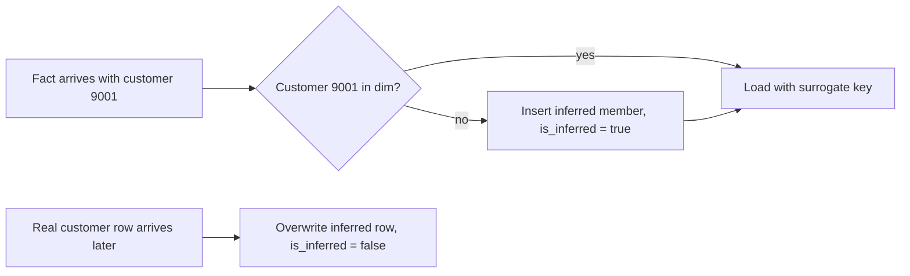

## 🎯 خلاصه

> اسکیمای ستاره‌ای ساده بیشتر سؤال‌ها را پوشش می‌دهد. تکنیک‌های پیشرفته‌ی بُعد برای حالت‌های درهم‌ریخته‌اند: **یک بُعد دو بار استفاده شود**، **یک flag جای مشخصی نداشته باشد**، **یک مقدار فقط در فکت زندگی کند**، **فکتی به سطری از بُعد اشاره کند که هنوز وجود ندارد**، یا **یک فکت به چند عضو بُعد هم‌زمان تعلق داشته باشد**.

- **Junk dimension:** جدول کوچکی از flagهای با کاردینالیتی پایین، تا فکت ستون‌های boolean زیاد نداشته باشد.
- **Degenerate dimension:** یک شناسه (مثل شماره‌ی سفارش) که چون ویژگی دیگری ندارد، در خود جدول فکت می‌ماند.
- **Role-playing dimension:** یک بُعد (مثل تاریخ) که چند بار با نقش‌های مختلف join می‌شود.
- **Mini-dimension:** ویژگی‌های سریع‌تغییر از یک بُعد بزرگ جدا می‌شوند تا سطرهای تاریخچه بی‌پایان نشوند.
- **Outrigger:** بُعدی که به بُعد دیگری وصل است (با احتیاط استفاده شود).
- **Bridge table:** رابطه‌ی many-to-many بین فکت یا بُعد و گروهی از اعضای بُعد را حل می‌کند.
- **فکت‌ها و بُعدهای دیررسیده (late-arriving):** بارگذاری داده‌ای که والدینش دیرتر می‌رسند.

## 🌱 از ساده شروع کنیم (مبتدی)

> **💡 تشبیه:** یک کتابخانه. **فکت** یعنی «یک امانت اتفاق افتاد». **بُعدها** کتاب، عضو و تاریخ‌اند. حالا سه حالت دیگر را تصور کن: امانت شماره‌ی رسیدی دارد که فقط برچسب است (degenerate)؛ «تاریخ» هم به عنوان *تاریخ امانت* و هم *تاریخ بازگشت* استفاده می‌شود (role-playing)؛ و بعضی اعضا برای هر flag یک «بله/خیر» دارند، مثل *دانشجو است* و *کارت دارد*. نمی‌خواهی برای هر flag روی هر امانت یک ستون جدید داشته باشی. یک جدول کوچک از ترکیب‌ها می‌خواهی.

ساده‌ترین حالت را با **junk dimension** شروع کنیم. یک فکت فروش سه flag دارد: `is_gift`، `is_express` و `payment_type` (کارت، نقدی یا کیف پول). هر flag به تنهایی ساده است، ولی روی جدول فکت سه ستون اضافه می‌کنند و جدول را پهن‌تر می‌کنند. روش Kimball این است که یک جدول کوچک با همه‌ی ترکیب‌ها بسازی:

```sql
CREATE TABLE dim_order_flags (
  flags_key    bigint PRIMARY KEY,
  is_gift      boolean NOT NULL,
  is_express   boolean NOT NULL,
  payment_type text    NOT NULL
);
-- 2 * 2 * 3 = 12 rows, generated once and never changed
```

جدول فکت حالا فقط یک `flags_key` ذخیره می‌کند. این یک junk dimension است: بُعدی از flagهای باقی‌مانده که جای دیگری نداشتند.

**degenerate dimension** حالت برعکس است. شماره‌ی سفارشی مثل `ORD-2026-000184` برای گروه‌بندی خطوط یک سفارش مفید است، ولی ویژگی مستقلی ندارد. یک جدول `dim_order` با یک ستون نمی‌سازی. `order_number` را مستقیم در `fact_order_line` نگه می‌داری.

```sql
SELECT order_number, SUM(amount) AS order_total
FROM fact_order_line
GROUP BY order_number;
```

> **⚠️ مراقب باش:** degenerate dimension همچنان یک بُعد است. برای گروه‌بندی مفید است، ولی متن توصیفی (نام مشتری، متن وضعیت) را داخلش نگذار. اگر ویژگی دارد، باید یک جدول بُعد واقعی بگیرد.

## 🔧 واقعاً چطور کار می‌کند (متوسط)

### بُعدهای role-playing

یک فکت اغلب چند تاریخ دارد: `order_date`، `ship_date`، `delivery_date`. هر کدام به `dim_date` اشاره می‌کنند. `dim_date` را سه بار کپی نمی‌کنی. همان جدول را چند بار با alias متفاوت join می‌کنی. در ابزارهای BI هر alias یک *نقش* می‌شود.

```sql
SELECT
  od.calendar_date AS order_date,
  sd.calendar_date AS ship_date,
  f.order_number,
  f.amount
FROM fact_order_line AS f
JOIN dim_date AS od ON od.date_key = f.order_date_key
LEFT JOIN dim_date AS sd ON sd.date_key = f.ship_date_key;
```

`LEFT JOIN` مهم است: سفارش‌هایی که هنوز ارسال نشده‌اند `ship_date_key` ندارند. خیلی از تیم‌ها هم view می‌سازند (`dim_order_date`، `dim_ship_date`) تا کاربران BI مجبور نباشند alias ها را به یاد بیاورند.

### mini-dimension برای ویژگی‌های سریع‌تغییر

یک بُعد مشتری با سن، بازه‌ی درآمد و امتیاز اعتباری بی‌خطر به نظر می‌رسد. حالا SCD نوع ۲ را اعمال کن: هر بار که بازه‌ی درآمد عوض شود، یک سطر جدید مشتری ساخته می‌شود. برای پایگاه مشتری بزرگ، این بُعد سریع رشد می‌کند چون یک ویژگی زیاد عوض می‌شود.

راه حل **mini-dimension** است: ویژگی‌های سریع‌تغییر را در جدول کوچک خودشان می‌گذاری، با یک سطر برای هر *ترکیب بازه‌ها*. جدول فکت حالا دو کلید دارد: کلید پایدار مشتری، و کلید mini-dimension که بازه‌های مشتری را *در زمان تراکنش* توصیف می‌کند.

```sql
CREATE TABLE dim_customer_profile_mini (
  profile_key   bigint PRIMARY KEY,
  age_band      text NOT NULL,      -- e.g. '18-24', '25-34'
  income_band   text NOT NULL,      -- e.g. 'low', 'mid', 'high'
  credit_band   text NOT NULL
);
```

بازه‌ها کلید هستند: مشتری‌ای که درآمدش از `mid` به `high` می‌رود، در خرید بعدی `profile_key` متفاوتی می‌گیرد، ولی سطر اصلی مشتری رشد نمی‌کند.

### outriggerها

**outrigger** بُعدی است که به بُعد دیگری اشاره می‌کند، مثلاً `dim_employee` یک `hire_date_key` دارد که به `dim_date` وصل می‌شود. این یک snowflake کوچک است. Kimball آن را فقط برای ویژگی‌های پایدار که many بُعد سطر مشترک دارند و نمی‌خواهی تکرار شوند توصیه می‌کند، مثل تقویم مالی. اگر همه جا استفاده شود، ستاره را به snowflake تبدیل می‌کند با join و سردرگمی بیشتر.

### bridge tableها برای many-to-many

یک حساب بانکی مشترک دو مشتری دارد. یک سطر فکت موجودی حساب نمی‌تواند تمیز دو کلید مشتری را نگه دارد. **bridge table** برای هر جفت (حساب، مشتری) یک سطر دارد، به همراه یک **ضریب وزنی** که برای هر حساب جمعش ۱ است، تا جمع‌ها دوبار شمرده نشوند.

```sql
CREATE TABLE bridge_account_customer (
  account_key  bigint NOT NULL,
  customer_key bigint NOT NULL,
  weight       numeric(5, 4) NOT NULL,   -- weights per account sum to 1.0
  PRIMARY KEY (account_key, customer_key)
);

-- Balance split across customer segments, without double counting
SELECT c.segment, SUM(f.balance * b.weight) AS weighted_balance
FROM fact_account_snapshot AS f
JOIN bridge_account_customer AS b ON b.account_key = f.account_key
JOIN dim_customer AS c ON c.customer_key = b.customer_key
GROUP BY c.segment;
```

بدون وزن، حساب مشترکی که زیر دو بخش شمرده شود، در جمع کل دوبار حساب می‌شود.

### فکت‌ها و بُعدهای دیررسیده

پایپ‌لاین‌های واقعی داده را خارج از ترتیب تحویل می‌دهند. دو حالت مهم است:

- **بُعد دیررسیده:** فکتی به `customer_nk = 9001` اشاره می‌کند، ولی سطر مشتری فردا می‌رسد. فکت را حذف نکن و بارگذاری را هم شکست نده. یک **عضو استنتاجی (inferred member)** بساز: سطر بُعدی با کلید کسب‌وکار، مقادیر placeholder و یک flag با نام `is_inferred`.
- **فکت دیررسیده:** خود فکت روزها بعد از تاریخش می‌رسد. باید در پارتیشن درست و تجمیع درست قرار بگیرد. این مسئله‌ی backfill است، نه مسئله‌ی مدل‌سازی.



```sql
-- Inferred member created by the fact loader
INSERT INTO dim_customer (customer_key, customer_nk, name, segment, is_inferred)
VALUES (nextval('customer_key_seq'), 9001, 'UNKNOWN', 'UNKNOWN', true);

-- Later, the real record arrives: fix the placeholder in place (Type 1 style)
UPDATE dim_customer
SET name = 'Sara', segment = 'gold', is_inferred = false
WHERE customer_nk = 9001 AND is_inferred;
```

سطر فکت در تمام این مدت همان surrogate key را نگه می‌دارد، پس هیچ فکتی نیاز به بارگذاری مجدد ندارد. فقط سطر بُعد عوض می‌شود.

## 🧠 عمق و trade-offها (سنیور)

- **mini-dimension در برابر SCD نوع ۲:** نوع ۲ تاریخچه‌ی کامل هر ویژگی را نگه می‌دارد، که برای ویژگی‌های آهسته‌تغییر درست است. برای بازه‌های سریع‌تغییر، نوع ۲ بُعد را منفجر می‌کند. mini-dimension اندازه را به تعداد ترکیب بازه‌ها (چند صد یا چند هزار) محدود می‌کند، ولی دیگر نمی‌توانی بدون بازه «درآمد دقیق مشتری» را در همان جدول بپرسی.
- **اندازه‌ی junk dimension:** تعداد سطرها حاصل‌ضرب کاردینالیتی‌هاست. پنج flag با ۲ مقدار ۳۲ سطر می‌دهد. ده flag می‌شود ۱٬۰۲۴ سطر. مراقب ستون‌های متنی آزاد باش که حاصل‌ضرب را منفجر می‌کنند. اگر مجموعه بزرگ است، جدول را از ترکیب‌های واقعی مشاهده‌شده در داده بساز.
- **وزن‌های bridge تصمیم کسب‌وکار است:** وزن برابر، وزن بر اساس فروش یا «مالک اصلی ۱۰۰٪» هر کدام جواب متفاوتی می‌دهند. قاعده را مستند کن و اگر ممکن است تغییر کند، وزن را با تاریخ اعمال ذخیره کن.
- **عضو استنتاجی در محیط واقعی:** پاسخ معمول به «فکت زودتر رسید» است، ولی اگر کسی آن‌ها را نشمارد، مشکلات کیفیت داده را پنهان می‌کنند. تعداد سطرهای `is_inferred = true` را پایش کن و وقتی رشد کرد هشدار بده.
- **فکت‌های دیررسیده و تجمیع‌ها:** وقتی فکت دیررسیده در پارتیشن قدیمی می‌نشیند، هر جدول تجمیع‌شده‌ای که از آن ساخته شده، کهنه است. بارگذاری را طوری طراحی کن که یک پارتیشن قابل محاسبه‌ی مجدد باشد (overwrite idempotent پارتیشن تاریخ)، و بررسی کن موتورت چطور این کار را می‌کند (Spark dynamic partition overwrite، یا `MERGE` در Iceberg یا Delta).
- **outriggerها در عمل:** بیشتر موتورها یک join اضافه را ارزان انجام می‌دهند، پس هزینه‌ی واقعی نگهداری و سردرگمی است، نه سرعت. ستون denormalize شده در بُعد را ترجیح بده، مگر اینکه outrigger بین بُعدهای زیادی مشترک باشد.
- **کی از اینها استفاده نکنیم:** برای یک ستاره‌ی تمیز با یک تاریخ و بدون flag، این تکنیک‌ها پیچیدگی اضافه می‌کنند و فایده‌ای ندارند. وقتی درد مشخصی ظاهر شود از آن‌ها استفاده کن: فکت پهن، بُعد SCD2 بسیار بزرگ، یا گزارشی که دوبار می‌شمارد.

## 🧪 امتحان کن

داری یک فکت call-detail record (CDR) مخابراتی را مدل می‌کنی. هر تماس دارای این‌هاست: `call_id` (شماره‌ی یکتا از سوئیچ)، `caller_key`، `callee_key`، `start_date`، `end_date`، `is_roaming`، `is_international`، `call_type` (voice، video) و `plan_key` برای طرح مشتری در زمان تماس. یک مشتری می‌تواند چند شماره داشته باشد و یک شماره می‌تواند بین اعضای خانواده مشترک باشد.

1. کدام ویژگی یک degenerate dimension است؟
2. کدام flagها به junk dimension می‌روند و آن جدول چند سطر دارد؟
3. `start_date` و `end_date` را چطور به `dim_date` مدل می‌کنی؟
4. دقیقه‌های یک شماره‌ی **مشترک** بین دو عضو خانواده را چطور نسبت می‌دهی؟

<details><summary>حدست چیست؟</summary>

1. `call_id` به عنوان degenerate dimension در جدول فکت می‌ماند. ویژگی مستقل ندارد و برای drill-through و حذف تکرار مفید است.
2. `is_roaming`، `is_international` و `call_type` به junk dimension می‌روند. با ۲ × ۲ × ۲ = ۸ سطر (اگر `call_type` دو مقدار داشته باشد)، جدول خیلی کوچک است. اگر نوع تماس‌های بیشتری اضافه شود، تعداد به صورت ضربی رشد می‌کند.
3. role-playing: `dim_date` را دو بار با alias هایی مثل `start_dt` و `end_dt` join کن. هر دو کلید را در فکت نگه دار.
4. یک bridge table بین شماره و کاربرانش بگذار، با وزنی برای هر کاربر که برای هر شماره جمعش ۱ شود. دقیقه‌ها با وزن تقسیم می‌شوند، پس کل دقیقه‌ها دوبار شمرده نمی‌شود.

</details>

## 💬 گوشه‌ی مصاحبه

**سؤال: «یک جدول فکت ده ستون boolean دارد. چه می‌کنی؟»** جواب متوسط: «آن‌ها را در یک junk dimension با یک سطر برای هر ترکیب می‌گذارم و در فکت فقط یک کلید نگه می‌دارم.» جواب سنیور: «اول تعداد واقعی ترکیب‌ها را چک می‌کنم. اگر ترکیب‌های مشاهده‌شده کم باشند، junk dimension ارزان است و فکت را باریک‌تر می‌کند. اگر flagها مقادیر زیادی دارند، جدول را از مجموعه‌ی مشاهده‌شده می‌سازم و نحوه‌ی اضافه شدن ترکیب‌های جدید را مستند می‌کنم.»

**سؤال: «یک تراکنش به مشتری‌ای اشاره می‌کند که هنوز نرسیده. چه می‌شود؟»** جواب متوسط: «یک عضو استنتاجی با نام نامشخص و flag می‌سازم، و وقتی مشتری واقعی برسد آن را به‌روز می‌کنم.» جواب سنیور: «روی تعداد سطرهای استنتاجی هم هشدار می‌گذارم، چون نشانه‌ی یک مشکل واقعی ترتیب یا کیفیت در upstream است. مطمئن می‌شوم تجمیع‌هایی که این فکت را دارند، وقتی بُعد اصلاح شد دوباره محاسبه شوند.»

**سؤال: «چطور در رابطه‌ی many-to-many دوبار شمردن را جلوگیری می‌کنی؟»** جواب متوسط: «از bridge table استفاده می‌کنم.» جواب سنیور: «از bridge table با ضریب وزنی استفاده می‌کنم که برای هر کلید جمعش ۱ است، و قاعده‌ی وزن‌دهی را با کسب‌وکار مشخص می‌کنم. بدون وزن، جمع‌ها در گروه بزرگ‌تر از واقع می‌شوند.»

> **🎤 این را در مصاحبه بگو:** «فکت را باریک نگه می‌دارم. flagها به junk dimension می‌روند، شناسه‌هایی که ویژگی ندارند degenerate می‌مانند، و تاریخ‌های تکراری role-playing می‌شوند. ویژگی‌های سریع‌تغییر به mini-dimension می‌روند و many-to-many از یک bridge وزن‌دار رد می‌شود. برای داده‌ی دیررسیده از عضو استنتاجی استفاده می‌کنم و مطمئن می‌شوم پارتیشن‌ها قابل محاسبه‌ی مجدد باشند.»

## ⚠️ اشتباهات رایج

> **⚠️ مراقب باش:** join کردن bridge table بدون وزن و جمع زدن یک measure. جمع‌ها برای گروهی از مشتری‌ها از مجموع واقعی بزرگ‌تر می‌شوند.

> **⚠️ مراقب باش:** ساختن یک سطر بُعد برای هر ترکیب در داده‌ی واقعی بدون محدود کردن کاردینالیتی. junk dimension ساخته‌شده از یک ستون متن آزاد junk نیست، یک جدول فکت دوم است.

- استفاده از junk dimension برای یک boolean تنها. یک flag به ندرت جدول مستقل لازم دارد.
- گذاشتن ویژگی توصیفی در degenerate dimension (مثلاً نام مشتری کنار `order_number`).
- استفاده از SCD نوع ۲ برای یک ویژگی سریع‌تغییر، و بعد تعجب از اینکه جدول مشتری میلیاردها سطر دارد.
- حذف فکت‌های دیررسیده چون سطر بُعد نیست، به جای ساختن عضو استنتاجی.
- فراموش کردن `LEFT JOIN` برای نقشی که تاریخش می‌تواند خالی باشد (هنوز ارسال نشده، هنوز تحویل نشده).
- ساختن زنجیره‌های outrigger چند سطح عمیق که بی‌صدا ستاره را به snowflake تبدیل می‌کند.

## ✅ خودت را بسنج

1. کدام تکنیک شماره‌ی سفارش را در جدول فکت نگه می‌دارد چون ویژگی دیگری ندارد؟
   - A) Junk dimension
   - B) Degenerate dimension
   - C) Bridge table
   - D) Mini-dimension

<details><summary>جواب</summary>

**B** — degenerate dimension شناسه‌ای است که در جدول فکت می‌ماند. ویژگی توصیفی ندارد، پس یک جدول جدا فقط یک ستون خواهد داشت.

</details>

2. یک `dim_date` در یک کوئری فکت دو بار join می‌شود تا تاریخ سفارش و تاریخ ارسال را بدهد. این تکنیک چه نام دارد؟
   - A) Outrigger
   - B) Role-playing dimension
   - C) Late-arriving dimension
   - D) Snowflake

<details><summary>جواب</summary>

**B** — همان بُعد چند نقش بازی می‌کند و هر نقش alias خودش را در کوئری دارد. اگر تاریخ یک نقش می‌تواند خالی باشد، از `LEFT JOIN` استفاده کن.

</details>

3. یک حساب مشترک دو مشتری دارد. موجودی به تفکیک بخش مشتری جمع زده می‌شود و مجموع دو برابر موجودی واقعی است. چه چیزی کم است؟

   - A) یک ایندکس روی `account_key`
   - B) یک bridge table با وزن‌هایی که برای هر حساب جمعشان ۱ است
   - C) یک junk dimension برای موجودی
   - D) یک degenerate dimension برای مشتری

<details><summary>جواب</summary>

**B** — رابطه‌ی many-to-many باید از bridge table رد شود و وزن‌ها موجودی هر حساب را بین مشتری‌هایش تقسیم می‌کنند.

</details>

4. **(سنیور)** یک ویژگی سریع‌تغییر مثل بازه‌ی درآمد در بُعد مشتری (نوع ۲) صدها میلیون سطر ساخته. طراحی بهتر چیست و چه چیزی را از دست می‌دهی؟

   - A) رفتن به نوع ۱ و از دست دادن کل تاریخچه
   - B) انتقال بازه‌ها به mini-dimension با کلید ترکیب بازه‌ها؛ مقدار دقیق ویژگی را از دست می‌دهی، مگر اینکه جداگانه ذخیره‌اش کنی
   - C) کپی کردن جدول مشتری برای هر بازه
   - D) حذف کامل بازه‌ی درآمد

<details><summary>جواب</summary>

**B** — mini-dimension رشد را به تعداد ترکیب بازه‌ها محدود می‌کند و تاریخچه را در سطح فکت نگه می‌دارد. هزینه‌اش این است که مقادیر دقیق دیگر در همان جدول نیستند، مگر اینکه آن‌ها را هم نگه داری.

</details>

5. **(سنیور)** لودر فکت کلید مشتری‌ای را پیدا می‌کند که هنوز در بُعد نیست. کدام طراحی بارگذاری را ادامه می‌دهد بدون اینکه بعداً فکت‌ها را بازنویسی کنی، و چه چیزی باید پایش شود؟

   - A) حذف فکت و پردازش مجدد هفته‌ی بعد
   - B) درج یک عضو استنتاجی با flag با نام `is_inferred` و overwrite بعدی آن؛ پایش تعداد سطرهای استنتاجی
   - C) ذخیره‌ی کلید کسب‌وکار در فکت و رد شدن از بُعد برای همیشه
   - D) ساختن یک جدول فکت جدید برای هر مشتری

<details><summary>جواب</summary>

**B** — عضو استنتاجی فوراً یک surrogate key معتبر به فکت می‌دهد، پس بارگذاری مجدد فکت لازم نیست. پایش تعداد سطرهای استنتاجی مشکلات ترتیب یا کیفیت در upstream را آشکار می‌کند.

</details>

## 🗂️ فلش‌کارت

| جلو | پشت |
|---|---|
| Junk dimension | جدول ترکیب flagهای با کاردینالیتی پایین، تا فکت یک کلید داشته باشد |
| Degenerate dimension | یک شناسه که در جدول فکت می‌ماند و ویژگی مستقل ندارد |
| Role-playing dimension | یک بُعد با alias های مختلف چند بار join شود (تاریخ سفارش، تاریخ ارسال) |
| Mini-dimension | ویژگی‌های سریع‌تغییر جدا و با کلید ترکیب بازه‌ها، برای جلوگیری از انفجار SCD2 |
| Outrigger | بُعدی که به بُعد دیگری join می‌شود؛ با احتیاط استفاده شود |
| Bridge table با وزن | many-to-many را حل می‌کند؛ وزن‌ها برای هر کلید جمعشان ۱ است تا دوبار شمرده نشود |
| عضو استنتاجی (inferred member) | سطر placeholder بُعد که وقتی فکت پیش از بُعدش می‌رسد ساخته می‌شود |
| فکت دیررسیده | فکتی که بعد از دوره‌اش می‌رسد؛ نیاز به محاسبه‌ی مجدد پارتیشن دارد، نه تغییر مدل |

## 🔗 ادامه

- **dimensional-modeling** و **fact-table-types** اسکیمای ستاره‌ی پایه‌ای را پوشش می‌دهند که این تکنیک‌ها آن را گسترش می‌دهند.
- **scd** تغییرات نوع ۱ و ۲ را توضیح می‌دهد که mini-dimension و عضو استنتاجی با آن‌ها تعامل دارند.
- **star-snowflake-obt** طراحی ستاره، snowflake و جدول پهن تکی را مقایسه می‌کند و نشان می‌دهد outrigger کی شما را به سمت snowflake می‌برد.
- **pattern-late-data** جنبه‌ی پایپ‌لاین فکت‌های دیررسیده را پوشش می‌دهد: watermark، پردازش مجدد و backfill.
- **modeling-problems** این تکنیک‌ها را روی مطالعه‌ی موردی کامل مثل مدل مخابراتی و بانکی اعمال می‌کند.
