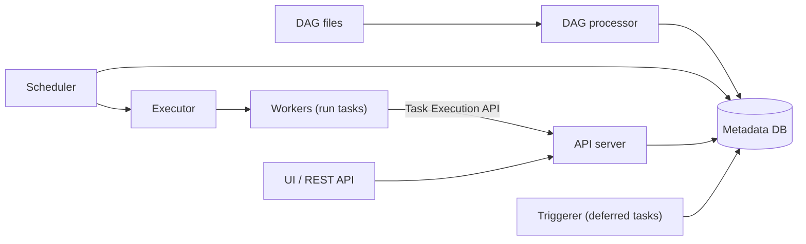

## 🎯 خلاصه

> **Apache Airflow** یک orchestrator مبتنی بر Python است. pipeline را به صورت یک [[dag]] در کد تعریف می‌کنی و Airflow تصمیم می‌گیرد هر تسک کی و کجا اجرا شود، وقتی شکست می‌خورد چه اتفاقی بیفتد، و هر run در چه وضعیتی است.

- Airflow هماهنگ می‌کند؛ نباید خودش داده را جابه‌جا کند. تسک‌ها Spark، یک warehouse یا یک اسکریپت را صدا می‌زنند و فقط reference (مسیر، اسم جدول) بین خودشان رد و بدل می‌کنند.
- بخش‌های اصلی: یک **scheduler** که تشخیص می‌دهد چه چیزی آماده‌ی اجراست، یک **DAG processor** که فایل‌های DAG را parse می‌کند، یک **API server** (UI و API)، یک **metadata database** که کل وضعیت را نگه می‌دارد، و **workerها** که تسک‌ها را از طریق یک **executor** اجرا می‌کنند.
- یک run با **data interval** (دوره‌ای که پردازش می‌کند) شناخته می‌شود، نه با زمانی که شروع شده. اجرای مجدد و backfill به همین دلیل درست کار می‌کنند.
- قاعده‌ی مهم در مصاحبه: **هر تسک باید idempotent باشد و با data interval پارامتری شود.** retry، اجرای مجدد و backfill به این وابسته‌اند.

## 🌱 از ساده شروع کنیم (مبتدی)

> **💡 تشبیه:** Airflow مثل سرپرست شیفت یک کارخانه است. سرپرست قطعات را خودش نمی‌سازد. تابلویی نگه می‌دارد که چه کاری باید انجام شود، به چه ترتیبی، و کدام دستگاه آزاد است. وقتی یک ایستگاه خراب می‌شود دوباره امتحانش می‌کند، و اگر باز هم خراب شد به مافوق خبر می‌دهد.

یک DAG ساده به سبک Airflow 3 این شکلی است:

```python
from datetime import datetime, timedelta
from airflow.sdk import dag, task   # Airflow 3 authoring namespace (Airflow 2: airflow.decorators)

@dag(
    schedule="0 2 * * *",           # every day at 02:00
    start_date=datetime(2026, 1, 1),
    catchup=False,                  # do not auto-run every missed period on deploy
    max_active_runs=1,              # only one period at a time
)
def orders_daily():

    @task(retries=3, retry_delay=timedelta(minutes=5))
    def load_partition(**context):
        day = context["data_interval_start"].strftime("%Y-%m-%d")  # the period this run is for
        # Overwrite exactly one partition: safe to retry and safe to backfill.
        print(f"replace partition dt={day} in fact_orders")

    load_partition()

orders_daily()
```

سه نکته را ببین:

- DAG کد Python است، پس مثل هر کد دیگری قابل بازبینی، تست و نسخه‌بندی است.
- `retries` و `retry_delay` برای هر تسک جدا تعریف می‌شوند. خطای گذرا دوباره امتحان می‌شود؛ کوئری بد در نهایت شکست می‌خورد و هشدار می‌دهد.
- تسک از context می‌پرسد «برای کدام روزم؟»، و هرگز نمی‌پرسد «الان ساعت چند است؟».

## 🔧 واقعاً چطور کار می‌کند (متوسط)

**معماری (Airflow 3).** Airflow 3 طراحی قدیمی «همه‌چیز در یک فرایند» را به سرویس‌های جدا تقسیم کرد:



- **DAG processor** فایل‌های DAG را parse می‌کند و ساختار DAG را در metadata DB می‌نویسد. این بخش یک فرایند جدا است، پس parse کند، زمان‌بندی را مسدود نمی‌کند.
- **Scheduler** به metadata DB نگاه می‌کند، تشخیص می‌دهد کدام task instanceها قابل اجرا هستند (وابستگی‌ها برقرار است، زمان رسیده، و pool و محدودیت‌های همزمانی اجازه می‌دهند)، و آن‌ها را به executor می‌دهد.
- **API server** جای webserver قدیمی را گرفته است. UI و REST API را سرویس می‌دهد، و workerها وضعیت را از طریق Task Execution API گزارش می‌دهند، نه این‌که مستقیم به metadata DB وصل شوند.
- **Triggerer** operatorهای deferrable را اجرا می‌کند که منتظر یک رویداد بیرونی می‌مانند بدون این‌که یک slot از worker را اشغال کنند.
- **Metadata DB** (در production معمولاً PostgreSQL یا MySQL) همه‌ی DAG runها، task instanceها، XComها، connectionها و variableها را نگه می‌دارد. بارش آن با تعداد تسک‌ها و دفعات تغییر وضعیت بالا می‌رود.

**Executorها.** executor تصمیم می‌گیرد هر تسک کجا اجرا شود:

| Executor | نحوه‌ی اجرای تسک | مناسب برای | نکته‌ی احتیاط |
|---|---|---|---|
| Local | subprocess روی ماشین scheduler | توسعه، راه‌اندازی تک‌میزبانه‌ی کوچک | مقیاس‌پذیری افقی ندارد |
| Celery | ارسال تسک به صف (Redis یا RabbitMQ) و برداشته شدن توسط یک ناوگان worker | بار ثابت، workerهای گرمِ مشترک | محیط workerها به مرور از هم فاصله می‌گیرد؛ تضاد وابستگی بین تسک‌ها |
| Kubernetes | یک pod برای هر تسک | ایزوله‌سازی، image متفاوت برای هر تسک | راه‌اندازی pod به هر تسک کوتاه تأخیر اضافه می‌کند |

executorهای دیگری هم برای محیط‌های edge یا خاص وجود دارند. انتخاب را بر اساس نیاز به ایزوله‌سازی و طول تسک‌ها انجام بده، نه عادت.

**Operator، hook و sensor.** *operator* یک قالب برای تسک است (`BashOperator`، `PythonOperator`، operatorهای provider برای دیتابیس‌ها و cloud). *hook* لایه‌ی اتصال است که operator با آن به یک سیستم بیرونی وصل می‌شود (اطلاعات ورود از connectionهای Airflow خوانده می‌شود). *sensor* منتظر یک شرط می‌ماند. برای منطق Python سبک `@task` (TaskFlow) و برای سیستم‌های بیرونی operatorهای provider را ترجیح بده.

**Data interval، logical date و catchup.** هر run یک data interval دارد: بازه‌ی `[start, end)` که پردازش می‌کند. برای یک زمان‌بندی روزانه‌ی ساعت ۰۲:۰۰، run مربوط به ۱ ژانویه بازه‌ی `[Jan 1 00:00, Jan 2 00:00)` را دارد و بعد از `Jan 2 00:00` شروع می‌شود. اسم قدیمی logical date (`execution_date`) به ابتدای همین بازه اشاره دارد. بازه را در کد این‌طور استفاده کن:

```python
# In a SQL task template: the data window for this run
SELECT *
FROM raw_orders
WHERE order_ts >= '{{ data_interval_start }}'
  AND order_ts <  '{{ data_interval_end }}';
```

با `catchup=True` (در بسیاری از نسخه‌ها پیش‌فرض است، پس نسخه‌ی خودت را چک کن)، وقتی DAG فعال می‌شود Airflow برای هر بازه‌ی جاافتاده از `start_date` یک run می‌سازد. با `catchup=False` فقط آخرین بازه برنامه‌ریزی می‌شود. این مقدار را عمداً تعیین کن.

**XCom.** XCom (cross-communication) مقادیر کوچک را بین تسک‌ها منتقل می‌کند و در metadata DB ذخیره می‌شود. XComها را به شناسه، مسیر، شمارش یا JSON کوچک محدود کن. داده‌ی بزرگ باید در object storage یا یک جدول باشد و فقط مکانش منتقل شود. Airflow امکان custom XCom backend هم می‌دهد، ولی آن مشکل را جابه‌جا می‌کند، نه این‌که حلش کند.

**Dynamic task mapping.** `expand()` در زمان اجرا، به ازای هر آیتم یک لیست یک task instance می‌سازد، پس تعداد تسک‌ها به داده بستگی دارد:

```python
@task
def list_partitions():
    return ["2026-01-01", "2026-01-02", "2026-01-03"]

@task
def load(day: str):
    print(f"load {day}")

load.expand(day=list_partitions())   # three mapped task instances
```

تسک‌های mapped جدا ردیابی می‌شوند، پس شکست یک partition را می‌شود دوباره امتحان کرد بدون این‌که بقیه دوباره اجرا شوند.

**زمان‌بندی بر اساس Asset (dataset).** به جای ساعت، یک DAG می‌تواند وقتی یک asset (در Airflow 2 اسمش dataset بود) توسط DAG دیگری به‌روز می‌شود اجرا شود. این کار زمان‌بندی شکننده‌ای مثل «ساعت ۰۳:۰۰ اجرا شو، چون job دیگر باید تمام شده باشد» را با یک وابستگی داده‌ای صریح جایگزین می‌کند.

**Pool و همزمانی.** *pool* مجموعه‌ای نام‌دار از slotها است. تسک‌هایی که از pool با نام `warehouse` استفاده می‌کنند slotهای آن را تقسیم می‌کنند، پس یک backfill نمی‌تواند ۲۰۰ اتصال به warehouse باز کند. محدودیت‌های دیگر: `max_active_runs` (به ازای هر DAG)، `max_active_tasks` (به ازای هر DAG)، و تنظیمات صف یا اولویت.

**KubernetesPodOperator.** یک image کانتینری را برای یک تسک به صورت pod اجرا می‌کند. وابستگی‌ها داخل image هستند، پس تیم‌هایی با نسخه‌های متضاد کتابخانه می‌توانند یک نصب Airflow مشترک داشته باشند. هزینه‌اش راه‌اندازی pod، دانلود image و ظرفیت cluster است، پس برای هر تسک ۲ ثانیه‌ای از آن استفاده نکن.

## 🧠 عمق و trade-offها (سنیور)

- **الگوی ضد کد سطح بالا.** DAG processor فایل‌های DAG را مدام دوباره import می‌کند، اغلب هر چند ثانیه یک بار. هر چیزی که در سطح ماژول باشد موقع هر parse اجرا می‌شود:

  ```python
  # BAD: runs on every parse, not on every task run
  import requests
  today = datetime.now()                                        # changes on each parse
  rows = requests.get("https://api.example.com/rates").json()  # network call at parse time

  # GOOD: heavy work and time-dependent values live inside tasks
  @task
  def fetch_rates(**context):
      day = context["data_interval_start"]
      ...
  ```

  به همین دلیل `datetime.now()` تله‌ی کلاسیک مصاحبه است. مقدارش موقع هر parse عوض می‌شود، پس scheduler ممکن است هر بار یک DAG متفاوت ببیند، و اجرای مجدد برای ماه گذشته از تاریخ امروز استفاده می‌کند. از `data_interval_start` استفاده کن.

- **idempotency با تاریخ‌های template.** الگوی امن این است که هر run یک partition را بنویسد: دقیقاً partition مربوط به `data_interval_start` را `DELETE` یا overwrite کن، و بعد insert کن. retry یا اجرای مجدد همان جدول را می‌سازد. append بدون کلید روی هر retry ردیف تکراری می‌سازد؛ ببین [[dedup-idempotent-loads]].

- **backfill امن برای شش ماه.** backfill با ۱۸۰ run روزانه که هر کدام ۲۰ دقیقه طول می‌کشد، ۳۶۰۰ دقیقه کار است. با ۴ run موازی و بدون رقابت هم ۳۶۰۰ / ۴ = ۹۰۰ دقیقه، یعنی ۱۵ ساعت، طول می‌کشد. برنامه‌ریزی کن:
  1. مطمئن شو تسک‌ها idempotent‌اند و فقط بازه‌ی خودشان را می‌خوانند.
  2. همزمانی را محدود کن: `max_active_runs` برای DAG و یک pool برای warehouse.
  3. اول یک بازه‌ی کوچک (مثلاً ۳ روز) را اجرا کن، تعداد ردیف‌ها و مجموع‌ها را با منبع مقایسه کن، و بعد بقیه را اجرا کن.
  4. تصمیم بگیر که DAGهای پایین‌دستی باید برای همان دوره پاک و دوباره اجرا شوند یا نه.
  5. هشدارها را بی‌صدا کن یا آماده‌ی نویز باش؛ هشدارهای مربوط به SLA برای runهای تاریخی هم فعال می‌شوند.
  6. راه توقف را بدانی: DAG را pause کن، بعد runهای باقی‌مانده را لغو کن.

  ببین [[backfill]] و [[backfills]].

- **مقیاس‌دادن scheduler.** Airflow امروزی چند replica از scheduler را برای high availability پشتیبانی می‌کند. گلوگاه‌ها معمولاً metadata DB (تعداد اتصال‌ها، قفل‌گیری روی وضعیت تسک‌ها)، زمان parse DAG (فایل‌های زیاد، importهای سنگین)، و تأخیر حلقه‌ی scheduler هستند. heartbeat scheduler، زمان parse، زمان انتظار در صف و اتصال‌های DB را زیر نظر بگیر. فایل‌های DAG را سبک نگه دار و جایی که می‌شود، DAGهای کمتر و بزرگ‌تر بساز.

- **pool برای محافظت.** بدون pool، یک DAG پرطرفدار می‌تواند دیتابیسی را که تیم‌های دیگر به آن وابسته‌اند اشباع کند. هر منبع خارجی را پشت یک pool بگذار و اندازه‌ی pool را از محدودیت واقعی منبع تعیین کن، نه از تعداد worker.

- **تغییرات Airflow 3 که مصاحبه‌کننده می‌پرسد.** webserver تبدیل به API server شد. DAG processor جدا اجرا می‌شود و در هر محیطی لازم است. workerها از Task Execution API استفاده می‌کنند. نویسنده‌ی DAG از namespace با نام `airflow.sdk` import می‌کند. datasetها به asset تبدیل شدند. راهنمای upgrade نسخه‌ی خودت را بخوان، چون ویژگی‌های حذف‌شده (برای مثال مکانیزم SLA در Airflow 2) جایگزین لازم دارند.

- **trade-off بین executorها.** Kubernetes ایزوله‌سازی و image مخصوص هر تسک می‌دهد، ولی یک تسک کوتاه هزینه‌ی راه‌اندازی pod را می‌پردازد. Celery workerهای گرم و تأخیر کم می‌دهد، ولی محیط مشترک یعنی تضاد وابستگی. Local فقط برای توسعه خوب است.

- **کی Airflow را استفاده نکنیم.** پردازش‌های زیر ثانیه، پرتکرار یا پیوسته‌ی رویداد کار Airflow نیستند؛ از یک موتور streaming استفاده کن (ببین [[flink]] یا [[kafka-streams]]). یک cron ساده بدون وابستگی به یک پلتفرم زمان‌بندی نیاز ندارد. مقایسه‌ی گزینه‌ها در [[orchestrator-alternatives]] است.

- **چه چیزی را مانیتور کنیم.** نرخ شکست و retry در هر DAG، روند مدت اجرای تسک‌ها، زمان انتظار در صف، heartbeat و زمان parse scheduler، اشباع اتصال‌های DB، و SLA یا تازگی داده‌ی از دست‌رفته. هشدار باید بگوید کدام دوره‌ی داده دیر است، نه فقط کدام تسک شکست خورده.

## 🧪 امتحان کن

1. **باگ را پیدا کن.** این DAG هر روز اجرا می‌شود. توضیح بده چه اشتباهی دارد و تسک را بازنویسی کن.

   ```python
   @task
   def load():
       day = datetime.now().strftime("%Y-%m-%d")
       run_sql(f"INSERT INTO fact_orders SELECT * FROM staging WHERE dt = '{day}'")
   ```

2. **backfill امن طراحی کن.** باید `fact_orders` را برای ۲۰۲۵-۰۷-۰۱ تا ۲۰۲۵-۱۲-۳۱ بار کنی. هر run ۲۰ دقیقه طول می‌کشد و warehouse اجازه‌ی ۴ بار هم‌زمان را می‌دهد. برنامه‌ی backfill را بنویس: همزمانی، ترتیب دوره‌ها، اعتبارسنجی، و این‌که اگر run شماره‌ی ۹۷ شکست خورد چه می‌کنی.

3. **Map کن.** یک تسک mapped بنویس که از لیست `["IR", "DE", "US"]` برای هر کشور یک partition بار کند، و توضیح بده چرا شکست یک کشور باعث اجرای مجدد بقیه نمی‌شود.

<details><summary>پاسخ‌ها را ببین</summary>

**۱.** `datetime.now()` روزی را می‌دهد که تسک اجرا می‌شود، نه روزی که برایش است. retry فردای آن روز، یا backfill برای ماه گذشته، partition اشتباه را درج می‌کند و اجرای مجدد می‌تواند برای امروز ردیف تکراری بسازد. از data interval استفاده کن:

```python
@task
def load(**context):
    day = context["data_interval_start"].strftime("%Y-%m-%d")
    # replace, do not append: the same partition can be loaded again safely
    run_sql(f"DELETE FROM fact_orders WHERE dt = '{day}'")
    run_sql(f"INSERT INTO fact_orders SELECT * FROM staging WHERE dt = '{day}'")
```

(اگر موتور پشتیبانی کند، این دو دستور باید در یک transaction اجرا شوند.)

**۲.** حدود ۱۸۴ run روزانه (از ۱ ژوئیه تا ۳۱ دسامبر، هر دو روز حساب شده). با ۲۰ دقیقه برای هر کدام و ۴ موازی، حدود ۱۸۴ × ۲۰ / ۴ = ۹۲۰ دقیقه (حدود ۱۵.۳ ساعت) است، اگر warehouse گلوگاه نباشد. `max_active_runs=4` را برای DAG تعیین کن و تسک را در pool با اندازه‌ی ۴ بگذار تا محدودیت حتی با DAGهای دیگر برقرار بماند. اول یک هفته را اجرا کن و تعداد ردیف‌ها را با منبع مقایسه کن. شکست run شماره‌ی ۹۷ اتفاق عادی است: چون overwrite روی partition امن است، همان یک run را پاک و دوباره امتحان می‌کنی و بقیه تأثیری نمی‌بینند.

**۳.**
```python
@task
def list_countries():
    return ["IR", "DE", "US"]

@task
def load_country(country: str, **context):
    day = context["data_interval_start"].strftime("%Y-%m-%d")
    print(f"replace partition dt={day}, country={country}")

load_country.expand(country=list_countries())
```
هر نمونه‌ی mapped یک task instance جدا با وضعیت و retry خودش است. اگر `DE` شکست بخورد، فقط همان نمونه دوباره امتحان یا پاک می‌شود و `IR` و `US` وضعیت موفقیت خود را نگه می‌دارند.

</details>

## 💬 گوشه‌ی مصاحبه

**«چرا یک تسک نباید از `datetime.now()` استفاده کند؟»**
- **جواب متوسط:** «چون DAG برای یک تاریخ مشخص اجرا می‌شود و `now()` زمان فعلی را می‌دهد، پس اجرای مجدد و backfill روز اشتباه را بار می‌کنند.»
- **جواب سنیور:** «دو دلیل دارد. اول این‌که فایل DAG بارها در دقیقه parse می‌شود، پس `now()` در سطح ماژول باعث می‌شود DAG موقع هر parse عوض شود. دوم، و مهم‌تر، مقدار به زمان اجرای تسک بستگی دارد، پس retry یا backfill قابل تکرار نیست. من از `data_interval_start` و `data_interval_end` در context استفاده می‌کنم، و هر run را جایگزینی یک partition می‌نویسم، تا یک دوره همیشه همان نتیجه را بدهد.»

**«شش ماه داده را چطور امن backfill می‌کنی؟»**
با تسک‌های idempotent و پارامتری شده با data interval شروع کن. همزمانی را در سطح DAG و pool محدود کن تا warehouse دوام بیاورد. یک بازه‌ی کوچک را با منبع اعتبارسنجی کن، بعد بقیه را در دسته‌های کنترل‌شده اجرا کن. درباره‌ی پاک‌سازی پایین‌دستی تصمیم بگیر، هشدارهای پرنویز را برای runهای تاریخی خاموش کن، و راه توقف داشته باش. محاسبه را بگو، چون نشان می‌دهد به زمان ساعت دیوار فکر کرده‌ای: ۱۸۰ run ضربدر ۲۰ دقیقه تقسیم بر ۴ موازی یعنی ۱۵ ساعت.

> **🎤 این را در مصاحبه بگو:** «هر تسک را idempotent نگه می‌دارم و به data interval‌اش وصل می‌کنم، پس retry یا backfill فقط همان تابع برای دوره‌ی دیگری است. برای backfill همزمانی را با `max_active_runs` و pool کنترل می‌کنم، اول یک نمونه را اعتبارسنجی می‌کنم و بعد بقیه را اجرا می‌کنم.»

## ⚠️ اشتباهات رایج

> **⚠️ مراقب باش:** import سنگین یا فراخوانی API در بالای فایل DAG. این‌ها موقع هر parse اجرا می‌شوند و زیر بار زیاد می‌توانند scheduler را از کار بیندازند.

> **⚠️ مراقب باش:** فرض این‌که `catchup` خاموش است. بسته به نسخه و تنظیمات، فعال کردن یک DAG با `start_date` قدیمی می‌تواند سیلی از runهای تاریخی بسازد. `catchup` را صریح تعیین کن.

- append کردن به جدولی در تسکی که retry می‌شود، که ردیف تکراری می‌سازد.
- عبور دادن DataFrameهای بزرگ از طریق XCom، که metadata DB را پر می‌کند.
- تعیین `max_active_runs` خیلی بالا برای backfill، که warehouse را اشباع می‌کند و باعث دیرکرد بقیه‌ی DAGها می‌شود.
- نوشتن sensor در حالت poke که ساعت‌ها یک worker را نگه می‌دارد، به جای حالت deferrable.
- استفاده از pod کوبرنتیز برای تسک‌های ساده، و بعد سرزنش Airflow به خاطر کندی pipeline.
- استفاده از `datetime.now()` یا `date.today()` در هر جای منطق تسک.

## ✅ خودت را بسنج

۱. یک تسک بعد از timeout دوباره اجرا شد و جدول برای آن روز ردیف تکراری دارد. کدام تغییر مستقیم‌ترین راه‌حل است؟
   - الف) افزایش `retries`
   - ب) جایگزین کردن partition مربوط به `data_interval_start` به جای append
   - ج) تغییر به executor محلی (Local)
   - د) اضافه کردن یک sensor قبل از تسک

<details><summary>پاسخ</summary>

**ب** — retry یعنی اجرای دوم. جایگزین کردن دقیقاً یک partition باعث می‌شود نتیجه، هر چند بار اجرا شود، یکسان باشد. retry بیشتر فقط ردیف تکراری بیشتری می‌سازد.

</details>

۲. در Airflow 3 کدام بخش UI و REST API را سرویس می‌دهد و جایگزین webserver قدیمی چیست؟
   - الف) scheduler؛ جایگزینی ندارد
   - ب) DAG processor؛ جایگزین webserver شد
   - ج) API server؛ جایگزین webserver شد
   - د) triggerer؛ جایگزین executor شد

<details><summary>پاسخ</summary>

**ج** — API server جایگزین webserver شد و UI و REST API را سرویس می‌دهد. DAG processor فایل‌های DAG را parse می‌کند و triggerer operatorهای deferrable را اجرا می‌کند.

</details>

۳. یک DAG با `catchup` فعال و `start_date` ۱۸ ماه قبل دارد. وقتی آن را فعال می‌کنی چه اتفاقی می‌افتد و چرا خطرناک است؟
   - الف) هیچ؛ Airflow فقط آخرین بازه را اجرا می‌کند
   - ب) Airflow برای بازه‌های جاافتاده run برنامه‌ریزی می‌کند که می‌تواند warehouse و هشدارها را سیل کند؛ `catchup` را عمداً تعیین کن و همزمانی را کنترل کن
   - ج) Airflow داده‌ی قدیمی را پاک می‌کند
   - د) DAG parse نمی‌شود

<details><summary>پاسخ</summary>

**ب** — با catchup فعال، هر بازه‌ی جاافتاده از `start_date` یک run می‌شود. بدون محدودیت همزمانی، این یک backfill کنترل‌نشده است. `catchup` را عمداً تعیین کن و با `max_active_runs` و pool محدودش کن.

</details>

۴. **(سنیور)** با اضافه شدن فایل‌های DAG، تأخیر scheduler بالا می‌رود و CPU متادیتا DB زیاد است. دو علت محتمل نام ببر و اولین چیزی را که اندازه می‌گیری مشخص کن.
   - الف) تم UI و کش مرورگر
   - ب) کد سنگین سطح بالا در فایل‌های DAG (زمان parse) و به‌روزرسانی زیاد وضعیت تسک‌ها روی metadata DB؛ اول زمان parse هر فایل و متریک‌های اتصال و قفل DB را اندازه بگیر
   - ج) executorهای کم؛ فقط صف Celery اضافه کن
   - د) XCom به صورت پیش‌فرض خاموش است، پس DB بیکار است

<details><summary>پاسخ</summary>

**ب** — کار زمان parse و تغییر زیاد وضعیت تسک هر دو scheduler و DB را زیر بار می‌گذارند. قبل از تغییر، زمان parse هر فایل و بار DB را بسنج، بعد کار سطح بالا و تعداد تسک را کم کن، یا DAGها را تقسیم کن و دیتابیس را مقیاس بده.

</details>

۵. **(سنیور)** وقتی چند DAG از یک warehouse استفاده می‌کنند، چرا pool از `max_active_runs` به تنهایی بهتر است؟
   - الف) pool تسک‌ها را سریع‌تر می‌کند
   - ب) `max_active_runs` فقط یک DAG را محدود می‌کند؛ pool یک منبع مشترک را بین همه‌ی DAGهایی که از آن استفاده می‌کنند محدود می‌کند
   - ج) pool جایگزین executor می‌شود
   - د) `max_active_runs` فقط با Kubernetes کار می‌کند

<details><summary>پاسخ</summary>

**ب** — pool تعداد slot مشترک بین DAGها است و از یک منبع بیرونی (سقف اتصال warehouse، API با محدودیت نرخ) محافظت می‌کند. `max_active_runs` فقط runهای داخل یک DAG را محدود می‌کند.

</details>

## 🗂️ فلش‌کارت

| جلو | پشت |
|---|---|
| Data interval | بازه‌ی `[start, end)` که یک run پردازش می‌کند؛ به جای زمان فعلی از آن استفاده کن |
| چرا `datetime.now()` نه | مقدار موقع هر parse و هر اجرای مجدد عوض می‌شود، پس نتیجه قابل تکرار نیست |
| DAG processor (Airflow 3) | فرایند جدا که فایل‌های DAG را parse می‌کند و ساختارشان را در metadata DB می‌نویسد |
| API server | UI و REST API را سرویس می‌دهد؛ در Airflow 3 جایگزین webserver شد |
| XCom | مقادیر کوچکی که بین تسک‌ها رد و بدل می‌شود و در metadata DB ذخیره می‌شود؛ کوچک نگهش دار |
| Dynamic task mapping | `expand()` به ازای هر آیتم در زمان اجرا یک task instance می‌سازد؛ هر کدام جدا retry می‌شود |
| Pool | تعداد slot نام‌دار که همزمانی تسک‌های DAGهای مختلف روی یک منبع را محدود می‌کند |
| Catchup | برای هر بازه‌ی جاافتاده از `start_date` run می‌سازد؛ عمداً تعیین‌اش کن |

## 🔗 ادامه

- [[orchestration-concepts]] مدل کلی را پوشش می‌دهد: DAG، retry، sensor و SLA، بدون جزئیات ابزار.
- [[backfills]] و [[dedup-idempotent-loads]] قواعد طراحی‌ای را توضیح می‌دهند که این درس به آن‌ها وابسته است.
- [[kubernetes-for-data]] بخش cluster در KubernetesExecutor و KubernetesPodOperator را پوشش می‌دهد.
- [[dbt]] اغلب مرحله‌ی transformی است که Airflow آن را اجرا می‌کند؛ [[pipeline-monitoring]] می‌گوید چه چیزی را هشدار بدهی.
- راهنمای upgrade نسخه‌ای از Airflow را که اجرا می‌کنی بخوان. چند پاسخ بالا بین Airflow 2 و 3 فرق می‌کند، و نام‌ها و پیش‌فرض‌های دقیق را باید همان‌جا چک کنی.
