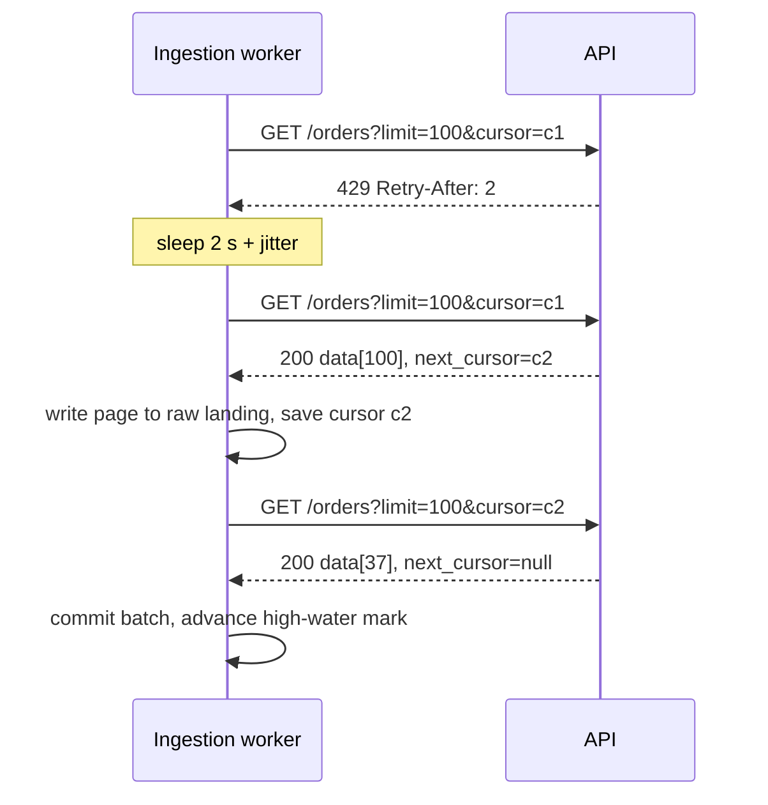

## 🎯 خلاصه

> **API ingestion** یعنی داده را از یک API تحت HTTP به پلتفرم خودت **قابل‌اعتماد** منتقل کنی: هر صفحه، هر رکورد، دقیقاً یک‌بار، حتی وقتی API کند است، محدودیت نرخ دارد یا گاهی خطا می‌دهد.

- نوع pagination تعیین می‌کند چطور داده را بخوانی: **offset** ساده است اما وقتی داده در حین خواندن تغییر کند، جابه‌جا می‌شود؛ **cursor** (keyset) پایدار و سریع است.
- محدودیت نرخ (`429 Too Many Requests`) و خطاهای سرور (`5xx`) عادی‌اند. با **exponential backoff به‌همراه jitter** دوباره تلاش کن و به `Retry-After` احترام بگذار.
- بارگذاری افزایشی از یک **high-water mark** (مثلاً `updated_at`) استفاده می‌کند، همراه با یک **پنجره lookback** کوچک تا تغییرات دیرهنگام را هم بگیرد.
- اول پاسخ خام را ذخیره کن، پیشرفت را checkpoint کن و نوشتن را **idempotent** کن. آن‌وقت وقتی کرش می‌کند، یعنی «دوباره اجرا کن»، نه «داده را از دست دادیم».

## 🌱 از ساده شروع کنیم (مبتدی)

> **💡 تشبیه:** کپی کردن فهرست یک کتابخانه از کتابداری که فقط ۵۰ کارت را هم‌زمان نشانت می‌دهد و اگر خیلی سریع بپرسی، ناراحت می‌شود. کارت‌ها را می‌گیری، جای توقفت را یادداشت می‌کنی، وقتی گفته شد صبر می‌کنی و ادامه می‌دهی. اگر جایت را گم کنی، باید بتوانی بدون کپی دوباره‌ی کارت‌ها و بدون جا انداختن هیچ‌کدام، از همان‌جا شروع کنی.

یک فراخوانی معمول API این شکل را دارد:

```text
GET https://api.example.com/v1/orders?limit=100&offset=0
→ 200 OK
{
  "data": [ {"id": 1, "status": "paid", "updated_at": "2026-10-12T08:01:00Z"}, ... ],
  "next_cursor": "eyJpZCI6MTAwfQ=="
}
```

در هر فراخوانی سه چیز را باید مدیریت کنی:

1. **صفحه‌ها.** یک درخواست حداکثر `limit` رکورد برمی‌گرداند. تا وقتی صفحه‌ی بعدی هست، درخواست بعدی را بفرست.
2. **محدودیت‌ها.** API تعداد مشخصی فراخوانی در دقیقه را اجازه می‌دهد. از این حد رد شوی، `429` می‌گیری.
3. **خطاها.** timeout و `500`، `502`، `503` پیش می‌آید. ممکن است یک فراخوانی وقتی شکست بخورد که سرور کار را قبلاً انجام داده باشد.

این کوچک‌ترین حلقه‌ای است که با cursor همه‌ی صفحه‌ها را می‌خواند:

```python
import requests

def fetch_all(url, token):
    headers = {"Authorization": f"Bearer {token}"}
    cursor, rows = None, []
    while True:
        params = {"limit": 100}
        if cursor:
            params["cursor"] = cursor
        resp = requests.get(url, headers=headers, params=params, timeout=30)
        resp.raise_for_status()
        body = resp.json()
        rows.extend(body["data"])
        cursor = body.get("next_cursor")
        if not cursor:          # صفحه‌ی بعدی نیست: تمام
            return rows
```

این کار می‌کند، اما آماده‌ی production نیست. retry ندارد، همه‌چیز را در حافظه نگه می‌دارد و اگر وسط کار کرش کند، از صفر شروع می‌کند. بقیه‌ی درس این مشکلات را یکی‌یکی حل می‌کند.

## 🔧 واقعاً چطور کار می‌کند (متوسط)

### Pagination: offset در برابر cursor

| سبک | درخواست | مزایا | معایب |
|---|---|---|---|
| Offset | `?limit=100&offset=5000` | قابل فهم، پرش به هر صفحه | صفحه‌های عمیق کندند؛ درج یا حذف در حین خواندن ردیف‌ها را جابه‌جا می‌کند، پس ممکن است رکوردها **جا بیفتند یا تکراری شوند** |
| شماره صفحه | `?page=51&per_page=100` | آشنا | همان مشکل drift مثل offset |
| Cursor / keyset | `?limit=100&cursor=<opaque>` | زیر نوشتن هم‌زمان پایدار، روی جدول بزرگ سریع | دسترسی تصادفی ندارد؛ cursor مبهم است و ممکن است منقضی شود |
| بر پایه زمان | `?updated_since=...` | برای بارگذاری افزایشی طبیعی است | وقتی رکوردهای زیادی timestamp یکسان دارند، tiebreaker لازم است |

**مثال عملی drift در offset.** رکوردها بر اساس id مرتب‌اند. صفحه‌ی ۱ را می‌خوانی (`offset=0`، id های ۱ تا ۱۰۰). بعد رکورد id ۵ حذف می‌شود. همه‌ی رکوردهای بعدی یک جایگاه بالا می‌آیند، پس id ۱۰۱ حالا در جایگاه ۹۹ است. درخواست `offset=100` از id ۱۰۲ شروع می‌شود و **id ۱۰۱ بی‌صدا رد می‌شود**. درج در ابتدای فهرست مشکل برعکس می‌سازد: تکرار. cursorی که می‌گوید «بعد از id ۱۰۰ ادامه بده» در هر دو حالت درست می‌ماند.

### محدودیت نرخ و retry

پاسخ `429` معمولاً هدر `Retry-After` دارد (ثانیه یا تاریخ HTTP). بعضی API ها `X-RateLimit-Remaining` و زمان reset هم می‌فرستند. اول به آن‌ها احترام بگذار. برای `5xx` و timeout شبکه از **exponential backoff با jitter** استفاده کن: حدود ۱ ثانیه، ۲، ۴، ۸ صبر کن و یک مقدار تصادفی هم اضافه کن تا worker های زیاد هم‌زمان دوباره تلاش نکنند.

```python
import random, time, requests

RETRYABLE = {429, 500, 502, 503, 504}

def get_with_retry(session, url, params, max_attempts=6):
    for attempt in range(max_attempts):
        try:
            resp = session.get(url, params=params, timeout=(3, 30))
        except requests.RequestException:
            resp = None                      # خطای شبکه: دوباره تلاش
        if resp is not None and resp.status_code not in RETRYABLE:
            resp.raise_for_status()          # غیر از 429، خطای 4xx یعنی باگ: سریع شکست بخور
            return resp.json()
        if attempt == max_attempts - 1:
            raise RuntimeError(f"gave up after {max_attempts} attempts")
        wait = min(60, 2 ** attempt)         # ۱، ۲، ۴، ۸، ۱۶، ۳۲ ثانیه
        if resp is not None and resp.headers.get("Retry-After", "").isdigit():
            wait = int(resp.headers["Retry-After"])
        time.sleep(wait + random.uniform(0, 1))
```

فقط فراخوانی‌های **idempotent** را دوباره امتحان کن (`GET` امن است؛ `POST` که منبع می‌سازد به idempotency key از سمت API نیاز دارد، وگرنه تکراری می‌سازی). خطای `400` یا `401` خودبه‌خود درست نمی‌شود؛ تکرارش فقط سهمیه را هدر می‌دهد.



### احراز هویت

- **API key** در هدر: ساده، اما طولانی‌مدت. آن را در secret manager نگه دار، نه در کد یا مخزن.
- **OAuth 2.0 client credentials**: شناسه و secret کلاینت را با یک access token کوتاه‌عمر عوض می‌کنی. قبل از انقضا تازه‌اش کن، و `401` وسط اجرا یعنی «یک بار تازه‌سازی، بعد retry».
- **توکن جدا برای هر tenant** در API های چندمستاجره: هر tenant یک اجرای جدا دارد تا یک توکن خراب بقیه را متوقف نکند.

### بارگذاری افزایشی و high-water mark

بارگذاری کامل یک API بزرگ هر ساعت، سهمیه را هدر می‌دهد. به‌جایش یک **high-water mark** (بزرگ‌ترین `updated_at` که با اطمینان بارگذاری کرده‌ای) ذخیره کن و فقط رکوردهای تغییرکرده بعد از آن را بخواه.

بخش ظریف ماجرا ایمنی است:

- رکوردها ممکن است از سمت منبع **دیرتر** commit شوند. ردیفی با `updated_at = 10:00:00` ممکن است در ۱۰:۰۰:۳۰ قابل‌دیدن شود. اگر mark را به ۱۰:۰۰:۰۰ ببری و آن موقع هنوز قابل‌دیدن نبوده، آن را از دست می‌دهی.
- راه‌حل یک **پنجره lookback** است: `updated_since = mark - 10 minutes` را بخواه، و سپس بر اساس کلید اصلی **merge** کن و جدیدترین نسخه را نگه دار. هم‌پوشانی کمی خواندن اضافه دارد، اما هیچ داده‌ای را از دست نمی‌دهد.
- mark را فقط **بعد از** اینکه batch در landing zone ماندگار شد جلو ببر (بخش بعدی).

**حذف‌ها.** بیشتر endpoint های لیست، رکوردهای حذف‌شده را برنمی‌گردانند. به یکی از این‌ها نیاز داری: فلگ `deleted` یا رویدادهای soft-delete، یک endpoint تغییرات یا audit، یا تطبیق کامل دوره‌ای که کلیدها را مقایسه می‌کند. بدون این‌ها، ردیف‌های حذف‌شده برای همیشه در انبار داده‌ات می‌مانند. الگوی تطبیق در [[pattern-reconciliation]] آمده است.

### Landing، checkpoint و idempotency

یک pipeline مقاوم سه مرحله را از هم جدا می‌کند:

1. **Fetch** هر صفحه و نوشتنش **همان‌طور که هست** (JSON خام) در object storage، با مسیری که run id و شماره صفحه دارد، مثلاً `raw/orders/run=2026-10-13T02/page=0042.json`.
2. **Checkpoint** cursor یا mark در یک جدول یا فایل state کوچک، **بعد از** اینکه صفحه با اطمینان نوشته شد.
3. **Transform و merge** فایل‌های خام در جدول curated، در مرحله‌ای جدا و با merge بر اساس کلید، تا replay ردیف تکراری نسازد (به [[idempotency]] و [[upsert]] نگاه کن).

اگر worker بعد از نوشتن صفحه‌ی ۴۲ و قبل از checkpoint بمیرد، صفحه‌ی ۴۲ بعد از ری‌استارت دوباره گرفته می‌شود. این تکرار بی‌ضرر است چون merge بر اساس کلید است. این طرح معمول «fetch با at-least-once به‌همراه نوشتن idempotent» است که نتیجه‌ی effectively-once می‌دهد. مقایسه کن با [[dedup-idempotent-loads]].

### تغییر schema (schema drift)

API ها فیلد اضافه می‌کنند، نامشان را عوض می‌کنند و گاهی نوع یک فیلد را از عدد به رشته تغییر می‌دهند. payload خام را ذخیره کن تا چیزی گم نشود، فقط فیلدهای لازم را parse کن، و وقتی مجموعه‌ی کلیدها تغییر کرد هشدار بده. هرگز نگذار یک فیلد غیرمنتظره کل اجرا را از کار بیندازد.

## 🧠 عمق و trade-offها (سنیور)

- **سهمیه یک بودجه‌ی مشترک است.** تعداد فراخوانی‌ها را روزانه هم بشمار، نه فقط در دقیقه. backfill ای که کل سهمیه‌ی روزانه را مصرف کند، job تولیدی را گرسنه نگه می‌دارد. بارگذاری تاریخی را در یک پنجره‌ی زمانی جدا برنامه‌ریزی کن یا، اگر provider اجازه دهد، کلید دوم داشته باش.
- **هم‌زمانی را API محدود می‌کند، نه کلاستر تو.** اضافه کردن ۵۰ executor اسپارک برای صدا زدن یک API با محدودیت نرخ، کار را کندتر می‌کند، چون هر executor retry های خودش را دارد. یک token bucket مشترک برای همه‌ی worker ها بگذار، یا برای هر کلید API یک worker.
- **بین صحت و هزینه تصمیم بگیر.** از اول تصمیم بگیر که به snapshot در یک لحظه نیاز داری یا به جریان تغییرات. snapshot تغییرات میانی را نشان نمی‌دهد؛ change feed ها به سیاست نگه‌داری در سمت provider نیاز دارند.
- **مشاهده‌پذیری.** برای هر اجرا این‌ها را پایش کن: تعداد صفحه‌ها، رکورد در هر صفحه، retry بر اساس کد وضعیت، مجموع `Retry-After`، تأخیر mark (زمان الان منهای mark)، و تعداد ردیف‌های خوانده‌شده در برابر ردیف‌های merge‌شده. تأخیر رو به رشد mark با تعداد ردیف ثابت معمولاً یعنی API دیگر تغییرات منتشر نمی‌کند، نه اینکه job تو سالم است.
- **ارکستریشن.** هر حلقه‌ی صفحه‌بندی یک واحد کار است، نه یک گره DAG. state را در orchestrator یا در یک جدول نگه دار تا retry از آخرین checkpoint ادامه دهد. برای بارگذاری تاریخی به [[backfills]] نگاه کن.
- **کی خودت نسازی.** برای تعداد کمی منبع SaaS معروف، یک connector مدیریت‌شده (به [[ingestion-tools]] نگاه کن) هفته‌ها کار را کم می‌کند. خودت بساز وقتی API غیرمعمول است، حجم زیاد است، یا به معنای خاصی از checkpoint نیاز داری.

## 🧪 امتحان کن

از یک mock server محلی یا یک API تست عمومی استفاده کن. حلقه‌ی صفحه‌بندی بخش «واقعاً چطور کار می‌کند» را بنویس و با این سرور تقلبی امتحانش کن:

```python
# fake_api.py: با `python fake_api.py` اجرا کن، بعد http://localhost:8000/orders را صدا بزن
from http.server import BaseHTTPRequestHandler, HTTPServer
import json, urllib.parse

DATA = [{"id": i, "updated_at": f"2026-10-{1 + i % 28:02d}T00:00:00Z"} for i in range(1, 251)]

class H(BaseHTTPRequestHandler):
    def do_GET(self):
        q = urllib.parse.parse_qs(urllib.parse.urlparse(self.path).query)
        after = int(q.get("cursor", ["0"])[0])
        page = [r for r in DATA if r["id"] > after][:100]
        nxt = str(page[-1]["id"]) if len(page) == 100 else None
        body = json.dumps({"data": page, "next_cursor": nxt}).encode()
        self.send_response(200)
        self.send_header("Content-Type", "application/json")
        self.end_headers()
        self.wfile.write(body)

HTTPServer(("localhost", 8000), H).serve_forever()
```

1. حلقه‌ی cursor را اجرا کن تا هر ۲۵۰ رکورد را بگیری. تأیید کن ۲۵۰ id یکتا داری.
2. روی هر سومین درخواست یک `429` با `Retry-After: 1` به سرور تقلبی اضافه کن و تأیید کن `get_with_retry` باز هم همه‌ی ردیف‌ها را برمی‌گرداند.
3. حلقه را بعد از صفحه‌ی ۲ بکش و از cursor ذخیره‌شده دوباره شروع کن. تأیید کن هیچ id ای گم نشده.

<details><summary>Show solutions</summary>

1. تا وقتی `next_cursor` برابر `null` شود حلقه بزن. صفحه‌ی آخر ۵۰ ردیف دارد، پس جمع کل ۲ × ۱۰۰ + ۵۰ = ۲۵۰ ردیف است.
2. تابع retry روی `429` به اندازه‌ی `Retry-After` ثانیه صبر می‌کند و بعد موفق می‌شود. تلاش‌ها را لاگ کن تا retry ها را ببینی.
3. بعد از هر صفحه cursor را ذخیره کن. در ری‌استارت آن را به‌عنوان اولین مقدار `cursor` بفرست. چون cursor آخرین id دیده‌شده است، ادامه دقیق است: چیزی رد نمی‌شود و بعد از checkpoint چیزی دوباره خوانده نمی‌شود.

</details>

## 💬 گوشه‌ی مصاحبه

**سؤال: «از یک REST API که ۱۰۰ رکورد در هر صفحه برمی‌گرداند و محدودیت نرخ دارد، چطور داده بگیری؟»**

- **جواب متوسط:** «روی صفحه‌ها حلقه می‌زنم تا لینک صفحه‌ی بعدی نباشد، روی 429 و 5xx از exponential backoff استفاده می‌کنم و نتیجه را به‌صورت JSON در S3 می‌نویسم.»
- **جواب سنیور:** «اگر API پشتیبانی کند cursor pagination را می‌گیرم، چون offset وقتی داده در حین خواندن تغییر کند drift می‌کند. یک token bucket مشترک جلوی همه‌ی worker ها می‌گذارم، `Retry-After` را رعایت می‌کنم، و بعد از هر صفحه‌ی نوشته‌شده در لایه‌ی raw، cursor را checkpoint می‌کنم. بارگذاری افزایشی با high-water mark بر اساس `updated_at`، پنجره lookback و merge کلیدی انجام می‌شود، و برای گرفتن حذف‌ها یک تطبیق دوره‌ای دارم.»

**سؤال: «چرا mark را به بزرگ‌ترین timestamp خوانده‌شده نبریم؟»**

چون ردیف‌ها ممکن است بعد از timestamp خودشان قابل‌دیدن شوند (تأخیر commit، replica ها). الگوی امن: پنجره lookback به‌همراه merge کلیدی.

> **🎤 این را در مصاحبه بگو:** «API را منبعی غیرقابل‌اعتماد و محدود به نرخ در نظر می‌گیرم. بعد از هر نوشتن ماندگار checkpoint می‌کنم، فقط چیزهایی را دوباره امتحان می‌کنم که امن‌اند، و بارگذاری را idempotent می‌کنم تا ری‌استارت‌ها خسته‌کننده و بی‌خطر باشند.»

## ⚠️ اشتباهات رایج

> **⚠️ هشدار:** جلو بردن mark به `max(updated_at)` بدون پنجره lookback. ردیف‌های دیرهنگام بی‌صدا گم می‌شوند و هیچ خطایی رخ نمی‌دهد.

> **⚠️ هشدار:** retry کردن فراخوانی‌های `POST` بدون idempotency key. فراخوانی اول شاید موفق بوده و retry یک سفارش تکراری می‌سازد.

- استفاده از offset pagination روی جدولی که در حین خواندن تغییر می‌کند، و بعد هفته‌ها بعد گزارش «داده گم شده» گرفتن.
- retry کردن هر خطایی، از جمله `400` و `401`، که سهمیه را هدر می‌دهد و باگ‌ها را پنهان می‌کند.
- نادیده گرفتن `Retry-After` و retry با یک خواب ثابت یک‌ثانیه‌ای که تو را مسدود نگه می‌دارد.
- ذخیره‌ی توکن API در کد یا لاگ.
- فرض اینکه endpoint لیست، حذف‌ها را برمی‌گرداند.
- نگه داشتن همه‌ی صفحه‌ها در حافظه تا پایان اجرا. کرش در ۹۹ درصد یعنی شروع از صفر.

## ✅ خودت را بسنج

۱. یک API با cursor در صفحه‌ی آخر `next_cursor: null` برمی‌گرداند. حلقه‌ی تو چه می‌کند؟
   - A) از صفحه‌ی ۱ دوباره شروع می‌کند
   - B) می‌ایستد، چون صفحه‌ی بعدی نیست
   - C) آخرین درخواست را با `limit` بزرگ‌تر دوباره می‌فرستد
   - D) ۶۰ ثانیه صبر می‌کند و دوباره چک می‌کند

<details><summary>Answer</summary>

**B** — `null` (یا نبودن) cursor بعدی یعنی صفحه‌ی بعدی وجود ندارد. شروع دوباره داده را تکراری می‌کند و صبر کردن صفحه‌ی جدید نمی‌سازد.

</details>

۲. کدام کد وضعیت باید retry با backoff را فعال کند؟
   - A) `400 Bad Request`
   - B) `401 Unauthorized`
   - C) `429 Too Many Requests`
   - D) `404 Not Found`

<details><summary>Answer</summary>

**C** — `429` یعنی محدودیت نرخ داری و بعداً موفق می‌شوی. `400`، `401` و `404` با retry خودبه‌خود درست نمی‌شوند؛ یعنی باگ، اعتبار منقضی‌شده یا منبع اشتباه.

</details>

۳. job افزایشی تو از `updated_at > last_mark` استفاده می‌کند و mark جدید را برابر بزرگ‌ترین مقدار خوانده‌شده می‌گذارد. یک هفته بعد، گزارش مالی بعضی سفارش‌ها را ندارد. محتمل‌ترین علت چیست؟

   - A) API از pagination پشتیبانی نمی‌کند
   - B) ردیف‌ها بعد از timestamp خودشان قابل‌دیدن شده‌اند و mark از آن‌ها جلو زده بود
   - C) منطق retry تعداد تلاش زیادی داشت
   - D) فایل‌های خام به‌صورت JSON ذخیره شده‌اند

<details><summary>Answer</summary>

**B** — ردیف‌های دیرهنگامی که timestamp قدیمی دارند پشت mark می‌مانند. از پنجره lookback و merge کلیدی استفاده کن.

</details>

۴. **(سنیور)** بیست process کارگر هر کدام با حلقه‌ی retry خودشان یک API با محدودیت نرخ را صدا می‌زنند. با افزودن کارگر، سرعت کل بدتر می‌شود. چرا، و چه چیزی را عوض می‌کنی؟

   - A) API کند است چون TLS دارد
   - B) همه‌ی کارگرها برای یک سهمیه رقابت می‌کنند، پس `429` و retry بیشتری می‌گیرند؛ یک token bucket مشترک بگذار یا هم‌زمانی را برای هر کلید API محدود کن
   - C) پارس JSON گلوگاه است، پس CPU بیشتر اضافه کن
   - D) به‌جای `GET` از `POST` استفاده کن تا محدودیت نرخ دور زده شود

<details><summary>Answer</summary>

**B** — سهمیه مشترک است. retry های هماهنگ‌نشده بار را تقویت می‌کنند و ممکن است کلید مسدود شود. محدودسازی نرخ مشترک (token bucket) و هم‌زمانی محدود این مشکل را حل می‌کند.

</details>

۵. **(سنیور)** چرا گاهی «هر شب کل جدول را بارگذاری کن» بهتر است، با اینکه سهمیه بیشتری مصرف می‌کند؟

   - A) API ها بارگذاری افزایشی را اجازه نمی‌دهند
   - B) snapshot کامل ساده‌تر است، حذف‌ها را خودکار تشخیص می‌دهد، و وقتی جدول به اندازه‌ی سهمیه کوچک است، باگ‌های mark و lookback را کنار می‌گذارد
   - C) snapshot ها همیشه از بارگذاری افزایشی سریع‌ترند
   - D) بارگذاری کامل نیاز به احراز هویت را از بین می‌برد

<details><summary>Answer</summary>

**B** — وقتی حجم و سهمیه اجازه دهد، snapshot کامل کل دسته‌ای از باگ‌ها (حذف‌ها، ردیف‌های دیرهنگام، drift mark) را حذف می‌کند. وقتی هزینه یا زمان بارگذاری کامل دیگر قابل قبول نیست، افزایشی را انتخاب کن.

</details>

## 🗂️ فلش‌کارت

| Front | Back |
|---|---|
| Offset در برابر cursor pagination | Offset موقعیت را می‌شمارد و وقتی داده تغییر کند drift می‌کند؛ cursor بعد از یک کلید پایدار ادامه می‌دهد |
| کدام خطاها را retry کنیم؟ | خطای شبکه، `429` و `5xx`؛ نه `400`، `401`، `404` |
| `Retry-After` چیست؟ | راهنمایی سرور (ثانیه یا تاریخ HTTP) برای مدت انتظار قبل از retry |
| Exponential backoff با jitter | زمان انتظار ۱، ۲، ۴، ۸ ثانیه… است؛ تأخیر تصادفی retry های هم‌زمان را پخش می‌کند |
| High-water mark | نقطه‌ای که داده تا آن با اطمینان بارگذاری شده؛ همیشه با پنجره lookback |
| چرا پنجره lookback؟ | ردیف‌ها ممکن است دیرتر از timestamp خودشان قابل‌دیدن شوند |
| retry کردن POST چطور امن می‌شود؟ | از idempotency key که API می‌دهد یا خودت می‌سازی استفاده کن |
| چرا JSON خام را اول ذخیره کنیم؟ | می‌توانی transform را replay کنی و drift در schema داده‌ای را گم نمی‌کند |

## 🔗 ادامه

- **ingestion-tools** connector ها و framework هایی را مقایسه می‌کند که این کار را برایت انجام می‌دهند.
- **batch-ingestion** و **file-ingestion** بقیه‌ی نوع‌های منبع رایج را پوشش می‌دهند.
- **dlq-bad-records** توضیح می‌دهد رکوردهایی که قابل parse نیستند کجا بروند.
- **backfills** بارگذاری سال‌ها تاریخچه را بدون مصرف کل سهمیه توضیح می‌دهد.
- **delivery-semantics** درباره‌ی at-least-once، at-most-once و exactly-once عمیق‌تر است.
