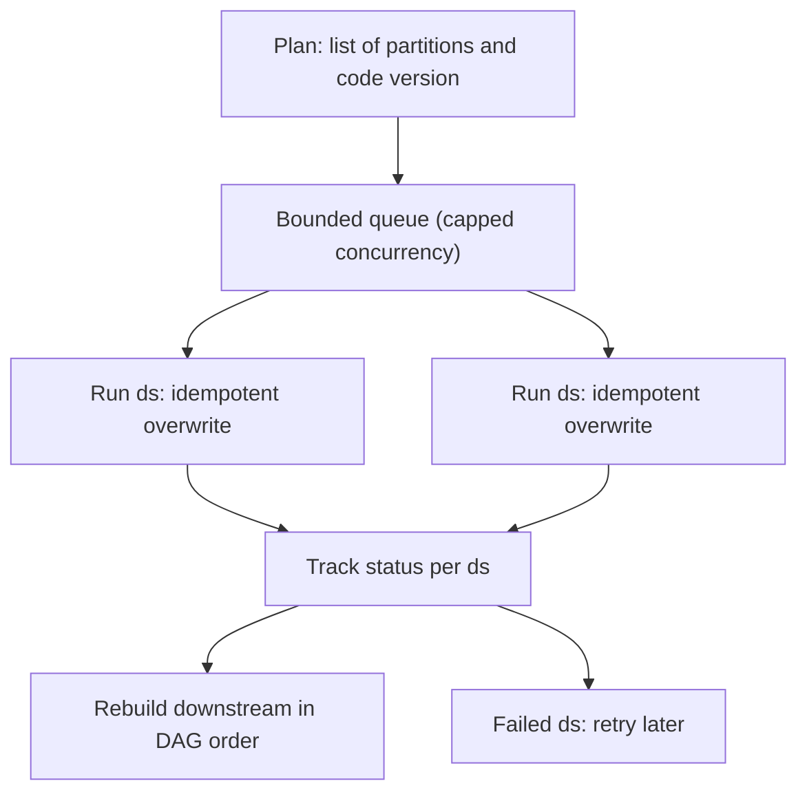

## 🎯 خلاصه

> **backfill** یعنی اجرای یک پایپ‌لاین برای بازه‌های گذشته، یا برای پر کردن تاریخچه‌ی خالی، یا برای محاسبه‌ی دوباره‌ی آن بعد از رفع یک باگ. آن را مثل تعداد زیادی اجرای معمولی از یک پایپ‌لاین **idempotent** در نظر بگیر، با محدودیت موازی‌سازی، جدا از برنامه‌ی روزانه، و یک پاسخ روشن به این سؤال که «کدام نسخه‌ی کد این partition را ساخته؟»

- backfill فقط وقتی امن است که اجرای هر partition idempotent باشد (ببین [[pipeline-design-principles]]).
- تعداد partitionهایی که هم‌زمان اجرا می‌شوند را محدود کن تا SLA روزانه حفظ شود.
- قبل از شروع، نسخه‌ی کد هر partition را تعیین و ثبت کن.
- مطمئن شو منبع هنوز داده را دارد: retention کافکا و APIهای منبع داده را منقضی می‌کنند، ولی لایه‌ی raw نگهش می‌دارد.
- جدول‌های **پایین‌دستی** را هم به ترتیب وابستگی دوباره بساز.

## 🌱 از ساده شروع کنیم (مبتدی)

> **💡 تشبیه:** یک فروشگاه خطای مالیاتی در فاکتورهای ماه قبل پیدا می‌کند. همه را یک‌جا و با عجله دوباره صادر نمی‌کند، در حالی که مشتری‌ها سرویس می‌گیرند. آن‌ها را دسته‌دسته، به ترتیب تاریخ، و با بررسی هر دسته صادر می‌کند، و فاکتورهای روزانه‌ی جاری را موازی ادامه می‌دهد.

فرض کن یک جاب روزانه `revenue_daily` را از جدول `orders` می‌سازد. یک باگ، برگشت‌های وجوه را از ۱ نوامبر تا ۳۱ ژانویه نادیده گرفته بود. بعد از رفع باگ، تیم باید آن ۹۲ روز را دوباره حساب کند.

رویکرد ساده این است که هر ۹۲ روز را هم‌زمان اجرا کنی:

```text
run 2025-11-01, 2025-11-02, ... 2026-01-31   (all at the same time)
```

این می‌تواند warehouse را زیر بار ببرد، اجرای امروز را کند کند، و اگر وسطش کرش کند، نیمی از روزها در وضعیت نامعلوم می‌مانند. رویکرد امن‌تر روزها را در دسته‌های کنترل‌شده اجرا می‌کند و ثبت می‌کند چه چیزی تمام شده:

```text
for each day in order:
    run the pipeline for that day
    if it fails, note the day and move on; retry failed days later
```

دو واژه را به خاطر بسپار:

- **Backfill:** اجرای پایپ‌لاین برای تاریخ‌های گذشته.
- **Reprocessing:** اجرای دوباره برای تاریخ‌هایی که قبلاً خروجی دارند، معمولاً چون منطق عوض شده.

## 🔧 واقعاً چطور کار می‌کند (متوسط)

یک backfill چهار بخش متحرک دارد: **فهرست partitionها**، **سقف هم‌زمانی**، **نسخه‌ی کد**، و **ترتیب کارهای پایین‌دستی**.

partitionها از برنامه‌ی زمان‌بندی می‌آیند. در Airflow، هر اجرا یک **data interval** را پوشش می‌دهد و logical date آن ابتدای همان بازه است. backfill از scheduler می‌خواهد برای یک بازه‌ی تاریخی run بسازد. برای فلگ‌های دقیق، مرجع CLI نسخه‌ی Airflow خودت را ببین. ایده برای هر orchestrator یا یک اسکریپت ساده‌ی مثل این یکی هم کار می‌کند؛ این اسکریپت یک بازه را با موازی‌سازی محدود اجرا می‌کند و شکست‌ها را برای retry برمی‌گرداند:

```python
from concurrent.futures import ThreadPoolExecutor
from datetime import date, timedelta


def day_range(start: date, end: date) -> list[str]:
    days = []
    d = start
    while d <= end:
        days.append(d.isoformat())
        d += timedelta(days=1)
    return days


def run_partition(ds: str) -> None:
    # Placeholder for the real pipeline entry point. It must be idempotent for ds.
    print(f"processing {ds}")


def backfill(start: date, end: date, workers: int = 4) -> list[str]:
    failed: list[str] = []
    partitions = day_range(start, end)
    with ThreadPoolExecutor(max_workers=workers) as pool:
        futures = {pool.submit(run_partition, ds): ds for ds in partitions}
        for future, ds in futures.items():
            try:
                future.result()
            except Exception:
                failed.append(ds)
    return failed


if __name__ == "__main__":
    failed = backfill(date(2025, 11, 1), date(2025, 11, 5), workers=2)
    print("failed:", failed)
```

در محیط واقعی، orchestrator یا صف کار، هم‌زمانی را مدیریت می‌کند، نه یک thread pool داخل یک اسکریپت. منطق همان است: تعداد محدودی worker، فهرست partitionها، و فهرست شکست‌ها برای retry.

**هم‌زمانی.** partitionها معمولاً مستقل‌اند، پس می‌توانند موازی اجرا شوند. اما اجرای روزانه روی همان cluster است. برای backfill یک pool، صف یا محدودیت منابع جدا بگذار تا همه‌ی slotها را نگیرد. روی DAG محدودیتی مثل `max_active_runs` تنظیم کن، یا از pool استفاده کن، و داک نسخه‌ات را چک کن.

**ترتیب.** بعضی پایپ‌لاین‌ها ترتیبی‌اند. یک جمع در حال اجرا، یک slowly changing dimension یا یک job مربوط به session، برای امروز به خروجی دیروز نیاز دارد. برای اینها نمی‌توانی بین تاریخ‌ها موازی کنی؛ به ترتیب اجرا می‌کنی، با قواعدی مثل `depends_on_past` یا وابستگی صریح. موازی بودن فقط وقتی سریع است که partitionها مستقل باشند.

**نسخه‌ی کد.** backfill کدی را اجرا می‌کند که امروز deploy شده، مگر اینکه یک نسخه‌ی قدیمی را پین کنی. این را قبل از شروع تصمیم بگیر. اگر رفع باگ منطق را عوض کرده، partitionهای قدیمی باید با کد جدید دوباره ساخته شوند. اگر هدف بازتولید چیزی است که آن موقع منتشر شده، نسخه‌ی قدیمی را پین کن و در متادیتای اجرا بنویس. برای هر اجرا git SHA یا تگ image را ثبت کن.

**بازسازی پایین‌دستی.** رفع `fact_orders` باعث می‌شود `mart_revenue` و داشبورد هم غلط باشند. وابسته‌ها را بعد از تمام شدن partitionهای بالادستی، به ترتیب DAG بساز. در غیر این صورت مصرف‌کننده‌ها ترکیبی از عددهای قدیمی و جدید می‌بینند. lineage ([[lineage]]) نشان می‌دهد چه چیزی به چه چیزی وابسته است.

**داده از کجا می‌آید.** replay فقط وقتی ممکن است که داده هنوز وجود داشته باشد:

- **لایه‌ی raw در object storage:** معمولاً همه‌چیز را نگه می‌دارد و منبع عادی backfill است (ببین [[medallion-architecture]]).
- **Kafka:** فقط چیزی را دارد که هنوز در بازه‌ی retention است. topic با retention هفت‌روزه نمی‌تواند باگ سی‌روز قبل را replay کند. compacted topicها فقط آخرین مقدار هر کلید را نگه می‌دارند.
- **API یا دیتابیس منبع:** ممکن است اصلاً تاریخچه ندهد، یا محدودیت نرخ داشته باشد که backfill بزرگ را چند روز طول بدهد.



## 🧠 عمق و trade-offها (سنیور)

- **idempotency پیش‌شرط است.** هر اجرا باید بی‌خطر قابل تکرار باشد، وگرنه یک backfill کرش‌کرده معلوم نمی‌کند کدام روزها تمام شده‌اند. partition را overwrite کن، append نکن. این هسته‌ی [[dedup-idempotent-loads]] است.
- **خروجی سایه برای تغییرات پرریسک.** برای یک رفع بزرگ، در یک جدول یا نسخه‌ی جدید بنویس (مثلاً `revenue_daily_v2`)، جمع‌ها را با نسخه‌ی قدیمی و منبع مقایسه کن، بعد view یا pointer را عوض کن. بازگشت آن‌وقت یک تغییر است، نه یک backfill دیگر.
- **از SLA روزانه محافظت کن.** ترافیک backfill با اجرای صبحگاهی رقابت می‌کند. از صف‌های جدا، اولویت پایین‌تر، یا سقف برای executorها و slotهای warehouse استفاده کن. backfillی که داشبورد روزانه را دیر کند شکست خورده است، حتی اگر عددهای خودش درست باشند.
- **هزینه.** backfill دو ساله یعنی حدود ۷۳۰ اجرای کامل، که اغلب گران‌تر از یک ماه اجرای معمولی است. با تخمین یک روز نمونه ضربدر تعداد partitionها برآورد کن، و قبل از شروع با بودجه چک کن. هزینه یکی از دلایل رایج برای کوچک‌تر کردن بازه است.
- **داده‌ی ناقص و دیررس.** اگر backfill هفته‌ی قبل را پوشش می‌دهد، ولی رویدادهای دیررس هنوز برای آن هفته می‌رسند، نتیجه فقط به اندازه‌ی کامل بودن روز اجرا کامل است. یک cutoff تعیین و مستند کن. ببین [[pattern-late-data]].
- **بار روی منبع.** پرس‌وجوی دوباره‌ی یک دیتابیس عملیاتی برای دو سال می‌تواند production را آسیب بزند. لایه‌ی raw یا read replica را ترجیح بده، و استخراج را throttle کن.
- **مشاهده‌پذیری.** یک جدول پیشرفت با یک ردیف برای هر partition نگه دار: `ds`، وضعیت، تعداد تلاش، تعداد ردیف، مدت اجرا، نسخه‌ی کد. این کار backfill را قابل ادامه می‌کند و شاهد کامل بودن کار است. ببین [[pipeline-monitoring]].
- **کجا backfill نکنیم.** اگر منطق side effect دارد، مثل اعلان یا پرداخت، اجرای دوباره برای تاریخچه آن‌ها را دوباره می‌فرستد. در این حالت در یک جدول بازمحاسبه کن و side effectها را دوباره فعال نکن. اگر داده‌ی منبع رفته و کپی raw هم نیست، شکاف را بپذیر، مستندش کن، و به مصرف‌کننده‌ها بگو.

## 🧪 امتحان کن

۱. باید ۱۸۰ partition روزانه را backfill کنی. هر کدام ۱۵ دقیقه طول می‌کشد و cluster می‌تواند هم‌زمان ۴ partition اجرا کند. backfill چقدر طول می‌کشد؟ محاسبه را نشان بده.
۲. topic کافکا retention هفت‌روزه دارد. یک باگ داده‌ی سی روز قبل را خراب کرده. از کافکا چه چیزی را می‌توانی backfill کنی، و به‌جای آن از چه چیزی استفاده می‌کنی؟
۳. یک رفع اشتباه `fact_orders` را عوض کرده که به `mart_revenue` و `mart_customers` خوراک می‌دهد. ترتیب بازسازی این جدول‌ها را بنویس و بگو چرا.

<details><summary>جواب‌ها را ببین</summary>

**۱.** ۱۸۰ partition با ۴ تا در هر لحظه یعنی ۱۸۰ / ۴ = ۴۵ موج. هر موج ۱۵ دقیقه طول می‌کشد، پس ۴۵ × ۱۵ = ۶۷۵ دقیقه، یعنی حدود ۱۱٫۲۵ ساعت. این فرض را دارد که partitionها مستقل‌اند و cluster بار دیگری ندارد. اگر پایپ‌لاین ترتیبی باشد، زمان خیلی بیشتر است، چون موجها نمی‌توانند هم‌پوشانی داشته باشند.

**۲.** فقط هفت روز آخر هنوز در topic است، پس فقط همان را می‌توانی replay کنی. داده‌ی سی‌روزه باید از لایه‌ی raw در object storage بیاید که هنگام رسیدن رویدادها نوشته شده، یا از سیستم منبع اگر تاریخچه نگه می‌دارد. کافکا بافر retention است، نه آرشیو.

**۳.** اول `fact_orders` را بساز، چون هر دو mart از آن می‌خوانند. بعد `mart_revenue` و `mart_customers` را به هر ترتیبی، چون مستقل از هم‌اند. martها را تا تمام شدن بازسازی fact و بررسی جمع‌ها منتشر نکن.

</details>

## 💬 گوشه‌ی مصاحبه

**سؤال: «شش ماه داده را چطور امن backfill می‌کنی؟»**

جواب متوسط: «برای هر روز از تاریخ شروع تا پایان job را اجرا می‌کنم، و مطمئن می‌شوم نوشتن‌ها partition را overwrite می‌کنند تا retryها امن باشند.»

جواب سنیور: «اول تأیید می‌کنم منبع هنوز شش ماه داده دارد؛ اگر کافکا فقط یک هفته دارد، از لایه‌ی raw استفاده می‌کنم. یک روز نمونه را تست می‌کنم، بعد partitionها را با هم‌زمانی محدود روی صف جدا اجرا می‌کنم تا اجرای روزانه سر وقت بماند. نسخه‌ی کد و یک جدول پیشرفت ثبت می‌کنم، در یک جدول سایه می‌نویسم و قبل از سوییچ جمع‌ها را مقایسه می‌کنم، و martهای پایین‌دستی را به ترتیب DAG بازسازی می‌کنم. قبل از شروع هم هزینه را برآورد می‌کنم.»

> **🎤 این را در مصاحبه بگو:** «backfill مجموعه‌ای از اجراهای معمولی است. امن است چون هر اجرا idempotent است، از برنامه‌ی روزانه جداست، و برای هر partition پیگیری می‌شود. قبل از شروع، چک می‌کنم داده از کجا می‌آید، از کدام نسخه‌ی کد استفاده می‌کنم، و چه چیزی به خروجی وابسته است.»

## ⚠️ اشتباهات رایج

> **⚠️ هشدار:** اجرای backfill بدون سقف هم‌زمانی. اجرای روزانه دیر می‌شود و صبح داشبورد عددهای قدیمی نشان می‌دهد.

- استفاده از `datetime.now()` یا `current_date` داخل یک task. partitionهای backfill‌شده منطق تاریخ امروز را می‌گیرند و همه شبیه هم می‌شوند.
- backfill از Kafka وقتی باگ قدیمی‌تر از پنجره‌ی retention است. داده اصلاً وجود ندارد.
- فراموش کردن بازسازی جدول‌های پایین‌دستی، پس مصرف‌کننده‌ها ترکیبی از عددهای درست و غلط می‌بینند.
- append کردن در حین backfill. retry آن‌وقت ردیف‌ها را تکراری می‌کند، و نمی‌فهمی کدام روزها تمام شده‌اند.
- نوشتن مستقیم در جدول production بدون مقایسه. یک رفع غلط بدون هیچ بررسی منتشر می‌شود.
- اجرای دوباره‌ی side effectها (ایمیل، پرداخت، webhook بیرونی) برای اجراهای تاریخی.
- اجرای backfill بدون هیچ رکورد پیشرفت. بعد از کرش، یا از اول شروع می‌کنی یا حدس می‌زنی.

## ✅ خودت را بسنج

۱. چرا یک backfill معمولاً امن است که دوباره retry شود؟
   - A) چون scheduler اجراهای تکراری را متوقف می‌کند
   - B) چون اجرای هر partition idempotent است و partition مالِ خودش را overwrite می‌کند
   - C) چون backfillها همیشه روی یک thread اجرا می‌شوند
   - D) چون لایه‌ی raw بعد از هر اجرا پاک می‌شود

<details><summary>جواب</summary>

**B** — نوشتن idempotent در سطح partition باعث می‌شود retry همان نتیجه را بدهد. بقیه یا تضمین نشده‌اند یا درست نیستند.

</details>

۲. یک باگ چهل روز پیش معرفی شده. topic کافکا چهارده روز داده نگه می‌دارد. منبع درست برای backfill کدام است؟
   - A) همان topic کافکا، با مقدار `offset` بزرگ‌تر
   - B) لایه‌ی raw در object storage یا سیستم منبع، اگر تاریخچه نگه می‌دارد
   - C) جدول mart، چون داده را از قبل دارد
   - D) هیچ؛ شکاف قابل رفع نیست

<details><summary>جواب</summary>

**B** — کافکا فقط پنجره‌ی retention را نگه می‌دارد، پس رویدادهای قدیمی‌تر باید از آرشیو raw بیایند. خواندن یک mart چیزی را بازمحاسبه نمی‌کند؛ فقط باگ را کپی می‌کند.

</details>

۳. **(سنیور)** backfill شما دو سال یک جدول fact در production را در جا بازنویسی می‌کند، و منطق جدید در ۵٪ ردیف‌ها باگ دارد. چه کاری باید می‌کردی؟
   - A) سریع‌تر اجرا کنی تا باگ زودتر رفع شود
   - B) در یک جدول سایه یا نسخه‌ی جدید بنویسی، جمع‌ها را با نسخه‌ی قدیمی و منبع مقایسه کنی، و بعد سوییچ کنی
   - C) برای صرفه‌جویی در فضا، اول partitionهای قدیمی را پاک کنی
   - D) مانیتورینگ را در طول اجرا خاموش کنی

<details><summary>جواب</summary>

**B** — خروجی سایه باعث می‌شود تغییر قابل بررسی باشد و بازگشت فقط تغییر pointer. بازنویسی در جای دو ساله هیچ راه امنی برای برگشت باقی نمی‌گذارد.

</details>

۴. **(سنیور)** چرا یک پایپ‌لاین روزانه با جمع در حال اجرا نمی‌تواند partitionهای backfill را ساده موازی اجرا کند؟
   - A) چون جمع‌های در حال اجرا را نمی‌شود ذخیره کرد
   - B) چون هر روز به خروجی روز قبل وابسته است، پس partitionها باید به ترتیب اجرا شوند
   - C) چون اجراهای موازی همیشه تکراری می‌سازند
   - D) چون Spark از task موازی پشتیبانی نمی‌کند

<details><summary>جواب</summary>

**B** — وابستگی به state روز قبل است، پس موازی‌سازی از state قدیمی می‌خواند. backfill باید به ترتیب اجرا شود، که کندتر است و برنامه‌ریزی جدا می‌خواهد.

</details>

۵. کدام اقدام بیشترین تأثیر را در حفظ SLA روزانه، در زمان backfill دارد؟
   - A) اجرای backfill هم‌زمان با جاب روزانه، تا زودتر تمام شود
   - B) محدود کردن هم‌زمانی backfill و جدا کردن آن روی صف یا pool منابع خودش
   - C) حذف بررسی‌های کیفیت داده
   - D) افزایش تعداد retry به ۱۰۰

<details><summary>جواب</summary>

**B** — محدود و جدا کردن کار backfill باعث می‌شود منابع اجرای روزانه در دسترس بماند. اجرای هم‌زمان، رد کردن بررسی‌ها یا retry بی‌پایان همه وضعیت روزانه را بدتر می‌کنند.

</details>

## 🗂️ فلش‌کارت

| Front | Back |
|---|---|
| Backfill | اجرای یک پایپ‌لاین برای بازه‌های گذشته، برای پر کردن یا محاسبه‌ی دوباره‌ی تاریخچه |
| پیش‌شرط backfill امن | اجرای هر partition idempotent باشد (overwrite، نه append) |
| داده‌ی قدیمی از کجا بیاید | لایه‌ی raw یا منبع؛ کافکا فقط پنجره‌ی retention را دارد |
| چرا هم‌زمانی backfill محدود شود | تا اجرای روزانه منابع و SLA خودش را حفظ کند |
| چرا جدول سایه | اول جمع‌ها را مقایسه کن؛ بازگشت می‌شود سوییچ pointer |
| بعد از یک رفع، چه چیزی بازسازی شود | partitionها، و بعد هر جدول پایین‌دستی، به ترتیب DAG |
| برای هر partition چه ثبت شود | وضعیت، تعداد تلاش، تعداد ردیف، مدت اجرا و نسخه‌ی کد |

## 🔗 ادامه

- **pattern-backfill** همین مسئله را از سمت الگوها، با مثال‌های بیشتر، پوشش می‌دهد.
- **dedup-idempotent-loads** توضیح می‌دهد loadهای idempotent چطور تکراری‌ها را حذف می‌کنند، که retry را امن می‌کند.
- **kafka-retention-compaction** نشان می‌دهد topic چه چیزی و تا چه مدتی نگه می‌دارد، و این تعیین می‌کند replay ممکن است یا نه.
- **medallion-architecture** نشان می‌دهد چرا لایه‌ی raw باعث می‌شود backfill ارزان شود.
- **pattern-late-data** سؤال cutoff را پوشش می‌دهد: یک partition تاریخی چقدر کامل است؟
- واژه‌نامه: [[backfill]]، [[idempotency]]، [[incremental-processing]]، [[partition]].
