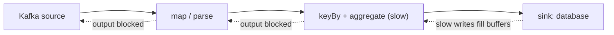

## 🎯 خلاصه

> **backpressure** (فشار برگشتی) وقتی رخ می‌دهد که یک مرحله‌ی پایین‌دستی نتواند با نرخ ورودی مرحله‌ی بالادستی همگام شود. کندی باید جایی برود: به یک بافر، به یک صف رو به رشد، یا به داده‌ی ازدست‌رفته. flow control مجموعه‌ی مکانیزم‌هایی است که تصمیم می‌گیرند کدام اتفاق بیفتد و کی.

- اگر تولیدکننده‌ها **به طور میانگین** از مصرف‌کننده‌ها سریع‌ترند، فاصله جمع می‌شود. هیچ سیستمی بیش از ظرفیتش پردازش نمی‌کند؛ فقط می‌تواند تأخیر بدهد، بافر کند یا داده را دور بریزد.
- سیستم‌ها در **جای** فشار فرق دارند. pipeline با بافر محدود فشار را به **بالادست** برمی‌گرداند (Flink). یک log پایدار مثل Kafka آن را به‌صورت **consumer lag** ذخیره می‌کند و تولیدکننده را کند نمی‌کند.
- راهکارها: بافر محدود، موازی‌سازی بیشتر، rate limit در لبه‌ی سیستم، batch کردن، و load shedding با سیاست مشخص.
- معیار کلیدی **روند** صف است، نه اندازه‌ی مطلقش. lag ای که دارد رشد می‌کند حتی اگر امروز کوچک باشد مشکل است.

## 🌱 از ساده شروع کنیم (مبتدی)

> **💡 تشبیه:** یک آشپزخانه با یک پیشخدمت سریع و یک آشپزِ کند. اول بشقاب‌ها روی میز تحویل جمع می‌شوند. وقتی میز تحویل پر شد، پیشخدمت دیگر سفارش از سالن نمی‌گیرد. آن «توقف» همان backpressure است: کندیِ آشپز تا درِ ورودی رستوران به عقب برمی‌گردد.

وقتی سفارش‌ها سریع‌تر از آشپز می‌رسند، سه اتفاق ممکن است:

۱. **صبر:** بشقاب‌ها انباشته می‌شوند. برای چند دقیقه اشکالی ندارد. وقتی تمام نمی‌شود خطرناک است.
۲. **توقف ورودی:** پیشخدمت سفارش کمتری می‌گیرد. مشتری آن را به‌صورت انتظار طولانی‌تر در در ورودی حس می‌کند. این همان backpressure است.
۳. **دور ریختن:** بعضی سفارش‌ها حذف می‌شوند. این load shedding است، و کسی باید تصمیم بگیرد کدام سفارش‌ها.

pipelineهای داده دقیقاً همین سه انتخاب را دارند. بقیه‌ی این درس درباره‌ی انتخاب عمدی بین آن‌هاست، به جای این‌که سیستم بی‌برنامه و معمولاً با تمام شدن حافظه تصمیم بگیرد.

## 🔧 واقعاً چطور کار می‌کند (متوسط)

### حساب پایه

اگر یک مرحله `λ` پیام در ثانیه دریافت کند و `μ` پیام در ثانیه پردازش کند، وقتی `λ > μ` باشد صف با سرعت `λ − μ` در ثانیه بزرگ می‌شود. یک مثال عددی:

- تولیدکننده: ۵۰٬۰۰۰ رویداد در ثانیه
- مصرف‌کننده: ۴۰٬۰۰۰ رویداد در ثانیه
- رشد صف: ۵۰٬۰۰۰ − ۴۰٬۰۰۰ = **۱۰٬۰۰۰ رویداد در ثانیه**
- بعد از یک ساعت: ۱۰٬۰۰۰ × ۳٬۶۰۰ = **۳۶٬۰۰۰٬۰۰۰ رویداد** عقب‌افتادگی

اگر بعد از آن مصرف‌کننده را به ۶۰٬۰۰۰ رویداد در ثانیه برسانی، صف با سرعت ۶۰٬۰۰۰ − ۵۰٬۰۰۰ = ۱۰٬۰۰۰ رویداد در ثانیه خالی می‌شود، پس پاک‌شدنش ۳۶٬۰۰۰٬۰۰۰ / ۱۰٬۰۰۰ = **۳٬۶۰۰ ثانیه (یک ساعت)** طول می‌کشد. ظرفیت باید بالاتر از نرخ ورودی باشد، وگرنه صف هرگز کوچک نمی‌شود.

قانون Little مقدار داده‌ی در حال پردازش را می‌دهد: `L = λ × W`. با ۵۰٬۰۰۰ رویداد در ثانیه و تأخیر ۲ ثانیه‌ای از ابتدا تا انتها، حدود **۱۰۰٬۰۰۰ رویداد** در هر لحظه داخل سیستم‌اند. حافظه و بافرها باید برای همین عدد اندازه شوند.

### backpressure در Flink

Flink رکوردها را بین operatorها از طریق بافرهای شبکه منتقل می‌کند. هر گیرنده به فرستنده **credit** (فضای بافر) می‌دهد. وقتی یک operator پایین‌دستی کند است، بافرهای ورودی‌اش پر می‌شوند، creditها تمام می‌شوند، و operator بالادستی در خروجی بلاک می‌شود. این بلاک از operator به operator به سمت source برمی‌گردد، و source هم کندتر از Kafka یا منبع دیگر می‌خواند.



رابط وب Flink نشان می‌دهد هر task چه سهمی از زمانش را **busy**، **backpressured** یا **idle** است. معمولاً taskی که busy time بالا دارد و بالادستش backpressure بالا نشان می‌دهد گلوگاه است. گلوگاه را ببین، نه اولین میله‌ی قرمز را.

این یک ویژگی است: حافظه کران‌دار می‌ماند و job کند می‌شود به‌جای این‌که crash کند. هزینه‌اش این است که تأخیر end-to-end بالا می‌رود، و یک sink کند می‌تواند کل job را کند نشان دهد.

### backpressure با log پایدار (Kafka)

Kafka وقتی یک مصرف‌کننده کند است تولیدکننده را کند نمی‌کند. تولیدکننده به log می‌نویسد و مصرف‌کننده آزاد است که عقب بیفتد. تفاوتش با Flink این است که **صف ذخیره می‌شود**، پس فشار به‌صورت **consumer lag** دیده می‌شود: تعداد پیام‌های بین [[offset]] commit‌شده‌ی consumer group و انتهای log.

```text
partition 0: log end offset = 9,400,000
             committed offset = 9,150,000
             lag = 250,000 messages
```

lag فقط یک نشانه است. سؤال واقعی این است که آیا lag **در حال رشد** است، و آیا قبل از این‌که پنجره‌ی **retention** قدیمی‌ترین پیام‌ها را پاک کند، تخلیه می‌شود. اگر retention هفت روز باشد و صف ده روز عقب باشد، داده بی‌صدا از بین می‌رود. به [[kafka-retention-compaction]] و [[consumer-lag]] نگاه کن.

### سیستم‌های batch و micro-batch

Spark Structured Streaming با micro-batch کار می‌کند. نرخ ورودی هر trigger محدود می‌شود (مثلاً با حداکثر تعداد offset در هر batch)، پس یک batch کند باعث می‌شود batch بعدی صبر کند و حافظه سرریز نشود. stream مثل Flink به همان شکل «فشار برنمی‌گرداند»؛ فقط در هر trigger کمتر پردازش می‌کند. قبل از اتکا به یک تنظیم خاص، گزینه‌های نسخه‌ی خودت را بررسی کن.

### راهکارها

- **بافر کران‌دار:** صف‌ها را محدود کن تا حافظه بی‌نهایت رشد نکند. این کار رشد بی‌حد را به backpressure قابل‌دیدن تبدیل می‌کند.
- **مقیاس افقی:** موازی‌سازی را زیاد کن. فقط وقتی کمک می‌کند که گلوگاه قابل موازی‌سازی باشد، و محدود است به تعداد partitionهای Kafka یا توزیع کلیدها (پایین‌تر ببین).
- **rate limit در لبه:** تولیدکننده یا API gateway عمداً ورودی را کند می‌کند. سهمیه‌ی tokens در ثانیه یا per-tenant از هسته محافظت می‌کند.
- **batch کردن:** به‌جای یک ردیف، ۵۰۰ ردیف را در یک نوشتن بفرست. هزینه‌ی هر فراخوانی اغلب بر sink کند غالب است.
- **load shedding:** در زمان overload داده را حذف یا نمونه‌برداری کن، با یک قاعده (مثلاً همه‌ی خریدها را نگه دار و از page viewها نمونه بگیر) و شمارنده برای آن‌چه حذف شده.
- **degrade کردن ملایم:** به‌جای شکست کل pipeline، جواب قدیمی بده یا یک enrichment غیرحیاتی را رد کن.

## 🧠 عمق و trade-offها (سنیور)

- **اول گلوگاه را پیدا کن.** در Flink، operatorی که busy است (نه backpressured) و بالادستش backpressured است، حد واقعی است. مقیاس دادن هر چیز دیگری فایده ندارد. اندازه‌ی state و مدت checkpoint را هم زیر نظر داشته باش، چون checkpoint کند شبیه backpressure دیده می‌شود.
- **تعداد partition سقف است.** در Kafka، یک partition در هر consumer group حداکثر توسط یک consumer خوانده می‌شود. با ۱۲ partition، ۲۴ consumer کمکی نمی‌کنند. partition‌ها را برای اوج موازی‌سازی برنامه‌ریزی کن، ولی یادت باشد partition بیشتر، سربار metadata و فایل باز را هم زیاد می‌کند.
- **skew مقیاس‌دهی را خنثی می‌کند.** اگر ۶۰٪ رویدادها یک [[hot-key]] داشته باشند، یک task تقریباً همه‌ی بار را می‌گیرد و بقیه بیکارند. اضافه کردن task فایده ندارد. برای کلید داغ از salting یا pre-aggregation استفاده کن. به [[data-skew]] نگاه کن.
- **محدودیت را کجا بگذاری.** هر چه به source نزدیک‌تر، بهتر. کار را در لبه رد کردن ارزان است؛ دور ریختن آن بعد از عبور از کل pipeline، محاسبه و شبکه را هدر می‌دهد.
- **SLO تازگی و تأخیر.** backpressure تازگی را برای پایداری معامله می‌کند. SLO را تعریف کن (مثلاً «رویدادها در p99 ظرف ۶۰ ثانیه دیده شوند») و هشدار را روی **زمان تخلیه‌ی پیش‌بینی‌شده** بگذار، نه فقط روی lag.
- **طوفان retry.** وقتی سرویس پایین‌دستی کند می‌شود، کلاینت‌ها معمولاً retry می‌کنند. retryها بار را بیشتر می‌کنند و overload را بدتر. backoff را با یک سیاست [[retry]] که jitter و budget دارد همراه کن، و به [[fault-tolerance]] نگاه کن.
- **sink معمولاً مقصر است.** بیشتر jobهای کند streaming در sink کندند: commitهای کوچک، فایل‌های کوچک زیاد، یا نوشتن ردیف‌به‌ردیف در دیتابیس. قبل از تنظیم stream، نوشتن را batch کن و معیارهای sink را بررسی کن.
- **exactly-once با backpressure تعامل دارد.** checkpointهای طولانی زیر فشار می‌توانند timeout و restart بسازند، و این خودش صف را طولانی‌تر می‌کند. فاصله و timeout checkpoint را با بار مورد انتظار هم‌زمان تنظیم کن.

## 🧪 امتحان کن

روی کاغذ یا spreadsheet کار کن؛ کلاستری لازم نیست.

۱. یک topic در اوج ۸۰٬۰۰۰ رویداد در ثانیه برای ۲ ساعت دریافت می‌کند، بعد ۲۰٬۰۰۰ رویداد در ثانیه برای بقیه‌ی روز. مصرف‌کننده ۵۰٬۰۰۰ رویداد در ثانیه پردازش می‌کند. بعد از اوج صف چقدر است، و با ورودی ۲۰٬۰۰۰ رویداد در ثانیه چقدر طول می‌کشد تا خالی شود؟
۲. retention برابر ۲۴ ساعت است. آیا صف سؤال ۱ ریسک است؟ توضیح بده.
۳. operator مربوط به `keyBy` در یک job Flink ۹۵٪ busy است و بالادستش backpressure بالا نشان می‌دهد. همکارت می‌خواهد موازی‌سازی source را دو برابر کند. کمک می‌کند؟ به جای آن چه می‌کنی؟

<details><summary>پاسخ‌ها را ببین</summary>

**۱.** در اوج، رشد صف ۸۰٬۰۰۰ − ۵۰٬۰۰۰ = ۳۰٬۰۰۰ رویداد در ثانیه برای ۷٬۲۰۰ ثانیه است، پس صف **۲۱۶٬۰۰۰٬۰۰۰ رویداد** می‌شود. بعد از اوج، تخلیه با سرعت ۵۰٬۰۰۰ − ۲۰٬۰۰۰ = ۳۰٬۰۰۰ رویداد در ثانیه انجام می‌شود، پس زمان تخلیه ۲۱۶٬۰۰۰٬۰۰۰ / ۳۰٬۰۰۰ = **۷٬۲۰۰ ثانیه (۲ ساعت)** است.

**۲.** بله، ریسک است. صف حدود دو ساعت رشد اوج به‌علاوه‌ی زمان تخلیه است، پس قدیمی‌ترین پیام‌ها بیش از دو ساعت در log می‌مانند. در پنجره‌ی ۲۴ ساعته‌ی retention این مشکلی نیست، ولی اگر صف از پنجره‌ی retention بزرگ‌تر شود، پیام‌ها قبل از مصرف حذف می‌شوند.

**۳.** نه. operator مربوط به `keyBy` گلوگاه است، نه source. موازی‌سازی بیشتر source فقط داده‌ی بیشتری به همان operator کند می‌فرستد. به‌جایش موازی‌سازی همان operator کند را بالا ببر، skew کلیدها را بررسی کن، یا کارش را کم کن (pre-aggregate کن، یا lookupهای سنگین را از مسیر داغ خارج کن).

</details>

## 💬 گوشه‌ی مصاحبه

**سؤال: «lag یک streaming job مدام زیاد می‌شود. چه می‌کنی؟»** پاسخ متوسط: «روند lag مصرف‌کننده را نگاه می‌کنم، بعد consumerها یا partitionها را زیاد می‌کنم و بررسی می‌کنم sink کند است یا نه.» پاسخ سنیور: «اول مطمئن می‌شوم lag واقعاً رشد می‌کند، بعد زمان تخلیه را با پنجره‌ی retention مقایسه می‌کنم. گلوگاه را با نمای backpressure و معیارهای busy time پیدا می‌کنم، skew کلیدها و تأخیر sink را بررسی می‌کنم، و بین مقیاس دادن، batch کردن sink، یا حذف عمدی یک stream کم‌ارزش با سیاست مشخص تصمیم می‌گیرم. همچنین هشدار روی زمان تخلیه‌ی پیش‌بینی‌شده اضافه می‌کنم.»

**سؤال: «backpressure در Flink چطور کار می‌کند ولی در Kafka نه؟»** Flink بافرهایش را کران‌دار می‌کند، پس کندی تا source به بالا منتقل می‌شود. Kafka داده را در یک log پایدار ذخیره می‌کند، پس تولیدکننده جدا می‌شود و فشار به lag تبدیل می‌شود که با retention محدود است.

> **🎤 این را در مصاحبه بگو:** «backpressure یعنی کندی باید جایی برود. آن را صریح می‌کنم: در Flink با بافر کران‌دار و backpressure، در Kafka با lag و retention، و در لبه با rate limit یا سیاست shedding مشخص. به operator گلوگاه و روند رشد صف نگاه می‌کنم، نه فقط به اندازه‌ی صف.»

## ⚠️ اشتباهات رایج

> **⚠️ مراقب باش:** مقیاس دادن job قبل از پیدا کردن گلوگاه. اگر بخش کند sink یا یک کلید داغ باشد، موازی‌سازی بیشتر چیزی را عوض نمی‌کند و ممکن است sink را بیشتر زیر فشار بگذارد.

> **⚠️ مراقب باش:** نادیده گرفتن retention وقتی lag رشد می‌کند. صفی بزرگ‌تر از پنجره‌ی retention بی‌صدا داده را از دست می‌دهد، و consumer وقتی به انتهای جدید log می‌رسد موفقیت گزارش می‌کند.

- نگاه کردن به عدد lag بدون روند. lag ثابت یک میلیونی ممکن است خوب باشد؛ lagی که هر ثانیه ۱۰٬۰۰۰ تا بزرگ‌تر می‌شود خوب نیست.
- گذاشتن صف‌های حافظه‌ای نامحدود «برای امنیت». این کار backpressure را به crash حافظه تبدیل می‌کند.
- partition بیشتر از consumer یا consumer بیشتر از partition اضافه کردن و انتظار سرعت بیشتر.
- حذف داده در زمان overload بدون شمارنده. بعداً نمی‌توانی عددهای گم‌شده را توضیح بدهی.
- retry بدون backoff، که یک وابستگی کند را به یک وابستگی خراب تبدیل می‌کند.
- فراموش کردن این‌که checkpoint کند می‌تواند شبیه stream کند دیده شود.

## ✅ خودت را بسنج

۱. یک مصرف‌کننده ۳۰٬۰۰۰ رویداد در ثانیه پردازش می‌کند و تولیدکننده ۳۵٬۰۰۰ رویداد در ثانیه برای ۱۰ دقیقه می‌نویسد. صف در پایان چقدر است؟
   - A) ۳۰۰٬۰۰۰ رویداد
   - B) ۳٬۰۰۰٬۰۰۰ رویداد
   - C) ۳۰٬۰۰۰ رویداد
   - D) صفر رویداد، چون Kafka هرگز صف نمی‌سازد

<details><summary>پاسخ</summary>

**B** — نرخ رشد ۵٬۰۰۰ رویداد در ثانیه است و ۵٬۰۰۰ × ۶۰۰ ثانیه = ۳٬۰۰۰٬۰۰۰ رویداد. Kafka صف می‌سازد؛ آن را به‌صورت consumer lag ذخیره می‌کند.

</details>

۲. در Flink، اولین نشانه‌ی این‌که یک operator گلوگاه است چیست؟
   - A) operator بالادستی‌اش backpressure بالا نشان بدهد در حالی که خودش busy است
   - B) job تعداد زیادی checkpoint داشته باشد
   - C) source از تعداد زیادی partition بخواند
   - D) sink هیچ retry نداشته باشد

<details><summary>پاسخ</summary>

**A** — operator busy‌ای که بالادست‌هایش backpressured هستند، حد واقعی را نشان می‌دهد. مقیاس دادن source یا تغییر checkpoint این را حل نمی‌کند.

</details>

۳. وقتی ۶۰٪ رویدادها یک کلید مشترک دارند و یک task overload شده، کدام راهکار احتمالاً کمک می‌کند؟
   - A) دو برابر کردن تعداد partitionهای topic ورودی
   - B) salting یا pre-aggregation کلید داغ، تا کار آن بین taskها تقسیم شود
   - C) خاموش کردن checkpointها
   - D) افزایش اندازه‌ی batch در تولیدکننده

<details><summary>پاسخ</summary>

**B** — skew کار را به یک task می‌فرستد و موازی‌سازی بیشتر یک کلید واحد را تقسیم نمی‌کند. salting یا pre-aggregation کار کلید داغ را پخش می‌کند.

</details>

۴. **(سنیور)** lag یک consumer Kafka برابر ۴۰ میلیون پیام است و هر ساعت ۲ میلیون پیام به آن اضافه می‌شود. retention برابر ۴۸ ساعت است. اول چه کار می‌کنی؟
   - A) صبر می‌کنی؛ lag همیشه خودبه‌خود جمع می‌شود
   - B) زمان تخلیه را با ظرفیت فعلی و برنامه‌ریزی‌شده حساب می‌کنی، با پنجره‌ی retention مقایسه می‌کنی، و همین حالا اقدام می‌کنی (مقیاس دادن، رفع گلوگاه، یا اولویت‌بندی topicهای حیاتی) قبل از حذف قدیمی‌ترین داده
   - C) retention را کم می‌کنی تا فضای دیسک آزاد شود
   - D) نرخ تولیدکننده را بالا می‌بری تا صف خالی شود

<details><summary>پاسخ</summary>

**B** — سؤال کلیدی این است که صف قبل از منقضی شدن قدیمی‌ترین پیام‌ها تخلیه می‌شود یا نه. کم کردن retention از دست رفتن داده را زودتر می‌کند، و بالا بردن نرخ تولیدکننده صف را بدتر می‌کند.

</details>

۵. **(سنیور)** یک تیم پیشنهاد می‌دهد بین یک API و یک نویسنده‌ی کند دیتابیس یک صف حافظه‌ای نامحدود بگذارد «تا هیچ‌وقت چیزی از دست نرود». چه می‌گویی؟
   - A) ایده‌ی خوبی است؛ حافظه ارزان است
   - B) این کار backpressure را پنهان می‌کند تا وقتی که فرایند حافظه‌اش تمام شود و کل صف از بین برود. از یک صف کران‌دار، rate limit در API، و یک سیاست صریح shedding یا ذخیره‌ی پایدار استفاده کن، مثلاً یک بافر بادوام با یک [[dead-letter-queue]] برای رکوردهایی که نوشته نمی‌شوند
   - C) به‌جای صف، اندازه‌ی batch را بزرگ‌تر کن
   - D) نویسنده‌ی دیتابیس را حذف کن

<details><summary>پاسخ</summary>

**B** — صف نامحدود کندیِ قابل‌دیدن و قابل‌کنترل را به یک crash تبدیل می‌کند که کل صف را از بین می‌برد. حد را صریح کن و تصمیم بگیر وقتی به حد رسیدی چه اتفاقی بیفتد.

</details>

## 🗂️ فلش‌کارت

| Front | Back |
|---|---|
| backpressure در یک جمله | کندیِ یک مرحله‌ی پایین‌دستی که نمی‌تواند همگام شود، به بالادست منتقل یا به‌صورت صف ذخیره می‌شود |
| نرخ رشد صف | نرخ ورودی منهای نرخ پردازش، وقتی ورودی بیشتر است |
| مکانیزم backpressure در Flink | بافرهای شبکه‌ی کران‌دار و credit؛ وقتی پایین‌دستی پر است بالادست بلاک می‌شود |
| نسخه‌ی Kafka از backpressure | تولیدکننده کند نمی‌شود؛ فشار به‌صورت consumer lag دیده می‌شود، با حد retention |
| گلوگاه واقعی در Flink | operator busy‌ای که بالادستش backpressure نشان می‌دهد |
| چرا مقیاس دادن شکست می‌خورد | تعداد partition، یک کلید داغ یا sink کند سقف بهره را محدود می‌کند |
| زمان تخلیه | حجم صف تقسیم بر (نرخ مصرف منهای نرخ ورودی) |

## 🔗 ادامه

- **stream-concepts** مفاهیم stream، event time و state را معرفی می‌کند که این درس از آن‌ها استفاده می‌کند.
- **flink** و **spark-structured-streaming** نشان می‌دهند هر موتور ورودی را چطور اعمال یا محدود می‌کند.
- **kafka-consumers** و **kafka-architecture** consumer groupها، partitionها و offsetها را توضیح می‌دهند که lag به آن‌ها بستگی دارد.
- **fault-tolerance** retryها، circuit breakerها و dead letter queueها را پوشش می‌دهد؛ نیمه‌ی دیگر streaming مقاوم.
- **queues-vs-logs** دو مدل ذخیره‌سازی را مقایسه می‌کند و نشان می‌دهد چرا یکی فشار را به lag و دیگری به صف تبدیل می‌کند.
- مستندات flow control نسخه‌ی موتورت را بررسی کن؛ اندازه‌ی بافرها و نام معیارها بین نسخه‌ها عوض می‌شوند.
