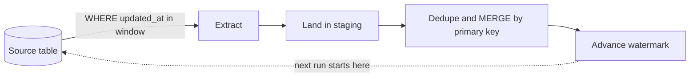

## 🎯 خلاصه

> **Batch ingestion** یعنی داده را طبق زمان‌بندی از یک سیستم مبدأ به پلتفرم داده منتقل کنیم. سؤال‌های طراحی همیشه یکی‌اند: *کدام ردیف‌ها از اجرای قبلی تغییر کرده‌اند*، *ردیف‌های حذف‌شده را چطور تشخیص بدهیم*، و *اگر یک اجرا دوباره اجرا شود چه می‌شود*.

- **Full load** کل جدول را هر بار کپی می‌کند. ساده و خودترمیم است، اما هزینه‌اش با بزرگ شدن جدول بالا می‌رود.
- **Incremental load** فقط ردیف‌های جدیدتر از یک **high-water mark** (نقطه‌ی watermark ذخیره‌شده) را می‌خواند. ارزان است، اما کامیت‌های دیررسیده را ممکن است از دست بدهد و حذف‌های سخت را نمی‌بیند.
- برای رفع نقاط کور: یک **lookback window**، یک **reconciliation** دوره‌ای، یا رفتن سراغ [[cdc]] مبتنی بر log وقتی تازگی داده و تاریخچه‌ی حذف مهم است.
- هر اجرا را **idempotent** کنید (اجرای دوباره، ردیف تکراری نسازد) تا retry و اجرای [[backfill]] امن باشد.

## 🌱 از ساده شروع کنیم (مبتدی)

> **💡 تشبیه:** فکر کن کاتالوگ یک کتابخانه را هر شب برای یک کتابخانه‌ی شعبه کپی می‌کنی. گزینه‌ی ۱: هر شب کل کاتالوگ را فتوکپی کنی. گزینه‌ی ۲: تاریخ آخرین کپی را یادداشت کنی و هر شب فقط کارت‌هایی را کپی کنی که از آن موقع اضافه یا ویرایش شده‌اند. گزینه‌ی ۲ خیلی سریع‌تر است، اما اگر کسی یک کارت را پاره کرده باشد، تا وقتی چک نکنی متوجه نمی‌شوی.

گزینه‌ی ۱ یک **full load** است و گزینه‌ی ۲ یک **incremental load**. این هم یک جدول کوچک در یک پایگاه داده‌ی تراکنشی (OLTP، یعنی دیتابیسی که اپلیکیشن با آن کار می‌کند):

```sql
CREATE TABLE orders (
  id          bigint PRIMARY KEY,
  status      text        NOT NULL,
  amount      numeric(12,2) NOT NULL,
  updated_at  timestamptz NOT NULL DEFAULT now()
);
```

یک full load همه‌چیز را می‌خواند:

```sql
SELECT id, status, amount, updated_at FROM orders;
```

یک incremental load فقط چیزهایی را می‌خواند که بعد از اجرای قبلی تغییر کرده‌اند. آخرین نقطه‌ای که به آن رسیده‌ایم را در یک جدول کنترلی کوچک نگه می‌داریم:

```sql
CREATE TABLE ingest_state (
  pipeline   text PRIMARY KEY,
  watermark  timestamptz NOT NULL
);

INSERT INTO ingest_state VALUES ('orders', '2026-10-13 09:00:00+00');
```

هر اجرا سه مرحله دارد:

```sql
-- 1. high-water mark را از آخرین اجرای موفق بخوان
SELECT watermark FROM ingest_state WHERE pipeline = 'orders';

-- 2. ردیف‌ها را در یک بازه‌ی کراندار استخراج کن (lo = mark قبلی، hi = mark جدیدی که انتخاب می‌کنیم)
SELECT id, status, amount, updated_at
FROM orders
WHERE updated_at > '2026-10-13 09:00:00+00'
  AND updated_at <= '2026-10-13 10:00:00+00';

-- 3. بعد از اینکه نوشتن در مقصد کامیت شد، mark را جلو ببر
UPDATE ingest_state SET watermark = '2026-10-13 10:00:00+00' WHERE pipeline = 'orders';
```

دو نکته از روز اول مهم است. بازه **کران بالا** دارد، پس هر اجرا یک برش ثابت از زمان را پوشش می‌دهد. و mark **فقط بعد از** موفقیت load جلو می‌رود.

## 🔧 واقعاً چطور کار می‌کند (متوسط)

شکل معمول یک pipeline دسته‌ای این است:



**انتخاب ستون watermark.**

- یک **id با auto-increment** فقط برای insert کار می‌کند. تغییرات ردیف‌های قدیمی را نمی‌بیند.
- **`updated_at`** هم insert و هم update را می‌بیند، اما به این بستگی دارد که اپلیکیشن (یا trigger) آن را درست مقداردهی کند، و به ساعت سرورها هم وابسته است.
- یک **ستون version یا شمارنده‌ی تغییر** وقتی سورس آن را دارد قابل‌اعتمادترین گزینه است.
- همیشه بررسی کنید ستون watermark **index** دارد. بدون index، هر اجرا یک full scan روی جدول مبدأ است و هدف incremental بودن از بین می‌رود.

**استخراج جدول‌های بزرگ.** به جای `OFFSET` از keyset pagination استفاده کنید، چون `OFFSET` در هر صفحه کندتر می‌شود:

```sql
SELECT id, status, amount, updated_at
FROM orders
WHERE id > :last_id
ORDER BY id
LIMIT 10000;
```

**بارگذاری در مقصد.** ردیف‌های staging با primary key در مقصد merge می‌شوند، پس یک batch که دوباره اجرا شود همان ردیف‌ها را بازنویسی می‌کند و ردیف جدید اضافه نمی‌کند. با SQL به سبک PostgreSQL:

```sql
-- staging ممکن است یک id را دوبار داشته باشد (سفارشی که در یک بازه دو بار آپدیت شده):
-- اول فقط جدیدترین نسخه‌ی هر id را نگه دار
CREATE TEMP TABLE batch AS
SELECT DISTINCT ON (id) id, status, amount, updated_at
FROM staging.orders_batch
ORDER BY id, updated_at DESC;

INSERT INTO dwh.orders (id, status, amount, updated_at)
SELECT id, status, amount, updated_at FROM batch
ON CONFLICT (id) DO UPDATE
SET status     = EXCLUDED.status,
    amount     = EXCLUDED.amount,
    updated_at = EXCLUDED.updated_at;
```

مرحله‌ی dedup اختیاری نیست. `INSERT ... ON CONFLICT` اگر یک کلید دوبار در همان statement بیاید خطا می‌دهد، و MERGE در موتورهای دیگر هم قوانین مشابهی دارد.

**مشکل کامیت دیررس.** فرض کنید `updated_at` مقدار پیش‌فرض `now()` دارد. در PostgreSQL، `now()` زمان **شروع** تراکنش را برمی‌گرداند، نه زمان کامیت. این خط زمانی را در نظر بگیرید:

| زمان | رویداد |
|---|---|
| 10:59:50 | تراکنش T شروع می‌شود و `updated_at = 10:59:50` می‌گذارد. |
| 11:00:00 | اجرای R2 شروع می‌شود. بازه‌اش `(10:00, 11:00]` است. T هنوز کامیت نشده، پس R2 ردیف را نمی‌بیند. R2 نشانگر mark را به 11:00:00 می‌برد. |
| 11:00:05 | T کامیت می‌شود. ردیف حالا `updated_at = 10:59:50` دارد. |
| 11:15:00 | اجرای R3 ردیف‌هایی با `updated_at > 11:00:00` را می‌خواند. این ردیف **هرگز بارگذاری نمی‌شود**. |

یک ردیف می‌تواند برای همیشه گم شود. راه‌حل، **lookback window** است: اجرای بعدی از `watermark - N دقیقه` شروع می‌شود (مثلاً ۱۵ دقیقه). برخی ردیف‌ها دوبار خوانده می‌شوند، و merge idempotent این را بی‌ضرر می‌کند.

**حذف‌ها.** استخراج مبتنی بر query نمی‌تواند ردیفی را ببیند که از سورس **حذف سخت** شده، چون دیگر ردیفی برای SELECT وجود ندارد. سه گزینه‌ی رایج:

1. **soft delete** در سورس (ستون `deleted_at`). مثل هر update استخراج می‌شود. ساده است، اما به همکاری اپلیکیشن نیاز دارد.
2. **reconciliation دوره‌ای کلیدها.** فقط primary keyها را (که ارزان است) استخراج کنید و با anti-join پیدا کنید کدام ردیف‌های مقصد دیگر در سورس نیستند.
3. **CDC مبتنی بر log.** حذف به صورت یک event در log دیده می‌شود. به [[cdc]] مراجعه کنید.

**full در برابر incremental، به عنوان قاعده‌ی کلی.** full refresh idempotent است و درک آن آسان است، و برای جدول‌های dimension کوچک یا جدول‌هایی با چند میلیون ردیف اغلب درست است. incremental وقتی سود می‌دهد که جدول بزرگ باشد و نرخ تغییر روزانه کم. بسیاری از تیم‌ها هر دو را دارند: روزانه incremental و هفتگی یک reconciliation کامل.

## 🧠 عمق و trade-offها (سنیور)

- **بار روی سورس.** اگر ممکن است از read replica استخراج کنید. یک `SELECT` سنگین روی primary با اپلیکیشن رقابت می‌کند. استخراج را از ساعت اوج دور کنید، و lag replica را رصد کنید: replica عقب‌افتاده بی‌صدا تغییر می‌دهد که watermark شما چه چیزی را می‌بیند.
- **ساعت و معنای تراکنش.** `updated_at` که توسط سرورهای اپلیکیشن ست می‌شود به ساعت آن‌ها وابسته است (انحراف چند ثانیه‌ای معمول است). آن را در خود دیتابیس ست کنید، یا watermark را «حداقل این قدیمی» در نظر بگیرید و روی lookback تکیه کنید.
- **سازگاری بین جدول‌ها.** اگر `orders` را ساعت ۱۰ و `order_items` را ساعت ۱۰:۰۵ بخوانید، ممکن است آیتم‌هایی در انبار باشند که سفارششان هنوز نیامده. برای جدول‌های مرتبط از یک snapshot واحد استفاده کنید (مثلاً یک تراکنش repeatable-read روی replica)، یا ناسازگاری موقت را بپذیرید و در job مقایسه‌ی reconciliation بررسی کنید.
- **drift در schema.** `SELECT *` وقتی کسی ستونی را اضافه یا تغییر نام می‌دهد بی‌صدا می‌شکند. لیست صریح ستون‌ها و یک قرارداد schema بهتر است، و به جای بارگذاری کورکورانه‌ی ستون جدید، هشدار بدهید.
- **نوع داده و منطقه‌ی زمانی.** timestampها را در ذخیره‌سازی به UTC نگه دارید و فقط در لایه‌ی گزارش به وقت محلی (یا تقویم جلالی) تبدیل کنید. ترکیب منطقه‌های زمانی در watermark یک منبع کلاسیک برای بازه‌های جاافتاده یا تکراری است.
- **exactly-once لازم نیست.** استخراج at-least-once به‌علاوه‌ی merge idempotent، در مقصد همان نتیجه‌ی exactly-once را می‌دهد و خیلی ارزان‌تر از تلاش برای دقیق کردن خود استخراج است.
- **رصد.** تعداد ردیف در هر اجرا، فاصله‌ی `now()` تا watermark، و تعداد اجراهای بدون ردیف را پایش کنید (یک اجرای صفر ردیفی بعد از یک روز شلوغ معمولاً باگ است، نه روز آرام). شمارش روزانه و کلیدها را با سورس مقایسه کنید، نه فقط مجموع ردیف‌ها.
- **کی استفاده نکنیم.** اگر تازگی زیر یک دقیقه، تاریخچه‌ی کامل تغییرات، یا حذف‌های قابل‌اعتماد بدون همکاری اپلیکیشن لازم دارید، به [[cdc]] بروید.

## 🧪 امتحان کن

از جدول `orders` ابتدای این درس استفاده کنید.

1. mark اجرای قبلی `2026-10-13 09:00:00+00` است. کوئری استخراج را برای اجرای ساعت `10:00:00+00` با lookback ده دقیقه بنویسید.
2. یک job، watermark را به `10:00` می‌برد و بعد هنگام load خطا می‌دهد. توضیح دهید اجرای بعدی چه می‌کند و چطور ترتیب مراحل را عوض کنید.
3. سورس ردیف‌ها را سخت حذف می‌کند. جدول `dwh.orders` (مقصد) و فهرست کامل کلیدهای سورس `src_keys(id)` را دارید. کوئری بنویسید که ردیف‌های مقصد را که دیگر در سورس نیستند پیدا کند.

<details><summary>Show solutions</summary>

**1.**
```sql
SELECT id, status, amount, updated_at
FROM orders
WHERE updated_at > '2026-10-13 08:50:00+00'   -- 09:00 minus 10 minutes
  AND updated_at <= '2026-10-13 10:00:00+00';
```
lookback باعث می‌شود بعضی ردیف‌ها دوبار خوانده شوند. merge idempotent باعث می‌شود مقصد درست بماند.

**2.** watermark از قبل روی 10:00 است، پس اجرای بعدی بعد از بازه‌ی شکست‌خورده شروع می‌شود و آن ردیف‌ها **هرگز بارگذاری نمی‌شوند**. mark را فقط بعد از کامیت نوشتن در مقصد جلو ببرید، و اگر مقصد و جدول state در یک دیتابیس‌اند، در همان تراکنش.

**3.**
```sql
SELECT t.id
FROM dwh.orders AS t
LEFT JOIN src_keys AS k ON k.id = t.id
WHERE k.id IS NULL;
```
قبل از حذف یا علامت‌گذاری این idها در مقصد، مطمئن شوید فهرست کلیدها کامل است (یک استخراج کلیدهای ناقص مثل حذف انبوه به نظر می‌رسد).

</details>

## 💬 گوشه‌ی مصاحبه

**سؤال: «یک جدول که روزانه تغییر می‌کند را چطور از یک دیتابیس OLTP به انبار داده منتقل می‌کنی؟»**

- **پاسخ متوسط:** «load افزایشی با watermark روی `updated_at`. ردیف‌های بازه را استخراج می‌کنم، با primary key در مقصد merge می‌کنم، و watermark را بعد از کامیت جلو می‌برم.»
- **پاسخ سنیور:** «همان طراحی اصلی، با سه محافظ. یک lookback window برای کامیت‌های دیررس، چون `updated_at` می‌تواند قدیمی‌تر از زمان کامیت باشد. یک merge idempotent تا retry و backfill امن باشند. و یک job reconciliation برای حذف‌ها، که watermark نمی‌بیند. از replica استخراج می‌کنم، برای جدول‌های مرتبط یک snapshot واحد می‌گیرم، و روی اجراهای صفرردیفی و اختلاف شمارش هشدار می‌گذارم. اگر کسب‌وکار حذف‌های قابل‌اعتماد یا تازگی زیر چند دقیقه بخواهد، به CDC مبتنی بر log می‌روم.»

**سؤال: «تفاوت full load و incremental load چیست؟»** full load ساده و خودترمیم است ولی هزینه‌اش با اندازه‌ی جدول بالا می‌رود. incremental load ارزان است ولی به watermark درست وابسته است و حذف سخت را نمی‌بیند.

> **🎤 این را در مصاحبه بگو:** «از ستون watermark شروع می‌کنم و بررسی می‌کنم index دارد. فرض می‌کنم کامیت دیررس و حذف سخت وجود دارد، پس از اول یک lookback window و یک مرحله‌ی reconciliation طراحی می‌کنم، و load را idempotent می‌کنم تا اجرای مجدد امن باشد.»

## ⚠️ اشتباهات رایج

> **⚠️ مراقب باش:** جلو بردن watermark قبل از کامیت load. شکستی بعد از آن نقطه بی‌صدا یک بازه را رد می‌کند.

> **⚠️ مراقب باش:** فرض کردن `updated_at` همان زمان کامیت است. تراکنش‌های طولانی آن را زودتر ست می‌کنند، پس ردیف می‌تواند پشت watermark شما قرار بگیرد.

- این باور که incremental load حذف‌ها را هم می‌گیرد. نمی‌گیرد، مگر با یک ستون soft delete یا reconciliation کلیدها.
- استفاده از پیجینگ `OFFSET` روی جدول بزرگ. هر صفحه ردیف‌های قبلی را دوباره اسکن می‌کند.
- اجرای اولین full load روی primary دیتابیس در ساعت کاری.
- استفاده از ستون watermark غیریکتا یا بدون index.
- append-only کردن load. در این حالت retry ردیف تکراری می‌سازد و یک [[backfill]] داده را دو برابر می‌کند.
- نرساندن مرحله‌ی dedup قبل از `INSERT ... ON CONFLICT` یا MERGE، که وقتی یک batch دو نسخه از یک کلید دارد شکست می‌خورد.

## ✅ خودت را بسنج

1. کدام محدودیت مخصوص استخراج incremental مبتنی بر query است؟
   - A) merge ها کندند
   - B) ردیف‌های حذف‌سخت‌شده دیده نمی‌شوند، چون ردیفی برای SELECT وجود ندارد
   - C) به یک message broker نیاز دارد
   - D) نمی‌تواند کلیدهای عددی را بخواند

<details><summary>Answer</summary>

**B** — سورس دیگر ردیف را ندارد، پس کوئری «ردیف‌های تغییرکرده بعد از T» برای آن چیزی برنمی‌گرداند. به یک ستون soft delete، reconciliation کلیدها، یا [[cdc]] مبتنی بر log نیاز دارید.

</details>

2. یک اجرا watermark را به 10:00 می‌برد و هنگام load خطا می‌دهد. اجرای بعدی چه می‌کند؟
   - A) بازه را خودکار دوباره load می‌کند
   - B) بعد از 10:00 شروع می‌شود، پس بازه‌ی شکست‌خورده هرگز بارگذاری نمی‌شود
   - C) ردیف‌های تکراری می‌سازد
   - D) watermark به ابتدای جدول برمی‌گردد

<details><summary>Answer</summary>

**B** — mark از قبل از بازه گذشته. watermark را فقط بعد از کامیت مقصد جلو ببرید و اجرا را restartable کنید.

</details>

3. job روزانه هر ماه کندتر می‌شود، با اینکه تعداد ردیف‌های تغییرکرده تقریباً ثابت است. محتمل‌ترین علت چیست؟
   - A) merge ایندکس‌های بیشتری می‌سازد
   - B) فیلتر `WHERE updated_at > :mark` روی ستون بدون index است، پس هر اجرا کل جدول سورس را اسکن می‌کند
   - C) watermark ها با زمان دقتشان را از دست می‌دهند
   - D) انبار فضای ذخیره‌سازی کم می‌آورد

<details><summary>Answer</summary>

**B** — هزینه‌ی فیلتر اگر ستون index نداشته باشد با اندازه‌ی جدول رشد می‌کند. ایندکس بسازید، یا از replica استخراج کنید که ایندکس دارد.

</details>

4. **(سنیور)** تراکنشی که `updated_at` را 10:59:50 ست کرده، ساعت 11:00:05 کامیت می‌شود. اجرای ساعت 11:00 تا 11:00:00 را خوانده و اجرای بعدی از 11:00:00 شروع می‌شود. چرا ردیف گم می‌شود و راه‌حل چیست؟
   - A) ردیف قفل است؛ تا روز بعد صبر کنید
   - B) `updated_at` از watermark قدیمی‌تر است، پس اجراهای incremental هرگز آن را نمی‌بینند؛ از lookback window و merge idempotent استفاده کنید
   - C) merge آن را حذف کرده؛ حذف را غیرفعال کنید
   - D) timestampها اصلاً نمی‌توانند watermark باشند

<details><summary>Answer</summary>

**B** — مقداری که دیرتر کامیت شده ممکن است timestamp قدیمی‌تری از mark داشته باشد. lookback window ردیف‌های اخیر را دوباره می‌خواند و merge idempotent این خواندن اضافه را بی‌ضرر می‌کند. اگر سورس داشته باشد، یک ستون version که در زمان کامیت افزایش می‌یابد هم گزینه‌ی خوبی است.

</details>

5. **(سنیور)** merge روزانه با `INSERT ... ON CONFLICT (id) DO UPDATE` خطای «command cannot affect row a second time» می‌دهد. محتمل‌ترین دلیل چیست و چطور رفع می‌شود؟
   - A) ستون `id` ایندکس ندارد
   - B) batch دو نسخه از یک `id` دارد؛ قبل از merge، برای هر کلید یک ردیف (جدیدترین) نگه دارید
   - C) `DO UPDATE` روی timestamp مجاز نیست
   - D) جدول مقصد خیلی بزرگ است

<details><summary>Answer</summary>

**B** — یک statement نمی‌تواند یک ردیف مقصد را دوبار آپدیت کند. batch را بر اساس کلید dedup کنید و جدیدترین نسخه را نگه دارید، همان‌طور که در بخش متوسط نشان داده شد.

</details>

## 🗂️ فلش‌کارت

| Front | Back |
|---|---|
| full load در برابر incremental load | full هر بار همه‌چیز را کپی می‌کند (ساده، هزینه با اندازه رشد می‌کند)؛ incremental ردیف‌های بعد از watermark را کپی می‌کند (ارزان، نیازمند درستی) |
| high-water mark | نقطه‌ی ذخیره‌شده (معمولاً timestamp یا id) که نشان می‌دهد اجرای موفق قبلی تا کجا رسیده |
| چرا lookback window استفاده کنیم؟ | کامیت‌های دیررس ممکن است timestamp قدیمی‌تر از mark داشته باشند؛ خواندن مجدد ردیف‌های اخیر آن‌ها را می‌گیرد |
| آیا استخراج مبتنی بر query حذف‌ها را می‌بیند؟ | نه. از ستون soft delete، reconciliation کلیدها، یا CDC مبتنی بر log استفاده کنید |
| watermark کی باید جلو برود؟ | فقط بعد از کامیت نوشتن در مقصد |
| چرا keyset pagination بهتر از OFFSET است؟ | با آخرین کلید جلو می‌رود، نه اینکه ردیف‌های رد شده را دوباره اسکن کند |
| چه چیزی load را idempotent می‌کند؟ | merge با primary key به‌علاوه‌ی dedup داخل batch، تا اجرای مجدد همان ردیف‌ها را بازنویسی کند |
| چرا ستون watermark را index کنیم؟ | وگرنه هر اجرا کل جدول سورس را اسکن می‌کند |

## 🔗 ادامه

- **cdc** توضیح می‌دهد که چطور capture مبتنی بر log نقاط کور حذف و کامیت دیررس را برمی‌دارد.
- **file-ingestion** همین مسئله را وقتی سورس مجموعه‌ای از فایل است (نه یک جدول) پوشش می‌دهد.
- **backfills** و **dedup-idempotent-loads** نحوه‌ی بازپخش امن بازه‌ها را توضیح می‌دهند.
- **etl-vs-elt** توضیح می‌دهد تبدیل داده کجا انجام می‌شود وقتی داده فرود آمد.
- قبل از اعتماد به هر timestamp به عنوان watermark، مستندات دیتابیس مبدأ را درباره‌ی معنای تراکنش‌ها (مثلاً اینکه `now()` چه برمی‌گرداند) بخوانید.

