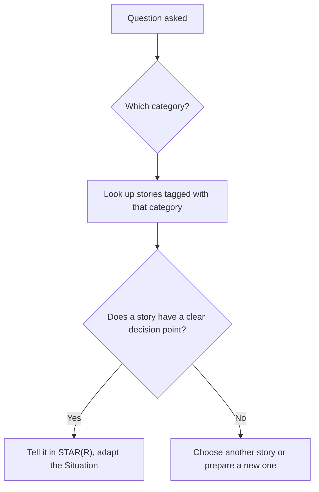

## 🎯 خلاصه

> سؤال‌های رفتاری تکرار می‌شوند. بیشتر آن‌ها در حدود ده **دسته (category)** جا می‌گیرند، و هر دسته چند مهارت مشخص را می‌سنجد. برای **هر دسته یک داستان قوی** آماده کن، و بعد آن را با دقیق‌ترین تعبیر سؤال تطبیق بده.

- ده دسته بیشتر مصاحبه‌ها را پوشش می‌دهد: تعارض، شکست، تصمیم سخت فنی، مخالفت و تعهد، منتورینگ، تأثیرگذاری بدون اختیار رسمی، trade-off زیر ددلاین، بهبود فرایند، نیازمندی مبهم، و «نه» گفتن.
- یک **بانک داستان (story bank)** نگه دار: هر داستان یک ردیف، با دسته‌هایی که می‌تواند جواب دهد.
- یک داستان اگر نقطه‌ی تصمیم درست داشته باشد، می‌تواند به دو یا سه دسته جواب دهد. برای هر ده دسته یک داستان را تکرار نکن.
- پاسخ را با صدای بلند و با ترتیب STAR(R) تمرین کن، بعد Reflection و trade-off را بسنج.

## 🌱 از ساده شروع کنیم (مبتدی)

> **💡 تشبیه:** بانک داستان مثل جعبه‌ابزار است. برای هر کار ابزار جدید لازم نداری، ولی ابزار درست باید در جعبه باشد. جعبه‌ای با ده ابزار تقریباً هر تعمیری را پوشش می‌دهد. جعبه‌ای با یک چکش، نه.

مصاحبه‌گر می‌پرسد «زمانی که…» چون نمی‌تواند تماشایت کند که کار می‌کنی. می‌خواهد ببیند با تعارض، فشار، و اشتباه چطور کنار می‌آیی، با یک مثال واقعی. سؤال درخواست شاهد است.

ساده‌ترین راه آماده‌سازی:

۱. ده دسته‌ی زیر را بخوان.
۲. برای هر کدام یک موقعیت واقعی از کار یا یادگیری‌ات پیدا کن.
۳. داستان را در قالب آخر این درس بنویس.
۴. با صدای بلند، زیر دو دقیقه، بگوش.

لازم نیست داستان دراماتیک باشد. یک مشکل کوچک که خوب مدیریت شده، پاسخ خوبی است. یک مشکل بزرگ که بد مدیریت شده، پاسخ بدی است.

> **⚠️ مراقب باش:** داستانی را انتخاب نکن که همکار سابقت را شرور نشان دهد. موقعیت و واکنش خودت را توصیف کن. مصاحبه‌گر به رفتار تو اهمیت می‌دهد، نه به اینکه چه کسی مقصر بود.

## 🔧 واقعاً چطور کار می‌کند (متوسط)

هر دسته یک مهارت متفاوت را می‌سنجد. جدول نشان می‌دهد مصاحبه‌گر دنبال چیست و یک پاسخ قوی چه چیزی باید نشان دهد.

| دسته | چه چیزی سنجیده می‌شود | سؤال معمول | پاسخ قوی باید نشان دهد |
|---|---|---|---|
| تعارض با همکار یا مدیر | احترام، ارتباط، تمرکز روی نتیجه | «درباره‌ی اختلاف با یک هم‌تیمی بگو.» | گوش دادن، واقعیت‌ها، هدف مشترک، نتیجه |
| شکست یا incident تولیدی | مالکیت، دیباگ، صداقت | «زمانی که چیزی در production خراب شد بگو.» | اقدام تو در incident، علت، پیشگیری |
| تصمیم سخت فنی | تفکر trade-off | «یک انتخاب فنی سخت که کردی را توضیح بده.» | گزینه‌ها، معیارها، انتخاب، هزینه‌ی پذیرفته‌شده |
| مخالفت و تعهد | قضاوت به‌همراه تعهد | «کِی با یک تصمیم مخالفت کردی و چه کردی؟» | اعتراض تو، تصمیم، و اجرای کامل آن |
| منتورینگ | چندبرابر کردن توان دیگران | «درباره‌ی کمک به رشد کسی بگو.» | یک آدم مشخص، یک روش، یک نتیجه‌ی قابل‌دیدن |
| تأثیرگذاری بدون اختیار رسمی | قانع‌کردن، داده، روابط | «درباره‌ی تغییر رویکرد یک تیم بگو.» | شاهد، ذی‌نفعان، تغییری که اتفاق افتاد |
| trade-off زیر ددلاین | اولویت‌بندی، ارتباط | «درباره‌ی ددلاینی بگو که کامل نتوانستی برسی.» | چه چیزی را حذف کردی، به که گفتی، ریسک چه بود |
| بهبود فرایند | ابتکار، اندازه‌گیری | «فرایندی که تغییر دادی را بگو.» | مشکل قبلی، تغییر، اثر اندازه‌گیری‌شده |
| نیازمندی مبهم | مدیریت ابهام | «با نیازمندی مبهم چطور کار کردی؟» | سؤال‌های پرسیده‌شده، فرض‌های نوشته‌شده، تصمیم گرفته‌شده |
| «نه» به ذی‌نفع | قضاوت، مذاکره | «زمانی که درخواستی را رد کردی بگو.» | دلیل، گزینه‌ی جایگزین، رابطه‌ای که حفظ شد |

برای انتخاب داستان مناسب از بانکت، این جریان را دنبال کن:



**قالب بانک داستان.** برای هر داستان یک ردیف نگه دار. همان‌طور که پر می‌کنی:

```text
STORY: [short name]
Situation (one line): [context, scale]
My decision point: [the choice I had to make]
Categories it answers: [pick 2 or 3 from the ten]
Alternatives I rejected: [what else I considered, and why not]
Result (number or before/after): [what changed, measured how]
Reflection: [what I would change next time]
People named (for follow-ups): [who was involved, and what they did]
```

**مثال کامل (تخیلی، با واقعیت‌های خودت جایگزین کن).** دسته: **«نه» گفتن به ذی‌نفع**. سؤال: «زمانی که درخواست یک ذی‌نفع ارشد را رد کردی بگو.»

> **پاسخ ضعیف:** «معاون یک داشبورد جدید تا جمعه می‌خواست، ولی ممکن نبود، پس گفتم نه. یه کم تنش شد، ولی آخرش تیم فهمید.»

پاسخ ضعیف یک تصمیم دارد، ولی دلیل، گزینه‌ی جایگزین، نتیجه، و ترمیم رابطه ندارد. مثل یک امتناع به نظر می‌رسد، نه یک قضاوت.

> **پاسخ قوی:** «**S:** معاون برای جلسه‌ی هیئت‌مدیره یک داشبورد درآمد زنده تا جمعه خواست. منبع استریم ما برای رسیدن به تازگی هدف، دو هفته کار لازم داشت. **T:** pipeline گزارش‌دهی مال من بود؛ هدفم این بود که هیئت‌مدیره جواب مفید بگیرد، بدون اینکه داده‌ای که الان منتشر می‌کنیم خراب شود. **A:** نسخه‌ی زنده را رد کردم و دو گزینه با تاریخ دادم. گزینه‌ی اول یک refresh روزانه تا جمعه، با برچسب روشن روی زمان‌بندی داده. گزینه‌ی دوم داشبورد زنده در دو هفته. یک یادداشت کوتاه با هزینه‌ی هر گزینه فرستادم و از تحلیلگر معاون خواستم بررسی کند آیا نسخه‌ی روزانه سؤال هیئت‌مدیره را جواب می‌دهد. جواب داد. **R:** هیئت‌مدیره جمعه داشبورد روزانه گرفت، و نسخه‌ی زنده دو هفته بعد با همان اعداد تحویل شد. معاون بعداً خواست درخواست‌های بعدی را قبل از ارسال با من مرور کند. **Reflection:** محدودیت تازگی را باید همان روزی که درخواست مطرح شد می‌گفتم، نه روز ددلاین.»

## 🧠 عمق و trade-offها (سنیور)

سنیورها بیشتر بر اساس **قضاوت** سنجیده می‌شوند تا بر اساس خود رویداد. برای هر دسته‌ی این حرکت‌ها را آماده کن:

- **trade-off را نام ببر، نه فقط عمل را.** «نه گفتم» یک عمل است. «نه گفتم چون استریم زنده SLA تطبیق دو گزارش دیگر را می‌شکست» قضاوت است.
- **اثر مرتبه‌ی دوم را نشان بده.** بعد از تصمیم تو چه شد؛ برای تیم، ذی‌نفع، یا سیستم؟ پاسخ‌های خوب کار پیگیری را هم می‌گویند، مثل runbook یا فرایند جدید.
- **زبان کالیبره‌شده به کار ببر.** وقتی مطمئن نیستی بگو «حدود ۳۰٪» یا «تقریباً دو هفته». اغراق سریع‌ترین راه از دست دادن اعتبار در پروب‌ها است.
- **آدم‌ها را بشناس.** در داستان‌های تعارض و مخالفت، آماده باش بگویی طرف مقابل وضعیت را چطور می‌دید. داوطلب قوی طرف دیگر را منصفانه توصیف می‌کند.
- **اشتباه واقعی را بپذیر.** سنیور می‌تواند خطای خودش، اثرش، و آنچه عوض کرد را توضیح دهد. داستانی بدون تقصیر در سطح سنیور کمتر باورپذیر است.

**بانک را متعادل کن.** مصاحبه‌گرها اغلب در یک دور دو سؤال از دسته‌های مرتبط می‌پرسند. یک داستان برای «تعارض» و یک داستان برای «شکست» شروع خوبی است، ولی یک داستان از حوزه‌ی دیگر، مثل ذی‌نفع یا منتورینگ، هم آماده کن تا تکرار نکنی.

**کِی داستان نگو.** سؤال‌های فرضی («اگر مدیرت از تو می‌خواست تست‌ها را رد کنی چه می‌کردی؟») به یک اصل بیان‌شده و یک برنامه نیاز دارند، نه به خاطره. بگو چه می‌کنی، اول چه چیزی را چک می‌کنی، و چه کسی را درگیر می‌کنی.

## 🧪 امتحان کن

**تمرین ۱: سؤال‌ها را به دسته وصل کن.** برای هر سؤال، دسته و یک نشانه‌ای که می‌سنجد را بگو.

- «زمانی که مجبور شدی روی نظر یک بازبینی طراحی مقاومت کنی بگو.»
- «یک release که بد پیش رفت را بگو، و در یک ساعت اول چه کردی.»
- «چطور تیم تحلیل را به مدل داده‌ات راضی کردی؟»

<details><summary>پاسخ</summary>

۱. **مخالفت و تعهد** (یا تعارض). قضاوت و احترام به بازبین را می‌سنجد.
۲. **شکست یا incident تولیدی.** مالکیت و پاسخ ساعت اول (triage، ارتباط، rollback) را می‌سنجد.
۳. **تأثیرگذاری بدون اختیار رسمی.** قانع‌کردن با شاهد و کار با ذی‌نفعان را می‌سنجد.

بعضی سؤال‌ها به دو دسته می‌خورند. هر دو را یادداشت کن، چون یک داستان ممکن است به هر دو جواب دهد.

</details>

**تمرین ۲: بانکی با پنج ردیف بساز.** پنج موقعیت واقعی از کار یا یادگیری‌ات انتخاب کن. برای هرکدام قالب بانک داستان را پر کن و دسته‌هایی که می‌تواند جواب دهد را برچسب بزن.

<details><summary>پاسخ</summary>

یک ردیف کامل، برای نمونه، این شکل را دارد:

- داستان: «فایل‌های دیرِرسِ شریک». نقطه‌ی تصمیم: اضافه کردن sensor و هشدار، یا مذاکره‌ی contract. دسته‌ها: شکست، تأثیرگذاری، بهبود فرایند. نتیجه: گزارش‌های دیرهنگام از هفتگی به تقریباً صفر رسید. Reflection: contract باید اول می‌آمد.

بانک کامل است وقتی هر ردیف یک نقطه‌ی تصمیم، یک عدد یا وضعیت «قبل و بعد»، و یک Reflection دارد. ردیفی بدون نقطه‌ی تصمیم نمی‌تواند به سؤال «تصمیم سخت» جواب دهد، پس آن را برای دسته‌ی دیگری برچسب بزن.

</details>

**تمرین ۳: یک پاسخ ضعیف را بازنویسی کن.** این پاسخ را بازنویسی کن تا یک تصمیم، یک گزینه‌ی ردشده، و یک نتیجه نشان دهد:

> «با مدیرم روی یک کار سخت کار کردیم و تمامش کردیم. استرس داشت، ولی تیم راضی بود.»

<details><summary>پاسخ</summary>

یک بازنویسی قوی، تصمیم، سهم تو، و نتیجه‌ی اندازه‌گیری‌شده را نام می‌برد. برای نمونه:

«مدیرم می‌خواست مسیر جدید ingestion را در یک هفته تحویل دهیم، که بررسی تکراری‌ها را حذف می‌کرد. پیشنهاد دادم مسیر اصلی در یک هفته برود و بررسی تکراری‌ها پشت یک flag باشد، و تستی نوشتم که ایمنی flag را ثابت کند. به‌موقع تحویل دادیم و بررسی تکراری‌ها هفته‌ی بعد، بعد از ۱۰ روز اجرا روی نمونه بدون تکراری، فعال شد.»

بازنویسی هنوز عدم‌قطعیت («۱۰ روز اجرا») و نقش روشن داوطلب را دارد. فکت‌هایی را نگه دار که در پروب می‌توانی از آن‌ها دفاع کنی.

</details>

## 💬 گوشه‌ی مصاحبه

> **🎤 این را در مصاحبه بگو:** «کِی با مدیرت مخالفت کردی؟» داستانی را انتخاب کن که واضح‌ترین نقطه‌ی تصمیم را دارد، و هم موضع خودت و هم تعهدت بعد از تصمیم را به یک اندازه روشن نشان بده.

**نمونه‌ی پاسخ متوسط (کوتاه):** «مدیرم می‌خواست job دسته‌ای را در یک اسپرینت به scheduler جدید ببریم. فکر می‌کردم تست‌ها کافی نیستند، پس سه ریسک را فهرست کردم و یک هفته اجرای موازی خواستم. موافقت شد، اجرای موازی یک باگ منطقه‌ی زمانی پیدا کرد، و بعد از رفعش طبق برنامه پیش رفتیم. بعد از آن از مهاجرت به‌طور کامل پشتیبانی کردم، از جمله انتقال on-call.»

**نمونه‌ی پاسخ سنیور (کوتاه):** «با برنامه‌ای مخالفت کردم که جداول قدیمی انبار داده را در روز مهاجرت حذف می‌کرد، چون دو گزارش مالی هنوز آن‌ها را می‌خواندند و فهرست وابستگی‌ها کامل نبود. فهرست وابستگی‌ها و هزینه‌ی یک حدس اشتباه را در یادداشت یک‌صفحه‌ای گذاشتم و یک دوره‌ی ۳۰ روزه‌ی فقط‌خواندنی پیشنهاد دادم. مدیرم با یک تغییر پذیرفت: یک مالک نام‌برده برای هر گزارش. در آن بازه سه مصرف‌کننده‌ی پنهان پیدا کردیم. بعد از تصمیم، مهاجرت را با همان دقتی اجرا کردم که برای برنامه‌ی خودم می‌گذاشتم، و cutover در تاریخ توافق‌شده تمام شد.»

## ⚠️ اشتباهات رایج

- **یک داستان برای همه‌چیز.** مصاحبه‌گر تکرار را می‌بیند، و داستان با همه‌ی سؤال‌ها جور نیست.
- **داستان بدون تصمیم.** داستانی درباره‌ی «یک هفته‌ی سخت» به سؤال «تصمیم سخت» جواب نمی‌دهد.
- **مقصر دانستن طرف مقابل.** موضعش را منصفانه بگو و روی واکنش خودت تمرکز کن.
- **نبودن نتیجه.** بدون نتیجه، داستان نصفه می‌ماند.
- **اغراق.** «تنهایی شرکت را نجات دادم» در اولین پروب فرو می‌ریزد.
- **بی‌توجهی به سؤال.** اگر درباره‌ی تعارض پرسیده شده، داستان شکست را نگو، حتی اگر داستان بهتری باشد.
- **حفظ کلمه‌به‌کلمه.** فکت‌ها و تصمیم را بدان، و طبیعی حرف بزن.

## ✅ خودت را بسنج

۱. این سؤال به کدام دسته تعلق دارد؟ «زمانی را بگو که نتوانستی قبل از لانچ همه‌چیز را تمام کنی.»
   - A) منتورینگ یک نفر
   - B) trade-off زیر ددلاین
   - C) بهبود فرایند
   - D) نیازمندی مبهم

<details><summary>جواب</summary>

**B** — سؤال درباره‌ی انتخاب چیزی برای حذف زیر ددلاین و اطلاع‌رسانی ریسک است. دسته‌های دیگر این trade-off را نمی‌سنجند.

</details>

۲. یک داستان نقطه‌ی تصمیم و نتیجه‌ی روشن دارد، ولی Reflection ندارد. بهترین اصلاح چیست؟

   - A) تصمیم را حذف کن و نتیجه را نگه دار
   - B) یک جمله اضافه کن درباره‌ی اینکه دفعه‌ی بعد چه تغییری می‌دهی و چه یاد گرفتی
   - C) Situation را طولانی‌تر کن
   - D) یک داستان دوم به همان پاسخ اضافه کن

<details><summary>جواب</summary>

**B** — Reflection رشد را نشان می‌دهد و تو را برای پروب «چه تغییری می‌دادی؟» آماده می‌کند. معمولاً یک یا دو جمله کافی است.

</details>

۳. سؤال «مخالفت و تعهد» مستقیماً کدام مهارت را می‌سنجد؟

   - A) سرعت تایپ
   - B) قضاوت همراه با تعهد بعد از تصمیم
   - C) دانش یک ابزار مشخص
   - D) تعداد سال‌های کار

<details><summary>جواب</summary>

**B** — پاسخ قوی نشان می‌دهد اعتراض واقعی با شاهد داشتی، و بعد از تصمیم، حتی اگر ترجیح تو نبود، آن را کامل اجرا کردی.

</details>

۴. **(سنیور)** مصاحبه‌گر می‌پرسد: «اگر مدیرت از تو بخواهد قبل از release تست‌ها را رد کنی چه می‌کنی؟» کدام پاسخ قوی‌تر است؟

   - A) «انجامش می‌دهم، چون مدیرها بهتر می‌دانند.»
   - B) «استعفا می‌دهم و تیم را ترک می‌کنم.»
   - C) «ریسک را کتبی می‌گویم، کوچک‌ترین مجموعه‌ی تستی که مسیر حیاتی را پوشش می‌دهد پیشنهاد می‌کنم، و تصمیم صریح با نام مالک آن را می‌خواهم.»
   - D) «تست‌ها را رد می‌کنم و امیدوارم چیزی خراب نشود.»

<details><summary>جواب</summary>

**C** — ریسک را نام می‌برد، یک سازش عملی پیشنهاد می‌دهد، و تصمیم را صریح می‌کند. این قضاوت زیر فشار است، بدون نمایش دراماتیک و بدون ریسک پنهان.

</details>

## ✅ چک‌لیست خودارزیابی

- [ ] برای هر ده دسته حداقل یک داستان دارم
- [ ] هر داستان یک نقطه‌ی تصمیم و یک نتیجه با عدد یا قبل و بعد دارد
- [ ] هر داستان با دو یا سه دسته‌ای که می‌تواند جواب دهد برچسب خورده
- [ ] می‌توانم هر داستان را زیر دو دقیقه با STAR(R) بگویم
- [ ] برای هر داستان trade-off و حداقل یک گزینه‌ی ردشده را نام می‌برم
- [ ] می‌توانم به پروب روی هر جزئیاتی که گفته‌ام جواب دهم
- [ ] هیچ‌کدام از داستان‌هایم همکار سابق را شرور نشان نمی‌دهد

## 🗂️ فلش‌کارت

| Front | Back |
|---|---|
| این بانک چند دسته دارد؟ | ده دسته که بیشتر مصاحبه‌های رفتاری را پوشش می‌دهند |
| بانک داستان چیست؟ | مجموعه‌ای از داستان‌ها، هر کدام یک ردیف، با دسته‌هایی که جواب می‌دهند |
| چرا یک داستان برای همه‌ی سؤال‌ها کافی نیست؟ | مصاحبه‌گر تکرار را می‌بیند و داستان با همه‌ی دسته‌ها جور نیست |
| چه داستانی برای سؤال «تصمیم سخت» مناسب است؟ | داستانی با نقطه‌ی تصمیم روشن و یک گزینه‌ی واقعی دیگر |
| «مخالفت و تعهد» چه را می‌سنجد؟ | قضاوت قبل از تصمیم و تعهد کامل بعد از آن |
| خطر اغراق چیست؟ | پروب‌ها آن را لو می‌دهند و اعتبار را از بین می‌برند |
| به سؤال «اگر… چه می‌کردی؟» چطور جواب دهی؟ | اصل، اولین بررسی‌ها، و اینکه چه کسی را درگیر می‌کنی |

## 🔗 ادامه

- [[star-framework]] ساختار پاسخی را توضیح می‌دهد که در همه‌ی دسته‌ها به کار می‌رود.
- [[senior-signals]] نشانه‌هایی را فهرست می‌کند که این پاسخ‌ها در سطح سنیور باید نشان دهند.
- [[project-narratives]] نشان می‌دهد چطور داستان‌های عمیق‌تر پروژه را آماده کنی که بسیاری از پاسخ‌های رفتاری از آن‌ها می‌آیند.
- [[interview-loop]] توضیح می‌دهد دورهای رفتاری در فرایند معمول کجا قرار می‌گیرند.
- [[negotiation-iran]] نشان می‌دهد مهارت «نه» گفتن و trade-off هنگام مذاکره‌ی بسته‌ی پیشنهادی چطور به کار می‌آید.
