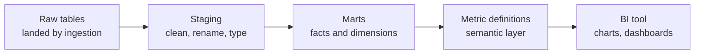

## 🎯 خلاصه

> ابزارهای **هوش تجاری (BI)** به آدم‌ها اجازه می‌دهند داده را با نمودار، داشبورد و فیلتر بررسی کنند. **Analytics engineering** داده‌ای را آماده می‌کند که این ابزارها می‌خوانند: جدول‌های تمیز، تعریف‌های توافق‌شده‌ی metric، و مدل‌هایی که شکل سؤال‌های واقعی مردم را دارند.

- یک ابزار BI فقط به اندازه‌ی **markها** (جدول‌های کیوریت‌شده) و **تعریف metricها**ی زیرش خوب است. داشبوردی که با داشبورد دیگر اختلاف دارد تقریباً همیشه مشکل مدل‌سازی است، نه مشکل نمودار.
- **Apache Superset** و **Metabase** ابزارهای BI متن‌باز هستند که بسیاری از تیم‌های ایرانی استفاده می‌کنند، چون می‌شود آن‌ها را رایگان روی زیرساخت خودت اجرا کرد. Tableau و Looker گزینه‌های تجاری‌اند؛ Looker یک لایه‌ی مدل‌سازی (LookML) اضافه می‌کند.
- **Analytics engineer** بین مهندسی داده (پایپ‌لاین، زیرساخت) و تحلیل (سؤال، بینش) قرار دارد. خروجی اصلی‌اش مدل‌های تست‌شده و مستندشده است.

## 🌱 از ساده شروع کنیم (مبتدی)

> **💡 تشبیه:** آشپزخانه‌ی یک رستوران و سالن غذاخوری. مهندس داده آشپزخانه را می‌سازد (لوله‌ها، ذخیره‌سازی، اجاق‌ها). analytics engineer مواد را به غذاهای استاندارد با دستورهایی که همه دنبال می‌کنند تبدیل می‌کند (mart و metric). ابزار BI همان منوست که مهمان از روی آن سفارش می‌دهد.

فرض کن کسب‌وکار می‌پرسد: «فروش هر شهر ماه گذشته چقدر بوده؟» داده‌ی خام بین جدول سفارش‌ها، جدول مشتری‌ها و جدول پرداخت‌ها پراکنده است. بدون آماده‌سازی، هر تحلیلگر join متفاوتی می‌نویسد و جواب متفاوتی می‌گیرد. یک **mart** این مشکل را حل می‌کند: یک جدول که join درست، فیلتر درست و تعریف درست «فروش» را از قبل دارد.

```sql
-- A small mart: one row per order, with the customer's city attached
CREATE TABLE mart_orders AS
SELECT
  o.order_id,
  o.order_date,
  c.city,
  o.amount_irr,
  o.status
FROM orders o
JOIN customers c ON c.customer_id = o.customer_id
WHERE o.status = 'paid';          -- one agreed definition of a "sale"
```

حالا ابزار BI فقط به یک کوئری ساده نیاز دارد: `SUM(amount_irr) GROUP BY city, month`. منطق در mart زندگی می‌کند، نه در هر نمودار.

## 🔧 واقعاً چطور کار می‌کند (متوسط)

یک پشته‌ی BI معمولاً چهار لایه دارد:



**Markها** جدول‌های کیوریت‌شده‌اند، معمولاً در قالب star schema: یک **fact table** (رویدادها یا اندازه‌گیری‌ها، یک ردیف به‌ازای هر ردیف سفارش یا هر روز) و **dimension table** ها (مشتری، محصول، تاریخ). به [[star-schema]]، [[fact-table]] و [[dimension-table]] نگاه کن. یک mart بر اساس حوزه‌ی کسب‌وکار نام می‌گیرد (`mart_sales`، `mart_support`)، **grain** مستند دارد، و تست دارد (کلید یکتا، not-null، بررسی ارجاع).

یک star کوچک برای فروش روزانه:

```sql
-- fact: one row per order line
CREATE TABLE fct_order_line (
  order_id    bigint,
  line_no     int,
  product_key int,
  date_key    int,          -- YYYYMMDD
  quantity    int,
  amount_irr  bigint,
  PRIMARY KEY (order_id, line_no)
);

-- dimension: one row per product
CREATE TABLE dim_product (
  product_key int PRIMARY KEY,
  name        text,
  category    text
);

-- query a BI tool would generate for "sales by category, by month"
SELECT d.category,
       substr(CAST(f.date_key AS text), 1, 6) AS yyyymm,
       SUM(f.amount_irr) AS revenue_irr
FROM fct_order_line f
JOIN dim_product d ON d.product_key = f.product_key
GROUP BY d.category, yyyymm
ORDER BY yyyymm, category;
```

**تعریف metric.** یک metric مثل «مشتری فعال» یا «حاشیه‌ی سود ناخالص» باید یک‌بار تعریف شود. گزینه‌ها:

- در **لایه‌ی تبدیل**، به‌صورت یک ستون در mart (ساده، قابل تست، ولی اگر چند mart به آن نیاز داشته باشند تکراری می‌شود)؛
- در یک **semantic layer** (LookML در Looker، metricهای dbt، یا یک سرویس metric) که ابزارهای BI تعریف را از آن می‌خوانند، نه این‌که دوباره استخراجش کنند؛
- در **خود ابزار BI** (شروعش سریع است، ولی در مقیاس خطرناک است، چون هر داشبورد ممکن است از تعریف فاصله بگیرد).

**Superset و Metabase.** هر دو از طریق درایورها به پایگاه‌های داده‌ی SQL وصل می‌شوند، به کاربران اجازه‌ی ساخت نمودار و داشبورد می‌دهند، و نوشتن SQL را هم ممکن می‌کنند. Superset پروژه‌ی Apache است با انواع نمودار غنی‌تر و ویرایشگر SQL Lab، و معمولاً توسط تیم‌های پلتفرم داده اجرا می‌شود. Metabase روی یک رابط ساده‌ی ساخت سؤال تمرکز دارد و اغلب تیم‌های کوچک‌تر و کاربران غیرفنی آن را انتخاب می‌کنند. هر دو caching و دسترسی بر اساس نقش دارند؛ مدل دسترسی و پایگاه‌های پشتیبانی‌شده را در مستندات نسخه‌ی خودت چک کن.

**Looker** (گوگل کلاد) از LookML استفاده می‌کند، یک زبان مدل‌سازی که در آن جدول‌ها، join ها، بُعدها و measureها یک‌بار تعریف می‌شوند و کاربران بدون نوشتن SQL کاوش می‌کنند. **Tableau** در کاوش بصری قوی است و در سازمان‌های بزرگ زیاد استفاده می‌شود؛ مدل‌سازی معنایی آن کمتر متمرکز از Looker است. هر دو در مصاحبه‌ها به‌صورت «با ابزارهای BI چه آشنایی داری؟» مطرح می‌شوند، پس تفاوت مدل‌هایشان را بدان، نه فهرست امکانات را.

**گردش کار analytics engineer** (در dbt یا ابزار مشابه): نوشتن مدل‌های SQL، مستندسازی ستون‌ها، افزودن تست، بازبینی در pull request، اجرای زمان‌بندی‌شده، و بررسی lineage از داشبورد تا جدول منبع. به [[dbt]] و [[data-lineage]] نگاه کن.

## 🧠 عمق و trade-offها (سنیور)

- **اول grain.** هر mart باید grain مشخص داشته باشد («یک ردیف به‌ازای هر خط سفارش در هر روز»). grainهای مخلوط در یک جدول فروش را دوبار حساب می‌کنند. grain را در توضیح مدل اعلام کن و یکتایی کلید را تست کن.
- **Slowly changing dimensions.** اگر مشتری شهرش را عوض کند، فروش‌های گذشته معمولاً باید با شهری که در زمان فروش داشته بماند. این به یک بُعد SCD type 2 یا snapshot نیاز دارد. به [[scd]] نگاه کن.
- **Fan-out و chasm trap.** join کردن دو fact table در grainهای متفاوت ردیف‌ها را ضرب می‌کند و مجموع‌ها را بالا می‌برد. اول هر fact را به grain مشترک تجمیع کن، بعد join کن.
- **کارایی.** داشبوردها کوئری‌های زیادی با فیلتر تاریخ و بُعد می‌زنند. marts تجمیع‌شده‌ی روزانه، partition بر اساس تاریخ، و موتورهای ستونی (ClickHouse، StarRocks، warehouseها) تأخیر را کم می‌کنند. TTL کش را با کسب‌وکار تنظیم کن: داشبوردی که هر پنج دقیقه refresh شود برای عددهای ماهانه‌ی مالی لازم نیست.
- **حاکمیت.** تصمیم بگیر چه کسی کدام ردیف (row-level security) و کدام ستون (داده‌ی شخصی، حقوق) را ببیند. این را در دیتابیس یا semantic layer اعمال کن، نه فقط با پنهان کردن داشبورد. به [[data-masking]] نگاه کن.
- **پذیرش.** شایع‌ترین شکست فنی نیست: کسی به عددها اعتماد ندارد. برای metricها مالک تعیین کن، تعریف‌ها را در یک catalog منتشر کن، و برای هر metric کلیدی یک داشبورد «تأییدشده» داشته باش. به [[data-catalog]] نگاه کن.
- **Self-hosting در ایران.** اجرای Superset یا Metabase روی یک warehouse on-prem داده را داخل شبکه نگه می‌دارد، که برای بانک‌ها و اپراتورها مهم است. backup را برای دیتابیس متادیتای BI هم برنامه‌ریزی کن، نه فقط warehouse، و نسخه‌ی BI را برای اصلاحات امنیتی به‌روز نگه دار.
- **کِی منطق را داخل ابزار BI نگذاری.** هر چیزی که باید دوباره استفاده شود، تست شود یا قابل audit باشد، به لایه‌ی تبدیل تعلق دارد. داشبوردها را برای ارائه و کاوش نگه دار.

## 🧪 امتحان کن

با star بالا و یک جدول واقعیت دوم `fct_refund(order_id, line_no, date_key, refund_irr)`:

۱. کوئری بنویس که درآمد و بازپرداخت را بر اساس دسته و ماه برگرداند **بدون** دوبار حساب کردن. توضیح بده چرا join مستقیم هر دو fact روی `order_id` اشتباه است.
۲. یک داشبورد درآمد ماهانه‌ی ۱٬۰۰۰ نشان می‌دهد ولی گزارش مالی ۱٬۰۵۰ دارد. سه علتی را که در لایه‌ی mart اول بررسی می‌کنی فهرست کن.
۳. یک بیانیه‌ی grain و دو تست داده برای جدول `mart_daily_product_sales` طراحی کن.

<details><summary>جواب‌ها را ببین</summary>

**۱.** هر fact را اول به grain مشترک (دسته، ماه) تجمیع کن، بعد دو نتیجه را ترکیب کن، مثلاً با `FULL OUTER JOIN` روی دسته و ماه. join کردن fact های خام روی `order_id` هر خط سفارش را به تعداد ردیف‌های بازپرداخت تکرار می‌کند و درآمد را بالا می‌برد.

```sql
WITH rev AS (
  SELECT d.category, substr(CAST(f.date_key AS text),1,6) AS yyyymm,
         SUM(f.amount_irr) AS revenue_irr
  FROM fct_order_line f JOIN dim_product d USING (product_key)
  GROUP BY 1, 2
),
ref AS (
  SELECT d.category, substr(CAST(r.date_key AS text),1,6) AS yyyymm,
         SUM(r.refund_irr) AS refund_irr
  FROM fct_refund r
  JOIN fct_order_line l ON l.order_id = r.order_id AND l.line_no = 1
  JOIN dim_product d ON d.product_key = l.product_key
  GROUP BY 1, 2
)
SELECT COALESCE(rev.category, ref.category) AS category,
       COALESCE(rev.yyyymm, ref.yyyymm)     AS yyyymm,
       rev.revenue_irr, ref.refund_irr
FROM rev FULL OUTER JOIN ref
  ON rev.category = ref.category AND rev.yyyymm = ref.yyyymm;
```
شرط `line_no = 1` برای این تمرین ساده‌سازی است: در مدل واقعی، جدول بازپرداخت باید خودش کلید محصول یا کلید خط را داشته باشد.

**۲.** بررسی کن: (الف) فیلتر (سفارش‌های پرداخت‌شده در برابر همه، و بازپرداخت‌ها خالص‌شده یا نه)؛ (ب) مرز زمانی یا منطقه‌ی زمانی (تاریخ سفارش در برابر تاریخ پرداخت، UTC در برابر وقت محلی)؛ (ج) ردیف‌های تکراری ناشی از fan-out در join یا اجرای دوباره‌ی load.

**۳.** Grain: «یک ردیف به‌ازای هر محصول در هر روز تقویمی، به وقت محلی کسب‌وکار». تست‌ها: `unique` روی `(product_key, sale_date)`، و `not_null` روی `sale_date` و `revenue_irr`. تست سوم مفید: مقایسه‌ی تعداد ردیف یا مجموع با منبع برای همان روز.

</details>

## 💬 گوشه‌ی مصاحبه

**سؤال: «دو داشبورد برای یک ماه درآمد متفاوت نشان می‌دهند. چه می‌کنی؟»** جواب متوسط: «SQL پشت هر دو نمودار را مقایسه می‌کنم و فیلتر متفاوت را پیدا می‌کنم.» جواب سنیور: «اول تعریف metric و grain را در هر mart بررسی می‌کنم، بعد هر دو داشبورد را با lineage تا جدول منبع ردیابی می‌کنم. تعریف را در لایه‌ی semantic یا تبدیل یکجا می‌کنم، یک تست تطبیق اضافه می‌کنم، و یک داشبورد را به‌عنوان تأییدشده علامت می‌زنم.»

**سؤال: «Superset یا Metabase، یا Looker؟»** trade-offها را نام ببر: خودمیزبان و رایگان در برابر مدیریت‌شده؛ SQL-محور در برابر ساخت سؤال؛ مدل‌سازی متمرکز با LookML در برابر مدل داخل ابزار BI. بگو کدام برای تیم پنج‌نفره و کدام برای تیم پانصدنفره مناسب است.

**سؤال: «analytics engineer کیست؟»** کسی که داده را برای تحلیل مدل و تست می‌کند: mart می‌سازد، مالک تعریف metricها است، مستندات و تست می‌نویسد، و با مهندسان و کاربران کسب‌وکار کار می‌کند.

> **🎤 در مصاحبه این را بگو:** «لایه‌ی BI را لایه‌ی ارائه می‌دانم. درستی در markهایی است که grain اعلام‌شده، کلیدهای تست‌شده و تعریف metricهای تک‌منبعی دارند. وقتی دو عدد اختلاف دارند، قبل از دست زدن به نمودار lineage را ردیابی می‌کنم.»

## ⚠️ اشتباهات رایج

> **⚠️ مراقب باش:** تعریف یک metric به‌صورت جداگانه در چند داشبورد. هر نسخه کم‌کم فاصله می‌گیرد و کسی نمی‌داند کدام درست است.

> **⚠️ مراقب باش:** join کردن دو fact در grainهای متفاوت و جمع زدن نتیجه. مجموع معقول به نظر می‌رسد و اشتباه است.

- ساختن markهایی که جدول‌های منبع را یک‌به‌یک آینه می‌کنند، پس هر تحلیلگر باز هم همه‌چیز را join می‌کند.
- نوشتن نکردن grain، و در نتیجه ترکیب ردیف‌های روزانه و ماهانه در یک جدول.
- استفاده از کوئری زنده برای داشبوردی که هر صبح توسط ۵۰۰ نفر دیده می‌شود، بدون کش یا تجمیع قبلی.
- تکیه بر دسترسی داشبورد به‌عنوان تنها کنترل امنیتی، در حالی که خود دیتابیس باز است.
- استفاده از مدل داخلی ابزار BI به‌عنوان منبع حقیقت برای منطق کسب‌وکاری که باید تست شود.

## ✅ خودت را بسنج

۱. هدف اصلی یک mart در پشته‌ی تحلیلی چیست؟
   - A) جایگزینی دیتابیس منبع
   - B) فراهم کردن جدول‌های کیوریت‌شده و مستند که برای سؤال‌های کسب‌وکار شکل گرفته‌اند
   - C) ذخیره‌ی لاگ‌های خام در قالب استریم
   - D) زمان‌بندی داشبوردهای BI

<details><summary>جواب</summary>

**B** — mart یک جدول کیوریت‌شده (اغلب star schema) با تعریف‌های توافق‌شده و grain مشخص است. جایگزین منبع نیست، استریم را هندل نمی‌کند، و زمان‌بندی مسئله‌ی جداگانه‌ای است.

</details>

۲. یک fact table یک ردیف به‌ازای هر خط سفارش دارد. کدام الگوی کوئری بیشترین احتمال دوبار حساب کردن درآمد را دارد؟
   - A) جمع زدن درآمد بعد از گروه‌بندی بر اساس خط سفارش
   - B) join کردن آن به fact دیگری در grain سفارش و بعد جمع زدن درآمد آن
   - C) فیلتر کردن بر اساس بازه‌ی تاریخ
   - D) join کردن به یک بُعد روی کلید یکتا

<details><summary>جواب</summary>

**B** — وقتی یک fact به fact دیگری در grain ریزتر یا متفاوت join می‌شود، ردیف‌ها تکرار می‌شوند و مجموع‌ها بالا می‌روند (fan-out). هر fact را اول به grain مشترک تجمیع کن.

</details>

۳. کدام ابزار metricهای کسب‌وکار را یک‌بار در یک زبان مدل‌سازی تعریف می‌کند که کاربران BI بدون SQL کاوش کنند؟

   - A) Looker (LookML)
   - B) ویرایشگر SQL Lab در Superset
   - C) خروجی CSV
   - D) یک topic در Kafka

<details><summary>جواب</summary>

**A** — LookML لایه‌ی مدل‌سازی Looker است که در آن جدول‌ها، join ها، بُعدها و measureها یک‌بار تعریف می‌شوند. SQL Lab ویرایشگر کوئری است و بقیه ابزار مدل‌سازی نیستند.

</details>

۴. **(سنیور)** یک مشتری از تهران به شیراز نقل مکان می‌کند. داشبورد درآمد ۱۴۰۴ بر اساس شهر حالا فروش‌های ۱۴۰۴ را در شیراز نشان می‌دهد. شکاف طراحی احتمالی و راه‌حل چیست؟

   - A) نوع نمودار اشتباه است
   - B) بُعد مشتری تاریخچه را بازنویسی می‌کند؛ از یک بُعد SCD type 2 یا snapshot استفاده کن تا هر فروش شهری را نگه دارد که در زمان فروش معتبر بوده
   - C) ابزار BI حافظه‌ی بیشتری لازم دارد
   - D) درآمد نباید بر اساس شهر گروه‌بندی شود

<details><summary>جواب</summary>

**B** — بُعد با overwrite (type 1) تاریخچه را بازنویسی می‌کند. type 2 بازه‌های اعتبار را نگه می‌دارد، پس فروش‌های گذشته به شهری وصل می‌شوند که در آن زمان جاری بوده.

</details>

۵. **(سنیور)** چه زمانی یک metric را از داشبورد به لایه‌ی تبدیل منتقل می‌کنی؟

   - A) هرگز؛ داشبوردها تنها جای درست metricها هستند
   - B) وقتی چند داشبورد یا گزارش به آن نیاز دارند، وقتی باید تست شود، یا وقتی باید قابل audit باشد
   - C) فقط برای metricهای لحظه‌ای
   - D) وقتی metric یک درصد است

<details><summary>جواب</summary>

**B** — استفاده‌ی مجدد، تست و audit دلیل متمرکز کردن تعریف‌اند. داشبوردها برای ارائه و کاوش خوب‌اند، ولی منطق تکراری کم‌کم فاصله می‌گیرد.

</details>

## 🗂️ فلش‌کارت

| Front | Back |
|---|---|
| Mart | جدول کیوریت‌شده و مستند برای یک حوزه‌ی کسب‌وکار |
| Grain | آنچه یک ردیف جدول نمایش می‌دهد (مثلاً یک خط سفارش در هر روز) |
| Fan-out trap | join کردن factها در grainهای متفاوت، ردیف‌ها را تکرار و مجموع‌ها را بالا می‌برد |
| Analytics engineer | مدل و تست می‌کند mart و تعریف metricها را، بین مهندسی و تحلیل |
| Superset | ابزار BI متن‌باز Apache با SQL Lab و نمودارهای غنی |
| Metabase | ابزار BI متن‌باز با رابط ساده‌ی ساخت سؤال |
| LookML | زبان مدل‌سازی Looker برای جدول‌ها، join ها، بُعدها و measureها |
| SCD type 2 | تاریخچه‌ی بُعد با بازه‌های اعتبار، تا فروش‌های گذشته ویژگی‌های قدیمی خود را نگه دارند |

## 🔗 ادامه

- **dimensional-modeling** star schema، grain و طراحی بُعد را توضیح می‌دهد که markها روی آن ساخته می‌شوند.
- **dbt** نشان می‌دهد analytics engineerها در عمل چطور مدل‌ها را می‌نویسند، تست و مستند می‌کنند.
- **semantic-layer** تعریف متمرکز metricها را عمیق‌تر پوشش می‌دهد.
- **star-framework** و **fact-table-types** واژگان مدل‌سازی رایج در مصاحبه را می‌دهند.
- **sql-window-functions** برای metricهای «سهم از کل» و «جمع تجمعی» که داشبوردها اغلب لازم دارند ابزار مناسبی است.
- مستندات نسخه‌ی ابزار BI خودت را برای پایگاه‌های پشتیبانی‌شده، caching و امکانات دسترسی بخوان.
