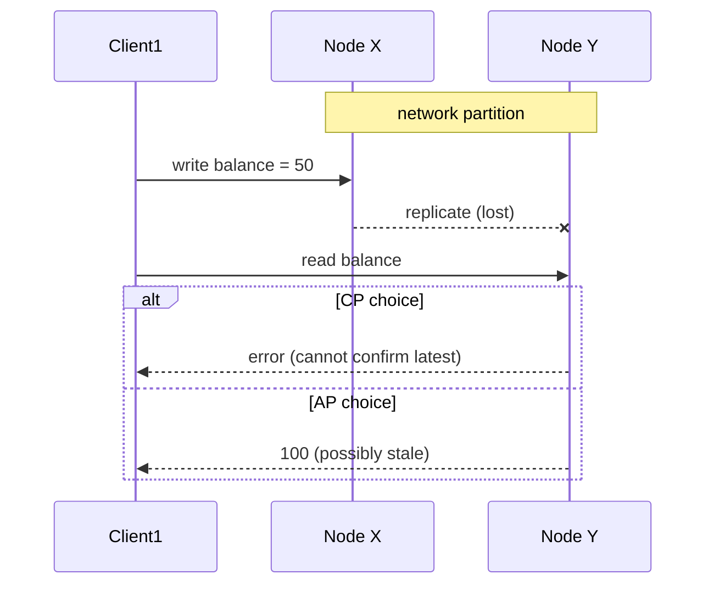

## 🎯 خلاصه

> **CAP** می‌گوید وقتی شبکه سیستم را به دو نیم جدا می‌کند، باید یا **سازگاری** (consistency؛ پاسخ دادن با داده‌ی احتمالاً قدیمی) یا **دسترس‌پذیری** (availability؛ امتناع از پاسخ) را کنار بگذاری. **PACELC** حالت عادی را هم اضافه می‌کند: وقتی partition نیست، باز هم بین **تأخیر (latency)** و **سازگاری** معامله می‌کنی.

- CAP درباره‌ی آنچه **هنگام partition شبکه** اتفاق می‌افتد است. partition نادر است، اما اختیاری نیست، پس مدل ذهنی «از سه تا دو تا را انتخاب کن» اشتباه است.
- سیستم‌های CP برای درست ماندن بعضی درخواست‌ها را رد می‌کنند. سیستم‌های AP به همه جواب می‌دهند و بعداً اختلاف‌ها را جمع می‌کنند.
- «C» در CAP، linearizability است، نه «C» در ACID.
- هزینه‌ی تأخیر از replication می‌آید: صبر کردن برای کپی‌ها وقت می‌برد.

## 🌱 از ساده شروع کنیم (مبتدی)

> **💡 تشبیه:** دو شعبه‌ی یک بانک خط تلفنشان قطع شده. مشتری در هر شعبه پول برمی‌دارد. گزینه‌ی اول: هر دو شعبه به کار ادامه می‌دهند، اما ممکن است هر دو به یک موجودی جواب دهند (سیستم در دسترس است ولی ممکن است اشتباه باشد). گزینه‌ی دوم: هر شعبه تا برگشتن خط، برداشت را نمی‌پذیرد (سیستم درست می‌ماند ولی بعضی مشتری‌ها رد می‌شوند).

همین کل ایده است. **partition** همان خط قطع‌شده است: نودها روشن‌اند، اما نمی‌توانند با هم حرف بزنند.

- **Consistency (C):** هر خواندن، آخرین نوشتن را برمی‌گرداند، یا خطا می‌دهد. همه یک مقدار به‌روز می‌بینند.
- **Availability (A):** هر درخواست به یک نود سالم، پاسخی غیر از خطا می‌گیرد، حتی اگر داده قدیمی باشد.
- **Partition tolerance (P):** سیستم وقتی پیام‌ها بین نودها گم می‌شوند هم ادامه می‌دهد.

هنگام partition باید بین C و A انتخاب کنی. برای یک داده‌ی مشخص نمی‌توانی هر دو را داشته باشی.

## 🔧 واقعاً چطور کار می‌کند (متوسط)

دو کپی از کلید `balance` روی نودهای X و Y هستند. شبکه بینشان قطع می‌شود.

سیستم‌های **CP** به سمتی که به اکثریت (quorum) نمی‌رسد اجازه می‌دهند عملیات را متوقف کند. سیستم‌های **AP** هر دو طرف را پاسخگو نگه می‌دارند و اختلاف‌ها را بعداً اصلاح می‌کنند (مثلاً با timestamp، vector clock یا read repair).

سیستم‌های واقعی این انتخاب را برای هر جزء و گاهی برای هر عملیات انجام می‌دهند:

| سیستم یا تنظیم | رفتار هنگام partition | نکته |
|---|---|---|
| ZooKeeper، etcd (مبتنی بر Raft) | CP: سمت اقلیت نمی‌تواند نوشتن یا خواندن linearizable را انجام دهد | برای هماهنگی و metadata |
| Kafka با `acks=all` و `min.insync.replicas` | اگر replicaهای in-sync کم باشند، producer خطا می‌گیرد | از گم‌شدن داده‌ی تأییدشده جلوگیری می‌کند، به قیمت دسترس‌پذیری |
| Kafka با `unclean.leader.election.enabled=true` | یک replica غیرهمگام می‌تواند leader شود | دسترس‌پذیری بیشتر؛ پیام‌های تأییدشده ممکن است گم شوند |
| Cassandra با سطوح قابل‌تنظیم (`ONE`، `QUORUM`، `ALL`) | برای هر query انتخاب می‌شود | سطوح پایین به AP متمایل‌اند، سطوح بالا به CP |

در یک سیستم quorum با `N` replica، اگر یک نوشتن با تأیید `W` replica و یک خواندن از `R` replica انجام شود، این دو هم‌پوشانی دارند وقتی `R + W > N`. با `N = 3`، `W = 2`، `R = 2`، هر خواندن حداقل یک replica را لمس می‌کند که آخرین نوشتن تأییدشده را دارد. این linearizability کامل زیر نوشتن‌های همزمان نیست، پس بیشتر از آنچه مستندات نسخه‌ی تو می‌گوید قول نده.

**PACELC در عمل.** فرض کن سه replica در مناطق مختلف دارید و رفت‌وبرگشت بین مناطق 120 میلی‌ثانیه است.

- **replication همزمان (synchronous):** نوشتن منتظر تأیید نود دور می‌ماند. هر نوشتن حداقل 120 میلی‌ثانیه طول می‌کشد. ده نوشتن پشت‌سرهم حداقل 1.2 ثانیه می‌شود. پاداشش این است که خواندن از هر replica به‌روز است.
- **replication ناهمزمان (asynchronous):** نوشتن بعد از commit محلی برمی‌گردد، در چند میلی‌ثانیه. خواندن از replica دور ممکن است آخرین نوشتن را نبیند.

این معامله حتی وقتی هیچ خرابی‌ای نیست وجود دارد. این بخش «ELC» در PACELC است.

## 🧠 عمق و trade-offها (سنیور)

- **CAP درباره‌ی یک عملیات روی یک داده است.** یک سیستم می‌تواند برای هر عملیات تضمین متفاوتی بدهد: خواندن قوی برای موجودی حساب، خواندن eventual برای کاتالوگ محصول. قبل از اینکه بگویی «CP» یا «AP»، بپرس «کدام عملیات، کدام کلید».
- **partition از آنچه به نظر می‌رسد رایج‌تر است.** شامل بسته‌های گم‌شده، کارت شبکه‌ی خراب، مشکل لینک بین AZها، یا نودی که GC آن را فریز کرده و بقیه‌ی cluster آن را مرده می‌بینند. آن را رویدادی عادی در طراحی حساب کن.
- **تأخیر یعنی قیمت سازگاری.** خواندن quorum، replicaهای همزمان و commit بین مناطق همگی round trip اضافه می‌کنند. قبل از انتخاب عددش را حساب کن: RTT را در تعداد round tripهای پشت‌سرهم هر درخواست ضرب کن.
- **پلتفرم‌های داده در عمل.**
  - *لایه‌ی serving* (Cassandra، Redis با replica، read replicaهای PostgreSQL): داشبورد تأخیر چند ثانیه‌ای را تحمل می‌کند، اما بررسی موجودی حساب نه. سطح خواندن را برای هر query انتخاب کن.
  - *جدول‌های lakehouse* (Iceberg، Delta): commitها به یک جایگزینی اتمیک pointer متادیتای جدول از طریق catalog تکیه دارند. commit متعارض شکست می‌خورد و دوباره امتحان می‌شود، پس جدول هیچ‌وقت دو نصفه نمی‌شود. این طراحی با اولویت سازگاری است.
  - *هماهنگ‌کننده‌ها* داخل موتورهای OLAP و streaming (سرویس‌های metadata و کنترلرها) معمولاً مبتنی بر consensus هستند، یعنی CP.
- **چه چیزی را مانیتور کنیم.** تأخیر replica، partitionهای under-replicated، نرخ خطای نوشتن، خطای quorum، و نرخ خواندن قدیمی جایی که اندازه می‌گیری.
- **کی AP را انتخاب نکنیم.** پول، موجودی و یکتایی هویت معمولاً تضمین قوی می‌خواهند. کی سازگاری قوی لازم نیست: تحلیل با حجم بالا که داده‌ی پنج دقیقه‌ای قابل قبول است، چون هزینه‌ی تأخیر واقعی است.

## 🧪 امتحان کن

1. یک cluster سه‌نودی با `N = 3` داری. `W` و `R` را طوری انتخاب کن که خواندن‌ها همیشه با نوشتن‌ها هم‌پوشانی داشته باشند، و بگو اگر نوشتن‌ها باید سریع باشند کدام را بزرگ‌تر نگه می‌داری.
2. یک سایت فروشگاهی تعداد موجودی را روی صفحه‌ی محصول نشان می‌دهد و کارت را هنگام checkout شارژ می‌کند. به هر عملیات CP یا AP بده و در دو جمله توجیه کن.
3. replication همزمان بین مناطق round trip برابر 150 میلی‌ثانیه دارد. یک job چهل نوشتن پشت‌سرهم انجام می‌دهد. حداقل زمانی که replication اضافه می‌کند چقدر است؟

پاسخ‌ها را ببین

**1.** هر انتخابی با `R + W > 3` کار می‌کند، برای مثال `W = 2، R = 2` یا `W = 3، R = 1`. اگر نوشتن‌ها باید سریع باشند، `W` را کوچک نگه دار (مثلاً `W = 1` یا `2`) و `R` را بزرگ‌تر کن. توجه کن که `W = 1، R = 3` هم `R + W > N` را برآورده می‌کند، اما هر خواندن را مجبور می‌کند منتظر هر سه replica بماند.

**2.** موجودی روی صفحه می‌تواند AP باشد: نشان دادن «حدود 3 عدد باقی مانده» که کمی قدیمی است قابل قبول است و صفحه بالا می‌ماند. شارژ کارت باید CP باشد: دو خریدار نباید هر دو آخرین کالا را بگیرند، و یک پرداخت نباید دو بار پردازش شود. مرحله‌ی checkout باید از یک رزرو با سازگاری قوی استفاده کند، و صفحه‌ی محصول از یک شمارش کش‌شده.

**3.** هر نوشتن یک round trip صبر می‌کند: 40 × 150 میلی‌ثانیه = 6000 میلی‌ثانیه، یعنی حداقل 6 ثانیه زمان اضافه فقط از replication.

## 💬 گوشه‌ی مصاحبه

**سؤال: «CAP: کدام دو تا را انتخاب می‌کنی؟»** پاسخ متوسط: «CP یا AP، بسته به اینکه سیستم به سازگاری یا دسترس‌پذیری نیاز دارد.» پاسخ سنیور: «انتخاب واقعی فقط هنگام partition ظاهر می‌شود. می‌پرسم کدام عملیات و کدام داده، بعد برای بررسی موجودی CP و برای کاتالوگ AP را انتخاب می‌کنم. بیرون از partition، PACELC می‌گوید هنوز بین تأخیر و سازگاری معامله می‌کنم، پس قبل از تصمیم، round tripها را اندازه می‌گیرم.»

**سؤال: «Cassandra از نوع CP است یا AP؟»** متوسط: «AP.» سنیور: «به سطح سازگاری هر query بستگی دارد. در `ONE` مثل یک سیستم AP رفتار می‌کند. با خواندن و نوشتن در سطح `QUORUM` هم‌پوشانی برای خواندن قوی‌تر ایجاد می‌شود، و می‌گویم این linearizability کامل زیر نوشتن‌های همزمان نیست.»

> **🎤 این را در مصاحبه بگو:** «CAP فقط هنگام partition انتخاب را اجبار می‌کند، و من آن را برای هر عملیات جداگانه می‌گیرم. بدون partition هم برای سازگاری تأخیر می‌دهم، پس PACELC در کار روزمره مدل مفیدتری است.»

## ⚠️ اشتباهات رایج

> **⚠️ مراقب باش:** «CA» برای یک سیستم توزیع‌شده گزینه‌ی واقعی نیست. یک دیتابیس تک‌نودی partition ندارد که تحملش کند، پس موضوع CAP نیست.

- گفتن «از سه تا دو تا را انتخاب کن» به‌عنوان قانون دائمی، به‌جای انتخاب هنگام partition.
- خواندن «availability» به‌عنوان «uptime 99.9 درصد». در CAP یعنی هر نود سالم هر درخواست را جواب می‌دهد.
- اشتباه گرفتن consistency در CAP (linearizability) با consistency در ACID (invariantها داخل یک تراکنش).
- برچسب زدن کل سیستم به CP یا AP بدون نام بردن از عملیات.
- نادیده گرفتن PACELC: هزینه‌ی تأخیر روی هر درخواست پرداخت می‌شود، نه فقط هنگام خرابی.

## ✅ خودت را بسنج

1. در CAP، «P» (partition tolerance) یعنی چه؟
   - A) سیستم داده‌هایش را برای مقیاس به partition تقسیم می‌کند
   - B) سیستم وقتی پیام‌های بین نودها گم می‌شوند هم کار می‌کند
   - C) سیستم با بند `PARTITION BY` در SQL قابل تقسیم است
   - D) سیستم خرابی یک دیسک را تحمل می‌کند

پاسخ

**B** — partition یعنی لینک شبکه بین نودها قطع شده. partition tolerance یعنی سیستم از آن عبور می‌کند. در یک سیستم توزیع‌شده واقعی، نمی‌توانی از آن صرف‌نظر کنی.

2. یک cluster از ZooKeeper با پنج نود به دو بخش 3 و 2 تقسیم می‌شود. بخش دونودی چه می‌شود؟
   - A) به پذیرش نوشتن ادامه می‌دهد و بعداً ادغام می‌کند
   - B) نوشتن را متوقف می‌کند، چون به اکثریت نمی‌رسد
   - C) چون نودهایش کمتر است leader می‌شود
   - D) هیچ تغییری نمی‌کند، چون خواندن‌ها همیشه محلی‌اند

پاسخ

**B** — ZooKeeper از نوع CP است. نوشتن به اکثریت نیاز دارد، پس سمت اقلیت به‌جای خطر واگرایی، آن را رد می‌کند.

3. **(سنیور)** داده‌ی یک topic در Kafka با `acks=all` و `min.insync.replicas=2` تولید می‌شود، و فقط یک replica در حالت in-sync است. رفتار مورد انتظار چیست؟
   - A) نوشتن روی همان یک replica موفق می‌شود
   - B) producer خطا می‌گیرد، پس سیستم از گم نشدن داده‌ی تأییدشده به دسترس‌پذیری ترجیح می‌دهد
   - C) broker پیام را بی‌صدا دور می‌ریزد
   - D) replica بدون بررسی داده leader می‌شود

پاسخ

**B** — وقتی تعداد replicaهای in-sync کمتر از حداقل است، broker نوشتن‌های تأییدشده را رد می‌کند. این یک انتخاب با اولویت سازگاری است. فعال کردن unclean leader election سیستم را به سمت دسترس‌پذیری می‌برد.

4. **(سنیور)** replicaهایت در دو منطقه با RTT برابر 100 میلی‌ثانیه‌اند. کدام جمله درباره‌ی PACELC درست است؟
   - A) PACELC فقط وقتی partition رخ دهد اهمیت دارد
   - B) replication همزمان حتی وقتی هیچ خرابی‌ای نیست تأخیر اضافه می‌کند، و این معامله‌ی ELC است
   - C) replication ناهمزمان همیشه همان خواندن‌های replication همزمان را می‌دهد
   - D) تأخیر هرگز یک موضوع سازگاری نیست

پاسخ

**B** — PACELC حالت عادی را هم پوشش می‌دهد. صبر برای تأیید نود دور، هزینه‌ی round trip را روی هر نوشتن می‌گذارد، و این قیمت خواندن قوی‌تر است.

5. **(سنیور)** چرا برچسب «CA» برای یک دیتابیس توزیع‌شده گمراه‌کننده است؟
   - A) چون دیتابیس‌های CA همیشه کندند
   - B) چون سیستم توزیع‌شده نمی‌تواند از partition دوری کند، پس انتخاب واقعی بین C و A هنگام وقوع آن است
   - C) چون دیتابیس‌های CA نمی‌توانند عدد ذخیره کنند
   - D) چون CAP فقط برای دو نود ثابت شده است

پاسخ

**B** — سیستمی که روی چند ماشین پخش است، دیر یا زود partition را می‌بیند. برچسب «CA» انتخابی را که واقعاً هنگام آن انجام می‌دهی پنهان می‌کند.

## 🗂️ فلش‌کارت

| Front | Back |
|---|---|
| «C» در CAP چیست؟ | Linearizability: هر خواندن آخرین نوشتن را می‌بیند، یا سیستم خطا می‌دهد |
| «A» در CAP چیست؟ | هر نود سالم به هر درخواست جواب می‌دهد، حتی با داده‌ی احتمالاً قدیمی |
| انتخاب CAP کی اعمال می‌شود؟ | فقط هنگام partition شبکه |
| «ELC» در PACELC یعنی چه؟ | بدون partition، بین تأخیر یا سازگاری انتخاب کن |
| نمونه‌ی سیستم CP | ZooKeeper یا etcd: سمت اقلیت نوشتن را رد می‌کند |
| شرط quorum برای R و W | `R + W > N` تا خواندن‌ها با آخرین نوشتن تأییدشده هم‌پوشانی داشته باشند |
| چرا «CA» گمراه‌کننده است؟ | سیستم توزیع‌شده نمی‌تواند از partition دوری کند |

## 🔗 ادامه

- **consistency-models** طیف را از linearizable تا eventual می‌آورد، و همین چیزی است که «C» واقعاً دربارهٔ آن می‌پرسد.
- **consensus** توضیح می‌دهد چرا هماهنگ‌کننده‌هایی مثل ZooKeeper و etcd از CP استفاده می‌کنند.
- **replication** درباره‌ی replication همزمان، ناهمزمان و quorum است و هزینه‌ی تأخیر از آن‌جا می‌آید.
- **distributed-transactions** هزینه‌ی هماهنگی بین سرویس‌ها را نشان می‌دهد و اینکه چرا saga سازگاری را برای دسترس‌پذیری معامله می‌کند.
- **kafka-producers** جزئیات `acks` و `min.insync.replicas` را توضیح می‌دهد.
- مقاله‌ی PACELC از Daniel Abadi (2012) منبع اصلی و کوتاهی است. یک بار بخوانش.
