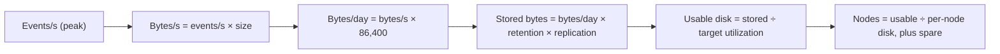

## 🎯 خلاصه

> **Capacity planning** یعنی تبدیل حجم کسب‌وکار به سخت‌افزار: سیستم چقدر CPU، RAM، دیسک و شبکه لازم دارد، با جا برای رشد و برای خرابی‌ها. زنجیره‌ی روش همیشه یکی است: **رویداد در ثانیه → بایت در ثانیه → بایت در روز → × replication × retention → ÷ هدف بهره‌برداری (utilization) → تعداد نود، به‌علاوه‌ی یدکی.**

- از **واحدهای اعشاری** استفاده کن و بنویسش (۱ TB = ۱۰۰۰ GB). ترکیب ۱۰۰۰ و ۱۰۲۴ یک اشتباه کلاسیک با خطای ۷ تا ۱۰٪ است.
- **Replication** هم حجم ذخیره و هم ترافیک نوشتن را ضرب می‌کند. **Retention** فقط حجم ذخیره را ضرب می‌کند. **هدف بهره‌برداری** (مثلاً ۷۰٪ دیسک) جا برای اوج‌ها و بازیابی نگه می‌دارد.
- همیشه برای **اوج** سایز کن، نه میانگین، و برای **سالی که به آن می‌رسی**، نه امروز.
- یک خرابی را تحمل کن: N+1 نود، یا برنامه برای رفتار کلاستر وقتی یک نود از دست می‌رود.
- throughput واقعی، نسبت فشرده‌سازی و سرعت هر core خودت را اندازه بگیر. عددهای این درس فرض‌هایی هستند برای نشان‌دادن محاسبه.

## 🌱 از ساده شروع کنیم (مبتدی)

> **💡 تشبیه:** برنامه‌ریزی یک پارکینگ. برای روز میانگین نمی‌سازی. تعداد ماشین در ساعت، مدت ماندن هر کدام، ساعت‌های شلوغ را می‌شماری، و جای خالی می‌گذاری تا وقتی پر است قفل نشود. پلتفرم‌های داده پارکینگ بایت‌ها هستند.

این سؤالی است که هر سنیور می‌پرسد: *«ما ۵۰٬۰۰۰ رویداد در ثانیه دریافت می‌کنیم. چند سرور لازم داریم؟»* قبل از جواب دادن چهار چیز را لازم داری:

| واقعیت | مقدار مثال | چرا مهم است |
|---|---|---|
| رویداد در ثانیه | ۵۰٬۰۰۰ (اوج ۳ برابر ← ۱۵۰٬۰۰۰) | شبکه و CPU را تعیین می‌کند |
| حجم یک رویداد | ۱ KB | رویداد را به بایت تبدیل می‌کند |
| مدت نگهداری | ۷ روز | دیسک را ضرب می‌کند |
| تعداد نسخه‌ها | ۳ (replication) | دیسک و ترافیک نوشتن را ضرب می‌کند |

آن‌ها را ضرب کن و یک جواب اولیه داری. بقیه‌ی درس درباره‌ی امن‌کردن همین جواب است.

یک بررسی واحد، چون خیلی‌ها اینجا گیر می‌کنند:

```text
1 KB  = 1,000 bytes      (we use decimal units throughout)
1 MB  = 1,000 KB
1 GB  = 1,000 MB
1 TB  = 1,000 GB
```

اگر جایی ۱۰۲۴ و جای دیگر ۱۰۰۰ استفاده کنی، عدد نهایی چند درصد خطا دارد، و این می‌تواند تعداد سروری که می‌خری را تغییر دهد.

## 🔧 واقعاً چطور کار می‌کند (متوسط)

### زنجیره‌ی سایزینگ



هر سیستم گلوگاه خودش را دارد، پس این محاسبه را برای هر منبع جدا انجام می‌دهی و بزرگ‌ترین نتیجه را برمی‌داری.

### مثال ۱: Kafka برای جریان رویدادها

فرض‌ها (با اندازه‌گیری خودت جایگزین کن):

- بار میانگین: ۵۰٬۰۰۰ رویداد در ثانیه، هر کدام ۱ KB ← **۵۰ MB/s** ورودی.
- در روز: ۵۰ MB/s × ۸۶٬۴۰۰ ثانیه = ۴٬۳۲۰٬۰۰۰ MB = **۴٫۳۲ TB در روز**.
- Replication factor برابر ۳ ← **۱۲٫۹۶ TB در روز** روی دیسک.
- Retention برابر ۷ روز ← ۱۲٫۹۶ × ۷ = **۹۰٫۷۲ TB** ذخیره در کلاستر.
- هدف بهره‌برداری ۷۰٪، پس دیسک قابل‌استفاده باید ۹۰٫۷۲ ÷ ۰٫۷۰ = **۱۲۹٫۶ TB** باشد.
- هر broker حدود ۱۲ TB قابل‌استفاده دارد. ۱۲۹٫۶ ÷ ۱۲ = ۱۰٫۸، پس برای ذخیره‌سازی **۱۱ broker** لازم است.

حالا throughput. هر بایت یک بار توسط leader و دو بار توسط followerها نوشته می‌شود، پس ترافیک نوشتن روی دیسک در کل کلاستر ۳ × ۵۰ = **۱۵۰ MB/s** است. اگر تست بار نشان دهد هر broker در بهره‌برداری راحت حدود ۲۴ MB/s را نگه می‌دارد، آنگاه ۱۵۰ ÷ ۲۴ = ۶٫۲۵، پس برای throughput **۷ broker** کافی است. اینجا ذخیره‌سازی محدودیت اصلی است.

در نهایت، خرابی. با ۱۱ broker، با از دست رفتن یکی، ۱۰ تای باقی‌مانده همان ۹۰٫۷۲ TB را نگه می‌دارند، یعنی در زمان re-replication بهره‌برداری ۹۰٫۷۲ ÷ (۱۰ × ۱۲) = ۷۵٫۶٪ می‌شود که از هدف ۷۰٪ بیشتر است. یک یدکی اضافه کن تا ۱۲ broker شود: بهره‌برداری عادی ۹۰٫۷۲ ÷ ۱۴۴ = ۶۳٪ است و بعد از یک خرابی ۹۰٫۷۲ ÷ ۱۳۲ = **۶۸٫۷٪** می‌شود که زیر هدف می‌ماند. **جواب: ۱۲ broker.**

### مثال ۲: Spark برای batch شبانه

یک job شبانه **۲ TB** Parquet فشرده را می‌خواند و باید در **۱ ساعت** تمام شود.

- نرخ اسکن لازم: ۲٬۰۰۰٬۰۰۰ MB ÷ ۳٬۶۰۰ ثانیه = **۵۵۶ MB/s**.
- فرض (اندازه‌گیری‌شده): ۵۰ MB/s برای هر core. ۵۵۶ ÷ ۵۰ = ۱۱٫۱، پس فقط برای اسکن **۱۲ core** لازم است.
- Shuffle، skew و retry زمان می‌گیرند. برای حاشیه دو برابر کن: **۲۴ core**، یعنی شش executor با چهار core هر کدام.

ضریب ۲ عدد جادویی نیست. یک حاشیه‌ی اعلام‌شده است، و در مصاحبه باید بگویی چرا آن را انتخاب کرده‌ای.

### مثال ۳: ClickHouse برای تحلیل

همان ۴٫۳۲ TB رویداد خام در روز برای ۹۰ روز تحلیل وارد ClickHouse می‌شود.

- نسبت فشرده‌سازی فرضی ۸:۱ (روی داده‌ی خودت اندازه بگیر): ۴٫۳۲ ÷ ۸ = **۰٫۵۴ TB در روز** (۵۴۰ GB).
- ۹۰ روز: ۰٫۵۴ × ۹۰ = **۴۸٫۶ TB**.
- Replication factor برابر ۲: ۴۸٫۶ × ۲ = **۹۷٫۲ TB**.
- هدف بهره‌برداری ۷۰٪: ۹۷٫۲ ÷ ۰٫۷۰ = **۱۳۸٫۹ TB** دیسک قابل‌استفاده که باید بخری.

توجه کن که اینجا ClickHouse به دیسک خیلی کمتری نسبت به Kafka در روز نیاز دارد، چون شکل ذخیره‌شده فشرده است، در حالی که Kafka بایت‌های خام را برای replay نگه می‌دارد. همین تفاوت دلیل این است که هر سیستم را جدا سایز می‌کنیم.

### رشد

اگر حجم سالانه ۵۰٪ رشد کند، حجم سال سوم ۱٫۵³ = ۳٫۳۷۵ برابر امروز است. ذخیره‌سازی Kafka بالا تبدیل می‌شود به ۹۰٫۷۲ × ۳٫۳۷۵ = **۳۰۶ TB** ذخیره تا سال سوم. باید تصمیم بگیری برای سال اول بخری و بعداً گسترش دهی، یا از اول برای سال سوم. سخت‌افزار on-premises معمولاً زمان تحویل طولانی دارد، پس جواب اغلب این است: «برای سال دوم سایز کن و همین حالا مسیر گسترش را برنامه‌ریزی کن.»

## 🧠 عمق و trade-offها (سنیور)

- **اوج در برابر میانگین.** ترافیک به‌ندرت یکنواخت است. اگر اوج ۳ برابر میانگین باشد، throughput و CPU را برای اوج سایز کن، ولی ذخیره را برای میانگین ضرب در retention، چون ذخیره انباشته می‌شود و اوج‌ها انباشته نمی‌شوند.
- **حاشیه یک سیاست است، حدس نیست.** هدف دیسک ۷۰٪ وجود دارد تا compaction، re-replication و خرابی یک نود دیسک را پر نکنند. برای Kafka و ClickHouse، merge و rebalance به فضای خالی نیاز دارند. عدد را بنویس و توجیهش کن.
- **Replication یک تصمیم هزینه است.** RF=3 به تو تحمل از دست دادن دو replica را می‌دهد، ولی ذخیره و ترافیک نوشتن را در ۳ ضرب می‌کند. برای یک کپی مشتق‌شده که از منبع قابل بازسازی است، RF=2 یا object storage ممکن است trade-off درست باشد.
- **حافظه به hot set بستگی دارد.** brokerهای Kafka داده‌ی اخیر را از page cache سیستم‌عامل سرو می‌کنند و ClickHouse و Spark وقتی مجموعه‌ی کاری در حافظه جا شود بهترین عملکرد را دارند. RAM را برای داده‌ای سایز کن که مصرف‌کننده‌ها بارها می‌خوانند (ساعت آخر، پارتیشن‌های داغ)، نه برای کل retention.
- **CPU به کار بستگی دارد.** فشرده‌سازی، serialization و aggregation پرمصرف CPU هستند. به‌جای اعتماد به یک قاعده‌ی عمومی، CPU به ازای هر میلیون رویداد را در یک تست واقع‌گرایانه اندازه بگیر.
- **شبکه مشترک است.** replication، مصرف‌کننده‌ها و shuffle در Spark همه از همان NICها عبور می‌کنند. یک لینک ۱۰ Gbps که کاملاً با replication پر شده جا برای مصرف‌کننده ندارد. شبکه را برای هر نقش برنامه‌ریزی کن و uplinkهای سوییچ را چک کن.
- **Object storage در برابر دیسک محلی.** object storage (ببین [[data-lake-object-storage]]) ظرفیت را از محاسبه جدا می‌کند، پس می‌توانی storage و compute را جدا سایز کنی. دیسک محلی برای مسیر داغ سریع‌تر است، ولی ظرفیت را به نودها گره می‌زند. برای هر سیستم انتخاب کن و trade-off را بگو.
- **هزینه یک فرمول است.** هزینه ماهانه ≈ (TB ذخیره × قیمت هر TB در ماه) + (ساعت compute × قیمت هر ساعت) + (egress و پشتیبانی). در on-premises، سخت‌افزار را در طول عمر مفیدش مستهلک کن (مثلاً ۴ سال) و برق، فضای رک و زمان نیروی انسانی را اضافه کن. همین فرمول را برای هر طراحی بیاور تا cloud و on-prem را منصفانه مقایسه کنی.
- **واقعیت‌های on-prem در ایران.** زمان تحویل سخت‌افزار، قیمت دیسک و محدودیت‌های واردات (ببین [[onprem-iran]]) جواب را عوض می‌کنند. طراحی‌ای که ۴۰٪ دیسک بیشتر لازم دارد می‌تواند یک خرید چند ماهه باشد، و این خودش یک ریسک ظرفیت است.
- **با load test اعتبارسنجی کن.** صفحه‌گسترده جواب اول را می‌دهد؛ load test جواب واقعی را. throughput به ازای هر broker و هر core، نسبت فشرده‌سازی واقعی، و زمان بازیابی بعد از کشتن یک نود را اندازه بگیر.
- **جواب را سنجش عقلی کن.** اگر طراحی‌ات برای یک stream با ۵۰ MB/s، ۴۰۰ broker بگوید، چیزی غلط است. با مرتبه‌ی بزرگی عددهایی که می‌شناسی مقایسه کن: چند broker ده‌ها تا صدها MB/s را هندل می‌کنند، و یک دیسک تکی چند TB است. خطاهای ۱۰ برابری رایج‌اند و زود گرفتنشان ارزان است (ببین [[numbers-to-know]]).

## 🧪 امتحان کن

ذخیره‌سازی یک stream با **۲۰٬۰۰۰ رویداد در ثانیه** را سایز کن، با میانگین رویداد **۲ KB**، replication factor **۳**، retention **۱۴ روز**، هدف بهره‌برداری **۶۰٪**، و هر broker با **۱۰ TB** دیسک قابل‌استفاده. واحدهای اعشاری را استفاده کن.

1. قبل از replication، چند TB در روز نوشته می‌شود؟
2. در حالت پایدار چند broker لازم است؟
3. چند broker لازم است تا بعد از از دست رفتن یک broker، بهره‌برداری زیر یا برابر ۶۰٪ بماند؟

<details><summary>حدست چیست؟</summary>

1. ۲۰٬۰۰۰ × ۲ KB = ۴۰٬۰۰۰ KB/s = **۴۰ MB/s**. در روز: ۴۰ × ۸۶٬۴۰۰ = ۳٬۴۵۶٬۰۰۰ MB = **۳٫۴۵۶ TB در روز**.
2. با replication: ۳٫۴۵۶ × ۳ = ۱۰٫۳۶۸ TB در روز. retention: ۱۰٫۳۶۸ × ۱۴ = **۱۴۵٫۱۵۲ TB** ذخیره. دیسک قابل‌استفاده با هدف ۶۰٪: ۱۴۵٫۱۵۲ ÷ ۰٫۶ = **۲۴۱٫۹۲ TB**. تعداد broker: ۲۴۱٫۹۲ ÷ ۱۰ = ۲۴٫۱۹، پس **۲۵ broker**. (بهره‌برداری پایدار با ۲۵ broker: ۱۴۵٫۱۵۲ ÷ ۲۵۰ = ۵۸٪.)
3. با ۲۵ broker، از دست رفتن یکی ۲۴ × ۱۰ = ۲۴۰ TB باقی می‌گذارد، و ۱۴۵٫۱۵۲ ÷ ۲۴۰ = **۶۰٫۵٪**، کمی بالاتر از هدف. با **۲۶ broker**، ۲۵ نود باقی‌مانده می‌دهند ۱۴۵٫۱۵۲ ÷ ۲۵۰ = ۵۸٫۱٪، که زیر ۶۰٪ است. **جواب: ۲۶ broker.**

</details>

## 💬 گوشه‌ی مصاحبه

**سؤال رایج:** «برای این حجم چند سرور لازم داری؟»

- **پاسخ مبتدی:** «شاید ۳ یا ۴ دستگاه، چون داده‌ی زیادی نیست.»
- **پاسخ متوسط:** «رویداد در ثانیه را به بایت در ثانیه تبدیل می‌کنم، در retention و replication ضرب می‌کنم، و بر دیسک قابل‌استفاده‌ی هر نود تقسیم می‌کنم. بعد throughput را جدا چک می‌کنم.»
- **پاسخ سنیور:** «زنجیره‌ی سایزینگ را برای هر منبع انجام می‌دهم و بزرگ‌ترین را برمی‌دارم. throughput را برای اوج و ذخیره را برای retention سایز می‌کنم، هدف بهره‌برداری حدود ۷۰٪ برای merge و بازیابی در نظر می‌گیرم، و یک نود یدکی اضافه می‌کنم تا کلاستر یک خرابی را تحمل کند. فرض‌هایم مثل فشرده‌سازی و throughput هر core را می‌گویم و قبل از خرید با load test اعتبارسنجی‌شان می‌کنم.»

> **🎤 این را در مصاحبه بگو:** «از حجم شروع می‌کنم: رویداد در ثانیه ضرب در اندازه می‌دهد بایت در ثانیه. ذخیره‌سازی می‌شود آن ضرب در retention ضرب در replication، تقسیم بر هدف بهره‌برداری ۷۰٪، تا جا برای merge و بازیابی بماند. throughput را جدا در اوج سایز می‌کنم و بزرگ‌ترین نتیجه به‌علاوه‌ی یک نود یدکی را برمی‌دارم. عددها فرض‌هایی هستند که قبل از خرید با load test اعتبارسنجی می‌کنم، چون هزینه را تعیین می‌کنند.»

## ⚠️ اشتباهات رایج

> **⚠️ مراقب باش:** فراموش کردن replication. رایج‌ترین خطا این است که دیسک را برای داده‌ی خام سایز می‌کنند و فراموش می‌کنند RF=3 آن را سه برابر می‌کند.

- **سایز برای میانگین.** سیستمی که در ۴۰٬۰۰۰ رویداد در ثانیه خوب است، در اوج ۱۵۰٬۰۰۰ خراب می‌شود. همیشه بگو برای کدام بار سایز کرده‌ای.
- **ترکیب ۱۰۰۰ و ۱۰۲۴.** جواب را چند درصد عوض می‌کند. اعشاری را انتخاب کن، بنویس، و نگهش دار.
- **فراموش کردن حاشیه.** دیسکی که ۹۸٪ پر است نمی‌تواند merge، rebalance یا بازیابی کند. بهره‌برداری را برنامه‌ریزی کن، نه ظرفیت خام.
- **نادیده گرفتن حالت خرابی.** کلاستری که دقیقاً برای حالت پایدار سایز شده، روزی که یک نود بمیرد overload می‌شود.
- **گرفتن نسبت فشرده‌سازی از یک وبلاگ.** فشرده‌سازی به داده‌ی تو بستگی دارد. روی یک نمونه اندازه بگیر.
- **یک عدد برای همه‌ی سیستم‌ها.** Kafka، Spark CPU و دیسک ClickHouse گلوگاه‌های متفاوتی دارند. هر کدام را جدا سایز کن.
- **بدون رشد.** طراحی‌ای که امروز جواب می‌دهد و ۱۲ ماه بعد بازسازی لازم دارد، طراحی خوبی نیست، به‌خصوص برای سخت‌افزار on-prem.

## ✅ خودت را بسنج

1. یک stream با ۱۰ MB/s و replication factor برابر ۳ داریم. ترافیک کل نوشتن روی دیسک‌ها در کلاستر، با شمردن هر replica یک بار، چقدر است؟
   - A) ۱۰ MB/s
   - B) ۲۰ MB/s
   - C) ۳۰ MB/s
   - D) ۳ MB/s

2. retention برابر ۷ روز است، stream قبل از replication روزانه ۱ TB می‌نویسد، RF=3 است و هدف بهره‌برداری ۷۰٪. چقدر دیسک قابل‌استفاده لازم داری؟
   - A) ۲۱ TB
   - B) ۱۰ TB
   - C) ۲۱ ÷ ۰٫۷ = ۳۰ TB، از ۳ × ۷ = ۲۱ TB ذخیره‌شده
   - D) ۷ TB

3. برای یک کلاستر Kafka با retention طولانی، معمولاً کدام منبع محدودیت اصلی است؟
   - A) CPU
   - B) ظرفیت دیسک
   - C) حافظه‌ی GPU
   - D) lookupهای DNS

4. **سناریو (سنیور):** همکارت یک job Spark را این‌طور سایز کرده: «۲ TB در یک ساعت، پس ۲ TB ÷ ۳٬۶۰۰ ثانیه، تمام.» این تخمین چه چیزی را ندارد و چطور اصلاحش می‌کنی؟

5. **چرا/trade-off (سنیور):** تیم می‌خواهد RF=3 برای یک جدول تحلیلی مشتق‌شده داشته باشد که از منبع در یک روز قابل بازسازی است. چه پیشنهادی می‌دهی و چه چیزی را از دست می‌دهی؟

<details><summary>جواب</summary>

1. **C** — هر بایت یک بار توسط leader و دو بار توسط followerها نوشته می‌شود: ۱۰ × ۳ = ۳۰ MB/s نوشتن روی دیسک در کل کلاستر.
2. **C** — ۱ TB در روز × ۷ روز = ۷ TB، ضرب در RF=3 = ۲۱ TB ذخیره، تقسیم بر ۰٫۷ = ۳۰ TB قابل‌استفاده. گزینه‌ی A حاشیه را نادیده می‌گیرد، و B و D یا replication یا حاشیه را.
3. **B** — retention طولانی یعنی داده‌ی ذخیره‌شده‌ی زیاد. ظرفیت دیسک، معمولاً همراه با حاشیه‌ی بهره‌برداری، اندازه‌ی کلاستر را تعیین می‌کند، در حالی که throughput یا CPU ممکن است فقط در اوج مهم باشند.
4. این تخمین ورودی خام را به‌کار می‌گیرد و throughput هر core، سرعت واقعی کلاستر، سربار shuffle و skew، retry و حاشیه‌ی اطمینان را نادیده می‌گیرد. اصلاح: throughput هر core را اندازه بگیر، core لازم برای یک ساعت را حساب کن، بعد برای shuffle و skew حاشیه اضافه کن (مثلاً ۲ برابر) و فرض را بگو.
5. پیشنهاد RF=2 است، یا نگه داشتن جدول در object storage (که دوام را لایه‌ی storage تضمین می‌کند) و بازسازی از منبع در صورت نیاز. آنچه از دست می‌دهی کمی حاشیه‌ی دوام و failover آنی یک replica اضافه است، پس برای جدولی که بازسازی‌اش ارزان است، بازیابی طولانی‌تر را می‌پذیری. برای جدولی که بازسازی‌اش گران یا غیرممکن است، RF=3 همچنان انتخاب درست است.

</details>

## 🗂️ فلش‌کارت

| Front | Back |
|---|---|
| زنجیره‌ی سایزینگ | رویداد/ثانیه × اندازه → بایت/ثانیه → بایت/روز × retention × replication ÷ هدف بهره‌برداری → نود + یدکی |
| چرا ۷۰٪ بهره‌برداری | جا برای merge، rebalance و بازیابی بعد از خرابی یک نود |
| اثر replication روی دیسک | بایت‌های ذخیره‌شده و ترافیک نوشتن را در RF ضرب می‌کند |
| اوج در برابر میانگین | throughput و CPU برای اوج؛ ذخیره از میانگین انباشته پیروی می‌کند |
| سایز N+1 | طوری برنامه‌ریزی کن که بعد از از دست رفتن یک نود هم به هدف‌ها برسی |
| نسبت فشرده‌سازی | باید روی داده‌ی خودت اندازه گرفته شود؛ هرگز از یک وبلاگ فرض نکن |
| رشد ۵۰٪ سالانه در سال سوم | ۱٫۵³ = ۳٫۳۷۵ برابر حجم امروز |
| فرمول هزینه | هزینه‌ی storage + compute + egress/پشتیبانی؛ برای on-prem سخت‌افزار را مستهلک کن |

## 🔗 ادامه

- [[data-estimation]] — روش کلی تخمین سریع در system design.
- [[numbers-to-know]] — عددهای مرتبه‌ی بزرگی که خطاهای ۱۰ برابری را می‌گیرند.
- [[kafka-architecture]] و [[kafka-retention-compaction]] — اینکه partition، replica و retention چطور تعداد broker و دیسک را تعیین می‌کنند.
- [[spark-memory-tuning]] و [[spark-shuffle]] — حافظه و شبکه‌ی Spark کجا مصرف می‌شوند و چرا حاشیه مهم است.
- [[data-retention]] — سیاست‌های tiering و حذف که ذخیره‌ای که باید بخری را کم می‌کنند.
- [[onprem-iran]] — زمان تحویل سخت‌افزار، قیمت دیسک و هزینه‌ی اشتباه در on-premises.
