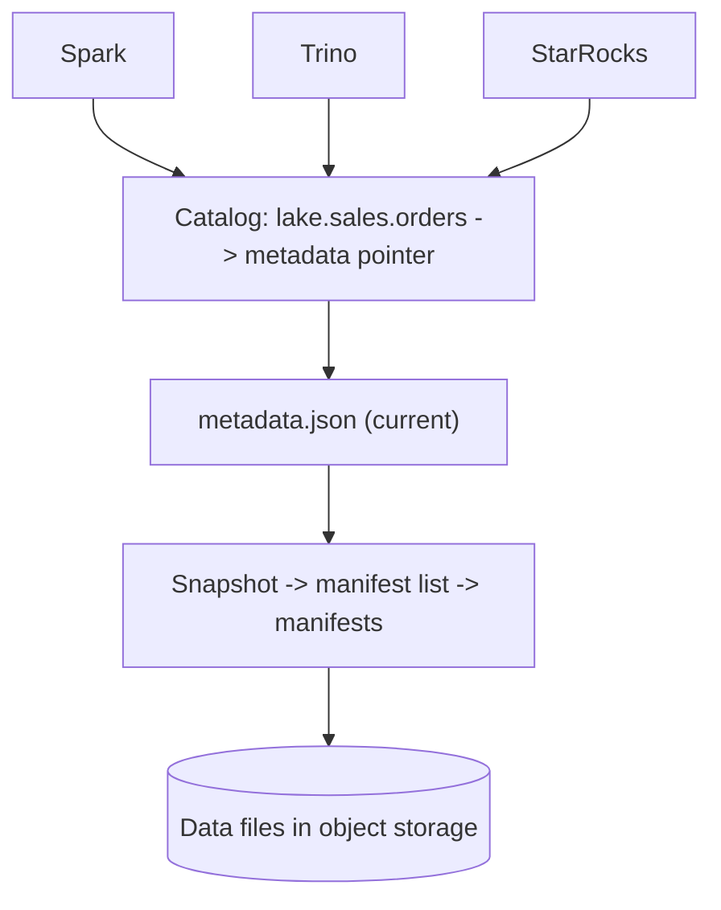

## 🎯 خلاصه

> **catalog** (metastore) دایرکتوری‌ای است که نام یک جدول را به **جایی که metadata فعلی‌اش قرار دارد** و به **اینکه چه کسی اجازه‌ی تغییرش را دارد** وصل می‌کند. در lakehouse این تنها جایی است که چند موتور روی نسخه‌ی فعلی یک جدول توافق می‌کنند.

- فایل‌های داده و metadata جدول در object storage هستند؛ catalog فقط یک **اشاره‌گر** به metadata فعلی نگه می‌دارد.
- یک **commit** یعنی جابه‌جایی اتمیک همان اشاره‌گر. همین compare-and-swap تک‌مرحله‌ای است که نوشتن هم‌زمان را امن می‌کند.
- گزینه‌های رایج: **Hive Metastore (HMS)**، **AWS Glue**، **REST catalog** ها (طبق مشخصات REST آیسبرگ که Polaris، Nessie، Unity Catalog و دیگران پیاده‌سازی کرده‌اند)، و **Nessie** (شاخه و تگ به سبک git برای داده).
- دسترسی چندموتوره (Spark می‌نویسد، Trino و StarRocks می‌خوانند) فقط وقتی کار می‌کند که همه‌ی موتورها به یک catalog وصل باشند.

## 🌱 از ساده شروع کنیم (مبتدی)

> **💡 تشبیه:** یک کتابخانه کتاب‌ها را روی قفسه دارد (فایل‌های داده) و برای هر عنوان یک کارت فهرست (metadata). کارت می‌گوید «چاپ فعلی *مهندسی داده* روی قفسه‌ی ۴، جعبه‌ی ۱۲، چاپ ۷ است». وقتی چاپ جدید می‌آید، کتابدار کارت را در یک مرحله عوض می‌کند. خوانندگانی که کارت را نگاه می‌کنند همیشه یک چاپ سازگار می‌گیرند. فهرست کارت‌ها همان **catalog** است.

بدون catalog، هر موتور باید حدس بزند. این مسیر را در نظر بگیر:

```text
s3://lake/warehouse/orders/metadata/00007-9f3c.metadata.json   <- کدام فعلی است؟
s3://lake/warehouse/orders/metadata/00006-1a2b.metadata.json
s3://lake/warehouse/orders/data/part-0001.parquet
```

کدام فایل metadata فعلی است؟ اگر دو job اسپارک هم‌زمان بنویسند، ممکن است هر دو `00007` را بنویسند و یکی دیگری را بازنویسی کند. catalog وجود دارد تا به «کدام فایل فعلی است؟» جواب دهد و وقتی نوشتن دوم قرار است نوشتن اول را خراب کند، آن را رد کند.

catalog سه چیز می‌دهد:

1. **نام.** `lake.sales.orders` برای اشتراک‌گذاری از یک مسیر راحت‌تر است.
2. **یک نسخه‌ی فعلی.** هر موتور از همان جا می‌پرسد.
3. **قواعد دسترسی.** چه کسی می‌تواند جدول را بخواند یا بنویسد.

## 🔧 واقعاً چطور کار می‌کند (متوسط)

### catalog در برابر فرمت جدول

**فرمت جدول** (Iceberg، Delta، Hudi) فایل‌های metadata، snapshot ها و manifest ها را تعریف می‌کند. **catalog** نام و اشاره‌گر به metadata فعلی را نگه می‌دارد. این دو لایه‌ی جدا هستند:



موتورها اشاره‌گر را می‌خوانند، بعد درخت metadata را تا فایل‌های داده دنبال می‌کنند. نویسنده‌ها اول فایل‌های جدید می‌سازند، بعد از catalog می‌خواهند اشاره‌گر را جابه‌جا کند.

### چطور یک commit کار می‌کند (کنترل هم‌روندی خوش‌بینانه)

1. نویسنده اشاره‌گر فعلی را می‌خواند (فرض کن نسخه ۶).
2. فایل‌های داده‌ی جدید و یک فایل metadata جدید (نسخه ۷) می‌نویسد. هنوز چیزی قابل‌دیدن نیست.
3. از catalog می‌خواهد «اشاره‌گر را از نسخه ۶ به نسخه ۷ ببر»، به‌صورت یک **compare-and-swap**.
4. اگر اشاره‌گر هنوز نسخه ۶ است، جابه‌جایی موفق است و خوانندگان نسخه ۷ را می‌بینند.
5. اگر نویسنده‌ی دیگری قبلاً آن را به نسخه ۷ برده، جابه‌جایی شکست می‌خورد. نویسنده دوباره لود می‌کند، تعارض‌ها را بررسی می‌کند و retry می‌کند (یا تسلیم می‌شود).

به همین دلیل catalog باید به‌روزرسانی **اتمیک** اشاره‌گر را تضمین کند. یک فروشگاه فایل ساده بدون این تضمین می‌تواند commit ها را از دست بدهد. این همان ایده‌ی snapshot های time-travel در [[time-travel]] و isolation در [[acid]] است.

### Hive Metastore

HMS قدیمی‌ترین و گسترده‌ترین catalog است. یک سرویس با API از نوع **Thrift** است که پشتش یک دیتابیس رابطه‌ای (MySQL، PostgreSQL) قرار دارد. تعریف دیتابیس و جدول، نوع ستون‌ها، مکان partition ها و property های جدول را نگه می‌دارد.

- Hive، Spark، Trino و Impala همگی آن را می‌فهمند، و به همین دلیل در پلتفرم‌های دوره‌ی Hadoop catalog مشترک پیش‌فرض بوده است.
- محدودیت‌ها: مدلش **partition** ها را نگه می‌دارد، نه نسخه‌های جدول. لیست کردن partition های زیاد کند است، و تغییر اتمیک روی چند جدول در مدلش نیست. فرمت‌های lakehouse خودشان metadata دارند، پس HMS عمدتاً نام و اشاره‌گر را نگه می‌دارد.
- تنظیم معمول Spark:

```properties
spark.sql.catalogImplementation=hive
hive.metastore.uris=thrift://hms.internal:9083
```

### REST catalog ها و مشخصات REST آیسبرگ

آیسبرگ یک **مشخصات REST catalog** تعریف می‌کند: یک API استاندارد HTTP برای namespace، جدول و commit اتمیک. هر موتوری که این مشخصات را بفهمد می‌تواند با هر سروری که آن را پیاده‌سازی کرده کار کند. این جهتی است که اکوسیستم دارد می‌رود: یک پروتکل، چند سرور.

```properties
# Spark: یک catalog آیسبرگ به اسم "lake" با سرور REST
spark.sql.catalog.lake = org.apache.iceberg.spark.SparkCatalog
spark.sql.catalog.lake.type = rest
spark.sql.catalog.lake.uri = https://catalog.internal/api/catalog
spark.sql.catalog.lake.warehouse = s3://lake-warehouse
spark.sql.extensions = org.apache.iceberg.spark.extensions.IcebergSparkSessionExtensions
```

```sql
-- بعد از تنظیمات، هر session اسپارک همان جدول را می‌بیند
CREATE NAMESPACE IF NOT EXISTS lake.sales;
CREATE TABLE lake.sales.orders (id BIGINT, amount DECIMAL(12,2), order_ts TIMESTAMP)
USING iceberg
PARTITIONED BY (days(order_ts));
```

Trino و StarRocks همان جدول را از طریق connector های آیسبرگ خودشان می‌خوانند، که به همان endpoint REST وصل شده‌اند. نام دقیق property ها بین موتورها و نسخه‌ها فرق دارد؛ مستندات connector نسخه‌ی خودت را چک کن.

### Nessie: شاخه برای داده

Nessie عملیات **به سبک git** را به catalog اضافه می‌کند: commit، شاخه و تگ روی **چند جدول هم‌زمان**. یک شاخه اجازه می‌دهد یک مرحله‌ی ETL پرریسک را اجرا کنی، با query نتایج را بررسی کنی، و بعد شاخه را **merge** کنی تا همه‌ی جدول‌های تغییرکرده با هم دیده شوند. خوانندگان روی `main` هیچ‌وقت نیمه‌ی یک اجرا را نمی‌بینند.

این یک تغییر اتمیک روی چند جدول است که commit ساده‌ی آیسبرگ روی هر جدول جدا ارائه نمی‌دهد. برای pipeline هایی که باید چند جدول را با هم منتشر کنند مفید است، اما وزن عملیاتی اضافه می‌کند (تعارض merge و پاک‌سازی شاخه واقعی‌اند).

### Polaris، Unity Catalog و catalog های ابری

- **Apache Polaris** یک catalog باز است که REST API آیسبرگ را پیاده‌سازی می‌کند و کنترل دسترسی مبتنی بر نقش برای namespace و جدول دارد.
- **Unity Catalog** (از Databricks، متن‌باز شده) نام سه‌سطحی (`catalog.schema.table`)، حاکمیت داده برای جدول، فایل و مدل، و دسترسی REST برای آیسبرگ و Delta فراهم می‌کند.
- **AWS Glue Data Catalog** یک catalog مدیریت‌شده و سازگار با HMS در AWS است و برای بسیاری از lake های AWS پیش‌فرض است.

API و فرمت‌های جدولی که هر محصول در نسخه‌ی تو پشتیبانی می‌کند را چک کن؛ پشتیبانی‌ها سریع تغییر می‌کنند.

### catalog چه چیزی نیست

**catalog فنی** (این درس) اشاره‌گرها و schema ها را نگه می‌دارد. **data catalog** (جست‌وجو، مالکیت، توضیحات، lineage) محصول دیگری است که اغلب از catalog فنی می‌خواند. به [[data-catalogs]] و [[data-lineage]] نگاه کن.

## 🧠 عمق و trade-offها (سنیور)

- **catalog یک نقطه‌ی هماهنگی واحد است.** اگر از کار بیفتد، نوشتن متوقف می‌شود و بیشتر خواندن‌ها شکست می‌خورند. آن را با دسترس‌پذیری بالا اجرا کن، با یک دیتابیس مدیریت‌شده پشتش، و تأخیر درخواست‌ها را پایش کن، چون هر query و هر commit به آن می‌خورد.
- **رقابت روی commit.** نویسنده‌های زیاد روی یک جدول باعث retry و کار هدررفته می‌شوند. نوشتن‌های کوچک را batch کن، پارتیشن‌بندی‌ای انتخاب کن که نویسنده‌ها را از هم جدا کند، و اجازه نده job استریمینگ هر ثانیه روی جدولی commit کند که پنج job batch هم روی آن به‌روزرسانی می‌کنند.
- **رشد metadata.** هر commit یک snapshot اضافه می‌کند. snapshot های قدیمی و فایل های یتیم را طبق زمان‌بندی منقضی و پاک کن؛ بدون این کار metadata و storage بی‌پایان رشد می‌کنند و برنامه‌ریزی query کند می‌شود.
- **مرز امنیتی.** ACL های جدول در catalog فقط تا جایی قوی‌اند که credential های storage قوی باشند. اگر موتورها بتوانند مستقیم bucket را بخوانند، منع در سطح catalog دور زده می‌شود. جایی که catalog پشتیبانی می‌کند از credential های محدود یا vended استفاده کن.
- **قفل شدن در برابر باز بودن.** انتخاب یک catalog اختصاصی برای حاکمیت می‌تواند فرمت جدول را به موتورهای یک فروشنده گره بزند. مشخصات REST را ترجیح بده و بررسی کن هر موتوری که لازم داری با آن تست شده است.
- **چندابری و بازیابی از فاجعه.** catalog مجموعه‌ی واحدی از اشاره‌گرهاست. کپی داده کافی نیست؛ برنامه‌ی بازیابی catalog، یا بازسازی اشاره‌گرها از فایل‌های metadata، را هم داشته باش و تستش کن.
- **کی catalog اضافه نکنی.** یک موتور، یک تیم و فایل‌هایی که هرگز به اشتراک گذاشته نمی‌شوند، catalog مشترک نمی‌خواهند. لحظه‌ای که دو موتور یا دو تیم به یک جدول نیاز داشته باشند، catalog ارزش هزینه‌اش را دارد.

## 🧪 امتحان کن

یک lakehouse محلی با Spark و یک REST catalog راه بینداز (مثلاً fixture مربوط به Iceberg REST یا Nessie در Docker). بعد با دستورها به این سؤال‌ها جواب بده:

۱. یک namespace و یک جدول بساز، سه ردیف از Spark insert کن، و از یک session دوم Spark که همان نام catalog را دارد بخوانشان.
۲. یک تعارض بساز: دو دستور `INSERT` روی همان جدول را از دو session هم‌زمان شروع کن. ببین آیا یکی با خطای تعارض commit شکست می‌خورد یا هر دو موفق می‌شوند (و چرا).
۳. فایل metadata فعلی جدول را از API مربوط به catalog یا با `SELECT * FROM lake.sales.orders.snapshots` (جدول metadata آیسبرگ) پیدا کن. توضیح بده یک commit جدید اشاره‌گر را چطور تغییر می‌دهد.

<details><summary>Show solutions</summary>

۱. بعد از `CREATE TABLE`، با `INSERT INTO lake.sales.orders VALUES (...)` هر session که با همان URI و نام catalog تنظیم شده باشد ردیف‌ها را می‌بیند. اگر session دوم ردیفی نمی‌بیند، بررسی کن هر دو از warehouse و نام catalog یکسان استفاده می‌کنند.
۲. آیسبرگ از کنترل هم‌روندی خوش‌بینانه استفاده می‌کند. commit دوم روی همان نسخه‌ی پایه در compare-and-swap شکست می‌خورد؛ Spark بسته به نوع عملیات و تنظیمات، خطای commit یا تعارض گزارش می‌کند یا retry می‌کند. append های روی partition های مختلف اغلب با یک retry موفق می‌شوند.
۳. جدول snapshot ها هر snapshot را با یک manifest list نشان می‌دهد. یک commit جدید یک snapshot اضافه می‌کند و اشاره‌گر metadata را به فایل metadata جدید می‌برد. فایل‌های قدیمی تا وقتی منقضی نشوند باقی می‌مانند.

</details>

## 💬 گوشه‌ی مصاحبه

**سؤال: «catalog در lakehouse چیست و چرا مهم است؟»**

- **جواب متوسط:** «یک ثبت‌کننده‌ی جدول است، مثل Hive Metastore. نام‌ها را به مکان‌ها و schema ها وصل می‌کند تا Spark، Trino و بقیه بتوانند روی یک جدول query بزنند.»
- **جواب سنیور:** «نقطه‌ی هماهنگی است که اشاره‌گر به metadata فعلی هر جدول را نگه می‌دارد و commit های اتمیک با compare-and-swap انجام می‌دهد. همین باعث می‌شود چند موتور نمای سازگار داشته باشند و به‌روزرسانی‌های گمشده رخ ندهد. برای باز بودن یک پیاده‌سازی از مشخصات REST آیسبرگ را انتخاب می‌کنم، دسترس‌پذیری بالا می‌خواهم، و برای expire کردن snapshot ها، کنترل دسترسی و بازیابی از فاجعه برنامه دارم.»

**سؤال: «دو job اسپارک روی یک جدول آیسبرگ می‌نویسند. چه می‌شود؟»**

هر دو فایل‌های جدید می‌سازند، بعد سعی می‌کنند اشاره‌گر catalog را جابه‌جا کنند. یکی موفق می‌شود، دیگری تغییر نسخه‌ی پایه را تشخیص می‌دهد و retry یا شکست می‌خورد. این catalog است، نه storage، که به‌روزرسانی گمشده را جلوگیری می‌کند.

> **🎤 این را در مصاحبه بگو:** «catalog تنها اشاره‌گری را نگه می‌دارد که نسخه‌ی فعلی جدول را تعریف می‌کند. commit ها جابه‌جایی اتمیک همین اشاره‌گرند، پس همه‌ی موتورها روی نسخه توافق دارند. catalog جایی است که دسترسی را اعمال می‌کنم و برای دسترس‌پذیری و پاک‌سازی برنامه دارم.»

## ⚠️ اشتباهات رایج

> **⚠️ هشدار:** دو موتور با نام catalog یا warehouse متفاوت که به یک bucket اشاره می‌کنند. یکی جدول‌های متفاوت می‌بیند، یا یکی فایل‌هایی می‌نویسد که دیگری پیدا نمی‌کند.

> **⚠️ هشدار:** نوشتن مستقیم فایل‌های آیسبرگ در bucket و انتظار اینکه خوانندگان آن‌ها را پیدا کنند. بدون commit به catalog، فایل‌های جدید دیده نمی‌شوند (یا بدتر، ویرایش دستی metadata جدول را خراب می‌کند).

- این باور که catalog همان data catalog (جست‌وجو و lineage) است. آن‌ها مسئله‌های متفاوتی را حل می‌کنند.
- نادیده گرفتن expire کردن snapshot، تا جایی که metadata و فایل‌های کوچک انباشته شوند و برنامه‌ریزی کند شود.
- استفاده از لیست partition های HMS برای جدول‌هایی با صدها هزار partition، و بعد سرزنش کردن موتور.
- دادن دسترسی در سطح جدول در catalog، در حالی که credential های bucket برای همه‌ی موتورها باز است.
- انتخاب catalog بدون بررسی اینکه کدام موتورها و فرمت‌های جدولی را در نسخه‌ای که اجرا می‌کنی پشتیبانی می‌کند.
- فراموش کردن اینکه catalog نقطه‌ی خرابی واحد کل lakehouse است.

## ✅ خودت را بسنج

۱. catalog برای یک جدول آیسبرگ چه چیزی را نگه می‌دارد؟
   - A) همه‌ی ردیف‌های داده
   - B) اشاره‌گر به فایل metadata فعلی، به‌همراه نام جدول و اطلاعات دسترسی
   - C) کپی همه‌ی فایل‌های Parquet
   - D) فقط آمار query

<details><summary>Answer</summary>

**B** — فایل‌های داده و metadata در object storage هستند. catalog نام و یک اشاره‌گر به‌صورت اتمیک به‌روزرسانی‌شونده را نگه می‌دارد.

</details>

۲. چرا یک commit آیسبرگ نیاز به compare-and-swap اتمیک در catalog دارد؟
   - A) برای فشرده‌سازی فایل‌های داده
   - B) تا دو نویسنده که از یک نسخه شروع کرده‌اند نتوانند هر دو موفق شوند و بی‌صدا یکدیگر را بازنویسی کنند
   - C) تا نیاز به پارتیشن از بین برود
   - D) برای رمزنگاری metadata

<details><summary>Answer</summary>

**B** — جابه‌جایی فقط وقتی موفق است که اشاره‌گر هنوز نسخه‌ی مورد انتظار را داشته باشد. این از به‌روزرسانی گمشده بین نویسنده‌های هم‌زمان جلوگیری می‌کند.

</details>

۳. کدام گزینه باز‌ترین و قابل‌حمل‌ترین راه برای اشتراک یک catalog آیسبرگ بین موتورهاست؟
   - A) یک catalog که فقط موتور یک فروشنده آن را پشتیبانی می‌کند
   - B) پیاده‌سازی مشخصات REST catalog آیسبرگ
   - C) کپی کردن فایل‌های metadata روی دیسک محلی هر موتور
   - D) داشتن catalog جدا برای هر تیم با نام جدول‌های یکسان

<details><summary>Answer</summary>

**B** — مشخصات REST یک پروتکل مشترک است که چند سرور پیاده‌سازی می‌کنند، پس موتورها به یک فروشنده گره نمی‌خورند. کپی‌های محلی و نام‌های تکراری نماهای متفاوتی می‌سازند.

</details>

۴. **(سنیور)** یک job شبانه سه جدول مرتبط را به‌روز می‌کند و گاهی داشبورد داده‌ی جدید یک جدول را کنار مقدار قدیمی جدول دیگر نشان می‌دهد. کدام قابلیت catalog این را حل می‌کند و trade-off آن چیست؟

   - A) partition pruning
   - B) شاخه‌ها با commit چندجدولی (مثلاً Nessie): job را روی یک شاخه اجرا کن، بررسی کن، و یک‌بار merge کن؛ trade-off آن سربار عملیاتی و تعارض merge است
   - C) افزایش تعداد executor های Spark
   - D) تغییر فرمت جدول به CSV

<details><summary>Answer</summary>

**B** — شاخه کل اجرا را جدا می‌کند و یک merge واحد هر سه جدول را با هم منتشر می‌کند. هزینه، عملیات اضافه است: مدیریت شاخه، مدیریت تعارض و پاک‌سازی.

</details>

۵. **(سنیور)** catalog تو یک سرویس مدیریت‌شده با SLA است، اما bucket داده با همان credential موتور قابل خواندن است. چرا این یک شکاف حاکمیتی است؟

   - A) object storage قابل امن‌سازی نیست
   - B) موتورها می‌توانند فایل‌های داده را مستقیم بخوانند و دسترسی‌های جدولی تعریف‌شده در catalog را دور بزنند؛ از credential های محدود یا vended استفاده کن و دسترسی مستقیم به bucket را فقط به principal های catalog بده
   - C) catalog ها نمی‌توانند دسترسی را ذخیره کنند
   - D) سرویس‌های مدیریت‌شده هرگز امنیت سطح ردیف ندارند

<details><summary>Answer</summary>

**B** — دسترسی‌های catalog فقط دسترسی از مسیر catalog را کنترل می‌کنند. اگر credential های storage گسترده باشند، همان فایل‌ها بدون عبور از بررسی‌های catalog قابل خواندن‌اند.

</details>

## 🗂️ فلش‌کارت

| Front | Back |
|---|---|
| یک catalog جدول چه چیزی را نگه می‌دارد؟ | نام جدول، schema و اشاره‌گر به metadata فعلی (نه خود داده) |
| چرا commit یک جابه‌جایی اتمیک است؟ | تا نویسنده‌های هم‌زمان نتوانند هر دو از یک نسخه‌ی پایه موفق شوند |
| پشتوانه‌ی Hive Metastore | یک دیتابیس رابطه‌ای (مثلاً MySQL یا PostgreSQL) که با API از نوع Thrift در دسترس است |
| مشخصات Iceberg REST چه چیزی را استاندارد می‌کند؟ | یک API HTTP برای namespace، جدول و commit اتمیک |
| Nessie چه چیزی اضافه می‌کند؟ | شاخه، تگ و commit چندجدولی به سبک git برای داده |
| catalog فنی در برابر data catalog | فنی اشاره‌گرها و schema ها را نگه می‌دارد؛ data catalog جست‌وجو، مالکیت و lineage اضافه می‌کند |
| چرا snapshot های قدیمی انقضا لازم دارند؟ | آن‌ها metadata و فایل‌ها را زنده نگه می‌دارند؛ بدون انقضا، storage و برنامه‌ریزی رشد می‌کنند |
| شکاف حاکمیتی که باید از آن پرهیز کرد | credential های گسترده‌ی bucket که دسترسی های catalog را دور می‌زنند |

## 🔗 ادامه

- **lakehouse-table-formats** درخت metadata را توضیح می‌دهد که catalog به آن اشاره می‌کند.
- **data-catalogs** کاتالوگ رو به کسب‌وکار، جست‌وجو و مالکیت را پوشش می‌دهد.
- **data-lineage** نشان می‌دهد metadata catalog چطور به ابزارهای lineage می‌رسد.
- **trino** و **starrocks-doris** دو موتوری هستند که همان catalog را می‌خوانند؛ مدل connector آن‌ها را مقایسه کن.
- **data-lake-object-storage** لایه‌ی storage را توضیح می‌دهد که فایل‌های مورد اشاره‌ی catalog را نگه می‌دارد.
