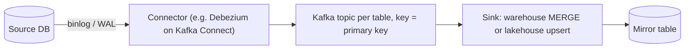
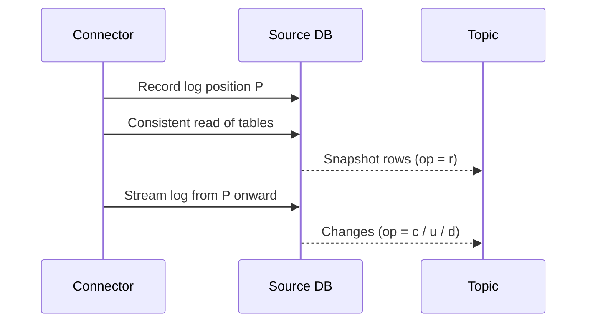

## 🎯 خلاصه

> **Change Data Capture (CDC)** هر insert، update و delete در دیتابیس مبدأ را به یک event تبدیل می‌کند که سیستم‌های پایین‌دستی می‌توانند مصرف کنند، معمولاً تقریباً در لحظه.

- **CDC مبتنی بر log** لاگ تراکنش خود دیتابیس را می‌خواند (binlog در MySQL، WAL در PostgreSQL). همه‌ی تغییرات کامیت‌شده، از جمله حذف‌ها، را به ترتیب کامیت می‌بیند.
- **CDC مبتنی بر query** جدول‌ها را با watermark بررسی می‌کند (به [[batch-ingestion]] مراجعه کنید). ساده‌تر است، اما حذف‌ها را نمی‌بیند و ممکن است کامیت‌های دیررس را از دست بدهد.
- یک طراحی کامل CDC چهار بخش دارد: یک **snapshot اولیه**، یک **فاز streaming** که از همان موقعیت log ادامه می‌دهد، یک **sink** که event ها را idempotent اعمال می‌کند، و برنامه برای **تغییر schema** و **سلامت replication slot**.
- هدف معمولاً یک **جدول آینه‌ای** در انبار داده (یا lakehouse) است که با مبدأ یکی باشد و حذف‌ها هم اعمال شده باشند.

## 🌱 از ساده شروع کنیم (مبتدی)

> **💡 تشبیه:** یک مغازه دوربین امنیتی دارد که هر تغییری در قفسه‌ها را ضبط می‌کند. شما هر ساعت نمی‌روید و قفسه‌ها را با یادداشت‌هایتان مقایسه نمی‌کنید (این روش query-based است). ضبط را نگاه می‌کنید و هر تغییر را همان لحظه کپی می‌کنید (این روش log-based است). ضبط حتی کالایی که برداشته شده را هم نشان می‌دهد، پس هرگز مجبور نیستید حدس بزنید.

فرض کنید جدول `orders` در دیتابیس یک فروشگاه را داریم. اپلیکیشن سفارشی را از `NEW` به `PAID` تغییر می‌دهد. با CDC مبتنی بر log، یک connector تغییر را از لاگ دیتابیس می‌خواند و یک event مثل این (ساده‌شده، به سبک Debezium) منتشر می‌کند:

```json
{
  "op": "u",
  "before": { "id": 42, "status": "NEW",  "amount": 250000 },
  "after":  { "id": 42, "status": "PAID", "amount": 250000 },
  "source": { "db": "shop", "table": "orders", "lsn": 918273645 },
  "ts_ms": 1760346000456
}
```

فیلدهای مهم:

- **`op`**: `c` (create)، `u` (update)، `d` (delete)، `r` (ردیفی که در snapshot اولیه خوانده شده).
- **`before` / `after`**: ردیف قبل و بعد از تغییر. یک delete فقط `before` دارد؛ یک create فقط `after`.
- **`source`**: منشأ تغییر، از جمله یک موقعیت در log. همین موقعیت است که امکان مرتب‌سازی event ها و ادامه‌دادن بعد از ری‌استارت را می‌دهد.

یک سیستم پایین‌دستی که این event ها را یکی‌یکی و به ترتیب اعمال کند، در نهایت به همان جدول مبدأ می‌رسد.

## 🔧 واقعاً چطور کار می‌کند (متوسط)

یک pipeline معمول CDC مبتنی بر log این شکل را دارد:



**چرا log کار می‌کند.** دیتابیس‌ها از قبل برای replication و بازیابی بعد از crash یک log می‌نویسند. CDC این log را مثل یک replica می‌خواند. برای مبدأ ارزان است (کوئری اضافه نمی‌زند) و فقط تغییرات کامیت‌شده را می‌بیند.

- **MySQL**: binary log باید روشن و در حالت `ROW` باشد، تا هر event تصویر کامل ردیف‌ها را داشته باشد.
- **PostgreSQL**: logical decoding از طریق یک **replication slot** و یک output plugin، WAL را می‌خواند. slot نگه می‌دارد مصرف‌کننده تا کجا خوانده است.

**snapshot اولیه.** connector نمی‌تواند از «الان» شروع کند و ردیف‌های موجود را جا بیندازد، پس دو مرحله دارد. ابتدا یک خواندن سازگار از جدول‌ها می‌گیرد (با `op = r` منتشر می‌شود) و همزمان موقعیت log را در لحظه‌ی شروع snapshot ثبت می‌کند. بعد از همان موقعیت log را streaming می‌کند. تغییراتی که در حین snapshot رخ داده دوباره پخش می‌شود، و اعمال idempotent در sink این هم‌پوشانی را بی‌ضرر می‌کند.



**ترتیب.** Kafka ترتیب را فقط داخل یک partition نگه می‌دارد. اگر topic را با primary key کلید بزنید، همه‌ی تغییرات یک ردیف به یک partition و به ترتیب کامیت می‌رسند. **هیچ ترتیب سراسری بین جدول‌ها وجود ندارد.** اگر sink به سازگاری بین جدول‌ها نیاز دارد، از موقعیت مبدأ، metadata تراکنش، یا یک snapshot واحد در زمان خواندن استفاده کنید.

**حذف‌ها.** حذف سخت یک event با `op = d` و تصویر `before` تولید می‌کند، تا sink بداند کدام کلید را حذف کند. اگر topic فشرده‌سازی log (log compaction) دارد، یک **tombstone** (پیامی با کلید و مقدار null) بعدش می‌آید و compaction در نهایت نسخه‌های قدیمی آن کلید را پاک می‌کند.

**ساخت mirror در انبار.** event ها را مستقیم در جدول mirror اعمال نکنید. ابتدا همه‌ی event ها را در یک جدول خام و append-only فرود بیاورید. بعد در micro-batch، آخرین event هر کلید را نگه دارید و merge کنید:

```sql
-- raw_cdc_orders: one row per change event (append-only landing table)
-- columns: id, op, status, amount, src_lsn

-- Latest event per key among events not yet applied.
-- last_applied_lsn is stored in a control table and moved only after the merge commits.
CREATE TEMP TABLE latest AS
SELECT DISTINCT ON (id) id, op, status, amount, src_lsn
FROM raw_cdc_orders
WHERE src_lsn > :last_applied_lsn
ORDER BY id, src_lsn DESC;

INSERT INTO mirror.orders (id, status, amount, src_lsn)
SELECT id, status, amount, src_lsn FROM latest WHERE op <> 'd'
ON CONFLICT (id) DO UPDATE
SET status  = EXCLUDED.status,
    amount  = EXCLUDED.amount,
    src_lsn = EXCLUDED.src_lsn;

DELETE FROM mirror.orders AS m
USING latest AS l
WHERE m.id = l.id AND l.op = 'd';
```

ستون `src_lsn` یک موقعیت یکنواخت از مبدأ است (یک log sequence number، یا مقداری که از نام فایل و position در binlog مشتق شده). با استفاده از آن، به‌جای زمان event، انتخاب «آخرین» درست می‌ماند حتی اگر event ها بی‌ترتیب برسند.

**transactional outbox.** گاهی نمی‌خواهید جدول‌های داخلی یک سرویس را بیرون بدهید. الگوی **outbox** یک event کسب‌وکاری را در همان تراکنشِ تغییر وضعیت می‌نویسد، و بعد CDC جدول outbox را استریم می‌کند:

```sql
CREATE TABLE outbox (
  id           uuid PRIMARY KEY,
  aggregate    text  NOT NULL,   -- e.g. 'order'
  aggregate_id text  NOT NULL,   -- use as the Kafka key
  event_type   text  NOT NULL,   -- e.g. 'OrderPaid'
  payload      jsonb NOT NULL,
  created_at   timestamptz NOT NULL DEFAULT now()
);

BEGIN;
UPDATE orders SET status = 'PAID' WHERE id = 42;
INSERT INTO outbox (id, aggregate, aggregate_id, event_type, payload)
VALUES (gen_random_uuid(), 'order', '42', 'OrderPaid', '{"amount": 250000}');
COMMIT;
```

هر دو نوشتن با هم کامیت می‌شوند یا هیچ‌کدام، و این مشکل **dual-write** را حل می‌کند (نوشتن جداگانه در دیتابیس و Kafka که ممکن است یکی موفق و دیگری شکست بخورد). مصرف‌کننده‌ها به‌جای ساختار خام جدول، یک قرارداد پایدار event می‌بینند.

**تغییر schema.** وقتی ستونی اضافه می‌شود، connector event هایی با فیلد جدید منتشر می‌کند. از schema registry با یک قاعده‌ی سازگاری (مثلاً backward compatibility برای Avro) استفاده کنید تا اضافه‌شدن یک ستون nullable مصرف‌کننده‌ها را نشکند. تغییر نام یا حذف ستون، تغییر ناسازگار است: برنامه‌ریزی کنید، اعلام کنید، و قرارداد را نسخه‌بندی کنید.

## 🧠 عمق و trade-offها (سنیور)

- **ریسک replication slot (PostgreSQL).** یک logical slot سرور را مجبور می‌کند WAL را تا وقتی مصرف‌کننده تأیید کند نگه دارد. اگر connector متوقف شود (یا slot رها شود)، WAL جمع می‌شود، دیسک پر می‌شود و ممکن است primary از کار بیفتد. WAL نگه‌داشته‌شده‌ی هر slot را پایش کنید و هشدار و runbook داشته باشید. نسخه‌های جدید PostgreSQL می‌توانند logical slotها را روی standby نگه دارند تا در failover بمانند؛ برای نسخه‌ی خودتان مستندات را چک کنید.

```sql
SELECT slot_name, active,
       pg_size_pretty(pg_wal_lsn_diff(pg_current_wal_lsn(), restart_lsn)) AS retained_wal
FROM pg_replication_slots;
```

- **نگهداری binlog (MySQL).** connector باید بتواند از یک موقعیت binlog ادامه دهد. اگر سرور binlogهای قدیمی را پاک کند در حالی که connector خاموش است، باید دوباره snapshot بگیرید. نگهداری را عمدی تنظیم کنید و طولانی‌ترین خرابی‌تان را بدانید. نام تنظیم را برای نسخه‌ی خودتان چک کنید.
- **یک connector برای هر دیتابیس، نه برای هر جدول.** چند connector روی یک سرور بار مبدأ و تعداد خواننده‌های log را ضرب می‌کند. برای ۵۰ دیتابیس میکروسرویس، طراحی معمول یک connector برای هر cluster دیتابیس است، با نام‌گذاری topic شامل سرویس و جدول، و یک مالک برای هر topic.
- **تحویل at-least-once است.** connectorها ری‌استارت می‌شوند و از آخرین offset کامیت‌شده دوباره پخش می‌کنند. sink باید idempotent باشد: با primary key اعمال کند، جدیدترین `src_lsn` را نگه دارد، و تکرار همان موقعیت را بی‌ضرر کند.
- **تراکنش‌های طولانی و snapshot.** یک snapshot اولیه‌ی بزرگ منابع را اشغال می‌کند (و بسته به دیتابیس ممکن است قفل یا تراکنش‌های خواندن طولانی ایجاد کند). زمان‌بندی‌اش کنید، از حالت‌های snapshot افزایشی یا تکه‌تکه (در جایی که connector دارد) استفاده کنید، و رشد log ناشی از آن را پایش کنید.
- **Flink CDC و خواننده‌های مستقیم.** برخی تیم‌ها log سورس را مستقیم به Flink (کانکتورهای Flink CDC) می‌دهند، بدون Kafka. یک مرحله حذف می‌شود، اما بافر replay کافکا که خیلی از مصرف‌کننده‌ها به آن تکیه دارند از دست می‌رود. بر اساس تعداد مصرف‌کننده‌هایی که همان stream را لازم دارند انتخاب کنید.
- **Oracle و سورس‌های سازمانی.** در بانک‌ها و اپراتورها سورس اغلب Oracle است. گزینه‌های مبتنی بر log وجود دارد (connectorهای مبتنی بر LogMiner، یا ابزارهای replication فروشنده)، اما لایسنس و پشتیبانی عملیاتی اغلب بیشتر از فناوری تصمیم را می‌گیرند. قبل از طراحی، ماتریس پشتیبانی فروشنده را بررسی کنید.
- **پایش.** وضعیت connector و تعداد ری‌استارت taskها، lag مصرف‌کننده روی topicها، تأخیر end-to-end (`now()` منهای `ts_ms`)، WAL نگه‌داشته‌شده‌ی replication slot، و تعداد event های اعمال‌نشده در جدول خام را پایش کنید. هر روز شمارش‌ها و checksum کلیدها را بین مبدأ و mirror مقایسه کنید.
- **کی استفاده نکنیم.** اگر یک batch شبانه کافی است و سورس نیازی به حذف‌های قابل‌پیگیری ندارد، CDC هزینه‌ی عملیاتی (خواننده‌ی log، broker، مدیریت schema) اضافه می‌کند که لازم نیست. با [[batch-ingestion]] شروع کنید.

## 🧪 امتحان کن

1. یک مصرف‌کننده‌ی topic مربوط به `orders` دو روز خاموش بوده و مبدأ PostgreSQL با یک logical slot است. اول چه چیزی را چک می‌کنید و ریسک چیست؟
2. توضیح دهید چرا جدول خام فرود و `DISTINCT ON ... ORDER BY src_lsn DESC` امن‌تر از اعمال مستقیم هر event روی mirror به ترتیب رسیدن است.
3. تیم می‌خواهد ستون nullable به نام `discount_code` به `orders` اضافه کند. کدام تغییر schema برای مصرف‌کننده‌ها امن است و کدام آن‌ها را می‌شکند؟

<details><summary>Show solutions</summary>

**1.** وضعیت `active` و `retained_wal` را در slot چک کنید. slot تا وقتی مصرف‌کننده تأیید نکند WAL را نگه می‌دارد، پس WAL روی دیسک هر ساعت بزرگ‌تر می‌شود. ریسک پر شدن دیسک روی primary است. اگر امن است connector را ری‌استارت کنید، و slot را فقط در صورتی حذف کنید که snapshot کامل دوباره را بپذیرید.

**2.** event ها ممکن است بی‌ترتیب برسند، یا بعد از ری‌استارت دوباره پخش شوند. اعمال به ترتیب رسیدن می‌تواند یک وضعیت قدیمی‌تر را روی یک وضعیت جدیدتر بنشاند. انتخاب event با بالاترین موقعیت مبدأ برای هر کلید، وضعیت نهایی را بدون توجه به ترتیب رسیدن درست می‌کند، و اگر دوباره پخش شود merge idempotent است.

**3.** اضافه‌کردن ستون nullable سازگار با نسخه‌های قبلی است: مصرف‌کننده‌های قدیمی فیلد جدید را نادیده می‌گیرند، و فیلد جدید در event های قدیمی وجود ندارد. تغییر نام یا حذف `amount` (یا تغییر نوعش) مصرف‌کننده‌ها را می‌شکند، پس باید تغییر نسخه‌دار باشد، هر دو schema کنار هم اجرا شوند، و یک دوره‌ی deprecation داشته باشد.

</details>

## 💬 گوشه‌ی مصاحبه

**سؤال: «CDC را از ۵۰ دیتابیس میکروسرویس به انبار داده طراحی کن.»**

- **پاسخ متوسط:** «از Debezium روی Kafka Connect استفاده می‌کنم. هر دیتابیس یک connector دارد که binlog یا WAL آن را می‌خواند، event ها به topicهایی با کلید primary key می‌روند، و یک sink انبار آن‌ها را در جدول‌های mirror merge می‌کند.»
- **پاسخ سنیور:** «همان ستون اصلی، با حاکمیت داده اضافه‌شده. یک connector برای هر cluster دیتابیس، topicها با نام سرویس و جدول، و schema registry با قواعد سازگاری. سرویس‌هایی که نباید جدول‌های داخلی‌شان را بیرون بدهند از طریق outbox منتشر می‌کنند. sink اول event های خام را فرود می‌آورد، بعد با primary key merge می‌کند که بالاترین موقعیت مبدأ برنده است، تا replay امن باشد. از نظر عملیاتی WAL نگه‌داشته‌شده‌ی replication slot روی هر مبدأ PostgreSQL، نگهداری binlog در MySQL، lag connector و شمارش روزانه‌ی reconciliation را پایش می‌کنم. برنامه‌ی snapshot را برای هر دیتابیس جداگانه توافق می‌کنم، چون بارگذاری اولیه ریسکی‌ترین مرحله است.»

**سؤال: «حذف‌ها را چطور مدیریت می‌کنی؟»** CDC مبتنی بر log یک event حذف با تصویر before منتشر می‌کند، و sink آن را روی mirror اعمال می‌کند (حذف سخت، یا تنظیم flag با `deleted_at` اگر تاریخچه لازم است). استخراج مبتنی بر query اصلاً حذف‌ها را نمی‌بیند، و برای همین CDC برای این مورد وجود دارد.

> **🎤 این را در مصاحبه بگو:** «CDC مبتنی بر log، log کامیت را می‌خواند، پس هر insert، update و delete را به ترتیب کامیت می‌بیند. همیشه snapshot اولیه را برنامه‌ریزی می‌کنم، sink را idempotent می‌کنم چون تحویل at-least-once است، و replication slot را پایش می‌کنم، چون یک مصرف‌کننده‌ی متوقف‌شده می‌تواند دیسک سورس را پر کند.»

## ⚠️ اشتباهات رایج

> **⚠️ مراقب باش:** فراموش کردن اینکه replication slot در PostgreSQL WAL را تا وقتی مصرف‌کننده برسد نگه می‌دارد. یک slot فراموش‌شده می‌تواند primary را از کار بیندازد.

> **⚠️ مراقب باش:** اعمال event ها به ترتیب رسیدن به جای موقعیت مبدأ. replay و retry وضعیت قدیمی را روی ردیف جدیدتر می‌نشاند.

- فرض اینکه `ts_ms` (زمان event) کلید درست برای ترتیب است. از موقعیت مبدأ استفاده کنید، چون ساعت می‌تواند اشتباه باشد و تراکنش‌ها می‌توانند timestamp مشترک داشته باشند.
- انتظار ترتیب سراسری بین جدول‌ها. فقط ترتیب داخل یک کلید (یک partition) تضمین می‌شود.
- در نظر گرفتن CDC به عنوان exactly-once از ابتدا تا انتها. تحویل at-least-once است و sink باید replay را بی‌ضرر کند.
- رد کردن snapshot اولیه، یا شروع connector از «الان» و از دست دادن ردیف‌های موجود.
- استفاده از استخراج incremental مبتنی بر query و باور به اینکه حذف‌ها را می‌گیرد.
- در معرض گذاشتن ساختار داخلی جدول برای همه‌ی مصرف‌کننده‌ها، که هر سرویس را به schema آن وابسته می‌کند.

## ✅ خودت را بسنج

1. در یک event به سبک Debezium، `op = "d"` یعنی چه و کدام تصویر پر می‌شود؟
   - A) Dedupe؛ فقط `after`
   - B) Delete؛ فقط `before`
   - C) Desync؛ هر دو تصویر خالی
   - D) Snapshot؛ فقط `before`

<details><summary>Answer</summary>

**B** — `d` یعنی حذف. ردیف در مبدأ دیگر وجود ندارد، پس تصویر `after` نداریم، و تصویر `before` به sink می‌گوید کدام ردیف را حذف کند. `r` خواندن snapshot است.

</details>

2. چرا connector مبتنی بر log قبل از شروع snapshot اولیه یک موقعیت log ثبت می‌کند؟
   - A) برای فشرده‌سازی snapshot
   - B) تا بتواند هر تغییری را که در حین و بعد از snapshot رخ می‌دهد، بدون شکاف استریم کند
   - C) برای قفل کردن جدول‌ها هنگام خواندن
   - D) چون Kafka برای هر topic یک موقعیت می‌خواهد

<details><summary>Answer</summary>

**B** — snapshot خواندنی در یک لحظه است، و تغییرات در حین اجرای آن ممکن است رخ دهد. شروع streaming از موقعیت ثبت‌شده باعث می‌شود چیزی جا نیفتد. تغییرات تکراری بی‌ضرر است، چون sink event ها را idempotent اعمال می‌کند.

</details>

3. دیسک یک primary PostgreSQL مدام پر می‌شود، و یک connector CDC یک هفته است متوقف شده. محتمل‌ترین علت چیست؟
   - A) جدول mirror خیلی بزرگ است
   - B) replication slot غیرفعال، WAL را تا تأیید مصرف‌کننده نگه می‌دارد
   - C) Kafka تعداد زیادی snapshot ذخیره می‌کند
   - D) انبار داده روی primary می‌نویسد

<details><summary>Answer</summary>

**B** — slot برای یک مصرف‌کننده‌ای که نمی‌خواند WAL را روی سرور نگه می‌دارد. `pg_replication_slots` را چک کنید، مصرف‌کننده را برگردانید یا slot را حذف کنید (با پذیرفتن snapshot دوباره)، و روی WAL نگه‌داشته‌شده هشدار بگذارید.

</details>

4. **(سنیور)** بعد از ری‌استارت connector، sink دو event برای سفارش ۴۲ می‌گیرد: یک update با `src_lsn = 500` و بعد همان update دوباره با `src_lsn = 500`. سپس یک update قدیمی‌تر با `src_lsn = 480` دیر می‌رسد. وضعیت نهایی mirror باید چه باشد و چرا؟
   - A) وضعیت `src_lsn = 480`، چون آخر رسیده
   - B) وضعیت `src_lsn = 500`، چون بالاترین موقعیت مبدأ برنده است و replay idempotent است
   - C) هر دو ردیف، چون تکرارها باید نگه داشته شوند
   - D) هیچ‌کدام، چون sink باید event های بی‌ترتیب را رد کند

<details><summary>Answer</summary>

**B** — sink برای هر کلید event با بالاترین موقعیت مبدأ را نگه می‌دارد، پس `480` دیرهنگام، `500` را بازنویسی نمی‌کند. `500` تکراری همان ردیف را می‌سازد، پس replay بی‌ضرر است. به همین دلیل merge انبار از `src_lsn` استفاده می‌کند، نه ترتیب رسیدن.

</details>

5. **(سنیور)** مصرف‌کننده‌های topic `orders` بعد از اینکه تولیدکننده نام `amount` را به `total_amount` تغییر داد، خراب شده‌اند. روش درست معرفی این تغییر چیست؟
   - A) نام را در مبدأ عوض کنید و بگذارید مصرف‌کننده‌ها خودشان با برنامه‌ی خودشان سازگار شوند
   - B) `total_amount` را کنار `amount` اضافه کنید، هر دو را برای یک دوره‌ی deprecation منتشر کنید، مصرف‌کننده‌ها را مهاجرت دهید، بعد `amount` را به عنوان تغییر ناسازگار نسخه‌دار حذف کنید
   - C) schema registry را بردارید تا مصرف‌کننده‌ها JSON خام بگیرند
   - D) نام را فقط در انبار عوض کنید

<details><summary>Answer</summary>

**B** — ابتدا تغییر افزایشی، بعد دوره‌ای که هر دو فیلد وجود دارند، سپس حذف با نسخه‌ی جدید قرارداد. یک schema registry با قواعد سازگاری کمک می‌کند تغییر ناسازگار قبل از ارسال گرفته شود.

</details>

## 🗂️ فلش‌کارت

| Front | Back |
|---|---|
| CDC مبتنی بر log در برابر مبتنی بر query | log-based لاگ کامیت را می‌خواند و حذف‌ها را به ترتیب کامیت می‌بیند؛ query-based با watermark بررسی می‌کند و حذف‌ها را از دست می‌دهد |
| `op = r` یعنی چه؟ | ردیفی که در snapshot اولیه خوانده شده |
| چرا قبل از snapshot موقعیت log ثبت کنیم؟ | تا streaming از همان نقطه بدون شکاف شروع شود؛ تغییرات هم‌پوشان به‌صورت idempotent اعمال می‌شوند |
| tombstone چیست؟ | پیامی با کلید و مقدار null، که با topicهای compacted برای حذف آن کلید استفاده می‌شود |
| ضمانت ترتیب در CDC با Kafka | ترتیب داخل هر کلید در یک partition حفظ می‌شود؛ ترتیب سراسری بین جدول‌ها وجود ندارد |
| چرا slot غیرفعال PostgreSQL مضر است؟ | WAL را روی primary نگه می‌دارد تا مصرف‌کننده تأیید کند، پس دیسک پر می‌شود |
| چرا از outbox استفاده کنیم؟ | event کسب‌وکاری را در همان تراکنش تغییر وضعیت می‌نویسد و dual write را حذف می‌کند |
| معنای تحویل در CDC | at-least-once؛ sink باید idempotent باشد |

## 🔗 ادامه

- **batch-ingestion** روش query-based و نقاط کورش را نشان می‌دهد، که دلیل وجود CDC است.
- **pattern-cdc-analytics** و **design-cdc-lake** این ایده‌ها را برای طراحی‌های تحلیلی و lakehouse به کار می‌برند.
- **kafka-connect-ops** اجرای connectorها در production را پوشش می‌دهد: ری‌استارت، offsetها و پایش.
- **dedup-idempotent-loads** توضیح می‌دهد چطور sink را در برابر replay امن کنیم.
- مدخل‌های glossary برای [[outbox-pattern]]، [[tombstone]] و [[wal]] توضیحات کوتاه مکمل این درس هستند.

