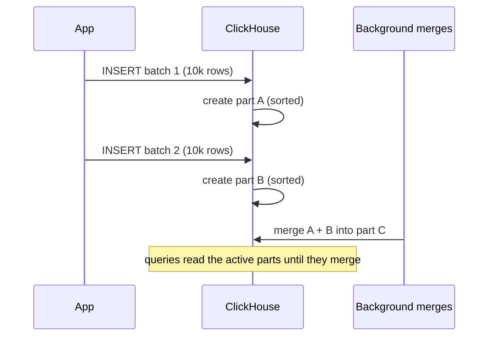

## 🎯 خلاصه

> **ClickHouse** یک پایگاه داده‌ی تحلیلی ستونی است. هسته‌اش خانواده‌ی **MergeTree** است: هر `INSERT` یک **part** تغییرناپذیر می‌نویسد که بر اساس `ORDER BY` مرتب است، **merge**های پس‌زمینه partها را ترکیب می‌کنند، و یک **primary index پراکنده** اجازه می‌دهد query بیشتر داده را رد کند.

- خواندن سریع از مرتب‌سازی، ذخیره‌سازی ستونی و skipping می‌آید، نه از index روی همه‌ی ستون‌ها.
- نوشتن باید **batch** شود. هر insert یک part می‌سازد؛ partهای کوچک زیاد همه‌چیز را کند می‌کنند و می‌توانند خطای «Too many parts» بدهند.
- Deduplication و aggregation در واریانت‌های `*MergeTree` **در حین merge** انجام می‌شود، و این eventual است. وقتی جواب دقیق در زمان خواندن لازم است، از `FINAL` یا query آگاه از aggregate استفاده کن.

## 🌱 از ساده شروع کنیم (مبتدی)

> **💡 تشبیه:** یک کتابخانه که تمام روز جعبه‌های کتاب جدید می‌گیرد. هر تحویل یک **part** است: یک جعبه‌ی مهروموم‌شده که از قبل بر اساس نام نویسنده مرتب شده. هر از گاهی کتابدار چند جعبه را در یک جعبه‌ی بزرگ‌تر و مرتب ادغام می‌کند. وقتی دنبال یک نویسنده می‌گردی، یک فهرست کوتاه (sparse index) را نگاه می‌کنی و مستقیم به جعبه‌ی درست می‌روی.

یک جدول کوچک از بازدید صفحات بساز:

```sql
CREATE TABLE page_views (
  user_id    UInt64,
  view_time  DateTime,
  url        String,
  duration_ms UInt32
)
ENGINE = MergeTree
PARTITION BY toYYYYMM(view_time)
ORDER BY (user_id, view_time);
```

- `ENGINE = MergeTree` خانواده‌ی پیش‌فرض ذخیره‌سازی است. بقیه‌ی این درس واریانت‌هایی از آن هستند.
- `ORDER BY (user_id, view_time)` تعیین می‌کند ردیف‌ها روی دیسک چطور مرتب شوند. مهم‌ترین تصمیم طراحی در ClickHouse است.
- `PARTITION BY toYYYYMM(view_time)` داده را بر اساس ماه گروه می‌کند، پس ماه‌های قدیمی را می‌توان یکجا حذف کرد.

یک query که فقط روی `user_id` فیلتر می‌کند، به چند granule نیاز دارد، چون داده اول بر اساس `user_id` مرتب است:

```sql
SELECT url, count() AS visits
FROM page_views
WHERE user_id = 42 AND view_time >= '2026-03-01'
GROUP BY url
ORDER BY visits DESC
LIMIT 10;
```

## 🔧 واقعاً چطور کار می‌کند (متوسط)

**Partها و merge.** یک `INSERT` یک دایرکتوری جدید (part) می‌سازد با یک فایل برای هر ستون. partها تغییرناپذیرند. در پس‌زمینه، ClickHouse partهای همان partition را به partهای بزرگ‌تر merge می‌کند و ترتیب مرتب‌سازی را نگه می‌دارد. merge است که سیستم را بعد از insertهای زیاد سریع نگه می‌دارد.



**Primary index پراکنده.** کلید اصلی یک B-tree روی همه‌ی ردیف‌ها نیست. ClickHouse برای هر **granule** از ردیف‌ها یک mark در index ذخیره می‌کند: به‌صورت پیش‌فرض هر ۸۱۹۲ ردیف (`index_granularity`). برای query روی پیشوند کلید، موتور روی markها جستجوی دودویی می‌کند و فقط granuleهای مطابق را می‌خواند. چون index کوچک است، حتی برای میلیاردها ردیف در حافظه می‌ماند. معاوضه این است که index ردیف تکی پیدا نمی‌کند؛ بازه پیدا می‌کند.

**چرا ترتیب کلید مهم است.** index روی پیشوند `ORDER BY` کار می‌کند. `ORDER BY (user_id, view_time)` باعث می‌شود `WHERE user_id = 42` سریع باشد، ولی `WHERE view_time > ...` به‌تنهایی خیلی کندتر است، چون ردیف‌های یک زمان بین همه‌ی کاربران پخش شده‌اند. ستون‌هایی را که بیشتر فیلتر می‌شوند و cardinality کمتری دارند جلو بگذار، و با `EXPLAIN indexes = 1` بررسی کن.

**مشکل «Too many parts».** هر insert part اضافه می‌کند. اگر insertها کوچک و پرتکرار باشند (مثلاً یک ردیف به ازای هر درخواست)، partها سریع‌تر از سرعت merge جمع می‌شوند. ClickHouse آن‌وقت insertهای جدید را با خطای «Too many parts» رد می‌کند و هر query باید فایل بیشتری بخواند. راهنمای رسمی batch کردن insertهاست: حداقل حدود ۱,۰۰۰ ردیف در هر insert و ترجیحاً ۱۰,۰۰۰ تا ۱۰۰,۰۰۰ ردیف، یا استفاده از `async_insert` که ردیف‌ها را روی سرور بافر می‌کند. راهنمای استراتژی insert مربوط به نسخه‌ی خودت را بررسی کن.

```sql
-- کدام جدول‌ها partهای فعال زیاد دارند؟
SELECT table, count() AS active_parts
FROM system.parts
WHERE active
GROUP BY table
ORDER BY active_parts DESC;
```

**Materialized view به‌عنوان trigger درج.** `MATERIALIZED VIEW` در ClickHouse یک trigger درج است. وقتی یک بلوک ردیف در جدول مبدا insert می‌شود، `SELECT` آن view روی همان بلوک اجرا و نتیجه در یک جدول مقصد نوشته می‌شود. این یک snapshot به‌روزشده از مبدا نیست؛ فقط insertهای جدید را می‌بیند.

```sql
CREATE TABLE views_daily (
  day Date, url String, visits UInt64
)
ENGINE = SummingMergeTree
ORDER BY (day, url);

CREATE MATERIALIZED VIEW views_daily_mv TO views_daily AS
SELECT toDate(view_time) AS day, url, count() AS visits
FROM page_views
GROUP BY day, url;
```

`SummingMergeTree` ردیف‌های با کلید یکسان را جمع می‌کند، اما فقط **در حین merge**. تا آن زمان، `views_daily` می‌تواند چند ردیف برای همان `(day, url)` داشته باشد. آن را با `SELECT day, url, sum(visits) ... GROUP BY day, url` بخوان.

## 🧠 عمق و trade-offها (سنیور)

- **خانواده‌ی MergeTree.** موتور را بر اساس این انتخاب کن که هنگام merge با ردیف‌های کلید یکسان چه باید بشود:
  - `ReplacingMergeTree(version[, is_deleted])` ردیفی با بیشترین version را نگه می‌دارد (و اختیاری ردیف‌های علامت‌خورده‌ی deleted را حذف می‌کند). الگوی معمول برای upsertهای CDC همین است.
  - `SummingMergeTree` ستون‌های عددی ردیف‌های با کلید یکسان را جمع می‌کند.
  - `AggregatingMergeTree` وضعیت‌های aggregate (`AggregateFunction`) را ذخیره می‌کند و با ترکیب‌کننده‌های `-State` و `-Merge` استفاده می‌شود، مثلاً برای شمارش یکتا.
  - `CollapsingMergeTree` با یک ستون `sign` (+۱ و -۱) وضعیت قدیمی را خنثی می‌کند؛ وقتی رویدادها خارج از ترتیب برسند شکننده است، پس در صورت امکان `ReplacingMergeTree` را ترجیح بده.
- **Deduplication eventual است.** `ReplacingMergeTree` تکرارها را فقط وقتی حذف می‌کند که یک merge به partهایی که آن‌ها را دارند برسد. یک `SELECT` ساده ممکن است هر دو نسخه را برگرداند. `SELECT ... FROM t FINAL` در زمان خواندن merge را انجام می‌دهد، که هزینه‌ی CPU و حافظه دارد؛ سربار با تعداد partهای merge‌نشده و ستون‌های خوانده‌شده بیشتر می‌شود. برای داشبوردها، یک روش رایج aggregate با `argMax(value, version)` گروه‌بندی‌شده روی کلید است، یا جلوگیری از تکرار در بالادست با [[idempotency]].
- **هزینه‌ی FINAL.** اندازه بگیرش. روی جدول‌های بزرگ، سربار `FINAL` بسته به داده از چند ده درصد تا چند برابر یک query ساده فرق دارد (مستندات رسمی طیف گسترده‌ای را ذکر می‌کند). کاهشش بده: روی کلید مرتب فیلتر کن (تا granule کمتری خوانده شود)، partها را merge‌شده نگه دار، یا query را طوری بازنویسی کن که آگاه از aggregate باشد.
- **Projection و skipping index.** projection یک کپی دوم از داده را با ترتیب یا aggregate متفاوت نگه می‌دارد، پس query روی ستون دیگری می‌تواند از آن استفاده کند؛ ClickHouse خودکار انتخابش می‌کند. skipping indexها (minmax، set، bloom filter) خلاصه‌ی هر granule را برای ستون‌های خارج از primary key نگه می‌دارند. granuleهایی را که نمی‌توانند مطابقت داشته باشند رد می‌کنند، ولی زمان نوشتن و دیسک هزینه دارند. با `EXPLAIN indexes = 1` و داده‌ی واقعی آزمایشان کن.
- **TTL و partition.** `TTL` می‌تواند ردیف‌های قدیمی‌تر از یک آستانه را حذف یا جابه‌جا کند، و partitionها را می‌توان با یک دستور حذف کرد. partition ماهانه برای retention خوب است؛ ابزار ضعیفی برای سرعت دادن به query روی یک ستون با cardinality بالاست. partitionهای زیاد، مشکل partهای زیاد را ضرب می‌کنند.
- **Dictionary.** lookupهای کلید-مقدار خارجی یا در حافظه (`dictGet`) راه معمول غنی‌سازی یک fact table با بُعدهای کوچک است، به‌جای یک `JOIN` بزرگ هنگام query.
- **محدودیت‌های JOIN.** ClickHouse از join پشتیبانی می‌کند، ولی طراحی آن به جدول‌های پهن و denormalized گرایش دارد. یک join بزرگ در سمت راست به حافظه برای hash table نیاز دارد، و الگوریتم‌های join و تنظیماتشان بین نسخه‌ها تغییر کرده. داده را برای query مدل کن، برای lookupهای کوچک از dictionary استفاده کن، و قبل از قول دادن یک الگوی join برای جدول‌های بزرگ، مستندات فعلی JOIN را بررسی کن.
- **Replication و توزیع.** `ReplicatedMergeTree` replicaها را از طریق یک سرویس هماهنگی همگام نگه می‌دارد: ZooKeeper، یا ClickHouse Keeper در استقرارهای جدیدتر. جدول `Distributed` یک جدول منطقی است که query ها را به shardها پخش و نتایج را ادغام می‌کند. replication دسترس‌پذیری می‌دهد، sharding ظرفیت. هر دو در مسیر insert دقت می‌خواهند، چون یک insert تکراری بعد از retry می‌تواند ردیف تکراری بسازد، که دوباره به [[idempotency]] می‌رسد.
- **ورودی Kafka.** جدول موتور Kafka یک topic را مصرف می‌کند و یک materialized view ردیف‌ها را به یک جدول MergeTree منتقل می‌کند. lag مصرف‌کننده و اندازه‌ی batchهای تولیدی را پایش کن، چون بلوک‌های ریز، partهای ریز می‌سازند.
- **پایش.** partهای فعال در هر جدول، backlog هم‌ادغامی (merge)، خطاهای insert (`Too many parts`) و `system.query_log` را برای query های کند و بایت‌های خوانده‌شده زیر نظر بگیر. این چهار سیگنال بیشتر چیزی را که لازم داری نشان می‌دهند.
- **کی استفاده نکنیم.** ClickHouse برای تحلیل‌هایی با نوشتن زیاد از نوع append و خواندن زیاد عالی است. برای به‌روزرسانی‌ها و حذف‌های ردیف‌تکی زیاد، تراکنش‌های پیچیده‌ی چندجدولی، یا کارهایی که در هر خواندن consistency دقیق هر ردیف لازم دارند، مناسب نیست.

## 🧪 امتحان کن

از یک stream مربوط به CDC، تغییرات پروفایل کاربر دریافت می‌کنی. هر رویداد `user_id`، `email`، `updated_at` (از نوع `DateTime`) و `is_deleted` (۰ یا ۱) دارد. رویدادها ممکن است خارج از ترتیب برسند.

1. یک `CREATE TABLE` برای جدول مقصد بنویس. موتور، `ORDER BY` و ستون version را انتخاب کن و هر انتخاب را توضیح بده.
2. یک query بنویس که پروفایل فعلی و غیرحذف‌شده‌ی `user_id = 7` را برگرداند، و بگو چرا یک `SELECT` ساده کافی نیست.
3. تیم از یک worker پایتون به ازای هر رویداد یک ردیف insert می‌کند و داشبورد «Too many parts» نشان می‌دهد. دو تغییر بده که بدون تغییر schema مشکل را رفع کند.

<details><summary>جواب‌ها را ببین</summary>

**1.**
```sql
CREATE TABLE user_profiles (
  user_id    UInt64,
  email      String,
  updated_at DateTime,
  is_deleted UInt8
)
ENGINE = ReplacingMergeTree(updated_at, is_deleted)
ORDER BY user_id;
```
`ORDER BY user_id` کلیدی است که ردیف را مشخص می‌کند، پس موتور می‌تواند تکرارها را تشخیص دهد. ستون version یعنی `updated_at` تعیین می‌کند کدام نسخه بماند: جدیدترین. `is_deleted` باعث می‌شود رویداد حذف برنده شود. رویدادهای خارج از ترتیب امن‌اند، چون version تصمیم می‌گیرد، نه ترتیب رسیدن.

**2.**
```sql
SELECT user_id, email, updated_at
FROM user_profiles FINAL
WHERE user_id = 7 AND is_deleted = 0;
```
یک `SELECT` ساده ممکن است قبل از اجرای merge، چند نسخه از کاربر ۷ را برگرداند. `FINAL` در زمان خواندن deduplicate می‌کند، و فیلتر روی `user_id` هزینه را پایین نگه می‌دارد.

توجه: مستندات می‌گویند ردیف‌های حذف‌شده در زمان merge حذف نمی‌شوند، پس فیلتر `is_deleted = 0` را در هر خواندن از این جدول نگه دار.

**3.** insertها را batch کن: رویدادها را در worker بافر کن (مثلاً ۱۰,۰۰۰ ردیف یا یک پنجره‌ی ۳۰ ثانیه‌ای، هرکدام زودتر رسید) و در یک statement insert کن. یا `async_insert` را فعال کن تا سرور insertهای کوچک را batch کند. هر دو تعداد partهای ساخته‌شده در ثانیه را کم می‌کنند، و merge می‌تواند عقب نماند.

</details>

## 💬 گوشه‌ی مصاحبه

**سؤال: «چرا نباید ردیف‌به‌ردیف insert کنی؟»** جواب متوسط: «هر insert یک part می‌سازد. partهای کوچک زیاد query ها را کند می‌کنند و می‌توانند خطای "too many parts" بدهند، پس insertها را batch می‌کنم.»

جواب سنیور: «هر insert یک part تغییرناپذیر می‌سازد، و فرایند merge در پس‌زمینه باید با نرخ partهای جدید هم‌گام بماند. یک ردیف به ازای هر insert یعنی هزاران part در ثانیه، که merge نمی‌تواند به‌موقع ترکیب کند. بعد query ها فایل بیشتری می‌خوانند، index برای هر part بررسی می‌شود، و سرور insertها را رد می‌کند. رفع: batch کردن سمت کلاینت با حدود ۱۰,۰۰۰ ردیف یا یک پنجره‌ی زمانی، `async_insert` برای کلاینت‌هایی که نمی‌توانند batch کنند، و یک بافر یا لایه‌ی Kafka جلوی جدول.»

**سؤال: «ReplacingMergeTree چطور dedup می‌کند و چرا فوری نیست؟»** جواب متوسط: «برای هر کلید مرتب‌سازی، در حین merge، ردیف با بیشترین version را نگه می‌دارد.»

جواب سنیور: «deduplication یک اثر جانبی merge های پس‌زمینه است، و merge ها به‌صورت غیرهمزمان روی partها اجرا می‌شوند. پس تا وقتی تکرارها در یک merge کنار هم نیفتند، هر دو نسخه دیده می‌شوند. به همین دلیل correctness آن eventual است. برای خواندن دقیق از `FINAL` یا aggregate با `argMax` استفاده می‌کنم و هزینه‌اش را هم می‌گویم. برای محدودیت یکتایی روی آن حساب نمی‌کنم؛ آن یک کلید idempotency در بالادست لازم دارد.»

> **🎤 این را در مصاحبه بگو:** «ClickHouse partهای مرتب و تغییرناپذیر می‌نویسد و در پس‌زمینه merge می‌کند. پس insertها را batch می‌کنم تا تعداد partها پایین بماند، ORDER BY را برای رایج‌ترین فیلتر انتخاب می‌کنم، و ReplacingMergeTree را dedup eventual می‌دانم که با FINAL یا aggregate وقتی جواب دقیق لازم است خوانده می‌شود.»

## ⚠️ اشتباهات رایج

> **⚠️ هشدار:** insert یک ردیف به ازای هر درخواست، یا یک insert به ازای هر پیام Kafka. جدول پر از partهای ریز می‌شود و صف merge هرگز نمی‌رسد.

> **⚠️ هشدار:** فرض این‌که `ReplacingMergeTree` تکرار ندارد. یک `SELECT` ساده تا زمان اجرای merge ممکن است تکرارها را برگرداند.

- انتخاب `ORDER BY` بر اساس عادت primary key در پایگاه‌های داده‌ی دیگر، به جای الگوی رایج فیلتر.
- partition زدن با یک ستون ریزدانه (روز به‌علاوه‌ی مشتری) و ساختن هزاران partition با partهای ریز.
- استفاده از `ALTER TABLE ... UPDATE` یا `DELETE` برای تغییرات مکرر ردیف‌تکی. mutationها کل partها را بازنویسی می‌کنند؛ برای این الگو از `ReplacingMergeTree` با version استفاده کن.
- انتظار این‌که یک materialized view ردیف‌های قدیمی را backfill کند. فقط روی insertهای بعد از ساختنش اجرا می‌شود.
- تلقی مجموع‌های `SummingMergeTree` به‌عنوان مقدار دقیق در زمان خواندن، بدون aggregate مجدد.
- استفاده از `FINAL` همه‌جا بدون اندازه‌گیری هزینه‌اش.

## ✅ خودت را بسنج

1. یک **part** در ClickHouse چیست؟
   - A) یک ردیف در primary index
   - B) مجموعه‌ای تغییرناپذیر و مرتب از فایل‌ها که یک insert می‌سازد و بعداً در پس‌زمینه merge می‌شود
   - C) یک shard از یک جدول توزیع‌شده
   - D) یک replica از جدول روی نود دیگر

<details><summary>جواب</summary>

**B** — هر `INSERT` یک part می‌سازد و merge های پس‌زمینه partها را ترکیب می‌کنند. index پراکنده برای هر granule است، shard تقسیم سطح نود است، و replica کپی داده روی نود دیگر.

</details>

2. کدام موتور را برای نگه داشتن فقط آخرین نسخه‌ی هر پروفایل کاربر از یک stream مربوط به CDC باید استفاده کنی؟
   - A) `MergeTree`
   - B) `SummingMergeTree`
   - C) `ReplacingMergeTree` با یک ستون version
   - D) `Memory`

<details><summary>جواب</summary>

**C** — `ReplacingMergeTree` یک ردیف برای هر کلید مرتب‌سازی نگه می‌دارد که در حین merge با ستون version انتخاب می‌شود. `SummingMergeTree` به‌جای آن مقادیر را جمع می‌کند و `MergeTree` ساده همه‌ی ردیف‌ها را نگه می‌دارد.

</details>

3. یک query روی `page_views` با `WHERE view_time > '2026-03-01'` کند است، در حالی که `WHERE user_id = 42` سریع است. جدول `ORDER BY (user_id, view_time)` دارد. دلیلش چیست و بهترین واکنش کدام است؟

   - A) index خراب شده؛ آن را بازسازی کن
   - B) primary index روی پیشوند کلید کار می‌کند، پس فیلتر روی `view_time` به‌تنهایی نمی‌تواند granuleها را رد کند؛ یک projection با ترتیب `view_time` اضافه کن، یا ترتیب جدول را برای رایج‌ترین فیلتر طراحی کن
   - C) `DateTime` را نمی‌توان index کرد؛ آن را به متن تبدیل کن
   - D) ClickHouse از `WHERE` روی ستون‌های غیرکلیدی پشتیبانی نمی‌کند

<details><summary>جواب</summary>

**B** — ردیف‌های با یک `view_time` مشخص بین همه‌ی مقادیر `user_id` پخش شده‌اند، پس markهای granule نمی‌توانند بازه‌ها را حذف کنند. گزینه‌ها: یک projection با ترتیب متفاوت، یک جدول دوم، یا `ORDER BY` که با غالب‌ترین query مطابقت دارد. بر اساس ترکیب واقعی queryها انتخاب کن.

</details>

4. **(سنیور)** یک pipeline به ازای هر پیام Kafka یک ردیف insert می‌کند و جدول هر بعدازظهر «Too many parts» گزارش می‌دهد. کدام تغییر مستقیم‌ترین رفع علت است؟
   - A) افزایش partitionها به ۱,۰۰۰ در روز
   - B) batch کردن insertها (موتور Kafka یا یک بافر جلوی جدول، یا `async_insert`) تا هر insert ردیف‌های زیادی بنویسد و partهای کمتری بسازد
   - C) جایگزینی `ORDER BY` با کلید تصادفی
   - D) خاموش کردن merge برای صرفه‌جویی در CPU

<details><summary>جواب</summary>

**B** — علت تعداد partهای ساخته‌شده در ثانیه است و merge نمی‌تواند هم‌گام بماند. batch کردن partها را در منبع کم می‌کند. partitionهای بیشتر مشکل را ضرب می‌کنند و خاموش کردن merge آن را قطعی می‌کند.

</details>

5. **(سنیور)** یک داشبورد جدول `user_profiles` (یک `ReplacingMergeTree`) را با `SELECT` ساده می‌خواند و گاهی یک کاربر را دو بار نشان می‌دهد. توضیح درست و رفع درست چیست؟

   - A) موتور خراب است؛ به موتور `Memory` برو
   - B) deduplication فقط در حین merge های پس‌زمینه اتفاق می‌افتد، پس تکرارهای merge‌نشده دیده می‌شوند؛ در query از `FINAL` (یا یک aggregate با `argMax`) استفاده کن و هزینه‌اش را در نظر بگیر
   - C) `ReplacingMergeTree` هرگز dedup نمی‌کند؛ از `SummingMergeTree` استفاده کن
   - D) داشبورد باید روی هر ستون `DISTINCT` بگذارد

<details><summary>جواب</summary>

**B** — deduplication eventual است، پس خواندن‌ها باید partهای merge‌نشده را در نظر بگیرند. `FINAL` یا query با aggregate نمای deduplicate‌شده را برمی‌گرداند. هزینه‌ی `FINAL` را روی جدول واقعی اندازه بگیر و برای محدود کردنش روی کلید مرتب فیلتر کن.

</details>

## 🗂️ فلش‌کارت

| Front | Back |
|---|---|
| part چیست؟ | مجموعه‌ی مرتب و تغییرناپذیر از فایل‌های ستونی که یک insert می‌نویسد؛ در پس‌زمینه merge می‌شود |
| Sparse primary index | یک mark برای هر granule (پیش‌فرض ۸۱۹۲ ردیف)؛ بازه پیدا می‌کند، نه ردیف تکی |
| چرا insert را batch کنیم؟ | هر insert part می‌سازد؛ partهای زیاد query را کند و خطای "Too many parts" ایجاد می‌کنند |
| dedup در ReplacingMergeTree | بیشترین version را برای هر کلید مرتب‌سازی در حین merge نگه می‌دارد؛ eventual است |
| خواندن دقیق ردیف‌های dedup‌شده | `FINAL`، یا یک aggregate مثل `argMax` گروه‌بندی‌شده روی کلید |
| SummingMergeTree | ستون‌های عددی را در حین merge برای هر کلید جمع می‌کند؛ هنگام خواندن دوباره aggregate کن |
| Materialized view در ClickHouse | trigger درج: هر بلوک درج‌شده را به یک جدول مقصد تبدیل می‌کند |
| چرا ORDER BY مهم است؟ | ترتیب مرتب‌سازی و پیشوندی را تعریف می‌کند که sparse index می‌تواند استفاده کند |

## 🔗 ادامه

- **[[realtime-olap]]** ClickHouse را در میان سیستم‌های OLAP بلادرنگ و معاوضه‌هایشان قرار می‌دهد.
- **[[mpp-architecture]]** ایده‌های توزیع‌شده‌ی shared-nothing و پردازش query پشت shardهای ClickHouse را توضیح می‌دهد.
- **[[starrocks-doris]]** یک موتور تحلیلی دوم با طراحی متفاوت برای به‌روزرسانی و join را مقایسه می‌کند.
- **[[file-layout]]** همان ایده‌های sorting و partitioning را روی Parquet و object storage پوشش می‌دهد.
- **[[dedup-idempotent-loads]]** الگوی کلی پشت استفاده از ReplacingMergeTree برای upsertهای CDC است.
