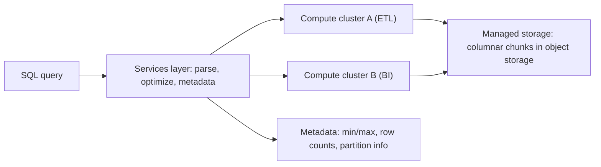

## 🎯 خلاصه

> یک **انباره‌ی داده‌ی ابری** (Snowflake، BigQuery، Redshift و مشابه‌ها) یک دیتابیس تحلیلی مدیریت‌شده است که ایده‌های اصلی‌اش این‌هاست: **storage و compute جدا هستند**، داده در **فایل‌های ستونی فشرده** که توسط vendor مدیریت می‌شوند ذخیره می‌شود، و **هزینه‌ی storage و compute** از دو صورتحساب جدا پرداخت می‌شود.

- **جداسازی storage و compute** اجازه می‌دهد ظرفیت کوئری را بدون جابه‌جایی داده بالا و پایین کنی.
- داده به **chunkهای ستونی تغییرناپذیر** تقسیم می‌شود (Snowflake آن‌ها را micro-partition می‌نامد) با متادیتایی مثل min/max، پس کوئری بیشتر آن‌ها را نادیده می‌گیرد.
- **مدل‌های قیمت‌گذاری** فرق دارند: پرداخت بر اساس زمان compute (warehouse یا slot)، یا پرداخت بر اساس داده‌ی اسکن‌شده (on-demand). هزینه به نحوه‌ی کوئری زدن هم بستگی دارد، نه فقط حجم ذخیره.
- این مفاهیم حتی بدون اکانت ابری در مصاحبه می‌آیند. مکانیزم‌ها را یاد بگیر، نه اسم‌های بازاریابی را.

## 🌱 از ساده شروع کنیم (مبتدی)

> **💡 تشبیه:** یک **کتابخانه با سالن مطالعه‌ی جدا**. کتاب‌ها (storage) در ساختمانی هستند که اندازه‌اش عوض نمی‌شود. میزهای مطالعه (compute) را برای هفته‌ی شلوغ اضافه می‌کنی و بعدش برمی‌داری. چند خواننده می‌توانند هم‌زمان پشت میزهای مختلف باشند و همه همان کتاب‌ها را می‌بینند.

در مدل قدیمی، یک سرور دیتابیس هم داده و هم CPU را نگه می‌داشت. برای شلوغی پایان ماه، یک ماشین بزرگ‌تر می‌خریدی و یا داده باید جابه‌جا می‌شد یا ماشین تمام سال بزرگ می‌ماند. در انباره‌ی ابری:

- **Storage** همه‌ی جدول‌ها را در object storage خود vendor نگه می‌دارد و به ازای هر ترابایت در ماه پول می‌گیرد.
- **Compute** کوئری‌ها را اجرا می‌کند. وقتی لازم داری یک cluster یا «warehouse» را شروع می‌کنی و وقتی لازم نیست متوقفش می‌کنی.

یک کوئری ساده:

```sql
SELECT region, SUM(amount) AS revenue
FROM sales.orders
WHERE order_date >= DATE '2026-01-01'
GROUP BY region;
```

موتور فقط ستون‌های لازم (`region`، `amount`، `order_date`) را می‌خواند و chunkهایی را که بازه‌ی تاریخشان نمی‌تواند مطابق باشد رد می‌کند. در ساده‌ترین حالت لازم نیست فایل، ایندکس یا partition را دستی بسازی، ولی وقتی جدول‌ها بزرگ می‌شوند با partitioning و clustering می‌توانی چیدمان را تحت تأثیر بگذاری.

## 🔧 واقعاً چطور کار می‌کند (متوسط)



**chunkهای ستونی با متادیتا.** ردیف‌ها در فایل‌های ستونی فشرده نوشته می‌شوند. هر chunk آمار دارد (min و max برای هر ستون، و گاهی شمارش مقادیر متمایز یا ساختارهای شبیه bloom). فیلتری مثل `order_date >= '2026-01-01'` ابتدا با این آمار مقایسه می‌شود، پس کل chunkها بدون خواندن رد می‌شوند. Snowflake این را micro-partition pruning می‌نامد؛ BigQuery و Redshift ایده‌های مشابه با اصطلاحات خودشان دارند.

**Clustering.** وقتی داده با ترتیب تصادفی می‌رسد، هر chunk کل بازه‌ی مقادیر را پوشش می‌دهد و pruning کمکی نمی‌کند. Clustering (کلیدهای clustering در Snowflake، clustering در BigQuery، sort key در Redshift) مقادیر مشابه را کنار هم نگه می‌دارد. Partitioning (جدول‌های partition شده در BigQuery، partition روزانه) جدول را به تکه‌های منطقی، معمولاً بر اساس تاریخ، می‌شکند، تا کوئری‌هایی که روی ستون partition فیلتر دارند بایت کمتری اسکن کنند.

**واحدهای compute.**
- **Snowflake:** یک *virtual warehouse* یک cluster محاسباتی است که اندازه‌اش را انتخاب می‌کنی (از X-Small تا بزرگ‌تر). چند warehouse می‌توانند هم‌زمان storage یکسان را بخوانند، که ETL را از BI جدا نگه می‌دارد.
- **BigQuery:** compute با *slot* (واحد ظرفیت پردازش کوئری) اندازه‌گیری می‌شود. می‌توانی on-demand اجرا کنی، که بر اساس بایت‌های اسکن‌شده پول می‌دهی، یا ظرفیت رزرو‌شده (slot) بخری که بین کوئری‌ها تقسیم می‌شود.
- **Redshift:** یک cluster provisioned یک leader node و compute node دارد. خانواده‌های جدیدتر node، storage مدیریت‌شده را از compute جدا می‌کنند؛ Redshift Serverless ظرفیت را خودکار فراهم می‌کند. برای خانواده و قیمت‌گذاری مورد سؤال، داک فعلی را چک کن.

**قیمت‌گذاری در یک جمله برای هر مدل.**
- Storage: به ازای TB در ماه (فشرده).
- Compute با زمان: به ازای ثانیه یا ساعت cluster یا warehouse وقتی روشن است.
- Compute با اسکن: به ازای TB اسکن‌شده توسط کوئری (BigQuery on-demand). `SELECT *` روی جدول پهن از لیست ستون باریک گران‌تر است.

یک مثال فرضی با قیمت ساختگی ۵ دلار به ازای هر TB اسکن‌شده: یک کوئری داشبورد که هر ۱۰ دقیقه ۲ TB اسکن می‌کند، در ۲۴ ساعت می‌شود ۲ × ۵ × ۱۴۴ = ۱٬۴۴۰ دلار در روز. همان کوئری با خواندن ۲۰ گیگابایت می‌شود ۱۴٫۴ دلار. pruning واقعاً پول ذخیره می‌کند.

## 🧠 عمق و trade-offها (سنیور)

- **جداسازی، جداسازی کامل نیست.** warehouseها storage را شریک‌اند، ولی هنوز روی سرویس‌های متادیتا، اسلات‌های هم‌زمانی و محدودیت‌های سطح اکانت رقابت می‌کنند. یک job ETL از کنترل خارج‌شده می‌تواند BI را کند کند اگر روی یک warehouse باشند، پس به هر workload compute جدا بده.
- **هزینه مسئله‌ی طراحی کوئری است.** قیمت اسکن‌محور نوشتن ستون‌های باریک، فیلتر partition و clustering را پاداش می‌دهد. قیمت زمان‌محور نگه داشتن cluster مشغول و suspend کردن آن در زمان بیکاری را پاداش می‌دهد. هر دو را اندازه بگیر: بایت‌های اسکن‌شده برای هر کوئری و ساعت‌های warehouse در روز.
- **micro-partitionها و نوشتن‌های ریز.** insertهای زیاد و کوچک chunkهای ریز زیادی می‌سازند. pruning ضعیف‌تر می‌شود و نگهداری پس‌زمینه کار بیشتری دارد. بارگذاری‌ها را batch کن و بررسی کن که vendor خودکار merge یا recluster می‌کند یا نه.
- **Clustering نگهداری می‌خواهد.** وقتی داده‌ی نامرتب اضافه می‌شود، clustering خراب می‌شود. automatic clustering یا reclustering هزینه‌ی compute دارد. فقط روی ستون‌هایی که در فیلترهای رایج هستند و با تعداد کلید محدود cluster کن.
- **هم‌زمانی.** یک cluster compute ظرفیت موازی محدود دارد. برای کاربران هم‌زمان زیاد داشبورد، scale out کن (cluster بیشتر یا multi-cluster warehouse) تا scale up. زمان صف را ببین، نه فقط زمان اجرا.
- **Lock-in و قابلیت انتقال.** dialectهای SQL، قابلیت‌های data sharing، time travel و stored procedure فرق دارند. منطق کسب‌وکار را در SQL قابل انتقال نگه دار و داده‌ی خام را در فرمت‌های باز (Parquet، Iceberg) نگه دار تا جایی که ممکن است. ببین [[lakehouse-table-formats]].
- **چارچوب مصاحبه.** وقتی از «طراحی یک انباره» می‌پرسند، جداسازی storage و compute، pruning چانک‌ها، جداسازی workloadها و مدل هزینه را نام ببر، و بعد حجم داده و هم‌زمانی را بپرس. این ترتیب نشان می‌دهد با مکانیزم فکر می‌کنی.
- **کی استفاده نکنی.** سرو کردن با تأخیر خیلی کم به کاربران نهایی (از store سرویس یا real-time OLAP استفاده کن، ببین [[realtime-olap]])، یا وقتی داده باید on-premises بماند و سرویس ابری مدیریت‌شده مجاز نیست.

## 🧪 امتحان کن

یک جدول fact به نام `sales.orders` با ۲ میلیارد ردیف و حدود ۵۰ ستون داری که بر اساس `order_date` partition شده (یک partition برای هر روز). یک داشبورد هر دقیقه این را اجرا می‌کند:

```sql
SELECT region, SUM(amount)
FROM sales.orders
WHERE order_date >= CURRENT_DATE - 7
GROUP BY region;
```

۱. با فرض قیمت‌گذاری اسکن‌محور، این کوئری چه می‌خواند و کدام انتخاب طراحی بیشترین کاهش را می‌دهد؟
۲. با فرض قیمت‌گذاری زمان‌محور و warehouse که دائم روشن است، اگر داشبورد فقط در ساعات اداری داده‌ی تازه لازم دارد، چه چیزی را عوض می‌کنی تا پول صرفه‌جویی شود؟
۳. جدول با ۵۰۰ فایل کوچک ساعتی بارگذاری می‌شود. این چه مشکلی برای pruning و هزینه ایجاد می‌کند؟

<details><summary>راه‌حل را ببین</summary>

**۱.** ستون‌های `region`، `amount` و `order_date` را برای هفت partition روزانه می‌خواند. فیلتر partition روزهای دیگر را حذف می‌کند. بیشترین کاهش از فیلتر partition و لیست ستون باریک می‌آید. مطمئن شو `CURRENT_DATE - 7` به عنوان ثابت ارزیابی می‌شود تا موتور در زمان برنامه‌ریزی pruning کند (وابسته به engine؛ dialect خودت را چک کن).

**۲.** warehouse را خارج از ساعات اداری suspend کن (auto-suspend و auto-resume)، یا جمع‌های منطقه‌ای هفت روزه را ساعتی یک‌بار در یک جدول کوچک از پیش محاسبه کن تا داشبورد از آن بخواند. گزینه‌ی دوم هزینه‌ی اسکن را هم کم می‌کند، چون داشبورد به جای میلیاردها ردیف، صدها ردیف را می‌خواند.

**۳.** فایل‌های کوچک یعنی chunkهای زیادی با بازه‌ی min/max باریک و هم‌پوشان، پس pruning ضعیف‌تر، متادیتا بزرگ‌تر و باز شدن فایل‌های بیشتر در هر کوئری. بارگذاری‌ها را در فایل‌های کمتر و بزرگ‌تر ادغام کن، یا اجازه بده پلتفرم compact کند، و بارگذاری‌های ساعتی را جایی که تأخیر اجازه می‌دهد batch کن.

</details>

## 💬 گوشه‌ی مصاحبه

**سؤال: «Snowflake (یا BigQuery) داده را چطور ذخیره و اسکن می‌کند؟»**
پاسخ متوسط: «داده در فایل‌های ستونی فشرده در object storage ذخیره می‌شود. کوئری فقط ستون‌های لازم را می‌خواند و با متادیتا فایل‌ها را رد می‌کند.»
پاسخ سنیور: «storage و compute جدا هستند. داده در chunkهای فشرده و تغییرناپذیر با آمار هر ستون سازمان می‌گیرد، پس فیلترها قبل از خواندن chunkها را رد می‌کنند. clustering یا partitioning روی ستون‌های فیلتر رایج، pruning را با رشد داده مؤثر نگه می‌دارد، و workloadها compute جدا دارند تا تداخل نکنند. هزینه تابع اسکن یا زمان compute است، پس برای اسکن باریک و compute کوتاه‌عمر طراحی می‌کنم.»

**سؤال: «چطور هزینه‌ی یک انباره‌ی در حال رشد سریع را کم کنی؟»**
پاسخ متوسط: «جدول‌های بلااستفاده را حذف و partition اضافه می‌کنم.»
پاسخ سنیور: «اول پرهزینه‌ترین‌ها را پیدا می‌کنم: بایت‌های اسکن‌شده برای هر کوئری و ساعت compute برای هر warehouse. بعد شکل کوئری (projection، فیلتر partition) را درست می‌کنم، تعداد فایل‌های ریز را کم می‌کنم، compute بیکار را suspend می‌کنم و کوئری‌های داغ داشبورد را از پیش تجمیع می‌کنم. برای workloadهای پرهزینه هشدار بودجه می‌گذارم.»

> **🎤 این را در مصاحبه بگو:** «انباره‌های ابری storage را از compute جدا می‌کنند و با متادیتا chunkهای ستونی تغییرناپذیر را رد می‌کنند. مدل هزینه یا اسکن‌محور است یا زمان‌محور، پس هدف طراحی من این است که کمتر بخوانم و برای هر workload compute کوتاه‌عمر داشته باشم.»

## ⚠️ اشتباهات رایج

> **⚠️ توجه:** دیدن انباره به عنوان اسکن نامحدود و رایگان. در قیمت‌گذاری اسکن‌محور، `SELECT *` روی یک جدول پهن ممکن است در یک روز بیشتر از یک سال مدل‌سازی دقیق هزینه داشته باشد.

> **⚠️ توجه:** فرض کردن اینکه clustering برای همیشه خودبه‌خود کامل می‌ماند. داده‌ی نامرتب جدید آن را خراب می‌کند و نگهداری هزینه‌ی compute دارد.

- اجرای ETL و BI روی یک compute و بعد مقصر دانستن «دیتابیس» برای کندی.
- نگه داشتن compute در تمام شب برای داشبوردی که فقط صبح استفاده می‌شود.
- partition کردن روی ستون با cardinality بالا (مثل `user_id`) که توده‌ای از partitionهای ریز می‌سازد.
- اشتباه گرفتن «warehouse» (compute) با storage: suspend کردن compute داده را پاک نمی‌کند.
- نقل قیمت یا پیش‌فرض از حافظه. قیمت‌ها و محدودیت‌ها تغییر می‌کنند؛ صفحه‌ی فعلی vendor را چک کن.

## ✅ خودت را بسنج

۱. مهم‌ترین مزیت جدا کردن storage از compute در انباره‌ی ابری چیست؟
   - A) داده برای امنیت دو بار ذخیره می‌شود
   - B) compute بدون جابه‌جایی یا بارگذاری مجدد داده می‌تواند scale یا suspend شود
   - C) کوئری‌ها دیگر به آمار نیاز ندارند
   - D) ایندکس خودکار روی هر ستون ساخته می‌شود

<details><summary>جواب</summary>

**B** — storage داده را سر جایش نگه می‌دارد و clusterهای compute مستقل از هم اضافه، تغییر اندازه یا متوقف می‌شوند. چند workload می‌توانند همان جدول‌ها را بخوانند.

</details>

۲. چرا فیلتر روی `order_date` در یک انباره‌ی ستونی با آمار chunk سریع‌تر می‌شود؟
   - A) فیلتر نادیده گرفته می‌شود و کل جدول خوانده می‌شود
   - B) chunkهایی که بازه‌ی min/max آن‌ها نمی‌تواند مطابق باشد بدون خواندن رد می‌شوند
   - C) فیلتر ستون‌ها را به ردیف تبدیل می‌کند
   - D) تاریخ به صورت متن ذخیره می‌شود و این سریع‌تر است

<details><summary>جواب</summary>

**B** — متادیتای هر chunk می‌گوید چه بازه‌ی تاریخی را پوشش می‌دهد. chunkهای خارج از فیلتر رد می‌شوند، که هم زمان و هم بایت‌های اسکن‌شده را کم می‌کند.

</details>

۳. در قیمت‌گذاری اسکن‌محور (on-demand)، کدام تغییر بیشترین کاهش هزینه‌ی یک کوئری داشبورد را می‌دهد؟

   - A) اضافه کردن ستون‌های بیشتر به لیست `SELECT`
   - B) انتخاب فقط ستون‌های لازم و فیلتر روی ستون partition
   - C) اجرای همان کوئری با تعداد بیشتر
   - D) حذف کلاز `WHERE`

<details><summary>جواب</summary>

**B** — projection باریک و فیلتر partition بایت‌های اسکن‌شده را کم می‌کنند، و همین چیزی است که این صورتحساب می‌گیرد.

</details>

۴. **(سنیور)** یک cluster compute هم ETL شبانه و هم BI روزانه را اجرا می‌کند و کاربران BI در زمان بارگذاری شکایت دارند که کند است. بهترین اصلاح ساختاری چیست؟

   - A) افزایش مدت نگهداری داده
   - B) دادن compute جدا به ETL و BI روی همان storage، تا هر کدام parallelism و صف خودش را داشته باشد
   - C) غیرفعال کردن clustering
   - D) ذخیره‌ی داده در یک فایل بزرگ

<details><summary>جواب</summary>

**B** — جداسازی storage و compute امکان جداسازی workload را می‌دهد. هر workload compute متناسب با نیازش می‌گیرد و storage مشترک می‌ماند.

</details>

۵. **(سنیور)** یک جدول با clustering key با گذشت ماه‌ها خراب می‌شود، چون داده‌ی جدید می‌رسد. چرا، و trade-off درست کردنش چیست؟

   - A) clustering فقط هنگام ساخت جدول اعمال می‌شود و دیگر هرگز
   - B) داده‌ی جدید نامرتب append می‌شود، پس chunkها دوباره هم‌پوشان می‌شوند؛ reclustering pruning را برمی‌گرداند ولی compute مصرف می‌کند
   - C) وقتی clustering خراب می‌شود هزینه‌ی storage کم می‌شود
   - D) vendor بعد از ۳۰ روز کلید clustering را حذف می‌کند

<details><summary>جواب</summary>

**B** — داده‌ی appendشده ترتیب clustering را رعایت نمی‌کند، پس بازه‌ی chunkها دوباره هم‌پوشان می‌شود و pruning ضعیف می‌شود. reclustering آن را درست می‌کند، ولی compute‌ای است که پولش را می‌دهی، پس فقط جایی clustering کن که صرفه‌جویی فیلتر ارزشش را دارد.

</details>

## 🗂️ فلش‌کارت

| Front | Back |
|---|---|
| جداسازی storage و compute | داده در storage مدیریت‌شده می‌ماند؛ clusterهای compute مستقل scale و متوقف می‌شوند |
| micro-partition (Snowflake) | chunk ستونی فشرده و تغییرناپذیر با متادیتای min/max برای pruning |
| Pruning | رد کردن chunk یا partitionی که متادیتایش نمی‌تواند با فیلتر مطابقت کند |
| Clustering | نگه داشتن مقادیر مشابه کنار هم تا pruning مؤثر بماند |
| قیمت‌گذاری اسکن‌محور | به ازای بایت‌های اسکن‌شده پول می‌دهی (مثل BigQuery on-demand) |
| قیمت‌گذاری زمان‌محور | به ازای مدت اجرای cluster یا warehouse پول می‌دهی |
| جداسازی workload | compute جدا برای هر workload روی storage مشترک |
| Slot (BigQuery) | واحد ظرفیت پردازش کوئری که برای صورتحساب و زمان‌بندی compute استفاده می‌شود |

## 🔗 ادامه

- [[trino]] — کوئری روی همان نوع داده در فرمت‌های باز بدون انباره‌ی مدیریت‌شده.
- [[lakehouse-table-formats]] — جایگزین باز با متادیتای جدول قابل انتقال.
- [[dimensional-modeling]] — مدل‌سازی جدول‌هایی که انباره به خوبی سرو می‌کند.
- داک vendor درباره‌ی جزئیات قیمت و storage پلتفرمی که استفاده می‌کنی، قبل از نقل قول در مصاحبه چک شود.
