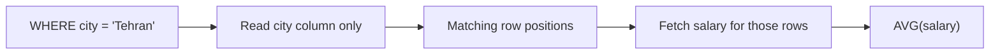

## 🎯 خلاصه

> **store سطری** همه‌ی ستون‌های یک ردیف را کنار هم نگه می‌دارد. **store ستونی** هر ستون را کنار هم نگه می‌دارد. تحلیل چند ستون از ردیف‌های زیاد را می‌خواند، پس چیدمان ستونی داده‌ی کمتری می‌خواند، بهتر فشرده می‌شود (مقادیر مشابه کنار هم‌اند) و به CPU اجازه می‌دهد مقادیر را دسته‌ای پردازش کند (**اجرای برداری**). هزینه‌اش این است که خواندن یا نوشتن یک ردیف کامل به جاهای زیادی دست می‌زند.

- Projection: فقط ستون‌هایی را بخوان که پرسش نام برده است.
- Encoding و فشرده‌سازی: ستون یک‌نوعی با مقادیر تکراری یا مرتب خیلی کوچک می‌شود.
- Skipping: آماره‌ی کمینه/بیشینه‌ی هر بلوک اجازه می‌دهد موتور بلوک‌هایی را که با فیلتر جور نیستند نادیده بگیرد.
- اجرا: عملگرها روی آرایه‌ای از مقادیر کار می‌کنند، نه یک ردیف در هر بار.

## 🌱 از ساده شروع کنیم (مبتدی)

> **💡 تشبیه:** کارت فیش در برابر کشوها. store سطری مثل یک کارت برای هر مشتری است که نام، شهر، سن و حقوق روی آن نوشته شده. store ستونی مثل یک کشو برای هر فیلد است: همه‌ی نام‌ها در یک کشو، همه‌ی شهرها در کشوی دیگر. برای پیدا کردن «همه‌چیز درباره‌ی مشتری ۴۲» کارت راحت‌تر است. برای «میانگین حقوق در تهران» فقط دو کشو را باز می‌کنی و بقیه را رد می‌کنی.

همان جدول سه‌ردیفی در هر دو چیدمان:

```text
store سطری (ردیف‌ها پشت سرهم):
(1, 'Ali',  'Tehran', 31, 9000)
(2, 'Sara', 'Shiraz', 27, 12000)
(3, 'Reza', 'Tehran', 45, 10000)

store ستونی (یک آرایه برای هر ستون):
id:     [1, 2, 3]
name:   ['Ali', 'Sara', 'Reza']
city:   ['Tehran', 'Shiraz', 'Tehran']
age:    [31, 27, 45]
salary: [9000, 12000, 10000]
```

پرسش: `SELECT city, AVG(salary) FROM people GROUP BY city;`. store سطری هر پنج فیلد هر ردیف را می‌خواند. store ستونی فقط `city` و `salary` را می‌خواند.

ایده‌ی پردازش کل یک آرایه با هم را می‌توان در چند خط Python دید:

```python
import numpy as np

salary = np.array([9000, 12000, 10000], dtype=np.int64)
print(salary[salary > 9500].sum())  # یک پیمایش روی آرایه: 12000 + 10000 = 22000
```

فیلتر و جمع هر کدام یک حلقه‌ی فشرده روی آرایه‌اند، نه یک فراخوانی تابع برای هر ردیف.

## 🔧 واقعاً چطور کار می‌کند (متوسط)

**۱. هرس ستون‌ها (projection).** هر ستون جدا ذخیره می‌شود، پس پرسشی که از شصت ستون سه ستون را نام می‌برد، تقریباً داده‌ی همان سه ستون را می‌خواند. فایل‌های Parquet و بخش‌های جدول ClickHouse هر دو داده را این‌طور می‌چینند.

**۲. Encoding و فشرده‌سازی.** مقادیر یک ستون یک نوع دارند و اغلب بازه‌ی باریکی دارند. encodingهای رایج:

- **Dictionary encoding**: رشته‌های تکراری مثل `'Tehran'` به کدهای عددی کوچک و یک دیکشنری تبدیل می‌شوند.
- **Run-length encoding (RLE)**: `[7, 7, 7, 7, 8]` می‌شود `(7, ×4), (8, ×1)`. ستون‌های مرتب خیلی خوب فشرده می‌شوند.
- **Delta encoding**: مقادیر صعودی مثل زمان به صورت تفاوت‌های کوچک ذخیره می‌شوند.
- یک codec عمومی (مثل LZ4 یا ZSTD) می‌تواند روی این‌ها هم اجرا شود.

**۳. Skipping با آماره.** هر بلوک از یک ستون کمینه و بیشینه‌اش را ذخیره می‌کند. فیلتر `WHERE event_date = '2026-03-01'` هر بلوکی را که بازه‌اش این تاریخ را شامل نمی‌شود رد می‌کند. اگر داده بر اساس `event_date` مرتب باشد، بیشتر بلوک‌ها رد می‌شوند. به همین دلیل کلید مرتب‌سازی مهم است.

**۴. ایندکس اصلی پراکنده (sparse).** ClickHouse برای هر گروه از ردیف‌ها (یک *granule*، که به‌طور پیش‌فرض ۸۱۹۲ ردیف است؛ برای نسخه‌ی خودتان داک را ببینید) یک ورودی ایندکس نگه می‌دارد، نه برای هر ردیف. ایندکس آن‌قدر کوچک است که در حافظه می‌ماند، ابتدای granule درست را پیدا می‌کند و موتور از همان‌جا اسکن می‌کند.

**۵. Late materialization.** موتور اول فقط ستون‌های فیلتر را می‌خواند، موقعیت ردیف‌های منطبق را حساب می‌کند و بعد ستون‌های دیگر را فقط برای همان ردیف‌ها می‌گیرد. وقتی فیلتر گزینشی باشد این کار ارزان است. وقتی بیشتر ردیف‌ها جور باشند، همین خواندن‌های اضافه تبدیل به خواندن‌های تصادفی زیاد می‌شوند.



**۶. اجرای برداری (vectorized).** موتورهای کلاسیک ردیف‌به‌ردیف، برای هر ردیف یک تابع `next()` را فرا می‌خوانند که هزینه‌ی فراخوانی و شاخه‌ها دارد. موتورهای برداری دسته‌هایی از مقادیر را در حلقه‌های فشرده روی آرایه پردازش می‌کنند. این کار به CPU اجازه می‌دهد از دستورهای SIMD استفاده کند و داده در cache بماند. نمونه‌ی پژوهشی X100 (که بعدها Vectorwise شد) این رویکرد را رایج کرد.

**عدد.** جدولی با ۱ میلیارد ردیف و ۵۰ ستون داریم که اندازه‌ی متوسط ردیف آن ۴۰۰ بایت است. یک پرسش میانگین ۳ ستون با حدود ۸ بایت را می‌خواهد. store سطری حدود ۱٬۰۰۰٬۰۰۰٬۰۰۰ × ۴۰۰ بایت یعنی ۴۰۰ گیگابایت می‌خواند. store ستونی ۱٬۰۰۰٬۰۰۰٬۰۰۰ × ۲۴ بایت یعنی ۲۴ گیگابایت خام می‌خواند. با فرض نسبت فشرده‌سازی ۵ به ۱، حدود ۴٫۸ گیگابایت می‌شود. نسبت به داده بستگی دارد؛ مرتبه‌ی بزرگی مهم است.

## 🧠 عمق و trade-offهای سنیور

- **درج‌های کوچک، بخش‌های زیاد می‌سازند.** موتورهای ستونی بخش‌های تغییرناپذیر می‌نویسند (ClickHouse با MergeTree) یا فایل‌های تغییرناپذیر (Parquet روی object storage). یک ردیف در هر درج، هزاران بخش ریز می‌سازد که merge های پس‌زمینه باید جمع کنند. درج‌ها را دسته‌ای کنید، یا از صف میانی استفاده کنید. تعداد بخش‌ها را پایش کنید.
- **به‌روزرسانی و حذف گران است.** بازنویسی یک بلوک ستون برای عوض کردن یک مقدار هزینه دارد. موتورها deduplication در زمان merge، نشانگر حذف یا فرمت‌های جدول lakehouse مثل Iceberg و Delta را دارند. رفتار دقیق به موتور و نسخه بستگی دارد؛ پیش از قول دادن داک را ببینید.
- **جست‌وجوی نقطه‌ای ضعیف است.** ایندکس پراکنده فقط برای فیلتر روی پیشوند کلید مرتب‌سازی کمک می‌کند. کلید مرتب‌سازی را از پرتکرارترین فیلترها انتخاب کنید و بررسی کنید موتور واقعاً از آن استفاده می‌کند (`EXPLAIN` یا پروفایل پرسش نشان می‌دهد چند granule یا بلوک خوانده شده).
- **داخلیات Parquet.** فایل Parquet گروه‌های ردیف (row group) دارد و هر گروه برای هر ستون یک column chunk دارد که به صفحه (page) تقسیم می‌شود. آماره‌ی کمینه/بیشینه و صفحات دیکشنری در footer و صفحات قرار دارند و همین چیزی است که [[predicate-pushdown]] و هرس ستون‌ها از آن استفاده می‌کنند. نگاه کنید به [[parquet]] و [[data-formats]].
- **اجرای برداری به دسته نیاز دارد.** دسته‌های خیلی کوچک سربار هر دسته را هدر می‌دهند و دسته‌های خیلی بزرگ ممکن است در cache جا نشوند. موتورها این را داخلی تنظیم می‌کنند؛ کار شما این است که پرسش‌های ریز روی جدول‌های ستونی عظیم نزنید.
- **جدول‌های پهن و join.** store های ستونی جدول‌های پهن و denormalized را ترجیح می‌دهند، اما جدول پهن داده را تکرار می‌کند و به‌روزرسانی را سخت‌تر می‌کند. این یک trade-off است، نه یک قانون. نگاه کنید به [[physical-modeling-olap]].
- **کی استفاده نکنیم.** به‌روزرسانی‌های مکرر تک‌ردیفی، جست‌وجوی نقطه‌ای زیاد با کلید، یا جدول‌های کوچک که سربار بخش‌ها و metadata بیشتر از خود داده است. برای این‌ها store سطری (یک دیتابیس OLTP) بهتر است.
- **موتورها در عمل.** ClickHouse از بخش‌های MergeTree و ایندکس پراکنده استفاده می‌کند. StarRocks و Doris از segmentهای ستونی با zone map و ایندکس کلید کوتاه. Trino و Spark با هرس ستون و pushdown از Parquet می‌خوانند و Spark یک Parquet reader برداری دارد. جزئیات فرق می‌کند؛ برای نسخه‌ی خودتان داک را بررسی کنید.

## 🧪 امتحان کن

از DuckDB استفاده کنید (درون‌فرایندی، ستونی، بدون سرور). دستورها را در پوسته‌ی DuckDB یا با بسته‌ی `duckdb` در Python اجرا کنید.

```sql
CREATE TABLE t AS
SELECT range AS id,
       range % 1000 AS city_id,
       random() * 100 AS amount
FROM range(10000000);

-- Query A: needs one column
EXPLAIN ANALYZE SELECT city_id, SUM(amount) FROM t GROUP BY city_id;

-- Query B: needs every column
EXPLAIN ANALYZE SELECT * FROM t WHERE id > 9999990;

-- Export to Parquet and inspect the per-row-group min/max statistics
COPY t TO 'out.parquet' (FORMAT parquet);
SELECT * FROM parquet_metadata('out.parquet') LIMIT 5;
```

۱. پیش‌بینی کنید کدام‌یک از پرسش‌های A و B داده‌ی بیشتری می‌خواند و چرا. بعد خروجی `EXPLAIN ANALYZE` را مقایسه کنید.
۲. `SELECT *` را به `SELECT id, city_id, amount` تغییر دهید و داده‌ی اسکن‌شده را مقایسه کنید.
۳. پیش‌بینی کنید اگر جدول بر اساس `city_id` مرتب باشد نه `id`، فیلتر روی `id` چقدر داده را رد می‌کند. جواب را در یک جمله توضیح دهید.

<details><summary>به دنبال چه چیزی باشید</summary>

پرسش A فقط دو ستون را اسکن می‌کند و به‌صورت دسته‌ای تجمیع می‌کند. پرسش B همه‌ی ستون‌ها را لازم دارد، اما فیلتر روی `id` می‌تواند row groupهایی را که بیشینه‌ی `id` آن‌ها کمتر از بازه است رد کند، پس اسکن کوتاه است. برای سؤال ۳: مرتب‌سازی بر اساس `id` باعث می‌شود بازه‌های کمینه/بیشینه‌ی row groupها از هم جدا باشند و فیلتر بیشترشان را رد کند. مرتب‌سازی بر اساس `city_id` باعث می‌شود هر row group تقریباً همه‌ی بازه‌های `id` را داشته باشد، پس رد کردن روی `id` تقریباً کاری نمی‌کند.

</details>

## 💬 گوشه‌ی مصاحبه

**س: چرا store های ستونی برای تحلیل سریع‌ترند؟**

> **🎤 در مصاحبه این را بگو:** یک پرسش تحلیلی معمولاً چند ستون از ردیف‌های زیاد را می‌خواند. store ستونی فقط همان ستون‌ها را می‌خواند، چون مقادیر مشابه‌اند خوب فشرده می‌شوند، با آماره‌ی کمینه/بیشینه بلوک‌ها را رد می‌کند و روی آرایه‌ها حلقه‌های برداری اجرا می‌کند. trade-off این است که نوشتن تک‌ردیفی و خواندن ردیف کامل کندتر است، پس برای OLTP چیدمان درستی نیست.

- **جواب مبتدی:** می‌گوید دیتابیس «فقط ستون‌های لازم را می‌خواند» و یک مثال می‌زند.
- **جواب متوسط:** encodingها (dictionary، RLE، delta)، zone map و اجرای برداری را توضیح می‌دهد.
- **جواب سنیور:** انتخاب کلید مرتب‌سازی، انفجار بخش‌ها با درج کوچک، هزینه‌ی به‌روزرسانی، late materialization برای فیلترهای گزینشی، و نقش footer در Parquet برای هرس را هم اضافه می‌کند.

**پرسش ادامه: «چرا ClickHouse درج دسته‌ای را پیشنهاد می‌کند؟»** هر درج یک بخش جدید روی دیسک می‌سازد. هزاران بخش ریز یعنی فایل‌های زیاد برای خواندن در هر پرسش و merge پس‌زمینه‌ی سنگین.

## ⚠️ اشتباهات رایج

- انتخاب کلید مرتب‌سازی بر اساس ترتیب نام ستون‌ها، به‌جای پرتکرارترین فیلتر.
- درج یک ردیف در هر بار در موتور ستونی و تعجب از عقب افتادن merge ها.
- استفاده از `SELECT *` روی جدول ستونی پهن. موتور فقط برای ستون‌هایی که نام برده‌اید I/O را کم می‌کند.
- انتظار سرعت از store ستونی برای به‌روزرسانی‌های نقطه‌ای تک‌ردیفی.
- استفاده از نسبت فشرده‌سازی یک مقاله‌ی وبلاگ به‌عنوان قطعیت. روی داده‌ی خودتان اندازه بگیرید.
- فراموش کردن اینکه late materialization همیشه برنده نیست. وقتی بیشتر ردیف‌ها جور باشند ضرر می‌زند.

## ✅ خودت را بسنج (کوییز)

۱. جدولی ۶۰ ستون دارد. کدام پرسش بیشترین بهره را از چیدمان ستونی می‌برد؟
   - A) `SELECT * FROM products WHERE id = 42`
   - B) `SELECT AVG(price) FROM products`
   - C) درج یک ردیف در `products`
   - D) `UPDATE products SET name = 'x' WHERE id = 42`

<details><summary>جواب</summary>

**B** — این پرسش یک ستون را در ردیف‌های زیاد می‌خواند و دقیقاً همان حالتی است که چیدمان ستونی برایش ساخته شده. بقیه‌ی گزینه‌ها ردیف کامل یا یک کلید را لمس می‌کنند.

</details>

۲. چرا store ستونی معمولاً نسبت به store سطری روی همان داده بهتر فشرده می‌شود؟
   - A) ستون‌ها قبل از فشرده‌سازی رمزنگاری می‌شوند
   - B) ستون یک نوع داده دارد و مقادیرش اغلب مشابه‌اند، پس dictionary و run-length خوب کار می‌کنند
   - C) ردیف‌ها مقادیر تکراری زیادی دارند که ستون‌ها حذف می‌کنند
   - D) store های ستونی همه‌ی مقادیر NULL را حذف می‌کنند

<details><summary>جواب</summary>

**B** — مقادیر مشابه از یک نوع دقیقاً چیزی است که encodingهایی مثل dictionary، RLE و delta از آن استفاده می‌کنند. فشرده‌سازی به رمزنگاری یا حذف NULL ربطی ندارد.

</details>

۳. جدولی بر اساس `event_date` مرتب است. کدام مکانیزم اجازه می‌دهد موتور برای `WHERE event_date = '2026-03-01'` بیشتر داده را رد کند؟
   - A) اجرای برداری
   - B) آماره‌ی کمینه/بیشینه‌ی هر بلوک (zone map) روی ستون مرتب
   - C) استفاده از store سطری
   - D) late materialization

<details><summary>جواب</summary>

**B** — داده‌ی مرتب باعث می‌شود بازه‌ی کمینه/بیشینه‌ی هر بلوک باریک باشد، پس بیشتر بلوک‌ها نمی‌توانند آن تاریخ را داشته باشند و رد می‌شوند. اجرای برداری و late materialization بلوک را رد نمی‌کنند.

</details>

۴. **(سنیور)** یک جدول ClickHouse حدود ۱۰۰۰ بار در ثانیه و هر بار یک ردیف دریافت می‌کند. پرسش‌ها کند می‌شوند و merge های پس‌زمینه عقب می‌افتند. علت و راه‌حل چیست؟
   - A) ستون‌های زیاد؛ نصف آن‌ها را حذف کنید
   - B) هر درج یک بخش کوچک تغییرناپذیر می‌سازد و تعداد بخش‌ها منفجر می‌شود؛ درج‌ها را در دسته‌های هزارتایی بریزید یا با صف میانی بافر کنید
   - C) فشرده‌سازی خیلی قوی است؛ آن را غیرفعال کنید
   - D) از `SELECT *` استفاده می‌شود؛ آن را با view عوض کنید

<details><summary>جواب</summary>

**B** — بخش‌های تغییرناپذیر سریع‌تر از ظرفیت merge جمع می‌شوند. دسته‌بندی در مبدأ یا بافر کردن با صفی مثل Kafka ریشه‌ی مشکل را حل می‌کند.

</details>

۵. **(سنیور)** چه زمانی late materialization پرسش را کندتر می‌کند؟
   - A) وقتی فیلتر خیلی گزینشی است و فقط چند ردیف می‌ماند
   - B) وقتی فیلتر بیشتر ردیف‌ها را جور می‌کند و خواندن ستون‌های دیگر تبدیل به خواندن‌های تصادفی زیاد می‌شود
   - C) وقتی پرسش `GROUP BY` دارد
   - D) هرگز؛ همیشه سریع‌تر است

<details><summary>جواب</summary>

**B** — با فیلتر غیرگزینشی، مرحله‌ی دوم تقریباً ستون‌های دیگر همه‌ی ردیف‌ها را از موقعیت‌های پراکنده می‌خواند، که از خواندن ترتیبی ستون‌ها گران‌تر است. late materialization شرط‌بندی روی گزینشی بودن فیلتر است.

</details>

## 🗂️ فلش‌کارت

| جلو | پشت |
|---|---|
| store سطری در برابر store ستونی | store سطری یک ردیف را کنار هم، store ستونی یک ستون را کنار هم نگه می‌دارد |
| چرا چیدمان ستونی به تحلیل کمک می‌کند | فقط ستون‌های لازم را می‌خواند و با آماره بلوک‌ها را رد می‌کند |
| Dictionary encoding | مقادیر تکراری به کدهای کوچک و یک دیکشنری تبدیل می‌شوند |
| Run-length encoding | اجراهای تکراری به‌صورت جفت (مقدار، تعداد) ذخیره می‌شوند |
| Zone map | کمینه و بیشینه‌ی هر بلوک، برای رد کردن بلوک‌هایی که جور نیستند |
| ایندکس اصلی پراکنده | یک ورودی برای هر گروه از ردیف‌ها، به اندازه‌ای که در حافظه جا شود |
| اجرای برداری | عملگرها دسته‌ای از مقادیر را در حلقه‌های فشرده پردازش می‌کنند، نه یک ردیف در هر فراخوانی |
| Late materialization | ستون‌های فیلتر اول خوانده می‌شوند و بقیه فقط برای ردیف‌های جورشده |

## 🔗 ادامه

- [[oltp-vs-olap]] بارهایی را توضیح می‌دهد که این چیدمان را درست می‌کنند.
- [[data-formats]] و [[parquet]] همین ایده‌ها را در قالب فایل نشان می‌دهند.
- [[compression]] codecهایی را پوشش می‌دهد که روی encoding ها اجرا می‌شوند.
- [[clickhouse]] و [[starrocks-doris]] نشان می‌دهند دو موتور این ایده‌ها را چطور به کار می‌گیرند.
- [[physical-modeling-olap]] کلید مرتب‌سازی و طراحی جدول برای موتورهای ستونی و MPP را پوشش می‌دهد.
