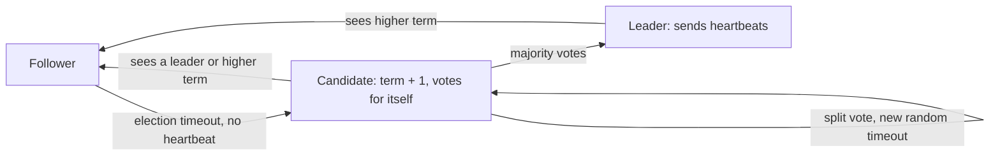

## 🎯 خلاصه

> **Consensus** یعنی گروهی از نودها روی **یک مقدار** (یا یک دنباله‌ی مرتب از مقادیر) توافق کنند، حتی وقتی بعضی نودها crash می‌کنند و پیام‌ها دیر می‌رسند یا گم می‌شوند. پروتکل‌هایی مثل **Raft**، **Paxos** و **ZAB** این کار را با یک **quorum اکثریت** و یک **leader** که تصمیم‌ها را مرتب می‌کند انجام می‌دهند.

- یک تصمیم وقتی قطعی می‌شود که **اکثریت** نودها آن را ذخیره کرده باشند. در یک کلاستر ۵ نودی، ۳ نود باید توافق کنند؛ ۲ نود می‌توانند از کار بیفتند.
- Raft از **term** (دوره‌ی شماره‌دار) استفاده می‌کند تا leaderهای قدیمی را رد کند. در هر term فقط یک leader وجود دارد.
- Consensus یک **لاگ replicated و linearizable** به تو می‌دهد. قفل، انتخاب leader، پیکربندی و metadata روی آن ساخته می‌شوند.
- هزینه‌اش بالاست: هر تصمیم منتظر یک رفت‌وبرگشت به اکثریت می‌ماند. آن را برای وضعیت کوچک و حیاتی استفاده کن، نه برای هر ردیفی که می‌نویسی.

## 🌱 از ساده شروع کنیم (مبتدی)

> **💡 Analogy:** پنج دوست باید یک رستوران را انتخاب کنند. هرکس پیشنهاد می‌دهد، و رستوران وقتی انتخاب می‌شود که سه نفر روی آن توافق کنند. اگر دو نفر اتاق را ترک کنند، سه نفر باقی‌مانده هنوز می‌توانند تصمیم بگیرند. دو گروه که هم‌پوشانی ندارند نمی‌توانند هر دو تصمیم بگیرند، چون هر کدام به سه نفر نیاز دارد و فقط پنج نفر وجود دارد.

به این قاعده‌ی «بیشتر از نصف» **quorum** می‌گویند. دو quorum از یک گروه همیشه حداقل یک عضو مشترک دارند، و همان عضو مشترک جلوی دو جواب متفاوت را می‌گیرد.

```text
Cluster: 5 nodes  ->  quorum = floor(5/2) + 1 = 3
  node1 stores "job-42 owner = worker-A"   (1 copy)
  node2 stores it                          (2 copies)
  node3 stores it                          (3 copies) -> decision is final
  node4, node5 are down: no problem, 3 of 5 still agree
```

چرا این لازم است؟ فرض کن دو worker هر دو فکر می‌کنند leader پردازش یک فایل هستند. بدون consensus، هر دو ممکن است نتیجه بنویسند و خروجی خراب شود. Consensus به گروه اجازه می‌دهد دقیقاً یک leader انتخاب کند و همه روی آن توافق کنند.

## 🔧 واقعاً چطور کار می‌کند (متوسط)

### Raft در یک صفحه

هر نود یکی از سه نقش **follower**، **candidate** یا **leader** را دارد. زمان به **termها** تقسیم می‌شود که شماره‌ی ۱، ۲، ۳ و… دارند. هر term حداکثر یک leader دارد.



۱. **انتخاب leader.** یک follower که برای مدت timeout تصادفی heartbeat نمی‌شنود candidate می‌شود، شماره‌ی term را زیاد می‌کند و رأی می‌خواهد. هر نود در هر term حداکثر یک‌بار رأی می‌دهد. timeoutهای تصادفی باعث می‌شوند رأی‌های مساوی نادر باشند، و اگر پیش بیاید دور جدیدی شروع می‌شود.
۲. **تکثیر لاگ.** leader دستور کلاینت را به لاگ خودش اضافه می‌کند و `AppendEntries` را برای followerها می‌فرستد. هر entry شماره‌ی term و index دارد.
۳. **Commit.** یک entry وقتی **committed** است که leader آن را روی اکثریت ذخیره کرده باشد. فقط آن موقع leader آن را روی state machine اعمال می‌کند و به کلاینت پاسخ می‌دهد.
۴. **ایمنی.** یک candidate فقط وقتی برنده می‌شود که لاگش دست‌کم به‌روز به اندازه‌ی لاگ اکثریت باشد. پس یک entry که commit شده بعد از تغییر leader گم نمی‌شود.

جزئیاتی که برای درستی مهم است: leader جدید برای تصمیم commit، replicaهای entryهای **termهای قبلی** را نمی‌شمارد. entry مربوط به term خودش را commit می‌کند و entryهای قدیمی‌تر همراه آن commit می‌شوند. پیاده‌سازی‌ها باید این قاعده را دقیقاً رعایت کنند.

### مثال کار‌شده: تحمل خرابی

| اندازه‌ی کلاستر N | Quorum | خرابی قابل تحمل |
|---|---|---|
| 1 | 1 | 0 |
| 3 | 2 | 1 |
| 5 | 3 | 2 |
| 7 | 4 | 3 |

اندازه‌های زوج هزینه اضافه می‌کنند بدون این‌که تحمل بیشتری بدهند: ۴ نود مثل ۳ نود فقط ۱ خرابی را تحمل می‌کند. به همین دلیل کلاسترها ۳، ۵ یا ۷ رأی‌دهنده دارند.

### قفل‌ها، lease و fencing token

قفلی که با lease ساخته می‌شود («۱۰ ثانیه قفل را نگه می‌دارم») به‌تنهایی ناامن است. شکست کلاسیک این است:

۱. کلاینت A قفل را با lease ده‌ثانیه‌ای می‌گیرد.
۲. A یک garbage-collection pause طولانی ۱۵ ثانیه‌ای می‌خورد. lease منقضی می‌شود.
۳. کلاینت B قفل را می‌گیرد و می‌نویسد.
۴. A بیدار می‌شود، هنوز فکر می‌کند قفل را دارد، و او هم می‌نویسد.

راه‌حل **fencing token** است: سرویس قفل با هر اعطا یک عدد صعودی برمی‌گرداند و سیستم ذخیره‌سازی نوشتن با توکن قدیمی‌تر را رد می‌کند. سرویس‌های مبتنی بر consensus (مثل etcd و ZooKeeper) جای درستی برای صادر کردن این عددها هستند، چون عددها باید بعد از خرابی‌ها هم یکنواخت باشند.

### سیستم‌هایی که در مصاحبه می‌پرسند

- **ZooKeeper** از ZAB استفاده می‌کند (یک پروتکل broadcast اتمیک با طراحی مشابه leader و quorum). کلاینت‌ها از **session**، **ephemeral znode** (که با پایان session حذف می‌شود) و **watch** (اعلان تغییر) استفاده می‌کنند. Kafka سال‌ها متادیتای کلاستر را در ZooKeeper نگه می‌داشت.
- **KRaft** کنترلر quorum مبتنی بر Raft در Kafka است. متادیتای کلاستر در یک لاگ داخلی (`__cluster_metadata`) قرار دارد که کنترلرها با Raft تکثیرش می‌کنند. نسخه‌های جدید Kafka حالت ZooKeeper را کاملاً حذف کرده‌اند؛ یادداشت‌های ارتقای نسخه‌ی خودت را ببین.
- **etcd** یک store کلید-مقدار مبتنی بر Raft است. Kubernetes وضعیتش را آن‌جا نگه می‌دارد. این سرویس **lease**، **revision** (شماره‌ی نسخه‌ی صعودی) و **watch** ارائه می‌دهد.
- **ClickHouse Keeper** یک سرویس هماهنگی مبتنی بر Raft با پروتکل سازگار با ZooKeeper است. جدول‌های ReplicatedMergeTree از آن برای هماهنگی partها و replicaها استفاده می‌کنند.

## 🧠 عمق و trade-offها (سنیور)

- **Latency.** یک write یک رفت‌وبرگشت به اکثریت به‌اضافه‌ی یک flush دیسک (`fsync`) روی هر رأی‌دهنده هزینه دارد. بین ریجن‌ها این ده‌ها تا صدها میلی‌ثانیه است. رأی‌دهنده‌ها را در یک ریجن نگه دار یا روی سه zone با latency کم پخش کن. quorum پنج‌نودی را برای داده‌ی داغ بین قاره‌ها پخش نکن.
- **از دست رفتن quorum یعنی عدم دسترس‌پذیری طراحی‌شده.** وقتی اکثریت در دسترس نیست، کلاستر به‌جای خطر دو جواب، writeها را رد می‌کند. این همان انتخاب CP از [[cap-theorem]] است. برای آن برنامه بریز: اپراتورها برای قطعی‌های سمت اقلیت runbook لازم دارند.
- **تغییر عضویت.** اضافه یا حذف کردن رأی‌دهنده باید از طریق خود پروتکل انجام شود (joint consensus یا تغییر یک‌سرور در Raft). دستی تغییر دادن لیست peerها می‌تواند در یک term دو اکثریت بسازد.
- **خواندن.** یک read linearizable یا به یک entry در لاگ نیاز دارد یا به بررسی leadership (read index یا lease reads). follower که بدون این بررسی‌ها read می‌دهد می‌تواند داده‌ی قدیمی برگرداند. ببین [[consistency-models]].
- **Consensus دیتابیس نیست.** مقدار کمی state را مرتب می‌کند. نگه داشتن payloadهای بزرگ در لاگ هر تصمیم را کند می‌کند. داده‌ی حجیم را در object storage یا لاگ‌های partition شده نگه دار و در گروه consensus فقط اشاره‌گر و metadata بگذار.
- **چه چیزی را پایش کنی.** تعداد تغییر leader در ساعت (flapping یعنی مشکل شبکه یا دیسک)، latency commit، lag followerها، تعداد رأی‌دهنده‌های زنده نسبت به quorum، و latency مربوط به `fsync` دیسک.
- **کی استفاده نکنی.** اگر یک دیتابیس با lease تک‌نوشته‌ای، یک update شرطی (compare-and-set) یا یک unique constraint مسئله را حل می‌کند، همان را استفاده کن. قفل توزیع‌شده به‌ندرت ساده‌ترین پاسخ درست است.

## 🧪 امتحان کن

۱. برای کلاستر ۷ نودی چند خرابی قابل تحمل است و برای commit چند نود باید تأیید کنند؟ بعد توضیح بده چرا ۶ نود بهتر از ۵ نود نیست.
۲. یک worker با توکن `37` روی `job-42` lease دارد. لایه‌ی ذخیره‌سازی قبلاً یک write با توکن `38` را پذیرفته. وقتی worker اول با توکن `37` می‌نویسد چه باید اتفاق بیفتد، و چرا؟
۳. کلاستر Kafka تو در حالت KRaft سه controller دارد. دو تا از آن‌ها از کار افتاده‌اند. آیا می‌تواند leader متادیتای جدید انتخاب کند؟ اگر یک نود دیگر به‌عنوان رأی‌دهنده‌ی چهارم به controller quorum اضافه شود، چه چیزی عوض می‌شود؟

<details><summary>Show solutions</summary>

**1.** Quorum = floor(7/2) + 1 = 4، پس ۳ خرابی را تحمل می‌کند (7 - 4). برای commit، ۴ تأیید لازم است. شش نود هم quorum برابر ۴ دارند (floor(6/2)+1 = 4)، پس فقط ۲ خرابی را تحمل می‌کنند. نود اضافه هزینه اضافه می‌کند بدون این‌که تحمل بیشتری بدهد؛ تعداد فرد معمول است.

**2.** write باید رد شود. توکن `38` از `37` جدیدتر است، پس لایه‌ی ذخیره‌سازی می‌داند کلاینت دیگری بعداً قفل را گرفته. پذیرفتن `37` کار آن مالک جدیدتر را بازنویسی می‌کند. به همین دلیل منبع باید fencing token را بررسی کند، نه فقط سرویس قفل.

**3.** نه. با ۳ رأی‌دهنده، quorum برابر ۲ است و فقط ۱ نود زنده است، پس اکثریتی وجود ندارد و leader جدیدی انتخاب نمی‌شود. اضافه کردن رأی‌دهنده‌ی چهارم quorum را floor(4/2)+1 = 3 می‌کند؛ با ۲ نود خراب و ۲ زنده، باز هم نمی‌تواند انتخاب کند. تا وقتی اکثریت در دسترس نباشد، اضافه کردن رأی‌دهنده کمکی نمی‌کند. راه‌حل بازگرداندن یکی از دو نود خراب است.

</details>

## 💬 گوشه‌ی مصاحبه

**سؤال: «ZooKeeper، etcd یا Raft چطور قفل می‌دهند؟»**

- متوسط: «کلاینت یک ephemeral node یا یک کلید lease می‌سازد. اگر بمیرد، session تمام می‌شود و کلید پاک می‌شود، پس کلاینت دیگری می‌تواند قفل را بگیرد.»
- سنیور: «فقط lease امن نیست، چون یک کلاینت که pause شده بعد از انقضا هم می‌تواند عمل کند. من یک fencing token صعودی از store مبتنی بر consensus می‌گیرم و منبع محافظت‌شده را طوری طراحی می‌کنم که توکن‌های قدیمی‌تر را رد کند. lease قفل را هم کوتاه نگه می‌دارم و تمدیدش می‌کنم.»

**سؤال: «چرا کلاسترها تعداد فرد رأی‌دهنده دارند؟»** چون ۴ رأی‌دهنده هم فقط ۱ خرابی را تحمل می‌کنند، مثل ۳ رأی‌دهنده. اندازه‌ی فرد بیشترین تحمل را به ازای هر رأی‌دهنده می‌دهد.

> **🎤 Say this in the interview:** «Consensus یک لاگ مرتب و توافق‌شده روی اکثریت به من می‌دهد. آن را برای متادیتا و leadership استفاده می‌کنم، نه برای داده‌ی حجیم، و می‌پذیرم که وقتی اکثریت از دست برود نوشتن متوقف می‌شود. هر چیزی که نیاز به انحصار متقابل دارد، به fencing token هم نیاز دارد.»

## ⚠️ اشتباهات رایج

> **⚠️ Watch out:** «برای high availability دو نود کافی است.» با N=2، quorum برابر ۲ است، پس یک خرابی کلاستر را متوقف می‌کند. حداقل ۳ رأی‌دهنده لازم است.

> **⚠️ Watch out:** «قفلی با TTL، انحصار متقابل را تضمین می‌کند.» فقط با fencing. یک پروسه‌ی pause شده می‌تواند از lease خودش بیشتر زنده بماند.

- داشتن تعداد زوج رأی‌دهنده و انتظار تحمل خرابی بیشتر.
- گذاشتن داده‌ی حجیم در لاگ consensus که هر تصمیم را کند می‌کند.
- قاطی کردن **leader** یک application (مثلاً یک scheduler) با leader در Raft مربوط به store متادیتا. این دو لایه‌ی جدا هستند.
- نادیده گرفتن این‌که quorum می‌تواند از دست برود، و طراحی بر اساس «کلاستر همیشه بالاست».
- خواندن از follower بدون بررسی read-index و نامیدن نتیجه linearizable.

## ✅ خودت را بسنج

1. کلاستر ۵ نودی Raft دو نود خراب دارد. چه اتفاقی می‌افتد؟
   - A) writeها رد می‌شوند، چون ۲ نود نمی‌توانند quorum بسازند
   - B) writeها ادامه می‌یابند، چون ۳ نود از ۵ اکثریت می‌سازند
   - C) کلاستر به دو کلاستر مستقل تقسیم می‌شود
   - D) فقط readها ادامه می‌یابند، writeها به هر ۵ نود نیاز دارند

<details><summary>Answer</summary>

**B** — quorum برای ۵ نود برابر ۳ است. با ۲ نود خراب، ۳ نود باقی می‌مانند و می‌توانند leader انتخاب کنند و entryها را commit کنند. writeها فقط وقتی متوقف می‌شوند که کمتر از ۳ نود در دسترس باشند.

</details>

2. شماره‌ی `term` در Raft چه کاری می‌کند؟
   - A) ضریب replication را تعیین می‌کند
   - B) یک epoch منطقی است که به نودها اجازه می‌دهد پیام‌های leaderهای قدیمی را رد کنند
   - C) زمان ساعت دیواری هر write را ثبت می‌کند
   - D) تعداد partitionهای لاگ است

<details><summary>Answer</summary>

**B** — termها ترتیب زمانی leadership را مشخص می‌کنند. نودی که پیامی با term قدیمی‌تر بگیرد آن را نادیده می‌گیرد، پس leader قدیمی که جدا شده نمی‌تواند بعد از وجود leader جدید commit کند.

</details>

3. یک قفل توزیع‌شده lease ده‌ثانیه‌ای دارد. کلاینتی ۱۵ ثانیه pause می‌شود، کلاینت دیگری قفل را می‌گیرد و می‌نویسد. کلاینت اول ادامه می‌دهد و می‌نویسد. کدام مکانیزم جا افتاده؟
   - A) lease بزرگ‌تر
   - B) heartbeat از کلاینت به سرویس قفل
   - C) یک fencing token که لایه‌ی ذخیره‌سازی بررسی می‌کند
   - D) جایگزین کردن قفل با sleep قبل از نوشتن

<details><summary>Answer</summary>

**C** — خود lease نمی‌تواند پروسه‌ای را متوقف کند که نمی‌داند قفل را از دست داده. یک fencing token صعودی به لایه‌ی ذخیره‌سازی اجازه می‌دهد write کلاینت قدیمی را رد کند.

</details>

4. **(سنیور)** از شما خواسته‌اند فهرست فایل‌های یک dataset دو گیگابایتی را داخل کلاستر etcd نگه دارید تا همه‌ی workerها سریع بخوانند. مشکل چیست و به جایش چه می‌کنی؟
   - A) etcd نمی‌تواند کلید ذخیره کند
   - B) مقادیر بزرگ هر write در consensus را کند می‌کنند و حافظه و snapshotها را تحت فشار می‌گذارند؛ فهرست را در object storage (یا یک دیتابیس) نگه دار و فقط یک اشاره‌گر، نسخه و metadata کوچک را در etcd بگذار
   - C) etcd برای مقادیر بزرگ همیشه سریع‌تر است
   - D) راه‌حل استفاده از کلاستر ۴ نودی است

<details><summary>Answer</summary>

**B** — لاگ‌های consensus هر مقدار را روی اکثریت تکثیر می‌کنند، پس payloadهای بزرگ I/O را ضرب می‌کنند و snapshot و بازیابی را کند می‌کنند. state هماهنگی را کوچک نگه دار و داده را در سیستمی بگذار که برای ذخیره‌ی حجیم ساخته شده.

</details>

5. **(سنیور)** تیمی یک کلاستر دیتابیس دو‌نودی برای «high availability» راه انداخته و کار را تمام شده می‌داند. به آن‌ها چه می‌گویی؟
   - A) دو نود حداقل لازم برای consensus است
   - B) با ۲ رأی‌دهنده quorum برابر ۲ است، پس خرابی یک نود نوشتن را متوقف می‌کند؛ برای تحمل یک خرابی از ۳ رأی‌دهنده (یا ۳ zone) استفاده کنید
   - C) دو نود کافی است، چون Raft به اکثریت نیاز ندارد
   - D) فقط ۲ رأی‌دهنده لازم است اگر روی SSDهای سریع باشند

<details><summary>Answer</summary>

**B** — quorum برای ۲ برابر floor(2/2)+1 = 2 است، پس کلاستر هیچ تحمل خرابی ندارد. سه رأی‌دهنده کوچک‌ترین اندازه‌ی مفید است و یک خرابی را تحمل می‌کند.

</details>

## 🗂️ فلش‌کارت

| Front | Back |
|---|---|
| Quorum برای N نود | floor(N/2) + 1 |
| خرابی قابل تحمل با N نود | floor((N-1)/2) |
| term در Raft چیست؟ | یک epoch منطقی با حداکثر یک leader؛ termهای قدیمی رد می‌شوند |
| entry کی commit می‌شود؟ | وقتی leader آن را روی اکثریت ذخیره کرده باشد |
| چرا fencing token؟ | کلاینت pause شده ممکن است بعد از انقضای lease عمل کند؛ storage توکن‌های قدیمی را رد می‌کند |
| ZooKeeper، etcd، KRaft و ClickHouse Keeper چه شباهتی دارند؟ | store متادیتای مرتب و تکثیرشده با quorum اکثریت |
| چرا تعداد رأی‌دهنده فرد است؟ | تعداد زوج هزینه اضافه می‌کند بدون تحمل خرابی بیشتر |
| Consensus در برابر دیتابیس | consensus state کوچک را مرتب می‌کند؛ داده‌ی حجیم متعلق به storage مخصوص خودش است |

## 🔗 ادامه

- **[[consistency-models]]** توضیح می‌دهد readهای linearizable چه هستند و چرا readهای follower نیاز به دقت دارند.
- **[[cap-theorem]]** و **[[cap-pacelc]]** توضیح می‌دهند چرا quorum هنگام پارتیشن نوشتن را متوقف می‌کند.
- **[[distributed-transactions]]** نشان می‌دهد پروتکل‌های commit چطور به یک coordinator قابل اعتماد وابسته‌اند.
- **[[fault-tolerance]]** replication و بازیابی در پلتفرم‌های داده را پوشش می‌دهد.
- **[[kafka-architecture]]** کنترلر quorum مربوط به KRaft را در طراحی گسترده‌تر Kafka قرار می‌دهد.
