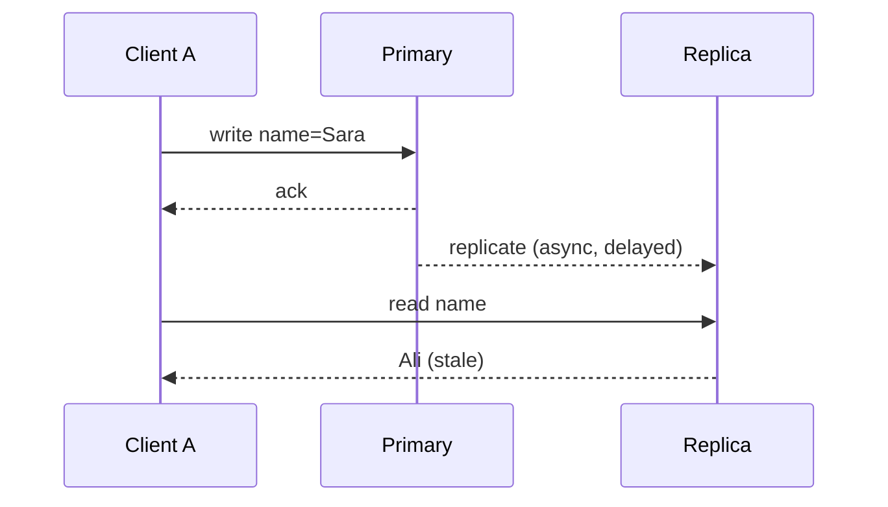

## 🎯 خلاصه

> **مدل سازگاری (consistency model)** قراردادی است درباره‌ی **این‌که یک read مجاز است چه مقداری برگرداند** وقتی داده تکثیر (replicate) شده یا هم‌زمان دسترسی می‌شود. مدل‌های قوی‌تر، سیستم توزیع‌شده را بیشتر از شما پنهان می‌کنند و هزینه‌ی بیشتری از نظر latency و availability دارند.

- **Linearizability** (روی یک شیء): هر عملیات انگار در یک لحظه‌ی مشخص بین شروع و پایانش اتفاق می‌افتد، و این لحظه‌ها با زمان واقعی هم‌خوان‌اند. وقتی یک write تأیید شد، هر read بعدی آن را می‌بیند.
- **Serializability** (تراکنش‌ها روی چند شیء): تراکنش‌های هم‌زمان طوری رفتار می‌کنند که انگار یکی‌یکی و به **یک ترتیب** اجرا شده‌اند. درباره‌ی زمان واقعی چیزی نمی‌گوید.
- **Strict serializability** = serializability + linearizability.
- تضمین‌های **causal** و **session** (read-your-writes، monotonic reads) ضعیف‌ترند، ارزان‌ترند و اغلب کافی‌اند.
- **Eventual consistency** فقط قول می‌دهد که وقتی نوشتن متوقف شد، replicaها به هم برسند.
- **C** در CAP یعنی linearizability. **C** در ACID یعنی دیتابیس قواعد یکپارچگی شما (constraint و invariant) را برقرار نگه می‌دارد. این دو چیز متفاوت‌اند.

## 🌱 از ساده شروع کنیم (مبتدی)

> **💡 Analogy:** یک تخته‌ی وایت‌برد خانوادگی که از آن عکس گرفته‌ای و به یخچال زده‌ای. تو «شیر» می‌نویسی، بعد به عکس نگاه می‌کنی و هنوز لیست قدیمی را می‌بینی. مدل‌های سازگاری تعیین می‌کنند که این عکس چقدر می‌تواند قدیمی باشد، و کدام افراد باید تغییر تو را ببینند قبل از این‌که تو دوباره نگاه کنی.

سناریو: کاربری نام نمایشی‌اش را عوض می‌کند. نوشتن به دیتابیس primary می‌رود. یک read به یک replica می‌خورد که هنوز تغییر را دریافت نکرده است.

```text
t=0  client A: UPDATE users SET name='Sara' WHERE id=7   (primary, OK)
t=1  client A: SELECT name FROM users WHERE id=7          (replica, lag 2s)
     -> returns 'Ali'   (stale)
```

آیا این باگ است؟ به قرارداد بستگی دارد. اگر محصول قول داده باشد «همیشه تغییر خودت را می‌بینی»، بله. اگر قول داده باشد «بقیه در چند ثانیه نام جدید را می‌بینند»، نه.

سه سؤال کمک می‌کند سیستم را روی این طیف قرار دهی:

1. آیا یک read همیشه آخرین write تأییدشده را می‌بیند؟
2. آیا کلاینت‌های مختلف writeها را به یک ترتیب می‌بینند؟
3. آیا تغییرات خودم را می‌بینم و خواندن‌هایم هرگز به گذشته برنمی‌گردند؟

هر «بله» سیستم را به سمت قوی‌تر شدن می‌برد و هر «بله» هزینه‌ای دارد.

## 🔧 واقعاً چطور کار می‌کند (متوسط)

### سر قوی طیف

یک register که **linearizable** است، مثل یک کپی‌ی واحد از داده رفتار می‌کند که هر عملیاتش atomic است. هر عملیات یک invocation و یک response دارد. باید یک نقطه‌ی واحد (**linearization point**) بین این دو وجود داشته باشد که عملیات در آن اثر می‌کند، و این نقاط باید با زمان واقعی هم‌خوان باشند. نتیجه‌ی عملی: اگر write با نام W زودتر از شروع read با نام R کامل شده باشد، R باید مقدار W یا چیزی جدیدتر از آن را برگرداند.

Linearizability ویژگی **یک شیء** (یک key یا یک register) است. درباره‌ی دو key که با هم به‌روز می‌شوند چیزی نمی‌گوید.

**Serializability** ویژگی **تراکنش‌ها** روی چند شیء است. نتیجه باید برابر با *یک* اجرای سریالی از همان تراکنش‌ها باشد. آن ترتیب سریالی می‌تواند با زمان واقعی فرق داشته باشد: تراکنشی که زودتر تمام شده می‌تواند بعد از تراکنشی قرار بگیرد که دیرتر شروع شده. به همین دلیل serializable با linearizable یکی نیست. **Strict serializability** هر دو را می‌خواهد: ترتیب سریالی باید زمان واقعی را رعایت کند.

بیشتر سیستم‌های SQL پیش‌فرض‌شان چیزی ضعیف‌تر از serializable است، مثل read committed یا snapshot isolation (ببین [[isolation-level]]). مستندات موتور خود را بخوان تا بدانی کدام را داری.

### وسط طیف

- **Sequential consistency**: همه‌ی کلاینت‌ها عملیات‌ها را در یک ترتیب کلی می‌بینند که ترتیب برنامه‌ی هر کلاینت را حفظ می‌کند، اما لزوماً زمان واقعی را نه.
- **Causal consistency**: اگر write ب به write الف وابسته باشد (ب بعد از خواندن الف نوشته شده)، همه الف را قبل از ب می‌بینند. writeهای هم‌زمان ممکن است به ترتیب‌های مختلف دیده شوند.
- **تضمین‌های session** (برای هر کلاینت):
  - *Read-your-writes*: بعد از این‌که نوشتی، readهایت شامل همان write است.
  - *Monotonic reads*: یک read بعدی هرگز قدیمی‌تر از read قبلی نیست.
  - *Monotonic writes*: writeهایت به همان ترتیبی اعمال می‌شوند که فرستاده‌ای.

### سر ضعیف طیف

**Eventual consistency**: اگر نوشتن متوقف شود، همه‌ی replicaها در نهایت به یک مقدار می‌رسند. نمی‌گوید این کار چقدر طول می‌کشد یا در این فاصله چه چیزی می‌خوانی. ببین [[eventual-consistency]].

### یک read قدیمی در عمل



با **replication همزمان** (primary قبل از تأیید، منتظر replica می‌ماند) این read قدیمی رخ نمی‌دهد، اما هر write زمان رفت‌وبرگشت به replica را می‌پردازد و یک replica کند همه‌ی writeها را کند می‌کند. با **replication ناهمزمان**، writeها سریع‌اند و readهای replica می‌توانند قدیمی باشند. **Session stickiness** (readهای یک کاربر را برای چند ثانیه بعد از write به primary بفرست، یا به همان replicaای که write را تأیید کرده) read-your-writes را بدون هزینه‌ی کامل replication همزمان می‌دهد.

### مرجع سریع

| مدل | قول | هزینه‌ی معمول |
|---|---|---|
| Strict serializability | تراکنش‌ها سریالی و با ترتیب زمان واقعی دیده می‌شوند | بیشترین latency، هماهنگی روی commit |
| Linearizable (روی هر key) | readها آخرین write تأییدشده را می‌بینند | رفت‌وبرگشت به leader یا quorum |
| Serializable | تراکنش‌ها برابر با یک ترتیب سریالی‌اند | lock، abort یا validation |
| Snapshot isolation | هر تراکنش یک snapshot سازگار می‌خواند | readهای ارزان، ولی anomaly از نوع write skew |
| Causal | writeهای وابسته به ترتیب دیده می‌شوند | ردیابی وابستگی‌ها |
| Session (read-your-writes) | writeهای خودم دیده می‌شوند، readها به عقب برنمی‌گردند | routing چسبنده یا بررسی نسخه |
| Eventual | replicaها بعد از توقف نوشتن به هم می‌رسند | ارزان‌ترین و در دسترس‌ترین |

## 🧠 عمق و trade-offها (سنیور)

- **CAP و C.** قضیه‌ی CAP (ببین [[cap-theorem]]) می‌گوید وقتی شبکه پارتیشن می‌شود، نمی‌توانی برای هر درخواست هم linearizable بودن و هم availability را نگه داری. انتخاب در سطح هر عملیات است، نه کل سیستم. PACELC اضافه می‌کند که حتی بدون پارتیشن هم بین latency و سازگاری معامله می‌کنی. ببین [[cap-pacelc]].
- **Quorumها جادو نیستند.** با N replica، writeای که W replica تأییدش کرده و readای که از R replica می‌خواند، با R + W > N همیشه حداقل یک replica مشترک دارند. این هم‌پوشانی لازم است اما برای linearizability کافی نیست. writeهای هم‌زمان، sloppy quorum، hinted handoff و writeهایی که شکست خورده‌اند ولی اعمال شده‌اند، همچنان می‌توانند مقدار قدیمی یا متناقض برگردانند. مخزن‌های سبک Dynamo (مثلاً Cassandra) قابل تنظیم و معمولاً eventual هستند و تراکنش‌های سبکشان مسیر consensus جدا و کندتری دارد. برای نسخه‌ی خودت مستندات را بررسی کن.
- **readهای replica در analytics.** داشبوردی که روی replica است داده‌ای چند ثانیه یا چند دقیقه قدیمی نشان می‌دهد. lag را در SLA بیاور، زمان «داده تا لحظه‌ی» را نشان بده، و replication lag را به‌عنوان metric پایش کن. هرگز برای تصمیمی که برگشت‌ناپذیر است، مثل کسر پول از کارت، از read روی replica استفاده نکن.
- **فرمت‌های جدول.** Iceberg، Delta و Hudi از طریق commitهای atomic روی metadata، snapshot isolation را روی object storage می‌دهند. writerهای متناقض هنگام commit تشخیص داده می‌شوند. readerها یک snapshot سازگار می‌بینند، اما دو موتور که «آخرین» را می‌خوانند اگر یکی catalogاش را refresh نکرده باشد، ممکن است snapshotهای متفاوتی ببینند. این مسئله‌ی تازگی داده است، نه خرابی داده.
- **Kafka.** داخل یک partition، لاگ یک ترتیب واحد می‌دهد که همه‌ی consumerها یکسان می‌بینند. بین partitionها ترتیبی وجود ندارد. برای ترتیب در سطح key طراحی کن، نه ترتیب سراسری.
- **مدل هزینه.** هر پله‌ی بالاتر در این نردبان یک رفت‌وبرگشت یا یک lock اضافه می‌کند. یک write linearizable بین ریجن‌ها دست‌کم یک رفت‌وبرگشت بین‌ریجنی می‌خواهد که اغلب ده‌ها تا صدها میلی‌ثانیه است. ضعیف‌ترین مدلی را انتخاب کن که invariantهایت را نگه می‌دارد، و بقیه را در application با idempotency key و unique constraint اعمال کن.
- **چه چیزی را پایش کنی.** replication lag برای هر replica، نرخ read قدیمی در canary (write، سپس read برگشتی)، نرخ abort در isolation سریالی، و consumer lag برای کپی‌های رویدادمحور.

## 🧪 امتحان کن

از دو session با `psql` روی PostgreSQL نسخه‌ی 13 یا بالاتر استفاده کن، یا فقط روی کاغذ استدلال کن.

1. جدول `accounts(id int primary key, balance int)` را با ردیف `(1, 100)` بساز. در session الف اجرا کن `BEGIN; UPDATE accounts SET balance = balance - 30 WHERE id = 1;` و commit نکن. در session ب اجرا کن `SELECT balance FROM accounts WHERE id = 1;`. ب چه می‌بیند، و بعد از commit شدن الف چه می‌بیند؟
2. دو پزشک on call هستند و قانون این است که «حداقل ۲ نفر on call باشند». دو تراکنش هرکدام `SELECT count(*) ... WHERE on_call` را اجرا می‌کنند (عدد ۲ می‌بینند)، سپس هرکدام ردیف خودشان را off call می‌کنند، و هر دو commit می‌شوند. این anomaly چیست و دو راه‌حل ممکن کدام‌اند؟
3. کاربری روی primary می‌نویسد، سپس read بعدی‌اش به replicaای می‌رود که ۳ ثانیه عقب است و مقدار قدیمی را نشان می‌دهد. کدام تضمین session نقض شده، و کدام تغییر routing آن را برمی‌گرداند؟

<details><summary>Show solutions</summary>

**1.** ب مقدار `100` می‌بیند: در read committed، تغییرات commit نشده برای session دیگر دیده نمی‌شوند. بعد از commit شدن الف، اولین statement ب مقدار `70` را می‌بیند.

**2.** این write skew است. هر دو تراکنش یک snapshot را می‌خوانند و سپس ردیف‌های متفاوتی می‌نویسند، پس بررسی conflict سطح ردیف در snapshot isolation فعال نمی‌شود و قانون «حداقل ۲» می‌شکند. راه‌حل‌ها: اجرای تراکنش‌ها در SERIALIZABLE (PostgreSQL با SSI این را تشخیص می‌دهد و یکی را abort می‌کند)، یا این‌که هر دو تراکنش یک ردیف مشترک (مثلاً ردیف شیفت) را به‌روز کنند تا روی یک key با هم تداخل پیدا کنند.

**3.** Read-your-writes نقض شده: کاربر write خودش را نمی‌بیند. راه‌حل: readهای آن کاربر را برای مدت کوتاهی بعد از write به primary بفرست، یا موقعیت لاگ write را همراه خودت ببر و از replica بخواه صبر کند تا آن موقعیت را اعمال کرده باشد.

</details>

## 💬 گوشه‌ی مصاحبه

**سؤال: «تفاوت consistency در CAP و consistency در ACID چیست؟»**

- متوسط: «C در CAP یعنی linearizability، یعنی هر read آخرین write را می‌بیند. C در ACID یعنی دیتابیس constraintها را معتبر نگه می‌دارد. این دو فرق دارند.»
- سنیور: «C در CAP ویژگی تازگی داده‌ی کل سیستم است و چیزی است که هنگام پارتیشن از دست می‌دهی. C در ACID یک invariant در سطح application است که دیتابیس با constraint و تراکنش اعمالش می‌کند و به سطح isolation وابسته است. یک سیستم می‌تواند ACID باشد و linearizable نباشد، مثلاً یک primary با snapshot isolation و replicaهای ناهمزمان.»

**سؤال: «آیا serializable همان linearizable است؟»** نه. Serializable درباره‌ی تراکنش‌ها روی چند شیء است، با یک ترتیب سریالی. Linearizable درباره‌ی یک شیء و ترتیب زمان واقعی است. Strict serializable هر دو را دارد.

> **🎤 Say this in the interview:** «اول می‌پرسم کدام invariant باید برقرار باشد و کدام عملیات به داده‌ی تازه نیاز دارد. بعد ضعیف‌ترین مدلی را انتخاب می‌کنم که آن invariant را نگه می‌دارد، و بقیه را با idempotency و constraint اعمال می‌کنم.»

## ⚠️ اشتباهات رایج

> **⚠️ Watch out:** «Replication یعنی consistency.» replicaها کپی‌اند. مگر این‌که پروتکل چیز دیگری تضمین کند، read از یک کپی می‌تواند قدیمی باشد.

> **⚠️ Watch out:** «R + W > N سازگاری قوی می‌دهد.» وقتی writeهای هم‌زمان یا شکست‌خورده در کار باشند، فقط یک هم‌پوشانی می‌دهد، نه linearizability.

- قاطی کردن serializable (تراکنش‌ها) و linearizable (یک شیء).
- فرض این‌که سطح isolation پیش‌فرض serializable است. خیلی از دیتابیس‌ها پیش‌فرض read committed دارند.
- خواندن از replica و عمل کردن بر اساس آن مقدار، انگار منبع حقیقت است.
- فکر کردن این‌که eventual consistency یعنی «داده‌ی غلط». یعنی داده‌ی موقتاً قدیمی، با قاعده‌ی همگرایی.
- مقایسه‌ی timestampهای ساعت دیواری ماشین‌های مختلف برای تعیین ترتیب (ببین [[time-and-ordering]]).

## ✅ خودت را بسنج

1. کدام ویژگی توصیف می‌شود با «هر read، آخرین write تأییدشده‌ی آن key را برمی‌گرداند»؟
   - A) Serializability
   - B) Linearizability
   - C) Causal consistency
   - D) Eventual consistency

<details><summary>Answer</summary>

**B** — linearizability برای یک شیء: وقتی write تأیید شد، هر read بعدی آن را می‌بیند (یا چیزی جدیدتر). Serializability درباره‌ی تراکنش‌ها روی چند شیء است و ترتیب زمان واقعی لازم ندارد.

</details>

2. کاربری کامنت می‌گذارد، صفحه را refresh می‌کند و کامنت نیست، چون read به یک replica عقب‌افتاده رفته. کدام تضمین نقض شده؟
   - A) Monotonic writes
   - B) Read-your-writes
   - C) Serializability
   - D) Durability

<details><summary>Answer</summary>

**B** — read-your-writes می‌گوید readهای یک کلاینت شامل writeهای قبلی خودش است. Durability درباره‌ی زنده ماندن write بعد از crash است و مشکل این‌جا آن نیست.

</details>

3. دو تراکنش هم‌زمان هرکدام داده‌ی هم‌پوشان می‌خوانند، بر اساس آن تصمیم می‌گیرند و ردیف‌های متفاوتی می‌نویسند. در snapshot isolation هر دو commit می‌شوند و یک invariant می‌شکند. این anomaly چه نام دارد؟
   - A) Dirty read
   - B) Lost update روی یک ردیف
   - C) Write skew
   - D) Phantom read در یک query فقط‌خواندنی

<details><summary>Answer</summary>

**C** — write skew. تراکنش‌ها ردیف‌های جداگانه می‌نویسند، پس بررسی conflict سطح ردیف در snapshot isolation فعال نمی‌شود. Serializable یا یک conflict صریح روی ردیف مشترک این را حل می‌کند.

</details>

4. **(سنیور)** یک تیم analytics برای تصمیم‌گیری درباره‌ی این‌که مشتری اعتبار کافی برای شارژ کارت دارد یا نه، از replica می‌خواند. چرا این طراحی غلط است و چه چیزی را تغییر می‌دهی؟
   - A) replicaها SELECT را پشتیبانی نمی‌کنند
   - B) read از replica ممکن است قدیمی باشد، پس تصمیم می‌تواند با موجودی منقضی گرفته شود؛ بررسی را روی primary و در همان تراکنش شارژ انجام بده، یا از یک update شرطی استفاده کن که محدودیت را اعمال کند
   - C) replicaها همیشه linearizable هستند، پس تغییری لازم نیست
   - D) شارژ کارت باید از DISTINCT استفاده کند

<details><summary>Answer</summary>

**B** — تصمیمی که نباید اشتباه باشد (شارژ پول) باید وضعیت معتبر را بخواند، داخل تراکنشی که invariant را اعمال می‌کند. replicaها برای داشبوردهایی با تازگی مشخص مناسب‌اند.

</details>

5. **(سنیور)** یک کلاستر N=5 replica دارد، writeها منتظر W=3 تأیید می‌مانند و readها R=3 replica را می‌پرسند. همکارت می‌گوید این linearizable است چون R + W > N. چه جوابی می‌دهی؟
   - A) درست است، هم‌پوشانی linearizability را تضمین می‌کند
   - B) هم‌پوشانی لازم است ولی کافی نیست: writeهای هم‌زمان و writeهایی که شکست خورده ولی اعمال شده‌اند همچنان می‌توانند مقدار قدیمی یا متناقض برگردانند؛ linearizability به پروتکلی نیاز دارد که عملیات‌ها را کاملاً مرتب کند، مثل یک leader با لاگ consensus
   - C) فقط اگر N زوج باشد درست است
   - D) بی‌ربط است، quorumها هرگز هم‌پوشانی ندارند

<details><summary>Answer</summary>

**B** — R + W > N حداقل یک replica مشترک تضمین می‌کند، ولی بدون ترتیب کلی برای writeها و پروتکل readی که writeهای در حال انجام را مدیریت کند، anomaly باقی می‌ماند. سیستم‌های مبتنی بر consensus (ببین [[consensus]]) هر عملیات را از یک لاگ مرتب می‌کنند و readهای linearizable می‌دهند.

</details>

## 🗂️ فلش‌کارت

| Front | Back |
|---|---|
| Linearizable | هر عملیات در یک لحظه بین شروع و پایانش اثر می‌کند؛ ترتیب زمان واقعی را رعایت می‌کند؛ روی یک شیء |
| Serializable | تراکنش‌های هم‌زمان برابر با یک ترتیب سریالی‌اند؛ نیاز به زمان واقعی ندارند |
| Strict serializability | Serializable + linearizable |
| Read-your-writes | بعد از write خودم، readهایم آن را شامل می‌شوند |
| Monotonic reads | readهای بعدی‌ام هرگز از readهای قبلی‌ام قدیمی‌تر نیستند |
| Causal consistency | writeهای وابسته برای همه به یک ترتیب دیده می‌شوند |
| Write skew | دو تراکنش داده‌ی هم‌پوشان می‌خوانند، ردیف‌های جدا می‌نویسند و یک invariant را می‌شکنند |
| C در CAP در برابر C در ACID | تازگی داده (linearizability) در برابر invariantهای یکپارچگی application |

## 🔗 ادامه

- **[[distributed-fundamentals]]** مدل خرابی را توضیح می‌دهد که این تضمین‌ها روی آن ساخته شده‌اند.
- **[[cap-pacelc]]** معامله را به یک تصمیم درباره‌ی latency تبدیل می‌کند.
- **[[consensus]]** نشان می‌دهد یک لاگ linearizable چطور ساخته می‌شود.
- **[[isolation-level]]** و **[[mvcc]]** بخش تک‌نودی serializability را توضیح می‌دهند.
- **[[kafka-exactly-once]]** و **[[dedup-idempotent-loads]]** نشان می‌دهند وقتی store ضعیف است چطور invariantها را نگه داری.
