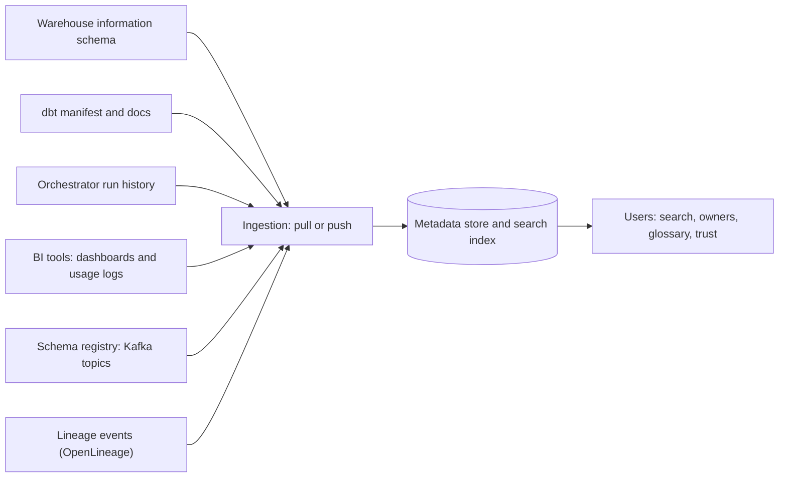

## 🎯 خلاصه

> **data catalog** فهرست قابل جست‌وجوی کل داده‌های سازمان است: چه جدول‌ها و داشبوردهایی وجود دارند، معنی‌شان چیست، مالکشان کیست، چطور استفاده می‌شوند، و چطور به هم وصل‌اند (lineage). کاتالوگ **metadata** را نگه می‌دارد، نه خود داده را.

- چهار نوع metadata: **فنی** (schema، نوع داده)، **عملیاتی** (تازگی، تاریخچه‌ی run)، **کسب‌وکاری** (تعریف‌ها، واژه‌های glossary) و **استفاده** (چه کسی چه چیزی را، و چند بار، کوئری می‌کند).
- کاتالوگ سه کار دارد: **کشف** («جدول درآمد کجاست؟»)، **اعتماد** («تأیید شده است؟ مالکش کیست؟») و **حاکمیت** («کدام ستون‌ها داده‌ی شخصی‌اند؟»).
- ابزارهایی مثل **OpenMetadata**، **DataHub** و **Amundsen** در روش ورود metadata (pull یا push)، مدل‌سازی entityها و تأکیدشان روی جست‌وجو، گردش‌کار حاکمیت یا lineage فرق دارند. قبل از انتخاب، مستندات فعلی را بررسی کن.

## 🌱 از ساده شروع کنیم (مبتدی)

> **💡 تشبیه:** فهرست کتابخانه. کتاب‌ها داده هستند. کارت فهرست عنوان، نویسنده، قفسه، این‌که نسخه به‌روز است یا نه، و این‌که برای سؤال باید از چه کسی بپرسی را می‌گوید. کسی برای فهمیدن محتوای کتاب سراغ فهرست نمی‌رود، اما بدون فهرست هم کسی کتاب را پیدا نمی‌کند.

فرض کن شرکتی ۲٬۰۰۰ جدول دارد. یک تحلیل‌گر تازه می‌پرسد: «مشتری‌های فعال سه‌ماههٔ گذشته را کجا پیدا کنم؟» بدون کاتالوگ، جواب از حافظه‌ی یک همکار می‌آید و تحلیل‌گر ممکن است `stg.customers_v2_old` را انتخاب کند. با کاتالوگ، «مشتری فعال» را جست‌وجو می‌کند، جدول تأییدشده را باز می‌کند، مالک و تعریف را می‌بیند، و زمان آخرین به‌روزرسانی را چک می‌کند.

یک ورودی کاتالوگ ممکن است این‌طور باشد، در YAML ساده:

```yaml
table: mart.customers
description: One row per customer, with activity flags updated daily.
owner: growth-analytics
certified: true
tags: [pii-contains-email]
columns:
  email:
    type: text
    tags: [pii]
  is_active:
    type: boolean
    business_term: Active customer
```

هر خط metadata است. هیچ‌کدامش داده‌ی مشتری نیست.

## 🔧 واقعاً چطور کار می‌کند (متوسط)

**metadata از کجا می‌آید.** کاتالوگ اطلاعاتش را خودش نمی‌سازد. آن را از منابع **ingest** می‌کند:



- **Pull (crawler):** یک job زمان‌بندی‌شده metadata را از منبع می‌خواند، مثلاً information schema انبار. ساده است، اما از تغییرات عقب می‌ماند.
- **Push:** منبع وقتی چیزی تغییر می‌کند رویداد metadata منتشر می‌کند، مثلاً یک run در dbt یا به‌روزرسانی schema registry. تازه‌تر است، اما هر منبع به یک integration نیاز دارد که رویداد منتشر کند.

**چهار نوع metadata** و کاری که هر کدام ممکن می‌کند:

| نوع | نمونه | چه چیزی را ممکن می‌کند |
|---|---|---|
| فنی | ستون‌ها، نوع‌ها، partitionها، تعداد ردیف | جست‌وجو بر اساس نام ستون، مقایسه‌ی schema |
| عملیاتی | آخرین refresh، وضعیت run، SLA | نشان تازگی، ریشه‌یابی حادثه |
| کسب‌وکاری | تعریف‌ها، واژه‌های glossary، متریک‌ها | «فعال» اینجا یعنی چه؟ |
| استفاده | تعداد کوئری، کاربران برتر، داشبوردهای ساخته‌شده روی آن | رتبه‌بندی محبوبیت، بازنشستن جدول‌های بلااستفاده |

**glossary کسب‌وکار.** glossary فهرستی از واژه‌های توافق‌شده‌ی کسب‌وکار است («مشتری فعال»، «درآمد خالص») که برای هر کدام یک تعریف دارد. بخش مفید **لینک** است: واژه به ستون‌ها و داشبوردهایی وصل می‌شود که آن را پیاده‌سازی می‌کنند. آن‌وقت دو تیم دیگر «فعال» را جور دیگری حساب نمی‌کنند، یا حداقل می‌بینند که این کار را می‌کنند.

**مالکیت.** هر دارایی مهم یک مالک (یک تیم) و اغلب یک steward (فردی که تعریف‌ها را نگه می‌دارد) لازم دارد. مالکیت مسیردهی هشدارها در [[data-observability|observability]] و درخواست‌های دسترسی در حاکمیت را تعیین می‌کند.

**گواهی (certification).** یک برچسب ساده مثل «certified» به کاربر می‌گوید کدام جدول‌ها یک استاندارد (مستندشده، تست‌شده، دارای مالک، تازه) را دارند. خودکار کردن این بررسی از نگه‌داشتن دستی برچسب بهتر است.

یک بررسی کوچک روی خروجی کاتالوگ، برای پیدا کردن جدول‌های بی‌مالک:

```python
catalog = [
    {"name": "mart.revenue_daily", "owner": "finance", "columns": {"amount": "numeric"}},
    {"name": "stg.customers", "owner": None, "columns": {"email": "text"}},
]

def missing_owner(entries: list[dict]) -> list[str]:
    return [e["name"] for e in entries if not e.get("owner")]

print(missing_owner(catalog))  # ['stg.customers']
```

## 🧠 عمق و trade-offها (سنیور)

- **کاتالوگی که کسی به‌روزش نمی‌کند از نداشتنش بدتر است.** توضیح‌ها و مالک‌های کهنه باعث می‌شوند مردم به ابزار بی‌اعتماد شوند. پوشش را اندازه بگیر (سهم جدول‌های تأییدشده‌ای که مالک و توضیح دارند) و تازگی خود metadata را هم.
- **pull در برابر push یک trade-off بین تازگی و تلاش است.** crawlerها راحت راه می‌افتند و روی هر منبعی کار می‌کنند. integrationهای push دقیق‌تر و در مقیاس ارزان‌ترند، اما برای هر ابزار کار جدا می‌خواهند. بیشتر راه‌اندازی‌های واقعی هر دو را ترکیب می‌کنند.
- **metadata یک گراف است.** lineage، مالکیت و لینک‌های glossary با هم کاتالوگ را برای تحلیل impact مفید می‌کنند. فهرست تخت جدول‌ها با توضیح فقط «این چیست؟» را جواب می‌دهد.
- **گردش‌کار حاکمیت.** درخواست دسترسی، طبقه‌بندی PII و مرحله‌های تأیید جایی است که ابزارها بیشترین تفاوت را دارند. اگر انطباق به ردپای حسابرسی نیاز دارد، بررسی کن ابزار ثبت کند چه کسی چه چیزی را و کی تأیید کرده، به‌جای این‌که به یک برچسب متنی آزاد اعتماد کنی.
- **کیفیت جست‌وجو محرک پذیرش است.** کاربران کاتالوگ را از اولین جست‌وجویشان قضاوت می‌کنند. رتبه‌بندی بر اساس استفاده و گواهی، همنام‌های کسب‌وکاری و نام‌های واضح جدول از تعداد connectorها مهم‌ترند.
- **مقیاس و store متادیتا.** چند هزار جدول با ستون‌ها یک ایندکس متوسط است. هزینه در دفعات ingestion، پروفایل‌سازی ستون‌ها و حجم لاگ‌های استفاده است، نه در خود جست‌وجو.
- **کاتالوگ داده با کاتالوگ جدول فرق دارد.** آن را با کاتالوگ قالب جدول که Iceberg یا Hive metastore استفاده می‌کنند اشتباه نگیر. آن‌ها بخشی از لایه‌ی ذخیره‌سازی‌اند و می‌گویند فایل‌ها و metadata یک جدول کجاست و کدام موتورها می‌توانند بخوانندش. کاتالوگ داده برای آدم‌ها و حاکمیت است. آن سمت را در [[catalogs]] ببین.
- **کی یک پلتفرم کامل نسازی.** برای تیم کوچک با چند جدول، یک صفحه‌ی ویکی مستند، قرارداد نام‌گذاری و مستندات dbt بیشتر نیازها را پوشش می‌دهند. وقتی مردم مکرراً می‌پرسند «کجاست؟» و «مالکش کیست؟»، کاتالوگ را بیاور.

## 🧪 امتحان کن

۱. تابع `missing_owner` را طوری گسترش بده که جدول‌هایی را هم برگرداند که ستونی با نام پایان‌یافته به `email` دارند، ولی `tags` شامل `pii` ندارند. **پیش‌بینی کن:** برای مثال بالا کدام ورودی‌ها پرچم می‌خورند؟
۲. یک ورودی YAML برای واژه‌ی کسب‌وکاری «درآمد خالص» بنویس که به دو ستون در دو جدول متفاوت لینک شود. توضیح بده این لینک چه چیزی اضافه می‌کند که یک توضیح ساده نمی‌کند.
۳. یک قانون گواهی با سه شرط طراحی کن که بتوان خودکار بررسی‌اش کرد. بگو هر شرط از کدام نوع metadata می‌خواند.

<details><summary>جواب‌ها را ببین</summary>

**۱.** با داده‌ی مثال، `stg.customers` ستون `email` دارد و اصلاً `tags` ندارد، پس پرچم می‌خورد. `mart.revenue_daily` ستون `email` ندارد، پس نه. نکته‌ی تمرین این است که `tags` نبودن را «بدون تگ» در نظر بگیری و کد نیفتد: از `e.get("tags", [])` استفاده کن.

**۲.** YAML یک ورودی glossary است با `term`، `definition`، `owner` و `linked_columns` که دو ستون را فهرست می‌کند. لینک نشان می‌دهد واژه کجاها پیاده‌سازی شده و اگر دو تیم آن را متفاوت حساب کنند، بازبین می‌بیند. یک توضیح ساده را نمی‌شود با داده مقایسه کرد.

**۳.** نمونه: (الف) مالک دارد (metadata مالکیت)؛ (ب) توضیح و لینک glossary روی ستون‌های کلیدی دارد (metadata کسب‌وکاری)؛ (ج) در SLA خودش refresh شده (metadata عملیاتی). هر شرط از نوع متفاوتی می‌خواند، و به همین دلیل کاتالوگ به چند منبع ingestion نیاز دارد.

</details>

## 💬 گوشه‌ی مصاحبه

**سؤال: «چطور به تحلیل‌گرها کمک می‌کنی داده‌ی قابل اعتماد پیدا کنند؟»** جواب متوسط: «کاتالوگی راه می‌اندازم که schema انبار و مستندات dbt را ingest کند، تا مردم بتوانند جدول‌ها را جست‌وجو کنند و توضیح و مالک را ببینند.» جواب سنیور: «از جدول‌هایی شروع می‌کنم که بیشترین داشبورد و مدل از آن‌ها استفاده می‌کنند و آن‌ها را تأیید می‌کنم: مالک‌دار، مستندشده، تست‌شده و تازه. metadata فنی، عملیاتی و استفاده را خودکار وارد می‌کنم، یک glossary کسب‌وکار برای واژه‌هایی که مردم سرشان بحث می‌کنند اضافه می‌کنم، و موفقیت جست‌وجو و پوشش را اندازه می‌گیرم، نه تعداد جدول‌ها را.»

**سؤال: «اول کاتالوگ یا lineage؟»** با هسته‌ی کاتالوگ (مالکیت، توضیح، جست‌وجو) شروع کن، چون رایج‌ترین سؤال روزانه را حل می‌کند. lineage عمق بیشتری برای تحلیل impact می‌دهد و معمولاً وقتی pipelineهای metadata قابل اعتماد شدند می‌آید.

> **🎤 این را در مصاحبه بگو:** «کاتالوگ فهرست کل داده‌هاست. می‌خواهم metadata فنی، عملیاتی، کسب‌وکاری و استفاده در آن باشد، با مالک برای هر دارایی مهم و glossary برای واژه‌های مشترک. موفقیتش را با این می‌سنجم که مردم سریع جدول درست و قابل اعتماد را پیدا کنند.»

## ⚠️ اشتباهات رایج

> **⚠️ مراقب باش:** کاتالوگ را یک پروژه‌ی مستندسازی بدانی که یک بار انجام می‌شود. metadata کهنه می‌شود، مگر این‌که ingestion و مالکیت خودکار شوند.

- ingest کردن همه‌چیز و نمونه‌برداری نکردن، طوری که جست‌وجو ۴۰ جدول تقریباً یکسان برگرداند.
- نوشتن تعریف‌های کسب‌وکار در ویکی و هرگز وصل نکردن آن‌ها به ستون‌ها.
- تعیین مالکی که شرکت را ترک کرده، یا مالک پیش‌فرض (مثلاً «تیم داده») که هیچ‌کس پاسخ‌گو نیست.
- اشتباه گرفتن کاتالوگ داده با کاتالوگ قالب جدول که metadata جدول Iceberg یا Hive را دنبال می‌کند.
- استفاده از برچسب «certified» که مردم دستی می‌گذارند و هرگز بازبینی نمی‌شود.
- انتظار این‌که کاتالوگ کنترل دسترسی را اعمال کند. کاتالوگ ثبت و نمایش می‌دهد؛ اعمال دسترسی با پلتفرم داده است.

## ✅ خودت را بسنج (quiz)

۱. «زمان آخرین refresh» و «وضعیت آخرین run» کدام نوع metadata‌اند؟
   - A) فنی
   - B) عملیاتی
   - C) کسب‌وکاری
   - D) استفاده

<details><summary>جواب</summary>

**B** — metadata عملیاتی توصیف می‌کند داده چطور و کی تولید شده و آیا هنوز به‌روز است.

</details>

۲. اصلی‌ترین فایده‌ی یک glossary کسب‌وکار که به ستون‌ها لینک شده چیست؟

   - A) کوئری‌ها را سریع‌تر می‌کند
   - B) تعریف‌های توافق‌شده را به جاهایی وصل می‌کند که آن تعریف‌ها پیاده‌سازی شده‌اند
   - C) جای schema انبار را می‌گیرد
   - D) داده‌ی شخصی را رمزگذاری می‌کند

<details><summary>جواب</summary>

**B** — یک تعریف به‌تنهایی ممکن است از کد فاصله بگیرد. لینک کردنش به ستون‌ها پیاده‌سازی را قابل دیدن و بازبینی می‌کند.

</details>

۳. کاتالوگ یک تیم ۹۰٪ جدول‌ها را ingest کرده، ولی تحلیل‌گرها همچنان همان سؤال «این مال کیست؟» را می‌پرسند. شکاف احتمالی چیست؟

   - A) ingestion خیلی سریع است
   - B) metadata مالکیت ناقص یا کهنه است، با این‌که metadata فنی کامل است
   - C) تیم به لاگ استفاده‌ی بیشتری نیاز دارد
   - D) کاتالوگ به موتور جست‌وجوی دوم نیاز دارد

<details><summary>جواب</summary>

**B** — پوشش فنی به معنی پوشش مالکیت نیست. مالکیت قطعه‌ی جدایی از metadata است که باید وارد و نگه‌داری شود، و اغلب از طریق یک فرایند، نه crawler.

</details>

۴. **(سنیور)** چرا ممکن است برای مدل‌های dbt ingestion از نوع push ترجیح داده شود، ولی برای یک پایگاه داده‌ی قدیمی crawler از نوع pull؟

<details><summary>جواب</summary>

اجراهای dbt لحظه‌ی تغییر، metadata تازه و ساختاریافته منتشر می‌کنند، پس push کاتالوگ را دقیق و ارزان نگه می‌دارد. یک پایگاه داده‌ی قدیمی اغلب hook رویدادی ندارد، پس crawler زمان‌بندی‌شده‌ی information schema آن عملی‌ترین گزینه است. بیشتر راه‌اندازی‌ها هر دو را ترکیب می‌کنند.

</details>

۵. **(سنیور)** چطور بفهمی کاتالوگ موفق است؟

   - A) تعداد جدول‌های ingest شده
   - B) موفقیت جست‌وجو (کاربران جدول موردنیازشان را پیدا و باز می‌کنند)، پوشش گواهی‌شده‌ی جدول‌های حیاتی، و سهم جدول‌های حیاتی با مالک و توضیح
   - C) فقط تعداد ورود روزانه
   - D) تعداد connectorهای نصب‌شده

<details><summary>جواب</summary>

**B** — حجم ingestion ورودی است، نه نتیجه. باید سنجید که مردم داده‌ی قابل اعتماد را پیدا می‌کنند یا نه، و دارایی‌های مهم مستند و دارای مالک هستند یا نه.

</details>

## 🗂️ فلش‌کارت

| Front | Back |
|---|---|
| کاتالوگ داده چه چیزی را نگه می‌دارد؟ | metadata درباره‌ی داده (schema، مالک، تعریف، استفاده، lineage)، نه خود داده |
| چهار نوع metadata | فنی، عملیاتی، کسب‌وکاری، استفاده |
| ingestion از نوع pull در برابر push | pull: crawler منبع را روی زمان‌بندی می‌خواند؛ push: منبع هنگام تغییر رویداد metadata منتشر می‌کند |
| چه چیزی glossary را مفید می‌کند؟ | لینک هر واژه‌ی توافق‌شده به ستون‌ها و داشبوردهایی که آن را پیاده‌سازی می‌کنند |
| چرا مالک در کاتالوگ مهم است؟ | پرسش‌ها، هشدارها و درخواست‌های دسترسی را به کسی که پاسخ‌گوست می‌رساند |
| کاتالوگ داده در برابر کاتالوگ قالب جدول | کاتالوگ داده برای آدم‌ها و حاکمیت است؛ کاتالوگ قالب (Iceberg، Hive metastore) به موتورها می‌گوید فایل‌های جدول کجاست |
| بهترین معیار پذیرش | موفقیت جست‌وجو و پوشش دارایی‌های حیاتی، نه تعداد جدول‌های ingest شده |

## 🔗 ادامه

- [[data-lineage]] گراف وابستگی را اضافه می‌کند که کاتالوگ را برای تحلیل impact مفید می‌کند.
- [[data-observability]] از مالکان و lineage کاتالوگ برای مسیردهی هشدارها استفاده می‌کند.
- [[governance-contracts-mesh|حاکمیت، قرارداد و Data Mesh]] مالکیت، سیاست‌ها و قراردادها، یعنی بستر حاکمیتی کاتالوگ را پوشش می‌دهد.
- [[catalogs]] سمت کاتالوگ قالب جدول (Iceberg و Hive metastore) را توضیح می‌دهد، که مفهومی متفاوت با همین نام است.
- [[dbt]] منبع رایج توضیح‌ها و تست‌هایی است که کاتالوگ ingest می‌کند.
- مستندات فعلی هر ابزار را برای مدل ingestion و منابع پشتیبانی‌شده بخوان؛ اینها بین نسخه‌ها تغییر می‌کنند.
