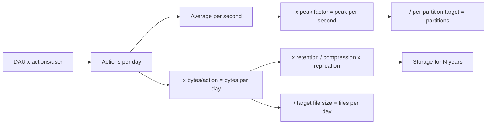

## 🎯 خلاصه

> **تخمین سرانگشتی (back-of-envelope estimation)** یک عدد محصول (مثلاً «۱۰ میلیون کاربر فعال روزانه») را به چند عددی تبدیل می‌کند که طراحی به آن‌ها تکیه دارد: رویداد بر ثانیه، بایت بر روز، تعداد فایل یا partition، و فضای موردنیاز برای N سال.

- قبل از محاسبه، همهٔ فرض‌ها را بنویس. مصاحبه‌گر بیشتر به استدلالت اهمیت می‌دهد تا به عدد دقیق.
- زیاد گرد کن. از توان‌های ده استفاده کن: یک روز حدود 10^5 ثانیه است (۸۶٬۴۰۰)، و یک میلیون در روز حدود ۱۲ در ثانیه.
- پیک با میانگین یکی نیست. قبل از سایز کردن، میانگین را در یک ضریب پیک ضرب کن (بازهٔ رایج برای برنامه‌ریزی ۲ تا ۵ است).
- نتیجه را با یک قاعدهٔ سلامت بسنج: «آیا روی یک ماشین جا می‌شود؟»، «تعداد فایل منطقی است؟»، «اصلاً به یک خوشه نیاز داریم؟»

## 🌱 از ساده شروع کنیم (مبتدی)

> **💡 تشبیه:** می‌خواهی برای یک استادیوم پیتزا سفارش بدهی. جمعیت دقیق را نمی‌دانی، پس می‌گویی «حدود ۵۰٬۰۰۰ نفر، نصفشان می‌خورند، هرکدام دو تکه، پس ۵۰٬۰۰۰ تکه، حدود ۱٬۰۰۰ پیتزا». عدد تقریبی است، ولی به تو می‌گوید یک فر کافی است یا ده‌تا. تخمین داده هم همین‌طور کار می‌کند.

روش کار پنج گام دارد. یک‌بار یادش بگیر و در همهٔ سؤال‌های طراحی سیستم از آن استفاده کن.

1. **از کاربر به کنش.** `تعداد کاربر × کنش به ازای هر کاربر در روز = کنش در روز`.
2. **از روز به ثانیه.** بر ۸۶٬۴۰۰ تقسیم کن (وقتی فقط مرتبهٔ بزرگی لازم است، تا 10^5 گرد کن). بعد ضریب پیک را ضرب کن.
3. **از کنش به بایت.** `کنش در روز × بایت به ازای هر کنش = بایت در روز`.
4. **از بایت به فضا.** در تعداد روزهای نگهداری ضرب کن. بعد بر نسبت فشرده‌سازی تقسیم کن، و اگر ذخیره‌سازی تکرار (replication) دارد، در ضریب تکرار ضرب کن.
5. **از فضا و توان به ساختار.** بر اندازهٔ هدف فایل تقسیم کن تا تعداد فایل دربیاید، و بر هدف توان هر partition تقسیم کن تا تعداد partition دربیاید.

سه واقعیت تبدیل بیشتر وقت‌ها را ذخیره می‌کند:

| کمیت | مقدار | کاربرد |
|---|---|---|
| ثانیه در روز | ۸۶٬۴۰۰ ≈ 10^5 | از «در روز» به «در ثانیه» |
| یک میلیون در روز | ≈ ۱۱٫۶ در ثانیه | نرخ تقریبی درخواست |
| ۱ گیگابایت در روز | ≈ ۱۲ کیلوبایت در ثانیه | پهنای باند تقریبی ورودی |

## 🔧 واقعاً چطور کار می‌کند (متوسط)

جریان تخمین یک قیف است: از کاربر شروع می‌کنی و به اعداد سطح سخت‌افزار می‌رسی.

### مثال کاربردی ۱: خط لولهٔ رویداد

**داده:** ۱۰ میلیون کاربر فعال روزانه (DAU)، ۲۰ رویداد به ازای هر کاربر در روز، ۱ کیلوبایت به ازای هر رویداد، ضریب پیک ۳، یک سال نگهداری خام، نسبت فشرده‌سازی Parquet برابر ۵ (۵ گیگابایت داده‌ی خام می‌شود ۱ گیگابایت روی دیسک)، و ضریب تکرار ذخیره‌سازی ۳.

**توان پردازش**

- رویداد در روز = ۱۰٬۰۰۰٬۰۰۰ × ۲۰ = ۲۰۰٬۰۰۰٬۰۰۰ = 2 × 10^8
- میانگین در ثانیه = 2 × 10^8 / ۸۶٬۴۰۰ ≈ ۲٬۳۱۵ ← حدود **۲٫۳ هزار در ثانیه**
- پیک در ثانیه = ۳ × ۲٬۳۱۵ ≈ ۶٬۹۴۴ ← حدود **۷ هزار در ثانیه**
- پهنای باند ورودی در پیک = ۶٬۹۴۴ رویداد × ۱ کیلوبایت ≈ ۶٫۹ مگابایت در ثانیه

**حجم روزانه**

- بایت خام در روز = 2 × 10^8 × ۱ کیلوبایت = 2 × 10^11 بایت = **۲۰۰ گیگابایت در روز**
- فشرده در روز = ۲۰۰ / ۵ = **۴۰ گیگابایت در روز**

**فضای سالانه**

- خام، یک سال: ۲۰۰ × ۳۶۵ = ۷۳٬۰۰۰ گیگابایت ≈ **۷۳ ترابایت**
- فشرده، یک سال: ۴۰ × ۳۶۵ = ۱۴٬۶۰۰ گیگابایت ≈ **۱۴٫۶ ترابایت**
- با تکرار ۳: ۱۴٫۶ × ۳ ≈ **۴۴ ترابایت** (ذخیره‌سازی object با erasure coding سربار متفاوتی دارد؛ فرضت را بگو)

**فایل و partition**

- اگر اندازهٔ هدف فایل ۲۵۶ مگابایت باشد، حجم فشردهٔ روزانه می‌شود ۴۰٬۰۰۰ / ۲۵۶ ≈ ۱۵۶ فایل، یعنی حدود **۱۶۰ فایل در روز** و حدود ۵۸٬۰۰۰ فایل در سال. این تعداد قابل مدیریت است. اما اگر هر micro-batch هر دقیقه یک فایل بنویسد، روزانه ۱٬۴۴۰ فایل کوچک می‌سازی. این همان [[small-files-problem]] است.
- Kafka partition: پیک ۶٫۹ مگابایت در ثانیه است. یک هدف توان برای هر partition را از benchmark خودت بگیر (مثلاً ۵ مگابایت در ثانیه، به عنوان فرض برنامه‌ریزی و نه حد ثابت). ۶٫۹ / ۵ ≈ ۱٫۴، پس حداقل ۲ partition لازم است. **۱۲ partition** انتخاب کن تا حاشیهٔ امن داشته باشی و تا ۱۲ مصرف‌کنندهٔ موازی ممکن باشد.

### مثال کاربردی ۲: جدول fact در انبار داده

**داده:** ۵۰٬۰۰۰ سفارش در روز، ۲۰۰ بایت به ازای هر سطر، ۵ سال تاریخچه.

- تعداد سطرها = ۵۰٬۰۰۰ × ۳۶۵ × ۵ = ۹۱٬۲۵۰٬۰۰۰ ≈ 9.1 × 10^7
- حجم خام = 9.1 × 10^7 × ۲۰۰ بایت = 1.825 × 10^10 بایت ≈ **۱۸ گیگابایت**
- با حاشیهٔ ۳ برابری برای index، متادیتا و سربار: حدود **۵۵ گیگابایت**

این حجم روی یک نود خوب جا می‌شود. بسیاری از طراحی‌های مصاحبه از چیزی که به نظر می‌رسد کوچک‌ترند، و گفتنش نشانهٔ خوبی است. برای ۵۵ گیگابایت، بدون دلیل یک خوشهٔ توزیع‌شده اضافه نکن.

### مثال کاربردی ۳: بار کوئری روی لایهٔ سرو

**داده:** ۱٬۰۰۰ تحلیلگر. هرکدام روزانه ۲۰ داشبورد باز می‌کنند و هر داشبورد ۵ کوئری می‌زند. ۸۰٪ فعالیت در یک پنجرهٔ ۲ ساعته‌ی کاری است.

- کوئری در روز = ۱٬۰۰۰ × ۲۰ × ۵ = ۱۰۰٬۰۰۰
- میانگین = ۱۰۰٬۰۰۰ / ۸۶٬۴۰۰ ≈ ۱٫۲ کوئری در ثانیه
- پنجرهٔ پیک = ۸۰٬۰۰۰ کوئری در ۷٬۲۰۰ ثانیه ≈ **۱۱ کوئری در ثانیه**

تعداد درخواست در ثانیه کم است. هزینهٔ واقعی، بایت‌هایی است که هر کوئری اسکن می‌کند. اگر هر کوئری ۲ گیگابایت اسکن کند، نرخ اسکن در پیک می‌شود ۱۱ × ۲ ≈ **۲۲ گیگابایت بر ثانیه**. این عدد تصمیم می‌گیرد که به pre-aggregation، جدول سرو یا موتور سریع‌تر نیاز داری یا نه. به همین دلیل طراحی‌های [[olap]] بیشتر به بایت اسکن‌شده اهمیت می‌دهند تا به تعداد درخواست.

## 🧠 عمق و trade-offها (سنیور)

- **حساسیت مهم‌تر از دقت است.** قبل از اینکه یک عدد را دقیق‌تر کنی، بپرس کدام ورودی بیشترین تأثیر را دارد. اینجا بایت به ازای هر رویداد و مدت نگهداری غالب‌اند؛ ضریب پیک بیشتر برای سایز کردن محاسبات مهم است، نه فضا. وقتت را روی اهرم‌های بزرگ بگذار.
- **میانگین و پیک دو طراحی متفاوت می‌سازند.** فضا بر اساس مجموع در طول زمان سایز می‌شود. محاسبات و شبکه بر اساس پیک. نگهداری Kafka، بودجهٔ lag مصرف‌کننده و اندازهٔ خوشه همه به پیک وابسته‌اند.
- **skew مدل یکنواخت را خراب می‌کند.** تقسیم بر تعداد partition با فرض بار یکنواخت، و بعد بررسی hot key. یک کاربر مشهور یا یک منطقه می‌تواند ۳۰٪ رویدادها را روی یک partition بریزد. کلید برتر را جداگانه تخمین بزن (به [[hot-key]] نگاه کن).
- **تکرار و فشرده‌سازی ضرب می‌شوند.** نسبت فشرده‌سازی ۵ برای Parquet یک برنامه است، نه یک واقعیت. روی نمونهٔ واقعی اندازه‌اش بگیر. فرمت‌های ستونی و dictionary encoding بسته به داده نسبت‌های خیلی متفاوتی می‌دهند.
- **نگهداری تصمیم کسب‌وکار است.** بپرس داده‌ها برای ممیزی، پردازش مجدد و آموزش ML چقدر باید بمانند. نگه داشتن رویدادهای خام ۳۶۵ روز و تجمیع‌ها ۵ سال یک تقسیم رایج است و جواب فضا را یک مرتبه بزرگی عوض می‌کند.
- **بدان کی سیستم بزرگ لازم نیست.** اگر تخمین بگوید «چند ترابایت در سال، چند هزار رویداد در ثانیه»، یک انبار داده‌ی مدیریت‌شده یا یک نود Postgres ممکن است کافی باشد. پلتفرم‌های استریمینگ هزینهٔ عملیاتی دارند و تخمین باید آن را توجیه کند.
- **فرض‌ها را در production پایش کن.** بایت واقعی به ازای هر رویداد، فشرده‌سازی واقعی، ضریب پیک واقعی و اندازهٔ فایل‌ها را ثبت کن. یک بازبینی طراحی فقط به اندازهٔ اعدادی است که رویش ساخته شده؛ به [[capacity-planning]] نگاه کن.

## 🧪 امتحان کن

این‌ها را اول روی کاغذ حل کن، هرکدام زیر ۳ دقیقه. بعد جواب‌ها را ببین.

1. **Clickstream.** ۵ میلیون DAU، ۵۰ بازدید صفحه در روز برای هر کاربر، ۵۰۰ بایت به ازای هر رویداد، ضریب پیک ۴، ۹۰ روز نگهداری خام، فشرده‌سازی ۴ برابر. میانگین و پیک رویداد در ثانیه، حجم خام و فشردهٔ روزانه، و فضای فشرده‌ی ۹۰ روزه را پیدا کن.
2. **پرداخت‌ها.** ۲٬۰۰۰٬۰۰۰ تراکنش در روز، ۳۰۰ بایت به ازای هر سطر، ۷ سال نگهداری، حاشیهٔ سربار ۳ برابری. حجم کل را پیدا کن و بگو آیا روی یک نود جا می‌شود.
3. **سایز Kafka.** پیک تمرین ۱ به Kafka نوشته می‌شود با هدف برنامه‌ریزی ۸ مگابایت در ثانیه برای هر partition. چند partition لازم داری، و با یک consumer group موازی ۱۶تایی چه انتخاب می‌کنی؟

جواب‌ها را نشان بده

**۱.**
- رویداد در روز = ۵٬۰۰۰٬۰۰۰ × ۵۰ = 2.5 × 10^8
- میانگین در ثانیه = 2.5 × 10^8 / ۸۶٬۴۰۰ ≈ ۲٬۸۹۴ ← حدود **۲٫۹ هزار در ثانیه**
- پیک = ۴ × ۲٬۸۹۴ ≈ ۱۱٬۵۷۴ ← حدود **۱۱٫۶ هزار در ثانیه**
- خام روزانه = 2.5 × 10^8 × ۵۰۰ بایت = 1.25 × 10^11 بایت = **۱۲۵ گیگابایت در روز**
- فشردهٔ روزانه = ۱۲۵ / ۴ = **۳۱٫۲۵ گیگابایت در روز**
- فشردهٔ ۹۰ روز = ۳۱٫۲۵ × ۹۰ ≈ ۲٬۸۱۲ گیگابایت ≈ **۲٫۸ ترابایت**

**۲.**
- تعداد سطرها در ۷ سال = ۲٬۰۰۰٬۰۰۰ × ۳۶۵ × ۷ = 5.11 × 10^9 سطر
- حجم خام = 5.11 × 10^9 × ۳۰۰ بایت = 1.533 × 10^12 بایت ≈ **۱٫۵ ترابایت**
- با سربار ۳ برابری ≈ **۴٫۶ ترابایت**
- یک نود با چند ترابایت دیسک می‌تواند این را نگه دارد، ولی به سقف نزدیک است. اینکه «جا می‌شود» یا نه، به دیسک و بار کوئری بستگی دارد. جواب خوب می‌گوید «یک نود بزرگ یا یک خوشهٔ کوچک، با توجه به بار کوئری، نه فقط حجم».

**۳.**
- پیک از تمرین ۱ = ۱۱٬۵۷۴ رویداد در ثانیه × ۵۰۰ بایت ≈ ۵٫۸ مگابایت در ثانیه.
- ۵٫۸ / ۸ ≈ ۰٫۷، پس از نظر توان تنها یک partition کافی است. برای حاشیه و موازی‌سازی مصرف‌کننده، گرد کن: **۱۶ partition** با consumer group ۱۶تایی تطابق دارد و هر مصرف‌کننده دقیقاً یک partition را می‌خواند.

## 💬 گوشه‌ی مصاحبه

**سؤال: «فضای لاگ‌ها را برای یک محصول با ۱۰ میلیون کاربر تخمین بزن.»** جواب متوسط: «۱۰ میلیون کاربر ضربدر ۲۰ رویداد در روز ضربدر ۱ کیلوبایت می‌شود ۲۰۰ گیگابایت در روز، یعنی حدود ۷۳ ترابایت در سال قبل از فشرده‌سازی.» جواب سنیور: «همین اعداد را دارم، بعد آن‌ها را بر اساس لایه‌های نگهداری تقسیم می‌کنم. لاگ خام ۳۰ روز روی storage داغ، Parquet فشرده برای یک سال روی object storage، و تجمیع‌ها برای مدت طولانی‌تر. نسبت فشرده‌سازی را به عنوان فرض می‌گویم و با یک نمونه چک می‌کنم، چون ۵ برابر تفاوت ایجاد می‌کند.»

**سؤال: «این topic چند partition لازم دارد؟»** جواب متوسط: «توان پیک تقسیم بر هدف هر partition، و بعد گرد کردن به بالا.» جواب سنیور: «همین، به‌علاوه‌ی موازی‌سازی مصرف‌کننده و حاشیه برای رشد. هم‌چنین بررسی می‌کنم که کلید داغ یک partition را زیر فشار نگذارد، چون تقسیم یکنواخت همیشه همان چیزی نیست که داده به تو می‌دهد.»

> **🎤 این را در مصاحبه بگو:** «اول فرض‌هایم را می‌گویم: تعداد کاربر، کنش به ازای هر کاربر، بایت به ازای هر رویداد و ضریب پیک. بعد اعداد روزانه، ثانیه‌ای و سالانه را حساب می‌کنم و بررسی می‌کنم که آیا اصلاً به یک سیستم توزیع‌شده نیاز داریم.»

## ⚠️ اشتباهات رایج

> **⚠️ هشدار:** تقسیم مجموع روزانه بر ۲۴ به جای ۸۶٬۴۰۰ ثانیه. ۲۴ ساعت است، نه ثانیه. از ۸۶٬۴۰۰ یا 10^5 گردشده استفاده کن.

> **⚠️ هشدار:** سایز کردن محاسبات بر اساس میانگین. پیک است که تعیین می‌کند سیستم زیر بار می‌رود یا نه، نه میانگین.

- یکاها را قاطی کردن. بیت و بایت را جدا نگه دار (لینک‌های شبکه معمولاً بر حسب بیت بر ثانیه‌اند، ذخیره‌سازی بر حسب بایت).
- فراموش کردن تکرار یا سربار در فضا، یا اعمال دوبارهٔ آن‌ها.
- فرض گرفتن فشرده‌سازی به‌عنوان رایگان یا دقیق. روی داده‌ی واقعی اندازه‌اش بگیر.
- محاسبه تا شش رقم بامعنا. معمولاً دو رقم کافی است و دقت کاذب نشانهٔ کم‌تجربگی است.
- طراحی برای یک میلیون کاربر وقتی سؤال «۱۰ میلیون DAU» می‌گوید، یا دادن عدد برای محصول دیگری.
- رد کردن بررسی سلامت. جوابی مثل «۲ پتابایت در روز» برای یک محصول کوچک یعنی یکی از ورودی‌ها اشتباه است.

## ✅ خودت را بسنج (quiz)

۱. یک محصول ۲ میلیون کاربر فعال روزانه دارد که هرکدام ۱۰ رویداد در روز تولید می‌کنند. نرخ میانگین رویداد در ثانیه چقدر است (گرد شده)؟
   - A) حدود ۲۳ در ثانیه
   - B) حدود ۲۳۱ در ثانیه
   - C) حدود ۲٬۳۱۵ در ثانیه
   - D) حدود ۲۳٬۱۵۰ در ثانیه

جواب

**B** — ۲٬۰۰۰٬۰۰۰ × ۱۰ = 2 × 10^7 رویداد در روز. بر ۸۶٬۴۰۰ تقسیم کن، حدود ۲۳۱٫۵ در ثانیه. گزینهٔ C جواب ۱۰ میلیون رویداد در روز است، اشتباه رایجی است.

۲. کدام گام را خیلی از داوطلب‌ها رد می‌کنند، و چرا برای سایز کردن محاسبات مهم‌ترین است؟
   - A) تبدیل بایت به بیت
   - B) اعمال ضریب پیک روی نرخ میانگین
   - C) اسم بردن از پایگاه داده
   - D) انتخاب فرمت فایل

جواب

**B** — میانگین جهش‌ها را پنهان می‌کند. brokerها، مصرف‌کننده‌ها و موتور کوئری باید پیک را تحمل کنند. اگر بر اساس میانگین سایز کنی، در شلوغ‌ترین ساعت عقب می‌افتند.

۳. تخمین فضای یک داوطلب ۵ برابر تخمین یک بازبین است. ورودی‌ها یکی‌اند. محتمل‌ترین منبع اختلاف چیست، و چطور بررسی‌اش کنی؟

   - A) فروشنده‌های متفاوت پایگاه داده
   - B) فرض متفاوت برای نسبت فشرده‌سازی یا ضریب تکرار؛ هر دو را با داده‌ی واقعی بسنج و صریح بگو
   - C) بازبین ترافیک پیک را فراموش کرده
   - D) partitioning تعداد کل بایت‌ها را عوض می‌کند

جواب

**B** — فشرده‌سازی و تکرار ضریب‌اند، پس تفاوت‌های کوچک در فرض‌ها به تفاوت‌های بزرگ در جمع تبدیل می‌شوند. آن‌ها را در جواب صریح بگو و با نمونهٔ داده‌ی واقعی اعتبارسنجی کن.

۴. **(سنیور)** تخمین تو می‌گوید ۴۰۰ گیگابایت خام در روز، و هدف امن توان هر partition در Kafka ۵ مگابایت در ثانیه است. پیک تو ۳۰ مگابایت در ثانیه است. با تعداد partition و کلید داغ چه می‌کنی؟

   - A) آن‌قدر partition اضافه کن که پیک تقسیم بر تعداد partition زیر ۵ شود، و بررسی کن که کلید برتر بار را روی یک partition متمرکز نکند
   - B) برای ترتیب، partition را ۱ بگذار و lag را بپذیر
   - C) ضریب پیک را ۱۰ کن تا جواب امن به نظر برسد
   - D) کلید را حذف کن تا بار همیشه یکنواخت باشد

جواب

**A** — تعداد partition باید پیک را با حاشیه پوشش دهد (۳۰ / ۵ = ۶ حداقل، شاید ۱۲ با حاشیه). اضافه کردن partition کمکی نمی‌کند اگر یک کلید بیشتر رویدادها را به یک partition بفرستد، پس skew را جدا بررسی کن. گزینهٔ D تضمین ترتیب را که طراحی ممکن است نیاز داشته باشد، حذف می‌کند.

۵. **(سنیور)** تخمین ۵ ساله‌ی تو ۴۰ ترابایت است و تیم می‌خواهد آن را روی یک نود NVMe نگه دارد. چرا «روی دیسک جا می‌شود» برای تصمیم کافی نیست، و چه چیز دیگری باید تخمین بزنی؟

   - A) دیسک‌ها بیش از ۱۰ ترابایت نگه نمی‌دارند
   - B) بار کوئری (بایت اسکن‌شده در ثانیه)، زمان بازیابی بعد از خرابی، و هزینهٔ بازسازی index یا replicaها را هم تخمین بزن؛ ظرفیت فقط یکی از چند محدودیت است
   - C) NVMe از Parquet پشتیبانی نمی‌کند
   - D) وقتی فضا جا شد، چیز دیگری مهم نیست

جواب

**B** — نودی که داده را نگه می‌دارد ممکن است برای اسکن کردن آن خیلی کند باشد، و یک نود یک نقطهٔ خرابی است. زمان بازیابی (برگرداندن ۴۰ ترابایت) و توان کوئری می‌توانند طرح را رد کنند، حتی وقتی ظرفیت دیسک کافی است.

## 🗂️ فلش‌کارت

| رو | پشت |
|---|---|
| ثانیه در روز (گردشده) | ۸۶٬۴۰۰ ≈ 10^5 |
| یک میلیون رویداد در روز تقریباً چند در ثانیه است | ≈ ۱۱٫۶ در ثانیه |
| گام اول هر تخمین | نوشتن فرض‌ها: کاربر، کنش به ازای کاربر، بایت به ازای رویداد، ضریب پیک |
| چرا برای محاسبات پیک را در نظر بگیریم، نه میانگین | شلوغ‌ترین بازه تعیین می‌کند سیستم عقب می‌افتد یا نه |
| فرمول فضا با فشرده‌سازی و تکرار | خام در روز × روزهای نگهداری ÷ فشرده‌سازی × ضریب تکرار |
| partition از روی توان | توان پیک ÷ هدف هر partition، گرد به بالا، به‌علاوه حاشیه |
| چرا تخمین کوچک می‌تواند طراحی را عوض کند | اگر داده روی یک نود جا می‌شود و بار کم است، خوشهٔ توزیع‌شده توجیه ندارد |

## 🔗 ادامه

- **[[capacity-planning]]** فرایند کلی‌تر را پوشش می‌دهد: رشد، حاشیه و هزینهٔ اشتباه.
- **[[partitioning-sharding]]** نشان می‌دهد تعداد partition که حساب کردی به کلیدها و نودها چطور وصل می‌شود.
- **[[data-formats]]** و **[[columnar-storage]]** توضیح می‌دهند چرا نسبت فشرده‌سازی Parquet با متن خام فرق دارد.
- **[[kafka-architecture]]** نشان می‌دهد partitionهای topic و consumer groupها چطور به اعداد تو مربوط می‌شوند.
- با تایمر تمرین کن. هر محصولی که استفاده می‌کنی را انتخاب کن، تخمین پنج‌گامی را در سه دقیقه انجام بده، و بعد با اعدادی که خود محصول منتشر می‌کند (در صورت وجود) مقایسه کن.
