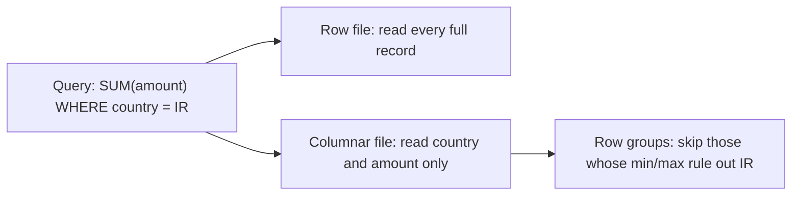

## 🎯 خلاصه

> **فرمت فایل (file format)** تعیین می‌کند بایت‌ها روی دیسک یا روی سیم چطور چیده شوند. تقسیم اصلی این است: **ردیفی (row-oriented)** یعنی همه‌ی فیلدهای یک رکورد کنار هم (CSV، JSON، Avro، Protobuf)، در برابر **ستونی (column-oriented)** یعنی همه‌ی مقادیر یک ستون کنار هم (Parquet، ORC).

- تحلیل معمولاً **چند ستون از سطرهای زیاد** را می‌خواند، پس فرمت‌های ستونی برای جدول‌های ذخیره‌شده برنده‌اند.
- سیستم‌های پیام معمولاً **یک رکورد در یک زمان** را جابه‌جا می‌کنند، پس فرمت‌های ردیفیِ فشرده (Avro، Protobuf) روی سیم برنده‌اند.
- Parquet و ORC **آمار (statistics)** ذخیره می‌کنند تا موتور بتواند داده‌ای را که لازم ندارد رد کند.
- برخی فرمت‌ها **قابل تقسیم (splittable)** نیستند: موتور توزیع‌شده نمی‌تواند آن‌ها را به taskهای موازی تکه کند، و یک فایل کند یعنی یک task کند.

## 🌱 از ساده شروع کنیم (مبتدی)

> **💡 تشبیه:** رکوردهای مشتری را مثل کارت‌های فهرست تصور کن. فرمت **ردیفی** برای هر مشتری یک کارت نگه می‌دارد که همه‌ی اطلاعاتش روی آن است. فرمت **ستونی** برای هر فیلد یک کشو دارد: همه‌ی نام‌ها در یک کشو، همه‌ی سن‌ها در کشوی دیگر. برای جواب دادن به «چند مشتری بالای ۴۰ سال دارند؟» فقط کشوی سن را باز می‌کنی.

سه رکورد پرداخت را در سه فرمت ببین. داده یکی است:

```text
user_id,country,amount
42,IR,12.5
43,DE,7.0
44,IR,3.25
```

```json
{"user_id": 42, "country": "IR", "amount": 12.5}
{"user_id": 43, "country": "DE", "amount": 7.0}
{"user_id": 44, "country": "IR", "amount": 3.25}
```

CSV متن ساده است و نوع ندارد: `007` عدد است یا رشته؟ از خود فایل معلوم نیست. JSON ساختار و تودرتویی اضافه می‌کند، اما نام هر فیلد را در هر رکورد تکرار می‌کند؛ پس یک میلیون رکورد، `"country"` را یک میلیون بار تکرار می‌کند. فرمت‌های باینری نوع‌ها را یک بار ذخیره می‌کنند و نام‌ها را حذف می‌کنند.

فرمت یک **قرارداد (contract)** است. خواننده باید نام فیلدها، نوع‌ها و ترتیبشان را بداند. تغییر این قرارداد بعداً کار سخت است، و بیشتر خطاهای تولید از همین‌جا می‌آیند.

## 🔧 واقعاً چطور کار می‌کند (متوسط)

یک column store فقط چیزی را می‌خواند که query لازم دارد. نمودار تفاوت را برای یک query نشان می‌دهد:



**ساختار Parquet.** یک فایل Parquet از داخل به بیرون این‌طور ساخته می‌شود:

- **Row group**: یک برش افقی از سطرها (یک تنظیم writer؛ در نویسنده‌های رایج معمولاً حدود ۱۲۸ MB).
- **Column chunk**: مقادیر یک ستون داخل یک row group. هر ستون را می‌شود جداگانه خواند.
- **Page**: واحدی از مقادیر کدشده داخل column chunk (معمولاً حدود ۱ MB). فشرده‌سازی روی page اعمال می‌شود.
- **Footer**: schema و آمار (min، max، تعداد null) برای هر column chunk. خواننده ابتدا footer را می‌خواند و بعد تصمیم می‌گیرد چه چیزی را بیاورد.

**Encodingها** قبل از اجرای codec (Snappy، Zstd، gzip) مقادیر را کوچک می‌کنند:

- **Dictionary encoding**: هر مقدار متمایز را یک بار ذخیره می‌کند و بعد کدهای عددی کوچک. برای `country` (حدود ۲۵۰ مقدار) ایده‌آل است.
- **Run-length encoding (RLE)**: `IR, IR, IR, IR` می‌شود `(IR × 4)`. برای ستون‌های مرتب یا تکراری ایده‌آل است.
- **Delta encoding**: ذخیره‌ی تفاوت عددهای مرتب یا timestampها. `1000, 1001, 1002` می‌شود `1000, +1, +1`.

**Predicate pushdown** از footer استفاده می‌کند. برای `WHERE country = 'IR'`، موتور هر row group را که بازه‌ی min/max ستون `country` در آن نمی‌تواند `'IR'` را داشته باشد رد می‌کند. این فقط وقتی کار می‌کند که داده بر اساس آن ستون **خوشه‌بندی (clustered)** شده باشد. اگر هر row group از `'AE'` تا `'ZA'` را پوشش دهد، چیزی رد نمی‌شود (به [[predicate-pushdown]] نگاه کن).

یک نمونه‌ی کوچک و قابل اجرا با `pyarrow`:

```python
import pyarrow as pa
import pyarrow.parquet as pq

table = pa.table({
    "user_id": [42, 43, 44],
    "country": ["IR", "DE", "IR"],
    "amount": [12.5, 7.0, 3.25],
})
pq.write_table(table, "payments.parquet", compression="zstd")

# Column projection: only two columns are read from storage
subset = pq.read_table("payments.parquet", columns=["country", "amount"],
                       filters=[("country", "=", "IR")])
print(subset.to_pydict())   # {'country': ['IR', 'IR'], 'amount': [12.5, 3.25]}

# The statistics live in the footer, no data pages are read
stats = pq.ParquetFile("payments.parquet").metadata.row_group(0).column(2).statistics
print(stats.min, stats.max)  # 3.25 12.5
```

**Avro** باینری ردیفی است. schema آن با JSON نوشته می‌شود و یک بار در هدر فایل (container file در Avro) ذخیره می‌شود، یا در هر پیام Kafka با یک ID به آن ارجاع داده می‌شود. تکامل از طریق **schema خواننده و نویسنده (reader and writer schema)** انجام می‌شود: خواننده schema نویسنده را به schema خودش تطبیق می‌دهد. فیلد جدید به **مقدار پیش‌فرض (default)** نیاز دارد تا رکوردهای قدیمی هم خوانده شوند:

```json
{
  "type": "record",
  "name": "Payment",
  "namespace": "com.example.payments",
  "fields": [
    {"name": "user_id", "type": "long"},
    {"name": "country", "type": "string"},
    {"name": "amount", "type": "double"},
    {"name": "channel", "type": ["null", "string"], "default": null}
  ]
}
```

فیلد `channel` بعداً اضافه شده است. رکوردهایی که قبل از آن نوشته شده‌اند با `channel = null` خوانده می‌شوند. مقدار پیش‌فرض باید با شاخه‌ی اول union یکی باشد، و به همین خاطر `null` اول می‌آید.

**Protobuf** روی سیم **شماره‌ی فیلد** را می‌گذارد، نه نام را. می‌توانی یک فیلد جدید با شماره‌ی جدید اضافه کنی. هرگز نباید یک شماره را دوباره استفاده کنی یا نوعش را عوض کنی، چون داده‌ی قدیمی به فیلد اشتباه decode می‌شود. پیام Protobuf خودتوصیفی (self-describing) نیست: خواننده به فایل `.proto` نیاز دارد.

**قابلیت تقسیم (splittability).** یک موتور توزیع‌شده (Spark، Trino) فایل را با بریدن به بازه‌های بایتی به taskها تبدیل می‌کند. فایل قابل تقسیم است اگر خواننده بتواند وسط فایل شروع کند و مرز رکورد بعدی را پیدا کند:

- CSV و JSON Lines ساده: بله، در خط جدید (اگر فشرده نباشند).
- **CSV فشرده‌شده با gzip**: خیر. gzip باید از ابتدا باز شود، پس یک task کل فایل را می‌خواند.
- Avro: بله، چون sync markerها بین blockها هستند، با هر codec بلاکی.
- Parquet و ORC: بله، در مرز row group و stripe. Parquet فشرده‌شده با Snappy قابل تقسیم است چون فشرده‌سازی روی page است.

**ORC** فرمت ستونی دورهٔ Hive است با stripe، آمار مشابه و Bloom filter اختیاری. **Arrow** فرمت ستونی برای **حافظه** است و برای تبادل داده بین فرایندها (Python، Spark، DuckDB) بدون کپی استفاده می‌شود. به‌ندرت فرمت ذخیره‌سازی بلندمدت است.

| فرمت | چیدمان | محل schema | حجم | قابل تقسیم | تکامل | کاربرد معمول |
|---|---|---|---|---|---|---|
| CSV | ردیفی، متن | فقط هدر | بزرگ | بله اگر فشرده نباشد | ضعیف | خروجی، فایل‌های کوچک |
| JSON Lines | ردیفی، متن | ضمنی | بزرگ‌ترین | بله اگر فشرده نباشد | انعطاف‌پذیر، بدون اجبار | لاگ خام، landing |
| Avro | ردیفی، باینری | هدر فایل یا registry | فشرده | بله (sync markers) | قوی (default، alias) | پیام Kafka، landing |
| Protobuf | ردیفی، باینری | فایل `.proto` | فشرده | برای هر پیام | قوی با قواعد شماره | RPC، پیام سرویس |
| Parquet | ستونی، باینری | footer | کوچک‌ترین برای تحلیل | بله (row groups) | خوب؛ table formatها ستون‌ها را با ID دنبال می‌کنند | جدول‌های lakehouse |
| ORC | ستونی، باینری | footer | کوچک | بله (stripes) | خوب | دریاچه‌های دورهٔ Hive |
| Arrow | ستونی، حافظه | شیء schema | n/a | n/a | n/a | تبادل در حافظه |

## 🧠 عمق و trade-offها (سنیور)

- **فایل‌های ریز چیدمان ستونی را از کار می‌اندازند.** یک فایل Parquet به اندازه‌ی ۱ MB برای هر partition، برای داده‌ی تقریباً هیچ، یک خواندن metadata و راه‌اندازی task هزینه دارد. فایل‌ها را به اندازه‌هایی در حد صدها MB compact کن، به [[small-files]] نگاه کن.
- **خوشه‌بندی تعیین می‌کند آیا pruning کار می‌کند.** آمار min/max فقط وقتی داده را رد می‌کند که مقادیر گروه‌بندی شده باشند. داده را بر اساس پرکاربردترین ستون فیلتر مرتب یا خوشه‌بندی کن (Z-order یا sort key در Iceberg، Delta یا نوشتن Spark)، یا با آن partition کن. ترتیب تصادفی آمار را بی‌فایده می‌کند.
- **Dictionary encoding محدودیت دارد.** writerها وقتی دیکشنری خیلی بزرگ شود به encoding ساده برمی‌گردند. UUIDهای تصادفی و floatهای با دقت بالا خوب فشرده نمی‌شوند. روی آن‌ها نسبت ۵ برابری انتظار نداشته باش.
- **داده‌ی تودرتو.** Parquet ساختارها و لیست‌های تودرتو را به‌صورت ستون‌های برگ جدا ذخیره می‌کند، همراه با repetition و definition level. query که `user.address.city` را می‌خواند فقط همان ستون برگ را می‌خواند. اگر همه‌چیز را در یک جدول پهن کنی، فضا هدر می‌رود و این امتیاز از بین می‌رود.
- **قوانین تکامل schema.** Avro و Protobuf: با default یا شماره‌ی جدید اضافه کن، و نوع را در جا عوض نکن. Parquet: اضافه کردن ستون رایج است، اما خوانندگانی که بر اساس نام تطبیق می‌دهند با تغییر نام می‌شکنند؛ table formatها (Iceberg، Delta) ستون‌ها را با ID یا mapping دنبال می‌کنند تا تغییر نام امن باشد.
- **Kafka با Schema Registry.** تولیدکننده ID schema را در هر پیام می‌گذارد. حالت سازگاری registry (برای نمونه BACKWARD یا FULL) تعیین می‌کند کدام تغییرها مجازند. حالت‌های ممکن را در مستندات registry خودت ببین.
- **مخابرات و ASN.1.** رکوردهای تماس اغلب به‌صورت باینری کدشده با **ASN.1** می‌رسند (مثلاً encodingهای BER یا PER برای schema یک رکورد مخابراتی). آن‌ها را در لبه با یک decoder تولیدشده decode کن، بعد به‌صورت Avro یا Parquet ذخیره کن و نسخه‌ی schema را ثبت کن. بایت‌های خام را تا تأیید decode نگه دار.
- **تبدیل یک job دسته‌ای است.** الگوی رایج این است: Avro (یا JSON) در landing zone، و بعد یک job دسته‌ای Parquet را روی تاریخ partition می‌کند. streamها ردیفی و مناسب append هستند؛ تحلیل ستونی و مناسب scan است.
- **کی ستونی لازم نیست.** جدول‌های مرجع با چند هزار سطر یا داده‌ای که در ویرایشگر باز می‌کنی، با CSV مشکلی ندارند. فرمت ستونی وقتی سود می‌دهد که جدول بزرگ باشد و scan شود.

## 🧪 امتحان کن

1. یک job شبانه‌ی Spark، ۴۰۰ فایل CSV فشرده‌شده با gzip و هرکدام ۱ GB می‌خواند. job از ۴۰۰ task استفاده می‌کند و ساعت‌ها طول می‌کشد. چرا، و کدام دو تغییر را می‌دهی؟
2. یک جدول Parquet که با `event_date` partition شده، ۲٬۰۰۰ فایل دارد. query با `WHERE user_country = 'IR'` همه‌ی فایل‌ها را می‌خواند. توضیح بده چرا، و یک راه‌حل پیشنهاد کن.
3. یک فیلد `discount` (از نوع double) به یک schema تولیدی Avro اضافه کن. تغییر schema را طوری بنویس که داده‌ی قدیمی قابل خواندن بماند، و بگو اگر آن را به‌صورت فیلد اجباری (بدون default) اضافه کنی چه می‌شود.

<details><summary>راه‌حل‌ها را ببین</summary>

**۱.** gzip قابل تقسیم نیست، پس هر فایل ۱ GB یک task می‌شود که کل فایل را می‌خواند. موازی‌سازی به ۴۰۰ task محدود می‌شود و هر task کند است. راه‌حل: داده را به Parquet یا Avro بنویس (قابل تقسیم)، یا از codec قابل تقسیم استفاده کن (Snappy یا Zstd داخل Parquet). بعد Spark برای هر فایل taskهای زیادی می‌سازد.

**۲.** جدول بر اساس تاریخ partition شده، نه بر اساس کشور، و چیزی بر اساس `user_country` خوشه‌بندی نشده است. داخل هر تاریخ، کشورها بین فایل‌های زیادی پخش شده‌اند، پس بازه‌ی min/max هر فایل شامل `'IR'` است و چیزی رد نمی‌شود. راه‌حل: نوشتن را بر اساس `user_country` مرتب یا خوشه‌بندی کن (مثلاً sort key در job نوشتن، یا Z-order در table format)، یا اگر cardinality به‌اندازه‌ی کافی پایین است، این ستون را به چیدمان partition اضافه کن.

**۳.** به فیلدها اضافه کن: `{"name": "discount", "type": "double", "default": 0.0}`. خواننده‌هایی که از schema جدید استفاده می‌کنند برای رکوردهای قدیمی `discount = 0.0` را پر می‌کنند، پس داده‌ی قدیمی و جدید هر دو قابل خواندن می‌مانند. اگر فیلد اجباری باشد (بدون default)، خواننده‌ی schema جدید نمی‌تواند رکوردهای قدیمی بدون آن فیلد را decode کند، و این در زمان rollout مصرف‌کننده‌ها را می‌شکند.

</details>

## 💬 گوشه‌ی مصاحبه

**سؤال: «چرا Parquet به‌جای CSV؟»**

- **پاسخ متوسط:** «Parquet ستونی و فشرده است، پس query فقط ستون‌های لازم و بایت‌های خیلی کمتری را می‌خواند. همچنین نوع‌ها و آمار را نگه می‌دارد، پس ابهام متنی CSV از بین می‌رود.»
- **پاسخ سنیور:** «چون ستونی است، column projection و predicate pushdown داده را رد می‌کنند، و آمار footer اجازه می‌دهد row groupها حذف شوند. encoding و codec حجم را چند برابر کم می‌کنند. تریدآف این است که برای انسان خوانا نیست، روی‌هم‌نویسی در جا ندارد، و فقط وقتی سود می‌دهد که فایل‌ها درست اندازه و خوشه‌بندی شده باشند.»

**سؤال: «Avro یا Protobuf برای Kafka؟»**

- **پاسخ متوسط:** «هر دو باینری فشرده با schema هستند. Avro با Kafka و Schema Registry رایج است و فرمت container برای فایل هم دارد. Protobuf در APIهای بین سرویس‌ها رایج است.»
- **پاسخ سنیور:** «بر اساس اکوسیستم و قواعد تکامل انتخاب می‌کنم. Avro schema نویسنده و خواننده را تطبیق می‌دهد و در Kafka و دریاچه‌ی داده خوب کار می‌کند. Protobuf برای RPC و قواعد سخت‌گیرانه‌ی شماره‌ی فیلد عالی است. در هر صورت حالت سازگاری را در registry اجباری می‌کنم، تا تغییر شکننده در CI رد شود، نه در یک مصرف‌کننده ساعت ۳ صبح.»

**سؤال: «چه چیزی یک فایل را قابل تقسیم می‌کند؟»** فایل قابل تقسیم است اگر خواننده بتواند از یک offset دلخواه شروع کند و مرز رکورد معتبر را پیدا کند. متن فشرده‌نشده با خط جدید، Avro با sync markers، و Parquet در مرز row group قابل تقسیم‌اند. gzip روی کل فایل قابل تقسیم نیست.

> **🎤 این را در مصاحبه بگو:** «داده‌ی خام را به‌صورت Avro نگه می‌دارم، چون تکامل و نوشتن append-friendly دارد، و بعد با یک job دسته‌ای به Parquet تبدیلش می‌کنم که بر اساس ستون اصلی فیلتر، partition و خوشه‌بندی شده باشد. اندازه‌ی فایل‌ها را هم چک می‌کنم، چون فایل‌های ریز و codecهای غیرقابل تقسیم بیشتر از انتخاب فرمت هزینه دارند.»

## ⚠️ اشتباهات رایج

> **⚠️ Watch out:** یک فایل CSV یا JSON فشرده‌شده با gzip یک task است. انتخاب codec انتخاب موازی‌سازی است، نه فقط حجم.

- ذخیره‌ی زمان و عدد به‌صورت رشته در CSV یا JSON. نوع از دست می‌رود و هر query باید cast کند.
- اضافه کردن فیلد اجباری به Avro یا Protobuf بدون default. داده‌ی قدیمی برای مصرف‌کننده‌های جدید غیرقابل خواندن می‌شود.
- استفاده‌ی دوباره از شماره‌ی فیلد Protobuf بعد از حذف فیلد. داده‌ی قدیمی به فیلد اشتباه decode می‌شود.
- انتظار pushdown روی ستونی که داده بر اساسش خوشه‌بندی نشده است.
- این باور که «Parquet همیشه کوچک است». IDهای با cardinality بالا و floatهای تصادفی خوب فشرده نمی‌شوند.
- نوشتن فایل‌های Parquet خیلی ریز، یک فایل برای هر partition در هر batch. سربار metadata و task غالب می‌شود.
- استفاده از Arrow به‌عنوان فرمت جدول بلندمدت. Arrow فرمت تبادل در حافظه است.

## ✅ خودت را بسنج

1. کدام فرمت همه‌ی مقادیر یک ستون را کنار هم ذخیره می‌کند؟
   - A) Avro
   - B) Parquet
   - C) Protobuf
   - D) JSON Lines

<details><summary>پاسخ</summary>

**B** — Parquet ستونی است. Avro، Protobuf و JSON Lines ردیفی هستند: فیلدهای هر رکورد کنار هم ذخیره می‌شوند.

</details>

2. چرا یک فایل CSV فشرده‌شده با gzip سخت موازی می‌شود؟
   - A) gzip نمی‌تواند متن را فشرده کند
   - B) gzip قابل تقسیم نیست، پس خواننده باید از ابتدا شروع کند و یک task کل فایل را می‌خواند
   - C) CSV جداکننده ندارد
   - D) Spark از gzip پشتیبانی نمی‌کند

<details><summary>پاسخ</summary>

**B** — باز کردن فشرده‌ی gzip باید از ابتدای جریان شروع شود. فایل فقط به‌عنوان یک واحد قابل خواندن است، پس job به یک task محدود می‌شود.

</details>

3. کدام تغییر schema در Avro داده‌ی قدیمی را برای خواننده‌های جدید قابل خواندن نگه می‌دارد؟
   - A) اضافه کردن فیلد جدید بدون default
   - B) تغییر نام یک فیلد موجود
   - C) اضافه کردن فیلد `["null", "string"]` با default برابر `null`
   - D) تغییر نوع فیلد از `long` به `string`

<details><summary>پاسخ</summary>

**C** — فیلد جدید با default به خواننده اجازه می‌دهد رکوردهای قدیمی را پر کند. تغییر نام و تغییر نوع، تطبیق schema نویسنده و خواننده را می‌شکنند.

</details>

4. یک جدول Parquet دارای ۲٬۰۰۰ فایل است و query با `WHERE event_date = '2026-03-01'` همه‌ی آن‌ها را می‌خواند. محتمل‌ترین علت چیست؟
   - A) Parquet از فیلترهای تاریخ پشتیبانی نمی‌کند
   - B) داده بر اساس `event_date` خوشه‌بندی یا partition نشده، پس بازه‌ی min/max هر فایل مقدار را دربر می‌گیرد
   - C) فایل‌ها باید CSV باشند
   - D) query به `DISTINCT` نیاز دارد

<details><summary>پاسخ</summary>

**B** — pruning به خوشه‌بندی نیاز دارد. اگر تاریخ‌ها در هر فایل در کل بازه پخش شده باشند، آمار نمی‌تواند هیچ فایلی را رد کند. نوشتن را بر اساس `event_date` مرتب یا partition کن.

</details>

5. **(سنیور)** چرا رویدادهای خام را به‌صورت Avro در landing zone نگه داریم و بعد دسته‌ای به Parquet تبدیل کنیم، به‌جای اینکه مستقیم از stream در Parquet بنویسیم؟

   - A) هیچ موتور streaming نمی‌تواند Parquet بنویسد
   - B) Avro رکورد به رکورد با schema همراه می‌نویسد و خوب تکامل می‌یابد؛ Parquet ستونی و بهترین گزینه برای scan تحلیلی است، پس تبدیل دسته‌ای هر دو مزیت را می‌دهد
   - C) Avro برای تحلیل از Parquet کوچک‌تر است
   - D) فایل‌های Parquet نمی‌توانند بیش از یک row group داشته باشند

<details><summary>پاسخ</summary>

**B** — streamها رکوردهای ردیفی و کوچک تولید می‌کنند؛ یک job دسته‌ای می‌تواند آن‌ها را در فایل‌های بزرگ و مرتب Parquet جمع کند. تریدآف یک مرحله‌ی بیشتر در pipeline و ثبت نسخه‌ی schema برای هر تبدیل است.

</details>

## 🗂️ فلش‌کارت

| Front | Back |
|---|---|
| فرمت ردیفی در برابر ستونی | ردیفی رکورد را کنار هم نگه می‌دارد (Avro، CSV)؛ ستونی هر ستون را کنار هم (Parquet، ORC) |
| چرا Parquet برای تحلیل سریع است | column projection و predicate pushdown بایت‌های کمتری می‌خوانند |
| row group چیست | برش افقی از سطرها، با یک column chunk برای هر ستون |
| آمار Parquet کجاست | در footer: min، max و تعداد null برای هر column chunk |
| چرا gzip CSV در Spark کند است | gzip قابل تقسیم نیست، پس یک فایل یعنی یک task |
| اضافه کردن امن فیلد در Avro | فیلد جدید با مقدار default |
| قاعدهٔ تکامل Protobuf | هرگز شماره‌ی فیلد را دوباره استفاده یا نوعش را عوض نکن |
| dictionary encoding بهترین کار را دارد برای | ستون‌های با cardinality پایین، مثل کشور یا وضعیت |

## 🔗 ادامه

- **numbers-to-know** محاسبه‌ی اندازه و توان را می‌دهد که نشان می‌دهد انتخاب فرمت کی اهمیت دارد.
- **columnar-storage** و **compression** توضیح می‌دهند چیدمان ستونی و codecها چطور هزینه‌ی scan را تغییر می‌دهند.
- **file-layout** و **small-files** می‌گویند چند فایل بنویسی و اندازه‌شان چقدر باشد.
- **schema-registry** نشان می‌دهد schemaهای Avro و Protobuf در Kafka چطور نسخه‌بندی می‌شوند.
- **lakehouse-table-formats** توضیح می‌دهد Iceberg و Delta چطور ستون‌ها و فایل‌ها را روی Parquet دنبال می‌کنند.
- **spark-writes** پارتیشن‌بندی و خوشه‌بندی هنگام نوشتن را پوشش می‌دهد، و همین‌ها تعیین می‌کنند pruning کار کند یا نه.
