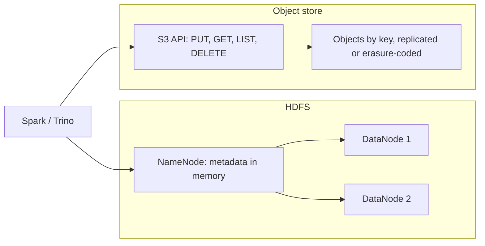

## 🎯 خلاصه

> **دریاچه‌ی داده (data lake)** مجموعه‌ی بزرگی از فایل‌ها (معمولاً Parquet، JSON، CSV یا ORC) است که روی ذخیره‌سازی ارزان نگه‌داری می‌شود و **هنگام نوشتن schema ثابتی ندارد**. امروز ذخیره‌سازی معمولاً یک **object store** (مثل S3 یا سیستم سازگار با S3 مثل MinIO و Ceph RGW) یا خوشه‌های قدیمی‌تر **HDFS** است.

- **Object storage** اشیای تغییرناپذیر را در bucket های تخت و با کلید نگه می‌دارد. ارزان، بادوام و خیلی فراتر از یک خوشه مقیاس‌پذیر است.
- **HDFS** یک فایل‌سیستم واقعی با دایرکتوری و rename اتمیِ دایرکتوری است. محاسبه معمولاً کنار داده قرار دارد.
- object store فایل‌سیستم نیست. **دایرکتوری وجود ندارد، rename یعنی کپی و حذف، و list صفحه‌بندی‌شده است.** بیشتر باگ‌های lake از فراموش کردن همین است.
- **ذخیره‌سازی و محاسبه جدا هستند**: موتورهای زیادی (Spark، Trino، Flink، Hive) همان فایل‌ها را می‌خوانند و هرکدام مستقل مقیاس می‌گیرند.
- lakeای بدون مالکیت، catalog و نظم فایل‌ها به **باتلاق داده (data swamp)** تبدیل می‌شود.

## 🌱 از ساده شروع کنیم (مبتدی)

> **💡 تشبیه:** اتاق پشتیِ یک کتابخانه. کتاب‌ها (فایل‌ها) در جعبه‌هایی چیده شده‌اند که روی‌شان برچسب دارند. هرکس می‌تواند جعبه‌ای را بگذارد و کسی هنگام ورود محتوایش را بررسی نمی‌کند. اضافه کردن به آن سریع و ارزان است. پیدا کردن کتاب درست بعداً به برچسب‌گذاری خوب و کارت کاتالوگ نیاز دارد. بدون آن‌ها، اتاق پشتی به تلی تبدیل می‌شود که کسی نمی‌تواند از آن استفاده کند. آن تل همان **data swamp** است.

در lake، یک «جدول» اغلب فقط یک پوشه از فایل‌هاست:

```text
s3://company-lake/raw/orders/dt=2026-03-01/part-0001.parquet
s3://company-lake/raw/orders/dt=2026-03-01/part-0002.parquet
s3://company-lake/raw/orders/dt=2026-03-02/part-0001.parquet
```

هر فایل یک فایل **Parquet** است (به [[parquet]] نگاه کن). بخش `dt=2026-03-01` یک قرارداد نام‌گذاری است (پارتیشن‌بندی به سبک Hive) که موتورها از آن برای رد کردن پوشه‌های غیرضروری استفاده می‌کنند. کوئری یک روز فقط یک پوشه را می‌خواند، نه کل bucket را.

سه ایده را نگه دار:

- **Object:** یک blob با کلید (مسیرش) و متادیتا. کامل نوشته می‌شود و در جا ویرایش نمی‌شود.
- **Bucket / prefix:** یک فضای نام تخت. `raw/orders/` فقط یک رشته‌ی پیشوند است، نه پوشه.
- **Schema on read:** lake هر فایلی را می‌پذیرد. خواننده تصمیم می‌گیرد چطور تفسیرش کند، که انعطاف دارد و ریسک هم دارد.

## 🔧 واقعاً چطور کار می‌کند (متوسط)

دو خانواده‌ی ذخیره‌سازی رفتار متفاوتی دارند. این جدول هستهٔ پاسخ مصاحبه است.

| ویژگی | HDFS | Object store (API مثل S3) |
|---|---|---|
| فضای نام | دایرکتوری واقعی، در حافظهٔ NameNode | کلیدهای تخت؛ «دایرکتوری»ها پیشوند کلید هستند |
| rename دایرکتوری | یک عملیات متادیتا (سریع، عملاً اتمی) | کپی همهٔ اشیا به کلید جدید، بعد حذف قدیمی‌ها (غیراتمی، هزینه متناسب با حجم داده) |
| append به فایل | پشتیبانی می‌شود (با محدودیت) | پشتیبانی نمی‌شود؛ شیء جدید نوشته می‌شود |
| list | لیست دایرکتوری از روی متادیتا | LIST صفحه‌بندی‌شده بر اساس پیشوند (صفحه‌های تا 1000 کلید) |
| محاسبه | معمولاً کنار داده (data locality) | جدا؛ داده از شبکه خوانده می‌شود |
| مقیاس‌پذیری | افزودن DataNode؛ حافظهٔ NameNode محدودیت است | تعداد اشیای تقریباً نامحدود در هر bucket |



**چرا rename مهم است.** یک job در Spark خروجی را در یک مسیر موقت می‌نویسد و بعد آن را به مقصد نهایی rename می‌کند، تا خواننده‌ها هیچ‌وقت نیمه‌ی job را نبینند. روی HDFS این rename ارزان و تقریباً اتمی است. روی S3 همین rename یعنی کپی همهٔ فایل‌ها، پس خطا در وسط کار وضعیت مخلوط باقی می‌گذارد. به همین دلیل نوشتن روی object store به یک **output committer** مخصوص object store نیاز دارد (مثلاً [[spark-writes]])، و به همین دلیل فرمت‌های جدول وجود دارند (به [[lakehouse-table-formats]] نگاه کن).

```bash
# روی S3، «جابه‌جا کردن یک پوشه» یعنی کپی + حذف، یک شیء در هر بار
aws s3 mv s3://company-lake/raw/orders/dt=2026-03-01/ \
          s3://company-lake/clean/orders/dt=2026-03-01/ --recursive
# اگر این کار در شیء 500 از 2000 متوقف شود، bucket حالا هر دو نیمه را دارد.
```

**Consistency.** S3 مدرن برای اشیا و لیست‌ها consistency قوی بعد از نوشتن (read-after-write) می‌دهد، پس فایلی که همین الان نوشتی در LIST دیده می‌شود. سیستم‌های قدیمی‌تر و بعضی محصولات سازگار با S3 تضمین‌های ضعیف‌تری داشته‌اند. مستندات سیستمی را که واقعاً اجرا می‌کنی بخوان و فرض نکن هر store سازگاری همان رفتار را دارد.

**تکرار در برابر erasure coding.** هر دو از داده در برابر خرابی دیسک و نود محافظت می‌کنند:

- **تکرار (3 نسخه):** ظرفیت خام = 3 × ظرفیت مفید. ساده، با خواندن و ترمیم سریع.
- **Erasure coding (مثلاً Reed-Solomon با 6+3):** داده را به 6 شارد داده تقسیم و 3 شارد parity حساب می‌کنی. ظرفیت خام = 9/6 = 1.5 × ظرفیت مفید، و با از دست رفتن هر 3 شارد داده بازیابی می‌شود. هزینه‌ی CPU بیشتر و ترمیم کندتر دارد، و اشیای کوچک معمولاً ضرر می‌کنند.

عدد نمونه: برای 1 PB داده‌ی مفید با تکرار سه‌گانه 3 PB خام لازم است و با 6+3 erasure coding فقط 1.5 PB. صرفه‌جویی زیاد است، و به همین دلیل داده‌ی سردِ lake روی سرور داخلی اغلب erasure coded است.

## 🧠 عمق و trade-offها (سنیور)

- **فایل‌های کوچک.** object store برای هر درخواست و هر شیء هزینه می‌گیرد، و هر موتور برای هر فایل هزینه‌ی task و متادیتا می‌دهد. یک روز داده‌ی استریمی که هر 10 ثانیه نوشته می‌شود می‌تواند ده‌ها هزار فایل ریز بسازد. به [[small-files-problem]] و [[compaction]] نگاه کن.
- **پروتکل commit.** نوشتن از Spark یا Hive روی S3 بدون committer مناسب، در retry می‌تواند خروجی را گم یا تکراری کند. برای داده‌ی مهم، یک فرمت جدول با commit اتمی را به نوشتن خام روی دایرکتوری ترجیح بده.
- **هزینه‌ی list در مقیاس.** لیست کردن 10 میلیون شیء حتی با صفحه‌بندی کند است. چیدمان پارتیشن و manifest ها (به [[lakehouse-table-formats]] نگاه کن) وجود دارند تا موتورها کل bucket را لیست نکنند.
- **جداسازی ذخیره‌سازی و محاسبه.** این امکان را می‌دهد که محاسبه را تا صفر کم کنی و یک کپی از داده را بین موتورها به اشتراک بگذاری. هزینه‌اش I/O شبکه و هزینه‌ی هر درخواست است، پس cache، فرمت ستونی و [[predicate-pushdown]] مهم می‌شوند.
- **حذف و نگهداری.** حذف داده‌ی یک نفر از فایل‌های تغییرناپذیر یعنی بازنویسی فایل‌های مرتبط، یا استفاده از فرمت جدولی که حذف سطری دارد. نگهداری و حذف را از روز اول برنامه‌ریزی کن (به [[data-retention]] و [[pattern-data-deletion]] نگاه کن).
- **جلوگیری از باتلاق.** از zone ها (raw، clean، curated)، catalog با مالک، قرارداد schema برای داده‌های مهم، بررسی کیفیت در هر ارتقا و سیاست نگهداری استفاده کن. باتلاق یعنی نبود فرایند، نه نبود تکنولوژی.
- **مهاجرت از HDFS به object store.** سخت‌ترین بخش کپی کردن نیست. سخت‌ترین بخش معناشناسی commit، فرض‌های list در jobها، مدل دسترسی و catalog است. به [[design-hadoop-migration]] نگاه کن.
- **object storage داخلی.** MinIO و Ceph RGW API سازگار با S3 ارائه می‌دهند، پس کد اغلب با تغییر endpoint بین ابر و سرور داخلی جابه‌جا می‌شود. هر قابلیتی که به آن وابسته‌ای (versioning، conditional write، قوانین lifecycle، اعلان رویداد) را در مستندات محصول بررسی کن، چون سازگاری جزئی است. بسیاری از استقرارهای داخلی به‌خاطر قوانین محل نگهداری داده وجود دارند، و همان قواعد طراحی در آن‌ها هم صدق می‌کند.
- **پایش.** تعداد شیء و میانگین اندازه‌ی شیء در هر prefix، نرخ درخواست و خطاها، فضای مصرفی هر zone، و سن جدیدترین شیء هر dataset (تازگی) را رصد کن.

## 🧪 امتحان کن

1. **محاسبه‌ی ظرفیت.** به 800 TB فضای مفید نیاز داری. ظرفیت خام لازم با تکرار سه‌گانه و با erasure code از نوع 10+4 را مقایسه کن. محاسبه را نشان بده.
2. **تخمین فایل‌های کوچک.** یک job استریمی برای هر پارتیشن هر 10 ثانیه یک فایل می‌نویسد و 50 پارتیشن دارد. در روز چند فایل می‌شود؟ اگر به فایل‌های 512 MB فشرده کنی و حجم روزانه 40 GB باشد، چند فایل خروجی داری؟
3. **ریسک rename.** یک job شبانه بعد از نوشتن 2000 شیء، `clean/tmp_orders/` را روی S3 به `clean/orders/` rename می‌کند. job بعد از 1200 کپی کرش می‌کند. خواننده‌ها چه وضعیتی می‌بینند؟ راهی پیشنهاد بده که خواننده‌ها یا همه‌ی داده را ببینند یا هیچ‌کدام را.

<details><summary>پاسخ‌ها را ببین</summary>

**1.** تکرار: 800 × 3 = 2400 TB خام. erasure coding با 10+4: خام = مفید × (14/10) = 800 × 1.4 = 1120 TB. erasure coding کمتر از نصف فضای خام را مصرف می‌کند، با هزینه‌ی CPU و زمان ترمیم.

**2.** 50 پارتیشن × (86400 ثانیه / 10 ثانیه) = 50 × 8640 = 432000 فایل در روز. حجم روزانه 40 GB = 40960 MB؛ 40960 / 512 = 80 فایل خروجی. compaction حدود 432000 فایل ریز را به حدود 80 فایل می‌رساند.

**3.** خواننده‌ها وضعیت مخلوط می‌بینند. `clean/orders/` شامل 1200 شیء است و `clean/tmp_orders/` بقیه را دارد، پس یک کوئری ممکن است داده‌ی ناقص و بدون خطا برگرداند. راه‌حل این است که کل نتیجه را در یک مسیر نسخه‌دار و جدید بنویسی و بعد یک اشاره‌گر را به‌صورت اتمی عوض کنی. یک فرمت جدول با commit اتمی snapshot این کار را طبیعی انجام می‌دهد: خواننده یا snapshot قدیمی را می‌بیند یا جدید را.

</details>

## 💬 گوشه‌ی مصاحبه

**سؤال: «برای data lake، HDFS یا S3؟ طراحی چه چیزی را عوض می‌کند؟»**

- **پاسخ مبتدی:** «S3 ارزان‌تر است و بهتر مقیاس می‌گیرد، پس از S3 استفاده می‌کنم.»
- **پاسخ متوسط:** «S3 ذخیره و محاسبه را جدا می‌کند و ارزان است. اما rename اتمی نیست، list صفحه‌بندی می‌شود و نوشتن کامل شیء است. پس به committer و فرمت جدول با commit اتمی نیاز دارم و باید فایل‌های کوچک را مدیریت کنم.»
- **پاسخ سنیور:** «تصمیم را بر اساس بار کاری و عملیات می‌گیرم. برای تحلیل چندموتوره با ذخیره‌سازی در مقیاس ابری، object storage همراه با فرمت جدول باز. برای سرور داخلی، بررسی می‌کنم کدام قابلیت‌های سازگار با S3 در محصولم هست، برای داده‌ی سرد erasure coding انتخاب می‌کنم، و قبل از مهاجرت zone ها، catalog، معناشناسی commit و compaction را طراحی می‌کنم. هزینه‌ی درخواست و تعداد فایل‌های کوچک را به‌عنوان متریک اصلی اندازه می‌گیرم.»

> **🎤 این را در مصاحبه بگو:** «روی object storage، rename یعنی کپی و حذف، پس اتمی بودن و رفتار list با HDFS فرق دارد. طراحی را دور آن می‌چینم: commit اتمی از طریق فرمت جدول، compaction برای فایل‌های کوچک، جداسازی ذخیره‌سازی و محاسبه، و zone ها همراه با catalog تا lake به باتلاق تبدیل نشود.»

## ⚠️ اشتباهات رایج

> **⚠️ مراقب باش:** S3 را فایل‌سیستم فرض کردن. «جابه‌جایی» یک پوشه اتمی نیست و یک جابه‌جایی نیمه‌کاره برای خواننده‌ها دیده می‌شود.

- نوشتن مستقیم در prefix نهایی، طوری که خواننده‌ها در حین job خروجی ناقص ببینند.
- فرض کردن اینکه نشانگرهای `_SUCCESS` یا نام دایرکتوری تضمین تراکنشی می‌دهند.
- نگه داشتن همه‌چیز زیر یک prefix در یک bucket بدون zone، مالک یا نگهداری.
- بی‌توجهی به فایل‌های کوچک تا وقتی کوئری‌ها timeout می‌شوند.
- استفاده از erasure coding برای داده‌ی داغ با اشیای کوچک، و بعد مقصر دانستن خوشه برای خواندن کند.
- نگه داشتن CSV یا JSON به‌عنوان فرمت بلندمدت، در حالی که Parquet اسکن را خیلی ارزان‌تر می‌کند.

## ✅ خودت را بسنج

1. بزرگ‌ترین تفاوت HDFS و object store برای rename یک دایرکتوری چیست؟
   - A) HDFS نمی‌تواند rename کند؛ object store می‌تواند
   - B) rename در HDFS یک عملیات متادیتاست؛ در object store، rename یعنی کپی و حذف هر شیء
   - C) object store به‌خاطر replication سریع‌تر rename می‌کند
   - D) برای دایرکتوری هیچ تفاوتی نیست

<details><summary>پاسخ</summary>

**B** — در HDFS rename متادیتا را تغییر می‌دهد. در object store «دایرکتوری» یک prefix است، پس هر شیء باید کپی و قدیمی‌اش حذف شود، و این فرایند اتمی نیست.

</details>

2. تکرار با ضریب 3 با erasure coding از نوع 6+3 برای همان داده‌ی مفید مقایسه می‌شود. سربار خام هرکدام چقدر است؟
   - A) 3× و 2×
   - B) 3× و 1.5×
   - C) 1× و 1.5×
   - D) 3× و 9×

<details><summary>پاسخ</summary>

**B** — سه نسخه یعنی 3×. برای 6+3، خام = (6+3)/6 = 1.5× مفید.

</details>

3. چرا lake بدون catalog یا مالک به باتلاق تبدیل می‌شود؟
   - A) object store نمی‌تواند متادیتا نگه دارد
   - B) کسی نمی‌تواند datasetها را پیدا، معتبر بداند یا با امنیت تغییر دهد، پس مردم کپی و dataset جدید می‌سازند
   - C) فایل Parquet در باتلاق مجاز نیست
   - D) باتلاق‌ها همیشه روی HDFS هستند

<details><summary>پاسخ</summary>

**B** — هزینه، قابل‌کشف نبودن و نبود اعتماد است. بدون آن‌ها، تکراری‌ها و عددهای متناقض زیاد می‌شوند.

</details>

4. **(سنیور)** یک job در Spark که بدون committer مناسب روی S3 می‌نویسد، وسط کار خطا می‌دهد و دوباره اجرا می‌شود. محتمل‌ترین نتیجه چیست؟
   - A) job همیشه خودکار rollback می‌شود
   - B) خروجی ناقص یا تکراری می‌تواند برای خواننده‌ها دیده شود
   - C) S3 دوباره اجرا را مسدود می‌کند
   - D) داده در یک transaction log مخفی ذخیره می‌شود

<details><summary>پاسخ</summary>

**B** — بدون پروتکل commit اتمی، retry می‌تواند اشیای مخلوط یا تکراری باقی بگذارد. راه‌حل committer مخصوص object store یا یک فرمت جدول اتمی است.

</details>

5. **(سنیور)** چه زمانی برای lake داخلی erasure coding را به تکرار ترجیح می‌دهی؟
   - A) برای اشیای داغ، کوچک و پرتکرار که مدام بازنویسی می‌شوند
   - B) برای داده‌ی بزرگ، سرد و عمدتاً خواندنی که هزینه‌ی ذخیره‌سازی غالب است و ترمیم کندتر قابل قبول است
   - C) همیشه، چون سریع‌تر است
   - D) هرگز، چون NameNode لازم دارد

<details><summary>پاسخ</summary>

**B** — erasure coding فضای خام را ذخیره می‌کند اما هزینه‌ی CPU و زمان ترمیم دارد، که برای داده‌ی سرد و بزرگ مناسب است. اشیای داغ و کوچک تکرار را ترجیح می‌دهند.

</details>

## 🗂️ فلش‌کارت

| Front | Back |
|---|---|
| Object store | کلیدمقدار تخت از اشیای تغییرناپذیر (API مثل S3) بدون دایرکتوری واقعی |
| HDFS | فایل‌سیستم توزیع‌شده با NameNode که متادیتای واقعی دایرکتوری را نگه می‌دارد |
| rename روی S3 | کپی هر شیء به کلید جدید، بعد حذف قدیمی؛ غیراتمی |
| Erasure coding 6+3 | 9 شارد برای 6 شارد داده؛ خام = 1.5× مفید؛ تحمل از دست رفتن 3 شارد |
| Data swamp | lake بدون مالک، catalog، بررسی کیفیت یا نگهداری که کسی نمی‌تواند از آن استفاده کند |
| مسیر پارتیشن به سبک Hive | `dt=2026-03-01/` در کلید به موتورها اجازه می‌دهد پوشه‌ها را رد کنند |
| جداسازی ذخیره‌سازی و محاسبه | چند موتور همان فایل‌ها را می‌خوانند و هرکدام مستقل مقیاس می‌گیرند |
| مشکل فایل‌های کوچک | اشیای ریز زیاد هزینه‌ی درخواست و task دارند؛ راه‌حل compaction است |

## 🔗 ادامه

- [[data-lake]] و [[object-storage]] تعریف‌های کوتاه را دارند.
- [[small-files-problem]] و [[compaction]] رایج‌ترین مشکل کارایی را توضیح می‌دهند.
- [[lakehouse-table-formats]] نشان می‌دهد فرمت‌های جدول چطور commit اتمی و snapshot را روی همین ذخیره‌سازی اضافه می‌کنند.
- [[dwh-fundamentals]] دریاچه را با انبار مقایسه می‌کند.
- [[file-layout]] و [[data-formats]] اندازه‌ی فایل و فرمت‌ها را پوشش می‌دهند.
- [[medallion-architecture]] زون‌ها (raw، clean، curated) را در یک lake مدرن توصیف می‌کند.
