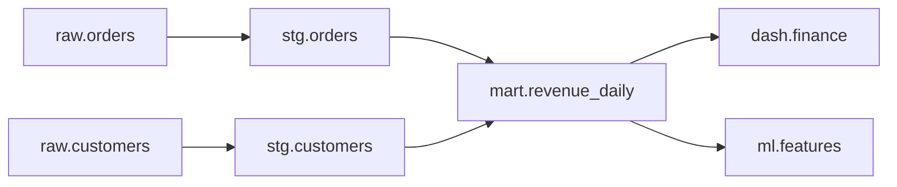

## 🎯 خلاصه

> **Data lineage** ثبت می‌کند داده از کجا آمده و به کجا می‌رود: کدام ورودی‌ها کدام خروجی را ساخته‌اند، با کدام job، و در چه زمانی. در سطح **جدول** جواب می‌دهد «چه چیزی این جدول را تغذیه می‌کند؟». در سطح **ستون** جواب می‌دهد «این عدد از کجا می‌آید؟».

- lineage برای دو کار است: **provenance** (اعتماد و حسابرسی) و **impact analysis** (اگر این را عوض کنم چه می‌شکند؟).
- lineage را می‌توان از parse کردن SQL، از orchestrator، از ابزار تبدیل (مثلاً dbt) یا از رویدادهای runtime مثل **OpenLineage** جمع کرد.
- lineage سطح جدول پایه‌ی رایج است. lineage سطح ستون سخت‌تر است و بیشتر عمق مصاحبه همان‌جاست.

## 🌱 از ساده شروع کنیم (مبتدی)

> **💡 تشبیه:** درخت خانوادگی برای داده. گزارش تو نوه است. والدینش جدول‌هایی‌اند که از آن ساخته شده، پدربزرگ‌هایش جدول‌هایی‌اند که آن‌ها از روی‌شان ساخته شده‌اند، و همین‌طور. وقتی یک جد تغییر می‌کند، می‌خواهی بدانی کدام نسل‌های بعدی تحت تأثیرند.

یک زنجیره‌ی کوچک این را ملموس می‌کند:

```text
raw.orders ──► stg.orders ──► mart.revenue_daily ──► dash.finance
raw.customers ──► stg.customers ──┘
```

دو سؤالی که یک گراف lineage در چند ثانیه جواب می‌دهد:

- **بالادستی (provenance):** «`mart.revenue_daily` از کجا می‌آید؟» جواب: `stg.orders` و `stg.customers`، و تا جدول‌های خام.
- **پایین‌دستی (impact):** «اگر `raw.orders` را عوض کنم چه می‌شکند؟» جواب: `stg.orders`، `mart.revenue_daily` و `dash.finance`.

بدون lineage، سؤال impact با پرسیدن از آدم‌ها در چت جواب داده می‌شود، و نیمی از اوقات جواب اشتباه است.

## 🔧 واقعاً چطور کار می‌کند (متوسط)

**سطح جدول در برابر سطح ستون.** این تبدیل را در نظر بگیر:

```sql
CREATE TABLE mart.revenue_daily AS
SELECT o.order_date,
       c.region,
       SUM(o.amount) AS total_revenue
FROM stg.orders o
JOIN stg.customers c ON c.customer_id = o.customer_id
GROUP BY o.order_date, c.region;
```

- **سطح جدول:** `mart.revenue_daily` به `stg.orders` و `stg.customers` وابسته است.
- **سطح ستون:** `total_revenue` به `stg.orders.amount` وابسته است. `region` به `stg.customers.region`. `order_date` به `stg.orders.order_date`. کلید join یعنی `customer_id` روی این‌که کدام ردیف‌ها وارد می‌شوند اثر می‌گذارد، که بسیاری از ابزارها آن را به‌عنوان وابستگی جداگانه‌ی «filter» یا «join» ثبت می‌کنند.

نمای ستونی چیزی است که برای جواب دادن به «چرا درآمد تغییر کرد؟» و «کدام ستون‌ها را امن می‌توانم حذف کنم؟» لازم داری.

**lineage از کجا می‌آید.**

| منبع | روش | نقطه‌ی قوت | ضعف |
|---|---|---|---|
| parse کردن SQL | تحلیل متن کوئری | بدون instrumentation کار می‌کند | SQL پویا و macro سخت است |
| ابزار تبدیل | dbt گراف مدل‌های خودش را می‌خواند | برای مدل‌های dbt دقیق | فقط چیزی را پوشش می‌دهد که خودش اجرا می‌کند |
| orchestrator | ورودی و خروجی taskها را ثبت می‌کند | runها و زمان‌ها را می‌داند | اغلب فقط سطح جدول |
| رویدادهای runtime (OpenLineage) | jobها رویدادهای start، complete و fail منتشر می‌کنند | runها، schemaها و facetها را دارد | هر integration باید منتشر کند |

**OpenLineage** یک استاندارد باز برای انتشار رویدادهای lineage است. مدلش سه entity دارد: یک **job** (کار نام‌دار)، یک **run** (یک اجرای job با `runId`) و یک **dataset** (جدول یا فایل، با namespace و name). یک run رویدادهایی مثل `START`، `COMPLETE` یا `FAIL` منتشر می‌کند و هر رویداد ورودی‌ها و خروجی‌هایش را فهرست می‌کند. اطلاعات اضافی به‌صورت **facet** (schema، متن SQL، تعداد ردیف، parent run) ضمیمه می‌شود. پروژه‌ی Marquez یک سرویس metadata متن‌باز است که این رویدادها را ذخیره و نمایش می‌دهد.

```json
{
  "eventType": "START",
  "eventTime": "2026-01-02T03:00:00.000Z",
  "run": { "runId": "3b452093-782c-4ef2-9c0c-aafe2aa6f34d" },
  "job": { "namespace": "airflow", "name": "revenue_daily.build" },
  "inputs": [ { "namespace": "warehouse", "name": "stg.orders" } ],
  "outputs": [ { "namespace": "warehouse", "name": "mart.revenue_daily" } ],
  "producer": "https://example.com/my-integration"
}
```

این نسخه برای خوانایی کوتاه شده است. مشخصات کامل فیلد `schemaURL` را هم لازم دارد و facetهای schema و SQL را توصیه می‌کند. مشخصات نسخه‌ای را که استفاده می‌کنی بررسی کن.

**impact analysis یک پیمایش گراف است.** lineage را به‌صورت adjacency list (از بالادستی به پایین‌دستی) ذخیره کن و با جستجوی سطح‌به‌سطح (BFS) بگرد:

```python
from collections import deque

edges = {  # upstream -> downstream
    "raw.orders": ["stg.orders"],
    "stg.orders": ["mart.revenue_daily"],
    "mart.revenue_daily": ["dash.finance", "ml.features"],
    "raw.customers": ["stg.customers"],
    "stg.customers": ["mart.revenue_daily"],
}

def impacted(start: str) -> list[str]:
    seen, order, q = {start}, [], deque([start])
    while q:
        node = q.popleft()
        for child in edges.get(node, []):
            if child not in seen:
                seen.add(child)
                order.append(child)
                q.append(child)
    return order

print(impacted("raw.orders"))
# ['stg.orders', 'mart.revenue_daily', 'dash.finance', 'ml.features']
```

مجموعه‌ی `seen` باعث می‌شود پیمایش متناهی بماند و وقتی دو مسیر به یک گره می‌رسند، آن گره دوبار گزارش نشود.



## 🧠 عمق و trade-offها (سنیور)

- **lineage سطح ستون گرفتنش سخت است.** `SELECT *`، نام ستون‌های بدون پیشوند، macro، `UNION` بر اساس موقعیت و SQL پویا، همه parse را مبهم می‌کنند. ابزاری که «بیشتر درست» است می‌تواند اعتماد کاذب بدهد. قبل از این‌که برای پاسخ به ممیزی به آن تکیه کنی، پوشش آن را اندازه بگیر.
- **جزئیات در برابر هزینه.** lineage ستون برای هزاران جدول یک گراف خیلی بزرگ می‌سازد. نمای دقیق را برای martهای حیاتی نگه دار و نمای جدولی را همه‌جا.
- **runtime در برابر static.** parse استاتیک نشان می‌دهد کد چه *می‌گوید*. رویدادهای runtime نشان می‌دهند چه چیزی واقعاً *اجرا* شده: backfill، اجرای دستی مجدد یا یک job نیمه‌نوشته‌ی شکست‌خورده. راه‌اندازی‌های بالغ هر دو را ترکیب می‌کنند.
- **lineage سیستم دسترسی نیست.** دانستن این‌که یک فیلد به گزارشی می‌رسد، کسی را از خواندنش باز نمی‌دارد. کنترل دسترسی با لایه‌ی [[data-security|امنیت داده]] و حاکمیت است.
- **تحلیل impact به versioning نیاز دارد.** تغییر یک ستون وقتی امن است که بدانی کدام مصرف‌کننده‌ها به آن وابسته‌اند. lineage را با قراردادهای schema ([[governance-contracts-mesh|قرارداد داده]]) ترکیب کن تا تغییر شکننده قبل از merge دیده شود.
- **lineage در streaming.** برای pipelineهای Kafka به lake، هویت dataset ترکیب topic و جدول sink است، و job یک run طولانی است نه یک run روزانه. lineage مبتنی بر رویداد (OpenLineage با runهای طولانی) رویکرد معمول است. برای موتورهای streaming مثل Flink یا Spark Structured Streaming، integration مورد استفاده‌ات را بررسی کن.
- **trade-off با حاکمیت.** lineage بیشتر یعنی metadata بیشتر برای ذخیره، ایندکس و تازه نگه داشتن. lineage کهنه بدتر از نداشتنش است، چون مردم به آن اعتماد می‌کنند.

## 🧪 امتحان کن

۱. به دیکشنری `edges` در Python، `dash.exec_summary` را به‌عنوان فرزند `mart.revenue_daily` و `ml.features` را به‌عنوان فرزند `stg.customers` اضافه کن. **پیش‌بینی کن:** `impacted("raw.customers")` چه برمی‌گرداند و به چه ترتیبی؟
۲. lineage ستون را دستی برای این کوئری بنویس: `SELECT customer_id, UPPER(name) AS name_upper, amount * 1.09 AS amount_with_tax FROM raw.sales;`. برای هر ستون خروجی، همه‌ی ستون‌های بالادستی را فهرست کن.
۳. توضیح بده چرا مجموعه‌ی `seen` در BFS مهم است وقتی دو مسیر به یک گره می‌رسند.

<details><summary>جواب‌ها را ببین</summary>

**۱.** اگر `"ml.features"` را به فهرست `"stg.customers"` و `"dash.exec_summary"` را به فهرست `"mart.revenue_daily"` اضافه کنی، نتیجه `['stg.customers', 'mart.revenue_daily', 'ml.features', 'dash.finance', 'dash.exec_summary']` است. `ml.features` با این‌که از دو والد قابل دسترس است، فقط یک بار می‌آید؛ به‌خاطر مجموعه‌ی `seen`. داشبوردها بعد از martی که تغذیه‌شان می‌کند می‌آیند.

**۲.** `customer_id` به `raw.sales.customer_id` وابسته است. `name_upper` به `raw.sales.name`. `amount_with_tax` به `raw.sales.amount`. ثابت `1.09` وابستگی نیست.

**۳.** در مثال قبلی، `mart.revenue_daily` هم از `stg.orders` و هم از `stg.customers` می‌رسد. بدون `seen`، گره‌ی دوبار رسیده دوبار در صف می‌افتد و دوبار گزارش می‌شود، و در گرافی با حلقه، پیمایش هرگز تمام نمی‌شود. مجموعه باعث می‌شود هر گره یک بار دیده شود.

</details>

## 💬 گوشه‌ی مصاحبه

**سؤال: «برای یک انبار داده، lineage را چطور پیاده می‌کنی؟»** جواب متوسط: «برای lineage سطح جدول، SQL را parse می‌کنم یا گراف dbt را استفاده می‌کنم و در یک سرویس metadata ذخیره می‌کنم تا مردم جدول‌های بالادستی و پایین‌دستی را ببینند.» جواب سنیور: «از lineage سطح جدول که از ابزار تبدیل و orchestrator می‌آید شروع می‌کنم، و بعد رویدادهای runtime را برای runهایی که از dbt نمی‌گذرند اضافه می‌کنم. lineage سطح ستون بعد می‌آید، فقط برای martهای حیاتی، چون parse بخش سخت است. lineage را در کاتالوگ نمایش می‌دهم، به مالک‌ها وصل می‌کنم، و در pull requestها برای تحلیل impact استفاده‌اش می‌کنم.»

**سؤال: «تفاوت data lineage و data observability چیست؟»** lineage ساختار وابستگی‌ها را توصیف می‌کند. observability سلامت داده‌ای را که از آن‌ها می‌گذرد اندازه می‌گیرد. lineage می‌گوید چه چیزی را باید بررسی کنی و به چه کسی خبر بدهی؛ observability می‌گوید چیزی خراب است.

> **🎤 این را در مصاحبه بگو:** «lineage می‌گوید داده از کجا آمده و چه چیزی به آن وابسته است. قبل از یک تغییر برای تحلیل impact و بعد از یک حادثه برای ریشه‌یابی ازش استفاده می‌کنم. آن را از لایه‌ی تبدیل و رویدادهای runtime جمع می‌کنم و درباره‌ی پوشش lineage سطح ستون صادق هستم.»

## ⚠️ اشتباهات رایج

> **⚠️ مراقب باش:** کامل فرض کردن lineage فقط چون ابزار گرافی کشیده. گرافی که از parse ناقص ساخته شده وابستگی‌هایی را که از دست داده پنهان می‌کند.

- فرض دقیق بودن lineage برای `SELECT *`. ستون‌ها به schema جدول در زمان parse وابسته‌اند.
- اشتباه گرفتن کلید join با وابستگی مقدار. کلید join تعیین می‌کند کدام ردیف‌ها بیایند، پس برای تحلیل impact هنوز مهم است.
- جمع‌آوری lineage فقط برای jobهای batch روزانه و فراموش کردن notebookهای ad hoc، اصلاح‌های دستی و backfillها.
- استفاده از lineage به‌عنوان سیستم کنترل دسترسی.
- کهنه شدن lineage. دیاگرامی از شش ماه پیش با اطمینان اشتباه است.
- کشیدن lineage ستون برای هر ستون هر جدول، که گرافی تولید می‌کند که کسی نمی‌خواندش.

## ✅ خودت را بسنج (quiz)

۱. تحلیل **impact** از lineage برای چه استفاده می‌کند؟
   - A) فشرده‌سازی جدول‌ها
   - B) پیدا کردن assetهای پایین‌دستی که تحت تأثیر یک تغییر قرار می‌گیرند
   - C) رمزگذاری ستون‌ها
   - D) زمان‌بندی jobها

<details><summary>جواب</summary>

**B** — تحلیل impact از asset تغییریافته به سمت پایین‌دست گراف پیمایش می‌کند تا جدول‌ها، داشبوردها و مدل‌های وابسته را پیدا کند.

</details>

۲. در OpenLineage، چه چیزی **یک اجرا** از یک job را مشخص می‌کند؟
   - A) namespace دیتاست
   - B) `runId` روی run
   - C) URL مربوط به `producer`
   - D) فهرست facetها

<details><summary>جواب</summary>

**B** — job کار نام‌دار است و هر اجرا یک run با `runId` خودش است. رویدادهای START، COMPLETE و FAIL همان run همین شناسه را دارند.

</details>

۳. یک کوئری روی جدول منبع از `SELECT *` استفاده می‌کند و بعداً منبع یک ستون اضافه می‌کند. برای lineage چه اشکالی پیش می‌آید؟

   - A) هیچ؛ `SELECT *` همیشه lineage کامل دارد
   - B) lineage ستونی که قبلاً ثبت شده تا وقتی کوئری دوباره parse نشود ممکن است کهنه باشد
   - C) job به‌عنوان job استریمی علامت می‌خورد
   - D) namespace دیتاست تغییر می‌کند

<details><summary>جواب</summary>

**B** — ستون‌های خروجی به schema منبع در زمان parse وابسته‌اند. یک ستون جدید منبع lineage را تغییر می‌دهد، پس رکورد باید تازه شود. به همین دلیل `SELECT *` مشکل رایج lineage است.

</details>

۴. **(سنیور)** یک تیم قبل از یک ممیزی انطباق، که سه هفته دیگر است، lineage ستون را برای ۳٬۰۰۰ جدول می‌خواهد. چه پیشنهادی می‌دهی؟

   - A) برای هر جدول دستی بکشیم
   - B) محدود کنیم به جدول‌هایی که داده‌ی تحت‌قاعده دارند، برای بقیه lineage سطح جدول، پوشش parser را اندازه بگیریم و پوشش را صادقانه گزارش کنیم
   - C) lineage را تا بعد از ممیزی خاموش کنیم
   - D) lineage را جای کنترل دسترسی بگذاریم

<details><summary>جواب</summary>

**B** — ممیزی به اطمینان روی داده‌ی حساس نیاز دارد، نه همه‌ی جدول‌ها. محدودسازی، ترکیب روش‌ها و گفتن شکاف‌های پوشش از یک گراف ادعایی کامل معتبرتر است.

</details>

۵. چرا رویدادهای lineage در runtime علاوه بر parse کردن SQL مفیدند؟

<details><summary>جواب</summary>

parse نشان می‌دهد کد چه می‌گوید، اما رویدادهای runtime نشان می‌دهند چه واقعاً اجرا شده: اجرای دستی مجدد، backfill، نوشتن نیمه‌کاره‌ی شکست‌خورده، و jobهایی که SQL را پویا می‌سازند. ترکیب هر دو تصویر دقیق‌تری می‌دهد.

</details>

## 🗂️ فلش‌کارت

| Front | Back |
|---|---|
| lineage سطح جدول در برابر سطح ستون | سطح جدول: کدام جدول‌ها یک جدول را تغذیه می‌کنند؛ سطح ستون: کدام ستون‌های منبع هر ستون خروجی را می‌سازند |
| provenance در برابر impact analysis | provenance بالادست را می‌پیماید (از کجا؟)؛ impact پایین‌دست را (چه می‌شکند؟) |
| سه entity اصلی OpenLineage | job، run و dataset |
| رویداد `FAIL` چه می‌گوید؟ | run با آن `runId` با خطا تمام شده؛ خود job را لزوماً متوقف نمی‌کند |
| چرا facet استفاده می‌شود؟ | برای ضمیمه کردن metadata اضافی (schema، SQL، تعداد ردیف) به jobها، runها و datasetها |
| چرا `SELECT *` lineage را پیچیده می‌کند؟ | خروجی‌اش به schema منبع در زمان parse وابسته است، پس وقتی schema عوض شود lineage هم عوض می‌شود |
| چرا مجموعه‌ی `seen` در پیمایش impact؟ | برای جلوگیری از تکرار گره‌ها و توقف پیمایش در حلقه |

## 🔗 ادامه

- [[data-observability|data observability]] از lineage استفاده می‌کند تا یک هشدار را به فهرست impact تبدیل کند.
- [[data-catalogs|کاتالوگ‌های داده]] جایی است که lineage معمولاً کنار مالکان و توضیحات نمایش داده می‌شود.
- [[dbt]] منبع رایج lineage دقیق سطح جدول است.
- [[etl-vs-elt]] توضیح می‌دهد چرا تبدیل داخل انبار، ثبت lineage را ساده‌تر می‌کند.
- [[governance-contracts-mesh|حاکمیت، قرارداد و Data Mesh]] lineage را به قرارداد و مالکیت وصل می‌کند.
- [[dwh-fundamentals]] لایه‌بندی (raw، staging، mart) را می‌دهد که گراف‌های lineage معمولاً از آن پیروی می‌کنند.
