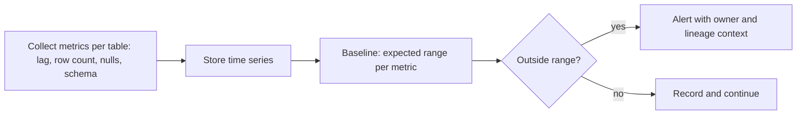

## 🎯 خلاصه

> **Data observability** یعنی دائماً بدانی داده‌ات **به‌موقع می‌رسد، کامل است، شکل درستی دارد و قابل اعتماد است**، و وقتی این‌طور نیست خبردار شوی. این ابزار خود داده را می‌پاید، نه فقط این‌که job اجرا شده یا نه.

- یک task سبز در Airflow فقط می‌گوید کد تمام شده. نمی‌گوید جدول ردیف‌های دیروز را دارد یا نه.
- یک چارچوب رایج پنج ستون دارد: **freshness**، **volume**، **schema**، **distribution** و **lineage**.
- مانیتورینگ خوب یک **baseline** یاد می‌گیرد و روی انحراف هشدار می‌دهد، به‌جای این‌که برای هر جدول یک آستانه‌ی ثابت بگذارد.
- سخت‌ترین بخش **کیفیت هشدار** است: هشدار کم، و هر کدام با یک مالک و قدم بعدی مشخص.

## 🌱 از ساده شروع کنیم (مبتدی)

> **💡 تشبیه:** مانیتور بیمارستان برای یک بیمار. دستگاه صبر نمی‌کند بیمار بگوید «حالم بد است». همیشه ضربان قلب، اکسیژن و دما را می‌پاید و وقتی عددی از محدوده‌ی طبیعی خارج شود زنگ می‌زند. Data observability همان مانیتور برای جدول‌ها است.

جدول `orders` را در نظر بگیر که هر صبح داشبورد آن را می‌خواند. چهار مشکل ممکن است پیش بیاید و job هر بار هم موفق اعلام شود:

- **دیر:** ردیف‌های دیروز اصلاً نرسیده‌اند.
- **کم:** فقط ۲۰۰ ردیف آمده، در حالی که معمولاً ۱۰٬۰۰۰ تاست.
- **تغییر کرده:** یک ستون بالادستی تغییر نام داده.
- **عجیب:** ناگهان ۴۰٪ مقادیر `customer_id` خالی است.

دو بررسی ساده با SQL (سینتکس PostgreSQL):

```sql
-- Freshness: جدیدترین ردیف چقدر قدیمی است؟
SELECT now() - max(loaded_at) AS lag
FROM warehouse.orders;

-- Distribution: چه سهمی از ردیف‌های دیروز مشتری ندارند؟
SELECT count(*) FILTER (WHERE customer_id IS NULL) * 1.0 / count(*) AS null_rate
FROM warehouse.orders
WHERE order_date = CURRENT_DATE - 1;
```

ضرب در `1.0` مهم است: بدون آن، تقسیم صحیح نتیجه‌ی `0` می‌دهد به‌جای `0.4`.

## 🔧 واقعاً چطور کار می‌کند (متوسط)

ابزارهای observability یک حلقه را دنبال می‌کنند: **جمع‌آوری متریک‌ها**، **ساختن baseline**، **تشخیص ناهنجاری**، **مسیردهی هشدار**.



**پنج ستون**، با سؤالی که هر کدام جواب می‌دهد:

| ستون | سؤال | متریک نمونه |
|---|---|---|
| Freshness | داده وقتی باید، رسیده؟ | فاصله‌ی بین الان و `max(loaded_at)` |
| Volume | تعداد ردیف معقول است؟ | تعداد ردیف در هر partition و هر روز |
| Schema | ساختار تغییر کرده؟ | ستون‌های اضافه، حذف‌شده یا با نوع جدید |
| Distribution | مقدارها عادی به نظر می‌رسند؟ | نرخ null، تعداد مقادیر یکتا، min/max، میانگین |
| Lineage | چه چیزی تحت تأثیر است و مالکش کیست؟ | وابستگی‌های بالادستی و پایین‌دستی |

**قاعده‌ی ثابت در برابر baseline یادگرفته‌شده.** یک قاعده‌ی ثابت («تعداد ردیف > ۵۰۰۰») قابل توضیح است، اما با فصلی‌بودن می‌شکند: دوشنبه شلوغ است، یکشنبه آرام، و تعطیلی یک افت مشروع است. baseline یادگرفته‌شده از تاریخچه‌ی اخیر استفاده می‌کند، گاهی برای هر روز هفته. نسخه‌ی ساده‌اش z-score است:

```python
import statistics

def is_volume_anomaly(history: list[int], today: int, z_max: float = 3.0) -> bool:
    if len(history) < 7:
        return False                      # تاریخچه‌ی کافی برای یادگیری baseline نیست
    mean = statistics.fmean(history)
    stdev = statistics.stdev(history)
    if stdev == 0:
        return today != mean
    return abs(today - mean) / stdev > z_max

last_week = [1000, 1020, 980, 1010, 990, 1005, 995]
print(is_volume_anomaly(last_week, 400))   # True: خیلی بیرون از محدوده‌ی عادی
print(is_volume_anomaly(last_week, 1015))  # False: تغییر عادی
```

ابزارهای تولیدی مدل‌های مقاوم‌تری دارند (فصلی‌بودن، روند، آمار مقاوم)، اما ایده همان است.

**کجا بررسی‌ها اجرا می‌شوند.** بررسی‌های metadata (freshness از timestamp بارگذاری، تعداد ردیف از آمار جدول) ارزان‌اند و می‌توانند زیاد اجرا شوند. بررسی‌های distribution داده را اسکن می‌کنند و هزینه‌ی محاسباتی واقعی دارند، پس فقط روی partition جدید اجرا کن، نه کل جدول. بررسی schema، schema فعلی را با آخرین schema شناخته‌شده مقایسه می‌کند، که اغلب از [[data-catalog|کاتالوگ داده]] یا information schema انبار داده فعال می‌شود.

**هشدار.** هر هشدار باید یک مالک جدول، سطح شدت، و لینک به run شکست‌خورده و داشبوردهای پایین‌دستی متأثر داشته باشد. هشدارها را deduplicate کن تا یک حادثه‌ی بالادستی ۴۰ پیام ایجاد نکند.

## 🧠 عمق و trade-offها (سنیور)

- **خستگی از هشدار مهم‌ترین حالت خرابی است.** ابزاری که هفته‌ای ۵۰ بار هشدار دهد، مردم را یاد می‌دهد نادیده‌اش بگیرند. با مجموعه‌ی کوچکی از جدول‌های حیاتی (آن‌هایی که [[sla-slo|SLA]] دارند) شروع کن و بعد گسترش بده.
- **تشخیص ناهنجاری خطای مثبت و منفی دارد.** baseline یادگرفته‌شده می‌تواند یک افت واقعی و آهسته را بی‌صدا کند، چون baseline همراه آن جابه‌جا می‌شود. برای جدول‌های حیاتی کسب‌وکار، بررسی یادگرفته‌شده را با یک کف سخت («هرگز کمتر از X ردیف») ترکیب کن.
- **مقیاس و هزینه.** اسکن همه‌ی ستون‌های همه‌ی جدول‌ها هر روز گران است. بر اساس اثر روی مصرف‌کننده (داشبورد، مدل، گزارش مالی) و نوع ستون اولویت بده. برای جدول‌های بزرگ که شمارش دقیق لازم نیست، نمونه‌برداری کن.
- **lineage هشدار را قابل اقدام می‌کند.** افزایش null در `stg_orders` وقتی مفید است که ببینی به `revenue_daily` و داشبورد مالی می‌رسد. [[data-lineage|lineage]] را ببین.
- **مالکیت یک مسئله‌ی داده است.** observability بدون مالک فقط داشبوردی تولید می‌کند که کسی نمی‌خواند. هر جدول را در [[data-catalog|کاتالوگ]] به یک تیم وصل کن.
- **observability در برابر تست.** تست روی تغییر کد یا ورودی شناخته‌شده اجرا و در صورت شکست build را متوقف می‌کند. observability داده‌ی تولید را دائماً می‌پاید و چیزی را می‌گیرد که تست‌ها پیش‌بینی نکرده بودند. هر دو لازم‌اند و یکی جای دیگری را نمی‌گیرد.
- **تشخیص حادثه.** وقتی هشدار freshness روشن می‌شود، سؤال این است: «کدام job بالادستی ایستاده، و داده غلط است یا فقط دیر رسیده؟» اینجا lineage و تاریخچه‌ی run مهم‌اند. نتیجه را وارد [[incidents-postmortems|پس‌مورتم‌ها]] کن.
- **کی خودت نسازی.** برای چند جدول، بررسی‌های SQL داخل orchestrator کافی‌اند. پلتفرم وقتی لازم است که ده‌ها تیم و صدها جدول به همان بررسی‌ها و مسیردهی نیاز داشته باشند.

## 🧪 امتحان کن

۱. با تابع z-score بالا و همان تاریخچه‌ی `last_week`، برای `today = 1200` پیش‌بینی کن. سپس توضیح بده چرا یک baseline آگاه از روز هفته برای دوشنبه ممکن است بهتر باشد.
۲. یک کوئری freshness برای `warehouse.payments` بنویس که وقتی جدیدترین `loaded_at` بیش از ۲ ساعت قدیمی است `TRUE` برگرداند.
۳. یک بررسی نرخ null هر یکشنبه برای `customer_id` هشدار می‌دهد. دو علت ممکن و یک راه‌حل بده که فقط آستانه را بالا نبرد.

<details><summary>جواب‌ها را ببین</summary>

**۱.** `1200` حدود ۲۰۰ بالاتر از میانگین حدود ۱۰۰۰ است و انحراف معیار این تاریخچه حدود ۱۳ است، پس z-score بالای ۳ و تابع `True` برمی‌گرداند. baseline مخصوص دوشنبه مهم است چون حجم دوشنبه ممکن است به‌طور سیستماتیک با بقیه‌ی هفته فرق داشته باشد، و یک baseline واحد اوج عادی دوشنبه را هشدار می‌دهد.

**۲.** `SELECT now() - max(loaded_at) > interval '2 hours' AS is_stale FROM warehouse.payments;`

**۳.** علت‌ها: یک جریان checkout مهمان که آخر هفته مشتری ندارد (طبیعی است)، یا تغییر بالادستی که یک روز فیلد را پر نکرده. راه‌حل: بررسی را بر اساس شرط شناخته‌شده تقسیم کن (مثلاً checkoutهای مهمان را حذف کن، یا متریک را بر اساس کانال تفکیک کن)، تا هشدار فقط یک ناهنجاری واقعی را نشان دهد. بالا بردن آستانه، رگرسیون واقعی بعدی را پنهان می‌کند.

</details>

## 💬 گوشه‌ی مصاحبه

**سؤال: «کیفیت داده را در یک pipeline چطور مانیتور می‌کنی؟»** جواب متوسط: «برای جدول‌های کلیدی بررسی freshness، تعداد ردیف و نرخ null اضافه می‌کنم و وقتی شکست می‌خورند هشدار می‌دهم.» جواب سنیور: «برای هر جدول حیاتی پنج ستون را مثل چک‌لیست استفاده می‌کنم. freshness و volume ارزان‌اند و زیاد اجرا می‌شوند؛ بررسی distribution فقط روی partitionهای جدید. آستانه‌ها از baseline یادگرفته‌شده به‌علاوه‌ی کف‌های سخت کسب‌وکار می‌آیند. هر هشدار مالک و context از lineage دارد، و دقت هشدارها را اندازه می‌گیرم تا سیگنال قابل اعتماد بماند.»

**سؤال: «تفاوت تست کیفیت داده و data observability چیست؟»** تست انتظارات شناخته‌شده را زمان build یا load بررسی می‌کند. observability داده‌ی تولید را دائماً می‌پاید و تغییرات غیرمنتظره را پیدا می‌کند. تست جلوی باگ‌های شناخته‌شده را می‌گیرد؛ observability تغییرات ناشناخته را.

> **🎤 این را در مصاحبه بگو:** «یک job موفق به این معنا نیست که داده درست است. روی جدول‌های مهم، freshness، volume، schema، distribution و lineage را می‌پایم، با baseline یادگرفته‌شده نویز را کم می‌کنم، و هشدارها را با context از lineage به مالک‌ها می‌رسانم تا قابل اقدام باشند.»

## ⚠️ اشتباهات رایج

> **⚠️ مراقب باش:** پایش وضعیت job به‌جای پایش داده. runهای سبز هنوز می‌توانند جدول خالی یا غلط تولید کنند.

- گذاشتن یک آستانه‌ی ثابت برای همه‌ی جدول‌ها و همه‌ی روزهای هفته، و بعد تنظیم بی‌پایان آن.
- هشدار دادن برای هر ناهنجاری بدون شدت یا deduplication، که مردم را به نادیده گرفتن هشدارها عادت می‌دهد.
- اجرای اسکن کامل distribution هر ساعت روی جدول‌های بزرگ.
- تلقی baseline یادگرفته‌شده به‌عنوان حقیقت، حتی بعد از یک تغییر واقعی در کسب‌وکار (مثلاً یک خط محصول جدید حجم عادی را تغییر می‌دهد).
- فراموش کردن این‌که تغییر schema می‌تواند «معتبر» باشد و هنوز یک متریک پایین‌دستی را خراب کند.
- ساختن observability قبل از این‌که جدول‌های حیاتی مالک داشته باشند.

## ✅ خودت را بسنج (quiz)

۱. کدام ستون به این سؤال جواب می‌دهد: «داده‌ی دیروز رسید؟»
   - A) Volume
   - B) Freshness
   - C) Schema
   - D) Lineage

<details><summary>جواب</summary>

**B** — freshness سن جدیدترین داده را می‌سنجد. بررسی volume می‌گوید چقدر داده رسیده، که سؤال متفاوتی است.

</details>

۲. یک job موفق شده و جدول تعداد ردیف درست دارد، اما ستون `amount` حالا به‌صورت متن ذخیره می‌شود. کدام ستون این را گرفت؟

   - A) Freshness
   - B) Volume
   - C) Schema
   - D) Distribution

<details><summary>جواب</summary>

**C** — نوع ستون تغییر کرده، یعنی تغییر schema. بررسی‌های volume و distribution شاید اصلاً این را نگیرند، و به همین دلیل بررسی schema جدا وجود دارد.

</details>

۳. **(سنیور)** یک تیم می‌خواهد وقتی `row_count` کمتر از ۸۰٪ میانگین ۳۰ روزه است هشدار بدهد. یک دلیل خطرناک بودن این و یک بهبود بده.

<details><summary>جواب</summary>

خطر: میانگین ثابت فصلی بودن هفتگی و افت‌های مشروع (تعطیلی) را نادیده می‌گیرد، پس زیاد هشدار می‌دهد. همچنین جابه‌جا می‌شود: یک افت آهسته می‌تواند میانگین جدید شود و هرگز هشدار ندهد. بهبود: مقایسه با همان روز هفته در چند هفته‌ی اخیر، و یک کف سخت کسب‌وکار برای جدول‌های حیاتی.

</details>

۴. **(سنیور)** وقتی هشدار null روشن می‌شود، چرا lineage مهم است؟

   - A) کوئری را سریع‌تر می‌کند
   - B) نشان می‌دهد کدام جدول‌ها و داشبوردهای پایین‌دستی متأثرند و مالکشان کیست
   - C) نیاز به مالک را برطرف می‌کند
   - D) مقادیر null را خودکار درست می‌کند

<details><summary>جواب</summary>

**B** — lineage هشدار را به فهرست اولویت‌دار تأثیر تبدیل می‌کند. observability بدون lineage می‌گوید مشکلی هست، اما نمی‌گوید چه کسی باید اهمیت بدهد.

</details>

۵. چرا بررسی‌های distribution معمولاً روی partitionهای جدید اجرا می‌شوند، نه کل جدول؟

<details><summary>جواب</summary>

اسکن کامل گران است و هر روز تکرار می‌شود. بیشتر ناهنجاری‌ها در داده‌ی جدید ظاهر می‌شوند، پس بررسی جدیدترین partition آن‌ها را با هزینه‌ی کسری پیدا می‌کند. حسابرسی‌های گاه‌به‌گاه کل تاریخچه هم می‌توانند کمتر اجرا شوند.

</details>

## 🗂️ فلش‌کارت

| Front | Back |
|---|---|
| data observability چه چیزی را می‌پاید؟ | خود داده (رسیدن، حجم، شکل، مقادیر، وابستگی‌ها)، نه فقط موفقیت job |
| پنج ستون | Freshness، volume، schema، distribution، lineage |
| Freshness در برابر volume | Freshness: داده چقدر تازه است؛ volume: چقدر داده رسیده |
| چرا baseline یادگرفته‌شده؟ | فصلی‌بودن را مدیریت می‌کند و یک آستانه‌ی ثابت برای هر جدول لازم نیست |
| حالت خرابی اصلی observability | خستگی از هشدار به‌خاطر هشدارهای زیاد و بدون اولویت |
| چرا در کوئری نرخ null در `1.0` ضرب می‌کنیم؟ | برای جلوگیری از تقسیم صحیح که `0` برمی‌گرداند |
| تست در برابر observability | تست انتظارات شناخته‌شده را قبل از تغییر بررسی می‌کند؛ observability تغییرات ناشناخته‌ی تولید را پیدا می‌کند |

## 🔗 ادامه

- [[data-quality|کیفیت داده]] قوانین و تست‌هایی را پوشش می‌دهد که observability را کامل می‌کنند.
- [[pipeline-monitoring]] متریک‌های سطح job مثل تأخیر، شکست و مدت اجرا را پوشش می‌دهد.
- [[data-lineage]] توضیح می‌دهد چطور یک هشدار را به فهرست تأثیر تبدیل کنی.
- [[data-catalogs]] معمولاً جایی است که مالکان و metadata جدول‌ها نگهداری می‌شوند.
- [[incidents-postmortems]] نشان می‌دهد بعد از روشن شدن هشدار چه کنی.
- [[design-dq-platform]] طراحی یک پلتفرم کیفیت داده را از ابتدا تا انتها توضیح می‌دهد.
