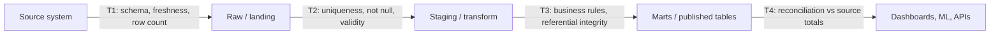

## 🎯 خلاصه

> **کیفیت داده (data quality)** یعنی داده برای کاری که قرار است در آن استفاده شود **مناسب** باشد. با تست‌های صریح و خودکار بررسی‌اش می‌کنی و از قبل تصمیم می‌گیری وقتی تستی شکست می‌خورد چه اتفاقی بیفتد: هشدار بدهی، ردیف‌های بد را قرنطینه کنی، یا **پایپ‌لاین را متوقف کنی** تا داده‌ی بد به داشبورد یا مدل نرسد.

- کیفیت در امتداد **ابعاد** اندازه‌گیری می‌شود: کامل‌بودن (completeness)، یکتایی (uniqueness)، اعتبار (validity)، سازگاری (consistency)، به‌موقع‌بودن (timeliness) و دقت (accuracy).
- تست‌ها را جایی بگذار که داده **دست‌به‌دست** می‌شود: مرز منبع، بعد از هر تبدیل، و درست قبل از publish.
- سه الگو بیشترین کار را می‌کنند: **write-audit-publish** (تست قبل از قابل‌دیدن‌شدن داده)، **circuit breaker** (توقف وقتی آستانه رد شد)، و **reconciliation** (منبع و مقصد باید در تعداد و جمع‌ها هم‌خوان باشند).
- تستی که پاس می‌شود، اثبات درستی نیست. تست‌ها فقط همان چیزهایی را بررسی می‌کنند که به فکرشان رسیده.

## 🌱 از ساده شروع کنیم (مبتدی)

> **💡 تشبیه:** آشپزخانه‌ی یک رستوران. قبل از اینکه غذا سرو شود، کسی چک می‌کند داغ باشد، مواد درستش داخلش باشد و چیزی کم نباشد. اگر سوپ سرد باشد، آشپز آن را نمی‌فرستد و آن ایستگاه را تا رفع مشکل متوقف می‌کند. پایپ‌لاین‌های داده هم همین عادت را لازم دارند.

فرض کن جدول `orders` داشبورد درآمد را تغذیه می‌کند. پنج اتفاق بد می‌تواند برایش بیفتد:

| بعد | سؤالی که پاسخ می‌دهد | مثال بد در `orders` |
|---|---|---|
| **Completeness** (کامل‌بودن) | آیا داده اصلاً هست؟ | ۱۲٪ ردیف‌ها `customer_id = NULL` دارند |
| **Uniqueness** (یکتایی) | آیا هر چیز فقط یک‌بار آمده؟ | `order_id = 881` بعد از یک retry سه‌بار آمده |
| **Validity** (اعتبار) | آیا مقدار از قواعد پیروی می‌کند؟ | `status = 'shipd'` (در لیست مجاز نیست) |
| **Consistency** (سازگاری) | آیا دو جا با هم می‌خوانند؟ | `orders` می‌گوید ۱۰٬۴۰۰ ردیف، سیستم منبع می‌گوید ۱۰٬۲۵۰ |
| **Timeliness** (به‌موقع بودن) | آیا به اندازه‌ی کافی تازه است؟ | پارتیشن دیروز ساعت ۱۴ امروز رسیده |
| **Accuracy** (دقت) | آیا مقدار در دنیای واقعی درست است؟ | `amount = -5000` برای یک خرید عادی |

به آخری توجه کن، سخت‌ترین است. دیتابیس نمی‌داند قیمت واقعی یک محصول چقدر است. دقت معمولاً به‌طور غیرمستقیم سنجیده می‌شود: با مقایسه با یک منبع معتبر دیگر، یا با بررسی معقول‌بودن مقادیر.

ساده‌ترین تست مفید سؤالی است که باید **صفر ردیف** برگرداند:

```sql
-- Test: every order has a customer. Passes if this returns 0 rows.
SELECT order_id
FROM orders
WHERE customer_id IS NULL;
```

تقریباً همه‌ی ابزارهای data quality راهی هستند برای نوشتن، اجرا، زمان‌بندی و گزارش‌دادن سؤال‌هایی مثل این.

## 🔧 واقعاً چطور کار می‌کند (متوسط)

### تست‌ها را کجا بگذاریم

داده از چند **مرز** عبور می‌کند. تست در مرز ارزان است و هرچه دیرتر باشد گران‌تر می‌شود، چون تا آن موقع داده‌ی بد دیگر join، aggregate و کپی شده است.



- **T1 (مرز منبع)** تغییرات بالادستی را زود می‌گیرد: ستونی تغییر نام داده، یا خروجی خالی است.
- **T2 (بعد از load)** ساختار و اعتبار پایه را قبل از هر join که خرابی را ضرب می‌کند، بررسی می‌کند.
- **T3 (بعد از transform)** منطق کسب‌وکار و کلیدها بین جدول‌ها را چک می‌کند.
- **T4 (قبل از publish)** جمع‌ها را با منبع مقایسه می‌کند. این همان تستی است که می‌گوید «همه چیز لود شد، اما join ساعت ۲۰٪ ردیف‌ها را انداخت» را می‌گیرد.

### ابزارها، با توصیف کارشان

- **dbt tests** در YAML کنار مدل تعریف می‌شوند. تست‌های عمومی `not_null`، `unique`، `accepted_values` و `relationships` (کلید خارجی) را پوشش می‌دهند. تست‌های سفارشی کوئری SQL هستند که باید صفر ردیف برگردانند، همان ایده‌ی مثال بالا.
- **Great Expectations** و **Soda** به تو اجازه می‌دهند expectation یا check روی جدول‌ها تعریف کنی و از orchestrator اجرایشان کنی. گزارش و تاریخچه هم تولید می‌کنند. نحو دقیق‌شان بین نسخه‌ها تغییر می‌کند، پس قبل از کپی‌کردن کد، مستندات نسخه‌ی خودت را چک کن.

```yaml
# dbt schema.yml: declared next to the model, run with `dbt test`
version: 2
models:
  - name: orders
    columns:
      - name: order_id
        tests: [unique, not_null]
      - name: customer_id
        tests:
          - not_null
          - relationships:
              to: ref('customers')
              field: customer_id
      - name: status
        tests:
          - accepted_values:
              values: ['placed', 'shipped', 'cancelled']
```

### Write-audit-publish (WAP)

مشکل الگوی «load، بعد تست» این است که مصرف‌کننده‌ها ممکن است همان موقع که تست‌ها در حال اجرا هستند، یا بعد از شکست‌شان، جدول را بخوانند. **WAP** این را حل می‌کند:

1. **Write**: داده‌ی جدید را در یک محل پنهان بنویس: جدول staging، یک پارتیشن جدید، یا یک branch در فرمت جدولی که branch را پشتیبانی می‌کند.
2. **Audit**: همه‌ی چک‌ها را روی داده‌ی staging اجرا کن.
3. **Publish**: به‌صورت atomic منتشرش کن (جایگزینی پارتیشن، ارتقای branch، تغییر نام جدول). اگر audit شکست خورده باشد، publish هرگز اتفاق نمی‌افتد و خواننده‌ها داده‌ی خوب دیروز را می‌بینند.

```sql
-- Audit step on the staged partition (must return 0 for each check)
SELECT
  (SELECT COUNT(*) FROM staging.orders WHERE order_id IS NULL)                    AS null_keys,
  (SELECT COUNT(*) - COUNT(DISTINCT order_id) FROM staging.orders)                AS duplicate_keys,
  (SELECT COUNT(*) FROM staging.orders WHERE amount < 0)                          AS negative_amounts;
```

### Circuit breaker

**circuit breaker** قانونی است که وقتی یک متریک از آستانه رد شد، پایپ‌لاین را متوقف می‌کند؛ مثل کلیدی که وقتی جریان برق زیاد می‌شود قطع می‌کند. breakerهای رایج:

- تعداد ردیف‌ها بیش از ۵۰٪ نسبت به میانگین ۷ روز قبل افت کرده (احتمالاً export بالادستی ناقص است).
- نرخ null یک ستون کلیدی از ۰٫۱٪ بیشتر شده.
- تغییر schema که ستونی را حذف کرده که پایین‌دست به آن وابسته است.

breaker باید مرحله‌ی **publish** را متوقف کند، به یک انسان هشدار بدهد، و آخرین خروجی خوب را نگه دارد. متوقف‌کردن یک task در orchestrator کم‌هزینه است. منتشر کردن عدد غلط که کسی قبلاً برای تصمیم استفاده کرده، نه.

### Reconciliation

Reconciliation برای یک بازه‌ی زمانی، **control totals** منبع و مقصد را مقایسه می‌کند: تعداد ردیف، جمع ستون‌های پولی، و تعداد کلیدهای یکتا، گروه‌بندی‌شده بر اساس روز یا پارتیشن.

```sql
-- Run per day on both sides, then compare
SELECT order_date,
       COUNT(*)       AS row_count,
       SUM(amount)    AS total_amount,
       COUNT(DISTINCT order_id) AS distinct_orders
FROM orders
WHERE order_date = DATE '2026-03-01'
GROUP BY order_date;
```

اگر هر کدام از این سه عدد با منبع نخواند، یک سیگنال است. هم‌خوانی تعداد ردیف‌ها هم ثابت نمی‌کند مقادیر درست‌اند، پس جمع‌ها و کلیدهای یکتا هم مهم‌اند.

## 🧠 عمق و trade-offها (سنیور)

- **شکست سخت در برابر نرم.** یک کلید اصلی تکراری در جدول fact یک شکست سخت است: متوقف شو. افزایش جزئی سهم `status = 'unknown'` یک شکست نرم است: هشدار بده و روند را دنبال کن. قاطی‌کردن این دو یا هشدار دائمی غلط می‌سازد یا خرابی بی‌صدا.
- **آستانه‌ها به تاریخچه نیاز دارند.** «تعداد ردیف‌ها باید بالای ۱ میلیون باشد» با آخر هفته خراب می‌شود. با یک baseline متحرک مقایسه کن (همان روز هفته، چند هفته‌ی اخیر)، و بپذیر که هفته‌های اول بعد از یک منبع جدید پرنویز است.
- **هزینه‌ی تست.** یک `COUNT(DISTINCT)` روی جدول ۲۰ ترابایتی رایگان نیست. تست را incremental کن (فقط پارتیشن جدید)، برای چک‌های سنگین نمونه‌گیری کن، و reconciliationهای سنگین را زمان‌بندی‌شده اجرا کن، نه در هر retry.
- **قرنطینه به‌جای توقف، وقتی ضرر قابل‌قبول است.** برای clickstream می‌توانی ردیف‌های بد را به یک محل dead-letter ببری (ببین [[dlq-bad-records]]) و بقیه را منتشر کنی. برای داده‌ی مالی معمولاً متوقف می‌کنی. این را برای هر dataset جدا تصمیم بگیر و به‌صورت قرارداد بنویس.
- **تست‌ها منحرف می‌شوند.** تستی که بعد از تغییر schema همیشه پاس می‌شود، از نداشتن تست بدتر است، چون اطمینان کاذب می‌سازد. تست‌های شکست‌خورده و skip‌شده را منظم بازبینی کن و تست‌هایی را که فرض‌هایشان دیگر برقرار نیست بازنشسته کن.
- **مالکیت.** هر dataset به یک مالک نیاز دارد که هشدار به او برسد. تستی که به کسی هشدار نمی‌دهد مستندات است، نه کنترل کیفیت. برای قراردادهای بین تیم تولیدکننده و مصرف‌کننده ببین [[governance-contracts-mesh]].
- **کیفیت و observability یکی نیستند.** تست‌ها می‌پرسند «این قانونِ مشخص امروز برقرار بود؟». Observability (ببین [[data-observability]]) می‌پرسد «چیز غیرمنتظره‌ای عوض شد؟» برای قوانینی که ننوشته‌ای. به هر دو نیاز داری.
- **Backfill تست‌ها را می‌شکند.** یک اجرای بازپردازش می‌تواند تعداد تاریخی را به‌حق تغییر دهد. تست‌ها باید بدانند اجرا backfill است (ببین [[pattern-backfill]]) تا روی تغییرات مورد انتظار متوقف نشوند، ولی نتیجه را همچنان چک کنند.

## 🧪 امتحان کن

تو یک پایپ‌لاین روزانه داری که جدول `payments` (`payment_id`, `order_id`, `amount_cents`, `currency`, `paid_at`) را لود می‌کند و آن را به `orders` (`order_id`, `customer_id`) join می‌کند. کوئری‌های SQL بنویس که هر کدام **ردیف‌های خطادار** را برگردانند. اجرا فقط وقتی پاس می‌شود که همه‌ی چک‌ها صفر ردیف برگردانند.

1. `payment_id` باید یکتا باشد.
2. `amount_cents` نباید منفی باشد.
3. هر `payments.order_id` باید در `orders` وجود داشته باشد.
4. مجموع امروزِ `amount_cents` باید با مجموع کنترلی منبع، که به‌صورت پارامتر `:source_total` می‌دهی، برابر باشد.

<details><summary>حدست چیست؟</summary>

```sql
-- 1. uniqueness: keys that appear more than once
SELECT payment_id, COUNT(*) AS n
FROM payments
GROUP BY payment_id
HAVING COUNT(*) > 1;

-- 2. validity: negative amounts
SELECT payment_id, amount_cents
FROM payments
WHERE amount_cents < 0;

-- 3. referential integrity: orphan payments (anti-join, not NOT IN with NULLs)
SELECT p.payment_id, p.order_id
FROM payments p
LEFT JOIN orders o ON o.order_id = p.order_id
WHERE o.order_id IS NULL;

-- 4. reconciliation: one row only if the total does not match
SELECT SUM(amount_cents) AS loaded_total, :source_total AS source_total
FROM payments
WHERE DATE(paid_at) = CURRENT_DATE
HAVING SUM(amount_cents) <> :source_total;
```

چک ۳ از anti-join با `LEFT JOIN ... IS NULL` استفاده می‌کند. `NOT IN (SELECT order_id FROM orders)` اگر `orders.order_id` شامل `NULL` باشد نتیجه‌ی عجیبی می‌دهد، پس برای چک‌های integrity از آن استفاده نکن. چک ۴ فقط در صورت عدم تطابق یک ردیف برمی‌گرداند، که با قاعده‌ی «صفر ردیف یعنی پاس» جور است. (در بعضی موتورها `CURRENT_DATE` و `DATE(...)` نیاز به تنظیم dialect دارند.)

</details>

## 💬 گوشه‌ی مصاحبه

**سؤال رایج:** «چطور مطمئن می‌شوی داده‌ی پایپ‌لاینت درست است؟»

- **پاسخ مبتدی:** «روی ستون‌ها تست می‌نویسم، مثل not null و unique، و نتیجه را چک می‌کنم.»
- **پاسخ متوسط:** «در هر مرز تست می‌گذارم: منبع، بعد از load، بعد از transform، و قبل از publish. برای کلیدها و رابطه‌ها از تست‌های dbt استفاده می‌کنم و با write-audit-publish نمی‌گذارم داده‌ی بد برای مصرف‌کننده قابل‌دیدن شود.»
- **پاسخ سنیور:** «چک‌ها را با شدت و مالک مشخص دسته‌بندی می‌کنم: سخت یا نرم. publish با circuit breaker و reconciliation با جمع‌های منبع کنترل می‌شود. برای دقت، روی کنترل‌های مستقل تکیه می‌کنم، چون تست‌ها فقط قوانینی را چک می‌کنند که به فکرشان رسیده، پس روی حجم، تازگی و توزیع مانیتورینگ ناهنجاری هم دارم.»

> **🎤 این را در مصاحبه بگو:** «کیفیت مجموعه‌ای از تست‌ها در هر مرز است، با اقدام مشخص وقت شکست. با write-audit-publish منتشر می‌کنم تا مصرف‌کننده‌ها داده‌ی بازرسی‌نشده نبینند، تعداد و جمع‌ها را با منبع reconcile می‌کنم، و برای ناهنجاری‌هایی که هیچ قاعده‌ای پوششش نمی‌دهد هشدار دارم. هر dataset یک مالک دارد که هشدار به او می‌رسد.»

## ⚠️ اشتباهات رایج

> **⚠️ مراقب باش:** فقط بعد از publish تست کردن. وقتی تست شکست می‌خورد، مصرف‌کننده‌ها عدد غلط را قبلاً خوانده‌اند.

- **فقط تست‌کردن null و یکتایی.** اینها ساده‌ترین چک‌ها هستند. بیشتر خرابی‌های واقعی درباره‌ی افت حجم، داده‌ی دیررسیده و قواعد کسب‌وکار است.
- **استفاده از `NOT IN` برای چک‌های رابطه‌ای.** یک `NULL` در subquery باعث می‌شود نتیجه خالی شود، پس چک بی‌صدا پاس می‌شود. از anti-join استفاده کن.
- **پاس‌شدن را اثبات دانستن.** تستی با شرط `WHERE` اشتباه همیشه سبز است. گاهی تست‌ها را با تزریق یک ردیف بد امتحان کن.
- **یک‌بار آستانه تنظیم کردن و فراموش کردنش.** حجم داده رشد می‌کند، و آستانه‌ای که پارسال درست بود امروز هر روز هشدار می‌دهد یا هرگز هشدار نمی‌دهد.
- **متوقف‌کردن برای همه‌چیز.** اگر هر هشداری پروداکشن را متوقف کند، آدم‌ها breaker را خاموش می‌کنند. توقف را برای خرابی‌هایی نگه دار که منجر به تصمیم غلط می‌شوند.
- **فراموش کردن backfill.** یک job بازپردازش که شمارش‌های سال قبل را عوض می‌کند نباید on-call را بیدار کند، ولی همچنان باید بررسی شود.

## ✅ خودت را بسنج

1. جدول `orders` میلیون ردیف دارد و سیستم منبع هم میلیون گزارش می‌دهد. کدام بُعد هنوز تأیید نشده؟
   - A) Completeness
   - B) Accuracy
   - C) Uniqueness
   - D) Timeliness

2. کدام الگو تضمین می‌کند خواننده‌ها هرگز داده‌ای را نبینند که چک‌هایش شکست خورده؟
   - A) Retry با backoff
   - B) Write-audit-publish
   - C) Partition بر اساس تاریخ
   - D) Cache کردن داشبورد

3. بعد از یک تغییر منبع، نرخ null یک ستون کلیدی ناگهان ۳٪ شده. مناسب‌ترین اولین اقدام چیست؟
   - A) نادیده گرفتنش چون بقیه‌ی داده خوب است
   - B) گذاشتن آن روی داشبورد و رفع‌کردنش هفته‌ی بعد
   - C) فعال‌کردن یک circuit breaker که publish را متوقف کند و مالک را خبر کند
   - D) حذف کل جدول و لود مجدد

4. **سناریو (سنیور):** یک جدول fact روزانه لود می‌شود. تیم می‌خواهد چکی داشته باشد که join‌ای را که بی‌صدا ۲۰٪ ردیف‌ها را می‌اندازد بگیرد. چرا فقط تست تعداد ردیف روی جدول نهایی کافی نیست و چه چیزی اضافه می‌کنی؟

5. **چرا/trade-off (سنیور):** تیم می‌خواهد هر تستی پایپ‌لاین را متوقف کند. ریسک اصلی چیست و طراحی را چطور تغییر می‌دهی؟

<details><summary>جواب</summary>

1. **B** — تطابق تعداد ردیف یک چک سازگاری است (کامل‌بودن در سطح ردیف)، ولی درباره‌ی درستی مقادیر چیزی نمی‌گوید. دقت به یک منبع مستقل یا قواعد معقول‌بودن نیاز دارد.
2. **B** — write-audit-publish در یک محل پنهان می‌نویسد، بازرسی می‌کند و بعد به‌صورت atomic منتشر می‌کند. retry، partition و cache قابلیت دیدن را کنترل نمی‌کنند.
3. **C** — breakerی که publish را متوقف کند و مالک را خبر کند، آخرین داده‌ی خوب را نگه می‌دارد و تصمیم را به انسان می‌سپارد. نادیده‌گرفتن یا حذف جدول هر دو بدترند.
4. تست تعداد ردیف روی جدول نهایی آن را با چیزی مقایسه نمی‌کند، پس افت ناشی از join بد جز با دانستن تعداد مورد انتظار دیده نمی‌شود. reconciliation اضافه کن: تعداد ردیف ورودی fact قبل از join را با تعداد بعد از آن مقایسه کن (در left join از سمت fact نباید عوض شود)، و جمع‌ها را با control totals منبع بسنج. بررسی یکتایی کلید fact بعد از join هم fan-out ناشی از کلید تکراری بُعد را می‌گیرد.
5. **متوقف‌کردن با هر شکست** باعث خستگی از هشدار می‌شود و آدم‌ها breakerها را خاموش می‌کنند، پس خرابی واقعی نادیده گرفته می‌شود. سطح شدت بگذار: شکست سخت متوقف می‌کند، شکست نرم هشدار می‌دهد و روند را دنبال می‌کند. هدف طراحی این است که هر توقف چیزی باشد که یک انسان هم قبول دارد ارزش توقف پروداکشن را داشته باشد.

</details>

## 🗂️ فلش‌کارت

| Front | Back |
|---|---|
| شش بُعد کیفیت داده | Completeness، uniqueness، validity، consistency، timeliness، accuracy |
| تستی که باید صفر ردیف برگرداند | کوئری ردیف‌های خطادار: پایپ‌لاین پاس می‌شود اگر نتیجه خالی باشد |
| Write-audit-publish (WAP) | در محل پنهان بنویس، بازرسی کن، بعد به‌صورت atomic منتشر کن تا داده‌ی بد هرگز دیده نشود |
| Circuit breaker (داده) | قانون آستانه که publish را متوقف و مالک را خبر می‌کند |
| Reconciliation | مقایسه‌ی control totals (تعداد، جمع، کلیدهای یکتا) بین منبع و مقصد |
| چرا برای چک‌های integrity از anti-join استفاده کنیم | `NOT IN` وقتی subquery شامل NULL باشد هیچ نمی‌دهد و خطا را پنهان می‌کند |
| شکست سخت در برابر نرم | سخت publish را متوقف می‌کند؛ نرم هشدار می‌دهد و روند را دنبال می‌کند |
| تست در برابر observability | تست قوانین نوشته‌شده را چک می‌کند؛ observability تغییرات پیش‌بینی‌نشده را پیدا می‌کند |

## 🔗 ادامه

- [[data-observability]] — تشخیص ناهنجاری روی تازگی، حجم و schema، برای قوانینی که کسی ننوشته.
- [[pattern-reconciliation]] — الگوی کامل طراحی reconciliation از منبع تا مقصد.
- [[dlq-bad-records]] — کاری که با رکوردهایی که نمی‌توانی متوقف شوی انجام می‌دهی.
- [[pattern-backfill]] و [[backfills]] — رفتار چک‌ها در حین بازپردازش.
- [[governance-contracts-mesh]] — قراردادهای داده که کیفیت مورد انتظار بین تیم‌ها را تعریف می‌کنند.
- [[data-lineage]] — پیدا کردن اینکه تغییر بد بالادستی به کدام جدول‌های پایین‌دست می‌رسد.
