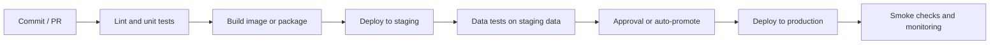

## 🎯 خلاصه

> **DataOps** نظم مهندسی نرم‌افزار را به داده می‌آورد: همه‌چیز (pipeline، جدول، زیرساخت، تنظیمات) **کد در version control** است، تغییرات **خودکار تست** می‌شوند، و استقرارها **تکرارپذیر و قابل بازگشت** هستند. ابزارها عبارت‌اند از Infrastructure as Code (Terraform، Ansible، Helm)، pipelineهای CI/CD، و کنترلرهای GitOps مثل Argo CD.

- **Infrastructure as Code (IaC)**: سرورها، شبکه‌ها، bucketها و کلاسترها را در فایل توصیف کن؛ هر بار به همان شکل اعمال شوند.
- **CI** (یکپارچه‌سازی مستمر) روی هر تغییر lint، تست واحد و تست داده اجرا می‌کند. **CD** (تحویل یا استقرار مستمر) یک artifact تست‌شده را بین محیط‌ها بالا می‌برد.
- **GitOps**: مخزن Git منبع حقیقت است؛ یک کنترلر کلاستر را با آن هم‌خوان می‌کند.
- در داده، «استقرار» فقط کد نیست: یک **تغییر schema**، **جابه‌جایی جدول** یا **backfill** می‌تواند مصرف‌کننده‌ها را بشکند. تست و استراتژی استقرار باید داده را هم پوشش بدهند.
- الگوی **blue/green** برای جدول یعنی ساختن نسخه‌ی جدید کنار نسخه‌ی قدیمی و جابه‌جایی atomic خواننده‌ها.

## 🌱 از ساده شروع کنیم (مبتدی)

> **💡 تشبیه:** آشپزخانه‌ی یک رستوران. دستورپخت‌ها نوشته شده‌اند (کد در Git)، هر غذای جدید قبل از رسیدن به مشتری چشیده می‌شود (تست در CI)، و غذای جدید اول روی یک میز آزمایشی می‌رود (staging). اگر غذایی خراب شد، دستورپخت قبلی هنوز در قفسه است (rollback).

بدون DataOps، داستان معمولی این است: کسی فایل SQL را مستقیم روی سرور production ویرایش می‌کند، هیچ‌کس نمی‌داند کدام نسخه زنده است، pipeline با یک ستون گم‌شده اجرا می‌شود، و داشبورد یک روز کامل صفر نشان می‌دهد. با DataOps:

1. تغییر یک **pull request** است که فرد دیگری بازبینی می‌کند.
2. **CI** روی یک دیتاست کوچک، linter و تست‌های SQL را اجرا می‌کند.
3. بعد از merge، همان artifact به **staging** و بعد به **production** می‌رود.
4. هر نسخه به یک commit قابل ردیابی است، پس rollback یعنی «commit قبلی را مستقر کن».

یک workflow ساده‌ی CI برای مخزنی با تبدیل‌های SQL و تست‌های پایتون (نحو GitHub Actions):

```yaml
name: data-ci
on:
  pull_request:
    branches: [main]

jobs:
  test:
    runs-on: ubuntu-latest
    steps:
      - uses: actions/checkout@v4
      - uses: actions/setup-python@v5
        with:
          python-version: "3.12"
      - run: pip install -r requirements-dev.txt
      - name: Lint SQL
        run: sqlfluff lint models/ --dialect postgres
      - name: Unit tests
        run: pytest tests/unit -q
```

این workflow عمداً کوتاه است. کارش این است که تغییرات خراب را قبل از رسیدن به محیط‌های مشترک متوقف کند.

## 🔧 واقعاً چطور کار می‌کند (متوسط)

### Infrastructure as Code

| ابزار | چه چیزی را مدیریت می‌کند | کاربرد معمول در پلتفرم داده |
|---|---|---|
| Terraform | منابع ابری یا data center به صورت declarative (VM، شبکه، bucket، سرویس‌های مدیریت‌شده) | ساختن bucketهای object storage، نقش‌های IAM، یک کلاستر Kubernetes |
| Ansible | پیکربندی ماشین‌ها (پکیج، فایل، سرویس) با playbook | نصب Java، پیکربندی Kafka یا Hadoop روی میزبان‌های bare metal |
| Helm | بسته‌های manifestهای Kubernetes با پارامتر (chart) | نصب Airflow، Spark Operator یا یک stack مانیتورینگ با فایل values |

Terraform یک مرحله‌ی **plan** دارد: قبل از اعمال نشان می‌دهد چه چیزی تغییر می‌کند. state را در یک backend راه‌دور با قفل نگه دار تا دو نفر همزمان اعمال نکنند.

```hcl
resource "aws_s3_bucket" "raw_events" {
  bucket = "acme-raw-events-${var.environment}"
}

resource "aws_s3_bucket_versioning" "raw_events" {
  bucket = aws_s3_bucket.raw_events.id
  versioning_configuration {
    status = "Enabled"
  }
}
```

در محیط on-premises همان نقش را یک provider مربوط به پلتفرم مجازی‌سازی شما، یا roleهای Ansible برای سرورها بازی می‌کند. اصل یکی است: هیچ کلیک دستی که قابل تکرار نباشد.

### مراحل CI/CD برای داده

یک pipeline مفید این گیت‌ها را به ترتیب دارد:



- **Lint و تست واحد**: استایل SQL، منطق پایتون روی ورودی‌های کوچک در حافظه. سریع، روی هر commit.
- **تست داده**: تعداد ردیف، یکتایی، not-null، بررسی ارجاع و تازگی داده، روی داده‌ی staging. تست‌های dbt یا چارچوبی مثل Great Expectations این‌ها را بیان می‌کنند. به [[data-quality]] نگاه کن.
- **بررسی سلامت (smoke)**: بعد از استقرار، بررسی کن که DAG ثبت شده، جدول وجود دارد و اولین اجرا تمام شده.

### محیط‌های staging و داده

محیط کد آسان است: همان image را با تنظیمات دیگر اجرا کن. محیط داده سخت‌تر است. گزینه‌ها:

- **داده‌ی نمونه‌برداری‌شده‌ی staging**: یک نمونه‌ی قطعی (مثلاً همه‌ی ردیف‌های ۱٪ از user IDها) تا join ها هنوز کار کنند.
- **داده‌ی مصنوعی**: fixtureهای تولیدشده که حالت‌های مرزی را پوشش می‌دهند (null، تکراری، رویداد دیرهنگام).
- **branching**: بعضی فرمت‌های جدول و warehouseها می‌توانند یک جدول را branch کنند یا zero-copy clone بسازند، پس تغییر روی یک snapshot از production اجرا می‌شود.

هرگز یک تبدیل تست‌نشده را روی جدول production اجرا نکن فقط چون ساختن داده‌ی staging سخت است. از محیطی که وجود دارد استفاده کن و بگو چه چیزی را پوشش نمی‌دهد.

### استقرار DAG و SQL

orchestratorهایی مثل Airflow فایل‌های DAG را از یک پوشه بارگذاری می‌کنند. الگوهای رایج:

- پوشه‌ی DAG را در هر merge از Git همگام کن (یک sidecar مثل git-sync یا یک job استقرار).
- DAG و وابستگی‌هایش را در یک image کانتینری بسته‌بندی کن و نسخه‌ی جدید image را پخش کن. این کار کد در حال اجرا را با artifact تست‌شده یکی می‌کند.
- اطلاعات اتصال را از فایل DAG بیرون نگه دار. از connection store یا secret backend خود orchestrator استفاده کن.

### GitOps با Argo CD

در GitOps، حالت مطلوب کلاستر (Deployment، StatefulSet، release های Helm، values مربوط به Airflow) در Git است. Argo CD کلاستر زنده را با Git مقایسه می‌کند و تفاوت را همگام می‌کند. مزایا: هر تغییر یک commit است، drift تشخیص داده می‌شود، و rollback یعنی `git revert`. trade-off: رفع اضطراری هم باید از Git رد شود، وگرنه همگام‌سازی بعدی آن را بازنویسی می‌کند.

### blue/green برای جدول‌ها

جدول سرویس نیست، پس blue/green متفاوت کار می‌کند:

1. نسخه‌ی جدید را در یک **جدول جدید** (`sales_daily_v2`) با منطق جدید و از همان منابع بساز.
2. اعتبارسنجی کن: تعداد، جمع روزانه، و مقایسه‌ی `v1` و `v2` روی نمونه‌ای از کلیدها.
3. خواننده‌ها را **atomic جابه‌جا** کن: یک view به نام `sales_daily` به `v2` اشاره کند، یا یک فرمت جدول branch یا tag را عوض کند.
4. `v1` را برای یک بازه‌ی rollback نگه دار، بعد حذفش کن.

```sql
-- جابه‌جایی atomic خواننده‌ها با یک view (بیشتر موتورها CREATE OR REPLACE VIEW را دارند).
CREATE OR REPLACE VIEW analytics.sales_daily AS
SELECT * FROM analytics.sales_daily_v2;
```

برای تغییرات schema که سازگاری را می‌شکنند، view نام پایدار را برای مصرف‌کننده‌ها نگه می‌دارد، در حالی که جدول فیزیکی تغییر می‌کند. جابه‌جایی فقط برای خواننده‌هایی atomic است که از view می‌خوانند؛ jobی که قبلاً شروع به خواندن `v1` کرده همان snapshot را نگه می‌دارد. معنای دقیق را در موتور خودت بررسی کن.

## 🧠 عمق و trade-offها (سنیور)

- **migration داده به طور پیش‌فرض برگشت‌پذیر نیست.** حذف ستون یعنی از دست دادن داده. از expand و contract استفاده کن: ستون جدید را اضافه کن، backfill و dual-write انجام بده، خواننده‌ها را جابه‌جا کن، و ستون قدیمی را در یک release بعدی حذف کن. این کندتر است، ولی همان چیزی است که rollback را ممکن نگه می‌دارد.
- **jobهای استقرار idempotent.** اجرای دوباره‌ی یک deploy باید سیستم را در همان وضعیت بگذارد. این برای retry بعد از شکست نیمه‌کاره مهم است. با loadهای idempotent جفت کن (به [[dedup-idempotent-loads]] نگاه کن).
- **هرم تست برای داده.** تست‌های واحد زیاد و سریع روی تبدیل‌ها، چند تست contract روی schemaها، و چند اجرای end-to-end روی داده‌ی staging. تست‌های end-to-end روی staging اگر به منابع زنده وابسته باشند کند و ناپایدارند؛ منابع را در مرز سیستم mock کن.
- **ارتقا بدون ساختن دوباره.** artifact را یک بار بساز و همان image یا package را به هر محیط ببر. ساختن دوباره برای هر محیط اجازه می‌دهد production کدی را اجرا کند که هیچ‌کس تست نکرده.
- **secretها و تنظیمات.** تنظیمات بین محیط‌ها فرق دارند، کد نه. آن‌ها را از طریق متغیر محیطی یا secret manager تزریق کن. هرگز رمز production را داخل image staging نگذار.
- **شعاع انفجار (blast radius).** هر استقرار را به یک domain یا یک گروه DAG محدود کن، و از feature flag یا namespace تیمی استفاده کن. یک pipeline که همه‌چیز را یکجا مستقر می‌کند، rollback را یک رویداد هماهنگ‌شده‌ی بزرگ می‌کند.
- **drift و تغییرات دستی.** هر تغییر دستی در کنسول drift است. Terraform plan یا Argo CD diff باید آن را نشان دهند؛ تشخیص drift را زمان‌بندی کن و drift توضیح‌نشده را یک حادثه بدان.
- **هزینه‌ی محیط‌ها.** هر محیط اضافه compute و storage هزینه دارد. staging را کوچک نگه دار ولی آن‌قدر نماینده که مشکلات schema و حجم را بگیرد (مثلاً نمونه‌ی ۲٪ برای تست کارایی، skew را نشان نمی‌دهد).
- **اندازه‌گیری تحویل.** زمان از merge تا production، نرخ شکست تغییرات و زمان بازیابی را رصد کن. این معیارهای استاندارد DevOps هستند و روی پلتفرم داده هم صدق می‌کنند.

> **⚠️ مراقب باش:** یک اجرای سبز CI ثابت می‌کند کد روی داده‌ی تست کار می‌کند، نه اینکه اعداد production درست‌اند. بررسی‌های استقرار را با بررسی‌های داده در production جفت کن، و وقتی تعداد ردیف، تازگی یا شاخص‌های کلیدی از محدوده‌ی عادی خارج شدند هشدار بده.

## 🧪 امتحان کن

به Git، Python 3.12 و `pytest` (یا هر test runner دیگر) نیاز داری.

1. یک تابع پایتون کوچک `daily_revenue(rows)` بنویس که ستون `amount` را بر اساس `day` جمع می‌کند و ردیف‌هایی که `amount` آن‌ها `None` است را نادیده می‌گیرد. دو تست واحد بنویس: یکی با ردیف‌های عادی، یکی با مقدار `None`. YAML بخش مبتدی را در `.github/workflows/data-ci.yml` بگذار (مراحل را با ابزارهای خودت تطبیق بده) و توضیح بده اگر تابع را خراب کنی کدام مرحله شکست می‌خورد.
2. یک جابه‌جایی blue/green برای جدول `sales_daily` بنویس. مرحله‌به‌مرحله توضیح بده قبل از جابه‌جایی چطور `sales_daily_v2` را اعتبارسنجی می‌کنی، و اگر بعد از جابه‌جایی داشبورد صفر نشان داد چه چیزی را چک می‌کنی.
3. در سه جمله توضیح بده چرا `git revert` برای کد rollback است، ولی برای داده همیشه نیست، و expand و contract در این مورد چه تغییری می‌دهد.

<details><summary>جواب‌ها را نشان بده</summary>

**۱.** یک نسخه‌ی درست:

```python
from collections import defaultdict

def daily_revenue(rows):
    totals = defaultdict(float)
    for row in rows:
        if row["amount"] is None:
            continue
        totals[row["day"]] += row["amount"]
    return dict(totals)
```

اگر `continue` را بدون محافظ حذف کنی، تست `None` با `TypeError` شکست می‌خورد و مرحله‌ی `pytest` در CI fail می‌شود و merge متوقف می‌شود.

**۲.** تعداد و جمع هر روز و مقایسه‌ی نمونه‌ای از کلیدها بین `v1` و `v2` را بررسی کن؛ null و تازگی را هم چک کن. view را جابه‌جا کن. اگر داشبورد صفر نشان داد، ببین view به جدول جدید اشاره می‌کند یا نه، جدول جدید برای تاریخ‌های خواسته‌شده پر است یا نه، و داشبورد نتایج قبل از جابه‌جایی را cache نکرده باشد.

**۳.** `git revert` کد قدیمی را برمی‌گرداند، پس اجرای بعدی منطق قدیمی را استفاده می‌کند. ولی اگر اجرای بد از قبل داده‌ی ناقص نوشته باشد، یا یک migration ستونی را حذف کرده باشد، revert کد داده را برنمی‌گرداند. expand و contract ستون قدیمی را تا وقتی خواننده‌ها جابه‌جا شوند نگه می‌دارد، پس rollback کد امن می‌ماند.

</details>

## 💬 گوشه‌ی مصاحبه

**سؤال: «تغییری را در یک pipeline داده چطور امن مستقر می‌کنی؟»**

- **جواب متوسط:** «از طریق pull request، با تست واحد در CI، استقرار در staging و بعد production. برای rollback، commit قبلی را دوباره مستقر می‌کنم.»
- **جواب سنیور:** «استقرار کد را از استقرار داده جدا می‌کنم. کد از CI و ارتقای یک artifact تغییرناپذیر می‌گذرد. تغییرات داده از expand و contract، جدول‌های blue/green، و backfillهای idempotent و تست‌شده روی نمونه استفاده می‌کنند. قبل از merge سازگاری schema با مصرف‌کننده‌ها را بررسی می‌کنم، و بعد از rollout تعداد ردیف و تازگی را رصد می‌کنم، چون rollback کد داده‌ی بدی را که نوشته شده پاک نمی‌کند.»

**سؤال: «GitOps چیست؟»** Git حالت مطلوب زیرساخت و اپلیکیشن‌ها را نگه می‌دارد؛ یک کنترلر سیستم زنده را با آن هم‌خوان می‌کند، و drift قابل دیدن و قابل برگشت است.

> **🎤 این را در مصاحبه بگو:** «pipeline و زیرساخت را کد نسخه‌بندی‌شده می‌دانم، یک artifact می‌سازم و ارتقایش می‌دهم، و هم کد و هم داده را تست می‌کنم. برای جدول‌ها از blue/green و expand و contract استفاده می‌کنم، چون rollback کد به تنهایی داده‌ای را که از قبل نوشته شده درست نمی‌کند.»

## ⚠️ اشتباهات رایج

> **⚠️ مراقب باش:** ویرایش مستقیم SQL یا فایل‌های DAG روی سرور production. استقرار بعدی اصلاح را بی‌صدا بازنویسی می‌کند، یا اصلاح اصلاً در Git نیست.

- ساختن دوباره‌ی image برای هر محیط، طوری که production کد تست‌نشده اجرا کند.
- نگه داشتن اطلاعات ورود در Git، لاگ CI یا فایل DAG.
- تست فقط کد (تست واحد) و هرگز تست داده (تعداد، null، یکتایی، تازگی).
- حذف یک ستون در همان release که دیگر استفاده نمی‌شود، که مسیر rollback را از بین می‌برد.
- اجرای backfill در حین استقرار بدون بررسی idempotent بودن job.
- فرض اینکه داده‌ی staging مشابه production است بدون بررسی حجم، skew یا توزیع کلیدها.
- اعمال Terraform بدون بازبینی plan، یا اعمال همزمان توسط دو نفر بدون قفل state.

## ✅ خودت را بسنج

1. هدف اصلی مرحله‌ی plan در Terraform چیست؟
   - A) اجرای تست‌ها
   - B) نشان دادن اینکه قبل از اعمال هر چیزی چه تغییر می‌کند
   - C) ساختن image داکر
   - D) حذف منابع استفاده‌نشده

<details><summary>جواب</summary>

**B** — plan یک اجرای آزمایشی است. create، update و delete را نشان می‌دهد تا بازبین قبل از وقوع تغییر آن را تأیید کند.

</details>

2. یک pipeline CI برای staging و production هر دو از یک commit، دو image جدید می‌سازد. چرا این ریسک است؟
   - A) فقط هزینه‌ی storage دو برابر می‌شود
   - B) دو build می‌توانند متفاوت باشند (drift وابستگی، زمان‌ها)، پس production ممکن است artifactی را اجرا کند که staging هرگز تست نکرده
   - C) image ها را نمی‌شود دو بار ساخت
   - D) production همیشه باید image قدیمی‌تر را استفاده کند

<details><summary>جواب</summary>

**B** — یک artifact تغییرناپذیر را در محیط‌ها ارتقا بده. ساختن دوباره، ارتباط بین آنچه تست شده و آنچه اجرا می‌شود را می‌شکند.

</details>

3. می‌خواهی نام ستونی را که ۲۰ داشبورد استفاده می‌کنند بدون قطعی عوض کنی. کدام ترتیب امن‌تر است؟
   - A) در یک release تغییر نام بده و داشبوردها را بعداً درست کن
   - B) ستون جدید را اضافه کن، dual-write و backfill کن، خواننده‌ها را منتقل کن، و ستون قدیمی را در یک release بعدی حذف کن
   - C) ستون قدیمی را حذف کن و بگذار داشبوردها دوباره بسازندش
   - D) فقط در staging تغییر نام بده

<details><summary>جواب</summary>

**B** — expand و contract باعث می‌شود هر دو نام در طول مهاجرت معتبر بمانند، و rollback تا زمان جابه‌جایی آخرین خواننده ممکن باشد.

</details>

4. **(سنیور)** یک استقرار اجرا شد، CI سبز بود، و صبح بعد یک داشبورد درآمد نصف مقدار معمول را نشان می‌دهد. rollback کد مشکل را حل نکرد. ترتیب بررسی تو چیست؟
   - A) همان commit را دوباره مستقر کن و امیدوار باش
   - B) بررسی کن اجرای بد داده‌ی ناقص نوشته یا نه، جابه‌جایی یا backfill idempotent بوده یا نه، کدام partitionها تحت تأثیرند؛ سپس آن‌ها را به‌صورت idempotent ترمیم کن و تست داده‌ای که افت را می‌گرفت اضافه کن
   - C) داشبورد را حذف کن
   - D) اندازه‌ی کلاستر را زیاد کن

<details><summary>جواب</summary>

**B** — rollback کد داده‌ای را که اجرای بد نوشته برنمی‌گرداند. آسیب را محدود کن، partitionهای تحت تأثیر را idempotent ترمیم کن، و تستی که جلوی آن را می‌گرفت اضافه کن تا استقرار بعدی متوقف شود.

</details>

5. **(سنیور)** چرا کنترلرهای GitOps مثل Argo CD مفیدند، و ریسک عملیاتی اصلی آن‌ها چیست؟
   - A) تست‌ها را غیرضروری می‌کنند؛ ریسک آن‌ها هزینه است
   - B) کلاستر را با Git هم‌خوان نگه می‌دارند، تغییرات را قابل بازبینی و rollback را یک revert می‌کنند؛ ریسک این است که تغییرات دستی اضطراری بازنویسی می‌شوند، مگر اینکه آن‌ها هم از Git رد شوند
   - C) جای Kubernetes را می‌گیرند؛ ریسک آن‌ها تداخل نسخه با Docker است
   - D) فقط با Terraform کار می‌کنند

<details><summary>جواب</summary>

**B** — همگام‌سازی قابلیت ممیزی و تشخیص drift می‌دهد. تله‌ی عملیاتی تغییرات دستی است: کنترلر آن‌ها را برمی‌گرداند، پس اصلاحات اضطراری باید commit شوند.

</details>

## 🗂️ فلش‌کارت

| Front | Back |
|---|---|
| DataOps | اعمال نظم مهندسی نرم‌افزار به داده: کد نسخه‌بندی‌شده، تست خودکار، استقرار تکرارپذیر |
| IaC | توصیف زیرساخت در فایل‌هایی که هر بار به یک شکل اعمال می‌شوند |
| Terraform plan | یک اجرای آزمایشی که قبل از apply نشان می‌دهد چه چیزی تغییر می‌کند |
| CI در برابر CD | CI: ساخت و تست هر تغییر؛ CD: ارتقای یک artifact تست‌شده بین محیط‌ها |
| چرا یک artifact را ارتقا بدهیم | ساختن دوباره برای هر محیط ممکن است کدی را اجرا کند که هرگز تست نشده |
| GitOps | Git منبع حقیقت است؛ یک کنترلر کلاستر را با آن هم‌خوان می‌کند |
| blue/green برای جدول | جدول جدید را کنار قدیمی بساز، اعتبارسنجی کن، سپس خواننده‌ها را atomic جابه‌جا کن |
| Expand و contract | ساختار جدید را اضافه کن، مهاجرت کن، خواننده‌ها را منتقل کن، و ساختار قدیمی را در یک release بعدی حذف کن |

## 🔗 ادامه

- **[[docker]]** توضیح می‌دهد image هایی که CI/CD ارتقا می‌دهد چطور ساخته می‌شوند.
- **[[kubernetes-for-data]]** کلاسترهایی را پوشش می‌دهد که GitOps و Helm مدیریت می‌کنند.
- **[[data-quality]]** تست‌های داده‌ای را توضیح می‌دهد که باید در گیت استقرار باشند.
- **[[dbt]]** و **[[airflow]]** نشان می‌دهند مدل‌های SQL و DAGها در عمل چطور تست و مستقر می‌شوند.
- **[[git-workflow]]** شاخه‌بندی و عادت‌های بازبینی پشت جریان pull request را پوشش می‌دهد.
- **[[onprem-iran]]** mirrorهای داخلی برای پکیج و image را بررسی می‌کند، چیزی که pipelineهای CI وقتی به registryهای عمومی نمی‌رسند به آن وابسته‌اند.
- مستندات Terraform، Argo CD و سیستم CI خودت را برای نحو دقیق نسخه‌ای که استفاده می‌کنی بخوان.

