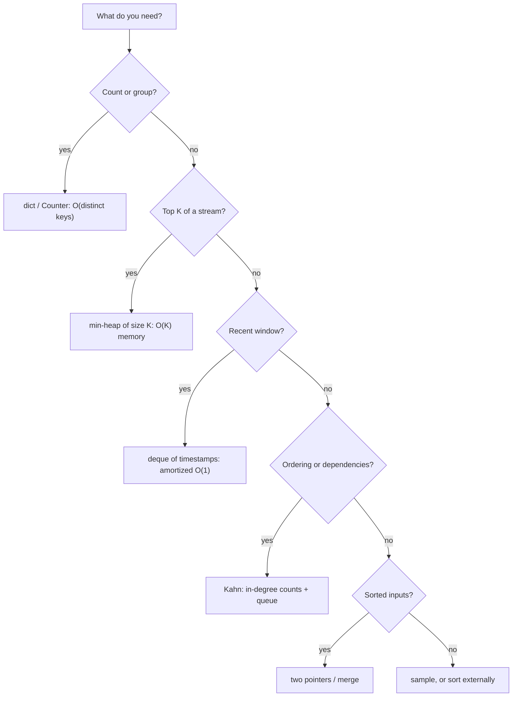

## 🎯 خلاصه

> مصاحبه‌های کدنویسی داده **تفکر استریمی** را جایزه می‌دهند: رکوردها را یکی‌یکی پردازش کن، فقط وضعیت لازم را نگه دار، و بگو آن وضعیت چه هزینه‌ای دارد.

- بیشتر مسائل داده به چند الگو برمی‌گردند: تجمیع با hash-map، heap برای top-K، deque برای پنجره‌ی لغزان، merge با دو اشاره‌گر، ترتیب‌دهی وابستگی‌ها، و reservoir sampling.
- اول سه سؤال بپرس: ورودی کران‌دار است یا استریم؟ وضعیت در حافظه جا می‌شود؟ ورودی از قبل مرتب است؟ جواب‌ها الگوریتم را انتخاب می‌کنند.
- همیشه زمان و حافظه را بگو، بعد توضیح بده که همین ایده وقتی داده روی ماشین‌های زیادی پخش شده چه تغییری می‌کند.

## 🌱 از ساده شروع کنیم (مبتدی)

> **💡 تشبیه:** یک آشپزخانه‌ی شلوغ را تصور کن. هیچ‌کس همه‌ی سفارش‌ها را نگه نمی‌دارد و آخر شب مرتبشان نمی‌کند. آشپز روی یک دفترچه شمارش می‌کند (counting)، فهرست کوتاهی از پرفروش‌ترین غذاها نگه می‌دارد (top-K)، و برای هر میز تایمر دارد (پنجره). هر ابزار فقط چیزی را نگه می‌دارد که تصمیم بعدی به آن نیاز دارد.

قبل از نوشتن کد این سه سؤال را بپرس:

1. **کران‌دار یا استریم؟** می‌توانی ورودی را دو بار بخوانی، یا لاگی است که هرگز تمام نمی‌شود؟
2. **وضعیت در حافظه جا می‌شود؟** دیکشنری از ۱۰٬۰۰۰ شناسه‌ی کاربر اشکالی ندارد. دیکشنری از یک میلیارد شناسه ندارد.
3. **از قبل مرتب است؟** ورودی مرتب اجازه می‌دهد با حافظه‌ی تقریباً صفر merge و اسکن با دو اشاره‌گر انجام دهی.

یک گرم‌کن که حرکت اصلی را نشان می‌دهد (یک گذر، یک دیکشنری از شمارش‌ها):

```python
from collections import Counter

events = ["click", "view", "click", "buy", "click"]
counts = Counter(events)          # one pass; memory grows with distinct keys
print(counts.most_common(2))      # [('click', 3), ('view', 1)]
```

هر مسئله‌ی این درس نسخه‌ای از همین پرسش است: چطور این داده را بدون نگه‌داشتن همه‌چیز در یک لحظه بشمارم، رتبه‌بندی کنم، گروه‌بندی کنم یا مرتب کنم؟

## 🔧 واقعاً چطور کار می‌کند (متوسط)

هر الگو به یک ساختار داده‌ی استاندارد وصل است. بر اساس سؤالی که جواب می‌دهی انتخابش کن:



مکانیزم‌های پشت تمرین‌ها:

- **Heap به اندازه‌ی K.** یک min-heap از K آیتم بزرگ‌تری نگه می‌داری که تا الان دیده‌ای. آیتم جدید فقط وقتی وارد می‌شود که از کوچک‌ترین آیتم نگه‌داشته‌شده بزرگ‌تر باشد. هر درج O(log K) هزینه دارد، نه O(log n).
- **پنجره‌ی لغزان با deque.** زمان‌های جدید را از راست اضافه و زمان‌های منقضی را از چپ حذف می‌کنی. هر عنصر یک بار وارد و یک بار خارج می‌شود، پس هزینه‌ی سرشکنی‌شده برای هر رویداد O(1) است.
- **merge اجرای‌های مرتب.** دو ورودی‌ی مرتب با دو اشاره‌گر join می‌شوند. حافظه به اندازه‌ی یک بلوک کلید‌های برابر است، نه کل ورودی. external sort و sort-merge join همین ایده را دارند.
- **الگوریتم Kahn.** جاب‌هایی که والد تمام‌نشده ندارند وارد صف می‌شوند. وقتی یک جاب تمام می‌شود، شمارش فرزندانش یکی کم می‌شود. اگر خروجی کمتر از ورودی باشد، گراف چرخه دارد.
- **Reservoir sampling.** اولین k آیتم را نگه دار. آیتم i ام (از صفر شمرده، i ≥ k) با احتمال k/(i+1) یک خانه‌ی تصادفی از نمونه را جایگزین می‌کند. در یک گذر، هر آیتم با احتمال k/n در نمونه قرار می‌گیرد.

| الگو | مسائل |
|---|---|
| تجمیع با hash-map | ۱، ۸، ۱۳ |
| flatten بازگشتی / اعتبارسنجی schema | ۲، ۱۲ |
| مرتب کن، بعد اسکن کن | ۳، ۱۰، ۱۳ |
| Heap | ۴ |
| deque / پنجره‌ی لغزان با انقضا | ۵، ۶ |
| cache با حذف | ۷ |
| شبیه‌سازی map-reduce | ۸ |
| ترتیب وابستگی‌ها | ۹، ۱۴ |
| Reservoir sampling | ۱۱ |

## 🧠 عمق و trade-offها (سنیور)

- **حافظه محدودیت واقعی است.** یک `Counter` در حافظه هزینه‌اش O(distinct keys) است. وقتی کلیدها بی‌کران‌اند (شناسه‌ی سشن، IP کلاینت)، به ساختارهای تقریبی برو: Count-Min Sketch همراه با heap برای top-K، یا [[hyperloglog]] برای شمارش مقادیر یکتا. کران خطایی که می‌پذیری را صریح بگو.
- **مرتب‌سازی یعنی shuffle.** نسخه‌ی Spark مسئله‌ی ۱۳ یعنی `lag` روی یک window که بر اساس کاربر پارتیشن شده و بر اساس زمان مرتب شده. کلید پارتیشن هم واحد موازی‌سازی است و هم واحد skew: یک کاربر ربات‌مانند می‌شود یک تسک کند (بخش [[data-skew]] را ببین).
- **وضعیت استریم به انقضا نیاز دارد.** مسائل ۶ و ۷ همان ایده‌ی نگه‌داری state در Flink یا Structured Streaming هستند. بدون TTL، state بی‌پایان رشد می‌کند. یک [[watermark]] به تو می‌گوید کی امن است کلیدهای قدیمی را فراموش کنی.
- **retry به نوشتن idempotent نیاز دارد.** مسئله‌ی ۱۴ کار شکست‌خورده را دوباره اجرا می‌کند. retry یک load غیر idempotent ردیف‌ها را تکراری می‌کند. اول نوشتن را idempotent کن (overwrite یک پارتیشن، یا `MERGE` بر اساس کلید)، بعد retry کن. بخش [[idempotency]] را ببین.
- **رکورد بد را مسیریابی کن، خرابش نکن.** مسئله‌ی ۱۲ ردیف‌های رد شده را به یک sink جدا می‌فرستد (بخش [[dead-letter-queue]]). یک رکورد بد کل pipeline را متوقف نمی‌کند و ردیف‌های رد شده قابل بازرسی و replay هستند.
- **سیستم‌های production را خودت از صفر نساز.** در production از `heapq`، sort موتور و یک orchestrator مثل [[airflow]] استفاده کن. مصاحبه می‌سنجد که درباره‌ی ساختار استدلال می‌کنی، نه اینکه بتوانی یک orchestrator را بازسازی کنی.

## 🧪 امتحان کن

قبل از باز کردن hint هر مسئله، خودت حلش کن. هر راه‌حل یک پایتون مستقل با Python 3.10+ و assert است؛ می‌توانی آن را در یک فایل بچسبانی و اجرا کنی.

### ۱. Parse & aggregate log lines

**مسئله:** هر خط به شکل `timestamp path status latency_ms` است. تعداد درخواست و میانگین latency را برای هر path بشمار و خطوط نامعتبر را جدا بشمار. فایل ممکن است خیلی بزرگ باشد، پس آن را به صورت استریم بخوان.

<details><summary>Hint</summary>

هر خط را یک بار split کن. یک dict با کلید path نگه دار که `[count, total_ms]` را ذخیره کند. هرگز لیست همه‌ی خطوط را نساز.

</details>

<details><summary>Solution</summary>

```python
from collections import defaultdict

def aggregate(lines):
    stats = defaultdict(lambda: [0, 0])     # path -> [count, total_ms]
    bad = 0
    for line in lines:
        parts = line.split()
        if len(parts) != 4 or not parts[3].isdigit():
            bad += 1
            continue
        _, path, _status, ms = parts
        stats[path][0] += 1
        stats[path][1] += int(ms)
    return {p: (c, t / c) for p, (c, t) in stats.items()}, bad

logs = [
    "2026-01-01T10:00:00 /home 200 120",
    "2026-01-01T10:00:01 /home 500 80",
    "garbage",
    "2026-01-01T10:00:02 /cart 200 50",
]
result, bad = aggregate(logs)
assert result == {"/home": (2, 100.0), "/cart": (1, 50.0)} and bad == 1
```

**پیچیدگی:** زمان O(n) روی خطوط، حافظه O(distinct paths). هر iterable‌ای کار می‌کند، پس دادن یک فایل باز آن را استریم می‌کند.

</details>

### ۲. Flatten nested JSON

**مسئله:** `{"user": {"id": 7, "tags": ["a", "b"]}}` را به `{"user.id": 7, "user.tags.0": "a", "user.tags.1": "b"}` تبدیل کن.

<details><summary>Hint</summary>

بازگشتی عمل کن. برای dict، کلید والد و فرزند را با نقطه وصل کن. برای list، ایندکس را کلید بگیر. مقادیر ساده حالت پایه هستند.

</details>

<details><summary>Solution</summary>

```python
def flatten(obj, prefix=""):
    if isinstance(obj, dict):
        items = obj.items()
    elif isinstance(obj, list):
        items = ((str(i), v) for i, v in enumerate(obj))
    else:
        return {prefix: obj}
    out = {}
    for key, value in items:
        out.update(flatten(value, f"{prefix}.{key}" if prefix else str(key)))
    return out

doc = {"user": {"id": 7, "tags": ["a", "b"]}, "ok": True}
assert flatten(doc) == {"user.id": 7, "user.tags.0": "a", "user.tags.1": "b", "ok": True}
```

**پیچیدگی:** زمان O(تعداد گره‌ها × عمق) به خاطر کپی دیکشنری‌ها در `update`؛ حافظه O(خروجی). کانتینرهای خالی هیچ کلیدی تولید نمی‌کنند. اسناد خیلی عمیق ممکن است به حد بازگشت پایتون (حدود ۱٬۰۰۰ فریم) برسند، پس راه‌حل production یک stack صریح است.

</details>

### ۳. Merge overlapping time intervals

**مسئله:** بازه‌های بسته‌ی `(start, end)` را بگیر و بازه‌های جدا از هم را برگردان که همان نقاط را پوشش می‌دهند. بازه‌های مماس مثل `(1, 3)` و `(3, 5)` را همپوشان حساب کن.

<details><summary>Hint</summary>

بر اساس start مرتب کن. هر بازه‌ی جدید یا آخرین بازه‌ی merge‌شده را گسترش می‌دهد یا یک بازه‌ی تازه شروع می‌کند.

</details>

<details><summary>Solution</summary>

```python
def merge(intervals):
    merged = []
    for start, end in sorted(intervals):
        if merged and start <= merged[-1][1]:
            merged[-1][1] = max(merged[-1][1], end)
        else:
            merged.append([start, end])
    return [tuple(iv) for iv in merged]

assert merge([(1, 3), (2, 6), (8, 10), (15, 18), (17, 20)]) == [(1, 6), (8, 10), (15, 20)]
assert merge([(1, 3), (3, 5)]) == [(1, 5)]
```

**پیچیدگی:** زمان O(n log n) برای sort، حافظه O(n) برای خروجی. sort غالب است و همان هزینه‌ی shuffle و sort است که در Spark هم می‌پردازی.

</details>

### ۴. Top-K with a heap (stream)

**مسئله:** یک استریم از جفت‌های `(key, count)` داده شده. K کلیدی را که بیشترین count را دارند، از بزرگ به کوچک برگردان. حافظه باید O(K) باشد، نه O(تعداد جفت‌ها).

<details><summary>Hint</summary>

از یک min-heap به اندازه‌ی K استفاده کن. کوچک‌ترین آیتم نگه‌داشته‌شده در ریشه است، پس یک مقایسه تصمیم می‌گیرد آیتم جدید وارد شود یا نه.

</details>

<details><summary>Solution</summary>

```python
import heapq

def top_k(pairs, k):
    heap = []                                   # min-heap of (count, key), size <= k
    for key, count in pairs:
        if len(heap) < k:
            heapq.heappush(heap, (count, key))
        elif count > heap[0][0]:
            heapq.heapreplace(heap, (count, key))
    return [(key, count) for count, key in sorted(heap, reverse=True)]

pairs = [("a", 5), ("b", 9), ("c", 1), ("d", 7), ("e", 9)]
assert top_k(pairs, 2) == [("e", 9), ("b", 9)]     # ties: larger key first
assert top_k([("x", 3), ("y", 4)], 5) == [("y", 4), ("x", 3)]
```

**پیچیدگی:** زمان O(n log k)، حافظه O(k). تساوی‌ها با کلید شکسته می‌شوند، پس خروجی قطعی است. برای کلیدهایی که از قبل جمع نشده‌اند، با `Counter` بشمار (حافظه O(distinct keys)) یا با Count-Min Sketch وقتی این هم زیاد است.

</details>

### ۵. Sliding-window rate limiter

**مسئله:** به هر کاربر در هر پنجره‌ی `window` ثانیه‌ای حداکثر `limit` رویداد اجازه بده. اگر رویداد مجاز بود `True` و در غیر این صورت `False` برگردان. رویدادهای رد شده ثبت نمی‌شوند.

<details><summary>Hint</summary>

برای هر کاربر یک deque از زمان‌های مجاز نگه دار. قبل از تصمیم، زمان‌هایی را که از پنجره بیرون افتاده‌اند از چپ pop کن.

</details>

<details><summary>Solution</summary>

```python
from collections import defaultdict, deque

class SlidingWindowLimiter:
    def __init__(self, limit, window):
        self.limit, self.window = limit, window
        self.hits = defaultdict(deque)          # user -> allowed timestamps

    def allow(self, user, now):
        q = self.hits[user]
        while q and q[0] <= now - self.window:  # expired: outside (now - window, now]
            q.popleft()
        if len(q) < self.limit:
            q.append(now)
            return True
        return False

rl = SlidingWindowLimiter(limit=2, window=10)
assert [rl.allow("u", t) for t in (0, 1, 2, 10, 10)] == [True, True, False, True, False]
```

**پیچیدگی:** سرشکنی‌شده O(1) برای هر رویداد، حافظه O(limit) برای هر کاربر فعال. deque چیزی است که pop از چپ را O(1) می‌کند؛ `pop(0)` در لیست پایتون O(n) است.

</details>

### ۶. Deduplicate events with TTL

**مسئله:** جفت‌های `(timestamp, event_id)` را که به ترتیب غیرنزولی زمان آمده‌اند بگیر و هر رویدادی را که شناسه‌اش در `ttl` ثانیه‌ی اخیر دیده نشده، تحویل بده. حافظه باید به TTL وابسته باشد، نه کل استریم.

<details><summary>Hint</summary>

یک set از شناسه‌های داخل پنجره و یک deque از `(timestamp, id)` به ترتیب ورود نگه دار. قبل از هر رویداد، ورودی‌های قدیمی‌تر از TTL را از چپ deque حذف کن و شناسه‌ها را از set پاک کن.

</details>

<details><summary>Solution</summary>

```python
from collections import deque

def dedup(events, ttl):
    seen = set()          # ids currently inside the TTL window
    expiry = deque()      # (timestamp, id) in arrival order
    for ts, eid in events:
        while expiry and expiry[0][0] <= ts - ttl:
            _, old_id = expiry.popleft()
            seen.discard(old_id)
        if eid in seen:
            continue
        seen.add(eid)
        expiry.append((ts, eid))
        yield ts, eid

ev = [(0, "a"), (5, "a"), (9, "b"), (10, "a"), (12, "a")]
assert list(dedup(ev, ttl=10)) == [(0, "a"), (9, "b"), (10, "a")]
```

**پیچیدگی:** سرشکنی‌شده O(1) برای هر رویداد، حافظه O(رویدادهای داخل یک TTL). ساعت TTL از اولین دیدن شروع می‌شود: یک تکرار پنجره را طولانی‌تر نمی‌کند. توجه کن که یک job در Flink یا Spark همین کار را با keyed state و timer انجام می‌دهد، یعنی همین منطق با checkpoint.

</details>

### ۷. LRU / TTL cache

**مسئله:** یک cache با `get(key, now)` و `put(key, value, now)` بساز. حداکثر `capacity` ورودی نگه می‌دارد، وقتی پر است کم‌استفاده‌ترین را حذف می‌کند، و بعد از `ttl` ثانیه ورودی را مفقود حساب می‌کند.

<details><summary>Hint</summary>

`OrderedDict` ترتیب درج را نگه می‌دارد و `move_to_end` و `popitem(last=False)` دارد. مقدار را `(value, expires_at)` ذخیره کن. انقضا را موقع `get` چک کن.

</details>

<details><summary>Solution</summary>

```python
from collections import OrderedDict

class LRUTTLCache:
    def __init__(self, capacity, ttl):
        self.capacity, self.ttl = capacity, ttl
        self.data = OrderedDict()           # key -> (value, expires_at), LRU first

    def get(self, key, now):
        if key not in self.data:
            return None
        value, expires_at = self.data[key]
        if now >= expires_at:
            del self.data[key]
            return None
        self.data.move_to_end(key)          # now the most recently used
        return value

    def put(self, key, value, now):
        self.data[key] = (value, now + self.ttl)
        self.data.move_to_end(key)
        if len(self.data) > self.capacity:
            self.data.popitem(last=False)   # evict least recently used

c = LRUTTLCache(capacity=2, ttl=10)
c.put("a", 1, now=0)
c.put("b", 2, now=1)
assert c.get("a", now=2) == 1               # a is now most recent
c.put("c", 3, now=3)                        # evicts b
assert c.get("b", now=3) is None and c.get("c", now=3) == 3
assert c.get("a", now=12) is None           # a expired at t=10
```

**پیچیدگی:** O(1) برای هر get و put. ورودی‌های منقضی‌ای که هرگز خوانده نمی‌شوند تا رسیدن به انتهای LRU می‌مانند، پس cache واقعی یک sweep دوره‌ای هم اضافه می‌کند.

</details>

### ۸. Map-reduce word count

**مسئله:** تعداد کلمات را در خطوط زیاد با فازهای صریح map، shuffle (گروه‌بندی بر اساس کلید) و reduce بشمار. حروف بزرگ و کوچک مهم نیستند و کلمات با فاصله‌ی سفید جدا می‌شوند.

<details><summary>Hint</summary>

map جفت‌های `(word, 1)` تولید می‌کند. shuffle مقادیر را بر اساس کلید گروه می‌کند. reduce هر گروه را جمع می‌زند. هر سه فاز را تابع جدا نگه دار تا هرکدام را جداگانه بتوان موازی کرد.

</details>

<details><summary>Solution</summary>

```python
def map_phase(line):
    return [(word, 1) for word in line.lower().split()]

def shuffle(pairs):
    groups = {}
    for key, value in pairs:
        groups.setdefault(key, []).append(value)
    return groups

def reduce_phase(groups):
    return {key: sum(values) for key, values in groups.items()}

lines = ["Data is big", "big data big pipelines"]
pairs = [pair for line in lines for pair in map_phase(line)]
assert reduce_phase(shuffle(pairs)) == {"data": 2, "is": 1, "big": 3, "pipelines": 1}
```

**پیچیدگی:** زمان O(کل کلمات)، حافظه‌ی shuffle O(distinct words). یک combiner (جمع‌زدن در هر mapper قبل از shuffle) داده‌ی منتقل‌شده در شبکه را کم می‌کند؛ اینجا معتبر است چون جمع شرکت‌پذیر است.

</details>

### ۹. Topological sort of job dependencies

**مسئله:** برای `{job: [parents]}` ترتیب اجرایی برگردان که در آن هر جاب بعد از همه‌ی والدهایش بیاید. اگر وابستگی‌ها چرخه داشتند خطا بده.

<details><summary>Hint</summary>

الگوریتم Kahn. برای هر جاب تعداد والدهای تمام‌نشده را بشمار. یک صف با جاب‌هایی که صفر دارند شروع کن. وقتی جابی خروجی داده می‌شود، شمارش فرزندانش را یکی کم کن و هر فرزندی که به صفر رسید را وارد صف کن. اگر خروجی از تعداد جاب‌ها کمتر بود، چرخه وجود دارد.

</details>

<details><summary>Solution</summary>

```python
from collections import deque

def topo_sort(deps):
    indegree, children = {}, {}
    for job, parents in deps.items():
        indegree.setdefault(job, 0)
        children.setdefault(job, [])
        for parent in parents:
            indegree.setdefault(parent, 0)
            children.setdefault(parent, []).append(job)
            indegree[job] += 1
    queue = deque(sorted(j for j, d in indegree.items() if d == 0))
    order = []
    while queue:
        job = queue.popleft()
        order.append(job)
        for child in children[job]:
            indegree[child] -= 1
            if indegree[child] == 0:
                queue.append(child)
    if len(order) != len(indegree):
        raise ValueError("cycle detected")
    return order

deps = {"load": ["clean"], "clean": ["extract"], "report": ["load", "dim"],
        "dim": ["extract"], "extract": []}
order = topo_sort(deps)
assert order.index("extract") < order.index("clean") < order.index("load") < order.index("report")
assert order.index("extract") < order.index("dim") < order.index("report")
try:
    topo_sort({"a": ["b"], "b": ["a"]})
except ValueError:
    pass
else:
    raise AssertionError("cycle not detected")
```

**پیچیدگی:** زمان O(V + E)، حافظه O(V + E). والد گم‌شده (جابی که در یک وابستگی آمده ولی تعریف نشده) به عنوان جابی بدون والد حساب می‌شود، پس تصمیم بگیر scheduler تو باید آن را رد کند یا نه.

</details>

### ۱۰. Join two large sorted files (merge join)

**مسئله:** دو iterable از جفت‌های `(key, value)` را که هر دو بر اساس کلید مرتب‌اند، بدون بارگذاری کامل هر طرف در حافظه inner join کن. کلیدهای تکراری در هر دو طرف باید همه‌ی ترکیب‌ها را تولید کنند.

<details><summary>Hint</summary>

هر دو iterator را با دو اشاره‌گر پیمایش کن. وقتی کلیدها فرق دارند، کوچک‌تری را جلو ببر. وقتی برابرند، فقط اجرای کلیدهای برابر سمت راست را بافر کن و هر ردیف برابر سمت چپ را با آن جفت کن.

</details>

<details><summary>Solution</summary>

```python
def merge_join(left, right):
    left, right = iter(left), iter(right)
    l, r = next(left, None), next(right, None)
    while l is not None and r is not None:
        if l[0] < r[0]:
            l = next(left, None)
        elif l[0] > r[0]:
            r = next(right, None)
        else:
            key = l[0]
            r_block = []
            while r is not None and r[0] == key:
                r_block.append(r[1])
                r = next(right, None)
            while l is not None and l[0] == key:
                for r_value in r_block:
                    yield key, l[1], r_value
                l = next(left, None)

left = [(1, "a"), (2, "b"), (2, "c"), (4, "d")]
right = [(2, "x"), (2, "y"), (3, "z"), (4, "w")]
assert list(merge_join(left, right)) == [
    (2, "b", "x"), (2, "b", "y"), (2, "c", "x"), (2, "c", "y"), (4, "d", "w"),
]
```

**پیچیدگی:** زمان O(n + m) به علاوه‌ی اندازه‌ی خروجی، حافظه O(بزرگ‌ترین اجرای کلید برابر در سمت راست). ورودی باید با همان کلید و همان ترتیب مرتب باشد، وگرنه join بی‌صدا ردیف‌ها را از دست می‌دهد. sort-merge join در Spark همین کار را بعد از shuffle و sort، روی هر پارتیشن انجام می‌دهد.

</details>

### ۱۱. Reservoir sampling

**مسئله:** از یک استریم که طولش از قبل معلوم نیست، یک نمونه‌ی تصادفی یکنواخت به اندازه‌ی `k` در یک گذر و با حافظه‌ی O(k) انتخاب کن.

<details><summary>Hint</summary>

reservoir را با k آیتم اول پر کن. برای آیتم با ایندکس i ≥ k یک عدد تصادفی j در بازه‌ی `[0, i]` بکش. اگر j < k بود، `sample[j]` را جایگزین کن.

</details>

<details><summary>Solution</summary>

```python
import random

def reservoir_sample(stream, k, rng=random):
    sample = []
    for i, item in enumerate(stream):
        if i < k:
            sample.append(item)
        else:
            j = rng.randint(0, i)           # inclusive on both ends
            if j < k:
                sample[j] = item
    return sample

assert reservoir_sample(range(5), 10) == [0, 1, 2, 3, 4]

rng = random.Random(42)
hits = [0] * 10
for _ in range(20000):
    hits[reservoir_sample(range(10), 1, rng)[0]] += 1
assert all(1700 < h < 2300 for h in hits)     # each value is picked about 2000 times
```

**پیچیدگی:** زمان O(n)، حافظه O(k). هر آیتم با احتمال k/n در نمونه می‌ماند. در تست‌ها از یک مولد تصادفی با seed استفاده کن تا نتایج تکرارپذیر باشند.

</details>

### ۱۲. Validate and clean CSV rows with a schema

**مسئله:** متن CSV را با یک schema به شکل `ستون -> تبدیل‌کننده` parse کن. ردیف‌های تمیز و فهرستی از ردیف‌های رد شده را همراه با شماره‌ی خط و دلیل برگردان. با اولین ردیف بد متوقف نشو.

<details><summary>Hint</summary>

از `csv.DictReader` استفاده کن و هر ستون را داخل `try` تبدیل کن. `ValueError` (مقدار بد) و `KeyError` یا `AttributeError` (ستون گم‌شده) را بگیر. خطاها را جمع کن، به جای raise کردن.

</details>

<details><summary>Solution</summary>

```python
import csv
import io
from datetime import date

SCHEMA = {"user_id": int, "amount": float, "day": date.fromisoformat}

def clean_csv(text, schema=SCHEMA):
    good, rejected = [], []
    for lineno, row in enumerate(csv.DictReader(io.StringIO(text)), start=2):
        try:
            good.append({col: cast(row[col].strip()) for col, cast in schema.items()})
        except (KeyError, ValueError, TypeError, AttributeError) as exc:
            rejected.append((lineno, str(exc), row))
    return good, rejected

data = ("user_id,amount,day\n"
        "1,9.5,2026-01-02\n"
        "x,3,2026-01-02\n"
        "2,4,2026-13-01\n"
        "3,1.25,2026-01-05\n")
good, bad = clean_csv(data)
assert good == [
    {"user_id": 1, "amount": 9.5, "day": date(2026, 1, 2)},
    {"user_id": 3, "amount": 1.25, "day": date(2026, 1, 5)},
]
assert [line for line, _, _ in bad] == [3, 4]
```

**پیچیدگی:** زمان O(ردیف × ستون)، حافظه O(ردیف) اگر نتیجه را در لیست نگه داری. برای فایل خیلی بزرگ، ردیف‌های خوب را yield کن و ردیف‌های رد شده را همان‌جا با دلیل در یک فایل بنویس. نسخه‌ی production این کار نوشتن رکوردهای رد شده در یک [[dead-letter-queue]] است.

</details>

### ۱۳. Sessions per user from a click stream

**مسئله:** رویدادهای `(user, timestamp_seconds)` را بگیر و رویدادهای هر کاربر را به سشن تقسیم کن. وقتی فاصله تا رویداد قبلی بیشتر از ۳۰ دقیقه شود، سشن جدیدی شروع می‌شود. `(user, session_no, start, end, n_events)` برگردان که شماره‌ی سشن از ۱ شروع می‌شود.

<details><summary>Hint</summary>

بر اساس کاربر و زمان مرتب کن، بعد بر اساس کاربر گروه کن. داخل هر گروه، هر timestamp را با قبلی مقایسه کن. وقتی فاصله زیاد است، سشن فعلی را ببند و یک سشن جدید باز کن.

</details>

<details><summary>Solution</summary>

```python
from itertools import groupby

GAP = 30 * 60   # seconds; a gap of exactly 30 minutes stays in the same session

def sessionize(events):
    out = []
    for user, group in groupby(sorted(events), key=lambda e: e[0]):
        session_no, start, prev, count = 0, None, None, 0
        for _, ts in group:
            if prev is None or ts - prev > GAP:
                if prev is not None:
                    out.append((user, session_no, start, prev, count))
                session_no += 1
                start, count = ts, 0
            count += 1
            prev = ts
        out.append((user, session_no, start, prev, count))
    return out

events = [("u1", 0), ("u1", 600), ("u1", 4000), ("u2", 100), ("u1", 4100)]
assert sessionize(events) == [
    ("u1", 1, 0, 600, 2),
    ("u1", 2, 4000, 4100, 2),
    ("u2", 1, 100, 100, 1),
]
```

**پیچیدگی:** زمان O(n log n) برای sort، حافظه O(n) در این نسخه. در یک job استریمی فقط آخرین timestamp و سشن باز هر کلید را نگه می‌داری؛ همان stateای که یک keyed process function در Flink نگه می‌دارد. رویدادهای دیررسیده بخش سخت ماجرا هستند؛ بخش [[sessionization]] را ببین.

</details>

### ۱۴. Mini scheduler with retries

**مسئله:** جاب‌های نام‌دار را به ترتیب وابستگی اجرا کن. هر جاب یک callable است که ممکن است خطا بدهد. یک جاب شکست‌خورده را تا `max_retries` بار دوباره امتحان کن و بین تلاش‌ها تأخیر backoff برابر ۱، ۲، ۴ ... ثانیه ثبت کن (ثبت کن، sleep نکن). اگر جابی در نهایت شکست خورد، آن را `failed` و هر چیزی که به آن وابسته است را `skipped` علامت بزن.

<details><summary>Hint</summary>

در دورهای متوالی کار کن. در هر دور، جاب‌هایی را اجرا کن که همه‌ی والدهایشان موفق بوده‌اند، و جاب‌هایی را که والدی `failed` یا `skipped` دارد رد کن. هر اجرا را در حلقه‌ی retry بگذار و از `for ... else` استفاده کن تا بفهمی همه‌ی تلاش‌ها شکست خورده‌اند.

</details>

<details><summary>Solution</summary>

```python
def run_jobs(jobs, deps, max_retries=2):
    status, delays = {}, []
    remaining = dict(jobs)
    while remaining:
        ready = [n for n in remaining
                 if all(status.get(p) == "ok" for p in deps.get(n, []))]
        for n in [n for n in remaining
                  if any(status.get(p) in ("failed", "skipped") for p in deps.get(n, []))]:
            status[n] = "skipped"
            del remaining[n]
        if not ready:
            if remaining:
                raise ValueError("cycle or missing dependency")
            break
        for n in ready:
            for attempt in range(max_retries + 1):
                try:
                    remaining[n]()
                    status[n] = "ok"
                    break
                except Exception:
                    if attempt < max_retries:
                        delays.append((n, 2 ** attempt))
            else:
                status[n] = "failed"
            del remaining[n]
    return status, delays

calls = {"n": 0}

def flaky():
    calls["n"] += 1
    if calls["n"] < 3:
        raise RuntimeError("temporary")

def always_fails():
    raise RuntimeError("permanent")

jobs = {"extract": flaky, "load": lambda: None, "bad": always_fails, "after_bad": lambda: None}
deps = {"load": ["extract"], "bad": [], "after_bad": ["bad"]}
status, delays = run_jobs(jobs, deps, max_retries=2)
assert status == {"extract": "ok", "load": "ok", "bad": "failed", "after_bad": "skipped"}
assert delays == [("extract", 1), ("extract", 2), ("bad", 1), ("bad", 2)]
```

**پیچیدگی:** زمان O(attempts × V) در این نسخه‌ی دوری ساده، حافظه O(V). scheduler های production به backoff یک jitter اضافه می‌کنند تا retryهای زیاد همزمان به منبع فشار نیاورند، و فقط خطاهای گذرا را دوباره امتحان می‌کنند. retry فقط برای taskهای idempotent امن است، همان‌طور که در بخش سنیور گفتیم.

</details>

## 💬 گوشه‌ی مصاحبه

**سؤال: «Top 10 صفحه از یک لاگ که در حافظه جا نمی‌شود.»** جواب متوسط: «شمارش برای هر صفحه در یک hash map، بعد sort و گرفتن ۱۰ تای اول.» جواب سنیور: «ورودی را بر اساس hash صفحه پارتیشن می‌کنم تا شمارش هر پارتیشن در حافظه جا بشود، برای هر پارتیشن یک heap به اندازه‌ی ۱۰ نگه می‌دارم، و بعد heapها را merge می‌کنم. در Spark این می‌شود `groupBy` و `orderBy` همراه با `limit`، و هزینه‌ی اصلی shuffle است که باید اسمش را ببری.»

**سؤال: «کلیک‌ها را با فاصله‌ی بی‌فعالیتی ۳۰ دقیقه‌ای به سشن تبدیل کن.»** جواب متوسط: «بر اساس کاربر و زمان مرتب کن و هر timestamp را با قبلی مقایسه کن.» جواب سنیور: «در Spark از `lag` روی یک window که بر اساس کاربر پارتیشن و بر اساس زمان مرتب شده استفاده می‌کنم، جایی که فاصله بیشتر از ۳۰ دقیقه است یک سشن جدید علامت می‌زنم، و بعد جمع تجمعی این علامت را به عنوان شناسه‌ی سشن می‌گیرم. skew کاربران سنگین و اینکه رویدادهای دیررسیده سشن‌های قدیمی را چطور تغییر می‌دهند را گوشزد می‌کنم.»

**سؤال: «یک load شکست‌خورده را چطور امن دوباره اجرا می‌کنی؟»** جواب متوسط: «با backoff دوباره امتحان می‌کنم.» جواب سنیور: «فقط بعد از اینکه نوشتن idempotent شده باشد: overwrite پارتیشن یا `MERGE` روی یک کلید. بعد retry با سقف مشخص و backoff همراه با jitter، و یک مسیر dead-letter برای خطاهایی که گذرا نیستند.»

> **🎤 این را در مصاحبه بگو:** «اول می‌پرسم ورودی کران‌دار است یا نه و وضعیت در حافظه جا می‌شود یا نه. بعد ساختار را انتخاب می‌کنم: یک شمارنده، یک heap به اندازه‌ی K، یا یک deque برای پنجره. زمان و حافظه را می‌گویم و توضیح می‌دهم وقتی داده روی ماشین‌های زیادی پخش شود چه چیزی عوض می‌شود.»

## ⚠️ اشتباهات رایج

> **⚠️ Watch out:** مرتب کردن یک میلیارد آیتم فقط برای گرفتن top K. یک heap به اندازه‌ی K همین را در زمان O(n log K) و حافظه‌ی O(K) انجام می‌دهد.

- `heapq` یک min-heap است. برای top-K، ریشه کوچک‌ترین آیتم نگه‌داشته‌شده است و همان است که باید جایگزین شود.
- حذف آیتم از یک لیست هنگام پیمایش خود لیست. از deque با `popleft` استفاده کن، یا یک لیست تازه بساز.
- استفاده از `>=` در یک جا و `>` در جای دیگر برای فاصله‌ها و لبه‌های پنجره. یک قرارداد انتخاب کن و آن را بگو.
- رفتار با بازه‌های مماس به عنوان جدا از هم، بدون گفتن آن. `(1, 3)` و `(3, 5)` طبق قراردادِ مسئله‌ی ۳ merge می‌شوند.
- فرض اینکه merge join روی ورودی نامرتب کار می‌کند. بی‌صدا شکست می‌خورد و ردیف‌ها را حذف می‌کند.
- retry یک نوشتن غیر idempotent که داده را تکراری می‌کند.
- نگه‌داشتن state مربوط به dedup یا cache بدون TTL. حافظه بی‌حد رشد می‌کند.
- بازگشتی روی JSON خیلی عمیق و خوردن به حد بازگشت.

## ✅ خودت را بسنج

۱. کدام ساختار top K آیتم را از یک استریم با حافظه‌ی O(K) می‌دهد؟
   - A) یک لیست مرتب از همه‌ی آیتم‌ها
   - B) یک min-heap به اندازه‌ی K
   - C) یک `set` از همه‌ی کلیدها
   - D) یک stack

<details><summary>Answer</summary>

**B** — یک min-heap به اندازه‌ی K فقط K کاندید بهتر را نگه می‌دارد و هر چیزی کوچک‌تر از ریشه‌اش را در O(1) رد می‌کند. لیست مرتب از همه‌ی آیتم‌ها حافظه‌ی O(n) لازم دارد.

</details>

۲. در rate limiter پنجره‌ی لغزان، چرا برای هر کاربر به جای `list` از `deque` استفاده می‌شود؟

   - A) `deque` thread-safe است
   - B) `popleft` در O(1) است، در حالی که `list.pop(0)` همه‌ی عناصر را جابه‌جا می‌کند و O(n) است
   - C) `deque` خودش مرتب می‌کند
   - D) `list` نمی‌تواند عدد صحیح نگه دارد

<details><summary>Answer</summary>

**B** — منقضی‌کردن زمان‌های قدیمی هر بار در انتهای چپ اتفاق می‌افتد. pop در O(1) باعث می‌شود limiter سرشکنی‌شده O(1) برای هر رویداد بماند.

</details>

۳. یک merge join با کلیدهای تکراری زیاد در هر دو طرف روبه‌رو است. چه چیزی باید در حافظه جا شود؟

   - A) کل طرف راست
   - B) اجرای کلیدهای برابر در یک طرف (بلوک راست در مسئله‌ی ۱۰)
   - C) هیچ‌چیز؛ join همیشه حافظه‌ی O(1) دارد
   - D) hash طرف چپ

<details><summary>Answer</summary>

**B** — merge فقط یک اجرای کلیدهای برابر را بافر می‌کند، پس هزینه‌ی حافظه اندازه‌ی بزرگ‌ترین چنین اجرایی است. یک کلید skew‌شده با میلیون‌ها ردیف تکراری همان ریسک است.

</details>

۴. **(سنیور)** job سشن‌سازی Spark کند است و یک executor بر اثر کمبود حافظه از کار می‌افتد. skew از یک کاربر ربات‌مانند با ۵۰ میلیون رویداد می‌آید. کدام اقدام اول مستقیم علت را هدف می‌گیرد؟

   - A) اضافه کردن executor بیشتر
   - B) افزایش حافظه‌ی driver
   - C) فیلتر کردن یا جدا کردن کلید سنگین (برای مثال، جدا کردن ترافیک ربات)، چون پنجره‌ی ترتیبی یک کاربر یک تسک است، مهم نیست چند executor اضافه کنی
   - D) تبدیل ورودی CSV به JSON

<details><summary>Answer</summary>

**C** — پنجره‌ی هر کاربر ذاتاً ترتیبی است، پس همه‌ی رویدادهای آن کاربر در یک پارتیشن و یک تسک قرار می‌گیرند. executor یا حافظه‌ی driver بیشتر آن را تقسیم نمی‌کند. جداسازی یا فیلتر کلید سنگین کاری را که یک تسک باید انجام دهد تغییر می‌دهد.

</details>

۵. **(سنیور)** یک load job نیمه‌کاره شکست می‌خورد و دوباره اجرا می‌شود. چرا retry فقط با نوشتن idempotent امن است؟

   - A) scheduler در retry محدودیت نرخ دارد
   - B) retry بعد از یک نوشتن ناقص بدون idempotency، ردیف‌های از قبل نوشته‌شده را دوباره اضافه می‌کند
   - C) retry ترتیب ردیف‌ها را داخل پارتیشن به هم می‌زند
   - D) retry، checkpointing را غیرفعال می‌کند

<details><summary>Answer</summary>

**B** — تلاش اول ممکن است قبل از شکست برخی ردیف‌ها را نوشته باشد. یک append ساده آن‌ها را تکرار می‌کند. overwrite همان پارتیشن یا `MERGE` بر اساس کلید، بدون توجه به تعداد اجرا، نتیجه‌ی یکسان می‌دهد.

</details>

## 🗂️ فلش‌کارت

| Front | Back |
|---|---|
| Top K از استریم با حافظه‌ی O(K) | min-heap به اندازه‌ی K؛ وقتی آیتم بزرگ‌تر می‌آید ریشه را جایگزین کن |
| چرا deque برای پنجره‌ی لغزان | `popleft` در O(1) است؛ هر رویداد یک بار وارد و یک بار خارج می‌شود |
| حافظه‌ی merge join | بلوک کلیدهای برابر در یک طرف، نه کل ورودی |
| الگوریتم Kahn | صف گره‌های با in-degree صفر؛ فرزندان را کم کن؛ خروجی کمتر از گره‌ها یعنی چرخه |
| احتمال reservoir sampling | آیتم i ام (i ≥ k) با احتمال k/(i+1) وارد نمونه می‌شود |
| چرا شمارنده در مقیاس شکست می‌خورد | حافظه O(distinct keys) است؛ برای کلیدهای بی‌کران از sketch استفاده کن |
| چرا retry به idempotency نیاز دارد | retry بعد از نوشتن ناقص وگرنه ردیف‌ها را تکراری می‌کند |
| قاعده‌ی سشن‌سازی | وقتی فاصله تا رویداد قبلی از آستانه بیشتر شد، سشن جدید شروع کن |

## 🔗 ادامه

- [[dsa-for-de]] ساختارهای داده‌ی زیربنایی و پیچیدگی آن‌ها را عمیق‌تر توضیح می‌دهد.
- [[python-large-files]] نشان می‌دهد چطور فایل‌هایی را که در حافظه جا نمی‌شوند استریم کنی؛ همین بستر بیشتر این مسائل است.
- [[mapreduce]] فازهای map، shuffle و reduce مسئله‌ی ۸ را در مقیاس خوشه توضیح می‌دهد.
- [[sql-window-functions]] نسخه‌ی SQL مسائل ۵ و ۱۳ و ایده‌های top-K و سشن‌سازی است.
- [[dlq-bad-records]] توضیح می‌دهد pipelineهای production ردیف‌های نامعتبر را چطور مسیریابی می‌کنند، مثل مسئله‌ی ۱۲.
- برای تمرین، هر راه‌حل را دو بار بنویس: یک بار با پایتون ساده و یک بار با Spark یا SQL، و shuffle و حافظه‌ی هر نسخه را با هم مقایسه کن.
