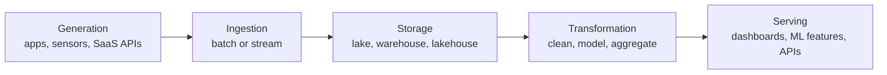

## 🎯 خلاصه

> **مهندس داده (Data Engineer)** سیستم‌هایی را می‌سازد و نگه می‌دارد که داده را از جایی که تولید می‌شود به جایی که آدم‌ها و برنامه‌ها از آن استفاده می‌کنند می‌رسانند؛ قابل اتکا، به‌موقع و با هزینه‌ای که کسب‌وکار می‌تواند بپردازد.

- کار اصلی، **پایپ‌لاین و پلتفرم** است، نه نمودار نهایی یا مدل. تحلیل‌گر یا دانشمند داده مصرف‌کننده است؛ مهندس داده مطمئن می‌شود ورودی‌اش وجود دارد، درست است و تازه است.
- کار از یک **چرخه‌ی عمر (lifecycle)** پیروی می‌کند: تولید → دریافت → ذخیره → تبدیل → سرو.
- دور این چرخه **undercurrents** است: امنیت، مدیریت داده، DataOps، orchestration، معماری و مهندسی نرم‌افزار. سنیورها بیشتر با همین‌ها سنجیده می‌شوند.
- عنوان‌های شغلی زیاد هم‌پوشانی دارند. سه نوع نقش را یاد بگیر تا برای هر کدام بتوانی جواب بدهی.

## 🌱 از ساده شروع کنیم (مبتدی)

> **💡 Analogy:** یک رستوران. مشتری‌ها (تحلیل‌گرها، مدیران محصول، مدل‌های ML) غذا سفارش می‌دهند (داشبورد، گزارش، فیچر). آشپز (دانشمند داده یا تحلیل‌گر) غذا را می‌پزد. مهندس داده زنجیره‌ی تأمین و آشپزخانه را اداره می‌کند: مواد می‌رسند (دریافت)، در جای درست یخچال قرار می‌گیرند (ذخیره)، برش و آماده می‌شوند (تبدیل) و سر وقت به میز می‌رسند (سرو). اگر مواد دیر برسد یا خراب باشد، بهترین آشپز هم نمی‌تواند شام را نجات دهد.

یک مثال ساده از کار. وب‌سایت یک فروشگاه هر بار که کسی خرید می‌کند، یک ردیف سفارش در دیتابیس می‌نویسد. هر صبح تیم مالی می‌خواهد درآمد دیروز به تفکیک شهر را در داشبورد ببیند. مهندس داده:

1. هر ساعت سفارش‌های جدید را از دیتابیس اصلی کپی می‌کند، بدون اینکه فروشگاه را کند کند (**دریافت / ingestion**).
2. آن‌ها را در یک جدول warehouse ذخیره می‌کند (**ذخیره / storage**).
3. ردیف‌های تکراری را حذف می‌کند، ارز را تبدیل می‌کند و نام شهرها را join می‌کند (**تبدیل / transformation**).
4. یک جدول تمیز `daily_revenue` منتشر می‌کند که داشبورد از آن می‌خواند (**سرو / serving**).
5. وقتی بارگذاری شکست می‌خورد یا عددها مشکوک‌اند، هشدار می‌گیرد (**undercurrents**).

هیچ‌کدام از این کارها «تحلیل» نیست. لوله‌کشی است که هر روز باید کار کند.

## 🔧 واقعاً چطور کار می‌کند (متوسط)

### چرخه‌ی عمر

| مرحله | سؤالی که مهندس جواب می‌دهد | ابزارهای رایج (نمونه) |
|---|---|---|
| Generation | چه سیستم‌هایی داده تولید می‌کنند و با چه شکلی؟ | دیتابیس‌های اپلیکیشن، producerهای رویداد، APIهای شخص ثالث |
| Ingestion | چطور بیرونش بیاوریم، چند وقت یک‌بار، و اگر دیر رسید چه؟ | ابزارهای CDC، Kafka، جاب‌های استخراج batch |
| Storage | کجا زندگی کند و در چه فرمتی؟ | object storage با Parquet، warehouseها، فرمت‌های جدولی |
| Transformation | خام‌ها چطور به جدول‌های قابل اعتماد تبدیل شوند؟ | Spark، موتورهای SQL، dbt |
| Serving | چه کسی می‌خواند، با چه تأخیری و با چه قواعد دسترسی؟ | ابزارهای BI، feature store، reverse-ETL، APIها |

undercurrentها از هر پنج مرحله عبور می‌کنند: امنیت (چه کسی کدام ستون را بخواند)، کیفیت داده و lineage، DataOps (تست و استقرار پایپ‌لاین‌ها)، orchestration (زمان‌بندی و وابستگی‌ها)، معماری (trade-offهای طراحی) و مهندسی نرم‌افزار (نسخه‌بندی، تست، code review).

### سه نوع نقش

| نوع | تمرکز | یک روز معمولی |
|---|---|---|
| Pipeline-focused | ساختن و نگه‌داشتن جاب‌های دریافت و تبدیل | رفع یک DAG دیرکرده‌ی Airflow، اضافه کردن یک منبع جدید، backfill یک ماه |
| Platform-focused | ساختن ابزارهایی که بقیه‌ی مهندس‌ها استفاده می‌کنند | ارتقای کلاستر، فریم‌ورک دریافت خودسرویس، کنترل هزینه |
| Analytics-focused | مدل‌سازی داده برای تحلیل‌گرها و BI | مدل‌های warehouse، تعریف متریک‌ها، semantic layer، تست‌های dbt |

شرکت‌ها این‌ها را ترکیب می‌کنند. تیم کوچک ممکن است یک نفر را برای هر سه بخواهد؛ تیم بزرگ‌تر کار را تقسیم می‌کند.

### تفاوت با نقش‌های هم‌جوار

- **تحلیل‌گر داده:** با داده‌ی موجود به سؤال جواب می‌دهد؛ SQL و داشبورد می‌نویسد. از جدول‌های مهندس استفاده می‌کند.
- **دانشمند داده:** مدل و آزمایش می‌سازد. به فیچرها و داده‌ی آموزشی تمیز نیاز دارد که اغلب از مهندس می‌آید.
- **Analytics Engineer:** لایه‌ی مدل‌سازی بین داده‌ی خام و BI را مدیریت می‌کند (معمولاً با SQL و dbt). بیشترین هم‌پوشانی را با نوع analytics-focused دارد.
- **مهندس پلتفرم داده:** زیرساخت (کلاستر، orchestration، کنترل دسترسی) را مدیریت می‌کند که بقیه از آن استفاده می‌کنند.
- **مهندس نرم‌افزار:** محصول می‌سازد. مهندس داده سیستمی می‌سازد که داده‌های تولیدشده‌ی محصول را ثبت و منتقل می‌کند.

> **⚠️ Watch out:** شرکت‌ها عنوان‌ها را ناهماهنگ به کار می‌برند. همیشه بپرس «تیم چه چیزی را مالک است و شب‌ها چه چیزی پیجر می‌شود؟» و به عنوان شغلی اعتماد نکن.

## 🧠 عمق و trade-offها (سنیور)

یک مهندس داده‌ی سنیور باید کل چرخه‌ی عمر و هزینه‌هایش را بسنجد، نه یک ابزار را.

- **تأخیر در برابر هزینه:** استریم ۵ دقیقه‌ای لزوماً از batch روزانه بهتر نیست. بپرس چه کسی داده را مصرف می‌کند و تأخیر برای او چه هزینه‌ای دارد.
- **قراردادهای صحت:** با تولیدکننده‌ها روی schema، تازگی و مالکیت توافق کن (data contract). بیشتر خرابی‌ها از بالادست شروع می‌شوند، نه از کد تو.
- **حالت‌های خرابی:** داده‌ی دیررس، داده‌ی تکراری، schema drift، بارگذاری ناقص، یا API منبعی که بی‌صدا معنایش را عوض می‌کند. برای هر کدام طراحی کن؛ فقط امید نداشته باش.
- **عملیات:** چه چیزی را مانیتور می‌کنی (تازگی، حجم، نرخ null، مدت جاب، هزینه) و وقتی بارگذاری شکست می‌خورد چه چیزی خودکار اجرا می‌شود؟
- **امنیت و حریم خصوصی:** داده‌ی شخصی (مثلاً شماره تلفن و کد ملی) باید mask شود یا بر اساس نقش محدود شود. این یک نیاز طراحی است، نه وصله‌ی بعدی.
- **کی پایپ‌لاین نسازیم:** اگر یک تیم فقط یک بار به یک کوئری نیاز دارد، یک کوئری ذخیره‌شده یا خروجی ساده شاید ارزان‌تر از یک پلتفرم باشد.

## 🧪 امتحان کن

1. یک محصولی را که هر روز استفاده می‌کنی انتخاب کن (اپ سفارش غذا، اپ بانکی، اپ تاکسی اینترنتی). پنج منبع داده‌ای را که احتمالاً تولید می‌کند بنویس.
2. برای هر منبع روش دریافت (batch، CDC، استریم، pull از API) و تأخیری که کسب‌وکار احتمالاً لازم دارد را مشخص کن.
3. یک جدولی را که تحلیل‌گر می‌خواهد نام ببر و سه بررسی‌ای را که اضافه می‌کنی تا بی‌صدا خراب نشود بنویس.

نمونه‌ی جواب برای منبع ۱

یک اپ تاکسی اینترنتی: رکوردهای سفر (دیتابیس اپلیکیشن)، پینگ‌های GPS (استریم رویداد)، رویدادهای پرداخت (API ارائه‌دهنده‌ی پرداخت)، مدارک راننده (آپلود فایل) و تیکت‌های پشتیبانی (API یک SaaS). هر کدام روش دریافت متفاوتی می‌خواهد و دقیقاً به همین دلیل این نقش سخت است.

## 💬 گوشه‌ی مصاحبه

**سؤال:** «مهندس داده چه کاری می‌کند و با دانشمند داده چه فرقی دارد؟»

> **🎤 Say this in the interview:** «مهندس داده پایپ‌لاین‌ها و ذخیره‌سازی‌ای را می‌سازد که داده را قابل اتکا و در دسترس می‌کند: دریافت، تبدیل و سرو، به‌علاوه‌ی مانیتورینگ و امنیت. دانشمند داده از همین داده برای ساختن مدل و آزمایش استفاده می‌کند. کار من این است که مطمئن شوم ورودی‌هایش درست، مستند و تازه‌اند تا وقتش صرف تحلیل شود، نه دیباگ کردن منبع.»

- **جواب مبتدی:** ابزارها (Spark، Airflow، SQL) را بدون توضیح هدف نام می‌برد.
- **جواب متوسط:** چرخه‌ی عمر را توضیح می‌دهد و یک پایپ‌لاین نمونه با یک بررسی کیفیت می‌آورد.
- **جواب سنیور:** درباره‌ی مالکیت، قرارداد با تولیدکننده‌ها، trade-off هزینه و چیزهایی که مانیتور می‌کند حرف می‌زند و می‌گوید کی یک ابزار ساده کافی است.

## ⚠️ اشتباهات رایج

- **«مهندسی داده همان ETL است».** ETL فقط یک مرحله است. مالکیت قابلیت اعتماد، قرارداد و هزینه چیزی است که نقش را سنیور می‌کند.
- **از ابزار شروع کردن.** مصاحبه‌کننده اول مسئله را می‌خواهد (چه داده‌ای، چقدر تازه، چه کسی می‌خواند)، بعد ابزار.
- **نادیده گرفتن مصرف‌کننده.** جدولی که کسی نمی‌خواند هزینه‌ی بیهوده است؛ جدولی بدون مالک مشخص بی‌صدا خراب می‌شود.
- **پایپ‌لاین را اسکریپت یک‌بارمصرف دیدن.** پایپ‌لاین تولیدی به تست، version control، retry و هشدار نیاز دارد (undercurrents).

## ✅ خودت را بسنج

1. یک CDC tool که تغییرات ردیف‌ها را از دیتابیس تولیدی کپی می‌کند، عمدتاً به کدام مرحله‌ی چرخه‌ی عمر تعلق دارد؟
   - A) Generation
   - B) Ingestion
   - C) Serving
   - D) Transformation

جواب

**B** — انتقال داده از منبع به پلتفرم، دریافت (ingestion) است. داده قبلاً توسط اپلیکیشن تولید شده؛ ابزار CDC فقط آن را جابه‌جا می‌کند.

2. یک تحلیل‌گر «کاربران فعال ماهانه» می‌خواهد. در تیمی که Analytics Engineer دارد، تعریف متریک و لایه‌ی مدل‌سازی معمولاً مال کیست؟
   - A) مهندس پلتفرم داده
   - B) Analytics Engineer، معمولاً با SQL و dbt
   - C) فقط مدیر محصول
   - D) مدیر دیتابیس

جواب

**B** — Analytics Engineer لایه‌ی مدل‌سازی بین داده‌ی خام و BI را مدیریت می‌کند، پس تعریف متریک معمولاً همان‌جا زندگی می‌کند. مهندس پلتفرم زیرساختی را اداره می‌کند که دیگران استفاده می‌کنند.

3. **(سنیور)** یک تیم محصول تازگی یک‌دقیقه‌ای برای داشبوردی می‌خواهد که فقط در بررسی هفتگی کسب‌وکار خوانده می‌شود. بهترین سؤال اول کدام است؟
   - A) از کدام موتور استریم استفاده کنیم؟
   - B) این را چه کسی مصرف می‌کند و تأخیر چند ساعته برای او واقعاً چه هزینه‌ای دارد؟
   - C) می‌توانیم executorهای بیشتری اضافه کنیم؟
   - D) جدول باید به‌صورت ساعتی partition شود؟

جواب

**B** — تأخیر یک نیاز کسب‌وکار با هزینه است. گزارش هفتگی به پایپ‌لاین یک‌دقیقه‌ای نیاز ندارد و ارزان‌ترین طراحی قابل اتکا معمولاً batch ساعتی یا روزانه است. انتخاب ابزار بعد از این سؤال می‌آید.

4. **(سنیور)** چرا مهندسان سنیور روی data contract با تولیدکننده‌های بالادست پافشاری می‌کنند؟
   - A) قرارداد فضای ذخیره‌سازی را ارزان‌تر می‌کند
   - B) بسیاری از خرابی‌ها وقتی شروع می‌شوند که منبع بی‌صدا schema یا معنای داده را عوض می‌کند؛ قرارداد انتظار را صریح و قابل تست می‌کند
   - C) قرارداد جای مانیتورینگ را می‌گیرد
   - D) قرارداد فقط برای استریم لازم است

جواب

**B** — تولیدکننده و مصرف‌کننده روی schema، تازگی و مالکیت توافق می‌کنند، پس تغییرات قبل از خراب کردن جدول‌های پایین‌دستی دیده می‌شوند. مانیتورینگ همچنان لازم است، اما قرارداد بسیاری از خرابی‌ها را پیشگیری می‌کند.

## 🗂️ فلش‌کارت

| Front | Back |
|---|---|
| پنج مرحله‌ی چرخه‌ی عمر DE | Generation، ingestion، storage، transformation، serving |
| undercurrentها چیستند؟ | مسائل فراگیر: امنیت، مدیریت داده، DataOps، orchestration، معماری، مهندسی نرم‌افزار |
| تحلیل‌گر داده در برابر مهندس داده | تحلیل‌گر با داده‌ی موجود به سؤال جواب می‌دهد؛ مهندس داده را قابل اتکا و در دسترس می‌کند |
| حوزه‌ی اصلی Analytics Engineer | لایه‌ی مدل‌سازی بین داده‌ی خام و BI (معمولاً SQL و dbt) |
| حوزه‌ی اصلی مهندس پلتفرم داده | زیرساخت و ابزارهای مشترک که بقیه استفاده می‌کنند |
| اولین سؤال قبل از انتخاب ابزار | چه کسی داده را مصرف می‌کند، چقدر باید تازه باشد و تأخیر چه هزینه‌ای دارد؟ |

## 🔗 ادامه

- **iran-de-market** نشان می‌دهد در ایران با چه استک‌ها و نوع شرکت‌هایی روبه‌رو می‌شوی.
- **senior-expectations** توضیح می‌دهد در سطح سنیور چه چیزی تغییر می‌کند.
- **pipeline-design-principles** و **dwh-fundamentals** ایده‌های طراحی پشت این چرخه را پوشش می‌دهند.
- **interview-loop** مراحل یک مصاحبه‌ی معمول مهندسی داده را شرح می‌دهد.
- کتاب *Fundamentals of Data Engineering* (Reis & Housley) را برای چرخه‌ی عمر و undercurrentها به‌تفصیل بخوان.
