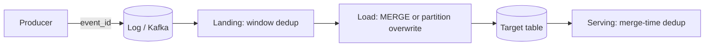

## 🎯 خلاصه

> تکرار **چیزی نیست که بتوانی کاملاً جلویش را بگیری**. retry، restart شدن consumer و backfillهایی که همپوشانی دارند، همان رکورد را دو بار تحویل می‌دهند. پس pipeline باید تحمل آن را داشته باشد: در هر لایه **بر اساس کلید حذف تکراری** انجام بده، و هر load را **idempotent** کن تا اجرای دوباره همان جدول را بدهد.

- در at-least-once delivery، تکرار بعد از هر خطا حالت عادی است. برایش برنامه‌ریزی کن.
- با یک **قانون قطعی** dedup کن: یک کلید، به‌علاوه‌ی یک ستون ترتیب (مثلاً `updated_at`)، به‌علاوه‌ی یک tie-breaker (مثلاً `event_id`).
- تکرار را در **لایه‌ها** حذف کن: در منبع (event ID)، در landing (window dedup)، در load (`MERGE` یا overwrite پارتیشن)، و در زمان serving برای storeهایی که بعداً merge می‌کنند.
- load idempotent آن است که بتوانی دو بار اجرایش کنی و اجرای دوم هیچ‌چیز را عوض نکند. همین ویژگی retry و backfill را امن می‌کند.

## 🌱 از ساده شروع کنیم (مبتدی)

> **💡 مثال:** شماره‌ی مرجع یک پرداخت. دکمه‌ی «پرداخت» را می‌زنی و شبکه timeout می‌دهد. دوباره می‌زنی. بانک همان شماره‌ی مرجع را می‌بیند و فقط یک بار پول کم می‌کند. شماره‌ی مرجع کلیدی است که retry را امن می‌کند.

تکرار از ساده‌ترین چیزها می‌آید:

- یک producer بعد از timeout ارسال را دوباره انجام می‌دهد، ولی ارسال اول در واقع موفق بوده.
- یک consumer صد رکورد را پردازش و نوشته، و قبل از commit کردن موقعیتش crash می‌کند. بعد از restart همان صد رکورد را دوباره می‌خواند.
- کسی job دیروز را دوباره اجرا می‌کند و بازه‌ی زمانی با روز قبل همپوشانی دارد.

یک مثال کوچک: دو نسخه از یک رویداد سفارش می‌رسد:

| order_id | status | updated_at | event_id |
|---|---|---|---|
| o1 | created | 1 | e1 |
| o1 | paid | 2 | e2 |
| o1 | created | 1 | e1 |

جدول باید **یک** ردیف برای `o1` داشته باشد، با وضعیت `paid`. دو سؤال این را مشخص می‌کنند: کدام ردیف‌ها یک چیز هستند (کلید `order_id` یا `event_id`)، و کدام برنده است (آخرین `updated_at`). بقیه‌ی این درس درباره‌ی صریح کردن این دو پاسخ و اعمال آن‌ها در همه‌جاست.

## 🔧 واقعاً چطور کار می‌کند (متوسط)

**تکرار از کجا می‌آید.** تضمین‌های تحویل خط مبنا را مشخص می‌کنند. با at-most-once داده را از دست می‌دهی؛ با at-least-once تکرار می‌گیری؛ و برای exactly-once **از ابتدا تا انتها** به تراکنش یا sink idempotent نیاز داری. به [[delivery-semantics]] و [[exactly-once]] نگاه کن. بیشتر سیستم‌های واقعی «at-least-once به‌علاوه‌ی نوشتن idempotent» هستند، و همین معنای عملی exactly-once است.

**لایه‌هایی که تکرار را حذف می‌کنی:**



۱. **منبع:** هر رویداد را در لحظه‌ی ساخت یک `event_id` پایدار بده، نه در لحظه‌ی ingestion. یک retry باید همان ID را دوباره استفاده کند.
۲. **Landing:** داخل batch، با یک window function برای هر کلید یک ردیف نگه دار.
۳. **Load:** batch حذف‌تکراری‌شده را با کلید در جدول مقصد merge کن، تا ردیف‌های موجود به‌روز شوند و تکرار نشوند.
۴. **Serving:** بعضی storeها موقع merge در پس‌زمینه dedup می‌کنند، پس خواندن باید تکرارهایی را که هنوز merge نشده‌اند در نظر بگیرد.

**Window dedup.** این query برای هر سفارش یک ردیف نگه می‌دارد، با برنده‌ای قطعی:

```sql
-- Keep one row per order_id: latest updated_at, then highest event_id as a tie-breaker
WITH ranked AS (
  SELECT e.*,
         ROW_NUMBER() OVER (
           PARTITION BY order_id
           ORDER BY updated_at DESC, event_id DESC
         ) AS rn
  FROM staging.order_events e
)
SELECT order_id, status, amount, updated_at, event_id
FROM ranked
WHERE rn = 1;

-- Idempotent load: merge the deduplicated batch into the target by key
MERGE INTO warehouse.orders AS t
USING deduped_batch AS s
  ON t.order_id = s.order_id
WHEN MATCHED AND s.updated_at > t.updated_at THEN
  UPDATE SET status = s.status, amount = s.amount, updated_at = s.updated_at
WHEN NOT MATCHED THEN
  INSERT (order_id, status, amount, updated_at)
  VALUES (s.order_id, s.status, s.amount, s.updated_at);
```

بخش `ORDER BY` در window مهم‌ترین بخش است. بدون tie-breaker، دو ردیف با `updated_at` یکسان ممکن است بین اجراها جابه‌جا شوند و «برنده» عوض شود. قانون قطعی است که job را قابل تکرار می‌کند. شرط `WHEN MATCHED AND s.updated_at > t.updated_at` باعث می‌شود یک رویداد قدیمیِ replay‌شده نتواند وضعیت جدیدتر را بازنویسی کند.

**چرا شرط مهم است.** نسخه‌ی پایتونی همان قانون در زیر است. دو بار اجرایش کن و جدول تغییر نمی‌کند:

```python
def apply_batch(table: dict, batch: list[dict]) -> dict:
    # table: key -> row ; the batch may contain duplicates and replays
    for ev in batch:
        key = ev["order_id"]
        current = table.get(key)
        if current is None or ev["updated_at"] > current["updated_at"]:
            table[key] = ev
    return table

table = {}
batch = [
    {"order_id": "o1", "status": "created", "updated_at": 1},
    {"order_id": "o1", "status": "paid",    "updated_at": 2},
    {"order_id": "o1", "status": "created", "updated_at": 1},  # duplicate of an old event
]
apply_batch(table, batch)
once = dict(table)
apply_batch(table, batch)          # replay the same batch
print(table == once)               # True: the result does not change on replay
print(table["o1"]["status"])       # paid
```

**Overwrite پارتیشن.** برای جدول‌های fact بزرگ، یک الگوی idempotent رایج بازسازی کل پارتیشن‌هاست. برای یک روز مشخص، پارتیشن را حذف کن و ردیف‌های بازمحاسبه‌شده را در یک تراکنش وارد کن، یا آن را در یک مرحله overwrite کن. در Spark، dynamic partition overwrite (`spark.sql.sources.partitionOverwriteMode = dynamic`) فقط پارتیشن‌هایی را overwrite می‌کند که در داده‌ی جدید هستند. اجرای دوباره‌ی job همان پارتیشن را می‌دهد.

**dedup در زمان serving.** `ReplacingMergeTree` در ClickHouse فقط یک ردیف برای هر sorting key نگه می‌دارد، ولی فقط موقع merge در پس‌زمینه. تا وقتی merge اجرا نشده، تکرارها ممکن است دیده شوند، پس query ها از `FINAL` استفاده می‌کنند یا با `argMax` روی ستون نسخه تجمیع می‌کنند. جدول‌های primary-key در StarRocks یک upsert بر اساس primary key انجام می‌دهند، پس آخرین نسخه‌ی یک کلید در زمان نوشتن برنده است. Flink با keyed state dedup می‌کند: IDهای دیده‌شده را برای هر کلید نگه می‌دارد و تکراری‌ها را حذف می‌کند، و با TTL state بی‌نهایت رشد نمی‌کند.

## 🧠 عمق و trade-offها (سنیور)

- **کلید dedup را با دقت انتخاب کن.** `event_id` یک رویداد را مشخص می‌کند؛ کلید طبیعی (`order_id`) یک entity را. dedup در سطح رویداد retry ها را حذف می‌کند؛ dedup در سطح entity آخرین وضعیت را نگه می‌دارد. معمولاً هر دو لازم‌اند: اول رویدادها را dedup کن، بعد entityها را merge کن.
- **ستون ترتیب.** قانون «آخرین برنده است» به یک ستون ترتیب قابل‌اعتماد نیاز دارد. ساعت دستگاه یا ساعت دیواری producer بین ماشین‌ها قابل‌اعتماد نیست. شماره‌ی نسخه‌ی منبع، موقعیت log پایگاه‌داده (LSN، موقعیت binlog) یا sequence منبع را ترجیح بده.
- **state محدود در stream.** stream dedup برای هر کلید دیده‌شده حافظه لازم دارد. TTL را بیشتر از حداکثر تأخیر مورد انتظار برای تکرار تنظیم کن، وگرنه همان رویداد که دیرتر می‌رسد جدید حساب می‌شود. این یک trade-off واقعی است: TTL بلندتر یعنی state بیشتر، و کوتاه‌تر یعنی احتمال تکرار. به [[state-store]] نگاه کن.
- **هزینه روی جدول‌های بزرگ.** window dedup روی یک میلیارد ردیف یعنی shuffle و sort. کار را با پارتیشن محدود کن: فقط پارتیشن‌هایی را dedup کن که batch به آن‌ها دست زده، نه کل تاریخچه.
- **حذف‌ها.** یک `MERGE` که فقط insert و update دارد، ردیف‌های حذف‌شده‌ی منبع را باقی می‌گذارد. حذف را صریح مدیریت کن (tombstone یا فلگ deleted)، وگرنه یک replay ممکن است ردیف حذف‌شده را دوباره زنده کند. به [[cdc]] نگاه کن.
- **exactly-once ویژگی end-to-end است.** یک producer تراکنشی کمکی نمی‌کند اگر sink هنگام retry تکرار بنویسد. sink به یک نوشتن idempotent (upsert با کلید) یا یک تراکنش که commit offset و نوشتن را پوشش می‌دهد نیاز دارد.
- **کی dedup نکنیم.** بعضی داده‌ها واقعاً تکرار قانونی دارند (یک بازدید صفحه که دو بار شمرده شود هنوز دو بازدید است). فقط جایی dedup کن که تکرارها retry هستند، نه رویداد واقعی. قانون کسب‌وکار را در کلید بگذار، نه حدس.
- **مانیتور کن.** نسبت تکرار در هر پارتیشن (`count(*) - count(distinct key)`)، ردیف‌هایی که شرط merge رد کرده، کلیدهای منقضی‌شده‌ی TTL در Flink، و شمارش تطبیقی بین منبع و مقصد بعد از هر اجرا. به [[pattern-reconciliation]] نگاه کن.

## 🧪 امتحان کن

یک سرویس پرداخت جدول `payment_events` را با فیلدهای `payment_id`، `event_id`، `status` و `event_time` (که producer تعیین می‌کند) تولید می‌کند. consumer بعد از timeout دوباره ارسال می‌کند، پس تکرارها ساعت‌ها بعد می‌رسند.

۱. برای dedup در landing و برای جدول نهایی `payments` از کدام کلید استفاده می‌کنی؟ چرا؟
۲. تیمت پیشنهاد می‌دهد در window از `ORDER BY ingestion_time` استفاده شود. مشکل چیست و به جایش چه بگذاری؟

<details><summary>پاسخ نمونه</summary>

۱. در landing بر اساس `event_id` dedup کن، چون یک retry از همان رویداد را مشخص می‌کند. برای جدول نهایی با `payment_id` کلیدگذاری کن، چون برای هر پرداخت یک وضعیت جاری وجود دارد. از `event_time` (به‌همراه `event_id` به عنوان tie-breaker) به عنوان ستون ترتیب استفاده کن، تا تکرارهای دیرهنگام نتوانند وضعیت جدیدتر را بازنویسی کنند.
۲. `ingestion_time` به زمانی بستگی دارد که سیستم رویداد را دریافت کرده، نه زمانی که رخ داده. یک retry دیرتر می‌رسد، پس ingestion time جدیدتری می‌گیرد و برنده می‌شود، با اینکه داده‌ی قدیمی‌تری است. از `event_time` منبع یا نسخه‌ی منبع، به‌همراه یک tie-breaker قطعی استفاده کن.

</details>

## 💬 گوشه‌ی مصاحبه

**سؤال:** «در pipelineای که retry دارد، چطور از تکرار جلوگیری می‌کنی؟»

> **🎤 این را در مصاحبه بگو:** «فرض می‌کنم under at-least-once delivery تکرار رخ می‌دهد، پس برایش طراحی می‌کنم. هر رویداد از producer یک ID پایدار دارد. در landing با window function برای هر کلید یک ردیف نگه می‌دارم، با ترتیب بر اساس نسخه‌ی منبع و یک tie-breaker قطعی. load یک MERGE idempotent است که با شرط محافظ، رویداد قدیمی نمی‌تواند وضعیت جدیدتر را بازنویسی کند. بعد از هر اجرا با یک متریک نسبت تکرار و شمارش تطبیقی بررسی می‌کنم.»

جواب میان‌سطح کلید و MERGE را نام می‌برد. جواب سنیور ستون ترتیب، trade-off مربوط به TTL در stream، حذف‌ها، و این را اضافه می‌کند که لایه‌ی serving ممکن است تا پایان merge ها هنوز تکرار نشان دهد.

## ⚠️ اشتباهات رایج

- **استفاده از زمان ورود به عنوان ستون ترتیب.** retry ها دیرتر می‌رسند و اشتباه برنده می‌شوند. از زمان رویداد یا نسخه‌ی منبع استفاده کن.
- **tie-breaker غیرقطعی.** `ROW_NUMBER` بدون tie-breaker ممکن است در هر اجرا برنده‌ی متفاوتی انتخاب کند.
- **INSERT برای loadهای retry شده.** ردیف‌ها را دو برابر می‌کند. از MERGE با کلید یا بازسازی پارتیشن استفاده کن.
- **فراموش کردن حذف‌ها.** replayها ردیف‌های حذف‌شده‌ی منبع را دوباره زنده می‌کنند.
- **اعتماد به `ReplacingMergeTree` برای شمارش دقیق** بدون `FINAL` یا `argMax`. تکرارها تا merge ممکن است هنوز وجود داشته باشند.
- **dedup فقط در انتها.** تکرارهایی که به لایه‌ی خام می‌رسند هنوز هزینه‌ی ذخیره دارند و می‌توانند joinهای بالادستی را خراب کنند.

## ✅ خودت را بسنج

۱. چرا در یک pipeline با at-least-once تکرار ظاهر می‌شود؟
   - A) چون broker طبق طراحی هر پیام را دو بار ذخیره می‌کند
   - B) چون producer یا consumer بعد از خطایی که شاید بعد از موفقیت کار رخ داده، دوباره تلاش می‌کند
   - C) چون Spark همیشه فایل‌ها را دو بار می‌نویسد
   - D) چون کلیدهای اصلی در منبع وجود ندارند

<details><summary>پاسخ</summary>

**B** — at-least-once یعنی وقتی فرستنده مطمئن نیست پیام پردازش شده، آن را دوباره تحویل می‌دهد؛ مثلاً بعد از timeout یا crash قبل از commit offset. retry ممکن است کاری را تحویل دهد که قبلاً موفق بوده.

</details>

۲. کدام ترتیب باعث می‌شود dedup با window در اجراهای مختلف قابل تکرار باشد؟
   - A) فقط `ORDER BY ingestion_time`
   - B) `ORDER BY updated_at DESC, event_id DESC`
   - C) بدون `ORDER BY`؛ موتور به‌طور تصادفی انتخاب می‌کند
   - D) `ORDER BY random()`

<details><summary>پاسخ</summary>

**B** — ستون ترتیب معنای «آخرین برنده است» را بیان می‌کند و tie-breaker باعث می‌شود مقادیر برابر هم قطعی شوند. گزینه‌ی A و D از زمانی غیر از زمان منبع یا تصادف استفاده می‌کنند، و C برنده را به موتور می‌سپارد.

</details>

۳. یک batch replay‌شده، یک رویداد قدیمی `created` دارد، در حالی که یک رویداد جدیدتر `paid` از قبل در مقصد است. کدام شرط merge از مقصد محافظت می‌کند؟
   - A) `WHEN MATCHED THEN UPDATE` بدون شرط
   - B) `WHEN MATCHED AND s.updated_at > t.updated_at THEN UPDATE`
   - C) فقط `WHEN NOT MATCHED THEN INSERT`
   - D) `TRUNCATE` قبل از هر merge

<details><summary>پاسخ</summary>

**B** — شرط باعث می‌شود فقط نسخه‌ی جدیدتر، مقصد را بازنویسی کند. بدون آن، replay سفارش را به `created` برمی‌گرداند. گزینه‌ی C هیچ ردیف موجودی را به‌روز نمی‌کند و D تاریخچه را از بین می‌برد.

</details>

۴. **(سنیور)** یک job فلینک رویدادهای پرداخت را با `event_id` و TTL یک‌ساعته در keyed state dedup می‌کند. بعضی retryها ۳ ساعت بعد از اصلی می‌رسند و دو بار شمرده می‌شوند. چه چیزی را باید عوض کنی و هزینه‌اش چیست؟

   - A) TTL را بیشتر از حداکثر تأخیر واقع‌بینانه‌ی retry تنظیم کن، و هزینه‌ی state، حافظه و checkpoint اضافه را بپذیر
   - B) dedup را بردار؛ retryها بی‌ضررند
   - C) به‌جای event time از processing time برای TTL استفاده کن که مشکل را حل می‌کند
   - D) parallelism را به ۱۰۰ ببر تا کلیدهای بیشتری نگه داری

<details><summary>پاسخ</summary>

**A** — TTL کوتاه‌تر از تأخیر retry است، پس state آن کلید قبل از رسیدن تکرار حذف شده. راه حل TTL‌ای است که حداکثر تأخیر واقع‌بینانه را پوشش دهد. هزینه state بیشتر است، یعنی حافظه‌ی بیشتر و checkpointهای بزرگ‌تر. گزینه‌ی D parallelism را بالا می‌برد ولی مشکل TTL را تغییر نمی‌دهد.

</details>

## 🗂️ فلش‌کارت

| Front | Back |
|---|---|
| چرا تکرار در at-least-once رخ می‌دهد | یک retry ممکن است کاری را که قبلاً موفق بوده دوباره تحویل دهد |
| load idempotent | loadی که می‌توانی دو بار اجرایش کنی و نتیجه یکی باشد |
| dedup در landing | window function، یک ردیف برای هر کلید، مرتب بر اساس نسخه‌ی منبع با tie-breaker |
| چرا tie-breaker | برنده را وقتی مقادیر ترتیب برابرند قطعی می‌کند |
| شرط محافظ در MERGE | فقط وقتی به‌روز کن که نسخه‌ی ورودی از مقصد جدیدتر است |
| تله‌ی ReplacingMergeTree | تکرارها موقع merge حذف می‌شوند، پس خواندن به FINAL یا argMax نیاز دارد |
| state در dedup فلینک | کلیدهای دیده‌شده در keyed state؛ TTL باید از حداکثر تأخیر retry بیشتر باشد |
| حذف‌ها در replay | tombstone یا فلگ deleted صریح، وگرنه ردیف‌های حذف‌شده برمی‌گردند |

## 🔗 ادامه

- [[pattern-dedup]] query های dedup را برای مسئله‌های رایج مصاحبه مرور می‌کند.
- [[pattern-exactly-once]] توضیح می‌دهد sinkهای idempotent و تراکنش‌ها چطور ترکیب می‌شوند.
- [[kafka-exactly-once]] producer idempotent و تراکنش‌ها را در Kafka پوشش می‌دهد.
- [[spark-writes]] حالت‌های ذخیره، overwrite پارتیشن و committerها را برای نوشتن امن توضیح می‌دهد.
- قبل از تکیه به زمان‌بندی merge، معنای کلید یا گزینه‌های table model در ClickHouse و StarRocks، مستندات نسخه‌ی خودت را بررسی کن.
