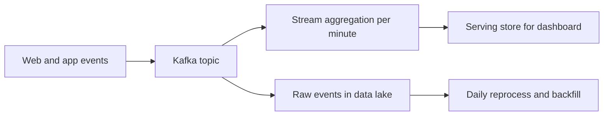

## 🎯 خلاصه

> برای هر سؤال طراحی سیستم داده، یک ترتیب ثابت را دنبال کن: **نیازمندی‌ها، عددها، مدل داده، معماری، deep diveها، عملیات**. این ترتیب باعث می‌شود قبل از دانستن مسئله، جعبه نکشی.

- ده دقیقه‌ی اول را صرف سؤال کن، نه نقاشی.
- عددها (حجم، نرخ، تازگی داده) را زود روی تخته بنویس. هر انتخاب بعدی باید از آن‌ها بیاید.
- دو یا سه deep dive انتخاب کن و عمیق برو، نه اینکه همه‌چیز را سطحی بگویی.
- با عملیات تمام کن: کیفیت، مانیتورینگ، بازیابی. بیشتر کاندیداها این را فراموش می‌کنند و سنیورها متوجه‌اش می‌شوند.

## 🌱 از ساده شروع کنیم (مبتدی)

> **💡 تشبیه:** پختن غذا از روی یک دستور. اول می‌پرسی چند نفر می‌خورند (نیازمندی). بعد مواد را برای همان تعداد حساب می‌کنی (عدد). بعد قابلمه و ترتیب کارها را انتخاب می‌کنی (معماری). و فقط بعد از آن می‌پزی. پختن بدون حساب، سوپی برای دو نفر می‌سازد که به بیست نفر نمی‌رسد.

یک صورت مسئله‌ی نمونه: **«یک گزارش روزانه از فروش هر فروشگاه برای تیم عملیات بساز.»** چارچوب این را به سؤال تبدیل می‌کند:

- **چه کسی** می‌خواند و **با آن** چه تصمیمی می‌گیرد؟
- **چقدر تازه** باید باشد؟ روزانه، ساعتی یا نزدیک به لحظه؟
- **چقدر داده** در روز داریم؟ ده هزار ردیف یا یک میلیارد؟
- داده **از کجا** می‌آید و آیا ممکن است دیر یا دوبار برسد؟

فقط بعد از این سؤال‌ها اسم ابزار را بیاور. برای گزارش روزانه با چند میلیون ردیف در روز، یک job دسته‌ای به یک warehouse اغلب کافی است. سیستم streaming یک انتخاب است که باید توجیهش کنی، نه پیش‌فرض.

> **🎤 این را در مصاحبه بگو:** «قبل از طراحی، بگذار تأیید کنم چه کسی از این استفاده می‌کند، تازگی‌اش چقدر باید باشد و تقریباً چقدر داده در روز داریم.»

## 🔧 واقعاً چطور کار می‌کند (متوسط)

چارچوب هفت مرحله دارد. هر مرحله یک خروجی دارد که روی تخته می‌نویسی.

1. **نیازمندی‌های کارکردی (حدود ۵ دقیقه).** چه کسی می‌خواند، چه داده‌ای، چه خروجی. ۳ تا ۵ بولت بنویس.
2. **نیازمندی‌های غیرکارکردی.** تأخیر (چقدر دیر)، تازگی (چقدر کهنه)، حجم، درستی (آیا داده را می‌توانیم گم یا تکراری کنیم؟)، هزینه و دسترس‌پذیری.
3. **منابع و تخمین.** داده از کجا می‌آید و عددهای back-of-envelope (ببین [[data-estimation]]).
4. **مدل داده.** جدول‌ها یا topicهای اصلی، کلیدها، grain و partitioning.
5. **معماری سطح بالا.** منبع، ingestion، پردازش، ذخیره و serving. در یک نمودار نگهش دار.
6. **Deep dive.** دو یا سه بخش سخت: exactly-once، داده‌ی دیررس، skew، backfill.
7. **عملیات.** بررسی کیفیت داده، مانیتورینگ lag و تازگی، پردازش مجدد و بازیابی.

**بودجه‌ی زمانی برای ۴۵ دقیقه:** نیازمندی‌ها ۵، عددها ۴، مدل ۵، معماری ۱۰، deep dive ۱۵، عملیات ۴، حاشیه‌ی اطمینان ۲. برای ۶۰ دقیقه، زمان اضافه را به deep diveها بده.

**چیدمان تخته.** سه ناحیه نگه دار: چپ برای نیازمندی و عدد، وسط برای معماری، راست برای مدل داده و فهرست سؤال‌های باز. ستون راست همان جایی است که وقتی مصاحبه‌گر فشار می‌آورد به آن برمی‌گردی.

**مثال کاربردی: داشبورد clickstream.** نیازمندی: تیم محصول می‌خواهد بازدید صفحه در هر دقیقه برای هر صفحه، تازگی زیر ۲ دقیقه، و نگهداری ۹۰ روزه‌ی رویدادهای خام.

عددها، با محاسبه:

- ۵۰ میلیون رویداد در روز ÷ ۸۶٬۴۰۰ ثانیه ≈ **۵۷۹ رویداد بر ثانیه** به‌طور میانگین.
- اوج با ضریب ۳ برابر میانگین ≈ **۱٬۷۴۰ رویداد بر ثانیه**. برای اوج طراحی کن، نه میانگین.
- اندازه‌ی هر رویداد خام ۵۰۰ بایت: ۵۰ میلیون × ۵۰۰ بایت = **۲۵ گیگابایت در روز** قبل از فشرده‌سازی؛ ۹۰ روز ≈ **۲٫۲۵ ترابایت** خام.

معماری از این عددها می‌آید. اوج حدود ۱۷۴۰ رویداد بر ثانیه برای یک topic کافکا با چند partition راحت است، پس ingestion سخت‌ترین بخش نیست. بخش سخت، رویدادهای دیررس و تجمیع‌های دقیقه‌ای است.

deep diveهایی که باید نام ببری: هدف تازگی ۲ دقیقه به یک [[watermark]] نیاز دارد که تصمیم بگیرد یک دقیقه کی بسته شود (ببین [[watermark]] و [[late-arriving-data]]). رویدادهای تکراری هم به یک راهبرد [[idempotency]] در serving store نیاز دارند.

## 🧠 عمق و trade-offها (سنیور)

- **trade-off را صریح بگو.** «watermark پنج دقیقه: رویدادهای تا ۵ دقیقه دیررس را می‌پذیریم و نتیجه را در ۶ دقیقه می‌گیریم. watermark طولانی‌تر کامل‌تر است ولی کندتر.» مصاحبه‌گر trade-off را نمره می‌دهد، نه عدد را.
- **کلمات درستی باید تعریف شوند.** «exactly-once» مبهم است. بگو چه چیزی را تضمین می‌کنی: سرتاسری با نوشتن idempotent، یا فقط داخل موتور پردازش. ببین [[exactly-once]].
- **اندازه، شکل را تعیین می‌کند.** اگر عددها نشان می‌دهند یک دیتابیس تنها کافی است، خوشه‌ی بزرگ اختراع نکن. اگر میلیاردها کلید داری، بگو کلید داغ چه می‌شود (ببین [[data-skew]]).
- **بازخورد مصاحبه‌گر داده است.** وقتی یک نیازمندی عوض می‌شود («حالا ۱۰ ثانیه تازگی»)، آن را بازگو کن، بگو کدام عددها و اجزا تغییر می‌کنند و چه چیزی را کنار می‌گذاری. طراحی‌ای که دیگر جواب نمی‌دهد را دفاع نکن.
- **زمان هم یک محدودیت است.** حاشیه‌ی ۲ دقیقه نگه دار. زود بپرس: «کدام deep dive را می‌خواهید؟» این حدس‌زدن را به گفت‌وگو تبدیل می‌کند.
- **عملیات جایی است که مالکیت دیده می‌شود.** دست‌کم این‌ها را نام ببر: هشدار تازگی، بررسی تعداد ردیف یا مغایرت با منبع، مسیر replay، و نحوه‌ی backfill یک روز خراب. ببین [[pipeline-monitoring]].

## 🧪 امتحان کن

سه مسئله‌ی طراحی از Track 14 نقشه‌ی راه انتخاب کن (یا [[design-clickstream-analytics]] و [[design-top-k]] را به‌عنوان شروع). برای هر کدام:

۱. تایمر ۴۵ دقیقه بگذار و هفت مرحله را بدون یادداشت با صدای بلند بگو.
۲. عددها را روی کاغذ بنویس و محاسبه را چک کن.
۳. خودت را ضبط کن و بشمار: قبل از اولین جعبه چند دقیقه صرف کردی؟

جواب‌ها را ببین

**۱–۳.** جواب واحدی وجود ندارد. نشانه‌های خوب: نیازمندی‌ها در ۵ تا ۸ دقیقه‌ی اول، عددها با محاسبه، دو یا سه deep dive که عمداً انتخاب شده‌اند، و بخش عملیات. نشانه‌های بد: نمودار در دقیقه‌ی ۲ ظاهر می‌شود و عددها هرگز نمی‌آیند.

## 💬 گوشه‌ی مصاحبه

> **🎤 این را در مصاحبه بگو:** «به ترتیب پیش می‌روم: نیازمندی‌ها، عددها، مدل، معماری، بعد دو بخش سخت‌تر، و در آخر اینکه چطور عملیاتش می‌کنیم. اول با سؤال‌ها شروع کنم.»

**چطور پرسیده می‌شود:** «یک pipeline بساز که X را انجام دهد.» یا «برام توضیح بده برای این طراحی چطور جلو می‌روی.»

- **پاسخ مبتدی:** فوراً یک پشته‌ی ابزاری می‌گوید و نقاشی می‌کند.
- **پاسخ متوسط:** درباره‌ی تازگی و حجم می‌پرسد، عدد تقریبی می‌دهد و ingestion، ذخیره و serving را می‌کشد.
- **پاسخ سنیور:** trade-off هر انتخاب را می‌گوید، بخش سخت را بدون اینکه کسی بپرسد پیدا می‌کند و خرابی و بازیابی را پوشش می‌دهد.

**پاسخ نمونه (۳ تا ۵ جمله):** «اول روشن می‌کنم چه کسی داده را استفاده می‌کند، تازگی‌اش چقدر باید باشد و روزانه چقدر داده می‌رسد. از روی عددها برای اوج طراحی می‌کنم نه میانگین، و بین batch و streaming بر اساس تازگی انتخاب می‌کنم. بخش‌های سخت اینجا رویدادهای دیررس و نتیجه‌ی exactly-once است، پس روی watermark و نوشتن idempotent عمیق می‌شوم. در پایان کنترل کیفیت، هشدار تازگی و مسیر backfill را می‌گویم.»

## ⚠️ اشتباهات رایج

- **پریدن به ابزار.** «ما Spark و Kafka می‌زنیم» قبل از اینکه کسی حجم را بداند.
- **نبود عدد.** طراحی بدون تخمین قابل بررسی نیست.
- **میانگین به‌جای اوج.** بار اوج معمولاً ظرفیت را تعیین می‌کند.
- **نادیده‌گرفتن پردازش مجدد.** هر pipeline به داستان backfill یا replay نیاز دارد.
- **صرف ۲۵ دقیقه روی یک deep dive.** گستردگی ساختار هم مهم است.
- **حذف عملیات.** نبود مانیتورینگ و کنترل کیفیت در سطح سنیور نشانه‌ی خطر است.

## ✅ خودت را بسنج

۱. یک سیستم ۵۰ میلیون رویداد در روز دریافت می‌کند. میانگین نرخ بر حسب رویداد در ثانیه چقدر است؟
   - A) حدود ۵۸ رویداد بر ثانیه
   - B) حدود ۵۷۹ رویداد بر ثانیه
   - C) حدود ۵٬۷۸۷ رویداد بر ثانیه
   - D) حدود ۵۷٬۸۷۰ رویداد بر ثانیه

جواب

**B** — ۵۰٬۰۰۰٬۰۰۰ ÷ ۸۶٬۴۰۰ ≈ ۵۷۹. اشتباه رایج تقسیم بر ۸٬۶۴۰ است (یک صفر کم). چون برای اوج طراحی می‌کنی، ضریب اوج را هم چک کن.

۲. تازگی نزدیک به لحظه (زیر ۲ دقیقه) خواسته شده. کدام مرحله اول می‌آید و چرا؟
   - A) مدل داده، تا جدول‌ها را بدانی
   - B) نیازمندی‌های غیرکارکردی، تا هدف تازگی قبل از انتخاب ابزار ثابت شود
   - C) deep dive روی skew
   - D) طرح عملیات

جواب

**B** — تازگی یک نیازمندی غیرکارکردی است که معماری را تعیین می‌کند (batch یا streaming، watermark، ذخیره‌سازی). اول هدف را ثابت کن، بعد طراحی‌ای را انتخاب کن که به آن برسد.

۳. **(سنیور)** در طراحی تجمیع دقیقه‌ای با streaming، watermark را ۱۰ دقیقه گذاشته‌ای به جای ۱ دقیقه. چه چیزی به دست می‌آوری و چه چیزی می‌دهی؟
   - A) تأخیر کمتر به دست می‌آید و تکرار بیشتر می‌شود
   - B) رویدادهایی تا ۱۰ دقیقه دیرتر را می‌پذیری، پس نتیجه کامل‌تر است، ولی هر نتیجه دیرتر منتشر می‌شود و state بیشتر نگه داشته می‌شود
   - C) exactly-once به دست می‌آید و فقط فضای ذخیره بیشتر می‌شود
   - D) هیچ‌چیز عوض نمی‌شود؛ watermark فقط روی لاگ اثر دارد

جواب

**B** — watermark طولانی‌تر تأخیر و حجم state را در برابر کامل‌بودن نتیجه معامله می‌کند. این trade-off را با صدای بلند بگو، مصاحبه‌گر آن را نمره می‌دهد. رفتار دقیق به موتور بستگی دارد، پس مستندات نسخه‌ی خودت را چک کن.

۴. **(سنیور)** ۳۵ دقیقه از یک طراحی ۴۵ دقیقه‌ای گذشته و فقط معماری را داری. بهترین حرکت کدام است؟
   - A) آن‌قدر نقاشی کنی تا زمان تمام شود
   - B) سریع بخش عملیات را پوشش بدهی و deep diveهای باقی‌مانده را نام ببری، بعد بپرسی مصاحبه‌گر کدامش را می‌خواهد
   - C) طراحی جدیدی را از اول شروع کنی
   - D) عذرخواهی کنی و جلسه را تمام کنی

جواب

**B** — یک بخش کوتاه عملیات و فهرست واضح deep diveهای باقی‌مانده نشان می‌دهد که کل چارچوب را بلدی، حتی وقتی زمان کم است. پرسیدن اینکه کدام deep dive را ادامه بدهی، گفت‌وگو را با مصاحبه‌گر زنده نگه می‌دارد.

## 🗂️ فلش‌کارت

| Front | Back |
|---|---|
| هفت مرحله چیست؟ | نیازمندی‌های کارکردی و غیرکارکردی، تخمین، مدل داده، معماری، deep dive، عملیات |
| اولین خروجی روی تخته چیست؟ | سه تا پنج بولت نیازمندی کارکردی |
| ۵۰ میلیون رویداد در روز تقریباً چند رویداد بر ثانیه است؟ | حدود ۵۷۹ (۵۰ میلیون ÷ ۸۶٬۴۰۰) |
| چرا برای اوج طراحی کنیم؟ | بار اوج ظرفیت و هزینه‌ی شکست در آن بار را تعیین می‌کند |
| watermark چه چیزی را تعیین می‌کند؟ | اینکه یک پنجره کی کامل در نظر گرفته شود و رویدادهای دیررس کنار گذاشته شوند |
| وقتی نیازمندی عوض می‌شود چه بگویی؟ | آن را بازگو کن، عددها را به‌روز کن و بگو کدام اجزا تغییر می‌کنند |
| عملیات چه چیزهایی دارد؟ | کنترل کیفیت، مانیتورینگ تازگی و lag، مسیر پردازش مجدد یا backfill |

## 🔗 ادامه

- **interview-loop** نشان می‌دهد مرحله‌ی طراحی سیستم در کل loop کجاست.
- **numbers-to-know** و **data-estimation** عددهای مرجع مراحل ۲ و ۳ را می‌دهند.
- **pattern-late-data** و **pattern-backfill** دو deep dive رایج را پوشش می‌دهند.
- **pipeline-monitoring** مرحله‌ی ۷ را عمیق‌تر توضیح می‌دهد.
- **design-clickstream-analytics** این چارچوب را روی یک مسئله‌ی کامل اعمال می‌کند.
