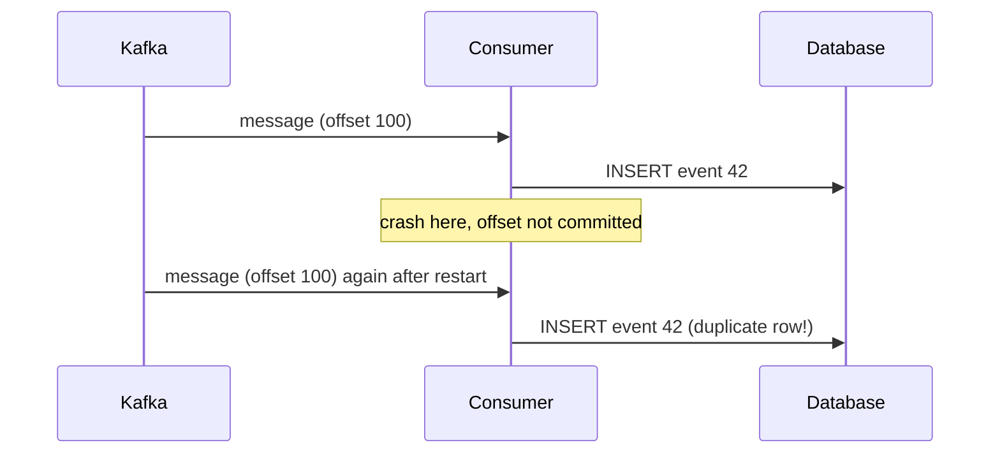

## 🎯 خلاصه

> **معناشناسی تحویل (delivery semantics)** مشخص می‌کند بعد از خرابی‌ها با یک پیام چه می‌شود: ممکن است گم شود (**at-most-once**)، ممکن است تکرار شود (**at-least-once**)، یا **اثرش** یک بار رخ دهد (**exactly-once**). روی شبکه‌ی غیرقابل‌اعتماد، تحویل واقعیِ exactly-once غیرممکن است. **پردازش** exactly-once با **تحویل at-least-once به‌همراه یک اثر idempotent یا تراکنشی** به دست می‌آید.

- at-most-once: یک بار بفرست و هرگز دوباره امتحان نکن. تکرار نداری، اما داده ممکن است گم شود.
- at-least-once: آن‌قدر تلاش کن تا تأیید بگیری. گمشدگی کم است، اما بعد از خرابی تکرار دارد.
- exactly-once (در عمل): تحویل at-least-once، به‌همراه حذف تکرار یا commit اتمیک اثر و نشانگر پیشرفت.
- exactly-once در Kafka داخل خود Kafka است. برای یک دیتابیس بیرونی هنوز به sink یا تراکنشی نیاز داری که هر دو سیستم را بپوشاند.

## 🌱 از ساده شروع کنیم (مبتدی)

> **💡 تشبیه:** فرستادن بسته با پست. گزینه‌ی اول: یک بار می‌فرستی و دیگر چک نمی‌کنی (ممکن است گم شود). گزینه‌ی دوم: آن‌قدر می‌فرستی تا رسید تحویل بگیری (ممکن است دو بار برسد، چون رسید گم شده). گزینه‌ی سوم: می‌فرستی تا رسید بگیری، و گیرنده شماره‌ی بسته را چک می‌کند و نسخه‌ی دوم را نادیده می‌گیرد.

گزینه‌ی سوم همان چیزی است که مهندس‌ها در عمل از exactly-once منظورشان است. کار حذف تکرار را گیرنده انجام می‌دهد.

یک مثال کوچک. یک producer پیام `order 42 paid` را به یک صف می‌فرستد.

- صف آن را ذخیره می‌کند، اما تأییدیه گم می‌شود. producer دوباره می‌فرستد. حالا صف دو نسخه دارد. این **at-least-once** است.
- producer هرگز دوباره نمی‌فرستد. اگر پیام روی سیم گم شده باشد، کسی متوجه نمی‌شود. این **at-most-once** است.
- مصرف‌کننده `order 42 paid` را در جدولی با کلید `order_id` می‌نویسد. نوشتنش دو بار فقط یک سطر می‌سازد. وضعیت نهایی یکسان است. این **پردازش idempotent** است.

## 🔧 واقعاً چطور کار می‌کند (متوسط)

**سه تضمین.**

| معناشناسی | مکانیزم | ریسک | کاربرد معمول |
|---|---|---|---|
| At-most-once | ارسال، بدون retry، ثبت پیشرفت قبل از پردازش | گمشدن | متریک‌هایی که نمونه‌گیری‌شان اشکالی ندارد |
| At-least-once | retry تا ack، ثبت پیشرفت بعد از پردازش | تکرار | بیشتر pipelineها، با dedup در پایین‌دست |
| Exactly-once (اثر) | at-least-once + اثر idempotent یا اتمیک | پیچیدگی، پشتیبانی sink | پول، شمارنده‌ها، جمع‌های گزارش |

ترتیب «ثبت پیشرفت» در برابر «پردازش» تضمین را تعیین می‌کند. مصرف‌کننده‌ای را در نظر بگیر که یک پیام می‌خواند، در دیتابیس می‌نویسد، و بعد offset را ثبت می‌کند:



اگر offset اول ثبت می‌شد و مصرف‌کننده قبل از insert کرش می‌کرد، پیام گم می‌شد. این ترتیب at-most-once است.

**یک sink idempotent در SQL.** یک `MERGE` استاندارد بر اساس کلید کسب‌وکار upsert می‌کند، پس یک batch تکراری در دفعه‌ی دوم چیزی را تغییر نمی‌دهد. batch مرحله‌بندی‌شده باید اول **یک سطر برای هر کلید** داشته باشد، چون بسیاری از موتورها وقتی چند سطر منبع به یک سطر هدف match می‌شوند `MERGE` را رد می‌کنند. با یک window function حذف تکرار کن (هزینه‌ی این کار در مقیاس بزرگ را در [[shuffle]] ببین):

```sql
WITH ranked AS (
  SELECT s.*,
         ROW_NUMBER() OVER (PARTITION BY order_id
                            ORDER BY event_ts DESC, event_id DESC) AS rn
  FROM staged_orders s
)
MERGE INTO orders_gold AS t
USING (SELECT * FROM ranked WHERE rn = 1) AS s
  ON t.order_id = s.order_id
WHEN MATCHED AND s.event_ts > t.event_ts THEN
  UPDATE SET status = s.status, amount = s.amount, event_ts = s.event_ts
WHEN NOT MATCHED THEN
  INSERT (order_id, status, amount, event_ts)
  VALUES (s.order_id, s.status, s.amount, s.event_ts);
```

همین batch را دو بار اجرا کن و `orders_gold` در یک وضعیت پایان می‌یابد. شرط `WHEN MATCHED AND s.event_ts > t.event_ts` هم یعنی یک replay قدیمی نمی‌تواند سطر جدیدتر را بازنویسی کند. `MERGE` در PostgreSQL نسخه 15 به بعد، Snowflake، BigQuery و Databricks هست، اما در MySQL نیست، پس موتور خودت را چک کن.

**یک مصرف‌کننده‌ی حذف‌کننده‌ی تکرار در Python.** بررسی و اثر باید **اتمیک** باشند. اگر شناسه را قبل از اعمال اثر ثبت کنی، کرش بین این دو مرحله اثر را گم می‌کند. اگر بعد از آن ثبت کنی، کرش بین این دو مرحله باعث تکرار می‌شود.

```python
def handle(event, db):
    with db.transaction():                       # one atomic unit
        if db.exists("processed", event["event_id"]):
            return "duplicate-skipped"
        db.apply_balance_change(event)           # the effect
        db.insert("processed", event["event_id"])  # the marker
    return "applied"
```

هر دو نوشتن با هم commit می‌شوند، پس نشانگر و اثر نمی‌توانند از هم جدا شوند.

**اجزای Kafka.** **producer idempotent** به broker اجازه می‌دهد تکرارهای یک session از producer را با شماره‌ی توالی هر partition تشخیص دهد، پس یک retry رکورد را دوباره نمی‌نویسد. **تراکنش‌ها** (با `transactional.id`، و مصرف‌کننده‌هایی که فقط داده‌ی commit‌شده را با `isolation.level=read_committed` می‌خوانند) یک دسته نوشتن به‌همراه commit offset مصرف‌کننده را اتمیک می‌کنند. این مورد read-process-write **داخل Kafka** را پوشش می‌دهد. مقدارهای پیش‌فرض و محدودیت‌ها را برای نسخه‌ات در مستندات بررسی کن.

## 🧠 عمق و trade-offها (سنیور)

- **چرا تحویل exactly-once غیرممکن است.** وقتی پیامی گم می‌شود، فرستنده بدون پاسخ نمی‌تواند «گم شده» را از «دریافت شده ولی تأیید گم شده» تشخیص دهد، و مسئله‌ی دو ژنرال نشان می‌دهد هیچ پروتکل متناهی این شک را کاملاً برطرف نمی‌کند. پس هدف عملی یک **اثر** exactly-once است، نه انتقال exactly-once.
- **تضمین کجا تمام می‌شود.** تراکنش‌های Kafka فقط topicهای Kafka را پوشش می‌دهند. همین که به یک دیتابیس بیرونی یا object store بنویسی، یکی از این‌ها لازم است: یک sink idempotent (upsert بر اساس کلید)، یک sink تراکنشی که با offsetها در یک واحد commit می‌شود، یا two-phase commit با sink.
- **sinkهای two-phase commit.** checkpointing در Flink و الگوی two-phase commit sink، خروجی را در زمان checkpoint pre-commit می‌کنند و وقتی checkpoint کامل شد commit می‌کنند. sink باید تراکنشی داشته باشد که از ری‌استارت جان سالم به در ببرد. مستندات connector نسخه‌ات را بخوان.
- **Spark Structured Streaming.** sinkهای فایلی آن یک log از checkpoint و خروجی می‌نویسند، به شکلی که یک query ری‌استارت‌شده بتواند batchهایی را که قبلاً commit شده‌اند رد کند. exactly-once به یک source قابل‌پخش‌مجدد، یک checkpoint location و sinkی که log commit را رعایت کند بستگی دارد. اگر checkpoint را عوض کنی، تضمین از بین می‌رود.
- **StarRocks و OLAP sinkهای مشابه از Kafka.** برای upsert از جدول Primary Key استفاده کن. یک رکورد تکراری همان سطر را بازنویسی می‌کند، پس تکرارها جمع می‌شوند. رفتار تحویل loader را در مستندات تأیید کن، و بعد از تست failover با count-distinct روی کلید کسب‌وکار چک کن.
- **حالت dedup هزینه دارد.** جدول `processed` بی‌پایان بزرگ می‌شود، مگر اینکه محدودش کنی. یک پنجره (مثلاً 7 روز) نگه دار و مطمئن شو replayهای قدیمی‌تر از پنجره ممکن نیستند، یا یک job reconciliation بپذیر.
- **ترتیب مسئله‌ی جداگانه است.** idempotency ترتیب را برنمی‌گرداند. رویدادِ قدیمی که دیر می‌رسد به یک guard زمانی (مثل `MERGE` بالا) یا طراحی مبتنی بر watermark نیاز دارد؛ ببین [[watermark]].
- **چه چیزی را مانیتور کنیم.** consumer lag، تعداد تحویل مجدد، شمارنده‌های duplicate-skipped، و reconciliation تعداد یا مجموع بین مبدأ و مقصد.
- **کی دنبال exactly-once نرویم.** لاگ‌ها، clickstream و متریک‌های تقریبی اغلب تکرار را تحمل می‌کنند. at-least-once همراه یک aggregate idempotent را انتخاب کن و هزینه را نگه دار.

## 🧪 امتحان کن

1. یک مصرف‌کننده offset را commit می‌کند، بعد در دیتابیس می‌نویسد، و بین این دو مرحله کرش می‌کند. مصرف‌کننده کدام تضمین را دارد، و چه چیزی را تغییر می‌دهی؟
2. یک `MERGE` (یا برای PostgreSQL یک `INSERT ... ON CONFLICT`) بنویس که `daily_totals(day, amount)` را از یک جدول staging upsert کند و برای هر روز بزرگ‌ترین `amount` را نگه دارد. توضیح بده چرا تکرار همان batch امن است.
3. جدول `processed` شناسه‌ی همه‌ی رویدادها را برای همیشه نگه می‌دارد. یک جایگزین محدود پیشنهاد کن و تنها موردی را بگو که در آن شکست می‌خورد.

<details><summary>پاسخ‌ها را ببین</summary>

**1.** offset قبل از نوشتن commit شده، پس کرش آن پیام را گم می‌کند. این at-most-once است. commit offset را بعد از نوشتن بگذار، و اگر store اجازه می‌دهد نوشتن و commit offset را اتمیک کن. در غیر این صورت درج را با کلید idempotent کن، که at-least-once با اثر idempotent می‌دهد.

**2.**
```sql
INSERT INTO daily_totals (day, amount)
SELECT day, MAX(amount) FROM staging_totals GROUP BY day
ON CONFLICT (day) DO UPDATE
SET amount = GREATEST(daily_totals.amount, EXCLUDED.amount);
```
تکرار batch مقدار `GREATEST(x, x) = x` می‌دهد، پس جدول تغییر نمی‌کند. قانون فقط به کلید و داده وابسته است، نه به اینکه batch چند بار اجرا شده.

**3.** شناسه‌ها را برای یک پنجره‌ی محدود، مثلاً 7 روز، نگه دار و شناسه‌های قدیمی‌تر را منقضی کن. شکست وقتی رخ می‌دهد که پیامی قدیمی‌تر از پنجره دوباره تحویل شود، چون شناسه‌اش دیگر نیست و دو بار اعمال می‌شود. با یک guard زمانی، یک job reconciliation، یا با محدود کردن تحویل مجدد (مثلاً dead-letter کردن رویدادهای خیلی قدیمی) کم کن.

</details>

## 💬 گوشه‌ی مصاحبه

**سؤال: «چطور در StarRocks از Kafka رکورد تکراری نداشته باشیم؟»** پاسخ متوسط: «از جدول Primary Key استفاده می‌کنم و بر اساس کلید کسب‌وکار upsert می‌کنم.» پاسخ سنیور: «تحویل از Kafka at-least-once است، پس بعد از خرابی replay اتفاق می‌افتد. در جدول Primary Key با کلید شناسه‌ی کسب‌وکار بار می‌زنم، تا رکورد تکراری همان سطر را بازنویسی کند. batch را قبلاً بر اساس کلید dedup می‌کنم، برای رویدادهای دیررس یک guard زمانی می‌گذارم، و بعد از تست failover با یک count-distinct چک می‌کنم. بدون نگاه به مستندات loader برای نسخه‌ام، exactly-once را در کل مسیر قول نمی‌دهم.»

**سؤال: «اگر sink تراکنشی نباشد، exactly-once چه می‌شود؟»** متوسط: «at-least-once می‌شود، پس تکرار ممکن است.» سنیور: «تراکنش‌های Kafka در مرز Kafka می‌ایستند. یک sink غیرتراکنشی ممکن است وقتی job قبل از commit offset ری‌استارت می‌شود، یک رکورد را دو بار دریافت کند. sink را با کلید idempotent می‌کنم، یا offset را در همان تراکنش نوشتن قرار می‌دهم. اگر هیچ‌کدام ممکن نباشد، at-least-once را می‌پذیرم و reconciliation انجام می‌دهم.»

> **🎤 این را در مصاحبه بگو:** «هیچ‌وقت exactly-once در تحویل را قول نمی‌دهم. اثر exactly-once را قول می‌دهم: تحویل at-least-once، به‌همراه یک sink idempotent یا تراکنشی، به‌همراه یک بررسی که آن را ثابت کند.»

## ⚠️ اشتباهات رایج

> **⚠️ مراقب باش:** فعال کردن تراکنش‌های Kafka، نوشتن در Postgres یا StarRocks را exactly-once نمی‌کند. sink باید در این کار شریک باشد.

- commit کردن offset قبل از پردازش، که یک کرش را به گم‌شدن بی‌صدا تبدیل می‌کند.
- ثبت شناسه‌ی پردازش‌شده در مرحله‌ای جدا از اثر، که پنجره‌ای برای تکرار یا گم‌شدن باقی می‌گذارد.
- استفاده از کلید surrogate تولیدشده‌ی خودکار در sink، که باعث می‌شود هر replay یک سطر جدید بسازد. به‌جایش کلید کسب‌وکار را استفاده کن (ببین [[surrogate-key]]).
- فرض اینکه `MERGE` با چند سطر منبع برای هر کلید امن است.
- منقضی شدن پنجره‌ی dedup قبل از بیشینه‌ی تأخیر تحویل مجدد.

## ✅ خودت را بسنج

1. کدام تضمین یعنی «هرگز دوباره امتحان نمی‌کنم، پس پیام‌ها ممکن است گم شوند ولی هرگز تکرار نمی‌شوند»؟
   - A) At-least-once
   - B) At-most-once
   - C) Exactly-once
   - D) Effectively-once

<details><summary>پاسخ</summary>

**B** — at-most-once بدون retry ارسال می‌کند. گمشدن ممکن است، تکرار نه.

</details>

2. یک مصرف‌کننده در دیتابیس می‌نویسد و بعد offset را commit می‌کند. بعد از نوشتن کرش می‌کند. بعد از ری‌استارت چه می‌شود؟
   - A) پیام گم می‌شود
   - B) پیام دوباره پردازش می‌شود، پس sink ممکن است تکرار ببیند
   - C) دیتابیس خودکار rollback می‌کند، چون Kafka تراکنشی است
   - D) هیچ؛ offsetها هرگز دوباره پخش نمی‌شوند

<details><summary>پاسخ</summary>

**B** — offset commit نشده، پس رکورد دوباره تحویل می‌شود. این at-least-once است. فقط یک sink idempotent یا تراکنشی می‌تواند اثر تکراری را جلوگیری کند.

</details>

3. **(سنیور)** pipeline از تراکنش‌های Kafka استفاده می‌کند و به یک جدول PostgreSQL بیرونی بدون کلید idempotent می‌نویسد. کدام جمله درست است؟
   - A) pipeline از ابتدا تا انتها exactly-once است
   - B) تراکنش‌های Kafka فقط Kafka را پوشش می‌دهند؛ نوشتن بیرونی هنوز هنگام replay می‌تواند تکرار شود
   - C) PostgreSQL روی هر insert تضمین exactly-once می‌دهد
   - D) وقتی producer idempotent باشد، تکرار غیرممکن است

<details><summary>پاسخ</summary>

**B** — مرز تراکنش در Kafka متوقف می‌شود. نوشتن بیرونی به کلید idempotent یا تراکنشی نیاز دارد که هر دو سیستم را بپوشاند.

</details>

4. **(سنیور)** چرا بررسی dedup و اثر باید در یک واحد اتمیک باشند؟
   - A) وگرنه دیتابیس قفل می‌شود
   - B) کرش بین ثبت شناسه و اعمال اثر، یا اثر را گم می‌کند یا آن را تکرار می‌کند
   - C) واحدهای اتمیک سریع‌ترند
   - D) Kafka این را الزامی کرده

<details><summary>پاسخ</summary>

**B** — این دو مرحله باید با هم موفق یا با هم ناموفق باشند. وگرنه کرش بین آن‌ها باعث گم‌شدن یا تکرار می‌شود.

</details>

5. **(سنیور)** یک batch با دو سطر برای یک `order_id` از `MERGE` عبور می‌کند. چرا این ریسکی است، و چه چیزی درستش می‌کند؟
   - A) `MERGE` نمی‌تواند عددها را به‌روز کند
   - B) بسیاری از موتورها چند سطر منبع منطبق با یک سطر هدف را رد می‌کنند یا به‌صورت غیرقطعی اعمال می‌کنند؛ ابتدا batch را بر اساس کلید dedup کن، مثلاً با `ROW_NUMBER`
   - C) `MERGE` سطرهای منبع را حذف می‌کند
   - D) راه‌حل اضافه کردن `DISTINCT` به جدول هدف است

<details><summary>پاسخ</summary>

**B** — یک `MERGE` به حداکثر یک سطر منبع برای هر کلید هدف نیاز دارد. batch مرحله‌بندی‌شده را با window function dedup کن تا انتخاب سطر صریح و قطعی باشد.

</details>

## 🗂️ فلش‌کارت

| Front | Back |
|---|---|
| At-most-once | هرگز retry نمی‌شود: گمشدن ممکن است، تکرار نه |
| At-least-once | تا ack تلاش می‌شود: تکرار ممکن است، گمشدن بعید است |
| چرا تحویل exactly-once غیرممکن است؟ | فرستنده نمی‌تواند روی شبکه‌ی غیرقابل‌اعتماد «گم شده» را از «دریافت شده، ack گم شده» تشخیص دهد |
| exactly-once عملی | تحویل at-least-once به‌همراه اثر idempotent یا تراکنشی |
| دامنه‌ی تراکنش‌های Kafka | topicها و offsetهای Kafka؛ sinkهای بیرونی تضمین خودشان را لازم دارند |
| چرا قبل از `MERGE` dedup کنیم؟ | چند سطر منبع برای یک کلید، نتیجه را نامعلوم می‌کند |
| چرا جدول `processed` را محدود کنیم؟ | بی‌پایان بزرگ می‌شود؛ پنجره‌ی محدود به تضمین سن تحویل مجدد نیاز دارد |

## 🔗 ادامه

- **kafka-exactly-once** جزئیات producer idempotent و تراکنش‌ها را پوشش می‌دهد.
- **pattern-exactly-once** طراحی‌های end-to-end برای pipelineها را نشان می‌دهد.
- **dedup-idempotent-loads** کلیدها، upsert و jobهای امن برای reload را توضیح می‌دهد.
- **distributed-transactions** درباره‌ی two-phase commit، saga و الگوی outbox است.
- **spark-structured-streaming** checkpoint و log commit را توضیح می‌دهد.
- قبل از نقل یک مقدار پیش‌فرض پیکربندی، مستندات نسخه‌ی Kafka، Flink، Spark و sink خودت را بررسی کن.
