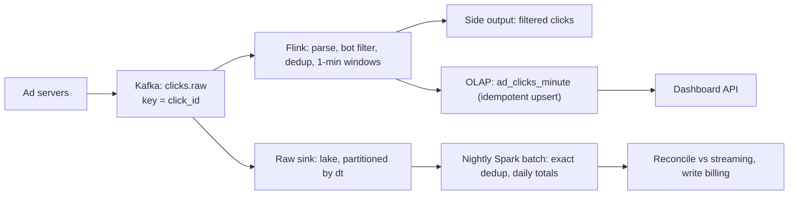

## 🎯 خلاصه

> **مسئله:** سیستمی بساز که رویدادهای کلیک تبلیغات را از سرورهای تبلیغاتی زیادی دریافت کند، تکراری‌ها را حذف کند، کلیک‌ها را برای هر تبلیغ و هر دقیقه تجمیع کند، داشبورد نزدیک به زمان واقعی را به تبلیغ‌دهنده‌ها نشان دهد، و **مجموع روزانه‌ی درجه‌ی صورتحساب** تولید کند که با داده‌ی خام بخواند.

- دو مسیر یک حقیقت را به اشتراک می‌گذارند: مسیر **streaming** (تأخیر ثانیه تا دقیقه) و مسیر **batch** (ساعت‌ها، دقیق) که اعداد streaming را **تطبیق** می‌دهد.
- بخش‌های سخت، **حذف تکراری**، **رویدادهای دیررس** (watermark)، **اثر exactly-once** در sink، و **تبلیغ‌های داغ** است که بیشتر کلیک‌ها را می‌گیرند.
- داده‌ی خام رویدادها را تغییرناپذیر نگه دار. هر تجمیع باید از روی آن‌ها قابل بازتولید باشد، تا بتوان با backfill باگ را رفع کرد.

## 🌱 از ساده شروع کنیم (مبتدی)

> **💡 تشبیه:** یک صندوق‌دار هر دقیقه می‌شمارد چند نفر از در مغازه رد می‌شوند، برای هر ویترین جداگانه. بازدیدکننده‌ی بی‌حوصله‌ای که دو بار رفت و آمد کرده باید یک بار شمرده شود. آخر روز مدیر از روی نوار دوربین امنیتی دوباره می‌شمارد تا اعداد صندوق‌دار را تأیید کند.

**شرح مسئله.** یک پلتفرم تبلیغاتی روی سایت‌های زیادی تبلیغ نشان می‌دهد. وقتی کاربر روی یک تبلیغ کلیک می‌کند، سرور تبلیغات یک رویداد کلیک می‌فرستد. تبلیغ‌دهنده‌ها به‌ازای هر کلیک پول می‌دهند، پس پلتفرم باید کلیک‌ها را درست بشمارد. تبلیغ‌دهنده‌ها هم می‌خواهند کلیک‌های هر کمپین را هر دقیقه ببینند.

**نیازمندی‌های کارکردی**

1. دریافت رویدادهای کلیک از سرورهای تبلیغاتی.
2. شمردن هر کلیک یک‌بار، حتی اگر رویداد دو بار فرستاده شده باشد.
3. تجمیع کلیک‌ها بر اساس `ad_id` در پنجره‌ی یک‌دقیقه‌ای.
4. نمایش داشبورد برای تبلیغ‌دهنده: کلیک به تفکیک تبلیغ و بازه‌ی زمانی (یک ساعت اخیر، ۷ روز اخیر).
5. تولید مجموع روزانه برای صورتحساب، و نگه‌داشتن داده‌ی خام رویدادها.

**نیازمندی‌های غیرکارکردی**

- **تازگی:** داشبورد حدود یک دقیقه بعد از کلیک به‌روز شود.
- **درستی:** مجموع صورتحساب بعد از تطبیق باید دقیق باشد (نه دوبار شارژ، نه کلیک گم‌شده).
- **مقیاس:** ۵۰۰ میلیون کلیک در روز، با اوج‌هایی چهار برابر میانگین.
- **دسترس‌پذیری:** دریافت داده باید با ری‌استارت یک broker یا job کلیک‌ها را از دست ندهد.
- **هزینه:** داده‌ی خام ۳۰ روز و تجمیع‌ها مدت طولانی‌تر نگه داشته شوند.

اولین چیزی که در مصاحبه باید بگویی این است که کدام‌یک از این‌ها سخت‌تر است. اینجا سخت‌ترین بخش درستی زیر تکرار و رویدادهای دیررس است، نه سرعت خام.

## 🔧 واقعاً چطور کار می‌کند (متوسط)

### گام ۳: تخمین (محاسبه را نشان بده)

| کمیت | محاسبه | نتیجه |
|---|---|---|
| نرخ میانگین رویداد | 500,000,000 / 86,400 ثانیه | ≈ 5,800 رویداد در ثانیه |
| نرخ اوج | 5,800 × 4 | ≈ 23,000 رویداد در ثانیه |
| اندازه‌ی رویداد خام | فرض ۲۵۰ بایت برای هر رویداد | 250 B |
| داده‌ی خام در روز | 500,000,000 × 250 B | 125 GB در روز |
| خام ۳۰ روز (فشرده‌نشده) | 125 GB × 30 | 3.75 TB |
| خام ۳۰ روز (Parquet، حدود ۴:۱) | 3.75 TB / 4 | ≈ 0.94 TB، یعنی ۱ TB |
| retention کافکا ۷ روز با ۳ replica | 125 GB × 7 × 3 | ≈ 2.6 TB |
| state حذف تکراری (پنجره‌ی یک‌ساعته) | 5,800/s × 3,600 s ≈ 20.8 M کلید | |
| اندازه‌ی state حذف تکراری | 20.8 M × 64 B ≈ 1.3 GB، پخش‌شده روی ۶۴ task | ≈ 21 MB برای هر task |
| تجمیع دقیقه‌ای، کران بالا | 300,000 تبلیغ فعال × 1,440 دقیقه | 432 M ردیف در روز |

تخمین state حذف تکراری یک اندازه‌ی **خام** است: state واقعی (مثل RocksDB) سربار دارد، پس دو تا سه برابر آن را بودجه کن. کران بالای تجمیع عمداً شل است: بیشتر تبلیغ‌ها در بیشتر دقیقه‌ها کلیکی ندارند، پس تعداد ردیف واقعی خیلی کمتر است.

### گام ۴: مدل داده

- **کلیک خام** (تغییرناپذیر، در lake): `click_id` (یکتا برای هر کلیک، توسط سرور تبلیغات ساخته می‌شود)، `ad_id`، `campaign_id`، `advertiser_id`، `user_hash`، `event_time`، `ingest_time`، `source` (سایت یا اپ)، `dt` (پارتیشن).
- **تجمیع دقیقه‌ای** (سرو، OLAP): کلید `(ad_id, window_start)`، مقدار `clicks`، `campaign_id`، `updated_at`.
- **جدول صورتحساب روزانه** (batch، lake): `(ad_id, dt)`، `billable_clicks`، `filtered_clicks`، `version`.

تصمیم کلیدی این است که `click_id` یک **کلید کسب‌وکاری** است که سرور تبلیغات باید یک بار برای هر کلیک بسازد و در تلاش‌های مجدد دوباره استفاده کند. بدون آن، حذف تکراری حدس‌زدن است.

### گام ۵: طراحی سطح بالا

به ترتیب مرور کن: سرورهای تبلیغات رویدادها را با `click_id` کلیددار می‌فرستند، پس تلاش‌های مجدد همان کلیک به همان partition می‌روند. Flink کار stateful را انجام می‌دهد. lake حقیقت خام را نگه می‌دارد. یک job شبانه‌ی batch روز را دقیق بازمحاسبه می‌کند و با نتیجه‌ی مسیر streaming مقایسه می‌کند.

## 🧠 عمق و trade-offها (سنیور)

### کاوش ۱: تجمیع streaming و watermark

تجمیع را بر اساس **event time** (`event_time`، زمانی که کلیک رخ داده) انجام بده، نه processing time. از پنجره‌های tumbling یک‌دقیقه‌ای با کلید `ad_id` استفاده کن. watermark می‌گوید «فکر می‌کنم رویدادی قدیمی‌تر از T دیگر نمی‌رسد»؛ وقتی watermark از انتهای یک پنجره رد شد، آن پنجره منتشر می‌شود.

- watermark خیلی سخت‌گیر، کلیک‌های دیررس را دور می‌ریزد (دستگاه‌های موبایل بعد از قطعی شبکه رویدادها را دیرتر می‌فرستند).
- watermark خیلی شل، داشبورد را کند می‌کند و state بیشتری نگه می‌دارد.
- طراحی معقول: حدود ۵ دقیقه allowed lateness برای داشبورد، به‌همراه یک **مسیر اصلاح**: رویدادهای دیرتر از آن را job batch می‌شمارد، نه اینکه بی‌صدا از دست بروند.

خروجی دنباله‌ای از به‌روزرسانی‌ها برای همان `(ad_id, window_start)` است. sink باید آن‌ها را upsert در نظر بگیرد نه append، وگرنه یک پنجره چندبار شمرده می‌شود.

### کاوش ۲: حذف تکراری

تکراری‌ها از تلاش مجدد کلاینت، تحویل at-least-once بین سرور تبلیغات و Kafka، و ری‌استارت Flink می‌آیند. راه‌حل state کلیددار است: Flink مقدار `click_id` را با TTL یک ساعت در state نگه می‌دارد و هر رویدادی را که `click_id` آن قبلاً آنجاست کنار می‌گذارد.

- TTL یک trade-off است. یک ساعت تقریباً همه‌ی تلاش‌های مجدد را می‌گیرد (آن‌ها در چند ثانیه یا دقیقه رخ می‌دهند). تکراری‌ای که بعد از TTL می‌رسد توسط stream دوبار شمرده می‌شود، و به همین دلیل job batch کل روز را حذف تکراری می‌کند.
- هزینه‌ی state اندازه‌ی آن است (تخمین بالا: حدود ۱.۳ GB خام برای یک ساعت با بار میانگین). آن را برای اوج اندازه بگیر، نه میانگین.
- sketchهایی مثل Bloom filter حافظه را کم می‌کنند، ولی یک false positive یک کلیک واقعی را دور می‌ریزد. برای صورتحساب، state دقیق را ترجیح بده و اندازه‌اش را بپذیر.

### کاوش ۳: اثرهای exactly-once

لازم نیست exactly-once delivery در همه‌جا داشته باشی. آنچه لازم است **اثر exactly-once** در جدولی است که تبلیغ‌دهنده و صورتحساب می‌بینند:

- offsetهای منبع Kafka بخشی از checkpointهای Flink هستند، پس بعد از ری‌استارت job از آخرین checkpoint دوباره پردازش می‌کند: پردازش at-least-once.
- sink **idempotent** است: هر نوشتن یک upsert روی `(ad_id, window_start)` با مقدار کامل بازمحاسبه‌شده است، پس replay یک پنجره همان ردیف را بازنویسی می‌کند و چیزی به آن اضافه نمی‌کند.
- در کنار هم، at-least-once به‌همراه نوشتن idempotent نتیجه‌ای می‌دهد که رفتارش مثل شمارش یک‌باره‌ی هر کلیک است.

بررسی کن موتور OLAP تو ردیف‌های تکراری و merge را چطور مدیریت می‌کند (مثلاً موتورهایی که هنگام merge ردیف‌ها را جایگزین می‌کنند به خواندن به سبک `FINAL` یا یک view حذف‌کننده‌ی تکراری نیاز دارند). تا وقتی replay را تست نکرده‌ای فرض نکن sink idempotent است. (به [[kafka-exactly-once]] و [[pattern-exactly-once]] نگاه کن.)

### کاوش ۴: تطبیق با batch

streaming سرعت می‌دهد؛ batch حقیقت را. هر شب:

1. کلیک‌های خام روز را از lake بخوان و روی `click_id` در کل روز حذف تکراری کن.
2. همان قوانین bot filter را اعمال کن و `billable_clicks` را به‌ازای `(ad_id, dt)` محاسبه کن.
3. با مجموع streaming مقایسه کن. اختلاف در حد کوچک (مثلاً ۰٫۱٪) طبیعی است و با رویدادهای دیررس توضیح داده می‌شود؛ اختلاف بزرگ‌تر هشدار می‌دهد و backfill ساعت تحت‌تأثیر را فعال می‌کند.
4. نتیجه‌ی batch را به‌عنوان منبع صورتحساب بنویس. تبلیغ‌دهنده در طول روز اعداد streaming را می‌بیند و صبح روز بعد اعداد تطبیق‌یافته را.

این الگوی **lambda** در شکل عملی آن است: (به [[pattern-reconciliation]] و [[pattern-lambda-kappa]] نگاه کن). job تطبیق همچنین شبکه‌ی ایمنی برای TTL حذف تکراری و داده‌ی دیررس watermark است.

### کاوش ۵: تبلیغ‌های داغ

یک تبلیغ از یک تبلیغ‌دهنده‌ی بزرگ ممکن است بخش بزرگی از همه‌ی کلیک‌ها را بگیرد. تجمیع کلیددار بر اساس `ad_id` باعث می‌شود کل بار آن تبلیغ روی یک subtask در Flink بیفتد.

- تجمیع دومرحله‌ای استفاده کن: در فاز اول بر اساس `(ad_id, salt)` پیش‌تجمیع کن، و در فاز دوم بر اساس `ad_id` merge کن (به [[pattern-hot-keys]] و [[salting]] نگاه کن).
- نسبت زمان max به median هر subtask را در هر job پایش کن.
- خود حذف تکراری با `click_id` کلیددار است و `click_id` به‌طور یکنواخت پخش می‌شود، پس تبلیغ‌های داغ به آن آسیب نمی‌زنند.

### کاوش ۶: پرس‌وجوهای سرویس

تبلیغ‌دهنده می‌پرسد «کلیک‌های هر تبلیغ در ۷ روز اخیر». پرس‌وجوی مستقیم روی ردیف‌های خام دقیقه‌ای در این مقیاس هدر دادن است. در لایه‌ی سرویس rollup بساز: تجمیع دقیقه‌ای برای ۷ روز اخیر، ساعتی برای ۹۰ روز، و روزانه برای بازه‌های طولانی‌تر. هر rollup از همان pipeline می‌آید، پس اعداد با هم می‌خوانند. (به [[materialized-view]] و [[olap]] نگاه کن.)

### trade-offهایی که باید نام ببری

- **تازگی در برابر کامل‌بودن:** watermark کوتاه تازه ولی ناقص است؛ job batch شکاف را پر می‌کند.
- **حذف تکراری دقیق در برابر حافظه:** TTL طولانی‌تر برای موارد بیشتری دقیق است ولی state بیشتری می‌خواهد.
- **هزینه:** نگه‌داشتن داده‌ی خام ۳۰ روز حدود ۱ TB فضا می‌گیرد؛ فضا ارزان است، زمان بازپردازش نه.
- **فیلتر ربات دقیق نیست:** قوانین اکتشافی‌اند، پس کلیک‌های فیلترشده را در side output نگه دار تا وقتی قوانین عوض شد بتوانی دوباره طبقه‌بندی و صورتحساب را محاسبه کنی.

## 🧪 امتحان کن

1. **مقیاس را بالا ببر.** کسب‌وکار به ۱ میلیارد کلیک در روز می‌رسد، با رویدادهای ۲۵۰ بایتی و همان ضریب اوج ۴×. نرخ میانگین، نرخ اوج، حجم خام ۳۰ روزه (فشرده‌نشده) و حجم Kafka برای ۷ روز با ۳ replica را دوباره حساب کن.
2. **اندازه‌ی state حذف تکراری.** با ۱ میلیارد کلیک در روز، state یک‌ساعته‌ی حذف تکراری در بار میانگین چقدر است (۶۴ بایت برای هر کلید، ۶۴ task)؟ اگر TTL را به ۶ ساعت ببری چه تغییری می‌کند؟
3. **داده‌ی دیررس.** کاربر موبایلی ۲ ساعت آفلاین می‌شود و بعد ۴۰ کلیک می‌فرستد. کدام مسیر آن‌ها را می‌شمارد و تبلیغ‌دهنده در لحظه‌ی ارسال چه می‌بیند؟

راه‌حل‌ها را نشان بده

**1.** میانگین: 1,000,000,000 / 86,400 ≈ 11,600 رویداد در ثانیه. اوج: 11,600 × 4 ≈ 46,300 رویداد در ثانیه. داده‌ی خام در روز: 1,000,000,000 × 250 B = 250 GB؛ برای ۳۰ روز: 250 GB × 30 = 7.5 TB فشرده‌نشده. Kafka برای ۷ روز با ۳ replica: 250 GB × 7 × 3 = 5.25 TB.

**2.** رویدادهای میانگین در ساعت: 11,600 × 3,600 ≈ 41.8 M کلید. با ۶۴ بایت برای هر کلید: 41.8 M × 64 B ≈ 2.7 GB خام، یا ≈ 42 MB برای هر task در ۶۴ task. TTL شش‌ساعته آن را شش برابر می‌کند: حدود ۱۶ GB خام، یا ≈ 250 MB برای هر task. state واقعی برای سربار ۲ تا ۳ برابر حجم خام نیاز دارد، پس نسخه‌ی شش‌ساعته برنامه‌ریزی دقیق حافظه می‌خواهد، یا بررسی تکراری باید به job batch منتقل شود.

**3.** ۴۰ کلیک حدود ۲ ساعت دیر رسیده‌اند، خیلی بیشتر از allowed lateness پنج‌دقیقه‌ای. مسیر streaming آن‌ها را از پنجره‌ی زنده کنار می‌گذارد (یا به یک side output دیررس می‌فرستد)، پس داشبورد در لحظه‌ی رسیدن آن‌ها را نشان نمی‌دهد. job batch شب بعد آن‌ها را از lake می‌خواند و در مجموع تطبیق‌یافته‌ی صورتحساب می‌گنجاند. تبلیغ‌دهنده آن‌ها را در عدد تطبیق‌یافته می‌بیند، نه در داشبورد زنده.

## 💬 گوشه‌ی مصاحبه

### انتظارات بر اساس سطح

- **متوسط:** خط لوله را رسم می‌کند (تولیدکننده، Kafka، job streaming، OLAP)، tumbling window و event time را توضیح می‌دهد، حذف تکراری با `click_id` را نام می‌برد، و محاسبه‌ی پایه را انجام می‌دهد. می‌گوید یک job batch اعداد streaming را چک می‌کند.
- **سنیور:** watermark و allowed lateness را با یک trade-off مشخص توضیح می‌دهد، state حذف تکراری و TTL آن را اندازه می‌گیرد، پردازش at-least-once را از نوشتن idempotent جدا می‌کند، حلقه‌ی تطبیق با یک tolerance طراحی می‌کند، و تبلیغ‌های داغ را با تجمیع دومرحله‌ای مدیریت می‌کند.
- **Staff:** صورتحساب را مثل یک قرارداد بررسی می‌کند: مالک عدد تطبیق‌یافته کیست، اختلاف‌ها با شواهد خام چطور حل می‌شوند، تکامل schema رویدادهای کلیک بین نسخه‌های SDK، ingestion چندمنطقه‌ای با فضای نام واحد `click_id`، و هزینه‌ی هر انتخاب retention. SLOهایی پیشنهاد می‌دهد (مثلاً streaming در ۲ دقیقه برای ۹۹٪ کلیک‌ها، و اعداد تطبیق‌یافته با تفاوت کمتر از ۰٫۱٪ تا ساعت ۰۶:۰۰).

### سؤال‌های پیگیری

1. **کلیکی دو روز دیر می‌رسد. چه می‌شود؟** stream آن را از نمای زنده کنار می‌گذارد، و job شبانه‌ی batch آن را برای روز رویدادش می‌شمارد، پس مجموع تطبیق‌یافته‌ی صورتحساب درست است. اگر صورتحساب آن روز قبلاً بسته شده، تعدیل یک اصلاح نسخه‌دار است، نه بازنویسی.
2. **چطور مطمئن می‌شوی تبلیغ‌دهنده بیش از حد شارژ نمی‌شود؟** حذف تکراری روی `click_id`، تطبیق دقیق batch، هشدار tolerance، و مسیر اعتراض با داده‌ی خام به‌عنوان شاهد.
3. **Kafka شش ساعت از کار افتاده. چه می‌شود؟** سرورهای تبلیغات تا حد محدودیت‌هایشان بافر یا تلاش مجدد می‌کنند، و sink خام lake هم ممکن است متوقف شود. وقتی سیستم برمی‌گردد، offsetهای منبع و رویدادهای خام اجازه‌ی replay می‌دهند. کلیک‌هایی که قبل از رسیدن به ذخیره‌ی بادوام گم شده‌اند قابل بازیابی نیستند؛ به همین دلیل سرور تبلیغات باید به‌طور بادوام بافر کند.
4. **یک تبلیغ ۳۰٪ کل کلیک‌ها را می‌گیرد.** تجمیع دومرحله‌ای روی آن کلید، یک گروه subtask جدا، و بررسی اینکه sink نرخ به‌روزرسانی بالا روی یک ردیف را تحمل می‌کند (به [[pattern-hot-keys]] نگاه کن).
5. **چرا فقط job batch را اجرا نکنیم؟** تبلیغ‌دهنده‌ها داشبورد نزدیک به زمان واقعی می‌خواهند و batch روزانه این را نمی‌دهد. چرا فقط stream؟ stream بدون شمارش مجدد نمی‌تواند زیر رویدادهای دیررس و محدودیت TTL دقیق باشد.

## ⚠️ اشتباهات رایج

- **استفاده از `click_id` فقط در مسیر batch.** اگر حذف تکراری streaming کلید ندارد، تکراری‌ها زنده شمرده می‌شوند و داشبورد کلیک‌ها را بیش از حد نشان می‌دهد.
- **تجمیع بر اساس processing time.** کلیکی که دو دقیقه دیر ارسال شده در دقیقه‌ی اشتباه می‌افتد و داشبورد با صورتحساب نمی‌خواند.
- **append کردن به‌روزرسانی‌های پنجره.** هر به‌روزرسانی یک پنجره به‌صورت ردیف جدید نوشته می‌شود و جمع، پنجره را چندبار می‌شمارد.
- **نبود تطبیق.** اعداد streaming بدون بررسی batch یک حدس است.
- **فراموش کردن هزینه‌ی TTL.** پنجره‌ی حذف تکراری «برای همیشه» state بی‌کران است. همیشه TTL و بودجه‌ی حافظه‌اش را بگو.
- **دقیق فرض کردن فیلتر ربات.** فیلتر اکتشافی کلیک واقعی هم دور می‌ریزد. رویدادهای فیلترشده را نگه دار تا قوانین قابل تغییر و صورتحساب قابل محاسبه‌ی مجدد باشد.
- **کنار گذاشتن لایه‌ی خام.** بدون رویدادهای خام تغییرناپذیر، باگ در تجمیع با backfill قابل رفع نیست.

## ✅ خودت را بسنج (quiz)

1. سرور تبلیغات بعد از timeout یک کلیک را دوباره می‌فرستد و همان `click_id` دو بار می‌رسد. کدام جزء باید تکراری را دور بریزد، و چرا `click_id` کلید درست است؟
   - A) داشبورد، با گروه‌بندی بر اساس `ad_id`
   - B) job streaming، با نگه‌داشتن `click_id` در state کلیددار با TTL
   - C) Kafka، با compact کردن topic بر اساس `ad_id`
   - D) پایگاه‌داده‌ی OLAP، با حذف ردیف‌ها بعد از یک روز

   

پاسخ

   **B** — job streaming، `click_id` را در state کلیددار نگه می‌دارد و تکرارها را در بازه‌ی TTL دور می‌ریزد. `click_id` برای هر کلیک یکتاست و تکراری را شناسایی می‌کند؛ `ad_id` کلیک‌های متفاوت را با هم ادغام می‌کرد.

   

2. چرا با watermark و بر اساس **event time** تجمیع می‌کنیم، نه processing time؟
   - A) processing time در Flink در دسترس نیست
   - B) event time هر کلیک را در دقیقه‌ای که رخ داده قرار می‌دهد، حتی اگر دیر برسد
   - C) event time نیاز به حذف تکراری را برمی‌دارد
   - D) watermark job را سریع‌تر می‌کند

   

پاسخ

   **B** — processing time یک کلیک دیررس را در دقیقه‌ی اشتباه می‌گذارد. event time به‌همراه watermark و allowed lateness، تا جایی که بودجه‌ی تأخیر اجازه می‌دهد، دقیقه را درست نگه می‌دارد.

   

3. **تریدآف سنیور:** دو برابر کردن TTL حذف تکراری از یک به دو ساعت حافظه می‌گیرد و فقط تکراری‌های نادر را پوشش می‌دهد. به‌جایش چه می‌کنی؟

   

پاسخ

   TTL مسیر زنده را کوتاه نگه دار، چون بیشتر تلاش‌های مجدد در چند دقیقه می‌رسند، و تضمین کل روز را به حذف تکراری شبانه‌ی batch بسپار. این state زنده را کوچک نگه می‌دارد و عدد صورتحساب را بدون state زنده‌ی بزرگ دقیق می‌کند. دو برابر کردن TTL فقط وقتی ارزش دارد که مسیر batch در دسترس نباشد.

   

4. کدام جفت ویژگی نتیجه‌ی effectively-once را در sink می‌دهد؟
   - A) exactly-once delivery از Kafka و یک sink append غیر idempotent
   - B) پردازش at-least-once با offsetهای checkpointشده و یک upsert idempotent کلیددار روی `(ad_id, window_start)`
   - C) پردازش at-most-once و یک صف تلاش مجدد
   - D) یک قفل سراسری برای هر پنجره

   

پاسخ

   **B** — replay بعد از خرابی بعضی رویدادها را دوباره پردازش می‌کند، ولی upsert idempotent همان مقدار بازمحاسبه‌شده را در همان ردیف می‌نویسد، پس نتیجه مثل شمارش یک‌باره‌ی هر کلیک است.

   

5. یک تبلیغ از یک تبلیغ‌دهنده ۳۰٪ کلیک‌ها را می‌گیرد. بیشترین زمان subtask در job بیست برابر median است. اولین راه‌حل چیست؟

   

پاسخ

   تجمیع دومرحله‌ای برای آن کلید: `ad_id` را در فاز اول به زیرکلیدها salt کن و در فاز دوم merge کن. اول skew را تأیید کن (کلیدهای پرتکرار و زمان subtaskها)، بعد راه‌حل را انتخاب کن؛ افزایش خوشه یک کلید واحد را تقسیم نمی‌کند.

   

## 🗂️ فلش‌کارت

| Front | Back |
|---|---|
| `click_id` | کلید کسب‌وکاری که یک بار برای هر کلیک ساخته و در تلاش‌های مجدد استفاده می‌شود؛ پایه‌ی حذف تکراری |
| Event time در برابر processing time | زمان وقوع کلیک در برابر زمان دیده‌شدن آن توسط سیستم؛ تجمیع بر اساس event time |
| Watermark | باور سیستم به اینکه رویدادهای قدیمی‌تر دیگر نمی‌رسند؛ انتشار پنجره را فعال می‌کند |
| Allowed lateness | مدت زمانی بعد از بسته‌شدن پنجره که رویدادهای دیررس هنوز آن را به‌روز می‌کنند |
| Exactly-once effects | پردازش at-least-once به‌همراه upsertهای idempotent، تا نتیجه‌ی ذخیره‌شده مثل شمارش یک‌باره باشد |
| Reconciliation | بازشماری دقیق شبانه از داده‌ی خام، در مقایسه با مجموع streaming |
| Hot ad | تبلیغی با سهم بزرگ از کلیک‌ها؛ با تجمیع دومرحله‌ای مدیریت می‌شود |

## 🔗 ادامه

- موضوع: [[pattern-dedup]]، [[pattern-exactly-once]]، [[pattern-late-data]]، [[pattern-reconciliation]]، [[pattern-realtime-aggregation]]، [[pattern-hot-keys]]، [[pattern-backfill]]، [[design-clickstream-analytics]]، [[design-campaign-analytics]]، [[design-unique-counts]].
- واژه‌نامه: [[deduplication]]، [[exactly-once]]، [[watermark]]، [[event-time]]، [[late-arriving-data]]، [[tumbling-window]]، [[idempotency]]، [[state-store]]، [[checkpoint]].
- مرجع: مستندات stream processor خودت درباره‌ی watermark، TTL state و checkpoint، و مستندات موتور OLAP درباره‌ی مدیریت تکراری‌ها و merge.
