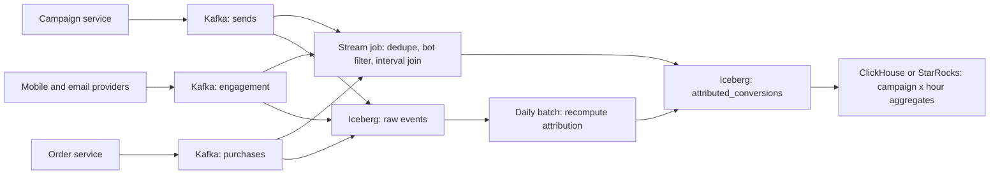

## 🎯 خلاصه

> تحلیل کمپین به این سؤال جواب می‌دهد: «آیا این اعلان باعث خرید شد؟» این یک **join زمانی بین stream های رویداد** است: یک ارسال، بعد تعامل (تحویل، باز شدن، کلیک)، و بعد تبدیل (خرید)، که هرکدام باید در داخل یک **پنجرهٔ انتساب (attribution window)** که تو تعریف کرده‌ای، به کمپین درست وصل شوند.

- از کلیدهای پایدار استفاده کن: هر ارسال یک `send_id` می‌گیرد و هر رویداد آن را حمل می‌کند. بدون این کلید، join ها حدس‌اند.
- **انتساب** را در دو مرحله بساز: یک job استریم برای داشبورد تازه و تقریبی، و یک بازمحاسبهٔ دسته‌ای برای عددهایی که گزارش و بر اساس آن‌ها تصمیم گرفته می‌شود.
- انتساب یک **قانون** است. نسخه‌اش را نگه دار، آن را کنار نتیجه ذخیره کن، و انتظار بازمحاسبه وقتی قانون عوض می‌شود داشته باش.
- قبل از اولین داشبورد برای **رویدادهای دیررسید**، **تکراری‌ها** و **ربات‌ها** (اسکنرهای ایمیل که هر پیام را «باز» می‌کنند) برنامه‌ریزی کن.

## 🌱 از ساده شروع کنیم (مبتدی)

**صورت مسئله.** یک شرکت فروشگاه آنلاین اعلان‌های push و ایمیل را برای کمپین‌ها (فروش ویژه، یادآوری، محصول جدید) می‌فرستد. تیم بازاریابی برای هر کمپین و هر کانال می‌خواهد بداند چند تا ارسال شد، به چند تا تحویل داده شد، چند تا باز شد و چند تا کلیک شد، و چند کاربر در چند روز بعد از کلیک خرید کردند. داشبورد باید تازه باشد (حدود ۱۵ دقیقه) و عددهای گزارش‌شده درست و قابل بازتولید باشند.

> **💡 تشبیه:** یک دفتر پستی که یک بروشور را دنبال می‌کند. ثبت می‌کند بروشور کی پست شد، رسید یا نه، خواننده آمد یا نه، و در هفتهٔ بعد خرید کرد یا نه. سؤال «آیا بروشور جواب داد؟» به چهار ثبت نیاز دارد که با شمارهٔ بروشور join شوند، و قانون «خرید در یک هفته بعد از مراجعه» باید نوشته شده باشد.

**نیازمندی‌های کاربردی**

- دریافت ارسال‌ها، رسیدهای تحویل، بازشدن‌ها، کلیک‌ها و خریدها.
- انتساب هر خرید به حداکثر یک کمپین (با قاعدهٔ مشخص) و یک پنجرهٔ زمانی.
- نمایش تعداد و نرخ‌ها به تفکیک کمپین، کانال، روز و بخش کاربران.
- پاسخ به «اگر قانون هفتهٔ گذشته را عوض کنیم چه می‌شود؟» با بازپردازش.

**نیازمندی‌های غیرکاربردی**

- تازگی: داشبورد در ۱۵ دقیقه؛ عدد نهایی در ۲۴ ساعت.
- درستی: شمارش دوباره نداریم، و عدد هر تاریخ گذشته قابل بازتولید است.
- مقیاس: اوج ترافیک در فروش‌های بزرگ.
- حریم خصوصی: شناسهٔ کاربر در تحلیل pseudonymous است و کاربران حذف‌شده از گزارش‌های آینده بیرون می‌روند (ببین [[design-user-deletion]]).

**برآورد (محاسبه را نشان بده)**

- کاربران: ۳۰ میلیون. هر کدام ۴ اعلان در روز → ۳۰M × ۴ = **۱۲۰ میلیون ارسال در روز**.
- رویداد تعامل برای هر ارسال: تحویل، باز شدن، کلیک ≈ ۳ → ۱۲۰M × ۳ = **۳۶۰ میلیون رویداد در روز**.
- خرید: ۵ میلیون در روز.
- جمع: ۳۶۵ میلیون رویداد در روز. نرخ میانگین: ۳۶۵,۰۰۰,۰۰۰ / ۸۶,۴۰۰ ثانیه ≈ **۴,۲۰۰ رویداد در ثانیه**. یک فروش بزرگ می‌تواند ۴ برابر میانگین باشد، پس برای اوج **حدود ۱۷,۰۰۰ رویداد در ثانیه** برنامه‌ریزی کن.
- اندازهٔ هر رویداد حدود ۴۰۰ بایت خام → ۳۶۵M × ۴۰۰ B ≈ **۱۴۶ گیگابایت در روز** JSON خام، یعنی حدود ۴٫۴ ترابایت در ماه. در قالب ستونی فشرده (Parquet، Iceberg) خیلی کوچک‌تر است، اغلب چند برابر کمتر؛ قبل از اینکه عددی قول بدهی، روی داده‌های خودت اندازه بگیر.

این حجم برای Kafka و lakehouse عادی است. سختی در **join زمانی** و قواعدی است که دور آن نوشته می‌شود.

## 🔧 واقعاً چطور کار می‌کند (متوسط)

**مدل رویداد.** یک رویداد برای هر واقعیت نگه دار، و همه کلیدهای یکسان را حمل کنند:

```text
send        : send_id, campaign_id, user_id, channel, sent_at
engagement  : event_id, send_id, type (delivered|opened|clicked), event_ts, received_at
purchase    : order_id, user_id, amount, order_ts
```

`send_id` را سرویس کمپین **یک بار** وقتی ارسال را می‌سازد تولید می‌کند. رویدادهای تعامل آن را کپی می‌کنند. خریدها کمپین را نمی‌دانند، پس انتساب باید آن‌ها را با `user_id` و زمان به کلیک‌ها وصل کند.

**pipeline**



**قاعدهٔ انتساب (آخرین کلیک در یک پنجره).** برای هر خرید، آخرین کلیک همان کاربر را در ۷ روز قبل از خرید پیدا کن، و کمپین آن کلیک را اعتبار بده. هر خرید را فقط یک بار بشمار. قاعده را به‌صورت داده بنویس:

```sql
-- Last click within 7 days before the order (illustrative, batch version)
WITH clicks AS (
  SELECT e.send_id, s.campaign_id, s.user_id, e.event_ts AS click_ts
  FROM engagement e
  JOIN send s ON s.send_id = e.send_id
  WHERE e.type = 'clicked'
),
ranked AS (
  SELECT p.order_id, p.user_id, p.amount, p.order_ts,
         c.campaign_id, c.send_id, c.click_ts,
         ROW_NUMBER() OVER (
           PARTITION BY p.order_id
           ORDER BY c.click_ts DESC, c.send_id DESC
         ) AS rn
  FROM purchases p
  JOIN clicks c
    ON c.user_id = p.user_id
   AND c.click_ts <= p.order_ts
   AND c.click_ts >  p.order_ts - INTERVAL '7' DAY
)
SELECT order_id, user_id, amount, campaign_id, send_id, click_ts
FROM ranked
WHERE rn = 1;
```

`ROW_NUMBER` با یک tiebreaker یکتا (`send_id`) نتیجه را قطعی می‌کند. بدون آن، دو کلیک با زمان یکسان ممکن است در اجراهای مختلف به کمپین‌های متفاوت اعتبار بدهند. ببین [[window-function]].

**نسخهٔ استریم.** job استریم همان join را با **interval join** انجام می‌دهد: یک کلیک وقتی با یک خرید match می‌شود که زمان خرید در `[click_ts, click_ts + 7 days]` باشد. موتور کلیک‌ها را برای ۷ روز در [[state-store]] نگه می‌دارد، پس state بزرگ است. فقط فیلدهای لازم را نگه دار، state را با `user_id` کلید بزن، و ورودی‌ها را وقتی پنجره بسته شد منقضی کن. نتیجه یک برآورد سریع است. با رسیدن کلیک‌های دیررس ممکن است عوض شود، پس آن را موقتی (provisional) برچسب بزن.

**dedupe و ربات‌ها.**

- هر رویداد تعامل یک `event_id` یکتا دارد. روی `(send_id, type, event_id)` با state محدود deduplicate کن (ببین [[deduplication]]).
- اسکنرهای ایمیل و بررسی‌کننده‌های لینک خودکار پیام‌ها را «باز» و «کلیک» می‌کنند. با user agent های شناخته‌شده و الگوهای غیرممکن فیلتر کن (مثلاً باز شدن کمتر از ۱۰۰ میلی‌ثانیه بعد از تحویل از یک بازهٔ IP شرکتی). رویداد خام را نگه دار، ولی رویدادهای علامت‌خورده را از متریک کنار بگذار.

**داده‌های دیررس.** اپ‌های موبایل بعد از آفلاین بودن، رویدادها را ساعت‌ها بعد می‌فرستند. برای پنجره‌ها از زمان رویداد (`event_ts`) و برای استریم از [[watermark]] استفاده کن. رویدادهای دیررس را تا یک دیرکرد مشخص قبول کن، و بقیه را job روزانه پوشش دهد. ببین [[late-arriving-data]].

**نوشتنی که شمارش دوباره ندارد.** sink ها باید idempotent باشند. جدول انتساب را با `(order_id)` و نسخهٔ قانون فعلی upsert کن، یا در Iceberg با همان کلید `MERGE` بزن. اگر job دوباره اجرا شد، همان ردیف بازنویسی می‌شود و ردیف تازه‌ای اضافه نمی‌شود. ببین [[upsert]] و [[idempotency]].

**سرو کردن.** داده را در یک انبار OLAP به `campaign_id × channel × hour` تجمیع کن ([[olap]]). نسخهٔ قانون و زمان «محاسبه‌شده در» را در هر ردیف نگه دار، تا داشبورد بتواند بگوید «تا ۱۰:۱۵ موقت» یا «نهایی، قانون v3».

## 🧠 عمق و trade-offها (سنیور)

**deep dive ۱: join بین stream های رویداد.**

- یک join استریم-به-استریم هر دو طرف را برای طول پنجره بافر می‌کند. با ۱۲۰ میلیون ارسال در روز و پنجرهٔ انتساب ۷ روزه، state ساده حدود ۸۴۰ میلیون ردیف ارسال نگه می‌دارد. این بزرگ است اما با state پشتیبانی‌شده توسط RocksDB، رکوردهای فشرده و TTL قابل اداره است. پیش از تعهد، اندازهٔ state به‌ازای هر کلید را اندازه بگیر.
- join دسته‌ای روی lake ارزان‌تر و دقیق است، چون همهٔ داده را یک‌جا می‌بیند. تقسیم معمول: استریم برای داشبوردهای چند دقیقه‌ای، دسته‌ای برای عددهای گزارش‌شده.
- مراقب skew باش. یک کاربر خیلی فعال، یا یک حساب ربات که هزاران کلیک می‌زند، یک کلید داغ می‌شود. قبل از join محدودش کن یا فیلتر کن.

**deep dive ۲: پنجره‌های انتساب و قواعد.**

- قاعده را با کسب‌وکار انتخاب کن. گزینه‌های رایج: آخرین کلیک، اولین کلیک، خطی بین همهٔ کلیک‌ها، و view-through (نمایش بدون کلیک، معمولاً با پنجرهٔ کوتاه). هر کدام عدد متفاوتی می‌دهند، و بازاریابی چند تای آن‌ها را می‌خواهد.
- قاعده را یک **artifact نسخه‌دار** کن: یک config با `rule_version`، طول پنجره و اولویت کانال‌ها. نسخه را در هر نتیجه ذخیره کن. وقتی قانون عوض شد، بازهٔ اثرگرفته را بازمحاسبه کن و نسخهٔ قدیمی را برای مقایسه نگه دار.
- منطقهٔ زمانی مهم است. پنجره‌ها را در pipeline به UTC تعریف کن و فقط برای نمایش تبدیل کن.

**deep dive ۳: exactly-once در عمل.**

- Kafka و موتور استریم می‌توانند پردازش exactly-once داخل pipeline بدهند (ببین [[kafka-exactly-once]])، اما اثرهای بیرونی (نوشتن در lake و انبار OLAP) هنوز به کلیدهای idempotent نیاز دارند. اول کلید را طراحی کن، بعد job را.
- بررسی تطابق ساده است و ارزشش را دارد: تعداد روزانهٔ ارسال‌ها در جدول خام برابر تعداد `send_id` های یکتا در جدول curated است، منهای رویدادهای ربات که صریحاً کنار گذاشته شده‌اند.

**deep dive ۴: عملیات.**

- lag مصرف‌کننده را به‌ازای هر topic زیر نظر داشته باش ([[consumer-lag]])، سن جدیدترین ردیف انتساب‌شده (تازگی)، سهم خریدهای بدون انتساب (یک جهش ناگهانی یعنی کلید join شکسته)، و نرخ فیلتر ربات.
- **نرخ انتساب** را روی داشبورد بگذار. اگر از ۲۵٪ به ۵٪ افت کرد، محتمل‌ترین علت تغییر schema است که انتشار `send_id` را شکسته، نه مشکل بازاریابی.

**انتظار سطح Staff.** کاندیداهای Staff معمولاً:

- **واقعیت** (هر رویداد، تغییرناپذیر) را از **انتساب** (نتیجهٔ مشتق‌شده و نسخه‌دار) جدا می‌کنند و توضیح می‌دهند چرا جدول‌های جدا هستند ([[fact-table]]).
- هزینهٔ join دقیق را در برابر ارزش تازگی توضیح می‌دهند و طراحی دوسرعته را با برچسب واضح برای عددهای موقت پیشنهاد می‌دهند.
- حاکمیت را پوشش می‌دهند: چه کسی تغییر قانون را تأیید می‌کند، چطور ممیزی می‌شود، و بازاریابی چطور دو قانون را کنار هم مقایسه می‌کند.
- مسیر حریم خصوصی را برنامه‌ریزی می‌کنند: شناسه‌های pseudonymous، پرچم رضایت روی هر ارسال، و درخواست‌های حذف که کاربر را از بازسازی‌های آینده بیرون می‌برند.

**کی این را نسازیم.** اگر شرکت چند کمپین در ماه اجرا می‌کند و یک پلتفرم تبلیغاتی عددها را گزارش می‌دهد، از گزارش‌گیری داخلی پلتفرم استفاده کن و pipeline نساز. این را وقتی بساز که انتساب بین‌کانالی، قواعد سفارشی و trail ممیزی لازم است.

## 🧪 امتحان کن

1. **محاسبهٔ پنجره.** یک خرید در ۲۰۲۶-۱۰-۱۰ ساعت ۱۲:۰۰ UTC رخ می‌دهد. کلیک‌هایی در ۲۰۲۶-۱۰-۰۳ ساعت ۱۱:۵۹، ۲۰۲۶-۱۰-۰۳ ساعت ۱۲:۰۰ و ۲۰۲۶-۱۰-۱۰ ساعت ۰۹:۰۰ وجود دارند. با پنجرهٔ ۷ روزهٔ `(order_ts - 7 days, order_ts]`، کدام کلیک‌ها واجد شرایط‌اند، و با قاعدهٔ آخرین کلیک کدام کمپین برنده است؟
2. **دفاع در برابر تکرار.** یک consumer تکرارشوندهٔ Kafka همان ردیف انتساب‌شده را دو بار می‌نویسد. نوشتنی در sink را توصیف کن که جدول را بدون job پاک‌سازی جداگانه درست نگه دارد.
3. **تغییر قانون.** بازاریابی پنجره را از ۷ روز به ۳ روز تغییر می‌دهد. توصیف کن چه چیزی را بازمحاسبه می‌کنی، چه چیزی را نگه می‌داری، و داشبورد تغییر را چطور نشان می‌دهد.

<details><summary>جواب‌ها را ببین</summary>

**۱.** پنجره `(2026-10-03 12:00, 2026-10-10 12:00]` است. کلیک ساعت ۱۱:۵۹ روز ۱۰-۰۳ بیرون پنجره است (۷ روز و ۱ دقیقه قبل از سفارش). کلیک ساعت ۱۲:۰۰ روز ۱۰-۰۳ روی مرز است: شمرده شدنش به باز یا بسته بودن ابتدای پنجره بستگی دارد. یک قاعده را انتخاب کن و بگو؛ انتخاب رایج `click_ts > order_ts - 7 days` است (ابتدا باز)، که آن را کنار می‌گذارد. کلیک ساعت ۰۹:۰۰ روز ۱۰-۱۰ واجد شرایط است و با قاعدهٔ آخرین کلیک برنده می‌شود.

**۲.** یک upsert با کلید `order_id` (یا `MERGE ... ON order_id`) بزن که نسخهٔ قانون بخشی از ردیف باشد، و فقط آخرین انتساب هر سفارش را نگه داری. نوشتن دوم همان ردیف را با همان مقادیر بازنویسی می‌کند، پس جدول یک ردیف برای هر سفارش دارد. روی یک job پاک‌سازی بعدی حساب نکن.

**۳.** فقط بازهٔ اثرگرفته را بازمحاسبه کن، مثلاً سفارش‌های ۳ روز اخیر و سفارش‌هایی که کلیکشان بیرون از پنجرهٔ جدید می‌افتد. نتایج نسخهٔ قدیمی را در یک ستون یا جدول جدا نگه دار تا بازاریابی مقایسه کند. هر دو عدد را با نسخهٔ قانون و زمان «تا لحظه» روی داشبورد نشان بده.

</details>

## 💬 گوشه‌ی مصاحبه

**سؤال: «یک pipeline تحلیل کمپین برای اعلان‌ها طراحی کن.»**

- **جواب متوسط:** «ارسال‌ها، بازشدن‌ها و کلیک‌ها را در Kafka جمع می‌کنم، در lake ذخیره می‌کنم، و خریدها را با SQL window به آخرین کلیک در ۷ روز join می‌کنم. تجمیع‌ها به یک جدول OLAP برای داشبورد می‌روند.»
- **جواب سنیور:** «هر رویداد `send_id` را حمل می‌کند، که کلید join است. انتساب یک قاعدهٔ نسخه‌دار است که در دو مرحله محاسبه می‌شود: یک interval join استریم برای عددهای تازهٔ موقت، و یک بازمحاسبهٔ روزانهٔ دسته‌ای برای عددهای نهایی. روی شناسهٔ رویداد dedupe می‌کنم، ربات‌ها را فیلتر می‌کنم، از event time با watermark برای رویدادهای دیررس موبایل استفاده می‌کنم، و sink ها را idempotent می‌کنم تا تکرارها شمارش دوباره نشوند.»
- **جواب Staff:** هزینهٔ state استریم، حاکمیت تغییر قانون، مسیر حریم خصوصی برای حذف، و پایش نرخ انتساب به‌عنوان شاخص زودهنگام joinهای شکسته را اضافه می‌کند.

**follow-upهایی که انتظار داشته باش**

- چرا همه‌چیز را در یک job استریم join نمی‌کنی؟ (اندازهٔ state و نیاز به تغییر قانون؛ دسته‌ای می‌تواند بازمحاسبه کند.)
- اگر کلیکی بعد از اینکه خرید به کمپین دیگری اعتبار داده شده بود برسد چه؟ (قاعده را قطعی نگه دار. سفارش را در batch بعدی بازمحاسبه کن، یا برچسب موقت را بپذیر و تغییرش را علامت بزن.)
- چطور ثابت می‌کنی عددها درست‌اند؟ (شمارش تطابق از خام تا curated، و نمونه‌برداری ممیزی از ردیف‌های join شده در برابر لاگ‌های منبع.)

> **🎤 این را در مصاحبه بگو:** «انتساب کمپین یک join زمانی بین سه stream است که با `send_id` کلید خورده، و مطمئن می‌شوم هر رویداد آن را حمل کند. آن را دو بار اجرا می‌کنم: یک نسخهٔ سریع استریم که واضح موقت برچسب خورده، و یک نسخهٔ دسته‌ای نسخه‌دار که عددهای گزارش‌شده را می‌سازد. dedupe، فیلتر ربات و نوشتن idempotent چیزی است که عددها را صادق نگه می‌دارد.»

## ⚠️ اشتباهات رایج

> **⚠️ Watch out:** join کردن خریدها به کلیک‌ها فقط با `user_id` و بدون کران زمانی. آن‌وقت هر خرید با هر کلیکی که کاربر تا آن زمان داشته match می‌شود و «آخرین کلیک» دلخواه می‌شود.

> **⚠️ Watch out:** شمردن بازشدن‌های اسکنر ایمیل به‌عنوان تعامل انسانی. نرخ باز شدن سالم به نظر می‌آید در حالی که تعامل واقعی افت کرده، و کسی متوجه نمی‌شود تا وقتی کمپین شکست بخورد.

- استفاده از زمان رسیدن به‌جای زمان رویداد، طوری که کلیک کمپین دیروز در عددهای امروز بیفتد.
- فراموش کردن tiebreaker یکتا در `ROW_NUMBER`، که باعث می‌شود داده‌ی یکسان در اجراهای مختلف برنده‌های متفاوت بدهد.
- اجازه دادن که نتیجهٔ استریم به‌عنوان نهایی گزارش شود، در حالی که رویدادهای دیررس هنوز می‌توانند آن را عوض کنند.
- تغییر قانون انتساب در جا بدون نسخه، که باعث می‌شود عددهای ماه قبل قابل بازتولید نباشند.
- ذخیرهٔ «نرخ تبدیل» به‌صورت میانگین نرخ‌های ذخیره‌شده، به‌جای جمع تبدیل‌ها و کلیک‌ها و تقسیم در زمان پرس‌وجو.
- ساختن join کامل استریم قبل از اینکه بررسی کنی آیا بازمحاسبهٔ دسته‌ای به‌تنهایی نیاز تازگی را برآورده می‌کند.

## ✅ خودت را بسنج (quiz)

1. مهم‌ترین دلیل اینکه هر رویداد تعامل باید `send_id` را حمل کند چیست؟
   - A) سرعت بیشتر پارتیشن‌های Kafka
   - B) کلید پایداری است که یک باز شدن یا کلیک را بدون حدس به ارسال و کمپین دقیق وصل می‌کند
   - C) جایگزینی نیاز به زمان‌ها
   - D) فقط برای ایمیل لازم است، نه push

<details><summary>جواب</summary>

**B** — بدون کلید مشترک، فقط می‌توانی با `user_id` و زمان join کنی، که وقتی کاربر چند کمپین دریافت کرده مبهم است. `send_id` یک بار تولید می‌شود و به هر رویداد مرتبط کپی می‌شود.

</details>

2. یک خرید باید به آخرین کلیک در ۷ روز قبل از سفارش اعتبار داده شود. کدام ساختار SQL یک کلیک را برای هر سفارش به‌طور قطعی انتخاب می‌کند؟

   - A) `DISTINCT order_id`
   - B) `ROW_NUMBER() OVER (PARTITION BY order_id ORDER BY click_ts DESC, send_id DESC) = 1` در یک subquery
   - C) `GROUP BY user_id`
   - D) `LIMIT 1` در انتهای پرس‌وجو

<details><summary>جواب</summary>

**B** — تابع پنجره‌ای کلیک‌ها را برای هر سفارش رتبه‌بندی می‌کند، و tiebreaker با `send_id` انتخاب را تکرارپذیر می‌کند. `DISTINCT` و `LIMIT` بر اساس قاعده انتخاب نمی‌کنند، و `GROUP BY user_id` سفارش‌هایی را که باید نگه داری جمع می‌کند.

</details>

3. بازشدن‌های موبایل تا شش ساعت دیرتر می‌رسند. job استریم تو برای پنجره‌ها از processing time استفاده می‌کند. چه اشتباهی رخ می‌دهد و راه‌حل چیست؟

   - A) هیچ؛ processing time همیشه درست است
   - B) بازشدن‌های دیررس در ساعت اشتباه می‌افتند و عددهای ساعتی بعد از انتشار عوض می‌شوند؛ از event time با watermark و دیرکرد مشخص استفاده کن، و بقیه را بازمحاسبهٔ روزانه پوشش دهد
   - C) بازشدن‌ها را نمی‌شود در Iceberg ذخیره کرد
   - D) راه‌حل حذف همهٔ بازشدن‌های قدیمی‌تر از یک دقیقه است

<details><summary>جواب</summary>

**B** — با processing time، بازشدنی که ساعت ۱۰:۰۵ رخ داده اما ساعت ۱۵:۰۰ رسیده در سطل ۱۵:۰۰ شمرده می‌شود، پس ساعت ۱۰ اشتباه است. event time آن را در سطل درست می‌گذارد، و watermark به‌همراه بازمحاسبه کار را تمام می‌کند.

</details>

4. **(سنیور)** یک interval join استریم-به-استریم یک پنجرهٔ ۷ روزهٔ کلیک را برای ۱۲۰ میلیون ارسال در روز در state نگه می‌دارد. دو راه مشخص برای کاهش هزینهٔ state بده و بگو هرکدام چه چیزی را از دست می‌دهد.

   - A) افزایش parallelism به ۱
   - B) نگه‌داشتن فقط فیلدهای لازم و کلید زدن state با `user_id` با TTL برای انقضا (چیزی از دست نمی‌رود جز تلاش کد)، و انتقال نتیجهٔ دقیق به یک join روزانهٔ دسته‌ای (تازگی عدد نهایی از دست می‌رود)
   - C) حذف watermark
   - D) ذخیرهٔ همه‌چیز به‌صورت JSON

<details><summary>جواب</summary>

**B** — state فشرده و TTL حافظه را بدون تغییر نتیجه کم می‌کنند. انتقال دقت به دسته‌ای state بزرگ را از مسیر بحرانی بیرون می‌برد، به هزینهٔ اینکه خروجی استریم موقت است. مصاحبه‌گر می‌خواهد بدانی چه چیزی را معامله می‌کنی.

</details>

5. **(سنیور)** بازاریابی می‌خواهد آخرین کلیک را با انتساب خطی برای سه‌ماههٔ گذشته مقایسه کند، و داشبورد نباید آن‌ها را مخلوط کند. کدام طراحی این را ممکن و قابل ممیزی می‌کند؟

   - A) هر بار که قانون عوض می‌شود جدول را بازنویسی کن
   - B) نتیجهٔ انتساب را با `rule_version` و زمان «تا لحظه» ذخیره کن، تعریف قوانین را به‌عنوان config نسخه‌دار نگه دار، و هر دو نسخه را کنار هم در لایهٔ سرو نشان بده
   - C) انتساب خطی را در مرورگر محاسبه کن
   - D) داده‌های سه‌ماههٔ گذشته را حذف کن

<details><summary>جواب</summary>

**B** — نتیجهٔ نسخه‌دار هر نمای محاسبه‌شده را قابل بازتولید نگه می‌دارد، و ستون نسخه از مخلوط شدن اتفاقی جلوگیری می‌کند. بازنویسی خط مبنا را از بین می‌برد و محاسبهٔ سمت کلاینت قابل ممیزی نیست.

</details>

## 🗂️ فلش‌کارت

| Front | Back |
|---|---|
| چرا هر رویداد `send_id` را حمل می‌کند | کلید پایدار join از یک ارسال به تعامل‌ها و کمپین آن |
| انتساب آخرین کلیک | آخرین کلیک واجد شرایط قبل از خرید، داخل پنجره |
| چرا `ROW_NUMBER` tiebreaker لازم دارد | زمان‌های برابر وگرنه برنده‌های تکرارناپذیر می‌دهند |
| شرط interval join | `click_ts` بین `order_ts - window` و `order_ts` (لبهٔ باز یا بسته را مشخص کن) |
| event time در مقابل processing time برای بازشدن | event time رویداد دیررس را در سطل درست می‌گذارد |
| sink idempotent برای ردیف‌های انتساب‌شده | upsert یا MERGE با کلید `order_id` تا تکرار بازنویسی کند، نه اضافه |
| چرا `rule_version` ذخیره شود | بازتولید، مقایسه و ممیزی عددها بعد از تغییر قانون |
| شاخص زودهنگام joinهای شکسته | افت ناگهانی سهم خریدهای دارای انتساب |

## 🔗 ادامه

- درس‌های مرتبط: [[design-clickstream-analytics]] (همان الگو برای کلیک‌های وب) و [[design-ad-click-aggregator]] (شمارش کلیک با حجم بالا).
- مدل‌سازی جدول‌های curated: [[fact-table-types]] و [[dimensional-modeling]].
- بازپخش و بازمحاسبه بعد از تغییر قانون: [[backfills]].
- قابلیت اطمینان pipeline: [[delivery-semantics]] و [[data-quality]].

