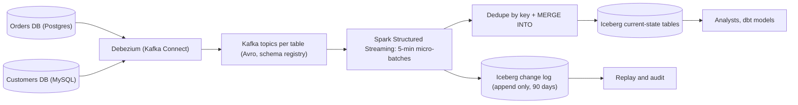

## 🎯 خلاصه

> یک lake بساز که دیتابیس‌های عملیاتی چندین microservice را با خواندن **لاگ تغییرات** آن‌ها آینه کند، نه با کوئری زدن به جدول‌ها. تغییرات را با **Debezium** به Kafka بفرست، هر تغییر را در یک **تاریخچه‌ی append-only** ذخیره کن، و آخرین وضعیت را با یک `MERGE` idempotent روی جدول **Iceberg** اعمال کن. ترتیب‌دهی، حذف‌ها و تغییر schema جایی‌اند که طراحی موفق یا شکست می‌خورد.

- لاگ تراکنش دیتابیس (WAL یا binlog) را با Debezium بخوان. هرگز جدول‌های production را poll نکن.
- تغییرات را بر اساس **موقعیت لاگ** (LSN، موقعیت binlog) مرتب کن، نه بر اساس timestampهای ساعت دیواری.
- دو خروجی نگه دار: یک **change log** (تاریخچه، قابل replay) و یک **جدول وضعیت فعلی** (چیزی که تحلیلگران کوئری می‌زنند).
- حذف‌ها در جدول وضعیت فعلی به‌صورت `MERGE DELETE` انجام می‌شوند، ولی برای اینکه واقعاً از lake پاک شوند به **expire کردن snapshot ها و پاک‌سازی فایل‌ها** نیاز دارند.
- تغییرات schema از یک registry با قواعد سازگاری عبور می‌کنند؛ Iceberg ستون‌ها را با ID دنبال می‌کند و این تغییر نام را امن می‌کند.

## 🌱 از ساده شروع کنیم (مبتدی)

> **💡 تشبیه:** دفتر روزنامه‌ی یک بانک را در نظر بگیر. شعبه هر تراکنش را به ترتیب در یک دفتر روزنامه می‌نویسد. یک حسابدار مرکزی سطر به سطر روزنامه را در دفتر دوم کپی می‌کند که همیشه موجودی فعلی را نشان می‌دهد. اگر حسابدار به ترتیب درست کپی کند و هیچ سطری را جا نیندازد، دفتر دوم دقیقاً با شعبه می‌خواند. CDC همان دفتر روزنامه است و جدول lake دفتر دوم.

**مسئله.** یک شرکت حدود ۶۰ microservice دارد. هر سرویس یک دیتابیس PostgreSQL یا MySQL دارد. تحلیلگران به یک جای واحد نیاز دارند که وضعیت فعلی همه‌ی جدول‌ها و تاریخچه‌ی تغییرات را داشته باشد، و داده‌ها باید در **۱۵ دقیقه** تازه باشند. lake همچنین باید وقتی درخواست قانونی برای حذف داده‌ی شخصی یک مشتری می‌رسد، حذف را پشتیبانی کند.

**نیازمندی‌های عملکردی**

- گرفتن هر درج، به‌روزرسانی و حذف از دیتابیس‌های منبع، برای حدود ۳۰۰ جدول.
- نگه‌داشتن یک **جدول وضعیت فعلی** برای هر جدول منبع (یک سطر برای هر primary key).
- نگه‌داشتن **تاریخچه‌ی تغییرات** (هر رویداد تغییر) حداقل ۹۰ روز، برای ممیزی و replay.
- پشتیبانی از time travel روی جدول lake («این سفارش در ۱ اسفند چه شکلی بود؟»).
- مدیریت ستون‌های جدید و تغییر نام ستون‌ها در جدول‌های منبع، در بیشتر موارد بدون دخالت دستی.
- پشتیبانی از حذف داده‌ی شخصی یک مشتری در همه‌ی جدول‌ها.

**نیازمندی‌های غیرعملکردی (فرض‌های ما)**

- حجم تغییرات: میانگین **۲٬۰۰۰ تغییر در ثانیه**، در اوج **۶٬۰۰۰ در ثانیه**.
- تازگی: جدول وضعیت فعلی حداکثر **۱۵ دقیقه** بعد از commit در منبع، در p95.
- دیتابیس‌های منبع نباید بار اضافه‌ای جز خواندن معمول WAL یا binlog ببینند.
- **اثر** exactly-once روی جدول وضعیت فعلی: replay نباید تکراری بسازد یا سطرهای حذف‌شده را زنده کند.
- از دست رفتن داده قابل قبول نیست؛ تأخیر قابل قبول است.

## 🔧 واقعاً چطور کار می‌کند (متوسط)

### تخمین

- تغییرات در روز: ۲٬۰۰۰ × ۸۶٬۴۰۰ ≈ **۱۷۳ میلیون رویداد در روز**.
- اندازه‌ی رویداد: envelope مربوط به Debezium با فیلدهای `before`، `after`، `source` و `op` به‌صورت JSON حدود **۱ KB** و به‌صورت Avro حدود **۰٫۴ KB** است. خام در Kafka (Avro): ۱۷۳ M × ۰٫۴ KB ≈ **۶۹ GB در روز**.
- نگهداری ۷ روزه‌ی topicهای تغییر در Kafka: ۶۹ × ۷ ≈ **۴۸۳ GB** (قبل از replication).
- change log در Iceberg (Parquet، با فشرده‌سازی حدود ۴:۱ نسبت به payload آ‌ورو): ۶۹ / ۴ ≈ **۱۷ GB در روز**، یا حدود **۶٫۳ TB در سال**. نگهداری ۹۰ روز داغ: ≈ **۱٫۵ TB**.
- جدول‌های وضعیت فعلی: داده‌ی عملیاتی روی هم حدود **۲ TB** است. در Parquet حدود **۵۰۰ GB**، بدون احتساب snapshotهای time travel.
- micro-batch اوج: یک batch پنج‌دقیقه‌ای در اوج ۶٬۰۰۰ × ۳۰۰ = **۱٫۸ میلیون** رویداد تغییر دارد. هر batch باید در چند دقیقه deduplicate و merge شود، و این اندازه‌ی cluster را تعیین می‌کند.

نکته‌ی این محاسبات: change log ارزان است، ولی یک `MERGE` ساده روی جدول ۵۰۰ GB تعداد زیادی فایل را بازنویسی می‌کند. الگوی نوشتن هزینه را تعیین می‌کند، نه حجم کل.

### مسیر داده



هر جدول منبع topic Kafka مخصوص خودش را دارد که با نام دیتابیس و جدول نام‌گذاری شده. connector یک بار در حالت snapshot اجرا می‌شود و بعد از لاگ استریم می‌گیرد. job اسپارک همه‌ی topicها را می‌خواند، رویدادها را در micro-batchهای پنج‌دقیقه‌ای گروه می‌کند، در change log می‌نویسد و سپس آن‌ها را در جدول‌های وضعیت فعلی merge می‌کند.

### Debezium: رویدادها چه شکلی هستند

هر رویداد تغییر یک فیلد `op` دارد: `c` (ایجاد)، `u` (به‌روزرسانی)، `d` (حذف)، و `r` (خواندن، در زمان snapshot اولیه). در رویداد حذف، `before` تصویر قبلی را دارد و `after` برابر null است. سپس Debezium یک **tombstone** (پیامی با مقدار null) می‌فرستد تا log compaction در Kafka کلید را حذف کند.

بلوک `source` موقعیت در لاگ را نگه می‌دارد. برای PostgreSQL فیلدهای `lsn` و `txId` هستند. برای MySQL فیلدهای `file` و `pos`. این کلید ترتیب است. `ts_ms` زمانی است که Debezium تغییر را خوانده، و بین دو تغییر روی یک سطر ترتیب درستی نمی‌دهد.

پیش‌نیازهای جدول روی منبع:

- PostgreSQL: replication منطقی با plugin از نوع `pgoutput`، یک replication slot، و یک publication برای جدول‌های موردنظر. slot را زیر نظر داشته باش: اگر connector متوقف شود، WAL روی منبع جمع می‌شود و می‌تواند دیسک آن را پر کند. برای lag این slot هشدار بگذار.
- MySQL: `binlog_format = ROW` و `binlog_row_image = FULL` تا تصویر `before` کامل باشد.

### حذف تکرار، سپس merge

داخل یک micro-batch، یک کلید ممکن است چند بار ظاهر شود (سفارشی ساخته شده، دو بار به‌روز شده، و بعد دوباره). یک `MERGE` که چند سطر منبع را به یک سطر هدف وصل کند در بیشتر موتورها شکست می‌خورد، پس batch را اول به یک سطر برای هر کلید کاهش بده:

```sql
MERGE INTO lake.orders AS t
USING (
  SELECT order_id, status, amount, op, source_lsn
  FROM (
    SELECT order_id, status, amount, op, source_lsn,
           ROW_NUMBER() OVER (PARTITION BY order_id
                              ORDER BY source_lsn DESC) AS rn
    FROM orders_cdc_batch
  ) ranked
  WHERE rn = 1
) AS s
ON t.order_id = s.order_id
WHEN MATCHED AND s.source_lsn > t.source_lsn AND s.op = 'd' THEN DELETE
WHEN MATCHED AND s.source_lsn > t.source_lsn THEN
  UPDATE SET t.status = s.status, t.amount = s.amount, t.source_lsn = s.source_lsn
WHEN NOT MATCHED AND s.op <> 'd' THEN
  INSERT (order_id, status, amount, source_lsn)
  VALUES (s.order_id, s.status, s.amount, s.source_lsn);
```

هر بخش چرا مهم است:

- `ROW_NUMBER ... ORDER BY source_lsn DESC` آخرین تغییر هر کلید را داخل batch نگه می‌دارد.
- `s.source_lsn > t.source_lsn` مرج را **idempotent و امن در برابر ترتیب** می‌کند. اگر یک batch بعد از ری‌استارت دوباره اجرا شود، یا رویداد قدیمی‌تری دیر برسد، هدف وضعیت جدیدترش را نگه می‌دارد. بدون این شرط، replay سطرها را به عقب برمی‌گرداند.
- حذف‌ها سطر را از وضعیت فعلی بیرون می‌برند. رویداد حذف همچنان در change log هست.

جدول هدف باید برای هر سطر `source_lsn` (یا ترکیب فایل و موقعیت) را ذخیره کند تا شرط محافظ کار کند.

### چیدمان Iceberg

- **Partitioning:** جدول وضعیت فعلی را بر اساس تاریخ partition نکن؛ کلید primary چیزی است که `MERGE` روی آن match می‌کند. از تبدیل **bucket** در Iceberg روی کلید استفاده کن، مثلاً `bucket(16, order_id)`. آن‌وقت هر batch فقط bucketهای تغییر کرده را لمس می‌کند و فایل‌های همان bucket بازنویسی می‌شوند، نه کل جدول.
- **Change log:** بر اساس `day(event_time)` partition کن، فقط append. بدون merge، پس نوشتن ارزان است و replay آسان.
- **فایل‌های کوچک:** هر micro-batch پنج‌دقیقه‌ای فایل‌های کوچک در هر bucket می‌سازد. هر ساعت compaction (بازنویسی فایل‌های داده) و هر روز expire کردن snapshotهای قدیمی و پاک کردن فایل‌های یتیم را زمان‌بندی کن.

## 🧠 عمق و trade-offها (سنیور)

### ترتیب بین جدول‌ها

merge روی یک جدول امن است اگر موقعیت‌های منبع برای هر کلید یکنواخت باشند. بین جدول‌ها ترتیب سراسری وجود ندارد و نباید سعی کنی یکی بسازی. یک کلید خارجی ممکن است به سطری اشاره کند که هنوز نرسیده، پس وضعیت lake بین جدول‌ها **eventually consistent** است. تحلیلگران باید با یک پنجره‌ی کوتاه ناسازگاری join کنند. اگر گزارشی به یک نقطه‌ی زمانی سازگار بین جدول‌ها نیاز دارد، از change log استفاده کن و موقعیتی از منبع را انتخاب کن که در همه‌ی topicها کامل باشد (یک watermark روی LSN برای هر دیتابیس منبع)، نه یک زمان ساعت دیواری.

### snapshot اولیه بدون شکاف

وقتی یک جدول جدید اضافه می‌شود، Debezium یک snapshot می‌گیرد (`op = r` برای هر سطر) در حالی که استریم ادامه دارد. دو قانون lake را درست نگه می‌دارد:

- رویدادهای snapshot و استریم برای یک کلید ممکن است در هر ترتیبی برسند. شرط `source_lsn` این را مدیریت می‌کند: سطرهای snapshot LSN زمان snapshot را دارند، و هر تغییر استریمی جدیدتر LSN بزرگ‌تری دارد.
- جدول وضعیت فعلی را در production وقتی CDC در حال اجراست truncate و دوباره load نکن. snapshot را در یک جدول سایه load کن، بگذار CDC برسد، و بعد جایگزین کن. این جایگزینی در Iceberg یک عملیات metadata است.

snapshotهای افزایشی (با سیگنال، در نسخه‌های جدیدتر Debezium) قفل‌های طولانی روی جدول‌های بزرگ را حذف می‌کنند. نسخه‌ای را که اجرا می‌کنی بررسی کن.

### حذف‌ها: از MERGE تا فایل فیزیکی

یک `MERGE ... THEN DELETE` سطر را از جدول **فعلی** برمی‌دارد. Iceberg یک snapshot جدید می‌نویسد که در آن سطر نیست، ولی فایل‌های داده‌ی قدیمی هنوز در snapshotهای قدیمی‌تر ارجاع داده می‌شوند. time travel هنوز می‌تواند داده‌ی مشتری حذف‌شده را بخواند.

برای درخواست حذف قانونی، روش کامل این است:

1. ردیف‌های آن فرد را از همه‌ی جدول‌های وضعیت فعلی با `MERGE` یا یک حذف سطری پاک کن.
2. ردیف‌های آن فرد را از change log پاک کن، یا partitionهای مربوط را بازنویسی کن. change log مقادیر اصلی را در ستون‌های `before` و `after` دارد، پس آن هم داده‌ی شخصی است.
3. snapshotهای قدیمی‌تر از حذف را expire کن تا هیچ snapshotی نتواند فایل‌های قدیمی را بخواند.
4. فایل‌های یتیم را که هیچ snapshotی ارجاع نمی‌دهد پاک کن.
5. تکمیل را در یک جدول ممیزی ثبت کن، با شناسه‌ی درخواست و شناسه‌ی snapshot بعد از پاک‌سازی.

جایگزین برای تاریخچه‌های خیلی بزرگ: **crypto-shredding**. ستون‌های شخصی را با یک کلید مخصوص هر مشتری در lake رمزگذاری کن، و با حذف، کلید را نابود کن. این روش از بازنویسی تاریخچه سریع‌تر است، ولی لازم دارد هر مصرف‌کننده کلید گمشده را مدیریت کند. اگر در مصاحبه درباره‌ی هزینه‌ی بازنویسی پرسیدند، این را مطرح کن.

### تکامل schema

سه لایه مستقل تغییر می‌کنند: جدول منبع، schema رویداد Debezium، و جدول Iceberg.

- **منبع ستون اضافه می‌کند:** Debezium آن را در رویداد بعدی می‌فرستد. schema جدید را با قاعده‌ی **سازگار با عقب (BACKWARD)** در registry ثبت کن (فیلدهای جدید اختیاری با مقدار پیش‌فرض). `ALTER TABLE ... ADD COLUMN` در Iceberg آن را اضافه می‌کند؛ فایل‌های قدیمی برای آن null برمی‌گردانند.
- **منبع ستونی را تغییر نام می‌دهد:** از سمت دیتابیس این شبیه یک drop و یک add است. Iceberg ستون‌ها را با **field ID** دنبال می‌کند، پس تغییر نام در Iceberg یک تغییر metadata است و داده‌ی قدیمی مقادیرش را حفظ می‌کند. نام جدید را عمدی به همان ID نگاشت کن، وگرنه تغییر نام در جدول فعلی از دست رفتن داده می‌شود. این کار را با یک مهاجرت برنامه‌ریزی‌شده انجام بده، نه خودکار.
- **منبع نوع ستون را عوض می‌کند:** در Iceberg فقط widening های امن (int به bigint، float به double) مجازند. هر چیز دیگر به یک ستون جدید و backfill نیاز دارد.
- **ستون حذف‌شده و دوباره اضافه‌شده:** Iceberg شناسه‌ی فیلد را دوباره استفاده نمی‌کند، پس ستونی که با همان نام دوباره اضافه شود یک ستون جدید است و مقادیر قدیمی null می‌مانند.

روی هر topic منبع یک **قرارداد** بگذار: تیم مالک schema را منتشر می‌کند و تغییر شکننده، بیلد تولیدکننده را شکست می‌دهد، نه job لِیک را ساعت ۳ صبح.

### تحویل exactly-once از نظر اثر، at-least-once از نظر انتقال

Debezium و Kafka حداقل یک‌بار تحویل می‌دهند. درستی این طراحی از سه ویژگی با هم می‌آید:

- ترتیب‌دهی قطعی (`source_lsn`).
- شرط محافظ `MERGE` که رویدادهای قدیمی‌تر را نادیده می‌گیرد.
- یک change log که می‌شود آن را replay کرد تا جدول وضعیت از صفر بازسازی شود، که مسیر بازیابی از فاجعه است.

اگر job اسپارک هر دو نوشتن (change log و جدول وضعیت) را در یک micro-batch انجام دهد، شکست بین دو نوشتن باعث replay کل batch می‌شود. پس هر دو نوشتن باید idempotent باشند. commit در Iceberg برای هر جدول اتمی است، پس اول change log را بنویس و بعد وضعیت. اگر نوشتن وضعیت شکست بخورد، replay همان batch change log را با همان event ID بازنویسی می‌کند و بر اساس event ID حذف تکرار می‌کند.

### حالت‌های خرابی و عملیات

- **تأخیر replication slot (PostgreSQL):** خطرناک‌ترین شکست. یک connector متوقف‌شده WAL روی منبع نگه می‌دارد. هشدار را روی چند گیگابایت WAL نگه‌داشته‌شده بگذار، نه وقتی دیسک پر شده.
- **ری‌استارت connector:** Debezium از offset ذخیره‌شده ادامه می‌دهد. مطمئن شو topic مربوط به offset با compaction پاک نمی‌شود.
- **registry schema خاموش:** تولیدکننده‌ها شکست می‌خورند، پس خرابی در منبع دیده می‌شود. registry را با دسترس‌پذیری بالا نگه دار.
- **کلیدهای داغ:** یک سطر بسیار فعال (مثلاً یک حساب «سیستمی») در هر batch رویدادهای زیادی تولید می‌کند. مرحله‌ی dedupe این را حل می‌کند، ولی تعداد سطرها در هر batch را بررسی کن.
- **بدهی compaction:** تعداد زیاد فایل کوچک در جدول‌های وضعیت، `MERGE` را کند می‌کند. تعداد فایل در هر bucket را پایش کن.

### پایش

- بایت‌های نگه‌داشته‌شده‌ی replication slot (منبع) و تأخیر connector (فاصله‌ی commit در منبع تا دریافت در Kafka).
- lag مصرف‌کننده‌ی Kafka برای job اسپارک، و مدت batch در برابر trigger پنج‌دقیقه‌ای.
- فاصله‌ی زمان commit منبع تا آخرین سطر وضعیت قابل‌مشاهده در Iceberg (SLO تازگی، p95 زیر ۱۵ دقیقه).
- نرخ سطرهای حذف‌شده و به‌روزرسانی‌شده در `MERGE`، برای پیدا کردن حذف‌های غیرمنتظره.
- تعداد snapshot و تعداد فایل‌های یتیم، به‌ازای هر جدول.
- خطاهای سازگاری در schema registry.

### کی این طراحی را استفاده نکنیم

- اگر جدول‌های منبع کوچک‌اند و کسب‌وکار extract شبانه‌ی batch را می‌پذیرد، یک extract مبتنی بر کوئری با ستون `updated_at` ساده‌تر است. حذف‌ها را نمی‌بیند؛ این همان trade-off است که باید توضیح بدهی.
- اگر دیتابیس منبع replication منطقی را اجازه نمی‌دهد (بعضی سرویس‌های مدیریت‌شده این را محدود می‌کنند)، از change feed فروشنده یا الگوی outbox در خود سرویس استفاده کن، نه trigger روی جدول‌های production.
- اگر برای یک جدول تازگی زیر ثانیه لازم است، آن جدول را به یک store سرویس‌دهی استریم کن و lake را برای تحلیل نگه دار.

## 🎤 گوشه‌ی مصاحبه

### انتظار در هر سطح

| سطح | پاسخ قوی چه چیزی نشان می‌دهد |
|---|---|
| متوسط | Debezium لاگ را می‌خواند، رویدادها به Kafka می‌روند، یک MERGE آخرین وضعیت را اعمال می‌کند، و حذف‌ها مدیریت می‌شوند. مقادیر `op` و snapshot را می‌داند. |
| سنیور | ترتیب‌دهی بر اساس موقعیت لاگ، حذف تکرار قبل از MERGE، شرط محافظ امن در برابر replay، bucket partitioning روی کلید، سیاست سازگاری schema، و روش واقعی حذف GDPR که snapshotها و change log را هم شامل می‌شود. |
| Staff | قرارداد پلتفرم برای تیم‌های زیاد (مالکیت schema، سیاست تغییر شکننده)، مدل هزینه برای نگه‌داشت change log، تمرین خرابی (lag اسلات، از دست رفتن connector، replay کامل)، و برنامه‌ی مهاجرت از extractهای batch موجود بدون تاریخچه‌ی تکراری یا گم‌شده. |

### سؤال‌های ادامه

1. یک مشتری درخواست حذف داده کرده. سطر از جدول فعلی رفته. چرا این کافی نیست، و دقیقاً چه چیزی را اجرا می‌کنی؟
2. منبع `cust_name` را به `customer_name` تغییر نام می‌دهد. با و بدون نگاشت برنامه‌ریزی‌شده چه اتفاقی می‌افتد؟
3. چرا یک `MERGE` ساده روی جدول ۵۰۰ GB گران است، و bucket partitioning چه کمکی می‌کند؟
4. یک connector شش ساعت خاموش بوده. چطور مطمئن شوی lake کامل است، و چطور بدون تکرار جبران کنی؟
5. دو سرویس یک مشتری منطقی را از طریق جدول‌های مختلف به‌روز می‌کنند. lake چطور یک نمای سازگار نشان می‌دهد؟

> **🎤 این را در مصاحبه بگو:** «من لاگ دیتابیس را با Debezium می‌خوانم، پس هرگز جدول‌های production را بار نمی‌کنم. رویدادها به topicهای جدا برای هر جدول می‌روند، هر پنج دقیقه batch می‌شوند، بر اساس موقعیت لاگ حذف تکرار می‌شوند، و با MERGE در Iceberg اعمال می‌شوند؛ شرطی دارد که رویدادهای قدیمی‌تر را نادیده می‌گیرد، پس replay امن است. تاریخچه‌ی کامل به یک change log فقط-append می‌رود تا بتوان replay و ممیزی کرد. برای حذف، snapshotها را expire و فایل‌های یتیم را پاک می‌کنم، چون یک MERGE به‌تنهایی داده را از time travel بیرون نمی‌برد.»

**پاسخ نمونه (۳ تا ۵ جمله):** Debezium تغییرات سطرها را از لاگ WAL یا binlog هر سرویس (PostgreSQL یا MySQL) به Kafka می‌فرستد، با یک topic برای هر جدول و schemaهای Avro در registry. Spark micro-batchهای پنج‌دقیقه‌ای را می‌خواند، آن‌ها را در یک change log فقط-append در Iceberg می‌نویسد، و آخرین تغییر هر کلید را در جدول‌های وضعیت فعلی bucket شده merge می‌کند؛ شرط محافظ موقعیت لاگ منبع باعث می‌شود replay نتواند سطرها را به عقب برگرداند. حذف‌ها سطر را از وضعیت فعلی می‌برند، و درخواست حذف هم change log و snapshotهای قدیمی را پاک می‌کند تا داده واقعاً از بین برود. تغییرات schema از قواعد سازگاری registry عبور می‌کنند، و field ID های Iceberg تغییر نام ستون را یک عملیات metadata می‌کنند.

## ⚠️ اشتباهات رایج

- مرتب کردن تغییرات بر اساس `ts_ms` یا زمان رسیدن، که باعث زنده شدن سطرهای حذف‌شده در replay ها می‌شود.
- poll کردن جدول‌های production با `SELECT ... WHERE updated_at > ?` و نامیدن آن CDC. حذف‌ها را از دست می‌دهد و ممکن است به‌روزرسانی‌هایی را که خارج از ترتیب commit شده‌اند گم کند.
- یک `MERGE` بدون شرط محافظ موقعیت منبع، که باعث برگشت سطرها بعد از ری‌استارت می‌شود.
- partition کردن جدول وضعیت بر اساس تاریخ در حالی که merge روی primary key است، که باعث می‌شود هر batch بیشتر فایل‌ها را بازنویسی کند.
- این باور که `DELETE` در جدول فعلی داده را از lake پاک می‌کند. snapshotها و فایل‌ها تا وقتی expire و پاک نشوند آن را نگه می‌دارند.
- فراموش کردن اینکه change log هم داده‌ی شخصی دارد و آن را از روش حذف جا انداختن.
- اجازه دادن به یک تیم منبع برای تغییر نام ستون بدون نگاشت برنامه‌ریزی‌شده‌ی ID در lake.
- نادیده گرفتن replication slot، که باعث می‌شود یک connector متوقف‌شده دیسک دیتابیس منبع را پر کند.

## ✅ خودت را بسنج

1. کدام فیلد باید ترتیب دو تغییر روی یک سطر را تعیین کند؟
   - A) `ts_ms`، زمانی که Debezium تغییر را خوانده
   - B) موقعیت لاگ منبع، برای مثال LSN در PostgreSQL
   - C) فقط offset پارتیشن Kafka
   - D) زمان رسیدن به job اسپارک

<details><summary>Answer</summary>

**B** — موقعیت لاگ ترتیبی است که منبع تغییرات را commit کرده. `ts_ms` زمانی است که connector آن‌ها را خوانده، و زمان رسیدن به شبکه و retryها بستگی دارد. دو تغییر روی یک سطر می‌توانند با این ساعت‌ها خارج از ترتیب خوانده شوند.

</details>

2. یک `MERGE` با خطایی شکست می‌خورد که می‌گوید یک سطر هدف با بیش از یک سطر منبع match شده. راه‌حل چیست؟
   - A) افزایش حافظه‌ی executorهای Spark
   - B) کاهش batch منبع به یک سطر برای هر کلید با `ROW_NUMBER` مرتب‌شده بر اساس موقعیت لاگ، قبل از MERGE
   - C) حذف بند `WHEN MATCHED`
   - D) تبدیل جدول به Parquet

<details><summary>Answer</summary>

**B** — یک کلید ممکن است داخل یک micro-batch چند بار تغییر کند، پس batch باید اول به آخرین تغییر هر کلید کاهش یابد. حافظه یا فرمت فایل روی این خطا اثری ندارد.

</details>

3. **(سنیور)** داده‌ی یک مشتری دیروز از جدول وضعیت فعلی پاک شده، ولی یک کوئری time travel روی همان جدول هنوز آن را برمی‌گرداند. چرا، و روش درست چیست؟

   - A) time travel طبق طراحی حذف‌ها را نادیده می‌گیرد؛ کاری لازم نیست
   - B) snapshotهای قدیمی‌تر هنوز به فایل‌های داده‌ای که سطر را دارند ارجاع می‌دهند؛ snapshotهای قبل از حذف را expire کن، فایل‌های یتیم را پاک کن، و change log را که همان مقادیر را دارد پاک کن
   - C) `MERGE` اجرا نشده؛ دوبار اجرایش کن
   - D) Iceberg از حذف پشتیبانی نمی‌کند

<details><summary>Answer</summary>

**B** — یک حذف snapshot جدید می‌سازد، ولی snapshotهای قدیمی‌تر هنوز به فایل‌های قدیمی اشاره می‌کنند. پاک‌سازی فیزیکی یعنی expire کردن آن snapshotها و حذف فایل‌های بی‌ارجاع. change log داده‌ی شخصی همان مقادیر را دارد و باید پاک شود.

</details>

4. **(سنیور)** وقتی job با کلید `order_id` merge می‌کند، partition کردن جدول وضعیت فعلی بر اساس تاریخ چرا انتخاب ضعیفی است، و bucket کردن چه چیزی را عوض می‌کند؟

   - A) partitionهای تاریخی با Iceberg قابل استفاده نیستند
   - B) هر batch کلیدهایی از همه‌ی تاریخ‌ها دارد، پس MERGE بیشتر فایل‌ها را لمس می‌کند؛ bucket کردن روی `order_id` هر batch را به bucketهای تغییر کرده محدود می‌کند
   - C) bucketing نیاز به compaction را از بین می‌برد
   - D) تاریخ نمی‌تواند کلید partition باشد

<details><summary>Answer</summary>

**B** — MERGE سطرهای هدف را با کلید پیدا می‌کند، پس چیدمان باید با کلید هم‌خوان باشد. با partition تاریخی، یک batch از تغییرات اخیر هنوز کلیدهای قدیمی را در همه‌ی تاریخ‌ها لمس می‌کند. bucket کردن روی کلید بازنویسی را به bucketهای درگیر محدود می‌کند.

</details>

5. **(Mid)** در change log یک سطر با `op = 'r'` دیده می‌شود. این یعنی چه، و آیا مشکل است؟

   - A) دیتابیس یک query خواندن ثبت کرده؛ باید حذف شود
   - B) سطر از snapshot اولیه‌ی جدول آمده؛ طبیعی است و شرط محافظ تضمین می‌کند که تغییرات بعدی استریمی برنده شوند
   - C) یک خطای replication رخ داده
   - D) سطر حذف شده و دوباره برگشته

<details><summary>Answer</summary>

**B** — `r` سطرهایی را نشان می‌دهد که در زمان snapshot اولیه تولید شده‌اند. این عادی است. شرط LSN تضمین می‌کند که یک تغییر جدیدتر استریمی، سطر snapshot را بازنویسی کند.

</details>

## 🗂️ فلش‌کارت

| Front | Back |
|---|---|
| چرا لاگ را بخوانیم به‌جای کوئری زدن به جدول‌ها؟ | بار اضافه روی production نیست؛ حذف‌ها و هر تغییر میانی را می‌گیرد |
| مقادیر `op` یعنی `c`، `u`، `d`، `r` چه هستند؟ | create، update، delete، read (snapshot) |
| کدام فیلد تغییرات را مرتب می‌کند؟ | موقعیت لاگ منبع (LSN در PostgreSQL، file و pos در MySQL)، نه `ts_ms` |
| چرا batch قبل از MERGE حذف تکرار شود؟ | یک MERGE نمی‌تواند یک سطر هدف را با چند سطر منبع match کند |
| شرط محافظ `source_lsn` چه چیزی را جلوگیری می‌کند؟ | replay یا رویداد دیررس که وضعیت جدیدتر را با مقدار قدیمی بازنویسی کند |
| چرا DELETE داده را از time travel بیرون نمی‌برد؟ | snapshotهای قدیمی‌تر فایل‌های قدیمی را ارجاع می‌دهند تا وقتی expire و پاک شوند |
| Iceberg چطور تغییر نام ستون را امن می‌کند؟ | ستون‌ها با field ID دنبال می‌شوند، پس تغییر نام یک تغییر metadata است |
| بزرگ‌ترین ریسک عملیاتی CDC با PostgreSQL چیست؟ | یک connector متوقف‌شده WAL را روی منبع نگه می‌دارد و ممکن است دیسک آن را پر کند |

## 🔗 ادامه

- **cdc** مدل ضبط مبتنی بر لاگ و جایگزین outbox را به‌طور کلی توضیح می‌دهد.
- **lakehouse-table-formats** snapshotها، field IDها و time travel در Iceberg را پوشش می‌دهد که این طراحی به آن‌ها تکیه دارد.
- **kafka-connect-ops** اجرای Debezium به‌عنوان connector Kafka Connect، از جمله offsetها و ری‌استارت‌ها را پوشش می‌دهد.
- **pattern-schema-evolution** و **schema-evolution** قواعد سازگاری را عمیق‌تر توضیح می‌دهند.
- **pattern-data-deletion** و **design-user-deletion** روش حذف برای درخواست‌های قانونی را گسترش می‌دهند.
- **dedup-idempotent-loads** توضیح می‌دهد چرا شرط محافظ MERGE، replay را امن می‌کند.
- **design-ecommerce-dwh** نشان می‌دهد جدول‌های وضعیت فعلی چطور یک مدل warehouse را تغذیه می‌کنند.
