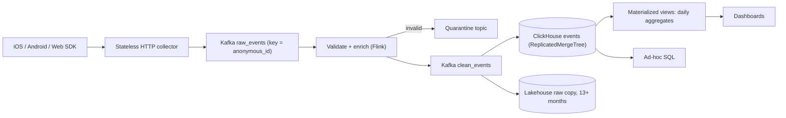

## 🎯 خلاصه

> تحلیل محصول سه سؤال را روی میلیاردها رویداد کاربر می‌پرسد: **چند نفر کار X را کردند** (شمارش و یکتاها)، **کاربران کجا رها کردند** (funnel)، و **چه کسانی برگشتند** (retention). یک schema پایدار بساز، یک مسیر ورود که رویدادهای تکراری و دیررس را تحمل کند، و یک store از نوع OLAP که sort key آن با سؤال‌ها هم‌خوان باشد.

- هر رویداد یک envelope پایدار دارد: `event_id`، زمان سمت کلاینت، زمان سمت سرور، فیلدهای هویت و مجموعه‌ای تایپ‌شده از property ها.
- **Sessionization** (گروه‌بندی رویدادها در بازدیدها با فاصله‌ی ۳۰ دقیقه) می‌تواند در استریم یا در زمان query انجام شود. یکی را انتخاب کن و trade-off را بگو.
- **ClickHouse** funnel و retention را با توابع تجمیعی بومی حساب می‌کند، ولی **sort key و sharding key** تعیین می‌کنند query سریع است یا یک full scan.
- داشبوردهای پرکاربرد را pre-aggregate کن، raw events را برای سؤال‌های ad-hoc نگه دار، و بپذیر که رویدادهای دیررس عدد دیروز را عوض می‌کنند.

## 🌱 از ساده شروع کنیم (مبتدی)

> **💡 تشبیه:** یک فروشگاه از هر بازدید دفترچه‌ای نگه می‌دارد: «علی وارد شد، یک پیراهن را دید، آن را در سبد گذاشت، رفت.» شمردن کسانی که پیراهن را دیدند ساده است. پرسیدن «از بین کسانی که دیدند، چند نفر خریدند؟» نیاز دارد دفترچه بر اساس شخص و زمان مرتب باشد. تحلیل محصول همین دفترچه است، در مقیاس یک اپلیکیشن ملی.

**مسئله.** یک محصول موبایلی و وب رویدادهای کاربر (نمایش صفحه، کلیک روی دکمه، خرید) را از اپلیکیشن‌هایش می‌فرستد. سیستمی بساز که به مدیران محصول اجازه بدهد کاربران فعال روزانه (DAU)، قیف‌های تبدیل (funnel) و کوهورت‌های بازگشت (retention) را ببینند، معمولاً چند دقیقه بعد از وقوع رویداد.

**نیازمندی‌های عملکردی**

- جمع‌آوری رویدادها از SDK های iOS، Android و وب، از جمله رویدادهایی که وقتی آفلاین بودند ساخته شده‌اند.
- داشبوردها: DAU، تعداد رویداد در روز، صفحات پربازدید، و نرخ تبدیل funnel در بازه‌ی تا ۳۰ روز.
- Retention: از کاربرانی که روز ۰ برای اولین بار ظاهر شدند، چه سهمی در روز ۱، ۷ و ۳۰ برگشتند؟
- کوئری‌های ad-hoc تحلیلگران روی رویدادهای خام، برای هر property، در یک بازه‌ی زمانی محدود.
- هویت: کاربر قبل از ورود ناشناس است و بعد از آن شناخته می‌شود؛ هر دو نما باید به هم وصل شوند.

**نیازمندی‌های غیرعملکردی (فرض‌های ما)**

- مقیاس: **۵ میلیون DAU**، و **۴۰ رویداد برای هر کاربر در روز**.
- تازگی: داشبوردها حداکثر **۵ دقیقه** بعد از رویداد. funnel و retention می‌توانند ساعتی باشند.
- کوئری‌های داشبورد در p95 زیر **۲ ثانیه**.
- رویدادهای تکراری برای مدت کوتاهی مجازند، ولی بعد از تثبیت سیستم، داشبورد نباید دوبار بشمارد.
- حذف داده‌ی یک کاربر در **۳۰ روز** بعد از درخواست، طبق قوانین حریم خصوصی.

## 🔧 واقعاً چطور کار می‌کند (متوسط)

### تخمین

- رویداد در روز: ۵٬۰۰۰٬۰۰۰ کاربر × ۴۰ رویداد = **۲۰۰ میلیون رویداد در روز**.
- نرخ میانگین: ۲۰۰٬۰۰۰٬۰۰۰ / ۸۶٬۴۰۰ ثانیه ≈ **۲٬۳۱۵ رویداد در ثانیه**.
- ضریب اوج ۳ (استفاده‌ی عصرها): ۲٬۳۱۵ × ۳ ≈ **۶٬۹۵۰ رویداد در ثانیه**. مسیر ورود را برای **۱۰٬۰۰۰ رویداد در ثانیه** طراحی کن.
- اندازه‌ی رویداد: حدود ۵۰۰ بایت JSON روی شبکه. خام: ۲۰۰ میلیون × ۵۰۰ بایت = **۱۰۰ GB در روز**.
- فشرده‌سازی ClickHouse روی این نوع داده معمولاً حدود ۸:۱ است، پس حدود ۱۲٫۵ GB در روز ذخیره می‌شود. در سال: ۱۲٫۵ × ۳۶۵ ≈ **۴٫۶ TB** (قبل از replication).
- نگهداری ۱۳ ماه raw events برای تحلیلگران: ۴٫۶ × ۱۳ / ۱۲ ≈ **۵ TB** در هر replica.

این اعداد نشان می‌دهند مسیر ورود برای Kafka عادی است. سخت‌ترین بخش شکل کوئری‌ها و هزینه‌ی یک sort key بد است.

### Event schema

برای هر رویداد یک **envelope** واحد با payload تایپ‌شده داخلش استفاده کن:

| فیلد | نوع | دلیل وجودش |
|---|---|---|
| `event_id` | UUID (روی دستگاه ساخته می‌شود) | کلید حذف تکرار بین تلاش‌های مجدد |
| `event_name` | `LowCardinality(String)` | `screen_view`، `add_to_cart`، `purchase`: گروه‌بندی و funnel |
| `event_time` | `DateTime64(3)` (ساعت دستگاه، اصلاح‌شده) | زمان وقوع؛ sessionها و funnelها را می‌سازد |
| `received_time` | `DateTime64(3)` (سرور) | زمان دریافت؛ partition، TTL و تازگی را کنترل می‌کند |
| `anonymous_id` | String | شناسه‌ی پایدار دستگاه قبل از ورود |
| `user_id` | String، قبل از ورود خالی | هویت شناخته‌شده؛ با یک جدول alias به `anonymous_id` وصل می‌شود |
| `platform`، `app_version` | `LowCardinality(String)` | فیلتر و دیباگ |
| `props` | `Map(String, String)` یا JSON | property های مخصوص هر رویداد |
| `schema_version` | Int | به مصرف‌کننده‌ها اجازه می‌دهد تغییرات را مدیریت کنند |

قواعدی که بیشتر دردسرهای آینده را جلوگیری می‌کنند:

- **رجیستری schema** (Avro یا Protobuf) با تکامل سازگار با عقب: فیلد اختیاری اضافه کن، هرگز فیلد را تغییر نام نده یا شماره‌ی فیلد را دوباره استفاده نکن.
- **نام رویدادها واژگان کنترل‌شده‌اند.** نام‌های ناشناخته به یک topic قرنطینه می‌روند، نه جدول اصلی.
- **هرگز IP خام را ذخیره نکن.** کشور و شهر را در collector استخراج کن و IP را دور بینداز.
- **ساعت دستگاه قابل اعتماد نیست.** هم `event_time` و هم `received_time` را ذخیره کن. فقط وقتی SDK آفست سرور را می‌فرستد، انحراف ساعت کلاینت را اصلاح کن.

### مسیر داده



collector فقط کارهای زیر را انجام می‌دهد: احراز هویت، زمان‌گذاری، و نوشتن در Kafka. باید stateless باشد تا بتوان به‌صورت افقی scale کرد. Kafka را بر اساس `anonymous_id` partition کن تا رویدادهای یک دستگاه داخل یک partition مرتب بمانند، که به sessionization کمک می‌کند.

### Sessionization

یک **session** دنباله‌ای از رویدادهای یک کاربر است که هیچ فاصله‌ای بیشتر از ۳۰ دقیقه ندارد. دو پیاده‌سازی داریم:

**۱. در زمان query (batch یا ad-hoc)، با syntax مربوط به Spark SQL:**

```sql
WITH gaps AS (
  SELECT user_id, event_time, event_name,
         CASE
           WHEN unix_timestamp(event_time)
                - unix_timestamp(lag(event_time) OVER (PARTITION BY user_id ORDER BY event_time))
                > 1800
           OR lag(event_time) OVER (PARTITION BY user_id ORDER BY event_time) IS NULL
           THEN 1 ELSE 0
         END AS new_session
  FROM events
  WHERE user_id <> ''
)
SELECT user_id, event_time, event_name,
       SUM(new_session) OVER (PARTITION BY user_id ORDER BY event_time
                              ROWS BETWEEN UNBOUNDED PRECEDING AND CURRENT ROW) AS session_seq
FROM gaps;
```

هر `new_session = 1` یک session را شروع می‌کند، و جمع تجمعی به هر رویداد یک شماره‌ی session داخل کاربر می‌دهد. نتیجه دقیق و قابل تکرار است و برای هر بازه‌ای قابل محاسبه‌ی مجدد است.

**۲. در زمان استریم (session window در Flink):** یک session window با کلید `user_id` بعد از ۳۰ دقیقه بی‌فعالیتی بسته می‌شود. این روش برای هر session یک رکورد می‌دهد، که داشبوردها به آن نیاز دارند. این روش به watermark و allowed lateness هم نیاز دارد. رویدادی که بعد از بسته شدن پنجره برسد یا یک session جدید می‌سازد یا به مسیر اصلاح می‌رود، پس sessionهای استریمی برای داده‌ی دیررس **تقریبی‌اند**، مگر اینکه تأخیر طولانی‌تری بپذیری.

زمانی که درستی و بازپردازش مهم‌تر از تأخیر است، query-time را انتخاب کن. وقتی محصول به «sessionهایی که در ۵ دقیقه‌ی اخیر بسته شده‌اند» نیاز دارد، stream-time را.

### ClickHouse modeling

جدول اصلی، با replication و TTL مبتنی بر زمان:

```sql
CREATE TABLE events ON CLUSTER analytics (
    event_id      UUID,
    event_time    DateTime64(3),
    received_time DateTime64(3),
    tenant_id     LowCardinality(String),
    user_id       String,
    anonymous_id  String,
    event_name    LowCardinality(String),
    platform      LowCardinality(String),
    props         Map(String, String)
)
ENGINE = ReplicatedMergeTree('/clickhouse/tables/{shard}/events', '{replica}')
PARTITION BY toYYYYMM(event_time)
ORDER BY (tenant_id, user_id, event_time)
TTL toDateTime(received_time) + INTERVAL 400 DAY;
```

funnel با تابع تجمیعی بومی `windowFunnel`. برای هر کاربر تعداد مراحل مرتب‌شده‌ای را برمی‌گرداند که در یک روز (۸۶٬۴۰۰ ثانیه) تکمیل کرده:

```sql
SELECT level, count() AS users
FROM (
    SELECT user_id,
           windowFunnel(86400)(event_time,
                               event_name = 'view_product',
                               event_name = 'add_to_cart',
                               event_name = 'purchase') AS level
    FROM events
    WHERE event_time >= now() - INTERVAL 30 DAY
    GROUP BY user_id
)
GROUP BY level
ORDER BY level;
```

سطح ۳ یعنی کاربر هر سه مرحله را به ترتیب و در ۸۶٬۴۰۰ ثانیه تکمیل کرده. سطح ۱ یعنی فقط مرحله‌ی اول را.

برای داشبوردهایی که هر چند ثانیه اجرا می‌شوند، جدول خام را اسکن نکن. یک materialized view یکتاهای روزانه را در یک جدول `AggregatingMergeTree` با تابع `uniqState` می‌نویسد و داشبورد state ها را با `uniqMerge` ادغام می‌کند. این کار کوئری DAU را ارزان نگه می‌دارد، در حالی که raw events برای کارهای ad-hoc در دسترس می‌ماند.

## 🧠 عمق و trade-offها (سنیور)

### تکامل schema رویداد

schema یک API بین اپلیکیشن‌ها و تیم تحلیل است. شکستن آن یعنی نسخه‌های قدیمی اپ (که کاربران هرگز به‌روز نمی‌کنند) ماه‌ها شکل قدیمی را می‌فرستند. قواعد:

- payload های نسخه‌دار (`schema_version`)، با مصرف‌کننده‌هایی که همه‌ی نسخه‌های هنوز در میدان را می‌پذیرند.
- property های ناشناخته را در map `props` نگه دار، به جای دور انداختن. بعداً، وقتی دیدی استفاده می‌شوند، می‌توانی یک property را به ستون تبدیل کنی.
- یک property را وقتی به ستون تبدیل کن که در بیشتر کوئری‌ها ظاهر می‌شود. جست‌وجو در `Map` یعنی خواندن کل map برای هر ردیف در part.

### sort key و sharding key

این مهم‌ترین تصمیم ClickHouse در این طراحی است:

- `ORDER BY (tenant_id, user_id, event_time)` مسیرهای **هر کاربر و funnelها** را سریع می‌کند: ردیف‌های یک کاربر روی دیسک کنار هم‌اند، پس index پراکنده‌ی اولیه بیشتر جدول را رد می‌کند.
- همین کلید یک **داشبورد صرفاً زمانی** (رویدادهای همه‌ی کاربران در یک ساعت اخیر) را کندتر می‌کند، چون `event_time` ستون اول نیست. index اولیه نمی‌تواند granuleهایی را که چند کاربر را پوشش می‌دهند رد کند.
- `ORDER BY (tenant_id, toStartOfHour(event_time), event_name)` برعکس است: داشبوردها سریع، مسیرها کند.

راه‌حل‌ها: کلید را برای پرهزینه‌ترین کار انتخاب کن، یک **projection** با ترتیب دوم اضافه کن، یا یک جدول دوم بساز که از همان استریم با sort key دیگری پر می‌شود. جدول دوم فضای ذخیره را دو برابر می‌کند، که معمولاً ارزان‌تر از p95 ده ثانیه‌ای داشبورد اصلی است.

**Sharding.** بر اساس `user_id` (یا هش آن) shard کن تا همه‌ی رویدادهای یک کاربر روی یک shard باشند. آن‌وقت `windowFunnel` و sessionization روی هر shard محلی اجرا می‌شوند و coordinator فقط شمارش‌ها را ادغام می‌کند. اگر بر اساس `event_id` یا تصادفی shard کنی، funnelها به یک shuffle کامل raw events در کل cluster نیاز دارند. هر shard را برای دسترس‌پذیری replicate کن، و یادت باشد جدول توزیع‌شده برای هر کوئری یک hop اضافه به coordinator می‌دهد.

### حذف تکرار (deduplication)

Kafka و SDK تحویل **at-least-once** می‌دهند، پس همان `event_id` ممکن است دوبار برسد. گزینه‌ها:

- **حذف تکرار در Flink** با state کلیددار روی `event_id` و TTL‌ای بلندتر از حداکثر پنجره‌ی retry. دقیق است، ولی state با حجم رویدادها رشد می‌کند؛ bloom filter یا TTL کوتاه (مثلاً ۲۴ ساعت) آن را محدود می‌کند.
- **`ReplacingMergeTree` در ClickHouse** تکراری‌ها را فقط در merge های پس‌زمینه حذف می‌کند. تا آن موقع تکراری‌ها دیده می‌شوند. کوئری‌هایی که درستی لازم دارند از `FINAL` (گران) استفاده می‌کنند، یا با `argMax` در یک subquery حذف تکرار می‌کنند.

به مصاحبه‌گر توضیح بده که سیستم در ClickHouse **یکتایی نهایی** و در داشبوردها **یکتایی تقریباً دقیق** را تضمین می‌کند. پنهان کردن این تفاوت، اعتماد تیم‌های تحلیل را از بین می‌برد.

### رویدادهای دیررس و آفلاین

اپلیکیشن‌های موبایل وقتی آفلاین‌اند رویدادها را نگه می‌دارند و ساعت‌ها بعد می‌فرستند. `event_time` آن رویداد متعلق به دیروز است، ولی `received_time` امروز است.

- partition و TTL را یکسان روی `event_time` یا `received_time` تعریف کن، و مستند کن کدام.
- **materialized view ها موقع insert اجرا می‌شوند**، پس یک رویداد دیررس، aggregate روزی را که وارد می‌شود به‌روز می‌کند، نه روزی که رخ داده. یا بپذیر که عدد داشبورد دیروز بالا می‌رود، یا یک job اصلاح روزانه اجرا کن که ۳ روز اخیر را از جدول خام بازمحاسبه کند و partitionهای aggregate را بازنویسی کند.
- funnel و retention باید روی `event_time` کار کنند، و تعریف کوهورت‌ها پایدار باشد: «روز ۰» یک کاربر وقتی کوهورت ساخته می‌شود ثابت می‌شود، نه اینکه با رسیدن یک رویداد دیررس دوباره محاسبه شود.

### یکپارچه‌سازی هویت (identity stitching)

`anonymous_id` با ورود به `user_id` تبدیل می‌شود. تاریخچه را بازنویسی نکن. یک جدول alias به شکل `(anonymous_id, user_id, first_seen, linked_at)` نگه دار و در زمان query resolve کن، یا در یک job دوره‌ای ستون `canonical_user_id` بنویس. اگر باید «این دستگاه قبل از ورود چه کرد» را نشان دهی، resolve در زمان query را انتخاب کن؛ اگر داشبوردها باید سریع باشند و جدول alias کوچک است، job دوره‌ای را.

### حریم خصوصی و حذف

- پرچم‌های رضایت همراه رویدادها حرکت می‌کنند. رویدادهای بدون رضایت اصلاً در جدول‌های تحلیلی نوشته نمی‌شوند، نه اینکه بعداً فیلتر شوند.
- حذف رویدادهای یک کاربر از ClickHouse با `ALTER TABLE ... DELETE` بخش‌ها را بازنویسی می‌کند و گران است. حذف‌ها را روزانه دسته‌ای کن، یا از **crypto-shredding** استفاده کن: `user_id` و property ها را با کلید مخصوص هر کاربر رمزگذاری کن و با حذف، کلید را نابود کن. آنچه تیم حقوقی می‌پذیرد را بررسی کن.
- شناسه‌هایی را که در شکل خام لازم نیستند با هش نمکی هش کن، نمک را به‌عنوان یک راز مدیریت کن.

### عملیات و پایش

- تأخیر ورود (lag مصرف‌کننده‌ی Kafka و فاصله‌ی `received_time` با آخرین ردیف قابل مشاهده در ClickHouse).
- نسبت رویدادهای topic قرنطینه به تفکیک نسخه‌ی SDK: یک جهش یعنی یک انتشار اپ schema را شکسته.
- نرخ تکرار به تفکیک پلتفرم (نشانه‌ی طوفان retry).
- صف merge در ClickHouse (part های زیاد یعنی insertها کوچک یا پرتکرارند؛ دسته‌ای کن).
- p95 کوئری‌های داشبورد و سهم کوئری‌هایی که جدول خام را اسکن می‌کنند.

### کی این طراحی را استفاده نکنیم

- زیر چند میلیون رویداد در ماه، یک warehouse مثل BigQuery، Snowflake یا PostgreSQL با partitioning ساده‌تر است، و SQL می‌دهد بدون عملیات cluster.
- اگر فقط شمارش دقیق یک مجموعه‌ی ثابت از رویدادها برای صورت‌حساب لازم است، یک جدول شمارنده‌ی تراکنشی ابزار بهتری است.

## 🎤 گوشه‌ی مصاحبه

### انتظار در هر سطح

| سطح | پاسخ قوی چه چیزی نشان می‌دهد |
|---|---|
| متوسط | envelope رویداد واضح، مسیر Kafka به ClickHouse، تعریف درست session، و یک کوئری `windowFunnel` یا retention که کار می‌کند. |
| سنیور | sort key و sharding key بر اساس ترکیب کوئری‌ها، استراتژی dedup با پنجره‌ی قابل مشاهده‌بودن، سیاست رویداد دیررس، و یکپارچه‌سازی هویت. |
| Staff | مدل هزینه برای ذخیره‌ی خام در برابر pre-aggregated، حاکمیت schema بین تیم‌های اپ زیاد، طراحی حذف برای حریم خصوصی، و برنامه‌ی مهاجرت schema رویداد بدون شکستن نسخه‌های قدیمی اپ. |

### سؤال‌های ادامه

1. یک مدیر محصول funnel سه‌روزه با پنجره‌ی ۱ روزه می‌خواهد. چه چیزی در کوئری و در داده‌ای که نگه می‌داری تغییر می‌کند؟
2. عدد DAU بعد از بسته شدن یک روز ۰٫۳٪ تغییر کرده. آیا این باگ است؟ به تیم محصول چه می‌گویی؟
3. چرا بر اساس کاربر shard کنیم و نه بر اساس زمان رویداد، و اگر بعداً کلید shard را عوض کنی چه می‌شکند؟
4. چطور یک A/B test را پشتیبانی می‌کنی که کاربران را به گروه آزمایش تقسیم می‌کند، و گروه وسط آزمایش می‌تواند عوض شود؟
5. یک نسخه‌ی جدید اپ property جدیدی اضافه می‌کند که یک رشته‌ی آزاد با ۱۰ میلیون مقدار متمایز دارد. برای `Map(String, String)` چه اتفاقی می‌افتد و چه می‌کنی؟

> **🎤 این را در مصاحبه بگو:** «رویدادها یک envelope پایدار با شناسه‌ی دستگاه و زمان دریافت سرور دارند. session بر اساس قاعده‌ی فاصله‌ی ۳۰ دقیقه تعریف می‌شود، در batch برای درستی و در Flink برای تازگی. در ClickHouse اول بر اساس کاربر مرتب می‌کنم تا funnelها محلی باشند، بر اساس کاربر shard می‌کنم تا تجمیع یک merge باشد، و materialized view برای DAU اضافه می‌کنم. می‌گویم که رویدادهای دیررس وارد aggregateهای قبلی می‌شوند و تکراری‌ها در نهایت در merge حذف می‌شوند.»

**پاسخ نمونه (۳ تا ۵ جمله):** رویدادها از طریق collectorهای stateless وارد Kafka می‌شوند، با کلید شناسه‌ی دستگاه، و یک job در Flink schema را اعتبارسنجی می‌کند و رویدادهای ناشناخته را قرنطینه می‌کند. ClickHouse آن‌ها را در جدول‌های MergeTree با replication ذخیره می‌کند، مرتب‌شده بر اساس tenant، کاربر و زمان، و shard شده بر اساس کاربر تا funnel و sessionization روی هر shard محلی اجرا شوند. داشبوردها materialized view های یکتاهای روزانه را می‌خوانند، و تحلیلگران ۱۳ ماه raw events دارند. تکراری‌ها با کلید `event_id` در استریم یا با merge در ClickHouse حذف می‌شوند، و رویدادهای دیررس یک پنجره‌ی کوتاه اصلاح برای aggregateهای مربوط ایجاد می‌کنند.

## ⚠️ اشتباهات رایج

- استفاده از زمان **سرور** برای sessionها و funnelها، که باعث می‌شود رویدادهای آفلاینِ دسته‌ای در session اشتباه قرار بگیرند.
- مرتب کردن جدول اصلی ClickHouse فقط بر اساس زمان، و بعد تعجب از اسکن کامل برای funnelهای هر کاربر.
- shard کردن تصادفی، که هر funnel را به یک shuffle کل cluster تبدیل می‌کند.
- فرض اینکه `ReplacingMergeTree` فوراً تکراری‌ها را حذف می‌کند.
- اجازه دادن به هر انتشار SDK که نام رویداد و property اضافه کند، بدون رجیستری، تا جایی که داشبوردها خواندنی نباشند.
- ذخیره‌ی IP خام در جدول تحلیلی «برای geolocation بعدی».
- بازمحاسبه‌ی «روز ۰» یک کوهورت retention از داده‌ای که دیر رسیده.

## ✅ خودت را بسنج

1. چرا `event_id` روی دستگاه ساخته می‌شود و نه در collector؟
   - A) تا collector بتواند stateless باشد
   - B) تا ارسال مجدد همان رویداد همان شناسه را داشته باشد و خط لوله بتواند تکراری را حذف کند
   - C) تا سرور ساعت دستگاه را بداند
   - D) Kafka برای کلید دستگاه‌ساز لازم دارد

<details><summary>Answer</summary>

**B** — شناسه باید یک بار، لحظه‌ی وقوع رویداد ساخته شود تا هر تلاش مجدد همان مقدار را حمل کند. شناسه‌ای که در collector ساخته شود در هر تلاش فرق دارد و برای حذف تکرار قابل استفاده نیست.

</details>

2. یک کاربر در گزارش شما روزش را در دو session دارد، با اینکه هرگز ۳۰ دقیقه مکث نکرده. محتمل‌ترین علت چیست؟
   - A) کوئری sessionization از `ROWS` به‌جای `RANGE` استفاده می‌کند
   - B) مرز sessionها بر اساس زمان دریافت سرور است و رویدادهای آفلاین بی‌ترتیب رسیده‌اند
   - C) ClickHouse از session پشتیبانی نمی‌کند
   - D) `user_id` برای همه‌ی رویدادها خالی است

<details><summary>Answer</summary>

**B** — sessionها باید از `event_time` و به ترتیب وقوع محاسبه شوند. استفاده از زمان دریافت، وقتی رویدادها بعد از یک دوره‌ی آفلاین دسته‌ای می‌رسند، فاصله‌های ساختگی و مرزهای ساختگی session می‌سازد.

</details>

3. **(سنیور)** جدول اصلی شما `ORDER BY (tenant_id, user_id, event_time)` است. یک داشبورد «رویدادها در هر دقیقه برای همه‌ی کاربران در یک ساعت اخیر» را می‌خواهد و ۴۰ ثانیه طول می‌کشد. چرا، و بهترین راه‌حل چیست؟

   - A) ستون `event_time` به index نیاز دارد
   - B) `event_time` ستون اول sort key نیست، پس index پراکنده نمی‌تواند granuleها را رد کند؛ یک projection یا جدول دوم مرتب‌شده بر اساس زمان، یا یک view از پیش‌تجمیع‌شده در سطح دقیقه اضافه کن
   - C) ClickHouse نمی‌تواند بر اساس دقیقه تجمیع کند
   - D) فقط تعداد replicaها را زیاد کن

<details><summary>Answer</summary>

**B** — index پراکنده روی پیشوند sort key کار می‌کند. بدون `user_id` یا `tenant_id` در فیلتر، تقریباً هر granule تطابق دارد. راه‌حل projection، جدول دوم مرتب‌شده برای کوئری زمانی، یا view پیش‌تجمیع‌شده است. replicaهای بیشتر توان عملیاتی را بالا می‌برند، نه اسکن را.

</details>

4. **(سنیور)** چرا shard کردن بر اساس کاربر `windowFunnel` را ارزان می‌کند، و چه هزینه‌ای دارد؟

   - A) نیاز به `GROUP BY user_id` را از بین می‌برد
   - B) همه‌ی رویدادهای یک کاربر روی یک shard هستند، پس هر shard سطح funnel کاربران خودش را حساب می‌کند و coordinator فقط شمارش‌ها را ادغام می‌کند؛ هزینه این است که کوئری‌های یک نوع رویداد برای همه‌ی کاربران هنوز به همه‌ی shardها می‌روند، و تغییر کلید shard بعداً یک مهاجرت بزرگ داده است
   - C) replication را غیرضروری می‌کند
   - D) ورود exactly-once را تضمین می‌کند

<details><summary>Answer</summary>

**B** — shard با کلید کاربر، تجمیع را محلی نگه می‌دارد، پس فقط شمارش‌های کوچک هر سطح روی شبکه حرکت می‌کنند. trade-off این است که تغییر کلید shard بعداً یک مهاجرت بزرگ داده است، و برخی کوئری‌های بین‌کاربری به همه‌ی shardها نیاز دارند.

</details>

## 🗂️ فلش‌کارت

| Front | Back |
|---|---|
| چرا envelope هم `event_time` و هم `received_time` دارد؟ | `event_time` sessionها و funnelها را می‌سازد؛ `received_time` partition، TTL و تازگی را |
| چه چیزی یک session را در این طراحی می‌سازد؟ | رویدادهای یک کاربر بدون فاصله‌ای بیشتر از ۳۰ دقیقه |
| `windowFunnel(86400)` برای هر کاربر چه برمی‌گرداند؟ | تعداد مراحل مرتب‌شده‌ی funnel که در یک روز تکمیل شده‌اند |
| چرا اول بر اساس `user_id` مرتب کنیم؟ | journeyها و funnelها ردیف‌های پیوسته‌ی هر کاربر را می‌خوانند، پس index پراکنده بیشتر جدول را رد می‌کند |
| چرا `ReplacingMergeTree` برای شمارش دقیق کافی نیست؟ | تکراری‌ها فقط در merge های پس‌زمینه حذف می‌شوند؛ تا آن موقع کوئری‌ها آن‌ها را می‌بینند |
| وقتی رویداد دیررس می‌رسد، materialized view چه می‌کند؟ | aggregate روزی را که رویداد وارد می‌شود به‌روز می‌کند، نه روزی که رخ داده |
| چرا IP خام ذخیره نشود؟ | حریم خصوصی: کشور یا شهر را در collector استخراج کن، سپس IP را دور بینداز |
| چرا `ALTER ... DELETE` برای حریم خصوصی مهم است؟ | بخش‌های داده را بازنویسی می‌کند و گران است، پس حذف‌ها دسته‌ای یا با crypto-shredding انجام می‌شوند |

## 🔗 ادامه

- **event-modeling** نحوه‌ی نام‌گذاری رویدادها و طراحی envelope را قبل از انتخاب ابزار توضیح می‌دهد.
- **clickhouse** پوشش MergeTree، index پراکنده و projection را می‌دهد که این طراحی به آن‌ها وابسته است.
- **sql-window-functions** الگوی `LAG` و جمع تجمعی را که برای sessionها استفاده می‌شود توضیح می‌دهد.
- **pattern-late-data** و **pattern-realtime-aggregation** trade-offهای رویداد دیررس و aggregate استریمی را عمیق‌تر پوشش می‌دهند.
- **design-unique-counts** توضیح می‌دهد HyperLogLog چیست و چرا DAU تقریبی قابل قبول است.
- **realtime-olap** ClickHouse را با موتورهای OLAP بلادرنگ دیگر برای همین نوع کار مقایسه می‌کند.
