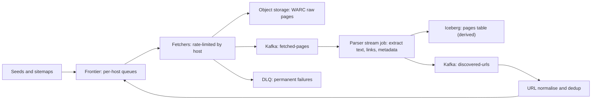

## 🎯 خلاصه

> یک web crawler در اصل یک **صف کار با قوانین ادب (politeness)** است. بخش‌های سخت، frontier (چه چیزی بعد fetch شود و هر host چند بار مجاز است زده شود)، **deduplication** در مقیاس میلیاردی برای URL و محتوا، و ذخیرهٔ صفحات خام است تا pipeline بتواند وقتی parser عوض شد دوباره اجرا شود.

- سیستم را به **frontier**، **fetcherها**، **ذخیره‌گاه صفحات خام**، **parserها** و **بازخورد لینک‌ها** تقسیم کن. هرکدام مقیاس‌پذیری و نوع خرابی متفاوتی دارند.
- کار را بر اساس **host** پارتیشن کن، نه URL. ادب (robots.txt، crawl delay، همزمانی در هر host) یک ویژگی برای هر host است.
- در دو جا deduplicate کن: URLها قبل از fetch (ارزان، تقریبی با Bloom filter و سپس دقیق)، و محتوا بعد از fetch (hash و near-duplicate با SimHash).
- **بایت‌های خام** را در object storage و **فیلدهای مشتق‌شده** را در یک table format نگه دار. بازخوانی از خام راه اصلاح باگ استخراج است، بدون اینکه دوباره وب را crawl کنی.

## 🌱 از ساده شروع کنیم (مبتدی)

**صورت مسئله.** یک شرکت جست‌وجو می‌خواهد یک index از وب عمومی بسازد. pipeline ای بساز که URLها را کشف می‌کند، صفحات را دانلود می‌کند، متن و لینک‌ها را استخراج می‌کند و نتایج را ذخیره می‌کند. هدف: حدود ۱ میلیارد صفحه در ماه، با تازه‌سازی صفحات پربازدید بیشتر از صفحات کم‌بازدید، و بدون اینکه هیچ وب‌سایتی زیر بار برود.

> **💡 تشبیه:** کتابداری که فرستاده شده تا همهٔ کتاب‌های یک شهر را جمع کند. لیست کارش را از قفسه‌ها نگه می‌دارد (frontier)، هرگز بیش از یک نفر را همزمان به یک مغازه نمی‌فرستد (ادب)، فهرست کتاب‌هایی که قبلاً جمع کرده را نگه می‌دارد تا تکراری نخرد (dedup)، و از هر صفحه عکس می‌گیرد تا فهرست‌نویس بعداً بتواند دوباره بخواندشان (ذخیرهٔ خام).

**نیازمندی‌های کاربردی**

- دریافت URLهای اولیه (seed) و کشف URLهای جدید از صفحات دریافتی.
- دریافت صفحات با HTTP(S)، دنبال کردن redirectها و timeout.
- رعایت `robots.txt` و crawl delay هر host.
- ذخیرهٔ پاسخ‌های خام، متن استخراج‌شده، لینک‌ها و متادیتا (وضعیت، هدرها، زمان fetch).
- تازه‌سازی صفحات طبق زمان‌بندی، بر اساس دفعات تغییر و اهمیت صفحه.

**نیازمندی‌های غیرکاربردی**

- توان عملیاتی: حدود ۱ میلیارد fetch در ماه، با اوج‌های موقت.
- ادب: یک host هرگز نباید بیشتر از نرخ توافق‌شده بگیرد.
- درستی: یک URL در یک چرخهٔ تازه‌سازی به‌اشتباه دو بار fetch نمی‌شود، و تکرار محتوا تشخیص داده می‌شود.
- قابلیت بازپخش: یک اصلاح parser باید روی صفحات قدیمی اعمال شود، بدون fetch دوباره.
- استحکام: تله‌های crawl (تقویم‌های بی‌پایان، session ID در URL) نباید بودجه را تمام کنند.

**برآورد (محاسبه را نشان بده)**

- fetch: ۱,۰۰۰,۰۰۰,۰۰۰ در ۳۰ روز. ثانیه‌های ماه: ۳۰ × ۸۶,۴۰۰ = ۲,۵۹۲,۰۰۰. نرخ میانگین: ۱e9 / ۲٫۵۹۲e6 ≈ **۳۸۶ fetch در ثانیه**. اوج با ۳ برابر میانگین ≈ **۱,۱۶۰ fetch در ثانیه**.
- بایت خام: فرض کن پاسخ میانگین ۱۰۰ KB بدون فشرده‌سازی باشد → ۱e9 × ۱۰۰ KB = **۱۰۰ ترابایت در ماه** قبل از فشرده‌سازی. با gzip داخل فایل‌های WARC (فرض ۴ برابر برای HTML؛ روی داده‌ها اندازه بگیر)، حدود **۲۵ ترابایت در ماه** ذخیره می‌شود. ۹۰ روز خام یعنی حدود ۷۵ ترابایت روی ذخیره‌گاه گرم؛ داده‌های قدیمی‌تر به لایه‌های ارزان‌تر می‌روند.
- شبکه: ۳۸۶ × ۱۰۰ KB ≈ **۳۸٫۶ مگابایت بر ثانیه ≈ ۳۱۰ مگابیت بر ثانیه** میانگین؛ اوج ۳ برابر ≈ ۰٫۹۳ گیگابیت بر ثانیه.
- URLهای دیده‌شده: فرض کن هر صفحه‌ی fetch‌شده ۱۰ لینک خروجی جدید نشان می‌دهد، پس در سال اول حدود **۱۰ میلیارد URL** دیده می‌شود. یک مجموعهٔ دقیق در حافظه از ۱۰ میلیارد hash ۸ بایتی ۸۰ گیگابایت است، که برای یک ماشین زیاد است؛ پس store dedup باید shard شده یا روی دیسک باشد، یا برای بررسی اول تقریبی باشد (ببین deep diveها).

نرخ fetch متوسط است. سختی در **منطق ادب و dedup** در این مقیاس است، و در اینکه هر مرحله قابل بازپخش باشد.

## 🔧 واقعاً چطور کار می‌کند (متوسط)

**مراحل**

- **Frontier** تصمیم می‌گیرد بعد چه چیزی fetch شود. state آن صف URLها است، به‌علاوهٔ زمان مجاز بعدی برای هر host.
- **Fetcherها** کارگرهای بی‌حالت‌اند. هر کدام یک lease برای host از frontier می‌گیرند، با نرخ مجاز درخواست می‌فرستند و پاسخ را می‌نویسند.
- **ذخیره‌گاه خام** بایت‌های پاسخ را دقیقاً همان‌طور که دریافت شده نگه می‌دارد، در فایل‌های WARC (فرمت استاندارد آرشیو وب) روی object storage.
- **Parserها** topic صفحات fetch‌شده را می‌خوانند و جدول‌های مشتق‌شده می‌سازند. از ذخیرهٔ خام می‌شود دوباره اجرایشان کرد.
- **Dedup و بازخورد** لینک‌های کشف‌شده را normalise می‌کنند و لینک‌های جدید را به frontier برمی‌گردانند.

**normalise کردن URL.** یک صفحه املای زیادی دارد. قبل از هر dedup، normalise کن: scheme و host را lowercase کن، پورت پیش‌فرض را حذف کن، fragment (`#...`) را حذف کن، پارامترهای query را مرتب کن، پارامترهای ردیابی شناخته‌شده را حذف کن، `.` و `..` را حل کن، و اگر سایت `<link rel="canonical">` دارد، آن را دنبال کن. قوانین normalise تصمیم محصول‌اند؛ نسخه‌اش را نگه دار.

**ادب.** سه کنترل برای هر host:

- `robots.txt`: یک بار گرفته می‌شود، cache می‌شود (مثلاً ۲۴ ساعت) و قبل از هر URL بررسی می‌شود. مسیرهای disallow‌شده هرگز وارد صف نمی‌شوند.
- Crawl delay: حداقل فاصلهٔ زمانی بین دو درخواست به یک host (مقدار `Crawl-delay` سایت، یا پیش‌فرض خودت، هر کدام امن‌تر است).
- سقف همزمانی: حداکثر N اتصال هم‌زمان برای هر host، معمولاً ۱ یا ۲ برای سایت‌های کوچک.

frontier و fetcherها را بر اساس **hash host** پارتیشن کن ([[consistent-hashing]]). بعد هر لحظه یک worker مالک یک host است، و ادب یک قانون محلی می‌شود، نه یک قفل توزیع‌شده.

**صف frontier.** یک ساختار دوسطحی: یک امتیاز اولویت برای هر URL (اهمیت و تازگی) و یک FIFO برای هر host. یک scheduler hostهایی را انتخاب می‌کند که زمان مجاز بعدی‌شان گذشته، و داخل هر host URL با بالاترین اولویت را برمی‌دارد. وقتی fetcherها کند شوند صف رشد می‌کند، پس frontier باید [[backpressure]] اعمال کند: وقتی صف یک host پر است، لینک‌های کشف‌شده از آن host را دیگر وارد صف نکن.

**dedup دو سطحی.**

1. **dedup URL قبل از fetch.** URL نرمال‌شده را با مجموعهٔ «دیده‌شده» بسنج. یک Bloom filter جواب سریع می‌دهد، بدون false negative و با نرخ کم false positive. برای ۱۰ میلیارد URL و نرخ false positive یک درصد، فیلتر به حدود ۹٫۶ بیت برای هر آیتم نیاز دارد: 10e9 × 9.6 / 8 ≈ **۱۲ گیگابایت**، که روی چند ماشین جا می‌شود. false positive یعنی یک URL اشتباهاً کنار گذاشته شده، پس جواب معتبر را از یک store دقیق (مثلاً key-value shard شده مانند RocksDB یا یک key-value توزیع‌شده) بگیر و Bloom filter را فقط پیش‌بررسی سریع نگه دار.
2. **dedup محتوا بعد از fetch.** بدنهٔ نرمال‌شده را با SHA-256 hash کن (۳۲ بایت). تکرارهای دقیق hash یکسان دارند. تکرارهای near (همان مقاله با تبلیغ‌های متفاوت) به SimHash یا MinHash نیاز دارند، که اثرانگشتی تولید می‌کند که با تغییرات کوچک کم عوض می‌شود. hash محتوا را در جدول صفحات نگه دار تا آینه‌ها را گروه‌بندی کنی.

**زمان‌بندی تازه‌سازی.** `next_fetch_at` را برای هر URL نگه دار. صفحه‌ای که از دفعهٔ قبل تغییر کرده فاصلهٔ کوتاه‌تر می‌گیرد، و صفحه‌ای که تغییر نکرده فاصلهٔ بلندتر. هنگام fetch دوباره `ETag` و `Last-Modified` بفرست، تا صفحهٔ بدون تغییر با `304 Not Modified` و بدون بدنه برگردد.

**مدیریت خطا.**

- timeout و 5xx: retry با backoff نمایی و jitter تا یک حد، و بعد دوباره وارد صف با اولویت پایین‌تر.
- 404 و 410: URL را مرده علامت بزن، retry نکن.
- حلقه‌های redirect: بعد از یک حد کوچک (مثلاً ۵ hop) متوقف شو.
- خطای parse: صفحهٔ خام را نگه دار، رکورد را به DLQ ببر ([[dead-letter-queue]])، و parser را بعداً اصلاح کن. هرگز داده خام را به‌خاطر خطای parse دور نریز.

## 🧠 عمق و trade-offها (سنیور)

**deep dive ۱: صف frontier.**

- frontier قلب سیستم و سخت‌ترین بخش برای مقیاس‌پذیری است. گزینه‌ها: یک جدول دیتابیس با ایندکس `(host, next_fetch_at)` (ساده، اما قفل‌ها و hostهای داغ آزارش می‌دهند)، یک key-value shard شده با لیست برای هر host (کد بیشتر، توان بهتر)، یا یک صف log-based با یک پارتیشن برای هر گروه host (بازپخش ارزان، اما ترتیب را خودت مدیریت می‌کنی).
- hostهای داغ تله‌اند. یک سایت خبری بزرگ میلیون‌ها URL و یک host دارد. صفش یک پارتیشن را اشغال می‌کند و آن shard گلوگاه می‌شود. backlog هر host را سقف بگذار، URLهای بخش‌های مختلف را درهم‌کن، و نرخ ادب را سخت‌گیرانه نگه دار.
- تله‌های crawler: تقویم‌هایی که صفحات بی‌پایان می‌سازند، session ID در URL، و صفحات جست‌وجوی faceted. دفاع استاندارد: بودجه برای هر host (حداکثر صفحه در هر چرخه)، حداکثر عمق مسیر، و blocklist الگوی URL. سهم صفحات با ارزش محتوایی پایین را اندازه بگیر.

**deep dive ۲: dedup در مقیاس میلیارد.**

- dedup دقیق ۱۰ میلیارد کلید اول یک مسئلهٔ ذخیره‌سازی است. بر اساس hash URL نرمال‌شده shard کن، و همان پارتیشن‌بندی frontier را استفاده کن تا بررسی dedup محلی باشد.
- اندازهٔ Bloom filter: با پر شدن فیلتر، false positive بیشتر می‌شود. ظرفیت یک سال آینده را برنامه‌ریزی کن و وقتی نزدیک شدی با اندازهٔ بزرگ‌تر بازسازی کن. Bloom filter آیتم حذف نمی‌کند، پس برای تازه‌سازی، store دقیق را برای «آخرین بار دیده شده» نگه دار و فیلتر را فقط برای گفتن «قطعاً جدید است» استفاده کن.
- hash محتوا آینه‌ها را پیدا می‌کند. برای یک index، معمولاً یک نسخهٔ متعارف نگه می‌داری و بقیه را لینک می‌کنی، که فضا را ذخیره می‌کند و از رتبه‌بندی تکراری جلوگیری می‌کند.

**deep dive ۳: ذخیره‌سازی و بازپخش.**

- صفحات خام به‌صورت فایل‌های WARC چند صد مگابایتی روی object storage می‌روند، یک مجموعه برای هر ساعت fetch. اشیای کوچک روی ذخیره‌گاه‌های سبک S3 گران‌اند، و میلیون‌ها فایل ریز در lake هم همین‌طور ([[small-files-problem]]).
- جدول‌های مشتق‌شده (متادیتای صفحه، لینک‌ها، متن) به یک جدول Iceberg یا Parquet می‌روند که بر اساس تاریخ fetch پارتیشن شده. upsert برای «آخرین نسخهٔ این URL» یک عملیات merge است؛ تاریخچه را به‌صورت snapshotهای append-only نگه دار تا بتوانی به «در روز X چه می‌دانستیم» جواب بدهی.
- بازپخش قدرت اصلی است. وقتی parser عوض شد، job parse را روی فایل‌های WARC تاریخ‌های اثرگرفته دوباره اجرا کن. هرگز نیازی به crawl دوباره نیست، که کند و بی‌ادب است.

**deep dive ۴: عملیات.** نرخ موفقیت fetch به‌ازای هر host، عمق صف به‌ازای هر bucket host، و سهم پاسخ‌های `304` را رصد کن. افزایش ناگهانی 429 یا 403 از hostهای زیاد یعنی یا رفتار ناسالم داری یا بلاک شده‌ای: متوقف شو، نرخ‌ها و قوانین robots را بررسی کن، و آرام‌آرام ادامه بده.

**حقوقی و اخلاقی.** `robots.txt` و شرایط استفادهٔ قابل‌اعمال را رعایت کن، crawler را با User-Agent ای که اطلاعات تماس دارد معرفی کن، و قوانین نگه‌داری و حذف برای صفحات خام تعیین کن، چون صفحات ممکن است داده‌های شخصی داشته باشند ([[data-retention]]).

**انتظار سطح Staff.** کاندیداهای Staff معمولاً:

- **frontier** (صفحهٔ کنترل) را از **ذخیره‌گاه خام** (صفحهٔ داده) جدا می‌کنند و توضیح می‌دهند چرا ذخیره‌گاه خام است که سیستم را قابل نگه‌داری می‌کند.
- مدل هزینه را می‌دهند: fetch در ثانیه، بایت در ماه، حافظهٔ dedup، و اینکه هر عدد با سیاست تازه‌سازی چطور تغییر می‌کند.
- hostهای داغ، تله‌ها و بلاک شدن را رویدادهای عادی می‌دانند، با بودجه و backoff خودکار.
- بازپخش و نسخه‌بندی parser را در طراحی اصلی می‌گذارند: هر ردیف مشتق‌شده نسخهٔ parser و فایل WARC مبدأش را ثبت می‌کند.

**کی این را نسازیم.** چند هزار صفحهٔ شناخته‌شده به یک job زمان‌بندی‌شده با sitemap و یک کلاینت HTTP ساده نیاز دارد. crawler توزیع‌شده وقتی ارزش دارد که باید صفحات ناشناخته را در مقیاس کشف کنی.

## 🧪 امتحان کن

1. **محاسبهٔ ادب.** یک host اجازه می‌دهد هر ۲ ثانیه یک درخواست. ۱۰۰,۰۰۰ URL برای آن host داری و می‌خواهی یک دور کامل در یک روز تمام شود. با یک connection ممکن است؟ محاسبه را نشان بده.
2. **اندازهٔ Bloom.** انتظار ۵ میلیارد URL داری و نرخ false positive ۰٫۵٪ را می‌پذیری. اندازهٔ فیلتر را بر حسب گیگابایت تخمین بزن (از m = −n·ln(p) / (ln 2)² استفاده کن).
3. **برنامهٔ بازپخش.** parser سه هفته باگ داشت. کوچک‌ترین مجموعه قدم‌ها را برای اصلاح جدول‌های مشتق‌شده توصیف کن، از جمله اینکه با تکراری‌هایی که باگ ساخته چه می‌کنی.

جواب‌ها را ببین

**۱.** یک درخواست هر ۲ ثانیه یعنی ۰٫۵ درخواست در ثانیه، یعنی حداکثر ۴۳,۲۰۰ درخواست در روز. یک دور کامل ۱۰۰,۰۰۰ URL به ۱۰۰,۰۰۰ / ۰٫۵ = ۲۰۰,۰۰۰ ثانیه ≈ ۵۵٫۶ ساعت نیاز دارد، که بیشتر از یک روز است. پس با یک connection و این قانون ممکن نیست. گزینه‌ها: از سایت محدودیت بالاتری بخواه، URLهای مهم را در روز اول اولویت بده، یا قبول کن که دور حدود ۲٫۳ روز طول می‌کشد.

**۲.** n = 5 × 10^9، p = 0.005. ln(p) = −5.298. m = 5e9 × 5.298 / 0.4805 ≈ 5.51 × 10^10 بیت ≈ **۶٫۹ گیگابایت**. یعنی حدود ۱۱ بیت برای هر آیتم.

**۳.** (الف) job های parse را بر اساس بازهٔ تاریخ fetch متوقف یا محدود کن. (ب) parser را اصلاح کن و نسخهٔ parser را بالا ببر. (ج) parse را روی فایل‌های WARC آن سه هفته دوباره اجرا کن و نتیجه را در یک partition یا snapshot جدید بنویس. (د) ردیف‌های بد را با پارتیشن (نه ردیف‌به‌ردیف) حذف کن و snapshot جدید را جایگزین کن. (ه) بر اساس URL و زمان fetch dedupe کن و آخرین parse را نگه دار. (و) شمارش‌ها را با تعداد رکوردهای WARC خام چک کن. crawl دوباره لازم نیست، چون بایت‌های خام از قبل وجود دارند.

## 💬 گوشه‌ی مصاحبه

**سؤال: «یک pipeline داده برای web crawler طراحی کن.»**

- **جواب متوسط:** «یک صف از URLها، worker هایی که آن‌ها را fetch می‌کنند و HTML را در object storage ذخیره می‌کنند، یک Bloom filter برای رد کردن URLهای دیده‌شده، و یک parser که متن و لینک استخراج می‌کند. لینک‌ها دوباره وارد صف می‌شوند.»
- **جواب سنیور:** «frontier را بر اساس host پارتیشن می‌کنم تا ادب یک قانون محلی باشد، با robots.txt و crawl delay برای هر host. dedup دو سطحی است: Bloom filter به‌عنوان پیش‌بررسی سریع، و یک store دقیق و shard شده برای جواب نهایی، به‌علاوه hash محتوا بعد از fetch. صفحات خام در فایل‌های WARC می‌روند، پس parserها بدون crawl دوباره اجرا می‌شوند. خطاهای هر host را رصد می‌کنم و روی 429 عقب می‌نشینم.»
- **جواب Staff:** مدل هزینه، دفاع در برابر hostهای داغ و تله‌ها، سیاست تازه‌سازی با درخواست‌های شرطی، و نسخه‌بندی parser و قوانین normalise را اضافه می‌کند، تا یک اصلاح باگ بازپخش باشد، نه crawl دوباره.

**follow-upهایی که انتظار داشته باش**

- چطور جلوی crawl همزمان یک صفحه را از دو جا بگیری؟ (lease در سطح host: در هر لحظه یک fetcher برای هر host، و یک قفل کوتاه روی URL در store دقیق.)
- اگر سایتی جلویت را بگیرد چه؟ (الگوی 403 و 429 را تشخیص بده، برای هر host عقب بنشین، به سیگنال احترام بگذار، و در صورت نیاز با سایت تماس بگیر.)
- چطور محتوای تکراری را بین دامنه‌ها پیدا می‌کنی؟ (hash محتوا برای کپی‌های دقیق، SimHash یا MinHash برای کپی‌های near، که در stream parser محاسبه می‌شود.)

> **🎤 این را در مصاحبه بگو:** «crawler یک صف کار آگاه از ادب است. پارتیشن را بر اساس host می‌گذارم تا هر محدودیت نرخ در یک جا اعمال شود، URLها را قبل از fetch با یک Bloom filter پشتیبانی‌شده توسط یک store دقیق dedupe می‌کنم، و محتوا را بعد از fetch با hash. صفحات خام در WARC می‌روند، پس هر جدول مشتق‌شده با بازپخش قابل ساخت دوباره است.»

## ⚠️ اشتباهات رایج

> **⚠️ Watch out:** پارتیشن کردن frontier بر اساس hash URL. آن‌وقت URLهای یک host بین همهٔ workerها پخش می‌شوند و هیچ جا نمی‌توان محدودیت نرخ آن host را اعمال کرد.

> **⚠️ Watch out:** دور ریختن HTML خام بعد از parse. آن‌وقت یک باگ parser یعنی crawl دوباره کل وب، که کند، گران و بی‌ادبانه است.

- normalise نکردن URL، طوری که `http://Example.com/a?x=1&y=2` و `https://example.com/a?y=2&x=1` به‌عنوان دو صفحه fetch شوند.
- استفاده از Bloom filter به‌تنهایی به‌عنوان store dedup، و از دست دادن صفحات به‌خاطر یک false positive.
- retry فوری هر خطا. یک host که 503 می‌دهد به زمان نیاز دارد، نه درخواست بیشتر.
- دنبال کردن redirectها بدون حد، و افتادن در حلقه‌ها یا تله‌های crawler.
- فراموش کردن انقضای cache مربوط به `robots.txt`، که باعث می‌شود یک تغییر قانون در سایت هفته‌ها نادیده گرفته شود.
- نوشتن یک شیء ریز برای هر صفحه در object storage به‌جای batch کردن در فایل‌های WARC.

## ✅ خودت را بسنج (quiz)

1. چرا frontier و fetcherها را بر اساس host پارتیشن می‌کنیم، نه بر اساس URL؟
   - A) نام‌گذاری host ها از URL ساده‌تر است
   - B) ادب (محدودیت نرخ و همزمانی) یک قانون محلی می‌شود که یک worker مالکش است، نه یک قفل توزیع‌شده
   - C) Bloom filter را غیرضروری می‌کند
   - D) تضمین می‌کند هر صفحه دقیقاً یک بار fetch شود

جواب

**B** — محدودیت نرخ یک host فقط وقتی قابل اعمال است که یک مالک همهٔ درخواست‌های آن host را ببیند. پارتیشن بر اساس URL درخواست‌ها را بین workerها پخش می‌کند، و احترام به محدودیت سخت می‌شود.

2. یک Bloom filter می‌گوید URL دیده شده. چه نتیجه‌ای می‌توانی بگیری؟

   - A) URL قطعاً fetch شده است
   - B) URL احتمالاً دیده شده؛ false positive یعنی ممکن است جدید باشد، پس جواب معتبر از store دقیق می‌آید
   - C) URL تکراری صفحه‌ای با همان محتوا است
   - D) URL توسط `robots.txt` بلاک شده است

جواب

**B** — Bloom filter هرگز false negative ندارد، اما false positive دارد. جواب «دیده شده» یک hint است، و store دقیق قبل از اینکه URL برای همیشه کنار گذاشته شود تصمیم می‌گیرد.

3. کدام پاسخ HTTP باید باعث شود crawler دیگر آن URL را درخواست نکند و retry هم نکند؟

   - A) 503 Service Unavailable
   - B) 429 Too Many Requests، برای همیشه
   - C) 410 Gone
   - D) timeout اتصال

جواب

**C** — 410 یعنی منبع برای همیشه رفته، پس retry بودجه را هدر می‌دهد. 503 و timeout گذرا هستند و backoff می‌خواهند. 429 یعنی کندتر شو، که سیگنال کنترل نرخ است و خطای دائمی نیست.

4. **(سنیور)** یک باگ parser سه هفته از metadata مشتق‌شده را خراب کرده. فایل‌های WARC خام سالم‌اند. ارزان‌ترین بازیابی درست چیست؟

   - A) سه هفته را از صفر دوباره crawl کن
   - B) parser را اصلاح کن، نسخهٔ جدید ثبت کن، parse را روی فایل‌های WARC ذخیره‌شده برای آن تاریخ‌ها در یک snapshot جدید دوباره اجرا کن، بعد partitionهای اثرگرفته را جایگزین کن
   - C) همهٔ صفحات خام را پاک کن و از نو شروع کن
   - D) ردیف‌های خراب را دستی ویرایش کن

جواب

**B** — بازپخش از داده خام ترافیک شبکه نمی‌خواهد و نتیجهٔ درست و نسخه‌دار می‌دهد. crawl دوباره کند و بی‌ادب است و ویرایش دستی مقیاس ندارد. جایگزینی در سطح پارتیشن تغییر را اتمیک نگه می‌دارد.

5. **(سنیور)** frontier تو یک host داغ با ۲۰ میلیون URL دارد و پارتیشنش backlog رو به رشد و تأخیر بالا دارد. کدام دو تغییر علت را برطرف می‌کنند؟

   - A) اضافه کردن پارتیشن بیشتر برای هر host
   - B) سقف گذاشتن بر backlog هر host و اعمال backpressure روی لینک‌های کشف‌شده از آن host؛ و اعمال بودجه (صفحه در هر چرخه، محدودیت عمق) تا آن host ظرفیت مشترک را قبضه نکند
   - C) حذف بررسی robots.txt برای سریع‌تر شدن
   - D) صفر کردن crawl delay

جواب

**B** — مشکل ریشه‌ای این است که یک host یک پارتیشن مشترک را مصرف می‌کند. backpressure جلوی انباشت کار جدید را می‌گیرد و بودجه‌ها نمی‌گذارند یک host بقیه را گرسنه نگه دارد. حذف قوانین ادب هرگز راه‌حل نیست.

## 🗂️ فلش‌کارت

| Front | Back |
|---|---|
| چرا بر اساس host پارتیشن کنیم | یک مالک محدودیت نرخ و همزمانی host را اعمال می‌کند |
| جواب «دیده شده» از Bloom filter | احتمالاً دیده شده؛ false positive یعنی store دقیق باید تصمیم بگیرد |
| false negative در Bloom filter | ندارد (آیتم ذخیره‌شده را هرگز از دست نمی‌دهد) |
| چرا صفحات خام نگه داشته شوند | parser را می‌شود اصلاح و بدون crawl دوباره بازپخش کرد |
| 410 در مقابل 503 | 410 دائمی است (توقف)؛ 503 گذراست (backoff و retry) |
| dedup دو سطحی | dedup URL قبل از fetch؛ hash محتوا (و SimHash) بعد از fetch |
| درخواست شرطی برای تازه‌سازی | `ETag` / `Last-Modified`؛ پاسخ `304` بدنه ندارد |
| دفاع در برابر تله‌های crawler | بودجه هر host، حداکثر عمق، blocklist الگوی URL |

## 🔗 ادامه

- درس‌های مرتبط: [[design-search-indexing]] (چه اتفاقی برای صفحات بعد از fetch می‌افتد) و [[design-log-platform]] (ذخیره‌سازی بزرگ append-only و الگوهای بازپخش).
- لایه‌بندی ذخیره‌سازی و فایل‌های ریز: [[data-lake-object-storage]] و [[file-ingestion]].
- رکوردهای بد و کنترل جریان: [[dlq-bad-records]] و [[backpressure]].

