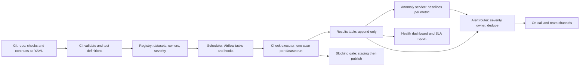
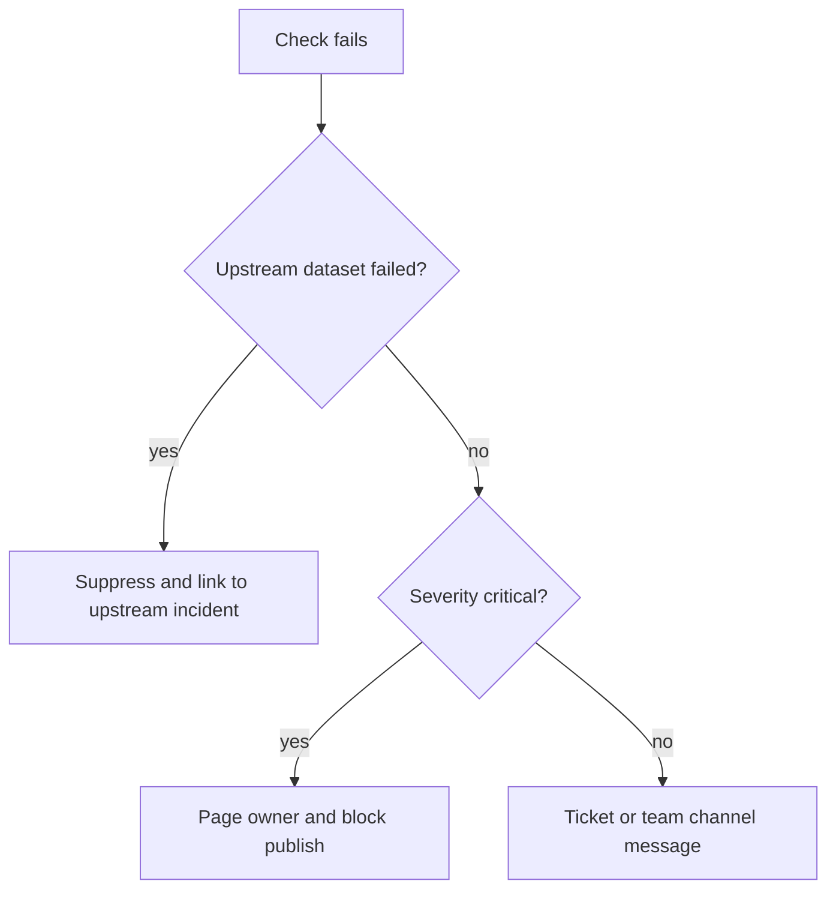

## 🎯 خلاصه

> یک پلتفرم کیفیت داده (DQ) برای هر دیتاست، هر روز، به یک سؤال جواب می‌دهد: **«الان می‌توانم به این جدول اعتماد کنم؟ اگر نه، چه کسی باید اقدام کند؟»** این پلتفرم چک‌ها را اجرا می‌کند، نتایج را ذخیره می‌کند، انحراف بی‌صدا را پیدا می‌کند، و هشدار را به مالک درست می‌رساند بدون اینکه تیم‌ها را غرق کند.

- **چک‌ها کد هستند**: در Git نسخه‌بندی می‌شوند، بازبینی می‌شوند، در CI تست می‌شوند و مثل هر تغییر دیگری deploy می‌شوند.
- **کوئری‌ها را یکی کن**: یک profiling scan برای هر اجرای دیتاست، از یک کوئری برای هر چک حدود ۱۰ برابر بهینه‌تر است (محاسبه‌ی زیر).
- **چک‌های blocking از publish جلوگیری می‌کنند** برای داده‌ی حیاتی؛ **monitor ها** بقیه را بعد از انتشار می‌پایند.
- **تشخیص anomaly** از baseline فصلی و مقاوم استفاده می‌کند، نه یک آستانه‌ی ثابت.
- **مسیردهی هشدار همان محصول است**: شدت، مالکیت از کاتالوگ، حذف هشدار بر اساس lineage، گروه‌بندی، و بودجه‌ی هشدار.

## 🌱 از ساده شروع کنیم (مبتدی)

> **💡 تشبیه:** میز triage یک بیمارستان. هر بیمار (دیتاست) طبق برنامه علائم حیاتی‌اش چک می‌شود (تازگی، تعداد ردیف، null ها). میز این خوانش‌ها را در پرونده ثبت می‌کند (store نتایج)، خوانش غیرعادی را با حالت «معمول» همان بیمار مقایسه می‌کند (anomaly)، و فقط دکتر درست را خبر می‌کند، نه کل بخش را (مسیردهی).

### ۱. صورت مسئله

یک بانک **۲٬۰۰۰ دیتاست** در warehouse و lake دارد که توسط **۳۰۰ pipeline** تولید می‌شوند و مالک آن‌ها **۴۰ تیم** است. سه‌ماه پیش یک partition خالی بی‌صدا به داشبورد ریسک رسید و سه روز ماند. یک پلتفرم DQ طراحی کن که این دسته از خرابی‌ها را بگیرد، ظرف چند دقیقه به مالک خبر بدهد، و تیم‌ها را با هشدار کاذب زیر فشار نگذارد.

### ۲. نیازمندی‌های کارکردی

- تیم‌ها برای دیتاست‌هایشان چک تعریف کنند: تازگی، حجم، یکتایی، null، بازه‌ی مقادیر، یکپارچگی ارجاعی، و SQL سفارشی.
- چک‌ها **داخل pipeline** (blocking، قبل از publish) و **طبق برنامه** (monitor) برای داده‌هایی که از بیرون می‌رسند اجرا شوند.
- نتایج با تاریخچه ذخیره شوند تا بتوان روند و حادثه‌های گذشته را پرس‌وجو کرد.
- متریک‌هایی مثل تعداد ردیف و نرخ null در طول زمان با تشخیص anomaly پایش شوند.
- هشدار به مالک برسد، با شدت، لینک runbook، و وضعیت هر دیتاست.

### ۳. نیازمندی‌های غیرکارکردی

- **تأخیر:** نتیجه‌ی چک حیاتی حداکثر ۱۵ دقیقه بعد از رسیدن داده.
- **پوشش:** هر دیتاست در کاتالوگ حداقل مجموعه‌ی چک‌ها را داشته باشد.
- **نویز:** کمتر از یک صفحه‌ی هشدار (page) در هفته برای هر مسئول on-call از چک‌های خودکار.
- **هزینه:** کوئری‌های چک نباید بیشتر هزینه‌ی warehouse را ببلعند.
- **قابل ممیزی بودن:** پاسخ «آیا این جدول در روز X معتبر بود؟» باید از روی نتایج ذخیره‌شده قابل بازسازی باشد.

## 🔧 واقعاً چطور کار می‌کند (متوسط)

### ۴. تخمین حجم

| کمیت | محاسبه | نتیجه |
|---|---|---|
| چک‌های تعریف‌شده | ۲٬۰۰۰ دیتاست × ۱۰ چک | **۲۰٬۰۰۰ چک** |
| اجرای suite زمان‌بندی‌شده در روز | ۵۰۰ حیاتی × ۲۴ (ساعتی) + ۱٬۵۰۰ بقیه × ۱ (روزانه) = ۱۲٬۰۰۰ + ۱٬۵۰۰ | **۱۳٬۵۰۰ اجرا در روز** |
| کوئری‌های ساده‌لوحانه | ۱۳٬۵۰۰ اجرا × ۱۰ چک | **۱۳۵٬۰۰۰ کوئری در روز** |
| زمان warehouse ساده‌لوحانه | ۱۳۵٬۰۰۰ × ۵ ثانیه (میانگین فرضی) | **۶۷۵٬۰۰۰ ثانیه ≈ ۱۸۷٫۵ ساعت warehouse در روز** |
| اسکن‌های تجمیع‌شده | ۱۳٬۵۰۰ اجرا × ۱ profiling scan × ۵ ثانیه | **۶۷٬۵۰۰ ثانیه ≈ ۱۸٫۷۵ ساعت در روز** |
| ردیف‌های نتیجه | ۱۳۵٬۰۰۰ × ۱ KB | **۱۳۵ MB در روز ≈ ۴۹ GB در سال** |
| سری‌های anomaly | ۲٬۰۰۰ دیتاست × ۴ متریک | **۸٬۰۰۰ سری روزانه** (≈ ۲٫۹ میلیون نقطه در سال) |
| نقاط anomaly ساعتی | ۵۰۰ حیاتی × ۴ متریک × ۲۴ × ۳۶۵ | **≈ ۱۷٫۵ میلیون نقطه در سال** |

عدد کلیدی تجمیع است: یک scan همه‌ی تجمیع‌های لازم یک دیتاست را محاسبه می‌کند. میانگین ۵ ثانیه فرض است، پس آن را صریح بگو و از مصاحبه‌کننده پروفایل واقعی warehouse را بپرس.

### ۵. مدل داده

چک‌ها تعریف هستند. نتایج یک جدول fact فقط-append است، با یک ردیف برای هر چک در هر اجرا:

```sql
CREATE TABLE dq_results (
    run_id         VARCHAR(64),
    dataset        VARCHAR(256),
    check_name     VARCHAR(128),
    check_version  INTEGER,        -- تعریفی که این نتیجه را تولید کرده
    run_ts         TIMESTAMP,
    data_date      DATE,           -- partitionی که قضاوت می‌شود، نه زمان اجرا
    status         VARCHAR(16),    -- PASS, FAIL, ERROR, SKIPPED
    observed       DOUBLE PRECISION,
    expected       VARCHAR(256),
    PRIMARY KEY (run_id, dataset, check_name)
);
```

`data_date` و `check_version` دو فیلدی هستند که معمولاً فراموش می‌شوند. بدون `data_date`، اجرای دیرهنگام برای دیروز شبیه خرابی داده‌ی امروز به نظر می‌رسد. بدون `check_version`، تغییر یک آستانه تاریخچه را بازنویسی می‌کند.

### ۶. طراحی سطح بالا



تعریف چک قرارداد بین مالک و پلتفرم است. این هم یک دیتاست که به‌صورت کد نوشته شده:

```yaml
dataset: marts.orders_daily
owner: team-payments
severity: critical            # مشخص می‌کند چه کسی page شود
freshness:
  column: loaded_at
  max_lag: 2h
checks:
  - name: order_id_unique
    type: unique
    columns: [order_id]
  - name: amount_not_negative
    type: range
    column: amount
    min: 0
  - name: row_count_anomaly
    type: anomaly
    metric: row_count
    sensitivity: 3.5
```

executor تمام چک‌های یک دیتاست را به **یک کوئری profiling** کامپایل می‌کند، تا warehouse پارتیشن را یک بار اسکن کند:

```sql
-- PostgreSQL dialect; the same shape works on most warehouses
SELECT
  COUNT(*)                                       AS row_count,
  COUNT(*) - COUNT(customer_id)                  AS null_customer_id,
  COUNT(*) - COUNT(DISTINCT order_id)            AS duplicate_order_rows,
  MAX(loaded_at)                                 AS max_loaded_at
FROM marts.orders_daily
WHERE load_date = CURRENT_DATE - INTERVAL '1 day';
```

`COUNT(DISTINCT)` روی جدول‌های بزرگ گران است. برای دیتاست‌های خیلی بزرگ می‌توان از sketch مثل HyperLogLog استفاده کرد و گفت که نتیجه تقریبی است.

## 🧠 عمق و trade-offها (سنیور)

### ۷. عمق: چک به‌عنوان کد

- **مخزن و بازبینی.** تعریف‌ها کنار کد pipeline هستند. PR ای که آستانه را ضعیف می‌کند باید تأیید مالک را بگیرد، و این تغییر را قابل‌دیدن می‌کند.
- **تست CI برای چک‌ها.** اسکیمای YAML را اعتبارسنجی کن، چک بدون مالک را رد کن، و هر چک SQL را روی یک fixture کوچک اجرا کن تا غلط‌های تایپی قبل از deploy گرفته شوند.
- **قالب‌ها.** برای هر نوع جدول (fact، dimension، mart) یک بسته‌ی پیش‌فرض بده. پوشش از پیش‌فرض‌ها می‌آید و چک سفارشی استثناست.
- **نسخه‌بندی.** هر نتیجه `check_version` را ذخیره می‌کند. تغییر آستانه یک نسخه‌ی جدید است، نه ویرایش تاریخچه.

### ۸. عمق: چک‌ها کجا اجرا شوند

دو جایگاه وجود دارد و طراحی خوب از هر دو استفاده می‌کند:

- **گیت blocking (داخل pipeline).** partition جدید را در محل staging بنویس، چک‌های حیاتی را اجرا کن، و فقط در صورت موفقیت publish کن. این مصرف‌کننده‌ها را محافظت می‌کند، ولی به هر اجرا تأخیر اضافه می‌کند و اگر بد استفاده شود، pipeline ها را برای دلایل غیرحیاتی می‌شکند.
- **Monitor (بعد از publish).** یک job زمان‌بندی‌شده جدول زنده را چک می‌کند. داده‌ی بیرونی، داده‌ی دیرهنگام، و تغییرات ابزارهای دیگر را می‌گیرد، ولی ممکن است داده‌ی بد قبلاً دیده شده باشد. برای چیزهایی که گیت نمی‌بیند استفاده کن.

فقط چک‌های blocking باید جلوی کار را بگیرند. با فیلد `severity` تصمیم بگیر: چک حیاتی گیت را رد می‌کند، چک هشداری فقط نتیجه ثبت می‌کند.

### ۹. عمق: تشخیص anomaly

یک آستانه‌ی ثابت («تعداد ردیف بالای ۱۰٬۰۰۰») با اولین سال رشد خراب می‌شود. baselineای که **امروز را با همان روز هفته در ۸ هفته‌ی اخیر** مقایسه کند، الگوی هفتگی را پوشش می‌دهد. از median و median absolute deviation (MAD) استفاده کن، تا یک خرابی گذشته baseline را تحریف نکند:

```python
from statistics import median

def robust_z(history: list[float], today: float) -> float:
    """history: همان روز هفته، ۸ هفته‌ی اخیر. median و MAD در برابر خرابی‌های گذشته مقاوم‌اند."""
    med = median(history)
    mad = median(abs(x - med) for x in history)
    if mad == 0:
        return 0.0 if today == med else float("inf")
    return 0.6745 * (today - med) / mad  # modified z-score

def is_anomaly(history: list[float], today: float, threshold: float = 3.5) -> bool:
    if len(history) < 6:
        return False  # cold start: تاریخچه کافی برای قضاوت نیست؛ این را در UI نشان بده
    return abs(robust_z(history, today)) > threshold
```

در مصاحبه سه حالت خرابی تشخیص anomaly را نام ببر: **cold start** (دیتاست جدید baseline ندارد)، **تعطیلات و لانچ** (baseline برای یک رویداد شناخته‌شده غلط است، پس annotation «تغییر مورد انتظار» بگذار که هشدار را سرکوب کند)، و **خستگی از هشدار** (هر هشدار باید دکمه‌ی بازخورد «واقعی» یا «مورد انتظار» داشته باشد که حساسیت را برای هر دیتاست تنظیم کند).

### ۱۰. عمق: مسیردهی هشدار



- **حذف هشدار بر اساس lineage.** وقتی یک جدول upstream خراب می‌شود، ۳۰ چک downstream نباید هرکدام یک نفر را page کنند. از lineage کاتالوگ استفاده کن و همه را به یک incident وصل کن.
- **گروه‌بندی و حذف تکرار.** برای هر دیتاست در هر روز یک incident با شمارنده، نه یک پیام برای هر اجرا.
- **پنجره‌های نگهداری و تغییرات مورد انتظار** عمداً هشدار را سرکوب می‌کنند، و هر سرکوب باید منقضی شود.
- **escalation.** یک page حیاتی که تأیید نشده بعد از زمان مشخص به team lead می‌رود. هر هشدار به runbook لینک دارد؛ هشداری بدون runbook یک باگ است.
- **بودجه‌ی هشدار.** تعداد page برای هر on-call در هفته را پایش کن و افزایش آن را باگ چک‌ها بدانی، نه کمبود نیرو.

### ۱۱. مقیاس، هزینه و عملیات

- **چک‌های incremental** اجرا کن: فقط partition جدید را به‌علاوه‌ی invariant های ارزان سطح جدول (مثل روند تعداد ردیف) اعتبارسنجی کن.
- **نمونه‌گیری فقط برای توزیع‌ها**، هرگز برای یکتایی یا یکپارچگی ارجاعی. یک نمونه ممکن است یک تکراری را نبیند.
- خود پلتفرم را پایش کن: تأخیر اجرای چک‌ها، نرخ خطای خود چک‌ها (نتیجه‌ی ERROR معادل PASS نیست)، و سهم دیتاست‌هایی که اصلاً چک ندارند.

## 🧪 امتحان کن

ستون تعداد ردیف یک جدول حیاتی در ۸ دوشنبه‌ی اخیر این مقادیر را داشته (مرتب‌شده: ۹٬۹۰۰، ۹٬۹۰۰، ۹٬۹۵۰، ۱۰٬۰۰۰، ۱۰٬۰۰۰، ۱۰٬۰۵۰، ۱۰٬۱۰۰، ۱۰٬۱۰۰). median، MAD و modified z-score را برای دو مقدار جدید حساب کن و با آستانه‌ی ۳٫۵ تصمیم بگیر که هشدار بدهی یا نه:

1. تعداد امروز **۶٬۲۰۰** است.
2. تعداد امروز **۹٬۸۰۰** است.

<details><summary>راه‌حل‌ها را نشان بده</summary>

**Median.** دو مقدار وسط ۱۰٬۰۰۰ و ۱۰٬۰۰۰ هستند، پس median = **۱۰٬۰۰۰**.

**MAD.** انحراف‌های مطلق از ۱۰٬۰۰۰ عبارت‌اند از ۱۰۰، ۱۰۰، ۵۰، ۰، ۰، ۵۰، ۱۰۰، ۱۰۰. مرتب‌شده: ۰، ۰، ۵۰، ۵۰، ۱۰۰، ۱۰۰، ۱۰۰، ۱۰۰. دو مقدار وسط ۵۰ و ۱۰۰ هستند، پس MAD = **۷۵**.

**۱.** z = ۰٫۶۷۴۵ × (۶٬۲۰۰ − ۱۰٬۰۰۰) / ۷۵ = ۰٫۶۷۴۵ × (−۵۰٫۶۷) ≈ **−۳۴٫۲**. |z| > ۳٫۵ است، پس **هشدار**. این افت واقعی است و مالک باید بار ورودی را بررسی کند.

**۲.** z = ۰٫۶۷۴۵ × (۹٬۸۰۰ − ۱۰٬۰۰۰) / ۷۵ = ۰٫۶۷۴۵ × (−۲٫۶۷) ≈ **−۱٫۸**. |z| < ۳٫۵ است، پس **بدون هشدار**. این تغییرات عادی است.

</details>

## 💬 گوشه‌ی مصاحبه

**سؤال مصاحبه‌کننده:** «یک پلتفرم کیفیت داده برای ۲٬۰۰۰ دیتاست طراحی کن.»

- **جواب متوسط:** «تیم‌ها چک‌های SQL می‌نویسند، orchestrator بعد از هر بارگذاری اجرایشان می‌کند، نتایج در یک جدول ذخیره می‌شوند و خطاها یک پیام Slack می‌فرستند.»
- **جواب سنیور:** «از پوشش و هزینه شروع می‌کنم: ۱۳٬۵۰۰ اجرای suite در روز، پس چک‌های هر دیتاست را در یک profiling scan جمع می‌کنم، نه ۱۳۵٬۰۰۰ کوئری. چک‌ها YAML در Git با تست CI هستند. دیتاست‌های حیاتی گیت blocking دارند و بقیه monitor. چک‌های anomaly از baseline مقاوم همان روز هفته با قانون cold start استفاده می‌کنند. هشدارها از یک router عبور می‌کنند که خطاهای downstream را با lineage حذف می‌کند، بر اساس دیتاست گروه‌بندی می‌کند، و page های تأیید‌نشده را escalate می‌کند.»

**انتظار در هر سطح**

- **Mid:** چک‌ها به‌صورت SQL، اجرای زمان‌بندی‌شده، جدول نتایج، و هشدار. تعریف روشن تازگی، یکتایی و null.
- **Senior:** تجمیع هزینه، جایگاه blocking در برابر monitoring، تشخیص anomaly فصلی با حالت‌های خرابی‌اش، مسیردهی بر اساس lineage، و بودجه‌ی هشدار.
- **Staff:** مدل عملیاتی: چه کسی مالک کدام چک است، پوشش چطور اندازه‌گیری و اجرا می‌شود، سیگنال پلتفرم چطور به SLO برای اعتماد به داده تبدیل می‌شود، و چطور تیم‌ها از اسکریپت‌های موردی بدون روز قطعی مهاجرت می‌کنند.

**پرسش‌های پیگیری محتمل**

- «یک pipeline داده‌ی درست می‌نویسد، ولی منبع نصف ردیف‌ها را فرستاده. پلتفرم از کجا می‌فهمد؟» (چک حجم و تازگی نسبت به baseline، به‌علاوه‌ی تطبیق با شمارش منبع اگر وجود داشته باشد.)
- «چطور تست می‌کنی که یک چک همان چیزی را می‌گیرد که باید؟» (fixture با خرابی‌های شناخته‌شده، در CI، یکی برای هر نوع چک.)
- «تشخیص‌دهنده‌ی anomaly هر دوشنبه page می‌دهد. چه تغییری می‌دهی؟» (baseline همان روز هفته، بررسی تنظیم فصلی، و الگوی هفتگی را به‌عنوان رفتار مورد انتظار ثبت کن.)

> **🎤 این را در مصاحبه بگو:** «چک‌ها را کد می‌دانم و هزینه‌شان را در ساعت warehouse حساب می‌کنم، پس هر دیتاست یک profiling scan دارد. داده‌ی حیاتی قبل از publish گیت دارد و بقیه پایش می‌شوند. anomaly ها با baseline فصلی و مقاوم سنجیده می‌شوند، و هشدارها با حذف خطاهای downstream بر اساس lineage به مالک می‌رسند، پس یک خرابی upstream یک incident می‌سازد.»

## ⚠️ اشتباهات رایج

> **⚠️ هشدار:** چکی که ERROR برمی‌گرداند و به‌عنوان PASS شمرده می‌شود. خطای داخل چک یک monitor خراب است، نه چراغ سبز. آن را جدا ثبت کن و روی آن هشدار بده.

- اجرای یک کوئری برای هر چک روی جدول بزرگ، و بعد کشف صورت‌حساب warehouse.
- استفاده از آستانه‌ی ثابت برای تعداد ردیف در کسب‌وکاری با فصلی بودن هفتگی یا سالانه.
- نمونه‌گیری جدول برای بررسی یکتایی، و بعد نادیده گرفتن تکراری‌ها.
- page کردن مالک هر جدول downstream وقتی یک جدول upstream خراب می‌شود.
- ذخیره‌ی نتایج بدون `data_date` و `check_version`، که باعث می‌شود تاریخچه قابل توضیح نباشد.
- blocking کردن همه‌ی چک‌ها. گیت پرنویز باعث می‌شود تیم‌ها آن را دور بزنند.
- سنجیدن موفقیت با تعداد چک‌ها به‌جای تعداد حادثه‌هایی که زود گرفته شده‌اند.

## ✅ خودت را بسنج (quiz)

1. «profiling scan تجمیع‌شده» در جدول تخمین چه چیزی را صرفه‌جویی می‌کند؟
   - A) فضای ذخیره‌سازی سطرهای نتیجه
   - B) زمان warehouse، با محاسبه‌ی همه‌ی تجمیع‌های یک دیتاست در یک گذر به‌جای یک کوئری برای هر چک
   - C) تأخیر شبکه بین scheduler و warehouse
   - D) نیاز به تست CI

<details><summary>جواب</summary>

**B** — در تخمین، ۱۳۵٬۰۰۰ کوئری به ۱۳٬۵۰۰ scan تبدیل می‌شود، یعنی حدود ده برابر زمان warehouse کمتر. فضای ذخیره‌سازی را تغییر نمی‌دهد و CI مسئله‌ی جداگانه است.

</details>

2. چرا `dq_results` علاوه بر `run_ts` باید `data_date` را هم ذخیره کند؟

   - A) چون `run_ts` نمی‌تواند timestamp باشد
   - B) در غیر این صورت، اجرای دیرهنگام برای partition دیروز شبیه خرابی داده‌ی امروز دیده می‌شد
   - C) چون کلید اصلی به دو ستون تاریخ نیاز دارد
   - D) تا پلتفرم سریع‌تر نتایج قدیمی را حذف کند

<details><summary>جواب</summary>

**B** — نتیجه توصیف partitionی است که قضاوت می‌شود، نه لحظه‌ای که چک اجرا شده. مخلوط کردن این دو باعث می‌شود backfill ها و اجرای مجدد، حادثه‌ی جدید به نظر برسند.

</details>

3. یک شمارش روزانه‌ی ردیف الگوی هفتگی قوی دارد. کدام baseline برای anomaly مناسب‌تر است؟

   - A) میانگین کل روزهای گذشته
   - B) آستانه‌ی ثابت ۱۰٬۰۰۰ ردیف
   - C) همان روز هفته در هفته‌های اخیر، با مرکز و پراکندگی مقاوم
   - D) فقط آخرین مقدار

<details><summary>جواب</summary>

**C** — مقایسه‌ی سیب با سیب چرخه‌ی هفتگی را حذف می‌کند، و median و MAD در برابر خرابی‌های گذشته مقاوم‌اند. میانگین کل فصلی بودن را نادیده می‌گیرد و یک آخرین مقدار، پرنویز است.

</details>

4. **(سنیور)** یک بارگذاری upstream به نام `raw.payments` خراب می‌شود و ۲۵ چک downstream در سه mart در همان اجرا شکست می‌خورند. router چه باید بکند و چرا؟

   - A) ۲۵ مالک را page کند تا همه خبردار شوند
   - B) چک‌های downstream را سرکوب کند و با استفاده از lineage کاتالوگ، یک incident به خرابی upstream وصل کند
   - C) چک‌ها را تا رفع داده‌ی upstream غیرفعال کند
   - D) چک‌های downstream را ده بار دوباره اجرا کند

<details><summary>جواب</summary>

**B** — شکست‌های downstream یک علت دارند. یک incident به‌هم‌پیوسته به مالک ریشه می‌رود و مالکان downstream لینک را می‌بینند. غیرفعال کردن چک‌ها مشکلات واقعی را پنهان می‌کند و تکرار اجرا داده‌ی upstream گم‌شده را برنمی‌گرداند.

</details>

5. **(سنیور)** چرا نمونه‌گیری برای چک نرخ null قابل قبول است ولی برای چک کلید تکراری قابل قبول نیست؟

   - A) نمونه‌گیری هرگز قابل قبول نیست
   - B) تخمین نرخ null ذاتاً تقریبی است و آرام تغییر می‌کند، در حالی که یک تکراری تنها ممکن است به‌کلی توسط نمونه از دست برود
   - C) کلیدهای تکراری همیشه در جدول جداگانه ذخیره می‌شوند
   - D) چک‌های null فقط روی metadata اجرا می‌شوند

<details><summary>جواب</summary>

**B** — نمونه یک نرخ تقریبی می‌دهد که برای پایش روند با خطای اعلام‌شده قابل قبول است. یکتایی ویژگی بله-یا-خیر هر ردیف است، پس نمونه ممکن است آن را نبیند. این trade-off پشت قاعده‌ی «برای توزیع نمونه بگیر، برای کلیدها اسکن کن» است.

</details>

## 🗂️ فلش‌کارت

| Front | Back |
|---|---|
| چک در این طراحی چیست؟ | تعریف نسخه‌دار در Git که بازبینی و در CI تست می‌شود و نتیجه تولید می‌کند |
| گیت blocking در برابر monitor | گیت publish داده‌ی حیاتی را متوقف می‌کند؛ monitor جدول زنده را بعد از انتشار چک می‌کند |
| چرا یک profiling scan برای هر دیتاست | جایگزین یک کوئری برای هر چک می‌شود و در تخمین حدود ده برابر زمان warehouse را کم می‌کند |
| دو فیلدی که معمولاً فراموش می‌شوند | `data_date` (partition قضاوت‌شده) و `check_version` (تعریف استفاده‌شده) |
| چرا median و MAD برای baseline | یک خرابی گذشته آن‌ها را جابه‌جا نمی‌کند، برخلاف میانگین و انحراف معیار |
| cold start در تشخیص anomaly | تاریخچه‌ی کافی برای قضاوت نیست؛ صریح بگو و بی‌صدا هشدار نده |
| حذف هشدار بر اساس lineage | یک خرابی upstream یک incident به‌هم‌پیوسته می‌سازد، نه یک page برای هر چک downstream |
| قاعده‌ی نمونه‌گیری | برای توزیع و روند نمونه بگیر؛ برای کلیدها و یکپارچگی ارجاعی همه‌ی ردیف‌ها را اسکن کن |

## 🔗 ادامه

- **data-quality** و **data-observability** ابعاد و مفاهیم پایش را تعریف می‌کنند که این طراحی به آن‌ها تکیه دارد.
- **data-lineage** توضیح می‌دهد کاتالوگ چطور گراف upstream و downstream را می‌دهد که حذف هشدار به آن نیاز دارد.
- **governance-contracts-mesh** قراردادهای داده را پوشش می‌دهد، که سمت تولیدکننده‌ی همین چک‌هاست.
- **incidents-postmortems** نشان می‌دهد هشدارهای پلتفرم چطور به کار پیگیری تبدیل می‌شوند.
- نوشته‌های تیم‌های پلتفرم داده درباره‌ی حجم هشدار و تعداد چک‌ها اعداد بسیار متفاوتی دارند. از محاسبات این درس به‌عنوان روش استفاده کن و هر عدد واقعی را با پست اصلی تطبیق بده.
