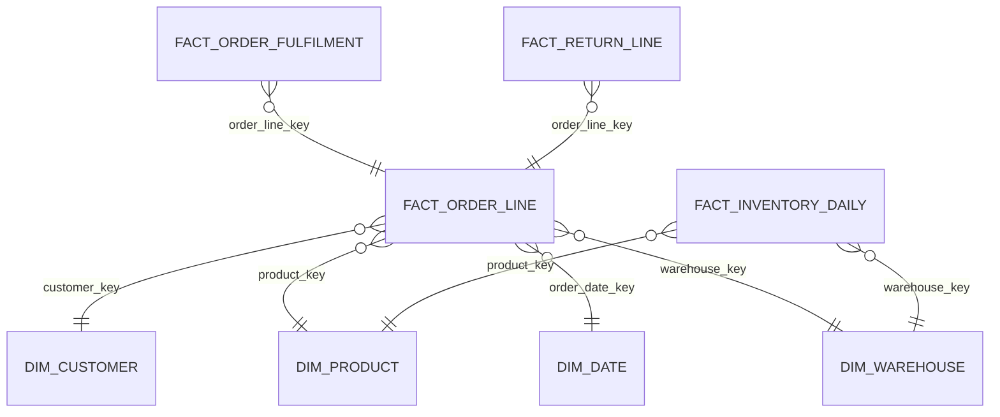

## 🎯 خلاصه

> یک انبار داده طراحی کن که **سفارش‌ها، ردیف‌های سفارش، موجودی و مرجوعی‌ها** را از یک پایگاه داده‌ی OLTP با CDC بار می‌کند، آن‌ها را به‌صورت **star schema به سبک Kimball** با بعدهای **SCD2** مدل می‌کند و **mart‌های روزانه** منتشر می‌کند که مالی و تیم کالا بتوانند به آن‌ها اعتماد کنند.

- اول **grain** را مشخص کن: یک ردیف برای هر ردیف سفارش. بقیه‌ی جدول‌ها به آن وابسته‌اند.
- سه نوع جدول واقعیت داشته باش: یک جدول تراکنشی برای ردیف‌ها، یک **accumulating snapshot** برای چرخه‌ی عمر سفارش، و یک **periodic snapshot** برای موجودی.
- ویژگی‌های مشتری و محصول که در طول زمان عوض می‌شوند، بعدهای **SCD2** می‌شوند تا تاریخچه درست بماند.
- تغییرات دیرهنگام (مرجوعی ۲۵ روز بعد از خرید) عادی‌اند. mart‌ها را با **پنجره‌ی بازبینی به عقب (lookback)** و **MERGE یا overwrite idempotent** بساز تا اجرای دوباره امن باشد.

## 📋 صورت مسئله

یک فروشگاه اینترنتی سیستم سفارش خود را روی PostgreSQL اجرا می‌کند. تحلیلگرها به انباری نیاز دارند با شاخص‌های فروش، فرایند تحویل، موجودی و مرجوعی. مالی به عدد درآمد روزانه تا ساعت ۰۶:۰۰ نیاز دارد که با منبع بخواند. تیم کالا موجودی و مرجوعی را به تفکیک دسته‌بندی می‌خواهد. شرکت در اوج حدود ۱ میلیون سفارش در روز دارد.

### نیازمندی‌های کارکردی

- دریافت تغییرات `orders`، `order_items`، `customers`، `products`، `warehouses`، `inventory_movements` و `returns`.
- مدل‌سازی فروش، فرایند تحویل، موجودی روزانه و مرجوعی برای BI.
- نگه‌داشتن تاریخچه‌ی آدرس و بخش مشتری و دسته‌ی محصول، تا گزارش‌های گذشته درست بمانند.
- انتشار mart‌های روزانه: فروش به تفکیک روز، دسته و کشور؛ نرخ مرجوعی؛ سلامت موجودی.
- پشتیبانی از بک‌فیل وقتی باگ یا تغییر قانون، پردازش دوباره‌ی یک بازه‌ی گذشته را لازم کند.

### نیازمندی‌های غیرکارکردی

- **تازگی:** mart‌های روزانه ساعت ۰۶:۰۰ آماده باشند؛ موجودی برای عملیات حداکثر ۱ ساعت کهنه باشد.
- **درستی:** درآمد روزانه بعد از تطبیق با منبع، حداکثر ۰٫۰۱٪ اختلاف داشته باشد؛ ردیف سفارش تکراری نباشد.
- **قابلیت بازیابی:** بار ناموفق بدون پاک‌سازی دستی قابل اجرای دوباره باشد.
- **حریم خصوصی:** داده‌ی شخصی (نام، تلفن، آدرس) ماسک یا محدود شود. این موضوع در ایران، با توجه به قوانین داخلی، همان‌قدر اهمیت دارد که در مقررات مشابه GDPR.

## 📐 تخمین

فرض کن در اوج ۱ میلیون سفارش در روز، میانگین ۳ ردیف در هر سفارش، و ۱۰ میلیون حرکت موجودی در روز داریم.

- ردیف سفارش در روز: ۱٬۰۰۰٬۰۰۰ × ۳ = **۳ میلیون ردیف در روز**.
- در سال: ۳٬۰۰۰٬۰۰۰ × ۳۶۵ = **۱٫۱ میلیارد** ردیف واقعیت. با حدود ۱۲۰ بایت در هر ردیف بدون فشرده‌سازی، یعنی ۱٫۱ × ۱۰⁹ × ۱۲۰ B ≈ **۱۳۲ گیگابایت در سال** قبل از فشرده‌سازی. فشرده‌سازی ستونی معمولاً این را چند برابر کم می‌کند.
- تغییر وضعیت سفارش: حدود ۵ بار برای هر سفارش (ثبت، پرداخت، بسته‌بندی، ارسال، تحویل). یعنی ۵ میلیون رویداد CDC در روز از `orders`، به‌علاوه‌ی رویدادهای سطح ردیف و موجودی.
- حرکت موجودی: ۱۰ میلیون × حدود ۱۰۰ B ≈ **۱ گیگابایت در روز** رویداد خام. snapshot روزانه‌ی موجودی خیلی کوچک‌تر است: ۵۰٬۰۰۰ محصول × ۲۰ انبار = ۱ میلیون ردیف در روز، حدود ۱۰۰ مگابایت.
- مرجوعی: ۵ درصد سفارش‌ها، یعنی ۵۰٬۰۰۰ مرجوعی در روز و حدود ۶۰٬۰۰۰ ردیف مرجوعی.

نتیجه: حجم برای یک انبار ستونی متوسط است. سخت‌ترین بخش‌ها **درستی در برابر تغییر** (ترتیب CDC، SCD2، مرجوعی‌های دیرهنگام) و **هزینه‌ی پردازش دوباره** هستند، نه توان عبوری خام.

## 🗃️ مدل داده

ما star schema به سبک Kimball را استفاده می‌کنیم، چون ابزارهای BI و تحلیلگران مستقیم به آن کوئری می‌زنند.



| جدول | نوع | grain | یادداشت |
|---|---|---|---|
| `fact_order_line` | تراکنشی | یک ردیف برای هر ردیف سفارش | تعداد، قیمت واحد، تخفیف، مبلغ خالص |
| `fact_order_fulfilment` | accumulating snapshot | یک ردیف برای هر ردیف سفارش | زمان ثبت، ارسال، تحویل، مرجوعی؛ در جا به‌روز می‌شود |
| `fact_return_line` | تراکنشی | یک ردیف برای هر واحد مرجوعی | به ردیف سفارش لینک می‌شود؛ کد دلیل |
| `fact_inventory_daily` | periodic snapshot | محصول × انبار × روز | موجودی پایان روز |
| `dim_customer` | SCD2 | یک ردیف برای هر نسخه‌ی مشتری | آدرس، بخش؛ `valid_from`، `valid_to`، `is_current` |
| `dim_product` | SCD2 | یک ردیف برای هر نسخه‌ی محصول | دسته، برند؛ تاریخچه برای گزارش دسته مهم است |
| `dim_date`، `dim_warehouse` | Type 1 | یک ردیف برای هر روز / انبار | ثابت یا با تغییر کم |

**grain** همه‌چیز را تعیین می‌کند. اگر کسی «درآمد به تفکیک بخش مشتری» بخواهد و بخش مشتری در طول زمان عوض شود، join باید نسخه‌ی مشتری معتبر در زمان سفارش را انتخاب کند. این فقط وقتی ممکن است که جدول واقعیت زمان سفارش را داشته باشد و بعد، بازه‌ی اعتبار داشته باشد.

هر بُعد یک **کلید جایگزین** (`customer_key`) دارد، تا کلید طبیعی منبع بتواند تغییر کند یا دوباره استفاده شود، بی‌آنکه تاریخچه بازنویسی شود.

## 🏗️ طراحی سطح بالا

```mermaid
flowchart LR
    PG["PostgreSQL OLTP"] -->|"logical replication"| DBZ["Debezium CDC"]
    DBZ --> K["Kafka: cdc topics"]
    K --> RAW["Raw CDC log, append-only"]
    RAW --> STG["Staging: latest change per key"]
    STG --> DIMS["SCD2 dimensions (MERGE)"]
    STG --> FACTS["Facts (MERGE on order line key)"]
    DIMS --> FACTS
    FACTS --> MART["Daily marts (lookback rebuild)"]
    MART --> BI["BI and finance reports"]
    FACTS --> DQ["Data quality checks"]
    DQ --> MART
```



لاگ خام CDC به‌صورت جدول **append-only** نگه داشته می‌شود، با ستون `op` (درج، به‌روزرسانی، حذف)، موقعیت لاگ منبع (LSN یا offset در binlog) و زمان منبع. در این لایه چیزی بازنویسی نمی‌شود. سپس staging **یک ردیف برای هر کلید** نگه می‌دارد: آخرین تغییر در بچ. بُعدها و واقعیت‌ها با MERGE از staging ساخته می‌شوند و mart‌ها از روی واقعیت‌ها.

این یک چیدمان medallion است: لایه‌های خام، staging و مدل‌شده، که هرکدام از لایه‌ی قبلی قابل اجرای دوباره‌اند.

## 🧠 غواصی در بخش‌های کلیدی

### ۱. ترتیب CDC و حذف‌ها

- بر اساس **موقعیت لاگ منبع** مرتب کن، نه زمان ورود به Kafka. پارتیشن‌بندی Kafka بر اساس کلید اصلی ترتیب یک ردیف را حفظ می‌کند، ولی ارسال دوباره‌ی بچ یا restart مصرف‌کننده می‌تواند رویدادها را دوباره پخش کند. روی `(table, primary_key, lsn)` dedup کن.
- **snapshot اولیه‌ی** یک جدول مجموعه‌ای از رویدادهای `op = 'r'` است. آن را در لایه‌ی خام جدا از جریان زنده نگه دار تا بتوانی بدون دست زدن به تغییرات زنده دوباره پخشش کنی.
- **حذف‌ها.** حذف در OLTP باید در انبار به یک حذف نرم (`is_deleted = true`، `deleted_at`) تبدیل شود. حذف سخت تاریخچه را می‌شکند و تطبیق را سخت‌تر می‌کند. درخواست حذف واقعی (حریم خصوصی) از یک فرایند جدا و قابل ممیزی می‌گذرد؛ به [[pattern-data-deletion]] نگاه کن.

### ۲. مشتریان با SCD2

مشتری از تهران به اصفهان می‌رود. انبار باید هر دو نسخه را نگه دارد تا درآمد سال قبل برای تهران همچنان در تهران بماند.

```sql
-- Dialect: سبک ANSI (مثل PostgreSQL / Snowflake / BigQuery).
-- در Spark، به جای "IS DISTINCT FROM" برای هر جفت از "NOT (a <=> b)" استفاده کن.
-- stg_customer برای هر مشتری یک ردیف دارد: آخرین تغییر در این بچ.
MERGE INTO dim_customer AS t
USING (
    -- شاخه‌ی ۱: همه‌ی ردیف‌های staging، با کلید customer_id (نسخه‌های قبلی را می‌بندد)
    SELECT s.customer_id AS merge_key, s.customer_id, s.city, s.segment, s.changed_at
    FROM stg_customer AS s
    UNION ALL
    -- شاخه‌ی ۲: ردیف‌های تغییرکرده با کلید NULL، تا match نشوند و درج شوند
    SELECT NULL, s.customer_id, s.city, s.segment, s.changed_at
    FROM stg_customer AS s
    JOIN dim_customer AS cur
      ON cur.customer_id = s.customer_id AND cur.is_current
    WHERE cur.city IS DISTINCT FROM s.city
       OR cur.segment IS DISTINCT FROM s.segment
) AS src
ON t.customer_id = src.merge_key AND t.is_current
WHEN MATCHED AND (t.city IS DISTINCT FROM src.city
               OR t.segment IS DISTINCT FROM src.segment) THEN
    UPDATE SET is_current = FALSE, valid_to = src.changed_at
WHEN NOT MATCHED THEN
    INSERT (customer_id, city, segment, valid_from, valid_to, is_current)
    VALUES (src.customer_id, src.city, src.segment, src.changed_at, DATE '9999-12-31', TRUE);
```

ایده‌ی کلیدی ترفند دو شاخه است: یک مشتری تغییرکرده باید یک بار match شود (تا نسخه‌ی قبلی بسته شود) و یک بار درج شود (به‌عنوان نسخه‌ی جدید). یک MERGE با یک ردیف منبع نمی‌تواند هر دو را انجام دهد.

join نقطه‌ی-زمانی (point-in-time) برای واقعیت‌ها:

```sql
SELECT f.order_line_id, c.customer_key, f.net_amount
FROM fact_order_line AS f
JOIN dim_customer AS c
  ON c.customer_id = f.customer_id
 AND f.order_ts >= c.valid_from
 AND f.order_ts <  c.valid_to;
```

> **⚠️ مراقب باش:** اگر به جای بازه‌ی اعتبار روی `is_current` join کنی، درآمد سال قبل بی‌صدا به شهر فعلی مشتری منتقل می‌شود.

**بُعدهای دیرهنگام.** ممکن است یک واقعیت قبل از بارگذاری تغییر مشتری برسد. یک ردیف بُعد «استنباطی» با کلید شناخته‌شده درج کن، پرچمش بزن، و اجرای SCD2 بعدی آن را اصلاح کند. واقعیت را دور نریز.

### ۳. انواع جدول واقعیت و چرخه‌ی عمر سفارش

- `fact_order_line` یک بار برای هر ردیف نوشته می‌شود و به‌ندرت تغییر می‌کند. به این سؤال جواب می‌دهد: «چه فروخته شد».
- `fact_order_fulfilment` یک **accumulating snapshot** است. یک ردیف برای هر ردیف سفارش، با زمان هر مرحله. وقتی مرحله‌ای می‌رسد، MERGE ردیف را به‌روز می‌کند. به این سؤال جواب می‌دهد: «ارسال چقدر طول کشید».
- `fact_return_line` grain خودش را دارد: یک ردیف برای هر واحد مرجوعی. مرجوعی ممکن است ۲۵ روز بعد از سفارش برسد. با کلید به ردیف سفارش لینک می‌شود، پس فروش را عوض نمی‌کند؛ یک واقعیت منفی اضافه می‌کند.

برای موجودی یک **periodic snapshot** نگه دار، نه جمع حرکت‌ها. جمع کردن حرکت‌ها هر روز کند است و یک رویداد جاافتاده کل مجموع را غلط می‌کند. snapshot روزانه برای بازسازی یک روز خاص ارزان است.

### ۴. mart‌های روزانه و داده‌ی دیرهنگام

mart‌هایی مثل `mart_daily_sales` از روی واقعیت‌ها با **پنجره‌ی lookback** ساخته می‌شوند: هر اجرا `N` روز آخر را بازسازی می‌کند (مثلاً ۷ روز)، نه فقط دیروز. بنابراین مرجوعی یا تغییر وضعیتی که دیر می‌رسد، روزهای مربوط را به‌روز می‌کند.

- برای روزهای بازسازی‌شده از **partition overwrite** روی `order_date` استفاده کن. overwrite idempotent است: اجرای دوباره‌ی یک روز همان نتیجه را می‌دهد.
- mart‌ای که به تغییر دیرهنگام در دوره‌ی بسته‌شده وابسته است، یک **restatement** است. سیاست آن را با مالی تعیین کن: بی‌صدا بازنویسی کنی، با نسخه بازنویسی کنی، یا عدد اصلی را نگه داری و تعدیل را نشان دهی. تصمیم را مکتوب کن.

### ۵. ارکستریشن، کیفیت و تطبیق

یک orchestrator مثل Airflow زنجیره را اجرا می‌کند: بار CDC، بُعدها، واقعیت‌ها، mart‌ها، بررسی‌های کیفیت، انتشار. هر task idempotent است تا retry امن باشد. این بررسی‌ها را همیشه داشته باش:

- **تطبیق با منبع:** تعداد ردیف و مجموع `net_amount` سفارش‌های دیروز، در مقایسه با replica OLTP. اختلاف بیشتر از آستانه، انتشار را متوقف کند.
- **یکپارچگی ارجاعی:** هر `customer_key` و `product_key` در واقعیت‌ها باید در بُعد خودش باشد؛ عضو ناشناخته‌ی `-1` فقط برای موارد دیرهنگام شناخته‌شده استفاده شود و شمارش شود.
- **تازگی:** آخرین `changed_at` در staging به‌اندازه‌ی کافی تازه باشد.
- **یکتایی:** در `fact_order_line` یک ردیف برای هر `order_line_id`.

## 🧠 عمق و trade-offها (سنیور)

- **چرا star و نه یک جدول پهن.** یک جدول بزرگ (OBT) برای یک سؤال سریع است، ولی تغییرش گران است و حفظ درستی SCD برایش سخت. star بُعدها را بین واقعیت‌ها مشترک نگه می‌دارد. بسیاری از تیم‌ها star را برای هسته و یک OBT را به‌عنوان mart روی آن می‌سازند.
- **هزینه‌ی MERGE.** MERGE فایل‌هایی را که ردیف‌های match‌شده دارند بازنویسی می‌کند. روی جدولی با ۱ میلیارد ردیف، به‌روزرسانی چند کلید می‌تواند تعداد زیادی فایل را بازنویسی کند. جدول را با کلید پایدار پارتیشن کن، روی کلید MERGE خوشه‌بندی کن و تعداد فایل‌هایی را که یک MERGE معمولی لمس می‌کند بررسی کن. در Iceberg یا Delta، compaction و تنظیم اندازه‌ی فایل مهم است؛ قبل از اجرا مستندات نسخه‌ی خودت را بررسی کن.
- **هزینه‌ی accumulating snapshot.** به‌روزرسانی در جا یعنی بازنویسی تاریخچه‌ی آن ردیف. در یک lakehouse فقط-افزودنی، تغییرات مرحله‌ها را به‌صورت رویداد نگه دار و snapshot را در یک view یا mart بساز، وقتی حجم کوئری کم است.
- **restatement در برابر حسابرسی.** بازنویسی بی‌صدا برای مالی غلط است. نسخه یا کد دلیل نگه دار، تا یک عدد گزارش‌شده یک ماه بعد هم قابل توضیح باشد.
- **حریم خصوصی در انبار.** ماسک و کنترل دسترسی ستونی باید روی `dim_customer` (تلفن، آدرس) اعمال شود. داده‌ی شخصی را در mart‌ها کپی نکن؛ کاربران mart کمتر به نام نیاز دارند.
- **ارکستریشن.** DAG را روی وابستگی‌ها بساز، نه روی offset زمانی. «واقعیت‌ها را ساعت ۰۳:۰۰ شروع کن» وقتی بُعدها دیر باشند بی‌صدا شکست می‌خورد؛ «واقعیت‌ها منتظر بُعدها بمانند» بلند و واضح شکست می‌خورد، که همان چیزی است که می‌خواهی.
- **بستر on-prem.** بسیاری از خرده‌فروشان ایرانی PostgreSQL روی زیرساخت داخلی، Debezium، Kafka و یک lakehouse روی Spark با ذخیره‌سازی object یا HDFS دارند. طراحی یکی است؛ هزینه‌ی عملیاتی (بک‌آپ، ارتقا، ظرفیت) بیشتر است، پس برای اوج فصل (مثلاً کمپین‌های نوروز یا جمعه‌ی سیاه) ظرفیت برنامه‌ریزی کن.
- **چه چیزی را پایش کنی:** تأخیر CDC (ثانیه پشت منبع)، مدت MERGE و تعداد فایل‌های بازنویسی‌شده، تعداد بُعدهای استنباطی SCD2، اختلاف تطبیق، و تعداد روزهای restatement‌شده در هفته.
- **کی این را نسازی:** اگر یک منبع، یک تیم و گزارش‌های روزانه داری، یک job ELT شبانه با view‌ها کافی است. SCD2 را وقتی اضافه کن که سؤال تاریخی پیدا شود.

## 🧪 امتحان کن

اول حدس بزن، بعد جواب را ببین.

> یک مشتری در ۲۰۲۶-۰۳-۱۰ از تهران به اصفهان می‌رود. سفارشی که در ۲۰۲۶-۰۳-۰۵ ثبت شده به `dim_customer` با `is_current = TRUE` join می‌شود. آن سفارش به کدام شهر گزارش می‌شود؟

<details><summary>حدست چیست؟</summary>

**اصفهان.** ردیف فعلی نسخه‌ی جدید است، پس سفارش قدیمی به شهر جدید نسبت داده می‌شود. join نقطه‌ی-زمانی روی `order_ts` بین `valid_from` و `valid_to` نتیجه‌ی **تهران** را می‌دهد که درست است. این دقیقاً همان باگی است که این درس هشدارش را می‌دهد.

</details>

## 💬 گوشه‌ی مصاحبه

> **🎤 این را در مصاحبه بگو:** «از grain شروع می‌کنم: یک ردیف برای هر ردیف سفارش. ردیف‌ها یک واقعیت تراکنشی هستند، چرخه‌ی عمر سفارش یک accumulating snapshot، و موجودی یک periodic snapshot روزانه. مشتریان و محصولات SCD2 هستند، پس واقعیت‌ها به نسخه‌ی معتبر در زمان سفارش join می‌شوند. CDC در یک لایه‌ی خام فقط-افزودنی فرود می‌آید و mart‌ها یک پنجره‌ی lookback را بازسازی می‌کنند تا مرجوعی‌های دیرهنگام هم درست شوند.»

**پاسخ متوسط چه شکلی است:** یک star schema با جدول واقعیت، بُعدها، بار CDC و یک mart روزانه.

**پاسخ سنیور چه اضافه می‌کند:** بیان grain، SCD2 با join نقطه‌ی-زمانی، تفاوت واقعیت‌های تراکنشی و snapshot، هزینه‌ی MERGE روی جدول‌های بزرگ، و یک سیاست restatement که با مالی توافق شده.

**پاسخ Staff چه اضافه می‌کند:** مالکیت هر mart و SLA آن، این‌که شرکت بین تیم‌ها چه چیزی را «درآمد» می‌نامد (یک لایه‌ی تعریف متریک)، و یک برنامه‌ی مهاجرت از پایگاه گزارش‌گیری فعلی بدون شکستن داشبوردها.

### پرسش‌های بعدی محتمل

1. **«یک مرجوعی ۴۰ روز بعد از سفارش می‌رسد. چه تغییر می‌کند؟»** یک ردیف جدید در `fact_return_line` به ردیف اصلی لینک می‌شود. واقعیت فروش تغییر نمی‌کند. پنجره‌ی lookback تاریخ مرجوعی را پوشش می‌دهد و mart فقط دوره‌ی تحت تأثیر را طبق سیاست توافق‌شده restate می‌کند.
2. **«مالی می‌گوید درآمد دیروز ۰٫۵٪ اختلاف دارد. کجا را نگاه می‌کنی؟»** تعداد ردیف و مجموع را در هر مرحله مقایسه کن: منبع، خام، staging، واقعیت‌ها، mart. تکرار ناشی از پخش دوباره‌ی CDC، حذف‌ها، و منطق تخفیف یا ارز را بررسی کن.
3. **«بعد از باگ در منطق تخفیف، ۲ سال گذشته را چطور بک‌فیل می‌کنی؟»** منطق را درست کن، واقعیت‌های پارتیشن‌های تحت تأثیر را با overwrite بازسازی کن، mart‌ها را بازسازی کن و تطبیق را اجرا کن. دسته‌ای انجام بده تا انبار قابل استفاده بماند.
4. **«یک مشتری درخواست حذف دارد. انبار چطور رعایت می‌کند؟»** ستون‌های شخصی `dim_customer` را در همه‌ی نسخه‌ها شبه‌نام‌گذاری کن، کلیدها را برای تجمیع نگه دار، و درخواست را ثبت کن. واقعیت‌های سفارش را که مالی لازم دارد حذف نکن.
5. **«چرا از replica خواندنی OLTP برای تحلیل استفاده نکنی؟»** بار تحلیلی را با سیستم زنده مخلوط می‌کند، تاریخچه ندارد و نمی‌تواند منابع را ترکیب کند. انبار تاریخچه و join اضافه می‌کند.

## ⚠️ اشتباهات رایج

- **نداشتن بیان grain.** واقعیت‌هایی با grain مخلوط، درآمد را دوبار می‌شمارند. قبل از ستون‌ها، grain را بگو.
- **join کردن SCD2 با `is_current`** برای واقعیت‌های تاریخی. از بازه‌ی اعتبار استفاده کن.
- **حذف سخت در انبار.** تاریخچه را پاک می‌کند و تطبیق را می‌شکند.
- **جمع زدن حرکت‌های موجودی** به‌جای نگه‌داشتن snapshot. یک رویداد جاافتاده برای همیشه مجموع را غلط می‌کند.
- **بازسازی فقط دیروز.** مرجوعی‌ها و تغییرات وضعیت دیرهنگام هرگز به mart نمی‌رسند.
- **MERGE بدون کلید پایدار یا dedup.** کلیدهای تکراری در منبع نتیجه‌ی غیرقطعی می‌دهند.
- **نداشتن تطبیق.** بدون آن، اولین بار از مالی می‌فهمی که عدد غلط است.

## ✅ خودت را بسنج

1. **یادآوری.** grain جدول `fact_order_line` چیست؟
   - A) یک ردیف برای هر سفارش
   - B) یک ردیف برای هر ردیف سفارش
   - C) یک ردیف برای هر مشتری در هر روز
   - D) یک ردیف برای هر رویداد CDC

   <details><summary>پاسخ</summary>

   **B** — یک ردیف برای هر ردیف سفارش، پایین‌ترین سطحی است که تعداد و قیمت را دارد. grain سفارش، جزئیات اقلام را از دست می‌دهد و grain رویداد، تغییرات وضعیت را با فروش مخلوط می‌کند.

   </details>

2. **سناریو.** کدام نوع جدول برای «از ارسال تا تحویل چند روز طول کشید، به تفکیک انبار» مناسب است؟
   - A) جدول واقعیت تراکنشی
   - B) periodic snapshot
   - C) accumulating snapshot
   - D) بُعد Type 1

   <details><summary>پاسخ</summary>

   **C** — accumulating snapshot یک ردیف برای هر فرایند با زمان هر مرحله نگه می‌دارد، پس اختلاف دو مرحله یک تفریق ساده است. یک واقعیت تراکنشی برای این کار به self-join روی ردیف‌های رویداد نیاز دارد.

   </details>

3. **سناریو.** یک MERGE برای SCD2 نسخه‌ی قبلی مشتری را می‌بندد ولی نسخه‌ی جدید را درج نمی‌کند. محتمل‌ترین علت چیست؟
   - A) بُعد کلید جایگزین ندارد
   - B) ردیف تغییرکرده با کلید موجود در همان MERGE match شده و فقط برای به‌روزرسانی استفاده شده؛ شاخه‌ی NOT MATCHED برای نسخه‌ی جدید وجود ندارد
   - C) MERGE از UPDATE پشتیبانی نمی‌کند
   - D) پنجره‌ی lookback کوتاه است

   <details><summary>پاسخ</summary>

   **B** — یک ردیف منبع که با ردیف هدف match می‌شود فقط می‌تواند شاخه‌ی matched را فعال کند. راه‌حل معمول منبع دو شاخه است: یک ردیف برای بستن نسخه‌ی قبلی، و یک ردیف با کلید NULL برای درج نسخه‌ی جدید.

   </details>

4. **trade-off سنیور.** مالی می‌خواهد درآمد سه‌ماههٔ گذشته ثابت بماند، ولی یک مرجوعی دیرهنگام مجموع را تغییر می‌دهد. رویکرد درست کدام است؟
   - A) جدول فروش را بی‌صدا به‌روز کن
   - B) واقعیت فروش را نگه دار، یک واقعیت مرجوعی اضافه کن، و سیاست restatement را با مالی توافق کن
   - C) مرجوعی را حذف کن
   - D) mart‌ها را بدون پنجره‌ی lookback بازسازی کن

   <details><summary>پاسخ</summary>

   **B** — مرجوعی یک رویداد جدا با grain خودش است، پس فروش همان‌طور که بود می‌ماند. این‌که دوره‌ی بسته‌شده restate شود یا نه و چطور، یک تصمیم کسب‌وکار است که باید مستند شود.

   </details>

5. **یادآوری.** چرا لاگ خام CDC فقط-افزودنی نگه داشته می‌شود؟
   - A) نوشتنش سریع‌تر از MERGE است
   - B) امکان replay، دیباگ و بازسازی staging و واقعیت‌ها را بدون بازگشت به منبع می‌دهد
   - C) نیاز به کلید اصلی را از بین می‌برد
   - D) وضعیت نهایی را برای BI ذخیره می‌کند

   <details><summary>پاسخ</summary>

   **B** — نگه‌داشتن هر تغییر با موقعیت منبعش، اجرای دوباره و دیباگ را ممکن می‌کند. staging و واقعیت‌ها را می‌شود از روی لاگ خام بازسازی کرد.

   </details>

## 🗂️ فلش‌کارت

| Front | Back |
|---|---|
| grain یعنی چه؟ | معنای یک ردیف در جدول واقعیت؛ اول باید بیان شود |
| تراکنشی در برابر accumulating snapshot | یک ردیف برای هر رویداد در برابر یک ردیف برای هر فرایند که در هر مرحله به‌روز می‌شود |
| SCD2 چیست؟ | برای هر نسخه‌ی یک بُعد یک ردیف جدید با بازه‌ی اعتبار نگه داشتن |
| چرا join نقطه‌ی-زمانی؟ | تا واقعیت به نسخه‌ی بُعدی که در زمان رویداد معتبر بوده وصل شود |
| چرا CDC خام فقط-افزودنی؟ | امکان replay و بازسازی بدون خواندن دوباره‌ی منبع |
| چرا پنجره‌ی lookback در mart؟ | مرجوعی‌ها و تغییرات وضعیت دیرهنگام روزهای اخیر را به‌روز می‌کنند |
| عضو استنباطی چیست؟ | ردیف placeholder در بُعد برای واقعیتی که قبل از بُعدش رسیده |

## 🔗 ادامه

- پیش‌نیازها: [[dimensional-modeling]]، [[scd]]، [[cdc]].
- الگوهای مرتبط: [[pattern-cdc-analytics]]، [[pattern-history]]، [[pattern-backfill]].
- طراحی‌های مرتبط: [[design-cdc-lake]]، [[design-payment-reconciliation]].
- واژه‌نامه: [[fact-table]]، [[dimension-table]]، [[grain]]، [[surrogate-key]]، [[scd]]، [[cdc]].
