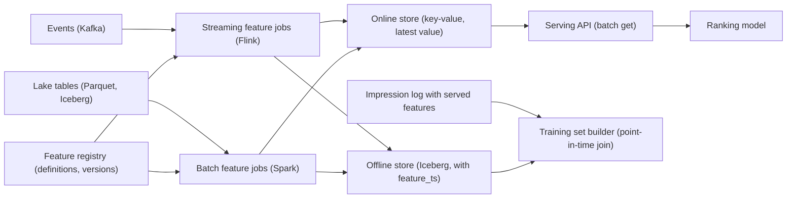

## 🎯 خلاصه

> یک پلتفرم feature طراحی کن که **فیچرها** (عددهایی که کاربر و آیتم را توصیف می‌کنند، مثل «کلیک‌ها در ۷ روز گذشته») را یک بار حساب کند، آن‌ها را به یک مدل رتبه‌بندی در **کمتر از ۲۰ میلی‌ثانیه** بدهد، و **داده‌ی آموزشی‌ای بسازد که با آنچه مدل در زمان سرویس دیده منطبق باشد**.

- هر فیچر را **یک بار** تعریف کن، و دو بار materialize کن: یک **offline store** برای آموزش و یک **online store** برای سرویس‌دهی.
- آموزش باید از joinهای **point-in-time درست** استفاده کند. استفاده از مقدار امروز برای یک رویداد گذشته، آینده را به مدل نشت می‌دهد.
- بزرگ‌ترین خرابی بی‌صدا **training-serving skew** است: یک فیچر در دو جا متفاوت محاسبه شود.
- backfill تاریخچه را وقتی تعریف فیچر عوض می‌شود بازسازی می‌کند. آن را نسخه‌بندی کن، محدودیت نرخ بگذار، و هرگز چیزی را که مدل‌های قدیمی با آن آموزش دیده‌اند بازنویسی نکن.

## 🌱 از ساده شروع کنیم (مبتدی)

> **💡 تشبیه:** یک کارت دستور پخت که در دو آشپزخانه نگه داشته می‌شود. آشپزخانه‌ی رستوران (online) غذای فعلی را سریع لازم دارد؛ آشپزخانه‌ی آزمایشی (offline) باید بداند در یک روز گذشته دقیقاً چه چیزی در قابلمه بوده تا دستور جدید را قضاوت کند. اگر این دو آشپزخانه از دو کارت متفاوت استفاده کنند، نتیجه‌ی آزمایش در رستوران هیچ معنایی ندارد.

**فیچر** مقداری است که مدل به‌عنوان ورودی استفاده می‌کند. نمونه‌ها:

- `user.clicks_7d`: چند آیتم کاربر در ۷ روز گذشته کلیک کرده.
- `item.ctr_1h`: نرخ کلیک یک آیتم در ساعت گذشته.
- `user.preferred_category`: دسته‌ای که کاربر بیشتر با آن تعامل داشته.

**feature store** سیستمی است که این‌ها را تعریف، محاسبه، ذخیره و به‌صورت یکسان سرویس می‌کند.

**صورت مسئله‌ای** که طراحی می‌کنیم:

> یک سرویس توصیه برای هر درخواست کاربر، آیتم‌های کاندید را رتبه‌بندی می‌کند. مدل رتبه‌بندی برای هر کاندید حدود ۵۰ فیچر و برای کاربر حدود ۲۰۰ فیچر لازم دارد. درخواست‌ها در اوج به ۱۰۰٬۰۰۰ در ثانیه می‌رسند و بودجه‌ی p99 برای جست‌وجوی فیچر ۲۰ میلی‌ثانیه است. دانشمندان داده هر هفته یک مدل جدید روی ۹۰ روز تاریخچه آموزش می‌دهند و باید به داده‌ی آموزشی اعتماد کنند.

**نیازمندی‌های عملکردی**

- ثبت تعریف فیچر با مالک، توضیح، نوع داده و هدف تازگی.
- سرویس‌دهی فیچرها برای یک دسته entity (یک کاربر و آیتم‌های زیاد) با کلید، در یک فراخوانی.
- ساخت داده‌ی آموزشی برای هر زمان رویداد برچسب‌دار، join شده با مقادیری که در آن زمان معتبر بوده‌اند.
- backfill تاریخچه وقتی تعریف فیچر عوض می‌شود، و ثبت این‌که هر مدل از کدام نسخه استفاده کرده.

**نیازمندی‌های غیرعملکردی**

- p99 جست‌وجوی online کمتر از ۲۰ ms، و دسترس‌پذیری مسیر online بالاتر از خود سرویس رتبه‌بندی.
- تازگی: فیچرهای stream در ۱ تا ۵ دقیقه؛ فیچرهای batch یک بار در روز.
- سازگاری: مقداری که هنگام سرویس استفاده می‌شود با مقداری که یک job آموزشی برای همان لحظه حساب می‌کند برابر باشد.
- هزینه: online store نباید با هر رویداد رشد کند، فقط با تعداد entityها و فیچرها.

**تخمین (محاسبه را نشان بده)**

- کاربران: ۲۰۰ میلیون. فیچر به‌ازای کاربر: ۲۰۰. اندازه‌ی میانگین هر مقدار: ۸ بایت. برای هر کاربر: ۲۰۰ × ۸ = ۱٬۶۰۰ بایت ≈ ۱٫۶ KB.
- فیچرهای کاربر در online: ۲۰۰ میلیون × ۱٫۶ KB = **۳۲۰ GB**. با کلید و سربار store حدود ۲ برابر، برای replicaها و shardها حدود **۶۴۰ GB** برنامه‌ریزی کن.
- درخواست‌ها: ۱۰۰٬۰۰۰ در ثانیه در اوج. هر درخواست یک رکورد کاربر و ۵۰ رکورد آیتم می‌خواند، یعنی ۵۱ کلید برای هر درخواست.
- خواندن کلید: ۱۰۰٬۰۰۰ × ۵۱ = **۵٫۱ میلیون خواندن در ثانیه**. با فرض ۱۰۰٬۰۰۰ عملیات در ثانیه برای هر نود، حدود **۵۱ نود** پیش از replica لازم است. با multi-get دسته‌ای تعداد رفت‌وبرگشت را کم کن؛ تعداد نود همان می‌ماند، ولی تأخیر پایین می‌آید.
- لاگ تغییرات offline: ۲۰۰ میلیون کاربر، حدود ۲۰٪ گروه‌های فیچر در روز تغییر می‌کنند، پس ۴۰ میلیون ردیف تغییر در روز. در سال: ۴۰ M × ۳۶۵ = **۱۴٫۶ میلیارد ردیف**. با حدود ۱۰۰ بایت برای هر ردیف فشرده: **۱٫۵ TB در سال**.
- اسکن آموزش: ۹۰ روز رویداد برچسب‌دار با ۵۰۰ میلیون impression در روز یعنی ۴۵ میلیارد ردیف. همه‌ی آن را آموزش نمی‌دهی؛ نمونه‌برداری از negativeها و فیلتر کن، و هزینه‌ی point-in-time join را در نظر بگیر.

> **⚠️ مراقب باش:** ۱۰۰ بایت برای هر ردیف و ۱۰۰٬۰۰۰ عملیات برای هر نود فرض‌اند. این را صریح بگو و بگو در load test چطور اندازه‌شان می‌گیری.

## 🔧 واقعاً چطور کار می‌کند (متوسط)

**معماری.**



**registry** منبع حقیقت برای تعریف، مالک، نسخه و هدف تازگی هر فیچر است. jobهای stream و batch هر دو همان تعریف را می‌خوانند. **online store** فقط آخرین مقدار هر کلید را نگه می‌دارد. **offline store** تاریخچه را نگه می‌دارد، با ستون `feature_ts` که می‌گوید هر مقدار از چه زمانی معتبر شده.

**مسیر نوشتن online.** یک job stream مقدار جدید را حساب می‌کند و با زمان رویداد در online store upsert می‌کند. store باید **نوشتن‌های قدیمی‌تر را رد کند**: برای هر کلید `max(event_time)` را نگه دار و فقط وقتی به‌روزرسانی را اعمال کن که زمانش جدیدتر باشد. بدون این قانون، یک replay یا یک batch دیررس می‌تواند یک فیچر را به مقدار قدیمی برگرداند. این یک نوشتن compare-and-set است و بیشتر key-value storeها با به‌روزرسانی شرطی یا فیلد نسخه آن را پشتیبانی می‌کنند.

**مسیر نوشتن offline.** هر job ردیف‌های `(entity_id, feature_ts, values...)` را به یک جدول Iceberg یا Parquet می‌افزاید که روزانه پارتیشن شده. هر ردیف یک نسخه از فیچر است که از `feature_ts` معتبر است تا ردیف بعدی. این ساختار تغییرپذیر است، پس کوئری point-in-time می‌شود جست‌وجوی «آخرین ردیف در یا قبل از زمان t».

**point-in-time join.** یک نمونه‌ی آموزشی یک برچسب در زمان `t` است (کلیک در ۰۹:۱۴). فیچرهایش باید مقادیری باشند که در ۰۹:۱۴ معتبر بوده‌اند، نه مقادیر امروز. با سینتکس PostgreSQL:

```sql
-- labels: یک ردیف برای هر impression با زمان رویداد و نتیجه
-- user_features: یک ردیف برای هر تغییر، با feature_ts
SELECT l.impression_id,
       l.user_id,
       l.event_ts,
       l.clicked,
       f.clicks_7d,
       f.preferred_category
FROM impressions AS l
JOIN LATERAL (
    SELECT uf.clicks_7d, uf.preferred_category
    FROM user_features AS uf
    WHERE uf.user_id = l.user_id
      AND uf.feature_ts <= l.event_ts
    ORDER BY uf.feature_ts DESC
    LIMIT 1
) AS f ON true;
```

شرط `feature_ts <= event_ts` کل نکته است. بدون آن، join آخرین مقدار را برمی‌گرداند که ممکن است از بعد از کلیک باشد. مدل از اطلاعاتی یاد می‌گیرد که در زمان سرویس‌دهی ندارد و متریک‌های offline بهتر از تولید به نظر می‌رسند. بعضی موتورها یک `ASOF JOIN` دارند که همین ایده را مستقیم‌تر بیان می‌کند و ارزش دارد سینتکسش را برای موتور خودت بدانی.

**لاگ‌کردن فیچر، تمیزترین راه برای skew.** مقادیر فیچر **همان‌طور که سرو شده‌اند** را در impression log ثبت کن. برای بازه‌ای که لاگ وجود دارد، روی همان مقادیر لاگ‌شده آموزش بده. بازمحاسبه‌ی offline را فقط برای تاریخچه‌ی پیش از شروع لاگ‌کردن استفاده کن، و این دو را در یک بازه‌ی هم‌پوشان مقایسه کن تا skew اندازه‌گیری شود. لاگ‌کردن هزینه‌ی ذخیره دارد (مثلاً ۲۰۰ فیچر × ۸ بایت برای هر impression، یعنی حدود ۱٫۶ KB برای هر impression یا ۸۰۰ GB برای ۵۰۰ میلیون impression)، ولی بزرگ‌ترین دسته‌ی باگ‌های training-serving را حذف می‌کند.

**سرویس‌دهی.** سرویس API یک کاربر و لیست کاندید می‌گیرد، کلیدها را می‌سازد، یک batch get برای کاربر و یک برای کاندیدها می‌زند، برای فیچرهای گمشده **مقدار پیش‌فرض** جایگزین می‌کند و بردارها را به مدل می‌دهد. پیش‌فرض‌ها باید همان مقادیری باشند که آموزش برای مقادیر گمشده استفاده کرده؛ وگرنه هر مقدار گمشده یک جابه‌جایی بی‌صدا است.

**backfill.** وقتی تعریف فیچر عوض می‌شود (مثلاً پنجره از ۷ به ۱۴ روز)، تاریخچه باید بازسازی شود. job بک‌فیل همان کد فیچر را روی پارتیشن‌های روزانه‌ی گذشته اجرا می‌کند، در یک **نسخه‌ی جدید** از فیچر در offline store می‌نویسد و نسخه‌ی قدیمی را دست‌نخورده می‌گذارد. مدل‌ها نسخه‌ی خودشان را در registry ثابت نگه می‌دارند. backfill را روی یک خوشه‌ی جدا یا با محدودیت نرخ اجرا کن تا jobهای stream که ترافیک تولید را تغذیه می‌کنند گرسنه نمانند.

## 🧠 عمق و trade-offها (سنیور)

**training-serving skew، ریسک اصلی.** skew وقتی ظاهر می‌شود که مسیر offline و online با هم فرق داشته باشند. علت‌های رایج:

- دو کدبیس: یک تابع Python برای آموزش و یک تابع Java برای سرویس. راه‌حل: یک تعریف واحد که برای هر دو مسیر کامپایل شود، یا یک transform واحد با SQL یا DataFrame که هر دو مسیر صدایش بزنند.
- معنای زمانی متفاوت: آموزش از زمان رویداد استفاده می‌کند، سرویس از زمان پردازش، پس فیچرهایی که به آینده نگاه می‌کنند فرق دارند.
- پیش‌فرض یا مدیریت null متفاوت.
- پنجره‌های متفاوت: پنجره‌ی «۷ روز گذشته» که offline در نیمه‌شب حساب می‌شود و online هر دقیقه.

اندازه‌اش بگیر. برای نمونه‌ای از درخواست‌ها، بردار سرو‌شده‌ی لاگ‌شده را با بازمحاسبه‌ی offline برای همان timestamp مقایسه کن و وقتی نرخ عدم‌تطابق از آستانه (مثلاً ۰٫۱٪ مقادیر برای هر فیچر) گذشت هشدار بده. فیچری با skew بالا امن نیست، هرچقدر متریک offline آن خوب به نظر برسد.

**تازگی یک خاصیت مدل است.** فیچری که روزانه حساب می‌شود، هنگام سرویس‌دهی تا ۲۴ ساعت کهنه است، و داده‌ی آموزشی باید همین کهنگی را منعکس کند. اگر مدل روی مقادیر دقیقه‌ای آموزش ببیند ولی روزانه سرو شود، skew دوباره در بُعد زمان ظاهر می‌شود. هر فیچر در registry هدف تازگی خودش را دارد و آموزش همان قاعده‌ی کهنگی را استفاده می‌کند.

**انتخاب و اندازه‌ی online store.** online store یک key-value store با تأخیر کم و همزمانی بالاست (Redis، DynamoDB، Cassandra، Bigtable و مشابه‌ها). trade-offها:

- **store مبتنی بر حافظه** (Redis) کمترین تأخیر را دارد ولی RAM گران‌تری برای هر گیگابایت می‌خواهد. با ۳۲۰ تا ۶۴۰ GB فیچر، یک store حافظه‌ای گران ولی شدنی است؛ فقط فیچرهایی را نگه دار که مدل استفاده می‌کند.
- **store مبتنی بر دیسک** (Cassandra، DynamoDB) داده‌ی بیشتری را ارزان نگه می‌دارد، با تأخیر دنباله‌ی کمی بالاتر. p99 را با اندازه‌ی batch واقعی بسنج، نه p50 روی کلیدهای تکی.
- برای entityهایی که غیرفعال می‌شوند از TTL استفاده کن تا store بی‌نهایت رشد نکند.

**کلیدهای داغ.** یک آیتم وایرال می‌تواند سهم بزرگی از خواندن‌ها را بگیرد. یک کلید روی یک نود گلوگاه می‌شود. با خواندن replicated برای کلیدهای داغ، یک cache محلی کوتاه‌مدت در فرایند سرویس (با چند ثانیه کهنگی که جزو بودجه‌ی تازگی است)، یا coalesce کردن درخواست‌ها کاهشش بده.

**درستی point-in-time در مقیاس.** point-in-time join گران‌ترین مرحله‌ی آموزش است. جدول فیچر را بر اساس هش entity و روز پارتیشن کن، بر اساس `(entity_id, feature_ts)` مرتب کن، و جدول برچسب‌ها را با همان پارتیشن‌بندی بساز تا join یک merge هم‌مکان باشد، نه shuffle کامل. یک sort-merge یا ASOF join روی داده‌ی مرتب از جست‌وجوهای تکراری جلوگیری می‌کند. plan را بررسی کن: broadcast join روی جدولی با ۲۰۰ میلیون ردیف اشتباه است.

**اقتصاد و درستی backfill.** بازسازی دو سال snapshot روزانه برای ۲۰۰ میلیون کاربر یعنی ۷۳۰ پارتیشن روزانه. اگر هر پارتیشن ۲۰ دقیقه روی یک خوشه‌ی مشترک طول بکشد، backfill ترتیبی می‌شود ۷۳۰ × ۲۰ دقیقه ≈ ۲۴۳ ساعت، یعنی حدود ده روز. پارتیشن‌ها را موازی و در حد بودجه‌ی خوشه اجرا کن، و فقط وقتی نسخه‌ی جدید را فعال کن که بررسی‌های skew و نرخ null را پاس کرده باشد. نسخه‌ی قدیمی را تا وقتی هر مدلی که به آن وابسته است دوباره آموزش داده یا بازنشسته شده نگه دار.

**مالکیت، حاکمیت و حریم خصوصی.** فیچرها از تیمی که آن‌ها را ساخته عمرشان بیشتر است. برای هر فیچر مالک، توضیح و سیاست deprecation بخواه. استفاده‌ی مجدد از فیچر مزیت است (یک تعریف، مدل‌های زیاد)، ولی یعنی یک تغییر ناسازگار به مدل‌های زیادی می‌رسد، پس فیچر را نسخه‌بندی کن و deprecate کن، نه ویرایش. برای حریم خصوصی، حذف یک کاربر باید به online store (حذف کلید)، offline store (بازنویسی یا حذف فایل‌های تأثیرپذیر) و لاگ‌هایی که فیچرهای سرو‌شده را دارند برسد. این مسیر را در طراحی برنامه‌ریزی کن، نه بعد از اولین درخواست حذف.

**حالت‌های خرابی که باید تمرین کنی.**

- online store کند یا خاموش است. پیش‌فرض یا آخرین مقدار cache‌شده را سرو کن، و سرویس رتبه‌بندی را degrade کن (مثلاً به یک مدل ساده‌تر برگرد) به‌جای رد کردن درخواست. نسبت درخواست‌های سرو‌شده با پیش‌فرض را بشمار و روی آن هشدار بده.
- یک job stream یک پنجره را replay می‌کند و یک به‌روزرسانی خارج از ترتیب می‌رسد. قانون `max(event_time)` جلوی آن را می‌گیرد.
- یک فیچر برای یک بخش کامل null می‌شود چون جدول upstream schema‌اش را عوض کرده. هشدار نرخ null برای هر فیچر این را ظرف چند دقیقه می‌گیرد.
- backfill اشتباهاً در نسخه‌ی زنده می‌نویسد. با مسیرهای نسخه‌ی جدا و دسترسی نوشتن جلوی آن را بگیر.

**کی feature store نسازی.** یک مدل با دوجین فیچر که در یک job شبانه حساب می‌شوند نیازی به feature store ندارد. وقتی چند مدل فیچرها را شریک‌اند، تازگی دقیقه‌ای لازم است، یا skew قبلاً یک حادثه‌ی تولید ساخته، یکی اضافه کن.

**سیگنال‌های عملیاتی:** p99 و نرخ خطای جست‌وجوی online، نسبت مقادیر پیش‌فرض سرو‌شده، نرخ skew برای هر فیچر، تأخیر تازگی برای هر فیچر، حافظه‌ی store و سهم کلیدهای داغ، پیشرفت و هزینه‌ی backfill، و مدت join مجموعه‌ی آموزشی.

## 🧪 امتحان کن

این ورودی‌ها را استفاده کن: ۳۰۰ میلیون کاربر، ۱۵۰ فیچر برای هر کاربر با ۸ بایت هر کدام، ۸۰٬۰۰۰ درخواست در ثانیه، ۴۰ آیتم کاندید در هر درخواست، ۴۰ فیچر برای هر آیتم، و هر کلید یک عملیات با ۱۰۰٬۰۰۰ عملیات در ثانیه برای هر نود.

1. online store فیچرهای کاربر چند GB است، پیش از replica؟
2. مسیر سرویس‌دهی چند خواندن کلید در ثانیه دارد و با ۱۰۰٬۰۰۰ عملیات در ثانیه برای هر نود، چند نود لازم است؟
3. مدلی روی مقادیر فیچری آموزش دید که از پنجره‌ی ۷ روزه در نیمه‌شب حساب شده. سرویس‌دهی همان پنجره را هر دقیقه حساب می‌کند. skew را توصیف کن، چطور اندازه‌اش می‌گیری، و چه چیزی را تغییر می‌دهی؟

<details><summary>راه‌حل‌ها</summary>

**1.** ۱۵۰ × ۸ B = ۱٬۲۰۰ بایت برای هر کاربر. ۳۰۰ M × ۱٬۲۰۰ B = ۳٫۶ × ۱۰¹¹ بایت = **۳۶۰ GB**.

**2.** کلیدها برای هر درخواست: یک کاربر به‌علاوه‌ی ۴۰ آیتم = ۴۱. خواندن در ثانیه: ۸۰٬۰۰۰ × ۴۱ = ۳٬۲۸۰٬۰۰۰ (۳٫۲۸ میلیون). نود: ۳٬۲۸۰٬۰۰۰ / ۱۰۰٬۰۰۰ ≈ ۳۲٫۸، پس **۳۳ نود** پیش از replica.

**3.** مقدار offline در نیمه‌شب حساب می‌شود، پس در لحظه‌ی مرزی تا یک روز کهنه است و پنجره به زمان ثابت وابسته است. مقدار online تا یک دقیقه تازه است. مدل یک تعریف از فیچر را آموزش دیده و تعریف دیگری را سرو می‌کند، که skew در معنای زمانی است. با لاگ‌کردن مقادیر سرو‌شده و بازمحاسبه‌ی مقدار offline برای همان timestamp‌ها، و هشدار روی نرخ عدم‌تطابق، اندازه‌اش بگیر. راه‌حل یک تعریف با یک قاعده‌ی تازگی است (مثلاً هر دو مسیر پنجره‌ی لغزان روی زمان رویداد با همان حد کهنگی)، یا لاگ‌کردن فیچرهای سرو‌شده و آموزش روی آن‌ها.

</details>

## 💬 گوشه‌ی مصاحبه

**شکل سوال:** «یک feature store برای یک سیستم توصیه طراحی کن.» انتظار سوال درباره‌ی skew، point-in-time join و backfill داشته باش.

**پاسخ سطح متوسط:** «فیچرها در یک registry تعریف می‌شوند و jobهای batch و stream آن‌ها را حساب می‌کنند. فیچرهای batch به offline store برای آموزش می‌روند و فیچرهای stream به یک key-value store برای سرویس‌دهی. برای آموزش، برچسب‌ها را با مقدار معتبر در زمان رویداد join می‌کنم، نه با آخرین مقدار، تا مدل آینده را نبیند.»

**پاسخ سطح سنیور:** «اصلی‌ترین ریسک training-serving skew است، پس برای هر دو مسیر یک تعریف دارم و بردارهای سرو‌شده را لاگ می‌کنم، سپس روی لاگ‌ها آموزش می‌دهم و عدم‌تطابق را با بازمحاسبه اندازه می‌گیرم. online store آخرین مقدار هر کلید را نگه می‌دارد و نوشتن‌های قدیمی‌تر را رد می‌کند، پس replay نمی‌تواند مقادیر را به عقب برگرداند. برای ۲۰۰ میلیون کاربر حدود ۳۲۰ تا ۶۴۰ GB برنامه‌ریزی می‌کنم، با batch get و پیش‌فرض برای هر فیچر سرویس می‌دهم، و backfillها را به‌صورت job نسخه‌دار با محدودیت نرخ اجرا می‌کنم و فقط بعد از پاس شدن بررسی‌های skew و نرخ null سوییچ می‌کنم.»

> **🎤 این را در مصاحبه بگو:** «feature store در اصل یک سیستم سازگاری است. کارش این است که عددی که مدل در تولید می‌بیند همان عددی باشد که روی آن آموزش دیده، در همان نقطه‌ی زمانی. تازگی، point-in-time join و backfill نسخه‌دار همه در خدمت همین هدف‌اند.»

**سیگنال‌های سطح Staff:** سیاست مالکیت و deprecation فیچر؛ مدل هزینه برای هر فیچر و هر مدل؛ حذف حریم خصوصی در online، offline و لاگ‌ها؛ برنامه‌ی سرویس‌دهی چندمنطقه‌ای با نسخه‌های سازگار فیچر؛ و SLO برای تازگی و skew که تیم‌های محصول بتوانند رویش حساب کنند.

**follow-upهای محتمل.** *برچسب‌هایی که چند روز دیرتر می‌رسند را چطور مدیریت می‌کنی؟* با مقدار فیچری که در زمان impression معتبر بوده join کن و قبل از ساخت داده‌ی آموزشی منتظر بمان بازه‌ی برچسب بسته شود؛ کلید join زمان رویداد است، نه زمان رسیدن برچسب. *چرا از online store برای آموزش استفاده نکنیم؟* فقط آخرین مقدار را دارد، پس مقادیر تاریخی point-in-time از بین رفته‌اند. *چطور یک فیچر جدید را سریع اضافه می‌کنی؟* تاریخچه‌اش را به‌صورت نسخه‌ی جدید backfill کن، یک هفته سایه‌لاگ کن تا skew اندازه‌گرفته شود، و بعد اجازه بده مدل‌ها از آن استفاده کنند.

## ⚠️ اشتباهات رایج

> **⚠️ مراقب باش:** join کردن برچسب‌های آموزشی با آخرین مقدار فیچر. مدل از آینده یاد می‌گیرد و متریک‌های offline خیلی بهتر از سیستم زنده به نظر می‌رسند.

> **⚠️ مراقب باش:** نوشتن در online store بدون بررسی زمان. یک پنجره‌ی replay شده یا یک batch دیررس بی‌صدا فیچرها را به مقادیر قدیمی برمی‌گرداند.

- نگه داشتن یک پیاده‌سازی فیچر در Python برای آموزش و یک پیاده‌سازی دیگر در Java برای سرویس.
- لاگ نکردن هیچ چیز درباره‌ی آنچه سرو شده، پس skew فقط حدس زده می‌شود.
- فراموش کردن پیش‌فرض برای فیچرهای گمشده، یا استفاده از پیش‌فرض‌های متفاوت در آموزش و سرویس.
- backfill در نسخه‌ی زنده، که باعث می‌شود مدل‌های قدیمی بی‌صدا تغییر کنند.
- نگه داشتن کل تاریخچه در online store، که بی‌نهایت رشد می‌کند به‌جای نگه داشتن آخرین مقدار.
- استفاده از broadcast join برای مرحله‌ی point-in-time روی جدول فیچر بسیار بزرگ.
- طراحی حذف برای حریم خصوصی فقط بعد از رسیدن اولین درخواست.

## ✅ خودت را بسنج

۱. چرا join آموزشی باید از `feature_ts <= event_ts` استفاده کند و نه آخرین مقدار فیچر؟
   - A) این کوئری را سریع‌تر می‌کند
   - B) آخرین مقدار ممکن است از بعد از رویداد باشد، پس مدل اطلاعاتی یاد می‌گیرد که در زمان سرویس‌دهی ندارد
   - C) Iceberg آن را لازم دارد
   - D) تکراری‌ها را حذف می‌کند

<details><summary>پاسخ</summary>

**B** — آخرین مقدار ممکن است شامل اطلاعات بعد از رویداد باشد. این نشت است و متریک‌های offline را بهتر از نتایج تولید نشان می‌دهد.

</details>

۲. هدف قاعده‌ی «به‌روزرسانی online فقط وقتی اعمال شود که زمان رویدادش از مقدار ذخیره‌شده جدیدتر باشد» چیست؟

   - A) نوشتن را سریع‌تر می‌کند
   - B) جلوی به‌روزرسانی‌های replay شده یا دیررس را می‌گیرد که فیچر را به مقدار قدیمی‌تر برگردانند
   - C) کلیدهای کهنه را حذف می‌کند
   - D) store را فشرده می‌کند

<details><summary>پاسخ</summary>

**B** — replay جریان و batchهای دیررس می‌توانند به‌روزرسانی‌های قدیمی را بعد از جدیدها برسانند. مقایسه‌ی زمان رویداد، مقدار آخر را درست نگه می‌دارد.

</details>

۳. کدام تمیزترین راه برای رفع training-serving skew است؟

   - A) آموزش روی مجموعه‌ی داده‌ی بزرگ‌تر
   - B) لاگ‌کردن مقادیر فیچر همان‌طور که سرو شده‌اند و آموزش روی آن لاگ‌ها در جایی که وجود دارند، با سنجش بازمحاسبه در برابرشان
   - C) افزایش TTL در online store
   - D) استفاده از میانگین برای هر فیچر گمشده

<details><summary>پاسخ</summary>

**B** — مقادیر سرو‌شده‌ی لاگ‌شده دقیقاً همان چیزی هستند که مدل دیده. بازمحاسبه فقط برای تاریخچه‌ی پیش از شروع لاگ لازم است و هم‌پوشانی آن skew را اندازه می‌گیرد.

</details>

۴. **(سنیور)** می‌خواهی یک فیچر را از پنجره‌ی ۷ روزه به ۱۴ روزه ببری و دو سال تاریخچه داری. انتشار امن چیست؟

   - A) ستون فیچر موجود را در جا بازنویسی کن و همه‌ی مدل‌ها را دوباره آموزش بده
   - B) تعریف جدید را به‌صورت نسخه‌ی جدید در offline store بک‌فیل کن، skew و نرخ null را بسنج، و نسخه‌ی قدیمی را تا وقتی مدل‌های وابسته دوباره آموزش یا بازنشسته شوند ثابت نگه دار
   - C) پنجره‌ی ۱۴ روزه را فقط در online store حساب کن
   - D) backfill را رد کن و بگذار مدل از ماه بعدی یاد بگیرد

<details><summary>پاسخ</summary>

**B** — بک‌فیل نسخه‌دار مدل‌های قدیمی را قابل بازتولید نگه می‌دارد و قبل از وابستگی، تعریف جدید را تأیید می‌کند. بازنویسی در جا بی‌صدا هر مدلی را که آن ستون را می‌خواند تغییر می‌دهد.

</details>

۵. **(سنیور)** online store در اوج ده دقیقه در دسترس نیست. مسیر سرویس‌دهی چه کند، و درباره‌ی پیش‌فرض‌ها چه چیزی باید درست باشد؟

   - A) همه‌ی درخواست‌ها را تا بازگشت store رد کند
   - B) پیش‌فرض یا مقدار cache‌شده سرو کند، در صورت نیاز رتبه‌بندی را degrade کند، و نسبت درخواست‌های سرو‌شده با پیش‌فرض را بشمارد و هشدار بدهد؛ پیش‌فرض‌ها باید همان مقادیری باشند که آموزش برای مقادیر گمشده استفاده کرده
   - C) در اوج، برای هر درخواست به offline store برود
   - D) رتبه‌بندی خالی برگرداند

<details><summary>پاسخ</summary>

**B** — degradation تدریجی باعث می‌شود محصول همچنان پاسخ بدهد. پیش‌فرض‌ها باید با آموزش یکی باشند، وگرنه خود fallback skew می‌شود. نسبت درخواست‌های degrade‌شده سیگنال عملیاتی اصلی است.

</details>

## 🗂️ فلش‌کارت

| Front | Back |
|---|---|
| training-serving skew چیست؟ | مسیرهای offline و online یک فیچر را متفاوت حساب می‌کنند، پس مدل در تولید ورودی متفاوت می‌بیند |
| چرا point-in-time join؟ | مقداری را برمی‌گرداند که در زمان رویداد معتبر بوده، و نشت داده‌ی آینده را جلوگیری می‌کند |
| online store چه نگه می‌دارد؟ | آخرین مقدار هر کلید، با بررسی زمان تا نوشتن‌های قدیمی رد شوند |
| offline store چه نگه می‌دارد؟ | تاریخچه‌ی نسخه‌دار با `feature_ts`، به‌اندازه‌ی کافی برای بازسازی هر نقطه‌ی زمانی گذشته |
| بهترین راه رفع skew؟ | لاگ‌کردن بردارهای سرو‌شده و آموزش روی آن‌ها؛ مقایسه با بازمحاسبه |
| چرا backfill را نسخه‌دار کنیم؟ | مدل‌های قدیمی قابل بازتولید بمانند؛ نسخه‌ی جدید پیش از استفاده تأیید شود |
| مقدار پیش‌فرض برای چیست؟ | جایگزین امن وقتی فیچری گم است؛ باید با آنچه آموزش استفاده کرده یکی باشد |
| چرا جدول فیچر را بر اساس entity و زمان مرتب کنیم؟ | تا point-in-time join یک merge هم‌مکان باشد، نه shuffle کامل |

## 🔗 ادامه

- **feature-stores** مفاهیم (registry، online و offline store) را معرفی می‌کند که این طراحی استفاده می‌کند.
- **pattern-backfill** توضیح می‌دهد چطور تاریخچه را امن بازسازی کنیم؛ این هسته‌ی بخش backfill است.
- **stream-joins** و **delivery-semantics** سمت stream را پوشش می‌دهند: داده‌ی دیررس، replay و رفتار at-least-once در نوشتن online.
- **serving-layer** توضیح می‌دهد مسیر سرویس‌دهی، cache و بودجه‌ی تأخیر چطور کنار هم قرار می‌گیرند.
- **design-fraud-detection** سیستم دیگری با همین trade-offهای تازگی و skew است، در دامنه‌ای دیگر.
- مستندات online store و فرمت جدولت را برای نوشتن شرطی، TTL و time travel بررسی کن، چون این قابلیت‌ها و سینتکسشان بین نسخه‌ها فرق می‌کند.
