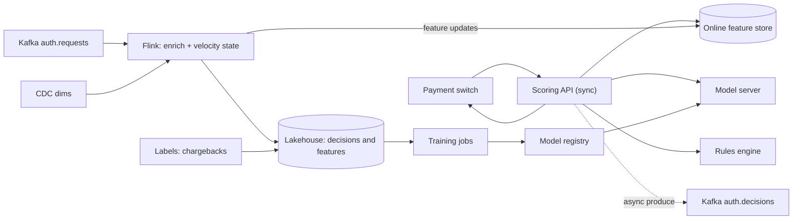
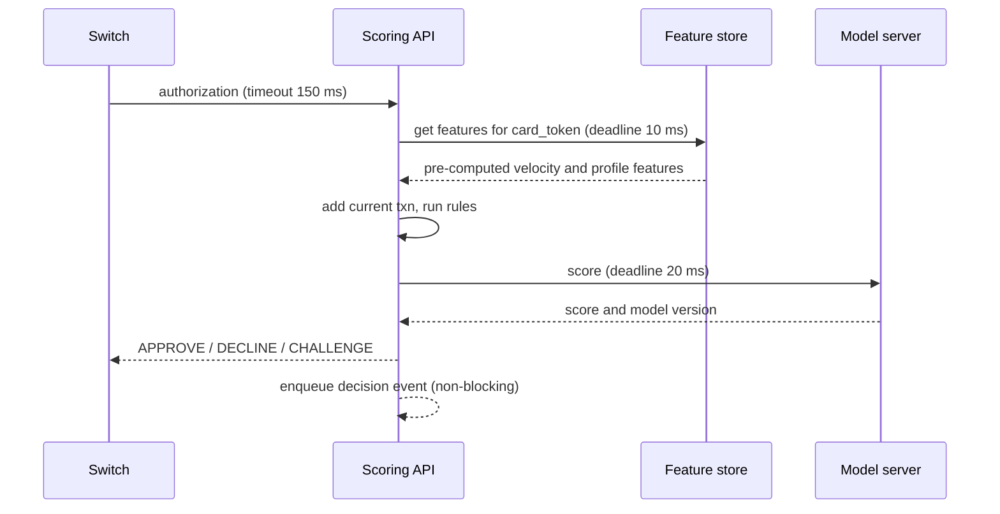

## 🎯 خلاصه

> یک درخواست مجوز کارت باید ظرف **حدود ۱۰۰ میلی‌ثانیه** تصمیم **تأیید / رد / چالش** را بگیرد، با استفاده از ویژگی‌هایی که **چند ثانیه‌ی پیش** درست بودند. دو مسیر بساز: یک مسیر **همگام** که ویژگی‌های از پیش محاسبه‌شده را از حافظه می‌خواند، و یک مسیر **ناهمگام** استریمی که همان ویژگی‌ها را از همان رویدادها تازه نگه می‌دارد.

- استریم‌های کلیددار (به‌ازای هر کارت یا حساب) وضعیت سرعت (velocity) را نگه می‌دارند: تعداد، جمع مبالغ و تعداد فروشنده‌های متمایز در یک پنجره.
- داده‌های بُعدی (مشتری، کارت، فروشنده) از **وضعیت نسخه‌دار** خوانده می‌شوند که با CDC پر شده، نه با یک کوئری پایگاه‌داده برای هر رویداد.
- تازگی ویژگی یک بودجه است که باید اندازه بگیری. برای هر خانوادهٔ ویژگی حداکثر سن و هشدار تعریف کن.
- کلاهبرداری تأییدشده و بازپس‌گیری‌ها (chargeback) با تأخیر روز یا ماه می‌رسند. اینها مدل را آموزش می‌دهند، ولی مستقیم مسیر زنده را عوض نمی‌کنند.

## 🌱 از ساده شروع کنیم (مبتدی)

> **💡 تشبیه:** یک صندوق‌دار بانک که قبل از تأیید یک برداشت بزرگ، نگاهی به سابقه‌ی اخیر مشتری می‌اندازد. اگر همین کارت در پنج دقیقه نُه پرداخت در سه شهر انجام داده باشد، صندوق‌دار یک کنترل اضافه می‌خواهد. او باید در همان لحظه‌ای که مشتری پشت پیشخوان ایستاده، تصمیم بگیرد.

**مسئله.** بانک درخواست‌های مجوز کارت را از طریق یک switch پرداخت از شبکه‌ی کارت دریافت می‌کند. برای هر درخواست، بانک باید یک تصمیم برگرداند. سیستمی بساز که هر درخواست را از نظر تقلب امتیازدهی کند، تصمیم را برگرداند، و شواهد لازم برای ممیزی و آموزش مدل را نگه دارد.

**نیازمندی‌های عملکردی**

- امتیازدهی برای هر درخواست مجوز.
- برگرداندن یکی از سه تصمیم: `APPROVE`، `DECLINE` یا `CHALLENGE` (درخواست OTP یا احراز هویت 3-D Secure).
- ترکیب **قوانین** (مثلاً «مبلغ بالاتر از X برای کارتی که کمتر از ۷ روز عمر دارد») با **امتیاز مدل ML**.
- تحلیلگران بتوانند قوانین را در چند ساعت اضافه یا تغییر دهند، بدون انتشار کد جدید.
- هر تصمیم همراه با دقیقاً همان ویژگی‌هایی که استفاده کرده ذخیره شود، برای اختلاف‌ها و آموزش دوباره.
- برگشت‌های پول و تقلب تأییدشده به داده‌ی آموزشی برگردند.

**نیازمندی‌های غیرعملکردی (فرض‌های ما)**

- تأخیر تصمیم: **p99 زیر ۱۰۰ میلی‌ثانیه** داخل سیستم ما. switch یک timeout سخت دارد؛ اگر از آن جا بمانیم، switch تصمیم پیش‌فرض خودش را اعمال می‌کند.
- در دسترس بودن مسیر تصمیم: ۹۹٫۹۹٪. اگر مدل از کار بیفتد، سیستم به حالت «فقط قوانین» می‌رود و این را در تصمیم ثبت می‌کند.
- دقیقاً یک رکورد تصمیم برای هر شناسه‌ی مجوز، حتی وقتی switch درخواست را دوباره می‌فرستد.
- شمارهٔ کارت (PAN) هرگز به بخش تحلیلی نمی‌رسد. از توکن استفاده کن.
- نگهداری تصمیم‌ها و ویژگی‌ها: طبق سیاست بانک و مقررات بانک مرکزی. ما ۵ سال فرض می‌کنیم.

## 🔧 واقعاً چطور کار می‌کند (متوسط)

### تخمین

فرض‌ها برای یک بانک بزرگ:

- حجم: ۲۰ میلیون تراکنش کارتی در روز.
- نرخ میانگین: ۲۰٬۰۰۰٬۰۰۰ / ۸۶٬۴۰۰ ثانیه ≈ **۲۳۱ TPS**.
- ضریب اوج ۴ (عصر، اول ماه حقوق، تعطیلات): ۲۳۱ × ۴ ≈ **۹۲۵ TPS**.
- هدف طراحی: **۲٬۰۰۰ TPS**، یعنی حدود دو برابر حاشیه‌ی اطمینان نسبت به اوج.
- اندازه‌ی رویداد: حدود ۱ کیلوبایت برای هر درخواست. حجم خام: ۲۰ میلیون × ۱ KB = **۲۰ GB در روز**، یعنی ۲۰ × ۳۶۵ ≈ **۷٫۳ TB در سال**.
- نگهداری ۵ ساله در Parquet فشرده با نسبت ۵:۱: ۷٫۳ TB × ۵ / ۵ ≈ **۷٫۳ TB** در lake.
- وضعیت ویژگی‌های آنلاین: ۳۰ میلیون کارت فعال × ۴۰ ویژگی × ۸ بایت ≈ ۹٫۶ GB. با سربار index و replication (×۲) حدود **۲۰ GB** حافظه در online store لازم است.

این اعداد سه چیز را نشان می‌دهند: مسیر همگام یک مسئله‌ی جست‌وجو در حافظه است (۲۰ GB در RAM جا می‌شود)، جریان رویدادها متوسط است (حدود ۲٬۰۰۰ پیام در ثانیه، برای Kafka آسان است)، و ذخیره‌سازی ارزان است در مقایسه با هزینه‌ی یک تصمیم اشتباه.

### مدل داده

| شیء | منبع / topic | فیلدهای کلیدی |
|---|---|---|
| درخواست مجوز | Kafka با نام `auth.requests`، کلید = `card_token` | `auth_id`، `card_token`، `merchant_id`، `mcc`، `amount`، `currency`، `country`، `device_id`، `event_time` |
| تصمیم | Kafka با نام `auth.decisions`، کلید = `auth_id` | `auth_id`، `decision`، `score`، `rule_hits[]`، `model_version`، `feature_snapshot_id`، `latency_ms` |
| مشتری، کارت، فروشنده | CDC (Debezium) به state و lake | کلید کسب‌وکار به‌همراه `valid_from` و `valid_to` (SCD نوع ۲ در lake) |
| تعریف ویژگی | رجیستری پیکربندی (نسخه‌دار) | `name`، `source`، `window`، `max_age`، `owner` |
| برچسب | سیستم اختلاف و بازپس‌گیری | `auth_id`، `label`، `label_time` |

### طراحی سطح بالا

مسیر همگام فقط به API، online store، موتور قوانین و model server دست می‌زند. Flink هرگز در مسیر درخواست نیست. Flink، online store را به‌روز نگه می‌دارد و ردپای ممیزی را می‌نویسد.

یک جزئیات مهم اینجاست. شمارنده‌های سرعت در Flink هنوز تراکنش در حال امتیازدهی را شامل نمی‌کنند. API آن تراکنش را به‌صورت محلی اضافه می‌کند تا شمارش درست شود، و اگر بعداً همان رویداد به Flink برسد، نباید دوباره اضافه شود. در سمت Flink با `auth_id` تکرار را حذف کن.

## 🧠 عمق و trade-offها (سنیور)

### Stream-table enrichment

جریان تراکنش‌ها باید با ابعادی که به‌آرامی تغییر می‌کنند join شود: دسته‌بندی فروشنده، وضعیت کارت، بخش مشتری. سه گزینه داریم:

| گزینه | مشکل |
|---|---|
| جست‌وجوی هر رویداد در پایگاه‌داده‌ی عملیاتی | جهش تأخیر، و بار اضافه روی هسته‌ی بانکی در اوج |
| ساخت state بُعدی از topic های CDC و join محلی | نیاز به مدیریت state دارد، ولی خواندن محلی و سریع است (**انتخاب ما**) |
| پخش (broadcast) ابعاد کوچک به همه‌ی taskها | برای صدها ردیف خوب است، نه برای میلیون‌ها کارت |

با state ساخته‌شده از CDC، join باید **temporal** باشد. یک تراکنش باید رکوردِ فروشنده‌ای را join کند که در **زمان رویداد** معتبر بوده، نه مقدار فعلی. نسخه‌های دارای `valid_from` و `valid_to` را با کلید `merchant_id` نگه دار و اجازه بده watermark زمان رویداد تعیین کند کدام نسخه‌های قدیمی حذف شوند.

> **⚠️ مراقب باش:** اگر یک کارت دو ثانیه بعد از یک مجوز بلاک شود، تصمیم تاریخی نباید تغییر کند، ولی تصمیم بعدی باید بلاک را ببیند. کش زنده و join ممیزی به دو سؤال مختلف جواب می‌دهند. مشخص کن هر مصرف‌کننده کدام را استفاده می‌کند.

رویدادهای CDC دیر یا نامرتب می‌رسند، پس ممکن است موقع رسیدن تراکنش، یک بُعد هنوز موجود نباشد. متوقف نشو. روی تصمیم `dim_missing = true` بگذار، یک قانون محافظه‌کارانه اعمال کن و تعداد دفعات را بشمار. افزایش این شمارنده معمولاً یعنی connector ‏CDC خراب است، نه یک روند تقلب.

### قوانین وضعیت‌دار (stateful rules)

قوانین سرعت معمولی: «بیش از ۵ تراکنش در ۱۰ دقیقه از کشورهای مختلف»، یا «بیش از ۳٬۰۰۰ دلار در ۲۴ ساعت روی کارتی که کمتر از ۳۰ روز عمر دارد». هر دو با کلید **کارت** گروه‌بندی می‌شوند.

- **شمارنده‌های سطلی (bucketed).** زمان را به سطل‌های ۱۰ ثانیه‌ای تقسیم کن و برای هر کارت مجموع ۶۰ سطل آخر (۱۰ دقیقه) یا ۸٬۶۴۰ سطل آخر (۲۴ ساعت) را نگه دار. حافظه محدود است و محاسبه سریع. پنجره‌های لغزان دقیق همه‌ی رویدادها را نگه می‌دارند و هزینه‌ی خیلی بیشتری دارند.
- **TTL برای state.** state کارت‌هایی که از طولانی‌ترین پنجره بیشتر بیکار بوده‌اند (۲۴ ساعت به‌علاوه حاشیه) پاک شود. بدون TTL، state با هر کارتی که بانک دیده رشد می‌کند.
- **شمارش متمایز (distinct).** «فروشنده‌های متمایز در ۲۴ ساعت» به یک مجموعه نیاز دارد. مجموعه‌های دقیق گران‌اند. یک sketch از نوع HyperLogLog برآورد می‌دهد با خطای نسبی کوچک و حافظه‌ی ثابت. فقط جایی به کار برو که آستانه‌ی قانون خطای برآورد را تحمل کند.
- **کلیدهای داغ (hot keys).** یک فروشنده یا حساب شرکتی ممکن است رویدادهای بسیار بیشتری از یک کارت تولید کند. آن‌وقت یک کلید، یک task را زیر بار می‌برد. برای تجمیع‌های سطح فروشنده کلید نمکی (`merchant_id` به‌همراه یک پسوند هش) بساز و نتایج جزئی را ادغام کن. نرخ هر کلید را پایش کن تا زود پیدایشان کنی.
- **قوانین داده هستند، کد نیستند.** شمارنده‌های سطلی خام را در state نگه دار و بگذار قوانین آن‌ها را بخوانند. قانون جدیدی که «دستگاه‌های متمایز در ۱ ساعت» را می‌خواهد، نباید state قوانین موجود را ریست کند.

### تازگی ویژگی (feature freshness)

هر خانوادهٔ ویژگی یک SLO تازگی دارد:

- ویژگی‌های سرعت: حداکثر **۵ ثانیه** عقب‌تر از رویداد.
- ویژگی‌های پروفایل مشتری از CDC: حداکثر **۱۵ دقیقه** عقب‌تر از منبع.
- ویژگی‌های مدل که در batch ساخته می‌شوند: با تاریخ «as-of» توصیف شوند و هرگز بی‌صدا با ویژگی‌های زنده مخلوط نشوند.

برای هر خانواده، `feature_age = decision_time − max(event_time of the inputs)` را اندازه بگیر و به‌صورت متریک صادر کن. روی p99 هشدار بگذار. منابع رایج تأخیر:

- عقب‌ماندن مصرف‌کننده‌ی Kafka وقتی partitionها نامتوازن‌اند.
- checkpointهای طولانی. با sinkهای exactly-once، یک checkpoint کند، commit تراکنشی به online store را عقب می‌اندازد.
- تأخیر نوشتن در online store موقع اوج بار.

روی هر تصمیم `feature_snapshot_id` ثبت کن تا بتوان یک اختلاف را بازتولید کرد. همان ویژگی‌ها را با همان تعاریف در batch برای آموزش هم محاسبه کن، تا آموزش و سرو یک مقدار ببینند. فاصله‌ی بین این دو **training-serving skew** است و در مدل‌های تقلب، رایج‌ترین خرابی بی‌صداست.

### بودجه‌ی تأخیر (latency budget)

تفکیک واقع‌گرایانه برای هدف p99 برابر ۱۰۰ میلی‌ثانیه در API امتیازدهی. اینها بودجه‌اند که باید روی آن طراحی کنی، و باید آن‌ها را اندازه بگیری:

| مرحله | بودجه (p99) |
|---|---|
| شبکه، از switch به API و برگشت | ۱۵ میلی‌ثانیه |
| خواندن از feature store (یک lookup) | ۱۰ میلی‌ثانیه |
| ارزیابی قوانین (داخل فرایند) | ۵ میلی‌ثانیه |
| اجرای مدل (درخت‌های gradient-boosted داخل فرایند) | ۲۰ میلی‌ثانیه |
| ساخت تصمیم و صف‌بندی غیرمسدودکننده | ۵ میلی‌ثانیه |
| حاشیه برای GC، retry و دنباله‌ی تأخیر | ۴۵ میلی‌ثانیه |

قواعد این بودجه:

- هر وابستگی deadline مخصوص خودش را دارد. اگر مدل از deadline عقب بماند، یک تصمیم **فقط-قوانین** با کد دلیل برگردان. درخواست همچنان کامل می‌شود.
- صف‌بندی ممیزی ناهمگام است و یک بافر محلی محدود دارد. اگر بافر پر شد، رکورد ممیزی را بیندازی، بشماری و هشدار بدهی. هرگز تصمیم را نینداز.
- از مسیر درخواست هیچ فراخوانی همگام به lakehouse، Flink یا پایگاه‌داده‌ی عملیاتی نداشته باش.

### idempotency و تضمین تحویل

- هر تصمیم را با `auth_id` کلیددار کن. تلاش‌های مجدد switch باید **همان** تصمیم را برگردانند، پس یک کش پاسخ کوتاه برای مدت timeout توی switch نگه دار.
- در Flink، checkpointing همراه با sink یک‌بار-دقیق (exactly-once) یا `MERGE` idempotent روی `auth_id` برای جدول lakehouse استفاده کن. رکوردهای تصمیم تکراری یک خطای گزارش‌دهی هستند. تکرار جابه‌جایی پول یک خطای مالی بود، و این طراحی جابه‌جایی پول را از این مسیر بیرون نگه می‌دارد.
- بعد از ری‌استارت، شمارنده‌های سرعت ممکن است رویدادهای replay‌شده را دوبار بشمارند. یک پنجره‌ی deduplication از `auth_id`های اخیر در state نگه دار، با اندازه‌ای برابر افق replay.

### حالت‌های خرابی

- **model server از کار افتاده:** تصمیم‌های فقط-قوانین، با پرچم در رکورد. نرخ fallback را هشدار بده.
- **feature store از کار افتاده:** قوانین محافظه‌کارانه (سقف‌های پایین‌تر، چالش بیشتر). نرخ تأیید پایین می‌آید؛ این trade-off درست است.
- **ری‌استارت job در Flink:** از آخرین checkpoint replay کن، بر اساس `auth_id` حذف تکرار کن، و بررسی کن که lag در SLO برگردد.
- **برچسب‌های دیررس:** بازپس‌گیری‌ها ۳۰ تا ۱۲۰ روز بعد از تراکنش می‌رسند. با تقسیم‌بندی آگاه از زمان آموزش بده تا هیچ ویژگی‌ای از اطلاعات بعد از تصمیم استفاده نکند (**label leakage**).

### چه چیزهایی را پایش کنیم

- تأخیر تصمیم در p50، p99 و p99.9، و نرخ timeout.
- نرخ fallback (فقط-قوانین) و نرخ dimension-missing.
- عمر ویژگی برای هر خانواده، و lag مصرف‌کننده برای هر topic.
- ترکیب تصمیم‌ها در هر دسته‌ی فروشنده: تأیید، رد، چالش.
- دقت چالش: سهم تراکنش‌های چالش‌شده که بعداً تقلب تأیید شده.
- انحراف توزیع امتیاز بین داده‌ی آموزش و ترافیک زنده.

### کی این طراحی را استفاده نکنیم

- در حجم کم (زیر حدود ۵۰ TPS)، یک سرویس ساده با پایگاه‌داده‌ی رابطه‌ای و مجموعه‌ای از قوانین batch ساده‌تر و ارزان‌تر است. state استریمی رایگان نیست.
- اگر کسب‌وکار بررسی بعد از مجوز را می‌پذیرد (تصمیم در ۲۴ ساعت)، مسیر همگام را حذف کن و امتیازدهی batch با یک pipeline هشداردهی اجرا کن.

## 🎤 گوشه‌ی مصاحبه

### انتظار در هر سطح

| سطح | پاسخ قوی چه چیزی نشان می‌دهد |
|---|---|
| متوسط | تفکیک درست بین امتیازدهی همگام و ویژگی‌های ناهمگام. state کلیددار برای قوانین سرعت. آگاهی از برچسب‌های دیررس و training-serving skew. |
| سنیور | بودجه‌ی تأخیر با deadline و fallback. join temporal برای ابعاد. state محدود، TTL و مدیریت کلید داغ. تازگی به‌ازای هر خانوادهٔ ویژگی اندازه‌گیری می‌شود. |
| Staff | هزینه‌ی تصمیم اشتباه در هر دو جهت (رد نادرست و تقلب از دست‌رفته) را توضیح می‌دهد، فرایند انتشار قانون و مدل، استراتژی replay و backfill، و مرز سازمانی بین تیم پلتفرم و تیم تقلب را طراحی می‌کند. |

### سؤال‌های ادامه

1. مشتری سفر می‌کند و کارتش را در کشور جدیدی استفاده می‌کند. چطور رد نادرست را بدون ضعیف کردن قانون برای تقلب واقعی جلوگیری می‌کنی؟
2. دسته‌ی یک فروشنده ۱۰ دقیقه بعد از یک تراکنش عوض می‌شود. رکورد ممیزی کدام دسته را نشان دهد و چرا؟
3. چطور یک مدل جدید را آفلاین ارزیابی کنی بدون label leakage، وقتی بازپس‌گیری‌ها ۹۰ روز دیر می‌رسند؟
4. چطور یک ویژگی اضافه کنی که کارت‌هایی را که دستگاه مشترک دارند به هم وصل کند، آن هم برای میلیون‌ها کارت؟
5. یک قانون به هزینه‌های ۳۰ روز اخیر هر کارت نیاز دارد. طراحی state چه تغییری می‌کند؟

> **🎤 این را در مصاحبه بگو:** «سیستم را به دو بخش تقسیم کردم: یک مسیر امتیازدهی همگام که فقط از حافظه می‌خواند، و یک استریم ناهمگام که همان رویدادها را برای تازه نگه داشتن ویژگی‌ها پردازش می‌کند. ابعاد به‌صورت state نسخه‌دار با معناشناسی زمان رویداد join می‌شوند. هر ویژگی SLO تازگی دارد و هر تصمیم snapshot ای را که استفاده کرده ذخیره می‌کند. وقتی یک وابستگی از deadline عقب بماند، سیستم به قوانین برمی‌گردد و این را اعلام می‌کند.»

**پاسخ نمونه (۳ تا ۵ جمله):** مجوزها از یک API امتیازدهی با بودجه‌ی ۱۰۰ میلی‌ثانیه عبور می‌کنند. API ویژگی‌های سرعت و پروفایل از پیش‌محاسبه‌شده را از online store می‌خواند و قوانین و مدل را داخل فرایند اجرا می‌کند. Flink همان رویدادها را از Kafka مصرف می‌کند، ابعاد CDC را به‌صورت state temporal join می‌کند، شمارنده‌های سرعت کلیددار با TTL نگه می‌دارد و ویژگی‌ها را با SLO تازگی اندازه‌گیری‌شده در online store می‌نویسد. هر تصمیم به‌صورت ناهمگام با شناسه‌ی snapshot ثبت می‌شود و برچسب‌های بازپس‌گیری، آموزش دوباره‌ی آگاه از زمان را تغذیه می‌کنند.

## ⚠️ اشتباهات رایج

- فراخوانی همگام پایگاه ویژگی **از داخل Flink** برای هر رویداد. Flink باید ویژگی بنویسد و API باید بخواند.
- محاسبه‌ی ویژگی‌های آموزشی بر اساس زمان پردازش به‌جای زمان رویداد، که باعث می‌شود مدل آفلاین بهتر از واقعیت به نظر برسد.
- نگه‌داشتن state برای هر کارت بدون TTL، تا حافظه رشد کند و job خراب شود.
- استفاده از یک پنجره‌ی سراسری برای همه‌ی کارت‌ها، که کل استریم را به یک partition تبدیل می‌کند.
- join کردن ابعاد با مقدار فعلی به‌جای مقدار معتبر در زمان رویداد.
- یک درخواست مجوز تکراری را رویداد جدید حساب کردن، و تولید دو تصمیم.
- افزودن نوشتن همگام ممیزی به مسیر درخواست، به این دلیل که «رکورد لازم داریم». از بافر ناهمگام استفاده کن و بیندازی‌ها را بشمار.

## ✅ خودت را بسنج

1. چرا topic درخواست‌های مجوز با کلید `card_token` ساخته شده؟
   - A) تا همه‌ی تراکنش‌های یک فروشنده در یک partition قرار بگیرند
   - B) تا همه‌ی رویدادهای یک کارت به یک partition بروند و state سرعت آن کارت روی یک task بماند
   - C) تا switch بتواند کارت را سریع‌تر پیدا کند
   - D) Kafka برای هر topic کلید لازم دارد

Answer

**B** — استریم‌های کلیددار رویدادهای هر کارت را روی یک partition می‌گذارند و Flink state سرعت هر کلید را روی یک task نگه می‌دارد. هر کلید دیگری تاریخچه‌ی یک کارت را بین taskهای مختلف پخش می‌کرد.

2. p99 امتیازدهی همگام ۱۴۰ میلی‌ثانیه است و علتش مرحله‌ی مدل است. درست‌ترین تغییر فوری چیست؟
   - A) حذف موتور قوانین برای صرفه‌جویی در زمان
   - B) دادن deadline مخصوص به فراخوانی مدل، و برگرداندن تصمیم فقط-قوانین با کد دلیل وقتی deadline تمام می‌شود
   - C) انتقال خواندن feature store به داخل Flink
   - D) افزایش timeout سوئیچ تا وقتی p99 جا شود

Answer

**B** — هر وابستگی به deadline و fallback نیاز دارد. درخواست همچنان در بودجه کامل می‌شود و fallback ثبت و هشدار داده می‌شود. گزینه‌ی C Flink را وارد مسیر درخواست می‌کند و گزینه‌ی D مشکل را از چشم switch پنهان می‌کند.

3. **(سنیور)** یک قانون به «فروشنده‌های متمایز هر کارت در ۲۴ ساعت» نیاز دارد. مجموعه‌های دقیق برای جمعیت کارت‌ها بزرگ‌اند. trade-off یک sketch از نوع HyperLogLog چیست، و چه زمانی قابل قبول نیست؟

   - A) دقیق است ولی کندتر
   - B) برآوردی با حافظه‌ی محدود و خطای نسبی کوچک می‌دهد؛ وقتی آستانه‌ی قانون آن‌قدر به مقدار واقعی نزدیک است که خطا تصمیم را عوض می‌کند، یا وقتی ممیزان شمارش دقیق لازم دارند، قابل قبول نیست
   - C) در استریمینگ قابل استفاده نیست
   - D) نیاز به TTL را از بین می‌برد

Answer

**B** — sketch دقت را با حافظه‌ی ثابت معامله می‌کند. جایی استفاده کن که خطای کوچک تصمیم را عوض نمی‌کند. برای آستانه‌های مرزی یا شواهد ممیزی، شمارش دقیق نگه دار یا رویدادهای خام را ذخیره کن.

4. **(سنیور)** یک مدل آفلاین خوب عمل می‌کند ولی در تولید بسیار بدتر. دو علت احتمالی مرتبط با این طراحی را نام ببر و هر کدام را چطور بررسی می‌کنی؟

   - A) مدل ساده است؛ یک شبکه‌ی عمیق‌تر بگیر
   - B) training-serving skew (تعریف ویژگی آفلاین و آنلاین متفاوت) و label leakage (استفاده از داده‌های بعد از تصمیم در آموزش). بررسی: توزیع ویژگی‌ها را به‌ازای `feature_snapshot_id` با بازمحاسبه‌ی batch مقایسه کن و در آموزش join های as-of (نقطه‌ی زمانی) اجباری کن
   - C) timeout سوئیچ کوتاه است
   - D) Kafka پیام‌ها را گم می‌کند

Answer

**B** — دو علت کلاسیک، عدم تطابق تعاریف ویژگی آنلاین و آفلاین، و نشت اطلاعات از آینده هستند. هر دو با snapshotهای قابل بازتولید و join های point-in-time بررسی می‌شوند، نه با تغییر مدل.

## 🗂️ فلش‌کارت

| Front | Back |
|---|---|
| چرا مسیر همگام را از Flink دور نگه می‌داریم؟ | Flink ناهمگام است و ممکن است عقب بماند؛ مسیر درخواست فقط باید در بودجه‌اش state از پیش‌محاسبه‌شده را بخواند |
| join temporal چه چیزی می‌دهد؟ | نسخه‌ی بُعد معتبر در زمان رویداد، نه مقدار فعلی |
| چرا شمارنده‌های سطلی به جای پنجره‌ی لغزان دقیق؟ | حافظه‌ی محدود و محاسبه‌ی سریع، با هزینه‌ی تقریب در مرز سطل‌ها |
| `feature_age` چیست؟ | زمان تصمیم منهای زمان رویداد جدیدترین ورودی؛ به‌ازای هر خانواده‌ی ویژگی در برابر SLO اندازه‌گیری می‌شود |
| چرا با `auth_id` حذف تکرار می‌کنیم؟ | وگرنه تلاش‌های مجدد switch و replay در Flink باعث شمارش یا تصمیم دوباره می‌شدند |
| training-serving skew چیست؟ | محاسبه‌ی ویژگی به دو روش آفلاین و آنلاین، پس مدل در تولید مقادیر متفاوتی می‌بیند |
| چرا state باید TTL داشته باشد؟ | وگرنه با هر کلیدی که دیده شده رشد می‌کند و در نهایت حافظه تمام می‌شود |
| fallback فقط-قوانین از چه چیزی محافظت می‌کند؟ | از دسترس‌پذیری: وقتی مدل از deadline عقب می‌ماند، درخواست با تصمیم محافظه‌کارانه و علامت‌گذاری‌شده کامل می‌شود |

## 🔗 ادامه

- **kafka-architecture** و **stream-joins** تقسیم‌بندی بر اساس کلید و انواع join مورد استفاده را پوشش می‌دهند.
- **streaming-state** کلید-state، TTL و checkpointing را عمیق‌تر توضیح می‌دهد.
- **design-feature-store** و **feature-stores** تفکیک online و offline store و مسئله‌ی skew را پوشش می‌دهند.
- **pattern-late-data** و **pattern-exactly-once** الگوهای رویداد دیررس و idempotency را برای مسیر ممیزی توضیح می‌دهند.
- **delivery-semantics** تفاوت at-least-once و exactly-once را با همین اصطلاحات توضیح می‌دهد.
- **design-telco-cdr** یک طراحی استریمی پرحجم با دغدغه‌های مشابه state کلیددار است.
