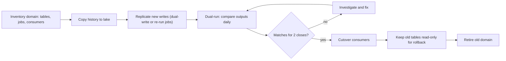

## 🎯 خلاصه

> مهاجرت از یک زیرساخت Hadoop (HDFS، Hive، Spark روی YARN، Oozie) به **lakehouse** (object storage، فرمت جدول باز، کاتالوگ مدرن) یک پروژه‌ی **مدیریت ریسک** است. **هر بار یک دامنه** را منتقل کن، **قدیم و جدید را کنار هم** اجرا کن تا عددها یکی شوند، بعد خواندن و نوشتن را با یک مسیر بازگشت **جابه‌جا** کن، و سیستم قدیمی را آخر از همه بازنشسته کن.

- داده بخش ساده ماجراست. بخش سخت **بیش از ۱٬۰۰۰ جاب و وابستگی‌های ضمنی‌شان**، **کاتالوگ** (تعریف‌های Hive Metastore و دسترسی‌ها) و **اعتماد** به اینکه عددهای کسب‌وکار تغییر نکرده‌اند است.
- **dual-run** برای مدتی محاسبات را دو برابر می‌کند. خوشه‌ی جدید را برای آن اندازه بگیر و بودجه را پیش از انتقال اولین دامنه برنامه‌ریزی کن.
- **اعتبارسنجی** باید خروجی‌های کسب‌وکار (تعداد، جمع‌ها، کلیدها به تفکیک پارتیشن) را مقایسه کند، نه فقط checksum فایل‌ها، چون فرمت‌ها و تایپ‌ها در انتقال عوض می‌شوند.
- **cutover** یک جابه‌جایی به ازای هر جدول یا دامنه‌ی مصرف‌کننده‌هاست (view، alias، تنظیمات اتصال)، نه یک رویداد یک آخر هفته.

## 🌱 از ساده شروع کنیم (مبتدی)

> **💡 تشبیه:** جابه‌جا کردن شعبه‌ی یک بانک به ساختمان جدید، در حالی که مشتری‌ها همچنان می‌آیند. شعبه‌ی قدیمی را جمعه نمی‌بندی و دوشنبه شعبه‌ی جدید را باز نمی‌کنی. یک شعبه‌ی کوچک جدید باز می‌کنی، حساب‌ها را طبقه‌به‌طبقه منتقل می‌کنی، موجودی هر حساب را در هر دو جا چک می‌کنی و فقط بعد هر طبقه از ساختمان قدیمی را تخلیه می‌کنی.

**مسئله.** یک بانک خوشه‌ی Hadoop با ۴۰۰ ترابایت داده‌ی منطقی دارد (بعد از فشرده‌سازی و replication سه‌گانه، حدود ۱٫۲ پتابایت دیسک خام). حدود ۱٬۵۰۰ جدول Hive، ۱٬۲۰۰ جاب Spark و Hive، چند import از Oracle با Sqoop و حدود ۳۰۰ workflow روزانه‌ی Oozie دارد. گزارش‌دهی، ریسک و تیم موبایل به آن وابسته‌اند. مدیریت می‌خواهد ظرف ۱۸ ماه به یک lakehouse روی object storage برود، بدون قطعی گزارش‌ها و بدون تغییر هیچ عدد منتشرشده‌ای.

**نیازمندی‌های عملکردی**

- انتقال جدول‌ها، تاریخچه و متادیتایشان (schema، پارتیشن، دسترسی‌ها) به پلتفرم جدید.
- ادامه‌ی تولید همان خروجی‌های کسب‌وکار توسط جاب‌های روزانه، در طول و بعد از انتقال.
- پشتیبانی از همان دسترسی SQL برای تحلیلگران با همان نام جدول‌ها در دوره‌ی انتقال.
- یک مسیر بازگشت برای هر دامنه تا زمان بازنشستگی‌اش.

**نیازمندی‌های غیرعملکردی (فرض‌های ما)**

- دسترس‌پذیری: قطعی گزارش‌ها در روزهای کاری بیشتر از ۲ ساعت نباشد. گزارش‌های مقرراتی هرگز دیر نشوند.
- صحت: هر جدول منتقل‌شده پیش از cutover باید برای تعداد و جمع‌های کسب‌وکار با منبع یکی باشد، و اختلاف‌ها باید توضیح داده شوند.
- تیم: ۸ مهندس داده، ۲ مهندس پلتفرم، و یک تیم گزارش‌دهی ۲۰ نفره که به نام‌های فعلی وابسته‌اند.
- محدودیت‌ها: همه‌ی داده on-prem می‌ماند. object storage و خوشه‌ی محاسباتی جدید داخل مرکز داده‌ی بانک مستقر می‌شوند.
- زمان: ۱۸ ماه برای مهاجرت، و بازنشستگی خوشه‌ی قدیمی حداکثر در ماه ۲۰.

## 🔧 واقعاً چطور کار می‌کند (متوسط)

### تخمین

- داده‌ی منطقی: ۴۰۰ ترابایت. روی HDFS با replication، یعنی ۱٫۲ پتابایت دیسک خام. object storage سربار متفاوتی دارد (replication یا erasure coding خودش)، پس اندازه‌ی **منطقی** را برنامه‌ریزی کن و ذخیره‌سازی جدید را بر اساس آن بودجه بده.
- انتقال: یک لینک ۱۰ گیگابیتی ۱٫۲۵ گیگابایت بر ثانیه می‌دهد. با حدود ۶۰٪ بازدهی پس از هزینه‌ی پروتکل و رقابت، می‌شود **۰٫۷۵ گیگابایت بر ثانیه**. انتقال ۴۰۰ ترابایت = ۴۰۰٬۰۰۰ گیگابایت ÷ ۰٫۷۵ ≈ ۵۳۳٬۰۰۰ ثانیه ≈ **۶٫۲ روز** انتقال پیوسته. با تلاش مجدد، خواندن‌های اعتبارسنجی و محدود کردن سرعت در ساعات کاری، **حدود ۳ هفته** پنجره‌ی کپی را در کل ۱۸ ماه پخش کن.
- محاسبات روزانه: فرض کن خوشه‌ی Hadoop روزانه ۶٬۰۰۰ core-hour برای ۳۰۰ جاب روزانه مصرف می‌کند. اجرای همین جاب‌ها روی پلتفرم جدید در dual-run، ۶٬۰۰۰ core-hour دیگر اضافه می‌کند. خوشه‌ی جدیدی که آن‌ها را در یک پنجره‌ی batch هشت‌ساعته اجرا کند، به‌طور میانگین ۶٬۰۰۰ ÷ ۸ ≈ **۷۵۰ core** نیاز دارد، یا حدود **۱٬۰۰۰ core** با حاشیه برای اوج. این هزینه‌ی dual-run است؛ آن را در بودجه بگذار.
- هزینه‌ی اعتبارسنجی: مقایسه‌ی کامل سطر‌به‌سطر و جمع‌ها هر بایت را یک بار روی هر طرف می‌خواند، پس تقریباً یک کپی دیگر هزینه دارد. برای همه‌چیز از **aggregate های سطح پارتیشن** (تعداد، جمع، کلیدهای متمایز در هر پارتیشن) استفاده کن و hash کامل سطرها را فقط برای جدول‌های حیاتی بگیر.
- متادیتا: ۱٬۵۰۰ جدول × میانگین ۴۰ پارتیشن = ۶۰٬۰۰۰ پارتیشن برای ثبت. این تعداد کم است، اما هر کدام باید بررسی شود.

عددها نشان می‌دهند محاسبات dual-run و اعتبارسنجی بخش‌های پرهزینه‌اند. خود کپی داده یک هفته زمان شبکه است.

### استراتژی مهاجرت

مهاجرت را بر اساس **دامنه** انجام بده (مثلاً ریسک، کارت‌ها، وام، گزارش‌دهی)، نه بر اساس لایه‌ی تکنولوژی. دامنه شامل جدول‌ها، جاب‌ها، مصرف‌کننده‌ها و مالکان آن است. هر دامنه همین چرخه را طی می‌کند:



**قانون دو بستن** یک استاندارد مفید است: یک دامنه فقط بعد از اینکه دو بستن دوره‌ی متوالی (مثلاً دو پایان ماه، یا دو گزارش هفتگی مقرراتی) یکی شوند، cutover می‌شود. یک روز مطابق می‌تواند جابی را پنهان کند که هنوز اجرا نشده است.

### طراحی dual-run

در dual-run، همان خروجی کسب‌وکار دو بار تولید می‌شود: یک بار توسط جاب قدیمی Hive یا Spark، و یک بار توسط جاب منتقل‌شده که در lake می‌نویسد. دو گزینه وجود دارد:

- **اجرای مجدد منطق** روی پلتفرم جدید، با خواندن تاریخچه‌ی کپی‌شده و داده‌ی جدید replicate‌شده. این انتخاب معمول است. SQL مربوط به Hive و وابستگی‌های Oozie را بازنویسی می‌کنی و منطق پنهان در همین‌جا پیدا می‌شود.
- **dual-write** از لایه‌ی ingestion، طوری که هر دو سیستم داده‌ی خام جدید یکسان را دریافت کنند. برای ناحیه‌ی raw خوب است، اما برای جدول‌های کسب‌وکار مشتق‌شده که زمان‌بندی‌شان می‌تواند متفاوت باشد، خوب نیست.

جاب قدیمی را تا cutover **منبع حقیقت** نگه دار. جاب جدید در یک جدول سایه با همان schema و مکان متفاوت می‌نویسد، پس چیزی پایین‌دست در دوره‌ی مقایسه تغییر نمی‌کند.

### اعتبارسنجی

اعتبارسنجی جایی است که مهاجرت‌ها بی‌صدا شکست می‌خورند. چند بررسی که بیشتر مشکلات را می‌گیرند:

```sql
-- Compare partition-level aggregates for one table between the old and new platform.
-- old_sales and new_sales are the two copies (for example, two catalog names).
SELECT o.load_date,
       o.row_cnt AS old_rows, n.row_cnt AS new_rows,
       o.amt_sum AS old_amt,  n.amt_sum AS new_amt
FROM (SELECT load_date, COUNT(*) row_cnt, SUM(amount_cents) amt_sum
      FROM old_sales GROUP BY load_date) o
FULL OUTER JOIN
     (SELECT load_date, COUNT(*) row_cnt, SUM(amount_cents) amt_sum
      FROM new_sales GROUP BY load_date) n
  ON o.load_date = n.load_date
WHERE o.row_cnt IS NULL
   OR n.row_cnt IS NULL
   OR o.row_cnt <> n.row_cnt
   OR o.amt_sum <> n.amt_sum;
```

بررسی‌ها به ترتیب هزینه:

1. **قرارداد schema**: نام ستون‌ها، تایپ‌ها و nullability. تایپ‌های Hive مثل `decimal(18,2)` در برابر `double`، و timestamp با و بدون time zone، شایع‌ترین تفاوت‌های بی‌صدا هستند.
2. **فهرست پارتیشن‌ها**: هر پارتیشنی که سمت قدیمی وجود دارد باید سمت جدید با همان تعداد ردیف وجود داشته باشد.
3. **جمع‌های کسب‌وکار** به تفکیک پارتیشن: تعداد، جمع ستون‌های پولی (به واحد کوچک صحیح) و کلیدهای متمایز.
4. **hash سطح کلید** روی جدول‌های حیاتی (مثلاً hash کلیدهای مرتب‌شده‌ی هر روز) تا وقتی aggregate ها تصادفاً یکی‌اند، چند سطر تغییرکرده را پیدا کنی.
5. **diff گزارش کسب‌وکار** برای گزارش‌های مقرراتی و مدیریتی: گزارش‌های هر دو سیستم باید یکی باشند یا فقط به دلایل توضیح‌داده‌شده تفاوت داشته باشند.

قانونی که هفته‌ها صرفه‌جویی می‌کند: اعتبارسنج هر اختلافی را گزارش می‌کند، اما یک **دفتر اختلاف‌های شناخته‌شده** هر اختلاف پذیرفته‌شده را با مالک و دلیل فهرست می‌کند. بدون آن، تیم‌ها یاد می‌گیرند گزارش را نادیده بگیرند.

### cutover و بازگشت

cutover **مصرف‌کننده‌ها** را عوض می‌کند، نه داده را. از **لایه‌ی view** یا **alias های کاتالوگ** استفاده کن تا تحلیلگران همان نام جدول را نگه دارند:

- جدول جدید را در lake زیر یک schema جدید بساز.
- view‌ای را که مصرف‌کننده‌ها می‌خوانند تغییر بده تا به جدول جدید اشاره کند.
- جدول قدیمی را برای دوره‌ی بازگشت (مثلاً ۳۰ روز) **فقط‌خواندنی** نگه دار. بازگشت یعنی view را دوباره به جدول قدیمی اشاره دهی.
- مسیر نوشتن را آخر عوض کن: جاب قدیمی بعد از تأیید جابه‌جایی مصرف‌کننده‌ها نوشتن را متوقف می‌کند.

cutover در زمان آرام دامنه انجام می‌شود، معمولاً بعد از کامل شدن یک بستن دوره و پیش از شروع دوره‌ی بعد.

### انتقال کاتالوگ و متادیتا

**Hive Metastore** کاتالوگ عملی Hadoop است. تعریف جدول‌ها، مکان پارتیشن‌ها و، از طریق لایه‌ی امنیت، اغلب قوانین دسترسی را نگه می‌دارد. انتقال آن یک جریان کاری جداست:

- تعریف جدول‌ها و پارتیشن‌ها را export کن و در کاتالوگ جدید بازسازی کن. ثبت پارتیشن عملیات دسته‌ای است؛ اول روی یک کپی تست کن.
- تایپ‌های Hive را به تایپ‌های فرمت مقصد نگاشت کن و هر نگاشتی را که مقدار را تغییر می‌دهد ثبت کن.
- **دسترسی‌ها** را صریح منتقل کن (مثلاً از سیاست‌های Ranger یا گروه‌های Hadoop به نقش‌های پلتفرم جدید). جدولی که روی سیستم قدیمی قابل خواندن است و روی جدید رد می‌شود، برای کسب‌وکار مثل یک قطعی دیده می‌شود.
- Hive Metastore را در دوره‌ی انتقال بالا نگه دار، چون جاب‌های قدیمی و بعضی ابزارها هنوز آن را می‌خوانند. فقط بعد از cutover آخرین مصرف‌کننده بازنشستش کن.

فرمت جدول مقصد را آگاهانه انتخاب کن. فرمت‌های جدول باز مثل Iceberg، Delta Lake یا Hudi snapshot، تکامل schema و بازنویسی امن را اضافه می‌کنند. رویه‌های مهاجرت نسخه‌ی انتخابی‌ات را در مستندات بررسی کن (مثلاً import درجا از فایل‌های Parquet موجود در برابر بازنویسی با `CREATE TABLE AS SELECT`)، چون پشتیبانی و رفتار بین نسخه‌ها فرق می‌کند.

### انتقال جاب‌ها

۳۰۰ workflow روزانه‌ی Oozie و import های Sqoop آن‌ها به یک orchestrator جدید نیاز دارند. آن‌ها را **همراه با دامنه** منتقل کن، نه در یک پروژه‌ی بزرگ جداگانه:

- Oozie را با Airflow (یا orchestrator منتخب بانک) جایگزین کن، همان زمان‌بندی و وابستگی‌ها را نگه دار و یال‌های وابستگی را صریح کن.
- import های Sqoop را با ابزار ingestion بانک جایگزین کن و جایی که منبع اجازه می‌دهد از CDC یا استخراج افزایشی استفاده کن، تا جاب جدید هر شب کل جدول‌های Oracle را کپی نکند.
- جاب‌های قدیمی را به ترتیب cutover خروجی‌هایشان بازنشسته کن، تا هیچ جابی به ورودی بازنشسته وابسته نماند.

## 🧠 عمق و trade-offها (سنیور)

- **وابستگی‌های پنهان.** خوشه‌های Hadoop قراردادهای ضمنی جمع می‌کنند: فایلی که یک جاب می‌نویسد و یک اسکریپت shell که کسی یادش نیست می‌خواند، پارتیشنی که با یک دستور دستی ساخته شده، یا یک view در Hive که یک گزارش استفاده می‌کند. این‌ها را با لاگ کوئری و lineage پیدا کن، نه با مصاحبه. فهرست را از لاگ‌های audit در Hive و history server اسپارک برای شش ماه بساز، و بعد با فهرست workflow ها مقایسه کن. هر چیزی که خوانده می‌شود ولی زمان‌بندی نشده ریسک است. ببین [[data-lineage]].
- **فایل‌های کوچک.** سال‌ها نوشتن در Hive تعداد زیادی فایل کوچک تولید می‌کند، و object store لیست‌کردن آن‌ها را کندتر و گران‌تر می‌کند. در طول کپی compact کن و اندازه‌ی هدف فایل را برای نویسنده‌های جدید تعیین کن. ببین [[small-files-problem]] و [[compaction]].
- **انحراف معنایی.** Spark، Hive و Trino در موردهای مرزی اختلاف دارند: مدیریت null در join، تقسیم صحیح، time zone، cast های ضمنی و collation رشته‌ها. یک جاب منتقل‌شده که «کار می‌کند» ممکن است جمع‌های کمی متفاوت برگرداند. dual-run برای گرفتن همین است؛ آن را برای جدول‌های «ساده» رد نکن.
- **هزینه و زمان dual-run.** dual-run پرهزینه‌ترین فاز است. آن را به ازای هر دامنه نگه دار و مدتش را محدود کن. dual-run نُه ماهه نشانه‌ی این است که معیار اعتبارسنجی روشن نیست یا مالکان اختلاف‌ها را بازبینی نمی‌کنند.
- **سازگاری در cutover.** اگر جابی هم قدیم و هم جدید می‌نویسد، یک crash بین دو نوشتن می‌تواند آن‌ها را متفاوت کند. اول در یک جای مرجع بنویس، بعد دیگری را از آن منتشر کن و انتشار را idempotent کن. ببین [[idempotency]].
- **امنیت.** principal های Kerberos، سیاست‌های Ranger و masking ستون‌ها باید پیش از اولین کوئری کاربر معادلی در سمت جدید داشته باشند. مهاجرتی که امنیت سطر-به-سطر را از دست بدهد، یک حادثه‌ی انطباق است. دسترسی را با هر نقش تست کن، نه با ادمین.
- **دامنه‌ی بازگشت.** بازگشت فقط وقتی کار می‌کند که داده‌ی قدیمی سالم و مسیر نوشتن قدیمی هنوز در دسترس باشد. بعد از حذف جدول‌های قدیمی، بازگشت یعنی بازیابی از snapshot های خود lake. پنجره‌ی نگهداری را پیش از cutover تصمیم بگیر، نه وسط یک incident.
- **trade-off در فرمت جدول.** فرمت باز تو را از یک فروشنده مستقل نگه می‌دارد و snapshot و تکامل schema می‌دهد. اما نگهداری آن (compaction، انقضای snapshot و نگهداری متادیتا) را به عملیات خودت می‌آورد. این هزینه‌ها را در طراحی نام ببر.
- **کی همه‌چیز را منتقل نکنی.** برخی بارها، مثل داده‌ی خام آرشیوشده که سالی یک بار خوانده می‌شود، ممکن است بهتر باشد به‌عنوان یک آرشیو ارزان بمانند تا یک دامنه‌ی کاملاً منتقل‌شده. بعضی جدول‌های Hive رها شده‌اند. اول آن‌ها را بازنشسته کن؛ انتقال داده‌ی مرده پرهزینه است و ارزشی ندارد.

### انتظارات بر اساس سطح

- **متوسط:** مراحل dual-run و اعتبارسنجی را توضیح می‌دهد، می‌گوید چرا cutover یک تغییر view یا alias است، و وابستگی‌های Hive Metastore و جاب‌ها را برای انتقال فهرست می‌کند. یک کوئری مقایسه‌ی سطح پارتیشن می‌نویسد.
- **سنیور:** دامنه‌ها را با قانون دو بستن برنامه‌ریزی می‌کند، محاسبات dual-run و پنجره‌ی کپی را با عدد می‌سنجد، دفتر اختلاف‌های شناخته‌شده را تعریف می‌کند و پنجره‌ی بازگشت و انتقال دسترسی را طراحی می‌کند.
- **Staff:** برنامه را بین تیم‌ها و بودجه ترتیب می‌دهد، استراتژی فرمت جدول و کاتالوگ را با هزینه‌ی عملیاتی تصمیم می‌گیرد، سیاست بازنشستگی خوشه‌ی قدیمی را تعیین می‌کند، و با کسب‌وکار توافق می‌کند که «همان عدد» وقتی معناشناسی فرق دارد یعنی چه.

### پرسش‌های ادامه‌ای که مصاحبه‌گر می‌پرسد

1. **«عدد جدید در یک ماه ۰٫۰۱٪ فرق دارد. چه می‌کنی؟»** آن را نادیده نگیر. اولین پارتیشنی که فرق دارد را پیدا کن، بعد اولین سطر را با hash سطح کلید. دلایل معناشناختی را بررسی کن: گرد کردن، time zone، داده‌ی دیرهنگام، null. توضیح را در دفتر ثبت کن و تصمیم بگیر آیا این اختلاف cutover را متوقف می‌کند.
2. **«بیست سال تاریخچه را چطور منتقل می‌کنی؟»** پارتیشن‌های تاریخی را در پس‌زمینه به تفکیک دامنه کپی کن، aggregate هایشان را یک‌بار اعتبارسنجی کن، و پنجره‌ی اخیر را در dual-run نگه دار. تاریخچه‌ی قدیمی به‌ندرت پرس‌وجو می‌شود، پس می‌تواند بعداً و پشت همان view جابه‌جا شود.
3. **«آیا کسب‌وکار می‌تواند هنگام انتقال به خوشه‌ی قدیمی بنویسد؟»** بله، و این حالت عادی است. نوشتن‌ها تا cutover دامنه روی منبع حقیقت می‌مانند و کپی داده‌ی جدید را بازپخش می‌کند.
4. **«اگر یک کوئری روی lake از Hadoop کندتر باشد چه؟»** اول اندازه بگیر. بعد بین تغییر پارتیشن‌بندی و چیدمان فایل، یک aggregate محقق‌شده، یا نگه داشتن آن بار روی سیستم قدیمی تا بازطراحی‌اش یکی را انتخاب کن. دامنه‌ای را با یک رگرسیون شناخته‌شده در یک گزارش حیاتی cutover نکن.

## 🧪 امتحان کن

یک بانک جدول Hive به نام `cards.txn` با ۳ پارتیشن دارد. با داده‌ی کوچک زیر در PostgreSQL نسخه‌ی ۱۳ یا بالاتر (یا Spark SQL) نسخه‌ی قدیمی و جدید را شبیه‌سازی کن. کپی جدید یک ردیف را در پارتیشن `2026-10-02` ندارد و یک مبلغ را تغییر داده است.

```sql
CREATE TABLE old_txn (load_date date, txn_id int, amount_cents bigint);
INSERT INTO old_txn VALUES
 ('2026-10-01',1,1000),('2026-10-01',2,2500),
 ('2026-10-02',3,400),('2026-10-02',4,700),
 ('2026-10-03',5,900);

CREATE TABLE new_txn (load_date date, txn_id int, amount_cents bigint);
INSERT INTO new_txn VALUES
 ('2026-10-01',1,1000),('2026-10-01',2,2500),
 ('2026-10-02',3,400),
 ('2026-10-03',5,950);
```

۱. کوئری بنویس که برای هر `load_date` تعداد ردیف و جمع مبلغ هر کپی را گزارش کند و پارتیشن‌های متفاوت را علامت بزند.
۲. کوئری بنویس که مقدارهای `txn_id` را پیدا کند که فقط در یکی از دو کپی هستند.
۳. توضیح بده چرا یکی بودن aggregate ها روی همه‌ی پارتیشن‌ها ثابت نمی‌کند مهاجرت درست است، و یک بررسی نام ببر که این وضعیت را می‌گیرد.

<details><summary>راه‌حل‌ها را نشان بده</summary>

**۱.**
```sql
WITH o AS (
  SELECT load_date, COUNT(*) AS old_rows, SUM(amount_cents) AS old_amt
  FROM old_txn GROUP BY load_date
), n AS (
  SELECT load_date, COUNT(*) AS new_rows, SUM(amount_cents) AS new_amt
  FROM new_txn GROUP BY load_date
)
SELECT COALESCE(o.load_date, n.load_date) AS load_date,
       o.old_rows, n.new_rows, o.old_amt, n.new_amt,
       (o.old_rows IS DISTINCT FROM n.new_rows
        OR o.old_amt IS DISTINCT FROM n.new_amt) AS differs
FROM o FULL OUTER JOIN n ON o.load_date = n.load_date
ORDER BY load_date;
```
نتیجه: `2026-10-01` یکسان است؛ `2026-10-02` متفاوت است (۲ ردیف در برابر ۱، جمع ۱۱۰۰ در برابر ۴۰۰)؛ `2026-10-03` متفاوت است (جمع ۹۰۰ در برابر ۹۵۰). `IS DISTINCT FROM` یک پارتیشن جاافتاده در یک سمت را به‌عنوان تفاوت می‌گیرد، در حالی که `<>` ساده آن را به دلیل NULL از دست می‌داد.

**۲.**
```sql
SELECT 'only_old' AS side, txn_id
FROM (SELECT txn_id FROM old_txn EXCEPT SELECT txn_id FROM new_txn) a
UNION ALL
SELECT 'only_new', txn_id
FROM (SELECT txn_id FROM new_txn EXCEPT SELECT txn_id FROM old_txn) b;
```
نتیجه: `only_old 4`. هر `EXCEPT` در یک subquery جداگانه است تا دو جهت روی هم اثر نگذارند. تراکنش ۵ در هر دو کپی است، پس فهرست نمی‌شود، و تغییر مبلغش نیاز به بررسی جداگانه دارد، ببین سؤال ۳.

**۳.** aggregate ها می‌توانند تصادفاً یکی شوند: یک سطر حذف‌شده و یک سطر اضافه با همان مجموع، جمع‌ها را بی‌تغییر نگه می‌دارد. تعداد پارتیشن و hash سطح کلید این حالت را می‌گیرند. فهرست مرتب‌شده‌ی `txn_id` (یا hash از `txn_id, amount_cents` به تفکیک پارتیشن) را مقایسه کن تا یک مقدار تغییرکرده حتی وقتی جمع‌ها بالانس‌اند پیدا شود.

</details>

## 💬 گوشه‌ی مصاحبه

**سؤال: «مهاجرت یک پلتفرم داده‌ی Hadoop به lakehouse را طراحی کن.»**

> **🎤 این را در مصاحبه بگو:** «من بر اساس دامنه مهاجرت می‌کنم، نه بر اساس لایه‌ی تکنولوژی، و هر دامنه از inventory، کپی تاریخچه، dual-run، اعتبارسنجی و cutover عبور می‌کند. dual-run منطق منتقل‌شده را روی پلتفرم جدید دوباره اجرا می‌کند و خروجی‌ها را در سطح پارتیشن و برای جدول‌های حیاتی با hash کلیدها مقایسه می‌کند. دامنه فقط بعد از دو بستن دوره‌ی متوالی یکسان cutover می‌شود. cutover یک تغییر view یا alias است، پس بازگشت یعنی view را برگردانی در حالی که جدول قدیمی فقط‌خواندنی می‌ماند. کاتالوگ و دسترسی‌ها صریح منتقل می‌شوند و Hive Metastore تا آخرین مصرف‌کننده بالا می‌ماند. خوشه‌ی جدید را برای dual-run اندازه می‌گیرم و هزینه‌اش را در بودجه می‌گذارم.»

**پاسخ نمونه به تفکیک سطح:** مهندس متوسط dual-run، اعتبارسنجی و cutover با تعویض view را نام می‌برد. سنیور قانون دو بستن، محاسبات کپی و محاسبات، دفتر اختلاف‌های شناخته‌شده و پنجره‌ی بازگشت را اضافه می‌کند. Staff برنامه را به بودجه و سیاست بازنشستگی وصل می‌کند و با کسب‌وکار توافق می‌کند «همان عدد» یعنی چه.

## ⚠️ اشتباهات رایج

> **⚠️ Watch out:** اعلام اینکه یک جدول «منتقل شده» وقتی کپی تمام شده. کپی شروع اعتبارسنجی است، نه پایانش. cutover نیاز به خروجی‌های کسب‌وکار یکسان در بستن‌های واقعی دارد.

> **⚠️ Watch out:** مقایسه‌ی فقط checksum فایل‌ها. فایل‌های داده با فرمت، فشرده‌سازی و چیدمان فایل فرق دارند حتی وقتی مقادیر کسب‌وکار یکی است، پس checksum همیشه متفاوت است. مقادیر را مقایسه کن.

- انتقال داده پیش از فهرست‌برداری از جاب‌ها، طوری که وابستگی‌های پنهان بعد از cutover بشکنند.
- انتقال SQL مربوط به Hive بدون بررسی تفاوت‌های معناشناختی موتور جدید (مدیریت null، cast ها، time zone).
- اجرای dual-run بدون تاریخ پایان و بدون مالک برای اختلاف‌ها.
- cutover با جابه‌جا کردن نویسنده‌ها اول، که مصرف‌کننده‌ها را روی جدول قدیمی که دیگر به‌روز نمی‌شود نگه می‌دارد.
- از دست رفتن امنیت سطر-به-سطر یا masking ستون در انتقال، و فهمیدن آن از زبان حسابرس.
- حذف جدول‌های قدیمی پیش از پایان پنجره‌ی بازگشت.
- انتقال جدول‌های رها شده و pipeline های مرده که بودجه را مصرف و ارزشی تولید نمی‌کنند.

## ✅ خودت را بسنج

۱. هدف اصلی dual-run چیست؟
   - A) نگه داشتن دو کپی از داده برای پشتیبان‌گیری
   - B) تولید همان خروجی‌های کسب‌وکار در سیستم قدیمی و جدید و مقایسه‌ی آن‌ها پیش از cutover
   - C) تست سرعت شبکه بین خوشه‌ها
   - D) کوتاه کردن مهاجرت با اجرای موازی جاب‌ها برای همیشه

<details><summary>پاسخ</summary>

**B** — dual-run شاهد است. نشان می‌دهد منطق جدید تحت بار واقعی و داده‌ی واقعی همان عددها را می‌دهد، و این مبنای cutover است.

</details>

۲. چرا checksum روی فایل‌های داده تست معتبر مهاجرت نیست؟
   - A) checksum برای داده‌ی بزرگ خیلی کند است
   - B) فرمت، فشرده‌سازی و چیدمان فایل بین سیستم‌ها فرق دارد، پس بایت‌ها حتی وقتی مقادیر کسب‌وکار یکی است متفاوت‌اند
   - C) checksum روی object storage محاسبه نمی‌شود
   - D) checksum فقط روی عدد صحیح کار می‌کند

<details><summary>پاسخ</summary>

**B** — تست باید چیزی را مقایسه کند که مصرف‌کننده‌ها می‌بینند: تعداد، جمع، کلیدها و گزارش‌ها. checksum فایل تفاوت‌هایی گزارش می‌کند که تفاوت کسب‌وکار نیستند.

</details>

۳. یک دامنه برای یک بستن پایان ماه مطابقت دارد. قاعده‌ای که طراحی پیش از cutover به کار می‌برد چیست؟
   - A) یک روز مطابق کافی است
   - B) دو بستن متوالی باید مطابق باشند، چون یک دوره می‌تواند جابی را که فقط در بستن اجرا می‌شود پنهان کند
   - C) سه سال تاریخچه باید مطابق باشد
   - D) cutover هر نتیجه‌ای که باشد انجام می‌شود

<details><summary>پاسخ</summary>

**B** — قانون دو بستن از اعتماد کاذب با یک دوره جلوگیری می‌کند. جاب‌های ماهانه و فصلی اغلب فقط در بستن اجرا می‌شوند، پس یک تطبیق تنها می‌تواند جاب خراب را پنهان کند.

</details>

۴. **(سنیور)** یک cutover برای شنبه برنامه‌ریزی شده. چه چیزی آن را امن می‌کند؟
   - A) خوشه‌ی جدید از خوشه‌ی قدیمی سریع‌تر است
   - B) مصرف‌کننده‌ها از طریق view یا alias جابه‌جا می‌شوند، جدول‌های قدیمی برای پنجره‌ی بازگشت فقط‌خواندنی می‌مانند، و مسیر نوشتن بعد از تأیید جابه‌جایی مصرف‌کننده‌ها منتقل می‌شود
   - C) همه‌ی جاب‌ها از خوشه‌ی قدیمی جمعه حذف می‌شوند
   - D) مهاجرت یک کپی بزرگ شبانه با یک بار است

<details><summary>پاسخ</summary>

**B** — cutover یک تغییر برگشت‌پذیر مصرف‌کننده‌هاست. اگر چیزی خراب شود، برگرداندن view رفتار قبلی را سریع برمی‌گرداند و داده‌ی قدیمی هنوز سر جایش است.

</details>

۵. **(سنیور)** dual-run یک دامنه نُه ماه است و هزینه‌ی محاسباتی زیادی دارد. چه می‌کنی؟
   - A) آن‌قدر نگهش دار تا بودجه تمام شود
   - B) معیارهای اعتبارسنجی و دفتر اختلاف‌های شناخته‌شده را با مالکان بازبینی کن، مهلت بگذار، و اختلاف‌های توضیح‌نشده را موانع با مالک و اصلاح مشخص بدان
   - C) آن را خاموش کن و بدون بررسی cutover کن
   - D) اندازه‌ی خوشه را دو برابر کن تا سریع‌تر شود

<details><summary>پاسخ</summary>

**B** — dual-run طولانی معمولاً یعنی معیار توقف روشن نیست یا اختلاف‌ها حل نمی‌شوند. راه‌حل فرآیند و مالکیت با مهلت است، نه سخت‌افزار بیشتر.

</details>

## 🗂️ فلش‌کارت

| Front | Back |
|---|---|
| واحد مهاجرت | یک دامنه (جدول‌ها، جاب‌ها، مصرف‌کننده‌ها، مالکان)، نه یک لایه‌ی تکنولوژی |
| dual-run | قدیم و جدید همان خروجی کسب‌وکار را تولید می‌کنند؛ قبل از cutover مقایسه می‌شوند |
| قانون دو بستن | بعد از یکسان شدن دو بستن دوره‌ی متوالی cutover کن |
| چرا checksum فایل نه؟ | فرمت و چیدمان فرق دارد؛ مقادیر کسب‌وکار را مقایسه کن |
| مکانیزم cutover | تغییر view یا alias؛ جدول قدیمی برای بازگشت فقط‌خواندنی می‌ماند |
| دفتر اختلاف‌های شناخته‌شده | اختلاف‌های پذیرفته‌شده با مالک و دلیل؛ بدون آن تیم‌ها گزارش را نادیده می‌گیرند |
| نقش Hive Metastore | کاتالوگ عملی: تعریف جدول‌ها، پارتیشن‌ها و اغلب قوانین دسترسی |
| هزینه‌ی محاسباتی dual-run | تقریباً دو برابر محاسبات دسته‌ای دامنه تا بازنشستگی آن |

## 🔗 ادامه

- **hadoop-ecosystem** دربارهٔ HDFS، YARN، Hive و Metastore مروری دارد؛ چیزهایی که این مهاجرت جایگزینشان می‌کند.
- **mapreduce** منشأ مدل دسته‌ای را توضیح می‌دهد که از آن دور می‌شوی.
- **lakehouse-table-formats** فرمت‌های جدول باز و قابلیت‌های snapshot و تکامل آن‌ها را مقایسه می‌کند.
- **data-catalogs** و **data-lineage** کار متادیتایی را پوشش می‌دهند که وابستگی‌های پنهان را پیدا می‌کند.
- **pattern-backfill** و **pattern-schema-evolution** کپی تاریخچه و تغییر امن تایپ‌ها را پوشش می‌دهند.
- **design-cdc-lake** الگوی ingestion هدفی را نشان می‌دهد که جایگزین کپی‌های شبانه‌ی Sqoop می‌شود.
