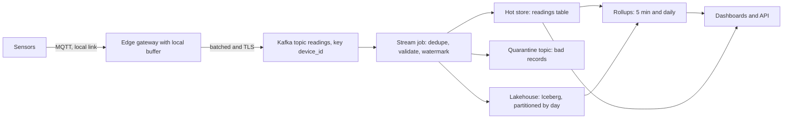
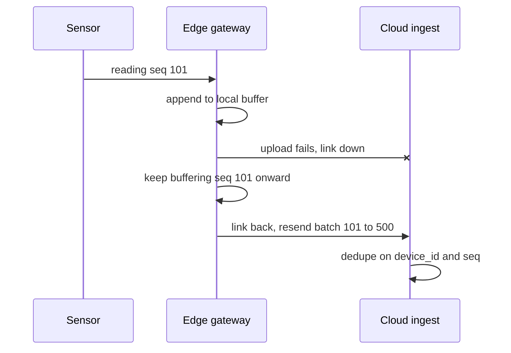

## 🎯 خلاصه

> پلتفرم IoT در واقع یک **pipeline سری زمانی با حجم بالا و تقریباً فقط-append** است. میلیون‌ها خوانش کوچک از دستگاه‌هایی روی شبکه‌های ناپایدار می‌آیند، نباید در زمان قطعی شبکه گم شوند، و باید بتوانی سریع جواب بدهی که «سنسور X بین ۱۰:۰۰ تا ۱۰:۰۵ چه کار کرد؟»، در حالی که تاریخچه‌ی سال‌ها ارزان نگه داشته می‌شود.

- سیستم را از روی **تعداد پیام در ثانیه، حجم هر پیام، و مدت نگهداری در هر لایه** اندازه بگیر. محاسبه را در مصاحبه با صدای بلند انجام بده.
- **گیت‌وی‌های لبه (edge) به‌صورت محلی بافر می‌کنند** (store-and-forward)، پس قطعی شبکه داده را به تأخیر می‌اندازد و از بین نمی‌برد.
- ورودی را از طریق یک log (Kafka، یا MQTT که به Kafka وصل شده) بگیر، **با کلید `device_id` پارتیشن‌بندی شده** تا ترتیب هر دستگاه حفظ شود.
- ساعت دستگاه قابل اعتماد نیست. هم `device_ts` (زمانی که اتفاق افتاده) و هم `ingested_at` (زمانی که ما دریافت کرده‌ایم) را نگه دار، و تکراری‌ها را با `(device_id, seq)` حذف کن.
- داده‌ی تازه را از یک store سری زمانی سرو کن، تاریخچه را در جدول lakehouse نگه دار، و rollup را برای داشبورد از پیش حساب کن.

## 🌱 از ساده شروع کنیم (مبتدی)

> **💡 تشبیه:** شبکه‌ای از ایستگاه‌های هواشناسی را تصور کن. هر ایستگاه هر ۱۰ ثانیه یک خط در دفترچه‌ی محلی‌اش می‌نویسد. وقتی ارتباط رادیویی قطع است، ایستگاه به نوشتن ادامه می‌دهد و خط‌های جاافتاده را بعداً می‌فرستد. دفتر مرکزی باید همه‌ی دفترچه‌ها را مرتب کند، داده‌ی جدید را راحت پیدا کند، و داده‌ی قدیمی را در انبار ارزان نگه دارد.

### ۱. صورت مسئله

یک کارخانه‌ی تولیدی **۲۰۰٬۰۰۰ سنسور** (دما، ارتعاش، فشار، توان) در ۴۰ کارخانه دارد. هر سنسور هر ۱۰ ثانیه یک خوانش می‌فرستد. پلتفرم داده‌ای طراحی کن که:

- خوانش‌ها را دریافت کند،
- داشبوردهای زنده با تأخیر کمتر از ۱ دقیقه نشان بدهد،
- تحلیل روی تاریخچه‌ی چند سال را پشتیبانی کند،
- قطعی اینترنت کارخانه تا ۷۲ ساعت را بدون از دست دادن داده تحمل کند.

### ۲. نیازمندی‌های کارکردی

- دریافت خوانش‌ها از سنسورها از طریق یک گیت‌وی لبه در هر کارخانه.
- پرس‌وجوی N دقیقه‌ی اخیر برای یک دستگاه یا یک کارخانه، با تأخیر کم.
- پرس‌وجوی تاریخچه‌ی هر دستگاه و هر متریک در هر بازه‌ی زمانی.
- نگهداری rollup (تجمیع ۵ دقیقه‌ای و روزانه) برای داشبورد و گزارش.
- رجیستری دستگاه‌ها (کارخانه، مدل، واحد هر متریک) برای تفسیر مقادیر خام.

### ۳. نیازمندی‌های غیرکارکردی

- **تازگی:** p95 زیر ۶۰ ثانیه از سنسور تا داشبورد.
- **دوام:** بدون از دست رفتن داده پس از قطعی تا ۷۲ ساعت. تحویل در لبه از نوع at-least-once است و پلتفرم با حذف تکراری‌ها آن را effectively-once می‌کند.
- **اوج بار:** طراحی برای ۳ برابر نرخ میانگین (جهش‌های اتصال مجدد بعد از قطعی).
- **نگهداری:** خوانش خام ۳۰ روز در store گرم (کوئری سریع) و ۲ سال در lake؛ rollup ها ۵ سال.
- **هزینه:** فضای ذخیره‌سازی بزرگ‌ترین بخش قبض است، پس فشرده‌سازی و tiering باید از همان ابتدا جزو نیازمندی‌ها باشند.

## 🔧 واقعاً چطور کار می‌کند (متوسط)

### ۴. تخمین حجم

همه‌ی اعداد زیر فرض‌اند. آن‌ها را بلند بگو و بعد با مصاحبه‌کننده تأیید کن.

| کمیت | محاسبه | نتیجه |
|---|---|---|
| نرخ میانگین پیام | ۲۰۰٬۰۰۰ سنسور / ۱۰ ثانیه | **۲۰٬۰۰۰ پیام در ثانیه** |
| حجم پیام | یک پیام JSON با ۵ متریک | **۲۰۰ بایت** |
| پهنای باند ورودی | ۲۰٬۰۰۰ × ۲۰۰ B | **۴ MB/s** |
| حجم خام روزانه | ۴ MB/s × ۸۶٬۴۰۰ ثانیه | **۳۴۵٫۶ GB در روز** (JSON) |
| حجم ستونی روزانه | ۳۴۵٫۶ / ۸ (بهره‌ی فرضی Parquet + zstd) | **حدود ۴۳ GB در روز** |
| نرخ اوج | ۳ × ۲۰٬۰۰۰ | **۶۰٬۰۰۰ پیام در ثانیه** (۱۲ MB/s) |
| نقطه‌ی متریک در ثانیه | ۲۰٬۰۰۰ × ۵ متریک | **۱۰۰٬۰۰۰ نقطه در ثانیه** |
| store گرم (۳۰ روز) | ۳۰ × ۴۳٫۲ GB | **حدود ۱٫۳ TB** |
| ردیف‌های rollup پنج‌دقیقه‌ای در روز | ۲۰۰٬۰۰۰ × ۵ × ۲۸۸ | **۲۸۸ میلیون ردیف** (حدود ۱۱٫۵ GB با ۴۰ بایت برای هر ردیف) |
| بافر لبه برای هر گیت‌وی | ۵۰۰ سنسور × ۸٬۶۴۰ پیام در روز × ۲۰۰ B = ۸۶۴ MB در روز | **حدود ۲٫۶ GB برای ۷۲ ساعت** |

عدد گیت‌وی مهم‌ترین عدد در مصاحبه است. قطعی ۷۲ ساعته یک مسئله‌ی اندازه‌گیری دیسک در لبه است، نه یک مسئله‌ی ابر.

### ۵. مدل داده

یک ردیف برای هر **خوانش و متریک** ذخیره کن، نه یک ردیف پهن برای هر پیام. این‌طور اضافه شدن متریک جدید، schema را تغییر نمی‌دهد:

```sql
CREATE TABLE readings
(
    device_id    UInt64,
    seq          UInt64,              -- شماره‌ی توالی هر دستگاه از سنسور
    ts           DateTime64(3, 'UTC'), -- زمان دستگاه (غیرقابل اعتماد)
    metric       LowCardinality(String),
    value        Float64,
    ingested_at  DateTime64(3, 'UTC') DEFAULT now64(3)
)
ENGINE = ReplacingMergeTree(ingested_at)
PARTITION BY toYYYYMMDD(ts)
ORDER BY (device_id, metric, ts, seq);
```

`ReplacingMergeTree` ردیف‌های تکراری با همان کلید مرتب‌سازی را **به‌تدریج و هنگام merge های پس‌زمینه** حذف می‌کند. تا آن موقع، کوئری ممکن است تکراری‌ها را ببیند، پس یا با `FINAL` بخوان یا تجمیعی بنویس که به تکرار حساس نباشد. زمان دقیق merge را در مستندات نسخه‌ی خودت بررسی کن.

یک کوئری rollup برای داشبورد:

```sql
SELECT device_id, metric,
       toStartOfFiveMinutes(ts) AS bucket,
       avg(value) AS avg_v,
       max(value) AS max_v
FROM readings FINAL
WHERE ts >= now() - INTERVAL 1 DAY
GROUP BY device_id, metric, bucket;
```

### ۶. طراحی سطح بالا



هر مرحله یک کار مشخص دارد. گیت‌وی قطعی را جذب می‌کند. Kafka تولیدکننده‌های پرنوسان را از مصرف‌کننده‌ها جدا می‌کند و log قابل replay نگه می‌دارد. stream job داده را تمیز و تکراری‌ها را حذف می‌کند. store گرم ۳۰ روز اخیر را سرو می‌کند. lakehouse تاریخچه‌ی ارزان را نگه می‌دارد و rollup ها داشبورد را پشتیبانی می‌کنند.

مسیر قطعی شبکه همان چیزی است که مصاحبه‌کننده‌ها می‌پرسند:



### ۷. بافر لبه با دیسک محدود

گیت‌وی به یک صف محلی‌ی پایدار نیاز دارد. یک حلقه‌ی ساده‌ی store-and-forward با SQLite:

```python
import json
import sqlite3

db = sqlite3.connect("buffer.db")
db.execute("""CREATE TABLE IF NOT EXISTS outbox (
    seq INTEGER PRIMARY KEY, payload TEXT, sent INTEGER DEFAULT 0)""")

def record(seq: int, reading: dict) -> None:
    # در این نمونه seq در هر گیت‌وی یکتاست؛ INSERT OR IGNORE باعث می‌شود تلاش مجدد بی‌ضرر باشد
    db.execute("INSERT OR IGNORE INTO outbox (seq, payload) VALUES (?, ?)",
               (seq, json.dumps(reading)))
    db.commit()

def flush(send, batch: int = 500) -> None:
    rows = db.execute(
        "SELECT seq, payload FROM outbox WHERE sent = 0 ORDER BY seq LIMIT ?",
        (batch,)).fetchall()
    for seq, payload in rows:
        send(json.loads(payload))  # سرور باید تکراری‌ها را حذف کند: کرش بعد از send یعنی ارسال مجدد
        db.execute("UPDATE outbox SET sent = 1 WHERE seq = ?", (seq,))
        db.commit()
```

دو قاعده این کار را امن می‌کند. گیت‌وی **قبل** از تأیید به سنسور، محلی می‌نویسد. و سرور تکراری‌ها را حذف می‌کند، چون کرش بین `send` و `UPDATE` باعث ارسال مجدد می‌شود. یک سقف اندازه و سیاست drop هم اضافه کن (مثلاً ابتدا متریک با اولویت پایین‌تر را دور بریز) تا قطعی طولانی دیسک را بی‌صدا پر نکند.

## 🧠 عمق و trade-offها (سنیور)

### ۸. عمق: ingestion با فرکانس بالا

- **پارتیشن با `device_id`.** همه‌ی خوانش‌های یک دستگاه به یک پارتیشن Kafka می‌روند، پس ترتیبشان حفظ می‌شود و stream job می‌تواند state هر دستگاه را نگه دارد. هزینه‌اش پارتیشن داغ است اگر یک کارخانه بیشتر ترافیک را بسازد. کلیدی با پخش بهتر (مثلاً hash روی `device_id`) انتخاب کن و نرخ هر پارتیشن را بسنج، نه فقط مجموع را.
- **batch در لبه انجام بده، نه در ابر.** هر پیام ۲۰۰ بایت است؛ یک رکورد Kafka برای هر خوانش هدررفت است. گیت‌وی‌ها ۱۰۰ تا ۵۰۰ خوانش را در یک درخواست produce می‌فرستند.
- **Backpressure.** وقتی مصرف‌کننده‌ها عقب می‌افتند، Kafka داده را تا سقف retention نگه می‌دارد و لبه بافر می‌کند. هم lag مصرف‌کننده و هم پر شدن دیسک گیت‌وی شاخص‌های پیش‌فرض هستند. به [[consumer-lag]] و [[backpressure]] نگاه کن.
- **حذف تکراری.** تحویل at-least-once به‌علاوه‌ی حذف روی `(device_id, seq)` نتیجه‌ی effectively-once می‌دهد. حذف را در stream job با state کلیددار و پنجره‌ی زمانی محدود انجام بده، یا به معنای merge در sink تکیه کن. exactly-once در کل مسیر معمولاً لازم نیست و گران است؛ این را صریح بگو.

### ۹. عمق: ذخیره‌سازی سری زمانی

- **اول کلید مرتب‌سازی.** `ORDER BY (device_id, metric, ts)` باعث می‌شود «یک دستگاه، یک متریک، ساعت اخیر» یک range scan کوتاه شود. اگر کلید فقط `ts` باشد، یک دستگاه روی کل جدول پخش می‌شود.
- **Cardinality.** تعداد ترکیب‌های یکتای `(device_id, metric)` اندازه‌ی index و تعداد rollup ها را تعیین می‌کند. هرگز شناسه‌ی هر درخواست یا تگ متنی آزاد را به‌عنوان label استفاده نکن؛ تعداد series را منفجر می‌کند. نام متریک‌ها را در یک enum کوچک نگه دار (`LowCardinality`).
- **TTL و tiering.** داده‌ی خام را پس از ۳۰ روز از store گرم حذف یا منتقل کن؛ تاریخچه در lake می‌ماند. rollup ها باید بیشتر از داده‌ی خام نگه داشته شوند.
- **Downsampling.** داشبورد یک ماهه باید از rollup پنج‌دقیقه‌ای بخواند. برای یک دستگاه و یک متریک، یک ماه ۳۰ × ۸٬۶۴۰ = ۲۵۹٬۲۰۰ خوانش خام دارد، اما فقط ۳۰ × ۲۸۸ = ۸٬۶۴۰ bucket پنج‌دقیقه‌ای. grain rollup را از الگوی کوئری انتخاب کن، نه از سنسور.

### ۱۰. عمق: زمان، داده‌ی دیرهنگام و ساعت‌ها

- ساعت دستگاه‌ها drift می‌کند و گاهی reset می‌شود. برای تحلیل `device_ts` را نگه دار، اما lake را بر اساس **تاریخ ingestion** یا یک پنجره‌ی event-time محدود پارتیشن کن، و بگو کدام را انتخاب کرده‌ای.
- گیت‌وی‌ای که بعد از ۷۲ ساعت وصل می‌شود، سه روز داده‌ی دیرهنگام می‌فرستد. stream job از یک **watermark** با allowed lateness استفاده می‌کند، و هر چیزی که دیرتر برسد به مسیر **reprocessing** می‌رود (ساعت یا روز اثرگرفته را backfill کن). به [[watermark]] و [[late-arriving-data]] نگاه کن.
- rollup هایی که قبلاً منتشر شده‌اند باید **اصلاح** شوند، نه اینکه بی‌صدا عوض شوند. bucket های اثرگرفته را دوباره حساب کن و revision را ثبت کن.

### ۱۱. عملیات

برای هر کارخانه پایش کن: تعداد پیام دریافتی در برابر تعداد مورد انتظار (فاصله یعنی گیت‌وی یا لینک مرده است)، پر بودن بافر گیت‌وی، lag مصرف‌کننده‌ی Kafka، نرخ quarantine، و تازگی (بیشترین `ts` هر کارخانه نسبت به اکنون). خرابی بی‌صدا یعنی سنسوری که دیگر ارسال نمی‌کند؛ پس روی **داده‌ی گم‌شده** هشدار بگذار، نه فقط روی داده‌ی بد.

## 🧪 امتحان کن

همان کارخانه‌ی ۲۰۰٬۰۰۰ سنسوری را در نظر بگیر و فقط یک فرض را عوض کن: سنسورها حالا هر **۲ ثانیه** می‌فرستند، نه هر ۱۰ ثانیه.

1. نرخ میانگین پیام، پهنای باند و حجم خام روزانه‌ی جدید چقدر است؟
2. با همان فرض ۸ برابری، حجم فشرده‌ی روزانه و اندازه‌ی store گرم ۳۰ روزه چقدر می‌شود؟
3. کدام عنصر طراحی را اول تغییر می‌دهی و چرا؟

<details><summary>راه‌حل‌ها را نشان بده</summary>

**۱.** ۲۰۰٬۰۰۰ / ۲ ثانیه = **۱۰۰٬۰۰۰ پیام در ثانیه**. پهنای باند = ۱۰۰٬۰۰۰ × ۲۰۰ B = **۲۰ MB/s**. خام در روز = ۲۰ MB/s × ۸۶٬۴۰۰ ثانیه = ۱٬۷۲۸ GB ≈ **۱٫۷۳ TB در روز** (JSON).

**۲.** ۱٬۷۲۸ GB / ۸ ≈ **۲۱۶ GB در روز** فشرده. store گرم ۳۰ روز = ۳۰ × ۲۱۶ GB ≈ **۶٫۵ TB**.

**۳.** بافر گیت‌وی برای هر دستگاه پنج برابر سریع‌تر پر می‌شود (هر ۲ ثانیه یک پیام)، پس قطعی ۷۲ ساعته برای هر گیت‌وی ۵۰۰ سنسوری حدود ۱۳ GB لازم دارد، نه ۲٫۶ GB. اولین تغییر، دیسک لبه و سیاست drop است. سمت ابر هم پنج برابر رشد می‌کند، پس store گرم به TTL کوتاه‌تر برای خام یا سهم بیشتر rollup نیاز دارد.

</details>

## 💬 گوشه‌ی مصاحبه

**سؤال مصاحبه‌کننده:** «ingestion را برای ۲۰۰٬۰۰۰ سنسور طراحی کن که گاهی ساعت‌ها اینترنت‌شان قطع می‌شود.»

- **جواب متوسط:** «سنسورها در Kafka منتشر می‌کنند، یک job در Spark به یک جدول می‌نویسد و داشبوردها از جدول می‌خوانند. اگر دستگاه جا داشته باشد، روی خود دستگاه بافر می‌کنم.»
- **جواب سنیور:** «از نرخ‌ها شروع می‌کنم: ۲۰٬۰۰۰ پیام در ثانیه، ۴ MB/s، حدود ۳۵۰ GB خام در روز. گیت‌وی باید ۷۲ ساعت بافر کند، یعنی حدود ۲٫۶ GB برای هر ۵۰۰ سنسور، و باید قبل از تأیید محلی بنویسد. Kafka با کلید دستگاه پارتیشن می‌شود تا ترتیب حفظ شود. stream job با دستگاه و شماره‌ی توالی حذف تکراری می‌کند، چون ارسال مجدد عادی است. زمان دستگاه قابل اعتماد نیست، پس زمان ingestion را هم نگه می‌دارم و با watermark تصمیم می‌گیرم کدام پنجره بسته شود.»

**انتظار در هر سطح**

- **Mid:** یک pipeline درست با اجزای درست، کلید پارتیشن معقول و محاسبه‌ی پایه.
- **Senior:** تخمین با ضریب اطمینان بیان‌شده، طراحی قطعی و replay، حذف تکراری idempotent، rollup بر اساس الگوی کوئری، و پایش خرابی‌های بی‌صدا.
- **Staff:** مدل هزینه و tiering در طول سال‌ها، چندمنطقه‌ای بودن یا الزامات محل نگهداری داده، schema evolution برای هزاران مدل دستگاه، و مدل عملیاتی برای تغییرات firmware و واحدها.

**پرسش‌های پیگیری محتمل**

- «یک کارخانه سنسور داغ دارد که ۱۰ برابر داده می‌فرستد. چه چیزی می‌شکند؟» (پارتیشن داغ؛ کلید را بشکن یا به آن دستگاه بازه‌ی پارتیشن اختصاصی بده.)
- «یک به‌روزرسانی firmware واحد را از سلسیوس به فارنهایت تغییر می‌دهد. چه می‌کنی؟» (تعریف متریک نسخه‌دار در رجیستری؛ هرگز تاریخچه را بازنویسی نکن؛ تبدیل را هنگام خواندن یا در یک view نسخه‌دار انجام بده.)
- «آیا برای کل مسیر به exactly-once نیاز داری؟» (معمولاً نه. at-least-once به‌علاوه‌ی merge idempotent برای این تجمیع‌ها همان نتیجه را می‌دهد.)

> **🎤 این را در مصاحبه بگو:** «اول اندازه می‌گیرم: پیام در ثانیه، بایت در هر پیام، و مدت نگهداری در هر لایه. بعد دوام را با یک بافر محدود در لبه تضمین می‌کنم، ingestion را از طریق یک log با پارتیشن دستگاه انجام می‌دهم، و با دستگاه و شماره‌ی توالی حذف تکراری می‌کنم. داده‌ی تازه در store سری زمانی و تاریخچه در lakehouse می‌ماند، با rollup هایی که با داشبورد هم‌خوان‌اند.»

## ⚠️ اشتباهات رایج

> **⚠️ هشدار:** به ساعت دستگاه اعتماد کردن. سنسوری با تاریخ اشتباه داده را در سال ۲۰۱۹ یا ۲۰۹۹ می‌نویسد. timestampهای خارج از بازه را اعتبارسنجی و به quarantine ببر، و زمان ingestion را نگه دار.

- فراموش کردن لبه. اگر فقط طراحی ابر را بکشی، قطعی ۷۲ ساعته یعنی از دست رفتن داده.
- گذاشتن یک خوانش در هر رکورد Kafka بدون batch، و بعد تعجب از هزینه‌ی broker.
- انتخاب `ts` به‌تنهایی به‌عنوان کلید مرتب‌سازی، که باعث می‌شود هر کوئری دستگاه کل بازه‌ی زمانی را اسکن کند.
- نگه داشتن همیشگی داده‌ی خام در store گرم. نگهداری تصمیم طراحی است، نه پیش‌فرض.
- استفاده از تگ‌های بی‌کران (شناسه‌ی درخواست، متن آزاد) به‌عنوان label متریک.
- وعده‌ی exactly-once در کل مسیر بدون نام بردن از مکانیزم حذف تکراری sink.
- هشدار دادن روی مقدار بد، ولی نه روی داده‌ی گم‌شده.

## ✅ خودت را بسنج (quiz)

1. یک کارخانه با ۵٬۰۰۰ سنسور هر ۱۰ ثانیه گزارش می‌دهد و هر پیام ۲۰۰ بایت است. پهنای باند میانگین چقدر است؟
   - A) ۱۰۰ KB/s
   - B) ۱ MB/s
   - C) ۱۰ MB/s
   - D) ۱۰۰ MB/s

<details><summary>جواب</summary>

**A** — ۵٬۰۰۰ / ۱۰ = ۵۰۰ پیام در ثانیه؛ ۵۰۰ × ۲۰۰ B = ۱۰۰٬۰۰۰ B = ۱۰۰ KB/s. گزینه‌ی B به ۵٬۰۰۰ پیام در ثانیه نیاز داشت، یعنی ده برابر بیشتر.

</details>

2. چرا تاپیک Kafka را با `device_id` پارتیشن کنیم و نه با کلید تصادفی؟

   - A) برای پیام‌های JSON کلید تصادفی مجاز نیست
   - B) خوانش‌های هر دستگاه را در یک پارتیشن نگه می‌دارد، پس ترتیب حفظ می‌شود و state هر دستگاه کار می‌کند
   - C) باعث می‌شود broker داده را بدون replication ذخیره کند
   - D) نیاز به حذف تکراری را از بین می‌برد

<details><summary>جواب</summary>

**B** — ترتیب فقط داخل یک پارتیشن تضمین می‌شود. کلید تصادفی خوانش‌های یک دستگاه را بین پارتیشن‌ها پخش می‌کند و آن‌وقت «خوانش قبلی» تعریف‌شده نیست.

</details>

3. گیت‌وی بعد از اتصال مجدد ۷۲ ساعت داده را دوباره می‌فرستد. کدام مکانیزم نتیجه را در warehouse درست می‌کند؟

   - A) خاموش کردن retry در گیت‌وی
   - B) حذف تکراری روی `(device_id, seq)` و نوشتن با merge یا upsert کلیددار و idempotent
   - C) استفاده از `ORDER BY ts` در جدول
   - D) افزایش retention Kafka به یک روز

<details><summary>جواب</summary>

**B** — تحویل at-least-once عمداً تکراری تولید می‌کند. یک کلید پایدار به‌همراه نوشتن idempotent باعث می‌شود replay بی‌ضرر باشد. retention و ترتیب تکراری‌ها را حل نمی‌کنند.

</details>

4. **(سنیور)** داشبورد یک ماهه‌ی دمای یک دستگاه کند است. جدول ۳۰ روز داده‌ی خام دارد. بهترین تغییر چیست و چه هزینه‌ای دارد؟

   - A) افزودن CPU به store گرم
   - B) سرو کردن ماه از rollup پنج‌دقیقه‌ای و نگه داشتن داده‌ی خام فقط برای بازه‌ی اخیر؛ هزینه‌اش فضای بیشتر و job rollup است که هنگام رسیدن داده‌ی دیرهنگام باید اصلاح شود
   - C) حذف `device_id` از کلید مرتب‌سازی
   - D) استفاده از `SELECT *` تا موتور داده را cache کند

<details><summary>جواب</summary>

**B** — کوئری به جای ۲۵۹٬۲۰۰ خوانش خام، ۸٬۶۴۰ bucket می‌خواند. trade-off، pipeline rollup و مسیر اصلاح داده‌ی دیرهنگام است. افزودن CPU مشکل را پنهان می‌کند و حذف `device_id` از کلید مرتب‌سازی وضعیت را بدتر می‌کند.

</details>

5. **(سنیور)** چرا برای این بار کاری `ORDER BY (device_id, metric, ts)` بهتر از `ORDER BY ts` است؟

   - A) `ts` قابل مرتب‌سازی نیست
   - B) کوئری معمول بر اساس دستگاه و متریک فیلتر می‌کند؛ کلیدی که با آن‌ها شروع شود، کوئری را به یک range scan کوتاه تبدیل می‌کند نه اسکن کل بازه‌ی زمانی
   - C) کلید مرتب‌سازی روی اسکن‌ها اثری ندارد
   - D) چون `ts` همیشه یکتاست

<details><summary>جواب</summary>

**B** — کلید مرتب‌سازی چیدمان فیزیکی داده را تعیین می‌کند. کوئری‌هایی که با پیشوند کلید مطابقت دارند، بلاک‌های کمی می‌خوانند. trade-off این است که کوئری‌های فقط بر اساس زمان روی همه‌ی دستگاه‌ها کمتر بهره می‌برند، و به همین دلیل پارتیشن‌بندی روزانه هم مهم است.

</details>

## 🗂️ فلش‌کارت

| Front | Back |
|---|---|
| اولین قدم در هر پاسخ تخمین | پیام در ثانیه، بعد بایت در هر پیام، بعد مدت نگهداری در هر لایه |
| چرا در لبه بافر کنیم | قطعی داده را به تأخیر می‌اندازد و از بین نمی‌برد؛ گیت‌وی قبل از تأیید محلی می‌نویسد |
| کلید Kafka برای داده‌ی سنسور | `device_id`، تا ترتیب هر دستگاه در یک پارتیشن حفظ شود |
| هویت یکتای امن در برابر تکرار | `(device_id, seq)` از طرف سنسور |
| چرا `ingested_at` را نگه داریم | ساعت دستگاه drift یا reset می‌کند؛ زمان ingestion مرجع قابل اعتماد است |
| تله‌ی `ReplacingMergeTree` | تکراری‌ها هنگام merge حذف می‌شوند، نه هنگام insert؛ با `FINAL` بخوان یا در کوئری مدیریت کن |
| watermark در stream job | نقطه‌ای که بعد از آن منتظر رویدادهای دیرهنگام نمی‌مانیم؛ داده‌ی دیرتر به reprocessing می‌رود |
| خرابی بی‌صدای سنسور | داده‌ی گم‌شده، که هشدار جدا از مقدار بد لازم دارد |

## 🔗 ادامه

- **time-series-db** را برای موتورهای ذخیره‌سازی سری زمانی و **realtime-olap** را برای سرو کردن کوئری روی داده‌ی تازه بخوان.
- **delivery-semantics** توضیح می‌دهد چرا at-least-once به‌علاوه‌ی حذف تکراری جواب معمول است.
- **pattern-late-data** و **design-metrics-monitoring** مکانیزم داده‌ی دیرهنگام و rollup را عمیق‌تر پوشش می‌دهند.
- **design-log-platform** همین روش را روی یک مسئله‌ی ingestion با حجم بالای دیگر اعمال می‌کند، که تمرین دوم خوبی است.
- نوشته‌های شرکت‌ها درباره‌ی پلتفرم‌های IoT صنعتی اعداد بسیار متفاوتی دارند. از محاسبات این درس به‌عنوان روش استفاده کن و هر عدد واقعی را با پست اصلی تطبیق بده.
