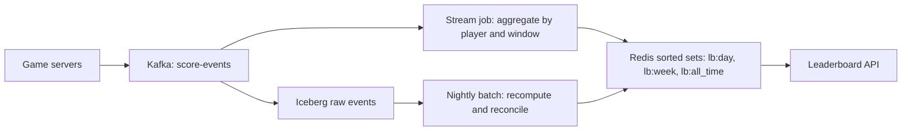

## 🎯 خلاصه

> یک leaderboard را به **دو مسئله** تقسیم کن: یک **ذخیره‌گاه رتبه‌بندی** سریع که در چند میلی‌ثانیه جواب «رتبه‌ی من چند است و چه کسی بالاتر از من است» را می‌دهد، و یک **pipeline دسته‌ای یا stream** که امتیازها را درست، قابل ممیزی و قابل بازتولید می‌کند.

- برای «top N» زنده و خواندن «رتبه‌ی من» از یک **Redis sorted set** استفاده کن (هر بازیکن یک member، و score = امتیاز).
- بازه‌های زمانی (روزانه، هفتگی، کل زمان) را به‌صورت کلیدهای جدا با TTL خودشان مدل کن و با ساختن کلید جدید ریست کن، نه با حذف member ها.
- **رویدادهای خام امتیاز** را در یک log یا جدول lake نگه دار. sorted set یک view مشتق‌شده است که می‌توانی دوباره بسازیش.
- دربارهٔ **tie**، **رویدادهای دیررسید** و **اتفاقی که با از دست رفتن Redis می‌افتد** صریح باش.

## 🌱 از ساده شروع کنیم (مبتدی)

**صورت مسئله.** یک بازی موبایلی که بازیکن‌ها امتیاز می‌گیرند. برای امروز، این هفته و کل زمان، ۱۰۰ بازیکن برتر را نشان بده و به هر بازیکن رتبه‌ی خودش و بازیکن‌های بالا و پایین خودش را نشان بده. امتیازها در دقیقه چندین بار تغییر می‌کنند.

> **💡 تشبیه:** یک تابلوی اعلانات مدرسه که هر بار که یک دانش‌آموز نمره‌ی جدیدی می‌گیرد دوباره مرتب می‌شود. نمی‌خواهی هر بار کل مدرسه را از نو مرتب کنی. تابلویی می‌خواهی که دانش‌آموزها را با تغییر نمره‌ها مرتب نگه دارد، تا بتوانی «ده نفر اول» یا «من کجا هستم» را فوراً بخوانی.

**نیازمندی‌های کاربردی**

- ثبت تغییر امتیاز (`player_id`، `points`، `event_time`).
- خواندن top N برای یک بازه (`today`، `this_week`، `all_time`).
- خواندن رتبه و امتیاز یک بازیکن، و همسایه‌ها (رتبه ±۵).
- ریست بازه‌ها در زمان ثابت (مثلاً نیمه‌شب UTC) بدون توقف سرویس.

**نیازمندی‌های غیرکاربردی**

- خواندن: p99 زیر ۵۰ میلی‌ثانیه برای top N و رتبه.
- نوشتن: تغییر امتیاز ظرف حدود ۵ ثانیه روی تابلو دیده شود (near real time).
- درستی: مجموع‌ها باید با جمع رویدادهای خام برابر باشند، و یک امتیاز مورد اعتراض باید قابل اصلاح باشد.
- دسترس‌پذیری: تابلو می‌تواند چند ثانیه کهنه باشد، اما بعد از از دست رفتن یک نود باید بدون بازسازی دستی برگردد.

**برآورد (محاسبه را نشان بده)**

- بازیکن‌ها: ۵۰ میلیون کل، ۵ میلیون فعال روزانه (DAU).
- رویدادهای امتیاز: ۵ در هر DAU در روز → ۵M × ۵ = ۲۵ میلیون رویداد در روز.
- نرخ نوشتن میانگین: ۲۵,۰۰۰,۰۰۰ / ۸۶,۴۰۰ ثانیه ≈ **۲۹۰ نوشتن در ثانیه**.
- اوج (فرض ۵ برابر میانگین در رویدادهای عصر): ۲۹۰ × ۵ ≈ **۱,۴۵۰ نوشتن در ثانیه**.
- خواندن بیشتر است: فرض ۲۰ خواندن در هر DAU در روز → ۱۰۰ میلیون خواندن در روز ≈ ۱,۱۶۰ در ثانیه میانگین، و حدود ۶,۰۰۰ در ثانیه اوج.
- حافظهٔ sorted set کل‌زمان: ۵۰ میلیون member × حدود ۱۰۰ بایت برای هر کدام (رشتهٔ member، score و overhead هر entry؛ این یک تخمین است که باید روی کلید خودت با `MEMORY USAGE` اندازه بگیری) ≈ **۵ گیگابایت**. sorted set های روزانه و هفتگی کوچک‌ترند، چون فقط بازیکن‌های فعال در آن‌ها هستند: ۵M × ۱۰۰ B ≈ **۰٫۵ گیگابایت** برای هر کدام.

این اعداد می‌گویند یک Redis primary با اندازهٔ مناسب (یا یک primary با replica) می‌تواند این بار خواندن و نوشتن را تحمل کند. سخت‌ترین بخش‌ها درستی و بازه‌ها هستند، نه توان خام.

## 🔧 واقعاً چطور کار می‌کند (متوسط)

**مدل داده.** این دو را از هم جدا نگه دار:

| لایه | ذخیره‌گاه | هدف | قابل بازسازی؟ |
|---|---|---|---|
| رویدادهای خام | topic در Kafka، سپس جدول Iceberg یا Parquet | منبع حقیقت، ممیزی، backfill | بله (خودش منبع است) |
| view رتبه‌بندی | Redis sorted set برای هر کلید بازه | خواندن سریع | بله، از رویدادهای خام |

نام‌گذاری کلیدهای Redis برای بازه‌ها:

```text
lb:all_time                 (no TTL)
lb:week:2026-W41            (TTL: about 8 days after week end)
lb:day:2026-10-13           (TTL: about 2 days after day end)
```

هر member در sorted set یک `player_id` است و score، مجموع امتیاز آن بازیکن در آن بازه است.

**جریان سطح بالا**



**دستورهای اصلی Redis** (Redis نسخهٔ 6.2 یا جدیدتر؛ syntax را برای نسخهٔ خودت در مستندات چک کن):

```bash
# Add points to a player in each window (ZINCRBY adds to the existing score)
ZINCRBY lb:day:2026-10-13   25 player:42
ZINCRBY lb:week:2026-W41    25 player:42
ZINCRBY lb:all_time         25 player:42

# Top 10, highest score first, with scores
ZRANGE lb:day:2026-10-13 0 9 REV WITHSCORES

# My rank (0-based, highest first) and my score
ZREVRANK lb:day:2026-10-13 player:42
ZSCORE   lb:day:2026-10-13 player:42

# Neighbours: 5 above and below (ZRANGE by rank index; start = max(rank-5, 0), stop = rank+5)
ZRANGE lb:day:2026-10-13 0 10 REV WITHSCORES   # example with rank = 5, so start 0, stop 10
```

پیدا کردن رتبهٔ یک member موجود O(log N) است. خواندن top N، O(log N + N) است. هر دو روی یک نود با ۵۰ میلیون member سریع‌اند، و به همین دلیل این طراحی رایج است.

**بازه‌ها و ریست.** دو الگو رایج است:

- **بازه‌های تقویمی (توصیه‌شده).** یک کلید برای هر روز یا هفته. روز جدید یعنی کلید جدید، پس ریست فوری است و داده‌های قدیمی را لمس نمی‌کند. روی کلیدهای قدیمی TTL بگذار و بگذار Redis منقضی‌شان کند.
- **بازه‌های کشویی (برای «۷ روز گذشته»).** کلیدهای روزانه را نگه دار و هنگام خواندن با `ZUNIONSTORE` در یک کلید موقت ترکیب کن. این برای هر درخواست هزینه‌بر است. نتیجه را برای مدت کوتاهی cache کن، یا هر چند دقیقه در یک job از پیش محاسبه کن.

بازه را با حذف همهٔ member ها ریست نکن، و روی هر نوشتن با `ZREMRANGEBYSCORE` یک sorted set را کوتاه نکن. هر دو روی یک کلید داغ عملیات طولانی هستند.

**tie.** وقتی دو بازیکن امتیاز برابر دارند، Redis آن‌ها را به‌ترتیب لغت‌نامه‌ای member مرتب می‌کند. این قطعی است، اما چیزی نیست که بازیکن‌ها انتظار دارند. اگر «کسی که زودتر به این امتیاز رسیده برنده است» مهم است، زمان را داخل score رمز کن، مثلاً `score * 10^10 + (MAX_TS - event_time_seconds)`، که `MAX_TS` یک ثابت بر حسب ثانیه است. رویدادهای زودتر بخش tie بزرگ‌تری می‌گیرند، پس بالاتر رتبه می‌گیرند. بررسی کن که مقدار زیر 2^53 بماند تا score با دقت double دقیق باشد. این را به‌عنوان یک قاعدهٔ محصول بنویس، چون معنای عدد را تغییر می‌دهد.

**رویدادهای دیررسید و تکراری.** یک کلاینت موبایلی ممکن است یک رویداد را دو بار بفرستد، یا یک ساعت بعد از آفلاین شدن بفرستد. دو قاعده بیشتر این مشکلات را حل می‌کند:

1. به هر رویداد یک `event_id` یکتا بده و در stream job با یک state store که IDهای اخیر را برای مدت محدود (مثلاً ۴۸ ساعت) نگه می‌دارد deduplicate کن. این همان [[deduplication]] است و تحویل at-least-once را به نتیجهٔ effectively-once تبدیل می‌کند.
2. امتیاز را به **پنجرهٔ `event_time`** نسبت بده، نه زمان رسیدن، تا یک رویداد دیررسید برای دیروز، تابلوی دیروز را به‌روز کند. به‌روزرسانی یک پنجرهٔ بسته را برای مدت دیرکرد مجاز نگه دار و بعد متوقف کن، و بقیه را job شبانه انجام دهد. ببین [[watermark]] و [[late-arriving-data]].

**بازیابی.** Redis یک cache از وضعیت مشتق‌شده است. اگر یک نود از دست برود، مسیر سریع این است که یک replica با failover ارتقا پیدا کند. مسیر کند بازسازی است: رویدادهای خام بازه‌های باز را از Kafka یا lake دوباره پخش کن و در یک کلید جدید بنویس، بعد اشاره‌گر را عوض کن. job بازسازی را تست‌شده نگه دار، چون همان چیزی است که در روز بد اجرا می‌کنی.

## 🧠 عمق و trade-offها (سنیور)

**deep dive ۱: sorted set های Redis.**

- sorted set ترکیبی از skip list و جدول hash است. پرس‌وجوی رتبه و بازه سریع است، اما حافظه برای هر member پرداخت می‌شود. حافظه برای هر member را روی داده‌ی خودت اندازه بگیر.
- score از نوع IEEE double است. عددهای صحیح تا 2^53 (حدود ۹ × ۱۰^۱۵) دقیق‌اند. فراتر از آن، score ترکیبی را بی‌صدا خراب نکن.
- کلید را داغ اما کوچک نگه دار. یک کلید با ۵۰ میلیون member در Redis Cluster روی یک shard است. تابلوهای داغ به‌صورت پیش‌فرض بین shardها پخش نمی‌شوند، پس یا تابلوی کل‌زمان را روی یک نود با replica نگه دار، یا بر اساس منطقه یا بازهٔ ID بازیکن تقسیم کن و در زمان خواندن top N ها را merge کن.
- تقویت نوشتن: هر رویداد در هر بازه یک `ZINCRBY` می‌زند (اینجا ۳ بار). در stream job در micro-batch های ۵ ثانیه‌ای امتیاز را برای هر بازیکن جمع کن، و برای هر بازیکن و بازه یک `ZINCRBY` بزن.

**deep dive ۲: ریست بازه‌ها و منبع حقیقت.**

- حقیقت را log خام تعیین می‌کند. Redis فقط آن را نشان می‌دهد. اگر stream job و Redis اختلاف داشتند، job شبانهٔ reconcile بازه را از lake دوباره محاسبه می‌کند و sorted set را زیر یک کلید جدید می‌نویسد، و بعد یک اشاره‌گر را در یک store کوچک تنظیمات عوض می‌کند.
- یک **متریک reconciliation** نگه دار: برای هر بازه، مجموع score ها در Redis را با مجموع job دسته‌ای مقایسه کن. وقتی شکاف از یک آستانه بیشتر شد هشدار بده.

**deep dive ۳: سازگاری خواندن.**

- replication در Redis ناهمزمان است. بازیکنی که همین الان امتیاز گرفته ممکن است به‌روزرسانی خودش را روی replica نبیند. خواندن رتبه برای بازیکن جاری را به primary بفرست، یا چند ثانیه کهنگی را بپذیر و آن را در طراحی بگو.

**انتظار سطح Staff.** کاندیداهای Staff معمولاً:

- جدا کردن **view سریع** از **log قابل پخش مجدد** را پیشنهاد می‌دهند و توضیح می‌دهند چرا view را می‌شود دور انداخت.
- هزینهٔ یک کلید داغ کل‌زمان را عدد می‌زنند و یک استراتژی shard با مرحلهٔ merge پیشنهاد می‌دهند.
- مرز ضد تقلب را نام می‌برند: تابلو به هر امتیازی که سرویس امتیاز می‌پذیرد اعتماد می‌کند، پس اعتبارسنجی (rate limit، رویداد امضاشده، قوانین سمت سرور) باید قبل از ورود رویداد به Kafka انجام شود.
- برای رویداد بزرگ برنامه‌ریزی می‌کنند: یک فصل جدید بازی می‌تواند ۱۰ برابر ترافیک بیاورد. کلیدها را از قبل بساز، گرم کن، و نوشتن را برای هر بازیکن محدود کن.

**کی Redis را استفاده نکنیم.** اگر تابلو فقط یک بار در روز برای گزارش خوانده می‌شود، یک کوئری SQL با `ORDER BY score DESC LIMIT 100` روی یک جدول خلاصه کافی و خیلی ساده‌تر است. Redis را وقتی بگذار که همان تابلو هزاران بار در ثانیه خوانده می‌شود و دائماً تغییر می‌کند.

## 🧪 امتحان کن

1. **محاسبهٔ رتبه.** بازیکن ۴۲ رتبهٔ ۰ (اول) دارد. وقتی کسی بالاتر از رتبهٔ ۰ نیست، فراخوانی `ZRANGE` را برای «بازیکن بالاتر و بازیکن پایین‌تر از من» بنویس. مورد لبه را چطور مدیریت می‌کنی؟
2. **ریاضی پنجره.** کلید روزانه‌ات دو روز بعد از پایان روز منقضی می‌شود. یک رویداد دیررسید برای ۲۰۲۶-۱۰-۱۳ در ۲۰۲۶-۱۰-۱۵ ساعت ۱۰:۰۰ UTC می‌رسد. چه اتفاقی برای تابلو می‌افتد و job دسته‌ای چه کار می‌کند؟
3. **رمزگذاری tie.** یک encoding برای score پیشنهاد بده که امتیازهای برابر بر اساس `event_time` زودتر رتبه‌بندی شوند. بیشترین مقدار امتیازی که encoding تو پشتیبانی می‌کند را بگو، پیش از اینکه double دقت خود را از دست بدهد.

<details><summary>جواب‌ها را ببین</summary>

**۱.** رتبهٔ `r` را از `ZREVRANK` بگیر. بازه `ZRANGE key MAX(r-1,0) r+1 REV WITHSCORES` است، پس تو و حداکثر یک همسایه از هر طرف را می‌گیری. برای رتبهٔ ۰، `MAX(r-1,0)` شروع را روی ۰ نگه می‌دارد، و نتیجه فقط تو و بازیکن پایین‌تر را دارد. در هر دو انتها clamp کن.

**۲.** stream job فقط رویدادهای دیررسید تا حد دیرکرد مجاز (مثلاً ۴۸ ساعت) را برای پنجرهٔ آن روز می‌پذیرد. دو روز بعد از پایان پنجره، کلید ممکن است منقضی شده باشد، پس افزایش یک کلید جدید و تقریباً خالی می‌سازد. رفتار درست: رویداد را از مسیر زنده کنار بگذار، در log خام نگه دار، و بگذار job شبانه بازهٔ مربوطه را از lake دوباره محاسبه کند. تعداد رویدادهایی که این‌طور کنار گذاشته شدند را هشدار بده.

**۳.** از `score * 10^10 + (MAX_TS - event_time_seconds)` استفاده کن، که `MAX_TS` یک ثابت بر حسب ثانیه است. بخش tie کمتر از 10^10 است (حدود ۳۰۰ سال بر حسب ثانیه)، پس مقدار ترکیبی فقط وقتی دقیق است که `score * 10^10` زیر 2^53 (حدود ۹٫۰ × ۱۰^۱۵) بماند. این یعنی score تا حدود ۹۰۰,۰۰۰ امتیاز. اگر امتیاز بزرگ‌تر است، score را بین دو sorted set تقسیم کن، یا از یک بخش tie با وضوح درشت‌تر استفاده کن.

</details>

## 💬 گوشه‌ی مصاحبه

**سؤال: «یک leaderboard زمان‌واقعی طراحی کن.»**

- **جواب متوسط:** «امتیازها را در یک Redis sorted set ذخیره می‌کنم و برای هر رویداد `ZINCRBY` می‌زنم. top N با `ZREVRANGE` و رتبه با `ZREVRANK`. برای تابلوهای روزانه و هفتگی یک کلید برای هر بازه با TTL.»
- **جواب سنیور:** «Redis view سریع است و رویدادهای خام در Kafka و lake منبع حقیقت هستند. هر بازه کلید خودش را دارد، پس ریست فوری است. روی `event_id` dedupe می‌کنم، امتیاز را به `event_time` نسبت می‌دهم، و یک reconcile شبانه دارم که بازه‌ها را بازسازی و مجموع‌ها را مقایسه می‌کند. tie-breaking و کلید داغ کل‌زمان را دو موردی می‌دانم که تصمیم محصول می‌خواهند.»
- **جواب Staff:** هزینه‌ی مدل (نوشتن در ثانیه، حافظه برای هر member)، runbook بازسازی و failover، مرز ضد تقلب، و trade-off بین بازه‌های کشویی و تقویمی را هم اضافه می‌کند.

**follow-upهایی که انتظار داشته باش**

- اگر Redis داده را از دست بدهد چه؟ (از log بازسازی کن، ببین بخش «بازیابی».)
- رتبه‌ی یک بازیکن را بین دوستانش چطور نشان می‌دهی؟ (یک sorted set جدا برای هر گروه دوستان، یا محاسبهٔ رتبه از لیست دوستان در API. یک sorted set برای هر کاربر نساز.)
- اگر ۱۰ برابر بازیکن داشته باشی چطور مقیاس می‌دهی؟ (shard بر اساس منطقه یا بازهٔ ID با مرحلهٔ merge برای top N، یا انتقال تابلوی کل‌زمان به ذخیره‌گاهی که روی دیسک مرتب می‌کند.)

> **🎤 این را در مصاحبه بگو:** «leaderboard یک view مشتق‌شده روی یک log رویداد است. خواندن‌ها را با sorted set های Redis و کلیدهای هر بازه سریع نگه می‌دارم، و درستی را با deduplication، پنجره‌های event-time و یک reconcile شبانه با lake. دو تصمیم محصولی که اول تأیید می‌کنم tie-breaking و نحوهٔ برخورد با رویدادهای دیررسید است.»

## ⚠️ اشتباهات رایج

> **⚠️ Watch out:** این‌که Redis را تنها نسخهٔ امتیازها بدانی. بدون log خام نمی‌توانی ممیزی، بازسازی یا اصلاح یک امتیاز موردِ اعتراض را انجام بدهی.

> **⚠️ Watch out:** ریست کردن تابلوی روزانه با حذف member ها، به‌جای سوئیچ به یک کلید جدید. حذف روی یک کلید داغ کند است و تا وقتی تمام شود تابلو نیمه‌خالی است.

- استفاده از زمان رسیدن به‌جای `event_time`، که باعث می‌شود رویدادهای دیررسید در بازهٔ اشتباه بنشینند.
- فراموش کردن deduplication، که باعث می‌شود یک رویداد retry‌شده دو بار امتیاز اضافه کند.
- نادیده گرفتن tie. ترتیب تابلو برای score های برابر آن‌وقت به شناسهٔ بازیکن بستگی دارد، و بازیکن‌ها این را می‌بینند.
- بسته‌بندی یک score ترکیبی داخل double بدون بررسی حد 2^53.
- فرستادن یک `ZINCRBY` برای هر رویداد به یک کلید داغ، به‌جای batch کردن برای هر بازیکن در هر micro-batch.
- طراحی یک sorted set برای هر کاربر برای رتبه‌بندی دوستان. این تعداد میلیون‌ها کلید کوچک می‌سازد که نگه‌داشتنشان سخت است.

## ✅ خودت را بسنج (quiz)

1. کدام دستور Redis رتبهٔ یک بازیکن را در یک sorted set که بالاترین اول است برمی‌گرداند؟
   - A) `ZRANK`
   - B) `ZREVRANK`
   - C) `ZSCORE`
   - D) `ZCOUNT`

<details><summary>جواب</summary>

**B** — `ZREVRANK` member ها را از بالاترین score به پایین‌ترین رتبه‌بندی می‌کند (از ۰). `ZRANK` از پایین‌ترین شروع می‌کند. `ZSCORE` خود score را برمی‌گرداند، نه رتبه، و `ZCOUNT` member ها را در یک بازهٔ score می‌شمارد.

</details>

2. یک تابلوی روزانه باید نیمه‌شب بدون توقف ریست شود. بهترین روش کدام است؟
   - A) اجرای `DEL` روی کلید در نیمه‌شب
   - B) اجرای `ZREMRANGEBYRANK` روی همهٔ member ها در نیمه‌شب
   - C) شروع نوشتن در یک کلید جدید با نامی که تاریخ جدید دارد، و گذاشتن اینکه کلید قدیمی با TTL منقضی شود
   - D) ری‌استارت Redis در نیمه‌شب

<details><summary>جواب</summary>

**C** — کلید جدید یک سوئیچ فوری است، و داده‌های قدیمی با انقضا حذف می‌شوند. حذف یا کوتاه کردن یک کلید داغ و بزرگ Redis را مسدود می‌کند و تابلو را در حین عملیات نیمه‌خالی می‌گذارد.

</details>

3. کلاینت موبایلی یک رویداد را دوباره می‌فرستد و دو بار می‌رسد. کدام مکانیزم از دو بار شمردن جلوگیری می‌کند؟

   - A) تعداد پارتیشن بیشتر در Kafka
   - B) deduplication روی `event_id` یکتا در stream job، با نگه‌داشت محدود state
   - C) تنظیم Redis روی `appendonly yes`
   - D) استفاده از `ZADD` به‌جای `ZINCRBY`

<details><summary>جواب</summary>

**B** — producer ممکن است retry کند، پس consumerها تکرار می‌بینند. یک dedupe با state که با `event_id` کلید خورده و برای مدت محدود نگه داشته می‌شود، افزایش را effectively-once می‌کند. `ZADD` با یک score مقدار را بازنویسی می‌کند به‌جای اضافه کردن، که باگ دیگری است.

</details>

4. **(سنیور)** sorted set کل‌زمان تو ۵۰ میلیون member دارد و در زمان رویداد بزرگ، یک shard روی ۱۰۰٪ CPU است. دو گزینهٔ مشخص چیست و هزینهٔ هرکدام چیست؟

   - A) اضافه کردن `DEL` های بیشتر برای آزاد کردن حافظه
   - B) تقسیم بر اساس منطقه یا بازهٔ ID بازیکن به چند sorted set و merge کردن top N در زمان خواندن (هزینه: merge در زمان خواندن و رتبهٔ سراسری سخت‌تر)؛ یا انتقال مسیر نوشتن پرحجم به یک job دسته‌ای که تابلو را هر چند ثانیه به‌روز می‌کند (هزینه: کهنگی)
   - C) خاموش کردن replication
   - D) جایگزین کردن sorted set با list

<details><summary>جواب</summary>

**B** — تقسیم بار نوشتن را پخش می‌کند، اما رتبهٔ دقیق سراسری را گران می‌کند، چون باید شمارش‌ها را بین shardها ترکیب کنی. batch کردن نرخ نوشتن را کم می‌کند، اما تابلو را کم‌تازه‌تر می‌کند. هر دو trade-off واقعی‌اند و مصاحبه‌گر می‌خواهد اسمشان را ببری.

</details>

5. **(سنیور)** چرا job شبانهٔ reconcile برای یک امتیاز موردِ اعتراض مهم‌تر از درستی job استریم است؟

   - A) Redis نمی‌تواند عدد صحیح ذخیره کند
   - B) job استریم ممکن است رویدادی را که بعداً نامعتبر شناخته شده قبلاً اعمال کرده باشد؛ فقط بازمحاسبه از log خام تغییرناپذیر یک مجموع قابل ممیزی و اصلاح‌شده می‌دهد
   - C) job های دسته‌ای همیشه از استریم سریع‌ترند
   - D) job استریم هرگز رویدادهای دیررسید را مدیریت نمی‌کند

<details><summary>جواب</summary>

**B** — وضعیت استریم افزایشی است، پس یک رویداد نامعتبر قبلاً مجموع‌ها را جابه‌جا کرده. بازمحاسبهٔ بازه از log خام (با قوانین اعمال‌شده در همان اجرا) نتیجه‌ای می‌دهد که می‌شود توضیحش داد و تکرار کرد، و این همان چیزی است که مدیریت اعتراض لازم دارد.

</details>

## 🗂️ فلش‌کارت

| Front | Back |
|---|---|
| ساختار اصلی Redis برای leaderboard | Sorted set: member = بازیکن، score = امتیاز |
| `ZINCRBY` در مقابل `ZADD` برای امتیاز | `ZINCRBY` به score اضافه می‌کند؛ `ZADD` آن را بازنویسی می‌کند |
| ریست امن تابلوی روزانه | نوشتن در کلید با تاریخ جدید؛ کلید قدیمی را با TTL منقضی کن |
| رتبهٔ یک بازیکن، بالاترین اول | `ZREVRANK` (از ۰) |
| کدام زمان برای رویداد دیررسید بازه را تعیین می‌کند | event time، نه زمان رسیدن |
| حد عدد صحیح دقیق در double | 2^53 (حدود ۹ × ۱۰^۱۵) |
| منبع حقیقت leaderboard | log رویداد خام؛ Redis یک view قابل بازسازی است |
| چرا یک کلید برای هر بازه، نه یک کلید سراسری | ریست فوری است و بازه‌های قدیمی بدون لمس داده‌های داغ منقضی می‌شوند |

## 🔗 ادامه

- درس‌های طراحی مرتبط: [[design-top-k]] (top-K تقریبی با sketch، وقتی sorted set دقیق گران است) و [[design-unique-counts]].
- معناشناسی استریم پشت قوانین dedupe و رویداد دیررس: [[delivery-semantics]] و [[kafka-exactly-once]].
- الگوهای بازپخش و reconcile: [[backfills]].
- مستندات sorted set های Redis را بخوان و syntax دقیق دستورها (مثل `ZRANGE ... REV`) را برای نسخهٔ سرورت چک کن.
