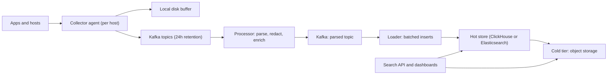

## 🎯 خلاصه

> یک پلتفرم طراحی کن که **لاگ‌های هر هاست و هر سرویس را جمع می‌کند**، آن‌ها را بافر می‌کند تا یک store کند هیچ داده‌ای را از بین نبرد، آن‌ها را بر اساس سرویس، سطح، زمان و متن قابل جست‌وجو می‌کند، و طبق یک سیاست نگه‌داری که کسب‌وکار توان هزینه‌اش را دارد پاک می‌کند.

- جمع‌آوری را در لبه با یک agent سبک انجام بده که یک **بافر روی دیسک محلی** نگه می‌دارد.
- بین collectorها و store یک **بافر Kafka** بگذار تا store بتواند خراب یا کند شود بی‌آنکه رویدادی گم شود.
- store را بر اساس **الگوی کوئری** انتخاب کن: جست‌وجوی متنی (inverted index، مثل Elasticsearch) یا تحلیل تجمیعی روی فیلدهای ساخت‌یافته (ستونی، مثل ClickHouse).
- نگه‌داری یک **تصمیم هزینه با لایه‌بندی** است: SSD داغ برای چند روز، ذخیره‌ی ارزان‌تر برای چند هفته، و object storage برای چند ماه.

## 🌱 از ساده شروع کنیم (مبتدی)

> **💡 تشبیه:** یک اداره‌ی پست برای کل یک شهر. هر خانه (هاست) نامه‌ها (خط‌های لاگ) را داخل صندوق محلی (بافر دیسک collector) می‌اندازد. کامیون‌ها صندوق‌ها را جمع و در یک مرکز مرتب‌سازی (Kafka) تخلیه می‌کنند. مرکز نامه‌ها را روی قفسه‌ها (index و partition) مرتب می‌کند تا کارمند بتواند سریع پیدا کند «همه‌ی نامه‌های سرویس cart با خطا در ساعت گذشته». نامه‌های قدیمی به انبار منتقل می‌شوند و در پایان طبق برنامه خرد می‌شوند.

یک خط لاگ یک رویداد با زمان، پیام و چند فیلد است:

```text
2026-10-13T09:14:02.381Z level=ERROR service=cart host=node-17 trace_id=9f1c message="payment timeout after 3000ms"
```

**صورت مسئله‌ای** که طراحی می‌کنیم:

> صدها سرویس روی هزاران هاست لاگ می‌نویسند. مهندس‌ها هنگام incident لاگ‌های اخیر را جست‌وجو می‌کنند، نمودار نرخ خطا می‌سازند و لاگ‌ها باید ۱۴ روز «داغ» و ۹۰ روز «سرد» نگه داشته شوند. لاگ‌ها نباید وقتی search cluster یک ساعت خاموش است گم شوند.

**نیازمندی‌های عملکردی**

- جمع‌آوری خط‌های لاگ از فایل‌ها، stdout کانتینرها و برنامه‌هایی که با HTTP یا پروتکلی مثل OTLP می‌فرستند.
- جست‌وجو بر اساس بازه‌ی زمانی، سرویس، سطح، هاست و متن آزاد (`"payment timeout"`).
- تجمیع: تعداد در دقیقه، نرخ خطا، پرتکرارترین پیام‌ها.
- نگه‌داری برای هر تیم، همراه با راهی برای حذف داده به دلیل قانونی یا حریم خصوصی.

**نیازمندی‌های غیرعملکردی**

- دوام: رویداد تأییدشده وقتی یک جزء خراب می‌شود گم نشود.
- تازگی: p95 کمتر از ۱۰ ثانیه از لحظه‌ی تولید تا قابل جست‌وجو بودن در شرایط عادی.
- تأخیر جست‌وجو: ساعت گذشته، یک سرویس، p95 کمتر از ۲ ثانیه.
- افت تدریجی: وقتی storage کند است، لاگ‌های کم‌ارزش (debug) را قبل از لاگ‌های مهم (error) کنار بگذار.

**تخمین (محاسبه را نشان بده)**

- هاست‌ها و سرویس‌ها به‌طور میانگین **۳۰۰٬۰۰۰ خط در ثانیه** تولید می‌کنند، با پیک سه برابر یعنی **۹۰۰٬۰۰۰ خط در ثانیه**.
- میانگین اندازه‌ی هر خط: **۴۰۰ بایت**. نرخ خام میانگین: ۳۰۰٬۰۰۰ × ۴۰۰ B = **۱۲۰ MB/s**. پیک: **۳۶۰ MB/s**.
- خام در روز: ۱۲۰ MB/s × ۸۶٬۴۰۰ s = ۱۰٫۴ TB در روز.
- فشرده‌سازی ستونی حدود **۸ برابر** برای لاگ (فرض است و باید روی داده‌ی واقعی بررسی شود): ۱۰٫۴ TB / ۸ = **۱٫۳ TB در روز** ذخیره‌شده.
- لایه‌ی داغ، ۱۴ روز: ۱٫۳ × ۱۴ = **۱۸٫۲ TB**. با ۲ replica: **۳۶٫۴ TB** SSD.
- لایه‌ی سرد، ۹۰ روز روی object storage با erasure coding (بدون replica کامل، حدود ۱٫۳ برابر سربار): ۱٫۳ × ۹۰ × ۱٫۳ = **۱۵۲ TB**، یعنی حدود ۱۱۷ TB پیش از سربار.
- بافر Kafka برای ۲۴ ساعت: ۱۰٫۴ TB خام در روز. با فشرده‌سازی producer حدود ۴ برابر: ۲٫۶ TB برای هر کپی، × ۳ replica = **۷٫۸ TB**. بدون فشرده‌سازی ۳۱ TB می‌شود، و به همین دلیل فشرده‌سازی یک انتخاب طراحی است.

> **⚠️ مراقب باش:** همه‌ی نسبت‌های فشرده‌سازی این‌جا فرض‌اند. این را صریح بگو و بگو چطور اندازه‌شان را می‌گیری: یک روز لاگ واقعی را بگیر، یک نمونه را فشرده کن و مقایسه کن.

## 🔧 واقعاً چطور کار می‌کند (متوسط)

**طراحی سطح بالا.**



**Collectorها.** روی هر هاست یک agent اجرا کن (در Kubernetes یک DaemonSet). Fluent Bit، Vector، Filebeat و OpenTelemetry Collector انتخاب‌های رایجی هستند. هر agent فایل‌ها یا stdout کانتینر را دنبال می‌کند، metadata (namespace، pod، سرویس، هاست) اضافه می‌کند، خط‌ها را دسته‌بندی و فشرده می‌کند و به Kafka می‌فرستد. اگر Kafka در دسترس نباشد، دسته‌ها را روی **بافر دیسک محلی** می‌نویسد و با backoff تلاش می‌کند. این بافر دیسکی اولین خط دفاعی backpressure است: هاست به‌جای از دست دادن لاگ، ساعت‌ها آن را نگه می‌دارد.

**Kafka به‌عنوان جذب‌کننده‌ی ضربه.** Kafka بین تولیدکننده‌ها و store می‌نشیند به سه دلیل:

1. **جداسازی.** search cluster می‌تواند ارتقا یا بازسازی شود، در حالی که collectorها به نوشتن ادامه می‌دهند.
2. **replay.** اگر یک loader باگ داشته باشد و یک روز داده را خراب کند، offset مصرف‌کننده را برمی‌گردانی و topic را دوباره پردازش می‌کنی (پنجره‌ی نگه‌داری، بودجه‌ی replay است).
3. **fan-out.** همان جریان می‌تواند store جست‌وجو، استخراج‌کننده‌ی متریک و آرشیو را تغذیه کند بی‌آنکه به هاست‌ها دست بزنی.

با کلید پایدار مثل `service` یا `host` partition کن تا رویدادهای یک منبع کنار هم بمانند. ترتیب سراسری بین هاست‌ها برای لاگ لازم نیست، پس هزینه‌اش را نپرداز. partitionها را طوری اندازه بگیر که در پیک چند مگابایت در ثانیه را حمل کنند و تعدادشان برای تعداد مصرف‌کننده‌هایی که اجرا می‌کنی کافی باشد.

**پردازش.** یک processor (Flink، Kafka Streams یا یک سرویس مصرف‌کننده‌ی ساده) پیام‌ها را به فیلد parse می‌کند، timestampها را به UTC نرمال می‌کند، فیلدهای حساس (شماره‌ی کارت، توکن) را پیش از رسیدن به ذخیره‌ی بلندمدت حذف یا mask می‌کند و خط‌ها را بر اساس tenant به topicها مسیریابی می‌کند. خطاهای parse باید به یک **dead-letter topic** با خط خام بروند، نه به جای نامعلوم.

**انتخاب store.** این مهم‌ترین تصمیم طراحی است که مصاحبه‌گرها به آن اهمیت می‌دهند.

| نیاز | inverted index (مثل Elasticsearch) | store ستونی (مثل ClickHouse) | index فقط روی label (مثل Loki) |
|---|---|---|---|
| جست‌وجوی متن آزاد روی کلمات کمیاب | قوی | خوب با token skip index، کندتر برای کلمات کمیاب | ضعیف (chunkها اسکن می‌شوند) |
| تجمیع (تعداد در دقیقه) | خوب، در مقیاس بزرگ پرهزینه | بسیار قوی | محدود |
| هزینه‌ی ذخیره | بالاتر (index به‌علاوه‌ی خام) | پایین (فشرده‌سازی ستونی) | پایین‌ترین (chunkها روی object storage) |
| عملیات | تنظیم heap، مدیریت shard | تنظیم schema و merge | ساده، ولی هزینه‌ی کوئری به طراحی label بستگی دارد |

**یک مثال ClickHouse.** فیلدهای ساخت‌یافته ستون می‌شوند؛ پیام یک رشته می‌ماند با یک token skip index:

```sql
CREATE TABLE logs (
    ts       DateTime64(3),
    service  LowCardinality(String),
    level    LowCardinality(String),
    host     String,
    trace_id String,
    message  String,
    attrs    Map(String, String),
    INDEX msg_tok message TYPE tokenbf_v1(32768, 3, 0) GRANULARITY 4
) ENGINE = MergeTree
PARTITION BY toYYYYMMDD(ts)
ORDER BY (service, level, ts)
TTL toDateTime(ts) + INTERVAL 14 DAY DELETE;

-- تعداد خطا در هر دقیقه برای یک سرویس، ساعت گذشته
SELECT toStartOfMinute(ts) AS minute, count() AS errors
FROM logs
WHERE service = 'cart' AND level = 'ERROR' AND ts >= now() - INTERVAL 1 HOUR
GROUP BY minute
ORDER BY minute;
```

کلید `ORDER BY (service, level, ts)` به کوئری اجازه می‌دهد بیشتر داده‌ها را برای این فیلتر رد کند. `LowCardinality` رشته‌های تکراری را به کد dictionary تبدیل می‌کند. `PARTITION BY` روزانه باعث می‌شود نگه‌داری یک drop ارزان پارتیشن باشد نه حذف ردیف‌به‌ردیف.

**رفتار loader.** loaderها را در **دسته‌های بزرگ** بنویس. ClickHouse برای هر insert یک data part جدید می‌سازد و merge پس‌زمینه باید آن‌ها را ترکیب کند. insertهای ریز زیاد، partهای زیاد می‌سازند و کل خوشه را کند می‌کنند. بر اساس اندازه و زمان دسته‌بندی کن (مثلاً با ۱۰٬۰۰۰ ردیف یا هر ۵ ثانیه، هرکدام زودتر رسید). Elasticsearch همین اصل را با bulk API دارد.

## 🧠 عمق و trade-offها (سنیور)

**معنای تحویل (delivery semantics).** collectorها تلاش مجدد می‌کنند، پس یک خط لاگ ممکن است دو بار برسد. pipeline را **at-least-once** در نظر بگیر و نوشتن را idempotent کن: هر رویداد یک ID دارد (مثلاً hash از host، inode فایل، offset و شماره‌ی خط)، و store یا یک مرحله‌ی dedup تکراری‌ها را حذف می‌کند. ClickHouse می‌تواند blockهای insert تکراری را روی جدول‌های replicated حذف کند، ولی فقط به آن تکیه نکن، چون batch تغییرکرده دیگر یکسان نیست. Elasticsearch می‌تواند با شناسه‌ی سند، به‌جای تکرار، بازنویسی کند. exactly-once برای لاگ معمولاً هزینه‌اش نمی‌ارزد.

**backpressure و اینکه چه چیزی را کنار بگذاری.** در overload، زنجیره‌ی بافرها از پایین پر می‌شود: store کند می‌شود، lag مصرف‌کننده‌ی Kafka بالا می‌رود، بافر دیسکی collector پر می‌شود. ترتیب از دست دادن را عمداً برنامه‌ریزی کن: اول `DEBUG` و `INFO` نمونه‌برداری‌شده، بعد سقف نرخ هر هاست، و هرگز `ERROR` را بی‌صدا از دست نده. lag را بر حسب زمان پایش کن، نه بایت: «lag چهل دقیقه است» یک جمله‌ی روشن درباره‌ی تازگی است.

**drift در schema.** توسعه‌دهنده‌ها هر هفته فیلد جدید اضافه می‌کنند. اگر هر کلید JSON جدید یک ستون شود، جدول منفجر می‌شود و merge کند می‌شود. مجموعه‌ی ثابتی از ستون‌های ارتقایافته (service، level، host، trace_id) نگه دار و بقیه را در `Map` یا ستون JSON بگذار. فیلدی را فقط وقتی ستون کن که کوئری‌ها اغلب روی آن فیلتر می‌کنند. این همان درس cardinality در متریک است و برای لاگ هم صدق می‌کند.

**لایه‌های نگه‌داری و حذف.**

- **داغ:** SSD، ۷ تا ۱۴ روز، replicated. برای جست‌وجوی incident.
- **گرم:** دیسک ارزان‌تر، ۳۰ تا ۶۰ روز، عمدتاً خواندنی.
- **سرد:** object storage، ماه‌ها، با کوئری کندتر یا بازیابی روی تقاضا.

حذف را با پارتیشن انجام بده (drop یک روز) نه با حذف ردیف، که داده را بازنویسی می‌کند. نگه‌داری به‌ازای هر tenant یک تنظیم روی مرز لایه‌هاست، نه یک pipeline جداگانه. برای درخواست حذف داده‌ی شخصی، پاسخ عملی این است: پیش از ذخیره در processor mask کن، و برای موارد سخت پارتیشن‌های تأثیرپذیر را پاک کن یا یک job بازنویسی با فیلتر اجرا کن.

**اندازه‌ی بافر Kafka.** بافر ۲۴ ساعته با میانگین ۱۲۰ MB/s حدود ۱۰ TB خام در روز می‌شود، یا ۳۱ TB با replication factor برابر ۳ و بدون فشرده‌سازی. این هزینه، بهای replay و زنده ماندن از یک قطعی چند ساعته‌ی store است. نگه‌داری کوتاه‌تر (مثلاً ۶ ساعت) وقتی store قابل اتکاست سازش معقولی است. این عدد باید تصمیمی باشد که می‌توانی توجیهش کنی، نه یک پیش‌فرض.

**امنیت و محل نگه‌داری داده.** لاگ‌ها اغلب داده‌ی شخصی و secret دارند. هرجا ممکن است در منبع (collector) redact کن، دوباره در processor، و محدود کن چه کسی می‌تواند کدام tenant را جست‌وجو کند. اگر شرکت on-premises است، کل pipeline داخل شبکه‌ی خودش می‌ماند و object storage یک سیستم محلی مثل MinIO یا یک store مبتنی بر Ceph است.

**حالت‌های خرابی که باید تمرین کنی.**

- یک collector دیسکش را از دست می‌دهد و لاگ‌های بافرشده گم می‌شوند. این را بپذیر و با مقایسه‌ی تعداد مورد انتظار و دریافتی برای هر هاست شکاف را هشدار بده.
- یک پیام مسموم (خط خیلی بزرگ، encoding خراب) یک loader را می‌شکند. اندازه‌ی خط را در collector محدود کن و رکوردهای خراب را به dead-letter topic بفرست.
- یک hot partition: یک سرویس پرسروصدا ۵۰٪ حجم را می‌سازد. محدودیت نرخ هر سرویس در collector، بقیه را محافظت می‌کند.
- طوفان merge بعد از backfill. هنگام پردازش مجدد، loader را محدود کن.

**کی این را نسازی.** یک شرکت کوچک با چند سرویس می‌تواند با یک سرویس لاگ مدیریت‌شده شروع کند. طراحی بالا وقتی ارزش ساخت دارد که حجم لاگ، قیمت هر گیگابایت را غالب کرده باشد، داده باید داخل شرکت بماند، یا همان جریان باید هم تحلیل و هم جست‌وجو را تغذیه کند.

**سیگنال‌های عملیاتی:** تازگی به تفکیک tenant، lag مصرف‌کننده بر حسب زمان، میزان استفاده از بافر collector، خط‌های ردشده یا حذف‌شده بر اساس سطح، نرخ خطای parse، تأخیر insert در store، تعداد part در هر جدول و میزان دیسک در هر لایه.

## 🧪 امتحان کن

این ورودی‌ها را اندازه بگیر: میانگین ۶۰۰٬۰۰۰ خط در ثانیه، ۵۰۰ بایت برای هر خط، پیک دو برابر میانگین، فشرده‌سازی ۷ برابر، نگه‌داری داغ ۷ روز با ۲ replica، و نگه‌داری سرد ۶۰ روز.

1. نرخ خام میانگین بر حسب MB/s و خام روزانه بر حسب TB چقدر است؟
2. حجم ذخیره‌شده‌ی روزانه بعد از فشرده‌سازی و حجم لایه‌ی داغ با replicaها چقدر است؟
3. loader تو برای هر درخواست یک ردیف insert می‌کند (حدود ۵٬۰۰۰ ردیف در ثانیه، هر کدام یک insert). توضیح بده چه چیزی می‌شکند و چطور تغییرش می‌دهی.

<details><summary>راه‌حل‌ها</summary>

**1.** ۶۰۰٬۰۰۰ × ۵۰۰ B = ۳۰۰ MB/s. ۳۰۰ MB/s × ۸۶٬۴۰۰ s = ۲۵٫۹ TB در روز (حدود ۲۶ TB).

**2.** ۲۵٫۹ TB / ۷ ≈ **۳٫۷ TB در روز**. لایه‌ی داغ: ۳٫۷ TB × ۷ روز = ۲۵٫۹ TB، × ۲ replica = **حدود ۵۲ TB**.

**3.** هر insert یک data part جدید می‌سازد، پس ۵٬۰۰۰ insert ریز در ثانیه، هزاران part در ثانیه می‌سازد. merge پس‌زمینه عقب می‌افتد، خواندن کند می‌شود و خوشه بیشتر وقتش را صرف merge می‌کند. راه‌حل batch کردن است: چند ثانیه یا ده‌ها هزار ردیف را در هر insert جمع کن و loader را بر اساس اندازه یا زمان flush کند. اگر store پشتیبانی می‌کند، یک مرحله‌ی بافر یا async insert هم اضافه کن.

</details>

## 💬 گوشه‌ی مصاحبه

**شکل سوال:** «یک پلتفرم تجمیع لاگ مثل ELK یا Loki طراحی کن.» انتظار سوال درباره‌ی انتخاب store، backpressure و هزینه‌ی نگه‌داری داشته باش.

**پاسخ سطح متوسط:** «هر هاست یک collector با بافر محلی دارد. لاگ‌ها از Kafka به یک processor می‌روند که parse و redact می‌کند و بعد به یک search store می‌رسند. اگر جست‌وجوی متنی مهم است از Elasticsearch استفاده می‌کنم و اگر کوئری‌های اصلی تجمیع‌اند از ClickHouse. نگه‌داری لایه‌ای است: SSD برای دو هفته و object storage برای سه ماه.»

**پاسخ سطح سنیور:** «اول تخمین می‌زنم: ۳۰۰٬۰۰۰ خط در ثانیه با ۴۰۰ بایت یعنی ۱۲۰ MB/s، حدود ۱۰ TB خام در روز و حدود ۱٫۳ TB ذخیره‌شده با فشرده‌سازی ستونی. Kafka یک بافر replay از ۲۴ ساعت می‌دهد و قطعی store را جذب می‌کند؛ collectorها بافر دیسکی خودشان را دارند. store را از روی الگوی کوئری انتخاب می‌کنم و فقط مجموعه‌ی کوچکی از فیلدها را ستون می‌کنم تا drift در schema جدول را منفجر نکند. زیر فشار اول لاگ‌های debug را کنار می‌گذارم و تازگی را به‌صورت lag بر حسب دقیقه پایش می‌کنم.»

> **🎤 این را در مصاحبه بگو:** «این pipeline فقط به اندازه‌ی بافرهایش دوام دارد، پس بافر را روی هاست و در Kafka می‌گذارم و بعد تصمیم می‌گیرم وقتی پر شدند چه چیزی کنار گذاشته شود. انتخاب store از روی کوئری‌ها می‌آید و نگه‌داری یک تصمیم هزینه است که به شکل لایه بیان می‌شود.»

**سیگنال‌های سطح Staff:** مدل هزینه به ازای هر گیگابایت و هر کوئری؛ یک schema استاندارد لاگ بین تیم‌ها؛ سیاست نمونه‌برداری که مالکان سرویس تأیید کرده‌اند؛ جمع‌آوری چندمنطقه‌ای با storage منطقه‌ای برای محل نگه‌داری داده؛ و runbook حادثه برای «لاگ‌ها گم شده‌اند» که با مقایسه‌ی تعداد دریافتی و مورد انتظار برای هر هاست شروع می‌شود.

**follow-upهای محتمل.** *چرا لاگ را در سیستم متریک نگه نداریم؟* لاگ cardinality بالا، متن آزاد و جزئیات هر رویداد دارد؛ متریک این‌ها را از قبل تجمیع می‌کند. *همه‌ی لاگ‌های یک trace ID را در سرویس‌های مختلف چطور پیدا می‌کنی؟* `trace_id` را به‌صورت ستون یا با skip index ایندکس کن و بپذیر که کوئری فقط پارتیشن‌های اخیر را اسکن می‌کند. *لاگ‌های یک کاربر را چطور حذف می‌کنی؟* با mask کردن در ورودی کمتر به آن نیاز پیدا می‌کنی، و برای استثناها از حذف پارتیشنی یا یک job بازنویسی استفاده کن.

## ⚠️ اشتباهات رایج

> **⚠️ مراقب باش:** فرستادن لاگ مستقیم از هر هاست به search cluster بدون هیچ بافری. اولین قطعی cluster تبدیل به یک حادثه‌ی از دست رفتن داده می‌شود.

> **⚠️ مراقب باش:** ایندکس کردن هر کلید JSON به‌صورت ستون یا فیلد. mapping یا جدول منفجر می‌شود و هزینه‌ی merge و حافظه با آن بالا می‌رود.

- انتخاب Elasticsearch به‌صورت پیش‌فرض بدون پرسیدن این‌که کوئری‌ها چه هستند، و پرداخت هزینه‌ی index برای داده‌ای که هیچ‌کس جست‌وجو نمی‌کند.
- نوشتن یک insert برای هر خط لاگ در یک store ستونی.
- نگه داشتن همه‌ی لایه‌ها روی SSD برای همیشه. نگه‌داری بدون لایه‌بندی بزرگ‌ترین بخش صورتحساب بیشتر لاگ‌هاست.
- اختیاری دانستن dead-letter topic. رکوردهای خراب باید جایی باشند که بتوانی بررسی‌شان کنی.
- فرض exactly-once. به‌جایش شناسه‌ی رویداد و مسیر dedup را طراحی کن.
- فراموش کردن این‌که لاگ‌ها secret و داده‌ی شخصی دارند و redact را فقط در زمان کوئری انجام دادن.

## ✅ خودت را بسنج

۱. نقش اصلی Kafka در این طراحی چیست؟
   - A) نگه‌داری لاگ‌ها برای همیشه برای جست‌وجو
   - B) جداکردن collectorها از store و دادن پنجره‌ی replay در زمان قطعی store
   - C) فشرده‌سازی لاگ‌ها تا حجم نهایی ذخیره
   - D) تبدیل JSON به ستون

<details><summary>پاسخ</summary>

**B** — Kafka ضربه‌ها و قطعی‌ها را جذب می‌کند، اجازه می‌دهد مصرف‌کننده‌ها بازسازی یا replay شوند، و یک جریان را به چند مصرف‌کننده می‌دهد. بافری با پنجره‌ی نگه‌داری است، نه store جست‌وجو.

</details>

۲. کدام انتخاب برای کاری که عمدتاً «تعداد خطا در هر دقیقه برای هر سرویس در ۳۰ روز گذشته» است بهترین است؟
   - A) یک inverted index روی هر توکن متن آزاد
   - B) یک store ستونی مرتب‌شده بر اساس سرویس و زمان، با پارتیشن روزانه
   - C) یک فایل تخت برای هر هاست با grep
   - D) یک جدول برای هر سرویس بدون پارتیشن

<details><summary>پاسخ</summary>

**B** — تجمیع روی فیلدهای ساخت‌یافته با فیلتر زمانی دقیقاً کاری است که store ستونی برایش ساخته شده. مرتب‌سازی بر اساس سرویس و زمان بیشتر داده را رد می‌کند و پارتیشن روزانه نگه‌داری را ارزان می‌کند.

</details>

۳. loader تو هر ردیف را جداگانه در ClickHouse insert می‌کند و خوشه کند می‌شود. ریشه‌ی مشکل و راه‌حل چیست؟

   - A) ClickHouse از `DateTime64` پشتیبانی نمی‌کند؛ از رشته استفاده کن
   - B) هر insert یک data part می‌سازد و partهای ریز زیاد، merge را زیر فشار می‌گذارند؛ ردیف‌ها را بر اساس اندازه یا زمان دسته‌بندی کن
   - C) partitionهای Kafka کم‌اند؛ broker بیشتر اضافه کن
   - D) بند `TTL` وجود ندارد

<details><summary>پاسخ</summary>

**B** — insertهای ریز زیاد partهای ریز زیاد می‌سازند که merge پس‌زمینه باید ترکیبشان کند. batch کردن insertها به بلوک‌های بزرگ‌تر تعداد part را قابل مدیریت نگه می‌دارد.

</details>

۴. **(سنیور)** می‌خواهی یک قطعی store به مدت سه ساعت بدون از دست رفتن داده تحمل شود. کدام بافرها باید وجود داشته باشند و کدام محدودکننده است؟

   - A) فقط کش index جست‌وجو
   - B) بافر دیسکی collector و پنجره‌ی نگه‌داری Kafka؛ محدودکننده هر کدام است که زودتر پر شود، پس هر دو را از روی هدف قطعی و نرخ پیک اندازه بگیر
   - C) یک cluster جست‌وجوی دوم در همان rack
   - D) خاموش کردن redaction

<details><summary>پاسخ</summary>

**B** — collector وقتی Kafka در دسترس نیست روی دیسک بافر می‌کند، و Kafka وقتی store خاموش است رویدادها را نگه می‌دارد. هر دو باید مدت قطعی را در نرخ پیک پوشش دهند، و کوچک‌ترین آن‌ها محدودیت واقعی است.

</details>

۵. **(سنیور)** چرا حذف داده‌ی قدیمی با drop کردن پارتیشن‌های روزانه بهتر است از حذف ردیف‌ها با شرط روی `ts`؟

   - A) در store های ستونی حذف ردیف مجاز نیست، پس جایگزینی وجود ندارد
   - B) drop پارتیشن فایل‌های کامل را بدون بازنویسی داده برمی‌دارد، در حالی که حذف ردیفی data partهای تأثیرپذیر را بازنویسی می‌کند و کار merge اضافه می‌سازد
   - C) پارتیشن‌ها بهتر فشرده می‌شوند
   - D) باعث می‌شود لاگ‌ها بیشتر نگه داشته شوند

<details><summary>پاسخ</summary>

**B** — store های ستونی برای append و عملیات دسته‌ای بهینه‌اند. drop پارتیشن یک عملیات روی metadata و فایل‌های کامل است، در حالی که حذف ردیفی partهای تأثیرپذیر را بازنویسی و هزینه‌ی پس‌زمینه ایجاد می‌کند.

</details>

## 🗂️ فلش‌کارت

| Front | Back |
|---|---|
| چرا هر هاست بافر دیسکی دارد؟ | تا لاگ‌ها از قطعی Kafka یا شبکه جان سالم به در ببرند؛ اولین خط دفاعی backpressure است |
| Kafka در یک pipeline لاگ چه چیزی می‌دهد؟ | جداسازی، replay در پنجره‌ی نگه‌داری، و fan-out به چند مصرف‌کننده |
| Elasticsearch در برابر ClickHouse | inverted index برای جست‌وجوی متن؛ store ستونی برای تجمیع روی فیلدهای ساخت‌یافته با هزینه‌ی ذخیره‌ی پایین‌تر |
| چرا insertهای loader را batch می‌کنیم؟ | هر insert یک part می‌سازد؛ partهای ریز زیاد merge پس‌زمینه را خفه می‌کنند |
| چطور ورودی را امن برای retry کنیم؟ | به هر رویداد شناسه‌ی پایدار بده و dedup کن؛ روی at-least-once طراحی کن |
| چرا تعداد کمی ستون ارتقایافته نگه می‌داریم؟ | کلیدهای جدید JSON جدول را منفجر و merge را کند می‌کنند |
| ارزان‌ترین راه حذف داده‌ی قدیمی؟ | drop کردن کل پارتیشن‌ها به‌جای حذف ردیف |
| زیر overload اول چه را کنار بگذاری؟ | لاگ‌های debug و info نمونه‌برداری‌شده؛ هرگز error را بی‌صدا از دست نده |

## 🔗 ادامه

- **design-metrics-monitoring** مسئله‌ی همراه است؛ همان مسیر ورود را دارد اما داستان cardinality و ذخیره‌سازی‌اش متفاوت است.
- **kafka-architecture** و **kafka-retention-compaction** partitionها، نگه‌داری و replay بافر را با جزئیات توضیح می‌دهند.
- **columnar-storage** و **clickhouse** توضیح می‌دهند چرا store ستونی خوب فشرده و تجمیع می‌کند.
- **backpressure** و **dlq-bad-records** الگوهای overload و پیام‌های مسموم را پوشش می‌دهند.
- **data-retention** طراحی سیاست نگه‌داری، نگه‌داری قانونی و درخواست‌های حذف را پوشش می‌دهد.
- مستندات فعلی موتور جست‌وجوی انتخابی‌ات را برای گزینه‌های index و لایه‌بندی بخوان، چون بین نسخه‌ها تغییر می‌کنند.
