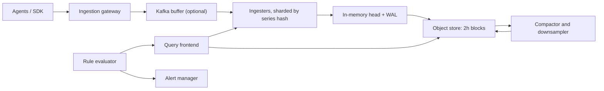

## 🎯 خلاصه

> یک سیستم طراحی کن که **میلیون‌ها نمونه‌ی عددی در ثانیه** را دریافت کند، آن‌ها را با فشرده‌سازی مناسب بر اساس زمان ذخیره کند، به سوال «این متریک را برای این labelها در شش ساعت گذشته نشان بده» در کمتر از یک ثانیه جواب دهد، داده‌های قدیمی را با وضوح پایین‌تر نگه دارد و ظرف یک دقیقه هشدار بدهد.

- یک **sample** (نمونه) برابر است با `(series, timestamp, value)`. یک **series** (سری) یعنی یک نام متریک به‌همراه یک مجموعه‌ی یکتای از labelها.
- نوشتن append-only و مرتب‌شده بر اساس زمان است و فشرده‌سازی مهم‌ترین اهرم هزینه است.
- **downsampling** تاریخچه‌ی بلندمدت را ارزان می‌کند، اما فقط اگر aggregateهایی ذخیره کنی که درست ترکیب می‌شوند.
- **high cardinality** (تعداد زیاد ترکیب‌های یکتای label) خرابی‌ای است که این سیستم‌ها را از پا درمی‌آورد. آن را در ورودی محدود کن، نه بعد از رسیدن صورتحساب.

## 🌱 از ساده شروع کنیم (مبتدی)

> **💡 تشبیه:** داشبورد یک ماشین که سرعت را هر ثانیه ثبت می‌کند. هر عدد یک نقطه است. فهرست این عددها برای یک سنسور، به ترتیب زمان، یک خط می‌شود. یک سیستم مانیتورینگ میلیون‌ها چنین خطی را ذخیره می‌کند و اجازه می‌دهد هر کدام را سریع رسم کنی.

یک نمونه‌ی متریک این شکلی است:

```text
http_requests_total{service="cart", status="500", pod="cart-7f9"}  1532  @1697200000
```

- `http_requests_total` **نام متریک** است.
- `{service, status, pod}` همان **labelها** (برچسب‌های کلید-مقدار) هستند.
- `1532` **مقدار** و `@1697200000` **زمان** (ثانیه‌های Unix) است.

همان نام با مجموعه‌ی label متفاوت، یک **series** دیگر است. هر series تاریخچه‌ی مخصوص خودش را دارد.

**صورت مسئله‌ای** که طراحی می‌کنیم:

> هزاران سرویس و هاست متریک منتشر می‌کنند. مهندس‌ها داشبورد با تازگی چند ثانیه‌ای، هشدارهایی که حدود یک دقیقه بعد از بروز مشکل شلیک شوند، ۳۰ روز تاریخچه‌ی با وضوح کامل و یک سال تاریخچه‌ی با وضوح پایین‌تر نیاز دارند.

**نیازمندی‌های عملکردی**

- دریافت counter، gauge و histogram از agentها یا SDKها.
- کوئری بر اساس نام متریک، فیلتر label و بازه‌ی زمانی، همراه aggregationهایی مثل `sum by (service)` و `rate()`.
- ارزیابی قانون‌های هشدار طبق زمان‌بندی و ارسال اعلان.
- اعمال سیاست نگهداری و downsampling برای هر tenant (تیم).

**نیازمندی‌های غیرعملکردی**

- ورودی داده باید در خرابی‌های جزئی بالا بماند. از دست دادن چند ثانیه داده روی یک نود قابل قبول است؛ از کار افتادن کل خط لوله قابل قبول نیست.
- تازگی داده: p99 کمتر از ۳۰ ثانیه از لحظه‌ی انتشار تا قابل کوئری بودن.
- کوئری داشبورد برای ۶ ساعت گذشته: p95 کمتر از ۱ ثانیه.
- هشدارها حتی وقتی لایه‌ی کوئری زیر بار است کار کنند.
- هزینه‌ی هر میلیون نمونه ورودی طراحی است، نه فکر بعدی.

**تخمین (محاسبه را نشان بده)**

- هاست‌ها: ۵۰٬۰۰۰. series در هر هاست: ۴۰۰. series فعال: ۵۰٬۰۰۰ × ۴۰۰ = **۲۰ میلیون**.
- فاصله‌ی scrape: ۱۵ ثانیه. میانگین ورودی: ۲۰٬۰۰۰٬۰۰۰ / ۱۵ = **۱٫۳۳ میلیون نمونه در ثانیه**. با پیک دو برابر، حدود ۲٫۷ میلیون در ثانیه.
- اندازه‌ی خام هر نمونه: ۸ بایت زمان + ۸ بایت مقدار = ۱۶ بایت. نرخ خام: ۱٫۳۳M × ۱۶ B ≈ ۲۱ MB/s، حدود **۱٫۸ TB در روز**.
- با فشرده‌سازی حدود ۱۰ برابر (فرض می‌کنیم ۱٫۵ بایت برای هر نمونه، ببین deep dive): ۱٫۳۳M × ۱٫۵ B ≈ ۲ MB/s، حدود **۱۶۸ GB در روز**.
- ۳۰ روز خام فشرده: ۱۶۸ GB × ۳۰ = **۵ TB**. با ۳ replica: **۱۵ TB**.
- downsample به وضوح ۵ دقیقه برای یک سال: ۲۰M / ۳۰۰ s = ۶۶٬۶۶۷ نقطه در ثانیه. هر rollup پنج aggregate ذخیره می‌کند (حدود ۴۰ بایت): ۶۶٬۶۶۷ × ۴۰ B ≈ ۲٫۷ MB/s، حدود ۲۳۰ GB در روز و ۸۴ TB در سال به‌صورت خام. با فشرده‌سازی حدود ۴ برابر: **۲۱ TB در سال**، پیش از replication.

> **⚠️ مراقب باش:** نسبت فشرده‌سازی یک فرض است. در مصاحبه این را صریح بگو و بگو چطور آن را روی داده‌ی واقعی اندازه می‌گیری.

## 🔧 واقعاً چطور کار می‌کند (متوسط)

**مدل داده.** دو ساختار بیشترِ کار را انجام می‌دهند:

- یک **series index** هر مجموعه‌ی یکتای label را به یک `series_id` عددی نگاشت می‌کند و یک **inverted index** هر `label=value` را به فهرست series_idهای منطبق (postings list). کوئری `service="cart", status="500"` اشتراک دو postings list است.
- یک **sample store** مقادیر هر series را به ترتیب زمان، در بلوک‌ها نگه می‌دارد (مثلاً بلوک‌های دو ساعته، که اندازه‌ی پیش‌فرض بلوک در Prometheus است).

**طراحی سطح بالا.**



Gateway نمونه‌ها را اعتبارسنجی می‌کند، relabeling را اعمال می‌کند و سقف series هر tenant را اجرا می‌کند. Ingesterها جدیدترین داده را در حافظه نگه می‌دارند و یک **WAL** (write-ahead log، لاگ پیش‌نوشت) می‌نویسند تا ری‌استارت، نمونه‌های تأییدشده را از بین نبرد. هر دو ساعت head به یک بلوک تغییرناپذیر تبدیل و آپلود می‌شود. مسیر کوئری نتیجه‌ی ingesterها (داده‌ی تازه) و بلوک‌ها (تاریخچه) را ادغام می‌کند.

**مسیر نوشتن، قدم به قدم.**

1. agent هر ۱۵ ثانیه یک دسته نمونه برای هر series می‌فرستد.
2. gateway برچسب‌های هر series را هش می‌کند تا یک ingester را روی یک consistent-hash ring انتخاب کند.
3. ingester به WAL و سپس به chunk درحافظه‌ی آن series اضافه می‌کند.
4. با replication factor برابر ۳، نوشتن بعد از تأیید ۲ از ۳ replica تأیید می‌شود (quorum). بنابراین یک نود می‌تواند خراب شود بی‌آنکه داده گم شود.
5. نمونه‌ی تکراری (همان series، همان timestamp) idempotent است: نوشتن دوم حذف یا با همان مقدار بازنویسی می‌شود. تلاش مجدد امن است.

**فشرده‌سازی با یک مثال.** scrapeها هر ۱۵ ثانیه می‌رسند: timestampهای `t0, t0+15, t0+30, t0+45`. زمان اول را ذخیره کن، سپس **delta of deltas**: دلتاها ۱۵، ۱۵، ۱۵ هستند و delta-of-delta برابر ۰، ۰ است. صفر یک بیت هزینه دارد. مقادیر با XOR نسبت به مقدار قبلی کدگذاری می‌شوند: gaugeای که تغییر نمی‌کند یک بیت هزینه دارد و تغییرات کوچک چند بیت. این روش Gorilla از مقاله‌ی Facebook در سال ۲۰۱۵ است. به همین دلیل روی داده‌ی منظم، ۱۶ بایت برای هر نمونه می‌تواند به حدود ۱٫۵ بایت برسد.

**مسیر کوئری.** query frontend یک کوئری طولانی را به تکه‌های زمانی (مثلاً یک تکه برای هر روز) می‌شکند، آن‌ها را موازی اجرا می‌کند، نتیجه‌ی تکه‌های کامل‌شده را کش می‌کند و نتایج جزئی را ادغام می‌کند. matcherهای label ابتدا به inverted index می‌روند، پس موتور فقط series لازم را می‌خواند.

## 🧠 عمق و trade-offها (سنیور)

**downsampling باید آنچه کوئری‌ها لازم دارند را حفظ کند.** **sum، count، min و max** را ذخیره کن (و برای gauge، last). این‌ها ترکیب‌پذیرند: مجموع مجموع‌ها همان مجموع است و میانگین یک ساعته می‌شود `sum(sum) / sum(count)`. ذخیره‌ی فقط میانگین این را خراب می‌کند. میانگین دو میانگین ۵ دقیقه‌ای وقتی تعداد نمونه‌ها متفاوت است جواب غلط می‌دهد. percentileها هم همین تله را دارند: نمی‌توانی p99ها را میانگین بگیری. برای latency از **histogram** (شمارنده‌های bucket) استفاده کن. bucketها بین shardها و زمان جمع می‌شوند و از آن‌ها می‌توان p99 تقریبی گرفت.

**reset شدن counter.** `rate()` فرض می‌کند counter فقط افزایش می‌یابد. وقتی پروسس ری‌استارت می‌شود، counter به صفر برمی‌گردد و موتور کوئری باید این افت را reset حساب کند. به همین دلیل downsample کردن counter خام با آخرین مقدار، در مرز reset‌ها باید با دقت انجام شود.

**شاردکردن بر اساس series، نه زمان.** هش کردن بر اساس series باعث می‌شود همه‌ی نمونه‌های یک series روی یک ingester بمانند و فشرده‌سازی موثر بماند. کوئری‌ای که روی label فیلتر می‌کند فقط وقتی به چند shard محدود می‌شود که آن label بخشی از shard key باشد. کوئری‌ای مثل `sum by (service) (...)` باید به همه‌ی shardها برود و جمع‌های جزئی را ادغام کند. این fan-out را برنامه‌ریزی کن و تعداد shardهایی را که یک کوئری لمس می‌کند محدود کن.

**حافظه بودجه‌ی واقعی است.** هر series فعال یک chunk در حافظه، یک ورودی index و labelها را نگه می‌دارد. فرض کن چند کیلوبایت برای هر series فعال (خودت اندازه بگیر). پس ۲۰ میلیون series فعال به حدود ده‌ها گیگابایت RAM در کل ناوگان ingester نیاز دارد، پیش از replication. تعداد series معمولاً اندازه‌ی خوشه را تعیین می‌کند، نه نرخ نمونه.

**high cardinality، شکست اصلی.** تعداد series حاصل‌ضرب تعداد مقادیر هر label است:

- `http_requests_total` با `method` (۵)، `status` (۲۰)، `endpoint` (۲۰۰) و `pod` (۱٬۰۰۰) می‌شود ۵ × ۲۰ × ۲۰۰ × ۱٬۰۰۰ = **۲۰ میلیون series برای یک سرویس**.
- افزودن `user_id` با ۱۰ میلیون کاربر، این عدد را در ۱۰ میلیون ضرب می‌کند.

کنترل‌ها، به ترتیبی که باید اعمال شوند:

1. **سقف series** برای هر tenant در gateway. series جدید بالای سقف را با خطای واضح رد کن و آن را در داشبورد نشان بده.
2. قانون‌های **relabeling** که label را حذف یا تجمیع می‌کنند (مثلاً `pod` را برای نگه‌داری بلندمدت با `deployment` عوض کن).
3. جزئیات هر کاربر یا هر درخواست را به **لاگ یا trace** ببر که برای این cardinality ساخته شده‌اند. از **exemplar** (شناسه‌ی trace که به نمونه‌ی histogram چسبیده) استفاده کن تا از یک جهش متریک به trace برسی.
4. خود **رشد cardinality** را هشداری کن: تعداد series در هر tenant در هر روز.

**هشدار نباید به چیزی که می‌پاید وابسته باشد.** اگر ارزیاب هشدار همان لایه‌ی کوئری پرباری را پرس‌وجو کند که قرار است پایش کند، دقیقاً وقتی از کار می‌افتد که به آن نیاز داری. ارزیابی قانون‌ها را با بودجه‌ی منابع خودش اجرا کن و یک **dead man's switch** اضافه کن: هشداری که وقتی سیستم سالم است دائماً شلیک می‌کند و وقتی متوقف شد صفحه‌ی on-call را فعال می‌کند. هشداری که هرگز آزموده نشده، هشدار نیست.

**چندمستأجری و محافظت از کوئری.** هر کوئری را با تعداد series، تعداد نمونه و بازه‌ی زمانی محدود کن و کوئری‌های بزرگ‌تر را با خطای قابل فهم رد کن. داشبورد گران یک تیم نباید هشدارهای تیم دیگر را کند کند. برای هشدارها و داشبوردها pool کوئری جدا داشته باش.

**کی این را نسازی.** برای شرکت کوچک با چند هزار series، یک سرویس مدیریت‌شده یا یک TSDB متن‌باز ارزان‌تر است. طراحی بالا وقتی ارزش دارد که مسیر ورود داده، سیاست cardinality و هزینه‌ی نگه‌داری را خودت مدیریت کنی.

**سیگنال‌های عملیاتی که باید پایش شوند:** نرخ ورودی هر tenant، نمونه‌های ردشده، تعداد series و رشد آن، زمان replay کردن WAL بعد از ری‌استارت، تأخیر آپلود به object store، تأخیر هر لایه‌ی کوئری، تأخیر ارزیابی قانون‌ها و dead man's switch.

## 🧪 امتحان کن

با این ورودی‌ها پلتفرم را اندازه بگیر: ۵۰٬۰۰۰ هاست، ۴۰۰ series برای هر هاست، یک نمونه هر **۱۰ ثانیه**، ۱٫۵ بایت برای هر نمونه‌ی فشرده، ۳۰ روز نگه‌داری و replication factor برابر ۳.

1. چند series فعال و چند نمونه در ثانیه داریم؟
2. روزانه چند ترابایت داده‌ی خام فشرده داریم و برای ۳۰ روز با ۳ replica چقدر می‌شود؟
3. یک تیم label مربوط به `request_id` را اضافه می‌کند که برای هر درخواست یکتاست، با ۲ میلیون درخواست در ساعت. توضیح بده چرا این تخمین را خراب می‌کند و به‌جایش چه می‌کنی.

<details><summary>راه‌حل‌ها</summary>

**1.** ۵۰٬۰۰۰ × ۴۰۰ = ۲۰٬۰۰۰٬۰۰۰ series. ۲۰٬۰۰۰٬۰۰۰ / ۱۰ ثانیه = **۲٬۰۰۰٬۰۰۰ نمونه در ثانیه**.

**2.** ۲٬۰۰۰٬۰۰۰ × ۱٫۵ B = ۳ MB/s. ۳ MB/s × ۸۶٬۴۰۰ s = ۲۵۹٫۲ GB در روز، حدود **۰٫۲۶ TB در روز**. برای ۳۰ روز: ۲۵۹٫۲ GB × ۳۰ = ۷٬۷۷۶ GB ≈ **۷٫۸ TB**. با ۳ replica: حدود **۲۳٫۳ TB**.

**3.** `request_id` برای هر درخواست یکتاست، پس هر درخواست یک series جدید می‌سازد. با ۲ میلیون درخواست در ساعت، یعنی ۲ میلیون series جدید در ساعت و حدود ۴۸ میلیون در روز؛ این از کل series فعال فعلی ناوگان هم بیشتر است. هر series، چه کوئری شود چه نه، حافظه و ورودی index هزینه دارد. به‌جایش شناسه‌ی درخواست را در سیستم لاگ ثبت کن، labelهای متریک را روی مقادیر محدود (route، کلاس status) نگه دار و با exemplar یک bucket کند histogram را به trace وصل کن.

</details>

## 💬 گوشه‌ی مصاحبه

**شکل سوال:** «یک سیستم متریک و مانیتورینگ مثل Prometheus یا Datadog طراحی کن.» انتظار follow-up درباره‌ی حجم ذخیره، cardinality و هشدار داشته باش.

**پاسخ سطح متوسط:** «agentها داده را push می‌کنند یا scrape می‌شوند، یک gateway نمونه‌ها را به یک store سری زمانی می‌فرستد، داده فشرده و در لایه‌ها نگه داشته می‌شود و یک سرویس کوئری داشبوردها را تغذیه می‌کند. هشدارها به‌صورت قانون و طبق زمان‌بندی اجرا می‌شوند. من از یک TSDB و object storage برای تاریخچه استفاده می‌کنم و labelها را محدود می‌کنم تا تعداد series کران‌دار بماند.»

**پاسخ سطح سنیور:** «اول اندازه می‌گیرم: ۲۰ میلیون series با فاصله‌ی ۱۵ ثانیه یعنی حدود ۱٫۳ میلیون نمونه در ثانیه، یعنی حدود ۵ TB برای ۳۰ روز فشرده، پیش از replication. ingesterها بر اساس هش series شارد می‌شوند و نوشتن با quorum دو از سه تأیید می‌شود. downsampling را روی sum، count، min و max انجام می‌دهم تا rollupها قابل ترکیب باشند، latency را به‌صورت histogram ذخیره می‌کنم، سقف series را در gateway برای هر tenant اعمال می‌کنم و هشدارها را روی pool کوئری جدا با dead man's switch اجرا می‌کنم.»

> **🎤 این را در مصاحبه بگو:** «قلب این سیستم تعداد series است، نه نرخ نمونه. سقف cardinality را دم در می‌گذارم، rollupهایی ذخیره می‌کنم که قابل تجمیع دوباره باشند و مطمئن می‌شوم هشدارها وقتی داشبوردها از کار افتاده‌اند هم کار می‌کنند.»

**سیگنال‌های سطح Staff:** هزینه‌ی هر series به‌عنوان متریک برنامه‌ریزی؛ مسیر مهاجرت از یک stack مانیتورینگ موجود؛ federation چندمنطقه‌ای (محلی برای هشدار، سراسری برای داشبورد)؛ و یک SLO برای خود مانیتورینگ.

**follow-upهای محتمل.** *نمونه‌های دیررسیده را چطور مدیریت می‌کنی؟* یک پنجره‌ی محدود برای نمونه‌های خارج از ترتیب برای هر series بپذیر و نمونه‌های قدیمی‌تر را با شمارنده‌ی واضح رد کن. *p99 یک هفته را چطور جواب می‌دهی؟* از rollupهای histogram، نه از میانگین p99ها. *اگر یک ingester وسط یک دسته بمیرد چه؟* نوشتن با quorum یعنی دسته یا روی دو replica است یا agent دوباره می‌فرستد، و کلید idempotent (series, timestamp) تلاش مجدد را امن می‌کند.

## ⚠️ اشتباهات رایج

> **⚠️ مراقب باش:** میانگین‌گرفتن از میانگین‌ها. میانگین میانگین‌های ۵ دقیقه‌ای، میانگین ساعتی نیست اگر تعداد نمونه‌ها متفاوت باشد. sum و count را ذخیره کن.

> **⚠️ مراقب باش:** گذاشتن مقدار بی‌کران (user ID، URL همراه query string، request ID) در label. هزینه در حافظه و اندازه‌ی index پرداخت می‌شود، نه در کوئری.

- طراحی یک ردیف برای هر نمونه در یک جدول رابطه‌ای عمومی، بدون پارتیشن زمانی و بدون فشرده‌سازی. برای دمو کار می‌کند و در ۱ میلیون نمونه در ثانیه می‌شکند.
- شاردکردن فقط بر اساس زمان. داده‌ی تازه نقطه‌ی داغ می‌شود و تاریخچه‌ی series بین نودها پخش می‌شود.
- فراموش کردن **reset شدن counter** بعد از ری‌استارت پروسس. نتیجه‌ی `rate()` منفی می‌شود یا جهش غلط دارد.
- فرستادن هشدارها از همان مسیر کوئری داشبورد، طوری که جهش یک داشبورد صفحه‌گذاری را عقب بیندازد.
- ادعای exactly-once برای نمونه‌ها. نوشتن idempotent با کلید (series, timestamp) پاسخ عملی است.
- نادیده گرفتن skew ساعت بین هاست‌ها. timestamp را در منبع بگذار با تحمل محدود و نمونه‌های خیلی آینده‌ای را رد کن.

## ✅ خودت را بسنج

۱. تیمی می‌خواهد روی یک counter درخواست label `user_id` داشته باشد و ۵ میلیون کاربر دارد. بهترین واکنش اول چیست؟
   - A) ingesterهای بیشتر اضافه کنیم تا series اضافی جا شود
   - B) در gateway آن label را رد یا relabel کنیم و جزئیات هر کاربر را به لاگ یا trace ببریم
   - C) counter را به‌صورت رشته ذخیره کنیم تا حافظه کم شود
   - D) downsampling را برای آن متریک خاموش کنیم

<details><summary>پاسخ</summary>

**B** — تعداد series در ۵ میلیون ضرب می‌شود. افزودن نود هزینه را بالا می‌برد ولی آن را کران‌دار نمی‌کند. label را در ورودی محدود کن و جزئیات هر کاربر را به لاگ یا trace بسپار.

</details>

۲. کدام مجموعه از aggregateهای rollup به ما اجازه می‌دهد میانگین ساعتی را درست از rollupهای ۵ دقیقه‌ای حساب کنیم؟
   - A) فقط میانگین
   - B) فقط min و max
   - C) sum و count
   - D) فقط p99

<details><summary>پاسخ</summary>

**C** — میانگین ساعتی برابر `sum(sum) / sum(count)` است. میانگین میانگین‌ها وقتی تعداد نمونه‌ها متفاوت است غلط است و min و max هم نمی‌توانند میانگین بدهند.

</details>

۳. با scrapeهای ۱۵ ثانیه‌ای، چرا کدگذاری delta-of-delta به سبک Gorilla زمان‌ها را این‌قدر خوب فشرده می‌کند؟

   - A) زمان‌ها را به‌صورت رشته ذخیره می‌کند
   - B) فاصله‌ی منظم باعث می‌شود delta-of-delta صفر شود که حدود یک بیت هزینه دارد
   - C) زمان‌ها را حذف می‌کند و فقط ترتیب نمونه‌ها را نگه می‌دارد
   - D) series را بر اساس نام مرتب می‌کند

<details><summary>پاسخ</summary>

**B** — روی برنامه‌ی منظم، دلتاها ثابت‌اند، پس delta-of-delta صفر است. صفر را ارزان می‌شود کدگذاری کرد.

</details>

۴. **(سنیور)** یک ingester بعد از نوشتن در حافظه و پیش از flush کردن بلوک کرش می‌کند. چه چیزی داده را محافظت می‌کند و trade-off آن چیست؟

   - A) هیچ‌چیز؛ نمونه‌ها گم می‌شوند و agent باید یک هفته بعد دوباره بفرستد
   - B) WAL هنگام ری‌استارت replay می‌شود و replicaها همان نمونه‌ها را دارند؛ trade-off زمان replay و ترافیک اضافه‌ی replication روی هر نوشتن است
   - C) مسیر کوئری تنها کپی را نگه می‌دارد
   - D) downsampling نمونه‌های خام را برمی‌گرداند

<details><summary>پاسخ</summary>

**B** — write-ahead log هنگام ری‌استارت replay می‌شود و یک quorum از replicaها نمونه‌ها را از قبل دارند. هزینه، ترافیک replication روی هر نوشتن و زمان replay بعد از ری‌استارت است.

</details>

۵. **(سنیور)** داشبوردها کند شده‌اند چون یک تیم کوئری‌های گران می‌زند و هشدارها هم دیر می‌رسند. کدام تغییر معماری علت اصلی را برطرف می‌کند؟

   - A) بازه‌ی ارزیابی هشدار را به ۵ دقیقه ببریم
   - B) pool کوئری یا سهمیه‌ی جدا برای هشدارها و داشبوردها، همراه با محدودیت هر کوئری روی series و نمونه
   - C) dead man's switch را خاموش کنیم
   - D) همه‌ی داده را روی یک shard ببریم

<details><summary>پاسخ</summary>

**B** — هشدار و داشبورد برای یک منبع رقابت می‌کنند. جدا کردن آن‌ها و محدود کردن هزینه‌ی کوئری یعنی یک کاربر نمی‌تواند مسیر صفحه‌گذاری را گرسنه نگه دارد.

</details>

## 🗂️ فلش‌کارت

| Front | Back |
|---|---|
| series چیست؟ | یک نام متریک به‌همراه یک مجموعه‌ی یکتای label؛ هر series تاریخچه‌ی مخصوص خودش را دارد |
| چرا cardinality آسیب می‌زند؟ | تعداد series با هر label ضرب می‌شود؛ حافظه و index با آن رشد می‌کنند، نه با نرخ نمونه |
| کدام aggregateهای rollup ترکیب‌پذیرند؟ | sum، count، min و max (و last برای gauge)؛ میانگین و percentile ترکیب‌پذیر نیستند |
| latency را بین shardها چطور ذخیره کنیم؟ | به‌صورت histogram (شمارنده‌ی bucket) که جمع می‌شود؛ p99 تقریبی از bucketها |
| چرا delta-of-delta برای timestamp؟ | فاصله‌ی منظم scrape، دلتای صفر می‌دهد که حدود یک بیت هزینه دارد |
| dead man's switch چیست؟ | هشداری که وقتی سالم است همیشه شلیک می‌کند و وقتی متوقف شد صفحه‌گذاری می‌کند |
| چرا بر اساس هش series شارد می‌کنیم؟ | یک series روی یک ingester می‌ماند تا فشرده‌سازی موثر باشد؛ هزینه‌اش fan-out کوئری است |
| چه چیزی retry را امن می‌کند؟ | کلیدهای idempotent: (series, timestamp) تکراری با همان مقدار بازنویسی می‌شود |

## 🔗 ادامه

- **time-series-db** موتورهای ذخیره‌سازی پشت این طراحی را پوشش می‌دهد؛ قبل از deep dive فشرده‌سازی بخوانش.
- **data-estimation** و **numbers-to-know** عادت‌های محاسباتی بخش تخمین را می‌سازند.
- **design-log-platform** مسئله‌ی همراه است: لاگ همان مسیر ورود را دارد، اما داستان cardinality آن کاملاً متفاوت است.
- **design-unique-counts** شمارش مبتنی بر sketch را برای داشبوردهایی که مقادیر یکتا می‌خواهند توضیح می‌دهد.
- مستندات stack مانیتورینگ انتخابی‌ات را برای محدودیت‌های فعلی series و گزینه‌های نگه‌داری بخوان، چون این‌ها بین نسخه‌ها تغییر می‌کنند.
