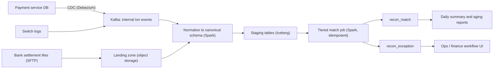
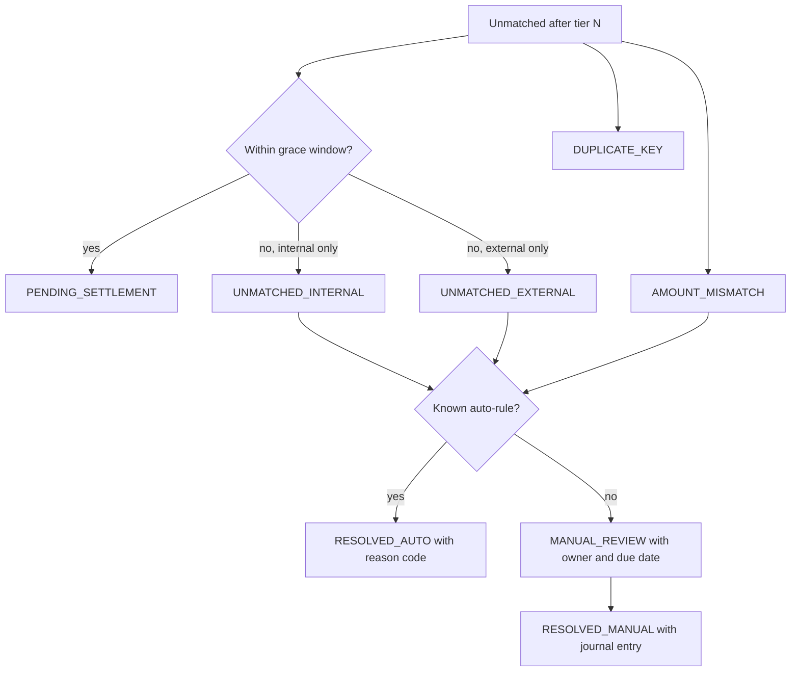

## 🎯 خلاصه

> **تطبیق پرداخت (payment reconciliation)** یعنی مقایسه‌ی آنچه **ما فکر می‌کنیم اتفاق افتاده** (دفتر کل خودمان) با آنچه **دنیای بیرون می‌گوید اتفاق افتاده** (سوئیچ، بانک، فایل تسویه)، پیدا کردن هر اختلاف، و ارجاع هر اختلاف به یک مسئول تا بسته شود.

- هر جابه‌جایی پول به یک **کلید تطبیق پایدار** (مثلاً RRN + STAN + terminal) و یک استراتژی **چندلایه** نیاز دارد، از دقیق تا تساهل‌آمیز.
- داده‌ی بیرونی **دیر و نامرتب** می‌رسد. از **تاریخ کسب‌وکار**، یک **بازه‌ی مهلت (grace)** و جاب‌های **قابل اجرای مجدد** استفاده کن؛ هرگز فرض نکن فایل روز D نیمه‌شب کامل است.
- تطبیق بخش ساده‌ی ماجراست. **جریان استثناها** (وضعیت‌ها، مسئول‌ها، SLA، قوانین خودکار و audit) تعیین می‌کند که سیستم برای مالی قابل استفاده باشد یا نه.
- پول را به صورت **عدد صحیح** در کوچک‌ترین واحد (ریال) ذخیره کن و هر جاب را **idempotent** بساز تا اجرای مجدد همان جواب را بدهد.

## 🌱 از ساده شروع کنیم (مبتدی)

> **💡 تشبیه:** فروشنده‌ای را تصور کن که هر فروش را در دفترچه‌اش می‌نویسد و آخر هفته دفترچه را با صورت‌حساب بانک مقایسه می‌کند. بعضی فروش‌ها در هر دو هستند، بعضی فقط در دفترچه‌اند (بانک هنوز ثبتشان نکرده)، و بعضی فقط در بانک‌اند (مشتری دو بار پرداخت کرده). تطبیق، همین مقایسه‌ی دقیق و فهرست سؤال‌هایی است که از آن بیرون می‌آید.

**مسئله.** یک شرکت پرداخت، پرداخت‌های کارتی پذیرنده‌ها (merchant) را پردازش می‌کند. هر پرداخت رکوردهایی در سیستم خودمان، در سوئیچ پرداخت (شبکه‌ی بین‌بانکی ملی) و در نهایت در فایل تسویه‌ی بانک می‌سازد. یک pipeline بساز که این منابع را هر روز تطبیق دهد و فهرست روشنی از استثناها به مالی بدهد.

**نیازمندی‌های عملکردی**

- دریافت تراکنش‌های داخلی (از سرویس پرداخت ما)، لاگ‌های سوئیچ و فایل‌های روزانه‌ی تسویه‌ی بانک‌ها.
- تطبیق هر تراکنش، با ثبت قانونی که باعث تطبیق شده.
- تبدیل هر رکورد تطبیق‌نشده یا ناهم‌خوان به یک استثنا با وضعیت، مسئول و موعد.
- پشتیبانی از برگشت (reversal)، بازپرداخت (refund) و بازپرداخت جزئی به عنوان رویدادهای جداگانه که خودشان هم باید تطبیق شوند.
- خلاصه‌ی روزانه برای مالی: جمع به تفکیک پذیرنده، نرخ تطبیق، استثناهای باز و سن آن‌ها.
- امکان تطبیق مجدد یک روز پس از رسیدن فایل دیرهنگام، بدون تکرار نتایج.

**نیازمندی‌های غیرعملکردی (فرض‌های ما)**

- مقیاس: **۵ میلیون تراکنش در روز**، که برای هر کدام تقریباً یک ردیف داخلی و یک ردیف بیرونی وجود دارد.
- تازگی: هدف **تطبیق روزانه** است. بررسی‌های درون‌روزی فقط برای هشدار خوب‌اند.
- صحت: هیچ پولی از دفاتر گم نشود. هر اختلافی حتی اگر خودکار اصلاح نشده، قابل مشاهده باشد.
- قابلیت ممیزی: هر تغییر وضعیت ثبت شود؛ چه کسی یا چه چیزی، چه زمانی و از کدام ورودی.
- نگهداری: ۷ سال سابقه‌ی تطبیق برای ممیزی مالی و مقرراتی.

## 🔧 واقعاً چطور کار می‌کند (متوسط)

### تخمین

- تراکنش‌ها: ۵٬۰۰۰٬۰۰۰ در روز. ردیف‌های بیرونی (تسویه + تأییدهای سوئیچ): حدود ۵٬۰۰۰٬۰۰۰ دیگر. ورودی کل: **۱۰٬۰۰۰٬۰۰۰ ردیف در روز**.
- حجم هر ردیف پس از نرمال‌سازی، حدود ۳۰۰ بایت. حجم خام: ۱۰ میلیون × ۳۰۰ بایت = **۳ گیگابایت در روز**.
- در سال: ۳ × ۳۶۵ ≈ **۱٫۱ ترابایت**. هفت سال: ۱٫۱ × ۷ ≈ **۷٫۷ ترابایت** پیش از replication و فشرده‌سازی.
- Shuffle در تطبیق روزانه: ۳ گیگابایت ÷ ۱۲۸ مگابایت برای هر پارتیشن ≈ ۲۴ پارتیشن. برای حاشیه‌ی اطمینان دو برابر کن: **۶۴ پارتیشن shuffle**.
- استثناها: فرض کن ۰٫۱٪ از ۵ میلیون، یعنی **۵٬۰۰۰ استثنا در روز**. اگر هر کدام ۲ دقیقه کار دستی بخواهد، می‌شود ۱۰٬۰۰۰ دقیقه ≈ **۱۶۷ ساعت در روز**، که هیچ تیمی تحمل نمی‌کند.
- قوانین خودکار باید سهم کار دستی را به ۰٫۰۱٪ برسانند: ۵۰۰ استثنا × ۲ دقیقه = ۱٬۰۰۰ دقیقه ≈ **۱۷ ساعت در روز**، یعنی حدود ۲ تا ۳ تحلیلگر.

درس عددها: جاب تطبیق ارزان است. **حجم استثناها** است که تیم و طراحی را تعیین می‌کند.

### مدل داده

بعد از نرمال‌سازی، برای هر منبع یک شکل متعارف داشته باش و نام فیلدهای خام منبع را در مدل اصلی نگه ندار:

| جدول | کلید | ستون‌های مهم |
|---|---|---|
| `txn_internal` | `txn_id` | `rrn`، `stan`، `terminal_id`، `merchant_id`، `amount_rial` (BIGINT)، `txn_type`، `txn_time`، `business_date`، `source_run_id` |
| `txn_external` | `ext_id` (شماره‌ی ردیف فایل) | `rrn`، `stan`، `terminal_id`، `amount_rial`، `settle_date`، `file_id`، `file_received_at` |
| `recon_match` | `(txn_id, business_date)` | `ext_id`، `match_rule`، `status`، `run_id`، `updated_at` |
| `recon_exception` | `exception_id` | `txn_id` یا `ext_id`، `reason`، `status`، `owner`، `due_at`، `resolution`، `opened_at` |
| `recon_audit` | فقط append | `entity_id`، `from_status`، `to_status`، `actor`، `run_id`، `at` |

دو قانون از فهرست ستون‌ها مهم‌ترند:

- **مبلغ‌ها عدد صحیح‌اند** و بر حسب ریال. هرگز برای پول از اعشار شناور استفاده نکن. تراکنش‌های ایرانی معمولاً زیرواحد ندارند، پس `BIGINT` یا `DECIMAL(18,0)` کافی است.
- **شماره‌ی ردیف فایل منبع را به عنوان کلید ردیابی (lineage) نگه دار.** هر سؤال مالی («این عدد از کجا آمده؟») باید به یک فایل و یک خط برسد.

### طراحی سطح بالا



سمت داخلی از CDC یا الگوی outbox می‌آید، پس reconciler هرگز مستقیم به دیتابیس تولیدی پرداخت کوئری نمی‌زند. سمت بیرونی مبتنی بر فایل است، پس landing zone هر فایل را همان‌طور که رسیده نگه می‌دارد، با checksum و زمان دریافت.

### کلیدهای تطبیق و لایه‌ها

**کلید تطبیق (matching key)** مجموعه‌ی فیلدهایی است که همان پرداخت واقعی را در دو طرف شناسایی می‌کند. در سیستم‌های کارتی معمولاً از شماره‌ی مرجع بازیابی (RRN، مرجع سمت بانک)، شماره‌ی ردیابی سیستم (STAN)، شناسه‌ی terminal و مبلغ استفاده می‌شود. نام دقیق فیلدها به سوئیچ و بانک بستگی دارد، پس فهرست بالا مثال است.

تطبیق را لایه‌ای انجام بده، از سخت‌گیرانه به تساهل‌آمیز. هر لایه فقط آنچه لایه‌ی قبلی تطبیق نداده را می‌بیند:

```sql
-- Tier 1: exact composite key
CREATE OR REPLACE TEMP VIEW tier1 AS
SELECT i.txn_id,
       e.ext_id,
       i.amount_rial AS int_amount,
       e.amount_rial AS ext_amount,
       'T1_RRN_STAN_TERM' AS match_rule
FROM txn_internal i
JOIN txn_external e
  ON i.rrn = e.rrn
 AND i.stan = e.stan
 AND i.terminal_id = e.terminal_id
WHERE i.business_date = DATE '2026-10-12';

-- Tier 2: same RRN and amount, but the external row has a different terminal string
-- (for example a normalization difference). Only rows not matched in tier 1 are considered.
```

قوانینی که باید اعمال شوند:

- **کلیدهای تکراری در هر طرف یک استثنا هستند، نه یک join.** اگر دو ردیف بیرونی یک کلید داشته باشند، join ساده دو تطبیق می‌سازد و مبلغ را دو برابر می‌کند. اول تعداد کلیدها را بشمار و هر کلید با تعداد بیشتر از ۱ را به `DUPLICATE` بفرست.
- **عدم‌تطابق مبلغ یک وضعیت است، نه تطبیق بی‌صدا.** با کلید join کن، بعد مبلغ‌ها را مقایسه کن. عدم‌تطابق به `AMOUNT_MISMATCH` تبدیل می‌شود و هر دو مقدار ذخیره می‌شوند.
- **تساهل یک سیاست نوشته‌شده است.** برای ریال گرد کردن نداریم، پس تساهل معمولاً صفر است. اختلاف کارمزد شناخته‌شده باید یک قانون صریح با کد دلیل باشد، نه یک قاعده‌ی کلی مثل «تا ۱٪ مجاز» که خطاهای واقعی را پنهان می‌کند.

### رکوردهای دیرهنگام و تاریخ کسب‌وکار

داده‌ی بیرونی دیر می‌رسد. فایل تسویه‌ی تراکنش‌های روز D ممکن است صبح D+1 برسد، یک اصلاحیه روز D+3، و تراکنشی ساعت ۲۳:۵۹:۵۹ فردای آن روز تسویه شود. بنابراین:

- با **تاریخ کسب‌وکار** (روزی که پرداخت اتفاق افتاده) تطبیق کن، نه تاریخ رسیدن فایل.
- یک **بازه‌ی مهلت (grace)** نگه دار، مثلاً ۳ روز. ردیف بیرونی‌ای که در این بازه نیست، `PENDING_SETTLEMENT` است، نه شکست.
- جاب را **قابل اجرای مجدد** کن. وقتی فایل دیرهنگام می‌رسد، تطبیق روزهای تأثیرپذیر را دوباره اجرا کن. از `MERGE` استفاده کن تا ردیفی که قبلاً تطبیق شده فقط وقتی به‌روز شود که وضعیتش واقعاً تغییر کرده، و هر تغییر یک ردیف audit بنویسد:

```sql
MERGE INTO recon_match t
USING staged_matches s
  ON t.txn_id = s.txn_id AND t.business_date = s.business_date
WHEN MATCHED AND t.status <> s.status THEN
  UPDATE SET status = s.status, match_rule = s.match_rule,
             run_id = s.run_id, updated_at = current_timestamp()
WHEN NOT MATCHED THEN
  INSERT (txn_id, business_date, ext_id, match_rule, status, run_id, updated_at)
  VALUES (s.txn_id, s.business_date, s.ext_id, s.match_rule, s.status, s.run_id, current_timestamp());
```

چون دستور با کلید و شرط نوشته شده، اجرای دوباره با همان ورودی هیچ تغییری نمی‌سازد. این همان idempotency‌ای است که برای یک مرحله‌ی Spark که دوباره اجرا می‌شود لازم داری.

### جریان استثناها

هر رکوردی که به‌طور تمیز تطبیق نشده، به یک استثنا با وضعیت ختم می‌شود. وضعیت‌ها باید کم باشند و هر کدام یک معنی داشته باشد:



قواعد عملیاتی:

- هر استثنا یک **تیم مسئول**، یک **موعد** و فیلد **سن (aging)** دارد. داشبورد باید تعداد و سن را به تفکیک وضعیت نشان دهد، نه فقط جمع کل را.
- قوانین خودکار **داده** هستند، نه شاخه‌های کد: جدولی از قوانین با کد دلیل، نسخه و تأییدکننده. هر حل‌شدن خودکار شناسه‌ی قانون را نگه می‌دارد.
- هر حلی که پول را جابه‌جا می‌کند یک **ثبت دفتری (journal entry)** می‌سازد، یعنی یک جفت بدهکار و بستانکار متوازن، تا دفاتر متوازن بمانند. تطبیق هرگز موجودی را مستقیم ویرایش نمی‌کند.
- در هر اجرا **جمع‌های کنترلی (control totals)** را بررسی کن: تعداد ردیف و جمع مبلغ به تفکیک منبع و فایل. اگر control total فایل با ردیف‌های خودش نمی‌خواند، کل فایل رد می‌شود، نه اینکه بخشی از آن بار شود.

## 🧠 عمق و trade-offها (سنیور)

- **Watermark برای batch.** «watermark» این‌جا همان مرز تاریخ کسب‌وکار به‌علاوه‌ی بازه‌ی مهلت است. صریح باش: بعد از D+3 سیستم دیگر صبر نمی‌کند و استثنا باز می‌کند. هر چیزی دیرتر یک اصلاح دیرهنگام است که یک روز بسته‌شده را دوباره باز می‌کند، و مالی باید این بازگشایی را تأیید کند.
- **اجرای مجدد در برابر بازنویسی تاریخی.** اجرای دوباره‌ی یک روز پس از فایل دیرهنگام نتایج تطبیق آن روز را عوض می‌کند. تصمیم بگیر که گزارش روزانه **بازنویسی شود** (اعداد به‌روز با change log) یا **منجمد بماند** (اولین بستن نهایی است و تعدیلات به‌صورت ثبت روز بعد می‌آیند). اغلب تیم‌های مالی بستن منجمد به‌علاوه‌ی تعدیل صریح را ترجیح می‌دهند. بگو کدام را انتخاب کرده‌ای.
- **نرخ تطبیق به‌عنوان سیگنال سلامت.** نرخ را به‌تفکیک منبع، پذیرنده و فایل دنبال کن. افت ناگهانی معمولاً یعنی یک قاعده‌ی نرمال‌سازی خراب یا فرمت تغییرکرده‌ی بانک است، نه تقلب. هشدار را روی **نرخ** بگذار، نه فقط روی تعداد.
- **تغییر اسکیمای بانک‌ها.** فرمت فایل بانک‌ها بدون اطلاع عوض می‌شود. هدر و چیدمان رکوردها را در landing zone اعتبارسنجی کن، فایل خام را نگه دار و نسخه‌ی parser را ثبت کن. تغییر parser باید یک تغییر بازبینی‌شده و قابل اجرای مجدد باشد، ببین [[schema-evolution]].
- **برای تطبیق لازم نیست exactly-once باشی، اما ردپای ممیزی لازم است.** جاب می‌تواند at-least-once باشد اگر نوشتن‌هایش کلیددار و idempotent باشند. آنچه باید دقیق باشد این است که هر تغییر وضعیت دقیقاً یک بار ثبت شود. ببین [[idempotency]] و [[exactly-once]].
- **پول روی Spark.** فقط محاسبه‌ی عدد صحیح. وقتی چند پذیرنده‌ی بزرگ کلیدها را غالب کرده‌اند، skew محتمل است؛ آن‌ها را جدا کن یا کلیدشان را salt کن (ببین [[data-skew]]).
- **کی این طور نسازی.** اگر حجم چند صد ردیف در روز است، یک اسکریپت SQL و یک control total در صفحه‌گسترده ممکن است نسخه‌ی اول درست باشد. گردش‌کار را وقتی بساز که استثناها به مسئول و ردپای ممیزی نیاز دارند، نه زودتر.

### انتظارات بر اساس سطح

- **متوسط:** منابع داخلی و بیرونی را توضیح می‌دهد، یک کلید تطبیق تعریف می‌کند، join با مدیریت تکرار می‌نویسد و وضعیت‌های استثنا را نام می‌برد. می‌داند چرا مبلغ‌ها عدد صحیح‌اند.
- **سنیور:** بازه‌ی مهلت و منطق تاریخ کسب‌وکار را طراحی می‌کند، جاب را با `MERGE` و ردیف‌های audit قابل اجرای مجدد می‌کند، حجم کار استثناها را با عدد می‌سنجد و تصمیم منجمد در برابر بازنویسی را بیان می‌کند.
- **Staff:** مالکیت بین مهندسی و مالی، قرارداد control total و رد فایل با هر بانک، نیازهای نگهداری و ممیزی مقرراتی، و مسیر مهاجرت از فرآیند صفحه‌گسترده را تعریف می‌کند. درباره‌ی چیزهایی که تیم خودکار نمی‌کند هم حرف می‌زند.

### پرسش‌های ادامه‌ای که مصاحبه‌گر می‌پرسد

1. **«سوئیچ یک تأیید را دو بار می‌فرستد. چه می‌شود؟»** قانون کلید تکراری آن را می‌گیرد: دو ردیف بیرونی با یک کلید، `DUPLICATE_KEY` می‌شوند و فقط یکی در جمع‌ها حساب می‌شود. بپرس که نسخه‌ی دوم تلاش مجدد است یا پرداخت واقعی دوم.
2. **«چطور درون‌روزی تطبیق می‌کنی؟»** تطبیق Tier 1 را روی یک پنجره‌ی کوتاه با همان کلیدها اجرا کن، ولی وضعیت را تا پایان بازه‌ی مهلت `PENDING_SETTLEMENT` نگه دار. نتایج درون‌روزی برای هشدار است، نه برای دفاتر.
3. **«بازپرداخت سه روز بعد از خرید می‌رسد. چطور تطبیقش می‌کنی؟»** بازپرداخت‌ها رویدادهای جدا با کلید خودشان هستند (و پیوند به شناسه‌ی تراکنش اصلی). در لایه‌ی جداگانه تطبیقشان کن و هرگز بی‌صدا با خرید تهاتر نکن.
4. **«با بازپرداخت جزئی چه می‌کنی؟»** برای هر رویداد بازپرداخت یک ردیف نگه دار، هر کدام را با مبلغ اصلی تطبیق بده و مانده‌ی هر تراکنش اصلی را دنبال کن.

## 🧪 امتحان کن

این جدول‌های کوچک را در PostgreSQL نسخه‌ی ۱۳ یا بالاتر، یا Spark SQL اجرا کن. جدول داخلی ۴ ردیف دارد و جدول بیرونی ۳ ردیف.

```sql
CREATE TABLE txn_internal (txn_id int, rrn text, stan text, amount_rial bigint);
INSERT INTO txn_internal VALUES
 (1,'R001','S01',1500000),(2,'R002','S02',250000),
 (3,'R003','S03',90000),(4,'R004','S04',400000);

CREATE TABLE txn_external (ext_id int, rrn text, stan text, amount_rial bigint);
INSERT INTO txn_external VALUES
 (101,'R001','S01',1500000),(102,'R002','S02',255000),(103,'R003','S03',90000);
```

۱. یک کوئری بنویس که هر تراکنش داخلی را با تطبیقش از سمت بیرونی روی `(rrn, stan)` برگرداند و ستون `status` با مقادیر `MATCHED`، `AMOUNT_MISMATCH` یا `UNMATCHED_INTERNAL` داشته باشد.
۲. یک وضعیت سوم برای حالتی اضافه کن که سمت بیرونی کلید تکراری دارد. توضیح بده چرا باید تکرارها را قبل از join بررسی کنی.
۳. مجموع اختلاف ریالی دو منبع را برای ردیف‌های تطبیق‌شده حساب کن و توضیح بده چرا این عدد control total مفیدی است.

<details><summary>راه‌حل‌ها را نشان بده</summary>

**۱.**
```sql
SELECT i.txn_id,
       CASE
         WHEN e.ext_id IS NULL THEN 'UNMATCHED_INTERNAL'
         WHEN e.amount_rial <> i.amount_rial THEN 'AMOUNT_MISMATCH'
         ELSE 'MATCHED'
       END AS status
FROM txn_internal i
LEFT JOIN txn_external e
  ON e.rrn = i.rrn AND e.stan = i.stan
ORDER BY i.txn_id;
```
نتیجه: تراکنش ۱ `MATCHED`، تراکنش ۲ `AMOUNT_MISMATCH` (250000 در برابر 255000)، تراکنش ۳ `MATCHED`، تراکنش ۴ `UNMATCHED_INTERNAL`.

**۲.** اول کلیدها را بشمار:
```sql
WITH dup AS (
  SELECT rrn, stan FROM txn_external GROUP BY rrn, stan HAVING COUNT(*) > 1
)
SELECT i.txn_id,
       CASE
         WHEN EXISTS (SELECT 1 FROM dup d WHERE d.rrn = i.rrn AND d.stan = i.stan)
           THEN 'DUPLICATE_KEY'
         WHEN e.ext_id IS NULL THEN 'UNMATCHED_INTERNAL'
         WHEN e.amount_rial <> i.amount_rial THEN 'AMOUNT_MISMATCH'
         ELSE 'MATCHED'
       END AS status
FROM txn_internal i
LEFT JOIN txn_external e ON e.rrn = i.rrn AND e.stan = i.stan;
```
با داده‌ی نمونه هیچ کلیدی تکراری نیست، پس نتیجه همان سؤال ۱ است. یک ردیف دوم برای `R001`/`S01` به جدول بیرونی اضافه کن تا `DUPLICATE_KEY` ظاهر شود. بدون این بررسی، یک کلید با دو ردیف بیرونی دو ردیف join‌شده می‌سازد و همان پرداخت را دو بار می‌شمارد، که هم تطبیق‌ها و هم جمع‌ها را بالا می‌برد.

**۳.**
```sql
SELECT SUM(i.amount_rial - e.amount_rial) AS matched_diff_rial
FROM txn_internal i
JOIN txn_external e ON e.rrn = i.rrn AND e.stan = i.stan;
```
نتیجه: `1500000-1500000 + 250000-255000 + 90000-90000 = -5000`. یک control total غیرصفر حتی وقتی هر ردیف استثنای توضیح‌پذیری است، هشدار است. مالی این عدد را با خلاصه‌ی خود بانک مقایسه می‌کند.

</details>

## 💬 گوشه‌ی مصاحبه

**سؤال: «یک pipeline تطبیق پرداخت طراحی کن.»**

> **🎤 این را در مصاحبه بگو:** «من منابع داخلی، لاگ‌های سوئیچ و فایل‌های تسویه‌ی بانک را بر اساس تاریخ کسب‌وکار تطبیق می‌دهم، نه تاریخ رسیدن. تطبیق لایه‌ای است: اول یک کلید ترکیبی دقیق، بعد قوانین تساهل‌آمیز، و کلیدهای تکراری استثنا هستند، نه join. همه‌چیز یک جاب Spark idempotent است که با MERGE می‌نویسد و برای هر تغییر وضعیت یک ردیف audit دارد. موارد تطبیق‌نشده به استثنا تبدیل می‌شوند با وضعیت، مسئول، موعد و قوانین خودکار کددار، و هر تغییر پولی یک ثبت دفتری است. معیارهای موفقیت نرخ تطبیق، اختلاف control total و سن استثناهاست.»

**پاسخ نمونه به تفکیک سطح:** مهندس متوسط منابع، کلید join و جدول استثنا را توضیح می‌دهد. سنیور بازه‌ی مهلت، جاب قابل اجرای مجدد و محاسبه‌ی حجم کار استثناها را اضافه می‌کند. Staff هم قرارداد فایل با هر بانک، سیاست منجمد در برابر بازنویسی و مرز بین مهندسی و مالی را تعریف می‌کند.

## ⚠️ اشتباهات رایج

> **⚠️ Watch out:** join روی کلیدی که در یک طرف یکتا نیست. ردیف تکراری مبلغ را دو برابر می‌کند و تطبیق همچنان «موفق» به نظر می‌رسد. قبل از join یکتایی کلید را بررسی کن.

> **⚠️ Watch out:** «هنوز در فایل نیست» را شکست فرض کردن. داده‌ی بیرونی به‌طور طبیعی دیر است. از بازه‌ی مهلت و وضعیت `PENDING_SETTLEMENT` استفاده کن.

- ذخیره‌ی پول به‌صورت `FLOAT` یا `DOUBLE`. از ریال عدد صحیح استفاده کن.
- تطبیق بر اساس تاریخ کسب‌وکار در یک منبع و تاریخ فایل در منبع دیگر.
- یک تساهل واحد مثل «تا ۱٪» که خطاهای واقعی را پنهان می‌کند. از قوانین صریح و کددار استفاده کن.
- ویرایش مستقیم موجودی به جای نوشتن ثبت دفتری.
- بازنویسی گزارش روزانه بدون change log، طوری که مالی نتواند توضیح دهد چه چیزی جابه‌جا شد.
- نگه داشتن فقط آخرین وضعیت و از دست دادن ردپای اینکه چه کسی و چرا تغییر داد.
- ساختن رابط کاربری استثناها قبل از اندازه‌گیری حجم استثناها.

## ✅ خودت را بسنج

۱. کدام نوع داده باید مبلغ تراکنش بر حسب ریال را نگه دارد؟
   - A) `FLOAT`
   - B) `DOUBLE`
   - C) `BIGINT` (یا `DECIMAL` با scale صفر)
   - D) `STRING`

<details><summary>پاسخ</summary>

**C** — نوع‌های صحیح دقیق‌اند. اعداد اعشاری شناور همه‌ی مقادیر اعشاری را نمی‌توانند نمایش دهند، پس جمع‌ها دچار انحراف می‌شوند. ریال در استفاده‌ی عادی زیرواحد ندارد، پس `BIGINT` مناسب است.

</details>

۲. فایل تسویه‌ی ۲۰۲۶-۱۰-۱۲ در ۲۰۲۶-۱۰-۱۴ می‌رسد. کدام انتخاب طراحی آن را درست مدیریت می‌کند؟
   - A) فایل را چون دیر رسیده رد کن
   - B) با تاریخ رسیدن فایل تطبیق بده تا روز بسته شود
   - C) با تاریخ کسب‌وکار تطبیق بده، ردیف‌های داخل بازه‌ی مهلت را `PENDING_SETTLEMENT` نگه دار و روز تأثیرپذیر را با `MERGE` idempotent دوباره اجرا کن
   - D) تطبیق‌های دیروز را پاک کن و از صفر شروع کن

<details><summary>پاسخ</summary>

**C** — فایل‌های دیرهنگام عادی‌اند. تاریخ کسب‌وکار منطق را پایدار نگه می‌دارد، بازه‌ی مهلت استثناهای کاذب را جلوگیری می‌کند، و اجرای مجدد idempotent با ردیف‌های audit فقط تغییرات واقعی را به‌روز می‌کند.

</details>

۳. دو ردیف بیرونی `(rrn, stan)` یکسان دارند و join ساده برای یک تراکنش داخلی دو تطبیق برمی‌گرداند. چه باید بشود؟
   - A) اولین ردیف را نگه دار و دومی را بدون ثبت کنار بگذار
   - B) دو مبلغ بیرونی را جمع کن و مجموع را تطبیق بده
   - C) کلید را به عنوان استثنای `DUPLICATE_KEY` با ارجاع به هر دو ردیف منبع علامت بزن
   - D) دوباره فقط روی `terminal_id` join کن

<details><summary>پاسخ</summary>

**C** — بدون بررسی نمی‌دانی کدام ردیف واقعی است، پس کلید استثنا می‌شود و هر دو ردیف به آن وصل می‌شوند. انتخاب بی‌صدای یکی یا جمع کردن، یک شارژ دوباره‌ی احتمالی را پنهان می‌کند.

</details>

۴. **(سنیور)** تعداد استثناها ۰٫۱٪ از ۵ میلیون تراکنش در روز است و هر کدام ۲ دقیقه وقت می‌گیرد. چرا این یک مشکل طراحی است و چه چیزی را عوض می‌کنی؟
   - A) هیچ؛ ۰٫۱٪ نرخ خطای عادی است
   - B) حدود ۱۶۷ ساعت کار دستی در روز است، پس طراحی باید قوانین خودکار کددار اضافه کند و سهم کار دستی را کم کند، با قوانینی که نسخه‌بندی و تأیید شده‌اند
   - C) یک topic بزرگ‌تر Kafka بساز تا استثناها را جذب کند
   - D) گردش‌کار استثناها را خاموش کن و فقط جمع‌ها را گزارش بده

<details><summary>پاسخ</summary>

**B** — ۵٬۰۰۰ × ۲ دقیقه = ۱۰٬۰۰۰ دقیقه ≈ ۱۶۷ ساعت، که قابل تأمین نیست. راه‌حل این است که الگوهای تکراری به قوانین خودکار با کد دلیل تبدیل شوند، تأیید و نسخه‌بندی شوند، و سهم باقی‌مانده‌ی کار دستی اندازه‌گیری شود.

</details>

۵. **(سنیور)** مالی می‌پرسد چرا گزارش دیروزِ بسته‌شده پس از یک فایل دیرهنگام عوض شده. سیاست را چطور تعیین می‌کنی و trade-off چیست؟
   - A) هرگز گزارش بسته‌شده را عوض نکن؛ فایل‌های دیرهنگام را نادیده بگیر
   - B) بین بستن منجمد (تعدیلات به‌صورت ثبت روز بعد) و گزارش بازنویسی‌شده (اعداد با change log عوض می‌شوند) انتخاب کن؛ منجمد تاریخچه را پایدار نگه می‌دارد، بازنویسی زودتر اعداد دقیق می‌دهد اما ردپای ممیزی واضح لازم دارد
   - C) همیشه بازنویسی کن، چون اعداد باید دقیق باشند
   - D) فقط جاب Spark را دوباره اجرا کن بدون اینکه به مالی بگویی

<details><summary>پاسخ</summary>

**B** — این یک تصمیم سیاستی با trade-off واقعی است. اغلب تیم‌های مالی بستن منجمد را ترجیح می‌دهند، اما انتخاب باید صریح، مستند و در گزارش‌ها قابل مشاهده باشد.

</details>

## 🗂️ فلش‌کارت

| Front | Back |
|---|---|
| چرا مبلغ به‌صورت عدد صحیح ریالی ذخیره می‌شود؟ | محاسبه‌ی دقیق؛ اعداد شناور هنگام جمع دچار انحراف می‌شوند |
| با کدام تاریخ تطبیق می‌کنیم؟ | تاریخ کسب‌وکار (زمان وقوع پرداخت)، نه تاریخ رسیدن فایل |
| بازه‌ی مهلت (grace window) چیست؟ | مدتی که در آن ردیف بیرونی گمشده `PENDING_SETTLEMENT` است، نه شکست |
| چرا قبل از join کلیدهای تکراری را بررسی می‌کنیم؟ | کلید تکراری نتیجه‌ی join را و در نتیجه مبلغ را دو برابر می‌کند |
| control total چیست؟ | تعداد ردیف و جمع مبلغ به تفکیک منبع و فایل که بین سیستم‌ها مقایسه می‌شود |
| چرا `MERGE` اینجا idempotent است؟ | ورودی یکسان در اجرای دوم تغییری نمی‌سازد؛ فقط تغییر واقعی وضعیت نوشته می‌شود |
| بستن منجمد در برابر گزارش بازنویسی‌شده | منجمد: تعدیل به‌صورت ثبت جدید. بازنویسی: اعداد با change log عوض می‌شوند |
| چرا ثبت دفتری و نه ویرایش موجودی؟ | هر تغییر هر دو طرف را متوازن و قابل ردیابی نگه می‌دارد |

## 🔗 ادامه

- **pattern-reconciliation** الگوی کلی پشت این مسئله را با مثال‌های دیگر توضیح می‌دهد.
- **dedup-idempotent-loads** و **delivery-semantics** واژگان اجرای مجدد و تکرار را می‌دهند.
- **data-quality** کنترل‌های control total و بررسی‌هایی را پوشش می‌دهد که پیش از نوشتن هر جاب می‌توانی اجرا کنی.
- **dlq-bad-records** نشان می‌دهد چطور ردیف‌های ناموفق در parsing را قرنطینه کنی، به‌جای اینکه بی‌صدا دورشان بریزی.
- **design-ecommerce-dwh** یک مسئله‌ی مدل‌سازی مرتبط با fact و dimension را نشان می‌دهد.
- پیش از طراحی کلیدها، مشخصات فایل بانک و مستندات سوئیچ خودت را بخوان. طراحی تطبیق به فیلدهای واقعی بستگی دارد و نام‌های این درس مثال‌اند.
