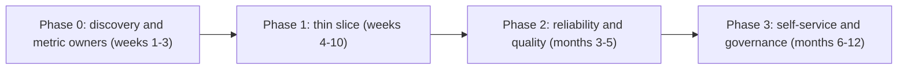
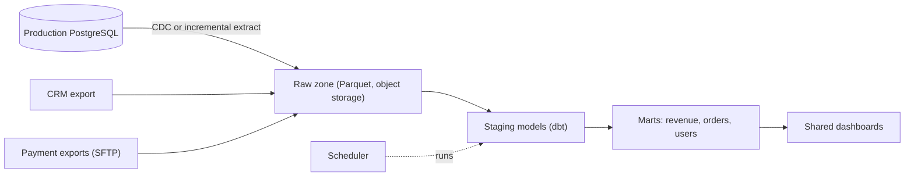

## 🎯 خلاصه

> ساختن پلتفرم داده برای شرکتی که **هیچ پلتفرمی ندارد**، بیشتر یک مسئله‌ی ترتیب‌دهی است. اول **چند منبع و پرسشی را انتخاب کن که ارزش می‌سازند**، در چند هفته یک **برش کاری نازک** تحویل بده، و بعد قابلیت اطمینان، حکمرانی و self-service را در **فازهای** جدا اضافه کن که هر کدام با یک درد واقعی توجیه شوند.

- با **پرسش‌های کسب‌وکار و مالکان** شروع کن، نه با فهرست ابزارها. ده داشبورد که مالی به آن‌ها اعتماد دارد، از یک lakehouse کامل که کسی استفاده نمی‌کند بهتر است.
- برای هر لایه (ingestion، storage، orchestration، BI، quality) جداگانه تصمیم بگیر **بسازی یا بخری**، با توجه به محدودیت‌ها: اندازه‌ی تیم، مهارت‌ها و اینکه بسیاری از محیط‌ها on-prem هستند.
- **تیم** گلوگاه واقعی است. استخدام و مالکیت را همراه با معماری برنامه‌ریزی کن و بگو بعد از راه‌اندازی چه کسی پلتفرم را اجرا می‌کند.
- هر فاز یک معیار خروج قابل اندازه‌گیری دارد، مثلاً «سه منبع هر روز بار می‌شوند با ۹۹٪ به‌موقع بودن و یک مالک مستند برای هر منبع».

## 🌱 از ساده شروع کنیم (مبتدی)

> **💡 تشبیه:** یک رستوران جدید در روز اول آشپزخانه‌ی صنعتی کامل نصب نمی‌کند. اول یک منوی کوتاه را خوب سرو می‌کند، با آشپزخانه‌ی کوچک، و بعد که منو بزرگ شد ایستگاه اضافه می‌کند. نصب همه‌چیز یک‌جا یعنی آشپزخانه‌ای که هیچ‌کس بلد نیست اداره‌اش کند.

**مسئله.** یک شرکت متوسط (یک بازار آنلاین با ۳۰۰ کارمند) داده‌اش را در یک دیتابیس PostgreSQL تولیدی، یک CRM، صفحه‌گسترده‌ها و چند خروجی از یک ارائه‌دهنده‌ی پرداخت دارد. تحلیلگرها داده را دستی کپی می‌کنند. مدیریت می‌پرسد «چرا عدد درآمد در گزارش مالی با داشبورد فروش فرق دارد؟» پلتفرم داده را از صفر طراحی کن و بگو اول چه چیزی می‌سازی.

**نیازمندی‌های عملکردی (دو سال اول)**

- بارگذاری منابع مهم کسب‌وکار در یک جای واحد، طبق برنامه، با تاریخچه.
- یک **تعریف مشترک** برای متریک‌های کلیدی (درآمد، کاربر فعال، سفارش).
- راهی برای تحلیلگران تا داده را کوئری بزنند و داشبورد بسازند، بدون اینکه از مهندس بخواهند فایل کپی کند.
- امکان افزودن منبع جدید در چند روز، نه چند ماه.

**نیازمندی‌های غیرعملکردی (فرض‌های ما)**

- حجم داده‌ی امروز: **حدود ۴۰۰ گیگابایت** در دیتابیس تولیدی، با رشد تقریبی **۲۰ گیگابایت در ماه**. CRM و صفحه‌گسترده‌ها کوچک‌اند.
- تازگی: برای مالی و فروش **روزانه** کافی است. دو منبع برای عملیات به **ساعتی** نیاز دارند.
- تیم: **۳ مهندس داده**، **۱ مهندس تحلیل (analytics engineer)** و بدون تیم اختصاصی پلتفرم یا SRE. دو مهندس backend می‌توانند پاره‌وقت کمک کنند.
- محدودیت‌ها: الزامات نگهداری داده و محدودیت‌های معمول محیط on-prem، بدون کلاد عمومی برای داده‌ی تولیدی. بودجه‌ی لایسنس محدود است، پس ابزار متن‌باز یا ابزارهای موجود ترجیح دارند.
- معیار موفقیت: تا ماه ششم، دو عدد درآمد از یک مدل بیایند و بار روزانه حداقل در ۹۸٪ روزها موفق باشد.

## 🔧 واقعاً چطور کار می‌کند (متوسط)

### تخمین

- تاریخچه‌ی اولیه: ۴۰۰ گیگابایت در دیتابیس تولیدی. با فرمت ستونی و فشرده‌سازی حدود ۴ به ۱، تقریباً **۱۰۰ گیگابایت Parquet**. یک snapshot کامل روزانه برای سه سال می‌شود ۱۰۰ × ۱٬۰۹۵ ≈ ۱۱۰ ترابایت، و به همین دلیل طراحی از **بار افزایشی و change capture** استفاده می‌کند، نه کپی کامل روزانه.
- رشد ماهانه: ۲۰ گیگابایت خام ÷ ۴ ≈ **۵ گیگابایت در ماه** داده‌ی ستونی جدید.
- حجم تغییرات روزانه: فرض کن ۲٪ ردیف‌ها در روز تغییر می‌کنند. برای ۴۰۰ گیگابایت، ۲٪ ≈ **۸ گیگابایت خام در روز** یا حدود ۲ گیگابایت فشرده. این همان حجمی است که pipeline افزایشی جابه‌جا می‌کند.
- منبع عملیاتی ساعتی: فرض کن ۵۰ میلیون رویداد در ماه با ۱ کیلوبایت هرکدام = ۵۰ گیگابایت در ماه. یعنی حدود **۱٫۷ گیگابایت در روز**، که برای یک worker ingestion کافی است.
- ظرفیت سال اول: ۱۰۰ گیگابایت تاریخچه + ۶۰ گیگابایت رشد + داده‌ی عملیاتی ≈ **۳۰۰ گیگابایت** فشرده. یک bucket ذخیره‌سازی مناسب و یک خوشه‌ی warehouse کافی است. برای پتابایت طراحی نکن.

عددها نشان می‌دهند پلتفرم کوچک است. بخش سخت ترتیب‌دهی، مالکیت و تعریف متریک‌هاست.

### نقشه‌ی راه فازی



**فاز ۰ — کشف (هفته‌ی ۱ تا ۳).** با مالکان ده پرسش برتر مصاحبه کن. برای هر متریک، تعریف، جدول منبع و فردی را بنویس که آن را تأیید می‌کند. این کار ارزان است و از پرهزینه‌ترین اشتباه جلوگیری می‌کند: ساختن pipeline برای عددهایی که کسی رویشان توافق ندارد.

**فاز ۱ — برش نازک (هفته‌ی ۴ تا ۱۰).** سه منبع (دیتابیس تولیدی، CRM، خروجی پرداخت) را روزانه در یک schema واحد در warehouse بار کن، با یک scheduler ساده. یک مدل درآمد و یک داشبورد که مالی استفاده می‌کند بساز. برای موارد نادر، مراحل دستی را بپذیر، اما ثبتشان کن.

**فاز ۲ — قابلیت اطمینان (ماه ۳ تا ۵).** بارگذاری افزایشی، ابزار backfill، بررسی تازگی و تعداد ردیف، هشدار و runbook برای خرابی‌ها اضافه کن. منبع ساعتی عملیاتی را فقط در صورتی به streaming یا micro-batch ببر که کسب‌وکار هزینه‌اش را بپردازد.

**فاز ۳ — self-service (ماه ۶ تا ۱۲).** کاتالوگ، مدل‌های مستند، کنترل دسترسی، فرآیند افزودن منبع و آموزش تحلیلگران را اضافه کن. لایه‌ی semantic را فقط وقتی در نظر بگیر که تعریف متریک‌ها بین ابزارها واگرا شده باشد.

هر فاز یک **معیار خروج** قابل اندازه‌گیری دارد. «ما یک پلتفرم داریم» معیار نیست. «سه منبع هر روز بار می‌شوند، برای ۹۸٪ روزها به‌موقع، و برای هر منبع مالک مشخص است» معیار است.

### ساختن یا خریدن، لایه به لایه

برای هر لایه جداگانه تصمیم بگیر. اغلب تیم‌ها لایه‌هایی را می‌خرند که تمایز کمی دارند و بخش‌هایی را می‌سازند که قوانین کسب‌وکار را کدگذاری می‌کنند.

| لایه | انتخاب معمول در تیم کوچک | چرا |
|---|---|---|
| ingestion از دیتابیس‌ها | CDC مدیریت‌شده یا extractor دسته‌ای (مثلاً Debezium با Kafka Connect، یا یک connector تجاری) | نوشتن CDC با دست تله است. ابزار موجود را استفاده کن و پیکربندی‌اش را خودت نگه دار. |
| ذخیره‌سازی | object storage با Parquet، به‌علاوه یک موتور warehouse (ClickHouse، StarRocks، یا Postgres در ماه‌های اول) | ذخیره‌سازی ارزان است؛ موتور warehouse چیزی است که تحلیلگرها لمس می‌کنند. |
| orchestration | Airflow یا یک scheduler ساده‌تر | ابزاری را انتخاب کن که تیمت بتواند on-prem اجرا و ساعت ۲ صبح دیباگ کند. |
| transformation | dbt (مدل‌های SQL با تست و مستندات) | تعریف‌های مشترک در SQL نسخه‌بندی‌شده زندگی می‌کنند. |
| quality | تست در ابزار transformation، به‌علاوه بررسی تعداد ردیف و تازگی | با بررسی‌هایی شروع کن که خرابی‌های پرهزینه را می‌گیرند. |
| BI | یک ابزار داشبورد که شرکت از قبل لایسنس دارد | تحلیلگرها از قبل بلدند؛ ابزار جدید یعنی هزینه‌ی آموزش. |

سؤال هر ردیف این است: «اگر دو سال دیگر مالکیتش را داشته باشیم، پشیمان می‌شویم؟» مالکیت یک موتور CDC معمولاً بله است؛ مالکیت یک سرور داشبورد معمولاً نه.

### معماری هدف برای فاز ۱



حتی در فاز ۱ سه ناحیه نگه دار: **raw** (همان‌طور که دریافت شده، هرگز ویرایش نشده)، **staging** (تایپ‌شده، تغییرنام‌یافته، بدون تکرار) و **marts** (تعریف‌های کسب‌وکار). این حداقل ایده‌ی medallion است (ببین [[medallion-architecture]]). تقریباً هزینه‌ای ندارد و هر جلسه‌ی دیباگ بعدی را کوتاه‌تر می‌کند.

### بارگذاری افزایشی از همان ابتدا

اولین loader برای جدول‌های کوچک یک کپی کامل روزانه است. برای جدول‌های بزرگ تولیدی، از یک **کلید افزایشی** (ستون `updated_at`) یا CDC از write-ahead log استفاده کن. کپی کامل تا وقتی جدول رشد کند کار می‌کند؛ تغییر را پیش از اینکه اولین بار کند گزارش را خراب کند برنامه‌ریزی کن. یک **load log** نگه دار با شناسه‌ی اجرا، بازه‌ی زمانی و تعداد ردیف‌ها برای هر منبع. این log اولین چیزی است که وقتی یک عدد غلط است می‌خوانی.

```sql
-- Staging model: deduplicate the latest version of each order (dbt-style SQL on the warehouse)
SELECT *
FROM (
  SELECT o.*,
         ROW_NUMBER() OVER (PARTITION BY order_id ORDER BY updated_at DESC, _load_id DESC) AS rn
  FROM raw_orders o
) t
WHERE rn = 1;
```

یک tiebreaker قطعی (`_load_id`) نتیجه را بین اجراهای مجدد پایدار نگه می‌دارد، نکته‌ای که پاسخ مصاحبه باید به آن اشاره کند.

### تعریف متریک و مالکیت

باارزش‌ترین خروجی فاز ۰ یک **دفتر متریک (metric register)** است: یک سطر برای هر متریک، با تعریف به زبان ساده، SQL، مالک و تاریخ بازبینی.

| متریک | تعریف | مالک | مدل منبع |
|---|---|---|---|
| درآمد خالص | سفارش‌های پرداخت‌شده منهای بازپرداخت‌ها، بر حسب ریال، بر اساس تاریخ سفارش | مدیر مالی | `mart_revenue_daily` |
| خریداران فعال | خریداران متمایز با حداقل یک سفارش پرداخت‌شده در دوره | PM رشد | `mart_users_monthly` |

وقتی داشبورد فروش و گزارش مالی اختلاف دارند، دفتر متریک می‌گوید هر کدام از چه تعریفی استفاده می‌کند. بیشتر مشکل‌های «پلتفرم داده» در سال اول، در واقع مشکل تعریف‌اند.

## 🧠 عمق و trade-offها (سنیور)

- **برش نازک در برابر پلتفرم‌محور.** برنامه‌ی پلتفرم‌محور ارزش را شش ماه عقب می‌اندازد و بعد الزامات اشتباه را کشف می‌کند. برش نازک محدودیت‌های واقعی (دسترسی‌ها، عجیب‌وغریب بودن منابع، قوانین کسب‌وکار) را زود پیدا می‌کند. خطر برش نازک، میان‌برهایی است که دائمی می‌شوند؛ فاز قابلیت اطمینان را به‌عنوان یک تعهد واقعی برنامه‌ریزی کن، نه یک وعده.
- **ساختن در برابر خریدن در محدودیت‌های on-prem.** SaaS connector و warehouse مدیریت‌شده ممکن است در دسترس نباشند یا با الزامات نگهداری داده سازگار نباشند. در این حالت «خرید» یعنی نرم‌افزار on-prem با لایسنس یا یک توزیع متن‌باز پشتیبانی‌شده، و هزینه‌ی قرارداد پشتیبانی بخشی از تصمیم است. ساعت‌های عملیات را هم حساب کن: جزئی که خودت اجرایش می‌کنی و کسی آن را نمی‌فهمد، یک incident آینده است.
- **شکل تیم.** یک تیم پلتفرم کوچک ۳ تا ۵ نفره می‌تواند تقریباً ۲۰ تا ۴۰ تحلیلگر و مهندس را پشتیبانی کند، اما فقط اگر کار پلتفرم از درخواست‌های گزارش یک‌باره جدا باشد. بدون این مرز، تیم پلتفرم یک صف تیکت است. پیش از اولین بار تولیدی، چرخه‌ی on-call را مشخص کن.
- **امنیت و دسترسی از روز اول.** افزودن کنترل دسترسی بعداً دردناک است. زود تصمیم بگیر: چه نقش‌هایی داده‌ی شخصی را می‌بینند، اعتبارنامه‌ها کجا نگه داشته می‌شوند، و پلتفرم کوئری‌ها را چطور ثبت می‌کند. حتی اگر فاز ۱ یک نقش ادمین دارد، نقش‌های خواندن و نوشتن را روی warehouse جدا کن.
- **هزینه و ظرفیت.** یک خوشه‌ی warehouse که برای فاز ۱ اندازه شده ارزان است. اشتباه‌های پرهزینه کوئری‌های بی‌کران تحلیلگران و کپی‌های کامل تکراری هستند. زود timeout کوئری و محدودیت منابع تعیین کن، و زمان بار روزانه را پایش کن، نه فقط موفقیت را.
- **ریسک مهاجرت.** اولین پلتفرم در دو سال جایگزین می‌شود. ناحیه‌ی raw را در فرمت‌های باز (Parquet، SQL) نگه دار، transformation را در کد نسخه‌بندی‌شده بنویس و منطقی که فقط داخل ابزار داشبورد زندگی می‌کند را کنار بگذار. آنگاه پلتفرم بعدی از همان داده شروع می‌کند.
- **کی پلتفرم نسازی.** اگر شرکت سه تحلیلگر و یک دیتابیس دارد، یک export زمان‌بندی‌شده‌ی SQL به یک صفحه‌گسترده‌ی مشترک و یک read replica کوچک ممکن است برای یک سال پاسخ درست باشد. محرکی را نام ببر که پروژه‌ی پلتفرم را شروع می‌کند، مثل منبع دوم، گزارش مقرراتی یا تطبیق شکست‌خورده.

### انتظارات بر اساس سطح

- **متوسط:** ساختار raw، staging و marts را توضیح می‌دهد، بارگذاری افزایشی با یک کلید پیشنهاد می‌کند و مالکان متریک را نام می‌برد. تخمین تقریبی حجم ذخیره‌سازی و زمان بار می‌دهد.
- **سنیور:** نقشه‌ی راه را با معیار خروج ترتیب می‌دهد، تصمیم ساختن یا خریدن را لایه به لایه با هزینه‌ی مالکیت می‌گیرد، و تیم و on-call را پیش از اولین بار تولیدی طراحی می‌کند. مشکل تعریف متریک را به‌عنوان اولین ریسک شناسایی می‌کند.
- **Staff:** پلتفرم را به استراتژی شرکت وصل می‌کند، مدل عملیاتی (تیم پلتفرم، تیم‌های دامنه، مالکان داده) پیشنهاد می‌دهد، تعیین می‌کند پلتفرم چطور تأمین مالی و سنجیده شود، و توضیح می‌دهد کی به منبع جدید «نه» بگوید.

### پرسش‌های ادامه‌ای که مصاحبه‌گر می‌پرسد

1. **«یک مهندس و شش ماه داری. چه می‌سازی؟»** فاز ۰ به‌علاوه یک منبع و یک مدل درآمد قابل اعتماد. یک load log، یک بررسی تعداد ردیف و یک runbook اضافه کن. کاتالوگ و streaming را عقب بینداز.
2. **«فروش و مالی روی درآمد اختلاف دارند. اول چه می‌کنی؟»** ساختن را متوقف کن. یک جلسه‌ی بازبینی متریک برگزار کن، تعریف را بنویس، مالک را ثبت کن و بعد مدل‌ها را با آن هماهنگ کن. ابزار بعد از توافق می‌آید.
3. **«مدیریت ماه بعد داشبورد بی‌درنگ می‌خواهد.»** بپرس کدام تصمیم با داده‌ی بی‌درنگ عوض می‌شود و ارزشش چقدر است. اغلب تازگی ساعتی کافی است، و مسیر streaming یک فاز بعدی با هزینه‌ی on-call خودش است.
4. **«از کجا بفهمیم پلتفرم کار می‌کند؟»** نرخ بار به‌موقع، زمان افزودن یک منبع، تعداد متریک‌های دارای مالک، سهم داشبوردهای ساخته‌شده روی marts و تعداد incident در ماه را اندازه بگیر.

## 🧪 امتحان کن

تو اولین مهندس داده‌ی یک شرکت با سه منبع هستی: `orders` (PostgreSQL، ۸۰ میلیون ردیف، ستون `updated_at`)، `customers` (خروجی CRM، ۲ میلیون ردیف، فایل کامل روزانه) و `refunds` (CSV روزانه‌ی ارائه‌دهنده‌ی پرداخت).

۱. معیارهای خروج فاز ۱ را به‌صورت سه جمله‌ی قابل اندازه‌گیری بنویس.
۲. جدول load log را طراحی کن. پنج ستون نام ببر و توضیح بده چرا هر کدام وجود دارد.
۳. یک کوئری staging بنویس که آخرین سطر `orders` را برای هر `order_id` برگرداند، و توضیح بده چرا tiebreaker مهم است.

<details><summary>راه‌حل‌ها را نشان بده</summary>

**۱.** نمونه‌ی معیارها:
- سه منبع هر روز در ناحیه‌ی raw بار می‌شوند، با تکمیل به‌موقع در حداقل ۹۸٪ روزهای ۳۰ روز گذشته.
- متریک `net_revenue` در گزارش مالی و داشبورد فروش از یک mart می‌آید و برای ۳۰ روز گذشته تا ریال یکسان است.
- برای هر منبع و هر متریک یک مالک نام‌برده در دفتر متریک ثبت شده و ماهانه بازبینی می‌شود.

**۲.** یک load log حداقلی:
```sql
CREATE TABLE load_log (
  run_id        text,       -- identifies one scheduled run
  source        text,       -- orders, customers, refunds
  window_start  timestamp,  -- incremental window or snapshot date
  window_end    timestamp,
  rows_read     bigint,     -- rows received from the source
  rows_loaded   bigint,     -- rows written to the raw zone
  status        text,       -- success, failed, partial
  finished_at   timestamp
);
```
`rows_read` و `rows_loaded` با هم حذف‌های بی‌صدا را آشکار می‌کنند. `window_start` و `window_end` اجرای مجدد و backfill را صریح می‌کنند.

**۳.**
```sql
SELECT *
FROM (
  SELECT o.*,
         ROW_NUMBER() OVER (PARTITION BY order_id ORDER BY updated_at DESC, _load_id DESC) AS rn
  FROM raw_orders o
) t
WHERE rn = 1;
```
دو نسخه از یک سفارش می‌توانند `updated_at` یکسان داشته باشند (مثلاً در یک batch). بدون `_load_id`، `ROW_NUMBER` به‌طور دلخواه یکی را انتخاب می‌کند و نتیجه بین اجراهای مجدد عوض می‌شود. tiebreaker مدل staging را قطعی می‌کند.

</details>

## 💬 گوشه‌ی مصاحبه

**سؤال: «شرکتی پلتفرم داده ندارد. یکی طراحی کن.»**

> **🎤 این را در مصاحبه بگو:** «من از ده پرسش برتر کسب‌وکار و مالکانشان شروع می‌کنم و تعریف هر متریک را پیش از ساختن pipeline می‌نویسم. فاز اول یک برش نازک است: سه منبع، ناحیه‌های raw، staging و marts، یک scheduler و یک مدل درآمد قابل اعتماد که مالی استفاده می‌کند. بعد قابلیت اطمینان را با بارگذاری افزایشی، بررسی تعداد ردیف و runbook اضافه می‌کنم و self-service و کاتالوگ را دیرتر. هر فاز معیار خروج قابل اندازه‌گیری دارد. تیم و چرخه‌ی on-call بخشی از طراحی‌اند و برای هر لایه بر اساس اینکه دو سال بعد از مالکیتش پشیمان می‌شویم یا نه، ساختن یا خریدن را انتخاب می‌کنم.»

**پاسخ نمونه به تفکیک سطح:** مهندس متوسط ناحیه‌ها، بارگذاری افزایشی و فهرست ابزار معقول را پیشنهاد می‌دهد. سنیور فازها را با معیار خروج ترتیب می‌دهد، ساختن یا خریدن را با هزینه‌ی عملیات تصمیم می‌گیرد و تیم را نام می‌برد. Staff پلتفرم را به مدل عملیاتی، تأمین مالی و سیاست منابع جدید وصل می‌کند.

## ⚠️ اشتباهات رایج

> **⚠️ Watch out:** شروع با فهرست ابزارها. ابزار آخرین تصمیم است، بعد از اینکه پرسش‌ها، مالکان و تیم روشن شده‌اند. پشته‌ای که اول انتخاب شود معمولاً نتیجه‌ی یک دمو است، نه محدودیت‌های تو.

> **⚠️ Watch out:** اعلام موفقیت وقتی pipeline اجرا می‌شود. بار موفقی که ردیف گم دارد شکست است. تعداد ردیف خوانده‌شده در برابر نوشته‌شده را بسنج و تازگی را بررسی کن.

- ساختن pipeline پیش از توافق بر تعریف متریک، طوری که دو تیم دو عدد درآمد نگه دارند.
- کپی کامل روزانه‌ی جدول‌ها تا اولین بار کند که گزارش را خراب کند، بدون برنامه برای بارگذاری افزایشی.
- اینکه یک مهندس تنها کسی باشد که پلتفرم را می‌فهمد، بدون runbook و بدون چرخه‌ی on-call.
- افزودن کنترل دسترسی و مدیریت داده‌ی شخصی بعد از اینکه داشبوردهای اول به اشتراک گذاشته شده‌اند.
- نگه داشتن منطق transformation داخل ابزار داشبورد، جایی که نسخه‌بندی و تست سخت است.
- وعده‌ی تازگی بی‌درنگ بدون تصمیم کسب‌وکاری که به آن نیاز داشته باشد.
- نگاه به تیم پلتفرم به‌عنوان صف تیکت گزارش‌های یک‌باره.

## ✅ خودت را بسنج

۱. بهترین تحویل اول در یک پروژه‌ی پلتفرم فاز ۱ کدام است؟
   - A) یک lakehouse کامل با streaming و کاتالوگ
   - B) فهرست امضاشده‌ی تعریف‌های متریک با مالکان، به‌علاوه یک برش نازک با سه منبع
   - C) یک خوشه که برای ده سال داده اندازه شده
   - D) یک framework ingestion سفارشی برای همه‌ی منابع

<details><summary>پاسخ</summary>

**B** — تعریف‌ها و مالکان پرهزینه‌ترین بازکاری را جلوگیری می‌کنند و برش نازک محدودیت‌های واقعی را امتحان می‌کند. پلتفرمی که پیش از این‌ها ساخته شود، معمولاً قوانین اشتباه را کدگذاری می‌کند.

</details>

۲. یک جدول ۴۰۰ گیگابایتی هر روز کامل کپی می‌شود. کدام تغییر گام بعدی درست است و چرا صبر نکنیم؟
   - A) هیچ؛ کپی کامل همیشه ساده‌ترین است
   - B) به یک کلید افزایشی یا CDC برو پیش از اینکه پنجره‌ی بار گلوگاه شود، چون بار کند گزارش را خراب می‌کند و تغییر زیر فشار سخت‌تر می‌شود
   - C) داده‌ی تاریخی را پاک کن تا کپی سریع‌تر شود
   - D) کپی را روزی دو بار اجرا کن

<details><summary>پاسخ</summary>

**B** — کپی کامل با اندازه‌ی جدول مقیاس می‌گیرد، نه با اندازه‌ی تغییرات. تغییر زودهنگام، با load log و backfill تست‌شده، بسیار امن‌تر از تغییر وسط یک incident است.

</details>

۳. مالی و فروش درآمد متفاوتی نشان می‌دهند. مهندس داده اول چه باید بکند؟
   - A) داشبورد فروش را در ابزار BI از نو بنویسد
   - B) یک منبع جدید به warehouse اضافه کند
   - C) تعریف‌های متریک و مدل‌های منبعشان را با مالکان مقایسه کند، یک تعریف را تأیید کند و بعد مدل‌ها را درست کند
   - D) یکی از داشبوردها را خاموش کند

<details><summary>پاسخ</summary>

**C** — اختلاف معمولاً از تعریف می‌آید (بازپرداخت، ارز، مبنای تاریخ)، نه از خطای ابزار. توافق پیش از تغییر کد می‌آید.

</details>

۴. **(سنیور)** تیم تو سه مهندس و یک تحلیلگر دارد. مدیریت برای فصل بعد پلتفرم بی‌درنگ می‌خواهد. چه پاسخی می‌دهی؟
   - A) بپذیر و با یک خوشه‌ی streaming شروع کن
   - B) بپرس کدام تصمیم به داده‌ی بی‌درنگ نیاز دارد و ارزشش چقدر است، تازگی ساعتی را اول پیشنهاد کن، و هزینه‌ی on-call و عملیات streaming را پیش از تعهد نشان بده
   - C) درخواست را بدون بحث رد کن
   - D) گران‌ترین سرویس streaming مدیریت‌شده را بخر و طراحی را کنار بگذار

<details><summary>پاسخ</summary>

**B** — پاسخ به تصمیم و ارزش آن بستگی دارد. بی‌درنگ هزینه‌ی on-call و عملیاتی اضافه می‌کند که یک تیم سه‌نفره شاید نتواند تحمل کند؛ یک برنامه‌ی فازی با محرک قابل اندازه‌گیری پاسخ حرفه‌ای است.

</details>

۵. **(سنیور)** کدام لایه در یک تیم کوچک on-prem منطقی‌تر است که خریداری شود نه ساخته شود، و چرا؟
   - A) تعریف‌های متریک کسب‌وکار
   - B) change data capture از یک دیتابیس تولیدی
   - C) منطق سفارشی یک قانون تقلب
   - D) schema مدل‌های marts

<details><summary>پاسخ</summary>

**B** — CDC مسئله‌ای شناخته‌شده است با حالت‌های خرابی که یاد گرفتنشان به‌تنهایی پرهزینه است. تعریف‌های کسب‌وکار و marts قوانین تو را کدگذاری می‌کنند و باید داخلی مالکیتشان را داشته باشی، پس خریدنشان دانشی را که شرکت لازم دارد پنهان می‌کند.

</details>

## 🗂️ فلش‌کارت

| Front | Back |
|---|---|
| اول چه چیزی در یک پروژه‌ی پلتفرم می‌آید؟ | پرسش‌های کسب‌وکار، تعریف متریک‌ها و مالکان |
| برش نازک (thin slice) چیست؟ | مسیر کوچک و سرتاسری (منابع کم، یک مدل قابل اعتماد) که زود تحویل می‌شود تا محدودیت‌ها را بسنجد |
| معیار خروج (exit criterion) چیست؟ | شرطی قابل اندازه‌گیری که یک فاز را تمام می‌کند، مثل نرخ بار به‌موقع در ۳۰ روز |
| raw، staging، marts | raw همان‌طور که دریافت شده؛ staging تایپ‌شده و بدون تکرار؛ marts با تعریف‌های کسب‌وکار |
| چرا load log؟ | تعداد ردیف خوانده‌شده در برابر نوشته‌شده را برای هر اجرا ثبت می‌کند تا حذف بی‌صدا و اجرای مجدد دیده شوند |
| تست ساختن یا خریدن | آیا دو سال بعد از مالکیتش پشیمان می‌شویم؟ |
| دفتر متریک (metric register) | برای هر متریک: تعریف، SQL، مالک و تاریخ بازبینی |
| چرا تیم را همراه معماری برنامه‌ریزی کنیم؟ | پلتفرم بدون on-call و مالک در اولین incident شکست می‌خورد |

## 🔗 ادامه

- **delivery-framework** و **senior-expectations** توضیح می‌دهند چطور در سطح سنیور درباره‌ی دامنه و trade-off حرف بزنی.
- **reference-architecture** یک معماری هدف کامل نشان می‌دهد تا با تصویر فاز ۳ خودت مقایسه کنی.
- **design-dq-platform** کار کیفیتی را ادامه می‌دهد که در فاز ۲ شروع می‌شود.
- **governance-contracts-mesh** مدل مالکیتی را پوشش می‌دهد که در فاز ۳ لازم داری.
- **iran-de-market** و **onprem-iran** محدودیت‌هایی را توضیح می‌دهند که اغلب تصمیم ساختن یا خریدن را شکل می‌دهند.
- **capacity-planning** نشان می‌دهد چطور ذخیره‌سازی و محاسبه را پیش از خرید هر چیزی اندازه بگیری.
