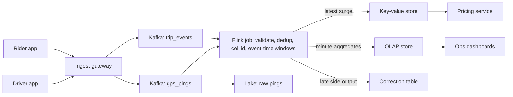

## 🎯 خلاصه

> یک سیستم طراحی کن که جریان GPS رانندگان و درخواست‌های سواری مسافران را به **عددهای عرضه و تقاضا برای هر منطقه** تبدیل کند، با به‌روزرسانی حدود یک دقیقه، و این عددها را به **قیمت‌گذاری پویا (surge)**، داشبورد عملیات و تاریخچه‌ی تحلیلی بدهد.

- مختصات را به **سلول‌های جغرافیایی** (شش‌ضلعی یا geohash) تبدیل کن، به‌جای join روی مختصات خام.
- تجمیع را با **پنجره‌های event-time** انجام بده، نه زمان ورود، چون GPS موبایل دیر و نامرتب می‌رسد.
- از **watermark** به‌همراه یک مسیر اصلاح برای رویدادهای دیرهنگام استفاده کن.
- **لایه‌ی سرو** را جدا کن: یک key-value برای آخرین مقدار surge که سرویس قیمت می‌خواند، و یک OLAP برای داشبورد و تاریخچه. هرگز داشبورد را مستقیم به جریان خام پینگ‌ها وصل نکن.

## 📋 صورت مسئله

پلتفرم تحلیل بلادرنگ پشت یک اپ سواری را طراحی کن. هر ۱۵ تا ۶۰ ثانیه، سیستم باید برای هر سلول شهری، تعداد **درخواست‌های باز سواری** (تقاضا) و **رانندگان آماده** (عرضه) را منتشر کند. سرویس قیمت‌گذاری از نسبت این دو، ضریب surge را می‌سازد. تیم عملیات به داشبورد با چند دقیقه تأخیر نیاز دارد و دانشمندان داده به تاریخچه‌ی کامل.

### نیازمندی‌های کارکردی

- دریافت پینگ GPS از اپ راننده (شناسه‌ی راننده، lat/lon، زمان دستگاه، وضعیت).
- دریافت رویدادهای درخواست سواری و وضعیت سفر (درخواست، تطبیق، شروع، پایان، لغو).
- نگه‌داشتن تقاضا، عرضه و ضریب surge محاسبه‌شده، برای هر سلول و هر دقیقه.
- سرو کردن آخرین surge هر سلول برای سرویس قیمت‌گذاری با تأخیر خواندن p99 زیر ۵۰ میلی‌ثانیه.
- سرو کردن تجمیع‌های تاریخی برای داشبورد و بک‌فیل با فرمول اصلاح‌شده.

### نیازمندی‌های غیرکارکردی

- **تازگی:** مقادیر surge تا حدود ۶۰ ثانیه قبل را منعکس کنند.
- **دقت:** یک پینگ بعد از تلاش مجدد دوبار شمرده نشود؛ پینگ‌های دیرهنگام در داشبورد در بازه‌ی زمانی محدود وارد شوند.
- **دسترس‌پذیری:** قیمت‌گذاری برای مدت کوتاهی می‌تواند به آخرین مقدار شناخته‌شده برگردد، ولی pipeline باید پس از کرش بدون از دست دادن داده بازیابی شود.
- **مقیاس:** ترافیک اوج در یک منطقه، با جهش در باران، کنسرت و فرودگاه.

## 📐 تخمین

فرض کن در اوج ۱ میلیون راننده آنلاین‌اند، هر راننده هر ۴ ثانیه یک پینگ می‌فرستد و هر رویداد بعد از سریالایز شدن ۲۰۰ بایت است.

- نرخ پینگ: ۱٬۰۰۰٬۰۰۰ / ۴ = **۲۵۰٬۰۰۰ پینگ در ثانیه** در اوج.
- حجم خام روزانه: ۲۵۰٬۰۰۰ × ۸۶٬۴۰۰ ثانیه = ۲۱٫۶ میلیارد پینگ در روز.
- بایت خام: ۲۱٫۶ × ۱۰⁹ × ۲۰۰ بایت = **۴٫۳۲ ترابایت در روز** بدون فشرده‌سازی.
- فشرده‌سازی ستونی (Parquet با dictionary و delta encoding) معمولاً برای این نوع داده ۴ تا ۶ برابر است. عدد ۵ را در نظر بگیر: حدود **۰٫۹ ترابایت در روز**، یا حدود **۳۳۰ ترابایت در سال** قبل از replication.
- درخواست سفر: ۵ میلیون در روز به‌طور متوسط می‌شود ۵٬۰۰۰٬۰۰۰ / ۸۶٬۴۰۰ ≈ **۵۸ درخواست در ثانیه**. با ضریب اوج ۱۰، حدود ۶۰۰ rps. این عدد در برابر پینگ‌ها کوچک است؛ جریان پینگ طراحی را تعیین می‌کند.
- سلول‌ها: ۵۰ شهر با حدود ۵٬۰۰۰ سلول فعال در هر شهر، یعنی **۲۵۰٬۰۰۰ سلول فعال**. برای هر سلول و هر دقیقه یک ردیف تقاضا و یک ردیف عرضه، یعنی ۵۰۰٬۰۰۰ ردیف در دقیقه یا ۷۲۰ میلیون ردیف در روز در جدول تجمیع.

دو نتیجه طراحی را شکل می‌دهد. جریان پینگ گلوگاه است، پس پیش‌تجمیع باید **قبل از** هر پایگاه داده انجام شود. جدول تجمیع آن‌قدر کوچک است که یک OLAP برای آن کافی است، پس لایه‌ی سرو ساده می‌ماند.

## 🗃️ مدل داده

| جریان یا جدول | کلید | یادداشت |
|---|---|---|
| `gps_pings` (Kafka) | `driver_id` | به‌ترتیب برای هر راننده؛ `device_seq` برای dedup دارد |
| `trip_events` (Kafka) | `trip_id` | تغییر وضعیت، idempotent با `(trip_id, state)` |
| `cell_minute_agg` (OLAP) | `(cell_id, window_start)` | تقاضا، عرضه، surge؛ هنگام اصلاح upsert می‌شود |
| `surge_latest` (key-value) | `cell_id` | آخرین surge به همراه `as_of` برای بررسی تازگی |
| `raw_pings` (lake، Iceberg یا Parquet) | پارتیشن بر اساس `dt` و `city` | منبع replay و آموزش ML |

شناسه‌ی سلول در هنگام ingestion از `(lat, lon)` محاسبه می‌شود. H3 با resolution ۸ شش‌ضلعی‌هایی حدود ۰٫۷ کیلومتر مربع می‌دهد که تعادل خوبی بین منطقه‌ی قیمت‌گذاری و تعداد سلول‌هاست. resolution را کنار شناسه‌ی سلول ذخیره کن تا تغییر بعدی آن، دو طرح را بی‌سروصدا با هم مخلوط نکند.

## 🏗️ طراحی سطح بالا



Gateway کلاینت‌ها را احراز هویت می‌کند، اعتبارسنجی سطحی انجام می‌دهد و در Kafka می‌نویسد. پارتیشن‌بندی Kafka با `driver_id` ترتیب پینگ‌های هر راننده را حفظ می‌کند، و منطق dedup به آن نیاز دارد. سپس job در Flink **بر اساس شناسه‌ی سلول دوباره پارتیشن‌بندی** می‌کند، چون تجمیع به‌ازای هر سلول است. این repartition یک shuffle است و اولین جایی است که یک سلول داغ می‌تواند یک task را زیر فشار بگذارد.

## 🧠 غواصی در بخش‌های کلیدی

### ۱. Geo bucketing

محاسبه‌ی `distance(driver, rider) < 2 km` برای هر جفت، O(drivers × requests) است و مقیاس نمی‌گیرد. به‌جایش هر مختصات به یک شناسه‌ی سلول نگاشت می‌شود و همه‌ی شمارش‌ها بر اساس همان شناسه گروه‌بندی می‌شوند.

- **شش‌ضلعی‌ها (H3)** شش همسایه‌ی هم‌اندازه دارند، پس هموارسازی بین سلول‌های همسایه ساده است.
- سلول‌های **geohash** مستطیل‌اند و نزدیک قطب‌ها شکل نامنظم دارند، و مرزهایشان اثر لبه‌ی بیشتری ایجاد می‌کند. برای query‌های پیشوندی ساده خوب‌اند.
- پینگی نزدیک مرز فقط در یک سلول شمرده می‌شود. قیمت‌گذاری این را می‌پذیرد؛ برای مسئله‌ی matching باید ۱-ring همسایه‌ها را جستجو کرد.

**سلول‌های داغ.** یک فرودگاه یا ورزشگاه می‌تواند ۱۰۰ برابر میانگین تقاضا داشته باشد. در این صورت یک task در Flink گلوگاه می‌شود. دو راه‌حل کنار هم خوب کار می‌کنند:

- **تجمیع دو مرحله‌ای.** هر task یک پیش‌تجمیع روی `(cell, minute)` با یک salt تصادفی روی کلید انجام می‌دهد (مثلاً `cell + "#" + (hash(driver_id) % 8)`). مرحله‌ی دوم salt را حذف و نتایج جزئی را جمع می‌کند. این همان ایده‌ی salting در Spark است.
- **زیر-سلول برای قیمت‌گذاری.** partialهای salt‌شده را برای داشبورد نگه دار، ولی surge را فقط روی مقدار ادغام‌شده حساب کن.

### ۲. پنجره‌بندی

surge به یک پنجره‌ی کوتاه و ثابت نیاز دارد، و هموارسازی به یک پنجره‌ی بلندتر.

- **پنجره‌ی tumbling، ۱ دقیقه، event time.** هر پینگ دقیقاً در یک سطل یک‌دقیقه‌ای می‌افتد. خروجی یک ردیف برای هر سلول در هر دقیقه است.
- **پنجره‌ی sliding، ۵ دقیقه با گام ۱ دقیقه.** برای هموار کردن surge و جلوگیری از نوسان قیمت. پنجره‌ی sliding state بیشتری نگه می‌دارد و خروجی بیشتری می‌دهد، پس فقط روی محاسبه‌ی surge استفاده‌اش کن، نه روی ذخیره‌ی خام.
- **پنجره‌ی session لازم نیست.** سفر یک فاصله در جریان پینگ‌ها نیست؛ سفر یک ماشین وضعیت روی `trip_events` است.

event time همان **زمان دستگاه** است، نه زمان دریافت در سرور. اگر ساعت دستگاه منحرف باشد، timestampهایی که خیلی در آینده یا گذشته‌اند را رد کن و در صورت نیاز به زمان دریافت با یک پرچم برگرد.

### ۳. رویدادهای GPS دیرهنگام

پینگ‌های موبایل به دلیل تونل، نقاط بدون پوشش و محدودیت اپ در پس‌زمینه دیر می‌رسند. پینگی که ۲ دقیقه پیش ثبت شده هنوز مفید است، ولی نباید مقداری را که قبلاً به قیمت‌گذاری منتشر شده تغییر دهد.

- یک **watermark** به‌صورت `max(event_time) − allowed_lateness` تعریف کن، مثلاً ۳۰ ثانیه. پنجره وقتی بسته می‌شود که watermark از پایان آن رد شود.
- رویدادهایی که بعد از بسته شدن می‌رسند به یک **side output** (مسیر اصلاح) می‌روند. آن‌ها پنجره‌ای را که قبلاً سرو شده دوباره باز نمی‌کنند.
- برای داشبورد، یک job ساعتی یا شبانه side output را می‌خواند و ردیف‌های اصلاح‌شده را در جدول OLAP با کلید `(cell_id, window_start)` **upsert** می‌کند. upsert اصلاح را idempotent می‌کند.
- نرخ **رویداد دیرهنگام** را برای هر شهر پایش کن. افزایش ناگهانی معمولاً به خاطر ریلیز اپ یا مشکل اپراتور موبایل است، نه باگ داده.

> **⚠️ مراقب باش:** اینکه lateness را برای «احتیاط» ۱۰ دقیقه بگذاری یعنی هر مقدار surge ۱۰ دقیقه کهنه باشد. تازگی و کامل بودن یک trade-off است و کسب‌وکار باید آن را انتخاب کند. انتخابت را مستند کن.

### ۴. اثر exactly-once

تلاش مجدد اپ موبایل و تحویل دوباره‌ی Kafka می‌توانند پینگ‌ها را تکراری کنند.

- روی `(driver_id, device_seq)` داخل یک پنجره‌ی state محدود (مثلاً ۲ دقیقه) با keyed state در Flink dedup کن. state را با timer پاک کن تا بی‌نهایت بزرگ نشود.
- checkpointهای Flink معنای exactly-once را برای **state** می‌دهند. برای sinkها، یا از sink تراکنشی استفاده کن یا از نوشتن idempotent (upsert با کلید پنجره). صادق باش که کدام را استفاده می‌کنی: فقط checkpoint نوشتن در سیستم خارجی را exactly-once نمی‌کند.
- برای الگوی کلی به [[exactly-once]] و [[idempotency]] نگاه کن.

### ۵. لایه‌ی سرو

- **قیمت‌گذاری** `surge_latest` را از key-value با TTL می‌خواند. رکورد شامل `as_of` است. اگر `as_of` از ۲ دقیقه قدیمی‌تر باشد، قیمت‌گذاری به یک ضریب پیش‌فرض برمی‌گردد و هشدار ثبت می‌کند.
- **داشبوردها** جدول OLAP را که برای هر شهر و هر ۵ دقیقه پیش‌تجمیع شده می‌خوانند. query‌ها هرگز به پینگ‌های خام دست نمی‌زنند.
- **بک‌فیل.** وقتی فرمول surge تغییر می‌کند، پینگ‌های خام را از lake دوباره پخش کن (replay) در یک نسخه‌ی جدید جدول، اعتبارسنجی کن، سپس اشاره‌گر سرو را عوض کن. این الگوی replay به سبک kappa است: یک مسیر کد برای داده‌ی زنده و تاریخی.

یک فرمول ساده‌ی surge که فقط برای توضیح آمده است:

```text
ratio      = demand / max(supply, 1)
multiplier = clamp(1.0 + k * max(0, ratio - 1), 1.0, cap)
```

قبل از این مرحله، `ratio` را روی پنجره‌ی sliding هموار کن. سقف (cap) از رایدرها در برابر قیمت‌های بی‌کنترل محافظت می‌کند، و کسب‌وکار مقدار `k` و `cap` را تعیین می‌کند.

## 🧠 عمق و trade-offها (سنیور)

- **کلیدهای پارتیشن.** Kafka با `driver_id` ترتیب را برای dedup حفظ می‌کند؛ Flink با `cell_id` تجمیع درست می‌دهد. هر تعویض یک shuffle است. shuffleهای طراحی‌ات را بشمار و بگو کجا رخ می‌دهند.
- **اندازه‌ی state.** keyed state برای dedup با تعداد رانندگان فعال × طول پنجره مقیاس می‌گیرد. با ۲۵۰ هزار پینگ در ثانیه و پنجره‌ی dedup دو دقیقه‌ای، state در حد ده‌ها گیگابایت است؛ پس state پشتیبانی‌شده با RocksDB و checkpointهای incremental استفاده کن.
- **فاصله‌ی checkpoint.** فاصله‌ی کوتاه یعنی از دست دادن کم بعد از recovery، ولی I/O بیشتر. نقطه‌ی شروع معمول ۳۰ تا ۶۰ ثانیه است؛ آن را با مدت checkpoint و هدف تازگی تنظیم کن.
- **Backpressure.** اگر job در Flink عقب بیفتد، lag مصرف‌کننده‌ی Kafka بالا می‌رود و surge کهنه می‌شود. هشدار را بر اساس lag در ثانیه‌ی event time (watermark lag) بگذار، نه تعداد پیام.
- **انتخاب OLAP.** ClickHouse یا StarRocks برای تجمیع‌های سری‌زمانی با cardinality بالا مناسب‌اند، با upsert از طریق جدول‌های به سبک `ReplacingMergeTree` یا مدل‌های primary-key. مجموعه‌ی قابلیت‌ها به نسخه بستگی دارد؛ قبل از انتخاب موتور جدول، مستندات نسخه‌ی خودت را بررسی کن.
- **چند منطقه‌ای.** محاسبه‌ی surge را در منطقه‌ای نگه دار که شهرها در آن‌اند. تجمیع‌ها را بین مناطق replicate کن، نه پینگ‌های خام. در غیر این صورت تأخیر بین‌منطقه‌ای وارد مسیر قیمت‌گذاری می‌شود.
- **چه چیزی را پایش کنی:** lag مصرف‌کننده (ثانیه)، watermark lag، نرخ رویداد دیرهنگام به تفکیک شهر، کهنگی `as_of` در `surge_latest`، سهم ده سلول برتر از کل رویدادها (skew)، مدت و خطاهای checkpoint، و درصد خواندن‌های قیمت‌گذاری که از fallback استفاده کرده‌اند.
- **کی این را نسازی:** اگر یک شهر، چند هزار راننده و تازگی یک دقیقه کافی است، یک job micro-batch هر دقیقه‌ای در یک warehouse ساده‌تر و راحت‌تر برای دیباگ است.

## 🧪 امتحان کن

اول حدس بزن، بعد جواب را ببین.

> دستگاه یک راننده ساعت ۱۰:۰۰:۰۵ و ۱۰:۰۰:۰۹ (زمان دستگاه) پینگ می‌فرستد. سرور پینگ ۱۰:۰۰:۰۵ را به خاطر یک تونل ساعت ۱۰:۰۱:۴۰ دریافت می‌کند. پنجره‌ی ۱۰:۰۰ ساعت ۱۰:۰۱:۱۰ بسته شده بود. پینگ ۱۰:۰۰:۰۵ کجا می‌رود؟

<details><summary>حدست چیست؟</summary>

به **side output** (مسیر اصلاح) می‌رود. watermark از پایان پنجره‌ی ۱۰:۰۰ گذشته بود و مقدار surge آن دقیقه منتشر شده بود. پینگ همچنان در lake ذخیره می‌شود و job اصلاح آن را در جدول OLAP upsert می‌کند، پس داشبورد درست می‌شود بی‌آنکه مقداری را که قیمت‌گذاری استفاده کرده تغییر دهد.

</details>

## 💬 گوشه‌ی مصاحبه

> **🎤 این را در مصاحبه بگو:** «جریان GPS را به درخواست‌ها join نمی‌کنم. مختصات را در job ingestion به سلول‌های H3 تبدیل می‌کنم، با پنجره‌های یک‌دقیقه‌ای event-time تجمیع می‌کنم و پنجره‌ها را با watermark می‌بندم. پینگ‌های دیرهنگام به مسیر اصلاح می‌روند. قیمت‌گذاری یک key-value کوچک می‌خواند و داشبورد یک جدول OLAP.»

**پاسخ متوسط چه شکلی است:** Kafka، یک job استریم، پنجره بر اساس event time، key-value برای آخرین مقدار، و جدول OLAP برای داشبورد.

**پاسخ سنیور چه اضافه می‌کند:** shuffle هنگام repartition بر اساس سلول، salting سلول‌های داغ، trade-off تازگی در برابر کامل بودن که با lateness تعیین می‌شود، محدود کردن state dedup، و بک‌فیل کردن تغییر فرمول با replay.

**پاسخ Staff چه اضافه می‌کند:** مالکیت و SLA برای هر خروجی (تازگی قیمت، تأخیر داشبورد)، هزینه‌ی replication چندمنطقه‌ای، و برنامه برای تست آفلاین فرمول surge روی تاریخچه‌ی replay شده قبل از آنکه زنده شود.

### پرسش‌های بعدی محتمل

1. **«به‌روزرسانی surge باید در ۱۰ ثانیه به قیمت‌گذاری برسد. چه تغییر می‌کند؟»** پنجره را کوتاه کن یا پنجره‌های جزئی منتشر کن، آخرین مقدار را در یک cache حافظه‌ای نزدیک قیمت‌گذاری نگه دار، و نویز بیشتر را بپذیر. بگو که دقت کم می‌شود.
2. **«بعد از قطعی یک منطقه، پینگ‌ها ۱۵ دقیقه دیر می‌رسند. چه می‌شود؟»** به مسیر اصلاح می‌روند. داشبورد با upsert اصلاح می‌شود. surge به‌صورت گذشته‌نگر تغییر نمی‌کند. اگر کسب‌وکار لازم بداند، یک محاسبه‌ی هدفمند برای سلول‌های آسیب‌دیده اجرا کن.
3. **«یک فرودگاه ۱۰۰ برابر بار عادی تولید می‌کند. چطور job را سالم نگه می‌داری؟»** تجمیع دو مرحله‌ای با salt، متریک‌های هر کلید برای سلول‌های برتر، و هشدار روی سهم سلول برتر.
4. **«یک فرمول surge جدید را چطور تست می‌کنی؟»** ۳۰ روز آخر پینگ‌های خام را در یک جدول shadow دوباره پخش کن، ضریب قدیمی و جدید را به تفکیک سلول مقایسه کن، و نوسان و سقف را بررسی کن، قبل از عوض کردن اشاره‌گر سرو.
5. **«چرا همه‌چیز را داخل پایگاه داده‌ی OLAP حساب نمی‌کنی؟»** حجم ورودی ۲۵۰ هزار رویداد در ثانیه با dedup و پنجره‌ی event-time یک مسئله‌ی stream processing است. پایگاه OLAP جای مناسبی برای query است، نه برای منطق درستی داده.

## ⚠️ اشتباهات رایج

- **پنجره‌بندی بر اساس زمان ورود.** نتیجه با شرایط شبکه تغییر می‌کند. از event time و watermark استفاده کن.
- **join روی مختصات خام.** join فاصله‌ی زوجی مقیاس نمی‌گیرد. اول bucket کن.
- **نادیده گرفتن سلول‌های داغ.** فرودگاه و ورزشگاه job را می‌شکنند، نه میانگین. سهم سلول برتر را اندازه بگیر.
- **یک جدول برای همه‌چیز.** قیمت‌گذاری، داشبورد و تاریخچه نیازهای تأخیر و دقت متفاوتی دارند. مسیرهای سرو را جدا کن.
- **فرض اینکه checkpoint، sink را exactly-once می‌کند.** checkpoint state را سازگار نگه می‌دارد. sink همچنان به نوشتن تراکنشی یا idempotent نیاز دارد.
- **نداشتن مسیر replay.** وقتی فرمول عوض می‌شود، به تاریخچه‌ی خام نیاز داری. پینگ‌های خام را در lake بر اساس تاریخ و شهر نگه دار.
- **نادیده گرفتن تازگی.** مقدار surge بدون `as_of` می‌تواند بی‌صدا ساعت‌ها کهنه باشد.

## ✅ خودت را بسنج

1. **یادآوری.** کدام نوع پنجره باید مقدار surge یک‌دقیقه‌ای را حساب کند؟
   - A) پنجره‌ی session
   - B) پنجره‌ی tumbling روی event time
   - C) پنجره‌ی sliding بر اساس processing time
   - D) پنجره‌ی global با trigger شمارشی

   <details><summary>پاسخ</summary>

   **B** — پنجره‌ی tumbling روی event time به هر پینگ دقیقاً یک سطل یک‌دقیقه‌ای می‌دهد، که دانه‌بندی مورد نیاز قیمت‌گذاری است. پنجره‌های processing time با تأخیر شبکه تغییر می‌کنند و پنجره‌ی session برای فاصله‌های فعالیت است، که سفرها نیستند.

   </details>

2. **سناریو.** یک پینگ ۳ دقیقه بعد از منتشر شدن پنجره‌اش می‌رسد. داشبورد باید تا ۱۵ دقیقه درست باشد. چه باید بشود؟
   - A) پنجره‌ی منتشرشده را دوباره باز کن و به قیمت‌گذاری دوباره منتشر کن
   - B) آن را دور بریز و یک هشدار ثبت کن
   - C) آن را به side output بفرست و اصلاح را با upsert در جدول OLAP بنشان
   - D) watermark را برای همه‌ی پنجره‌ها به ۵ دقیقه افزایش بده

   <details><summary>پاسخ</summary>

   **C** — side output داده را نگه می‌دارد و upsert idempotent داشبورد را بدون تغییر مقداری که قیمت‌گذاری قبلاً استفاده کرده اصلاح می‌کند. باز کردن دوباره‌ی پنجره‌ها (A) قیمت‌ها را به‌صورت گذشته‌نگر عوض می‌کند، و افزایش watermark سراسری (D) همه‌ی مقادیر surge را کهنه می‌کند.

   </details>

3. **سناریو.** چرا این طراحی Kafka را با `driver_id` پارتیشن می‌کند، ولی داخل Flink بر اساس `cell_id` تجمیع می‌کند؟
   - A) Kafka نمی‌تواند شناسه‌ی سلول را ذخیره کند
   - B) ترتیب هر راننده برای dedup لازم است و گروه‌بندی هر سلول برای تجمیع؛ پس یک repartition (shuffle) بین آن‌ها است
   - C) Flink فقط یک کلید پارتیشن را پشتیبانی می‌کند
   - D) شناسه‌ی راننده‌ها یکنواخت‌تر از شناسه‌ی سلول‌ها توزیع می‌شود

   <details><summary>پاسخ</summary>

   **B** — dedup نیاز دارد پینگ‌های یک راننده به ترتیب باشند، پس Kafka آن‌ها را کنار هم نگه می‌دارد. تجمیع نیاز دارد همه‌ی پینگ‌های یک سلول کنار هم باشند، پس Flink بر اساس سلول دوباره پارتیشن می‌کند. آن shuffle هزینه‌ای است که باید اسمش را ببری و پایشش کنی.

   </details>

4. **trade-off سنیور.** lateness را «برای احتیاط» ۱۰ دقیقه گذاشته‌ای. هزینه‌ی اصلی چیست؟
   - A) هزینه‌ی بالاتر ذخیره‌سازی Kafka
   - B) مقادیر surge حدود ۱۰ دقیقه بعد از رویدادهایی که توصیف می‌کنند منتشر می‌شوند، پس سیگنال قیمت کهنه است
   - C) dedup از کار می‌افتد
   - D) lake نمی‌تواند رویدادهای دیرهنگام را ذخیره کند

   <details><summary>پاسخ</summary>

   **B** — یک پنجره فقط بعد از رد شدن watermark از پایانش بسته می‌شود، پس lateness طولانی هر مقدار منتشرشده را به تأخیر می‌اندازد. این انتخاب تازگی را در برابر کامل بودن معامله می‌کند و باید تصمیم کسب‌وکار باشد.

   </details>

5. **یادآوری.** فیلد `as_of` در `surge_latest` چه کاری می‌کند؟
   - A) offset کافکا است
   - B) به قیمت‌گذاری اجازه می‌دهد مقادیر کهنه را تشخیص دهد و امن به fallback برود
   - C) کلید پارتیشن جدول OLAP است
   - D) نسخه‌ی فرمول surge را ذخیره می‌کند

   <details><summary>پاسخ</summary>

   **B** — با `as_of` خواننده می‌بیند مقدار چقدر قدیمی است و وقتی خیلی قدیمی است fallback اعمال می‌کند. بدون آن، مقدار کهنه تازه به نظر می‌رسد.

   </details>

## 🗂️ فلش‌کارت

| Front | Back |
|---|---|
| چرا به سلول جغرافیایی bucket می‌کنیم؟ | join زوجی مکان‌ها را به group-by روی یک شناسه‌ی سلول تبدیل می‌کند |
| event time در برابر processing time | event time لحظه‌ای است که پینگ ثبت شده؛ processing time لحظه‌ای است که job آن را می‌بیند |
| چه چیزی یک پنجره را می‌بندد؟ | رد شدن watermark از انتهای پنجره (بیشینه‌ی event time منهای lateness مجاز) |
| رویدادهای دیرهنگام کجا می‌روند؟ | به یک side output که اصلاح idempotent را به جدول OLAP می‌دهد |
| چرا سلول داغ را salt می‌کنیم؟ | یک کلید را بین چند task پخش می‌کند؛ مرحله‌ی دوم جمع‌های جزئی را ادغام می‌کند |
| چرا `as_of` را کنار surge نگه می‌داریم؟ | قیمت‌گذاری مقادیر کهنه را تشخیص می‌دهد و fallback می‌کند |
| چرا پینگ‌های خام را در lake نگه می‌داریم؟ | وقتی فرمول surge عوض می‌شود، بک‌فیل و replay ممکن می‌شود |

## 🔗 ادامه

- ایده‌های پیش‌نیاز: [[pattern-late-data]]، [[pattern-realtime-aggregation]]، [[pattern-hot-keys]].
- طراحی‌های مرتبط: [[design-clickstream-analytics]]، [[design-ad-click-aggregator]].
- الگوهای سرو: [[serving-layer]]، [[realtime-olap]].
- واژه‌نامه: [[watermark]]، [[event-time]]، [[tumbling-window]]، [[data-skew]].
