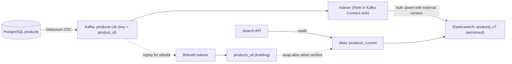

## 🎯 خلاصه

> یک **pipeline ایندکس جست‌وجو** موتور جست‌وجو (Elasticsearch یا OpenSearch) را با منبع حقیقت (دیتابیس محصولات) هماهنگ نگه می‌دارد. سه بخش سخت دارد: **تازه نگه داشتن ایندکس** با change data capture (CDC)، **بازسازی ایندکس** بدون قطعی وقتی mapping یا analyzer ها عوض می‌شوند، و **تحلیل متن فارسی** تا جست‌وجو چیزی را پیدا کند که کاربر منظورش است.

- ایندکس جست‌وجو را یک **کپی مشتق‌شده و قابل دور ریختن** بدان. اگر از منبع و لاگ قابل بازسازی است، یک ایندکس خراب یک کار عملیاتی است، نه فاجعه.
- از **CDC به Kafka** استفاده کن، و بعد یک indexer idempotent که با شناسه‌ی سند و یک **نسخه‌ی برآمده از منبع** (مثلاً موقعیت لاگ یا `updated_at`) می‌نویسد، تا رویدادهای خارج از ترتیب و تکراری داده‌ی جدیدتر را بازنویسی نکنند.
- در یک **ایندکس نسخه‌دار جدید** بساز، از لاگ جبران کن، بعد **alias** را به‌طور اتمیک جابه‌جا کن. خواننده‌ها هرگز یک ایندکس نیمه‌ساخته نمی‌بینند.
- کیفیت جست‌وجوی فارسی به **نرمال‌سازی** بستگی دارد (شکل حروف عربی و فارسی، نیم‌فاصله، ارقام فارسی و عربی) پیش از هر تنظیم ranking.

## 🌱 از ساده شروع کنیم (مبتدی)

> **💡 تشبیه:** جعبه‌ی کارت‌های یک کتابخانه. کتاب‌ها روی قفسه‌اند (دیتابیس). جعبه‌ی کارت‌ها (ایندکس) طوری مرتب شده که بتوانی با هر کلمه از عنوان کتاب را پیدا کنی. اگر کتابی جای قفسه را عوض کند، کارتش را به‌روز می‌کنی. اگر تصمیم بگیری کارت‌ها را با قاعده‌ی جدیدی مرتب کنی، یک جعبه‌ی دوم کنار اولی می‌سازی و فقط وقتی کامل شد برچسب کشوها را جابه‌جا می‌کنی.

**مسئله.** یک بازار آنلاین ایرانی **۲۰ میلیون آگهی محصول** در PostgreSQL دارد. کاربران با متن فارسی جست‌وجو می‌کنند، اغلب با غلط تایپی، ترکیب کلمات فارسی و انگلیسی، و املای متفاوت برای یک کلمه. قیمت، موجودی و محصولات دائم تغییر می‌کنند. جست‌وجوی فعلی با `LIKE '%term%'` دیتابیس را می‌خواند؛ کند است و نمی‌تواند نتایج را رتبه‌بندی کند. یک pipeline بساز که ایندکس را ظرف چند ثانیه تازه نگه دارد و وقتی تیم analyzer ها را عوض می‌کند قابل بازسازی باشد.

**نیازمندی‌های عملکردی**

- ایندکس کردن عنوان، توضیحات، دسته، برند، ویژگی‌ها، قیمت و وضعیت موجودی هر محصول.
- بازتاب تغییرات (تغییر قیمت، اتمام موجودی، آگهی جدید، حذف) در جست‌وجو ظرف **۱۰ ثانیه** در صدک ۹۵.
- پشتیبانی از جست‌وجوی متنی با رتبه‌بندی، فیلترها (دسته، بازه‌ی قیمت، موجود بودن) و تکمیل خودکار با پیشوند.
- بازسازی کامل ایندکس در صورت نیاز، مثلاً بعد از تغییر analyzer، بدون قطعی جست‌وجو.
- پردازش کوئری‌های فارسی: املای متفاوت یک کلمه، شکل حروف فارسی و عربی، نیم‌فاصله و ارقام فارسی یا عربی.

**نیازمندی‌های غیرعملکردی (فرض‌های ما)**

- مقیاس: **۲۰ میلیون** آگهی. هر سند متوسط حدود **۲ کیلوبایت** JSON پس از تخت کردن ویژگی‌ها.
- بار نوشتن: میانگین **۲۰۰ به‌روزرسانی در ثانیه**، و در اوج **۱٬۰۰۰ در ثانیه** (کمپین‌ها، تغییر قیمت).
- بار خواندن: اوج **۵۰۰ کوئری در ثانیه**، با تأخیر صدک ۹۵ زیر **۱۵۰ میلی‌ثانیه**.
- دسترس‌پذیری: جست‌وجو می‌تواند **کم‌کیفیت** باشد (چند دقیقه کهنه) ولی نباید از کار بیفتد. نوشتن در منبع هرگز توسط ایندکس بلاک نمی‌شود.
- هدف تازگی: ۹۵٪ به‌روزرسانی‌ها ظرف ۱۰ ثانیه دیده شوند، و ۹۹٫۹٪ ظرف ۶۰ ثانیه.

## 🔧 واقعاً چطور کار می‌کند (متوسط)

### تخمین

- داده‌ی منبع: ۲۰ میلیون × ۲ کیلوبایت = **۴۰ گیگابایت** سند معادل JSON.
- حجم ایندکس: یک inverted index به‌علاوه‌ی فیلدهای ذخیره‌شده معمولاً ۱ تا ۲ برابر منبع است. ضریب ۱٫۵ را بگیر: **۶۰ گیگابایت** داده‌ی ایندکس اصلی.
- replica: یک replica فضا را دو برابر می‌کند، پس **۱۲۰ گیگابایت** روی دیسک، پیش از سربار merge. ۵۰٪ حاشیه برای merge سگمنت‌ها اضافه کن: حدود **۱۸۰ گیگابایت**.
- شاردها: هدف ۲۰ تا ۴۰ گیگابایت برای هر primary shard. ۶۰ ÷ ۲۰ = ۳، پس **۴ primary shard** برای جا گذاشتن رشد.
- توان به‌روزرسانی: ۱٬۰۰۰ به‌روزرسانی در ثانیه در اوج، که هر کدام یک upsert از یک سند است. یک درخواست bulk با ۵۰۰ سند یعنی در اوج ۲ درخواست bulk در ثانیه، که ناچیز است. محدودیت واقعی CPU ایندکس‌سازی و هزینه‌ی refresh است.
- بازسازی کامل: ۲۰٬۰۰۰٬۰۰۰ سند ÷ ۱۰٬۰۰۰ سند در ثانیه (نرخ تخمینی یا اندازه‌گیری‌شده برای یک خوشه‌ی سه‌نودی با bulk indexing) = ۲٬۰۰۰ ثانیه ≈ **۳۳ دقیقه**. برای پنجره‌ی بازسازی، شامل تحلیل، اعتبارسنجی و جبران از لاگ، **۲ تا ۳ ساعت** برنامه‌ریزی کن.
- نگهداری لاگ: بازسازی به رویدادهای از زمان شروع بازسازی نیاز دارد. با ۲۰۰ رویداد در ثانیه، یک پنجره‌ی ۱۲ ساعته یعنی ۲۰۰ × ۴۳٬۲۰۰ ≈ **۸٫۶ میلیون رویداد**. حداقل **۲ روز** نگهداری لاگ (حدود ۳۵ میلیون رویداد) نگه دار تا یک بازسازی ناموفق و تلاش مجدد پوشش داده شود.

عددها نشان می‌دهند ایندکس کوچک است. ریسک‌های طراحی ترتیب، درستی بازسازی و کیفیت متن‌اند.

### معماری



منبع **دیتابیس سرویس محصولات** است. Debezium لاگ write-ahead آن را می‌خواند و هر تغییر را در یک topic کافکا با کلید `product_id` می‌نویسد، پس همه‌ی تغییرات یک محصول در یک پارتیشن و به ترتیب می‌مانند (ببین [[cdc]] و [[kafka-architecture]]). indexer این topic را مصرف می‌کند و در Elasticsearch می‌نویسد. کوئری‌های جست‌وجو از طریق یک **alias** (`products_current`) می‌خوانند، نه از نام فیزیکی ایندکس.

### به‌روزرسانی‌های مرتب و idempotent

تغییرات at-least-once می‌رسند: کافکا بعد از ری‌استارت مصرف‌کننده دوباره می‌فرستد، و CDC بعد از خرابی connector می‌تواند replay کند. Elasticsearch به‌تنهایی نمی‌داند کدام نسخه تازه‌تر است. دو قانون آن را درست نگه می‌دارند:

- **شناسه‌ی سند = `product_id`.** نوشتن دوباره‌ی یک محصول، همان سند را بازنویسی می‌کند و سند تکراری نمی‌سازد. این indexer را idempotent می‌کند (ببین [[idempotency]]).
- **نسخه‌ی خارجی = موقعیت منبع.** شماره‌ی توالی لاگ (LSN) تغییر، یا `updated_at` منبع به‌همراه یک tiebreaker، را به‌عنوان نسخه‌ی سند استفاده کن. آنگاه Elasticsearch نوشتنی را که نسخه‌اش از نسخه‌ی ذخیره‌شده پایین‌تر است رد می‌کند.

یک درخواست bulk با نسخه‌ی خارجی این شکل را دارد:

```text
POST _bulk
{ "index": { "_index": "products_v7", "_id": "418993", "version_type": "external", "version": 9876543210 } }
{ "product_id": 418993, "title": "کفش ورزشی مردانه", "price_irr": 1890000, "in_stock": true, "updated_lsn": 9876543210 }
```

اگر رویداد قدیمی‌تری (نسخه‌ی ۹٬۸۷۶٬۵۴۳٬۰۰۰) بعد از یک رویداد جدیدتر برسد، نوشتن با conflict رد می‌شود. indexer باید تعداد و لاگ conflict ها را نگه دارد؛ اینها عادی‌اند، خطا نیستند.

**حذف‌ها** در ایندکس به یک tombstone نیاز دارند. یک حذف CDC به یک درخواست delete با همان قانون نسخه تبدیل می‌شود، پس یک به‌روزرسانی قدیمی نمی‌تواند آگهی حذف‌شده را زنده کند. اگر کسب‌وکار برای ممیزی لازم دارد آگهی‌های حذف‌شده قابل جست‌وجو باشند، یک فیلد پرچم بگذار و در کوئری‌ها فیلترش کن.

### بازسازی بدون قطعی

بازسازی وقتی لازم است که mapping، یک analyzer یا تعداد شاردها عوض شود. mapping های Elasticsearch برای فیلدهای موجود عموماً ثابت‌اند، پس روش عملی یک **ایندکس جدید به‌علاوه‌ی جابه‌جایی alias** است:

1. **ساخت** `products_v8` با mapping، analyzer ها و تعداد شارد جدید. `products_v7` را از طریق alias در حال خواندن نگه دار.
2. **پر کردن** `products_v8` از یک snapshot سازگار از منبع (export دسته‌ای از دیتابیس در موقعیت لاگ `L`)، با همان قانون نسخه‌ی خارجی.
3. **جبران** با replay کردن topic کافکا از موقعیت `L` تا سر فعلی. ادامه بده تا تأخیر زیر هدف تازگی باشد.
4. **اعتبارسنجی** پیش از جابه‌جایی: شمارش سندها به تفکیک دسته، مجموعه‌ای از golden query ها با نتایج برتر مورد انتظار، و نمونه‌ی تصادفی از سندها در برابر منبع.
5. **جابه‌جایی** اتمیک با یک درخواست alias، طوری که `products_current` در یک عملیات از `v7` به `v8` برود. `v7` را یک روز نگه دار تا بازگشت ممکن باشد.

```text
POST _aliases
{ "actions": [
    { "remove": { "index": "products_v7", "alias": "products_current" } },
    { "add":    { "index": "products_v8", "alias": "products_current" } }
] }
```

دو عمل با هم اعمال می‌شوند، پس خواننده هرگز نه صفر ایندکس پشت alias می‌بیند نه دو. توجه کن که replay باید همان قانون (نسخه‌ی خارجی) indexer زنده را استفاده کند، وگرنه مرحله‌ی جبران می‌تواند سندهای جدیدتر را با سندهای قدیمی‌تر بازنویسی کند.

### تحلیل متن فارسی

کیفیت جست‌وجو پیش از رتبه‌بندی در analyzer تعیین می‌شود. متن فارسی چند تله دارد که یک analyzer پیش‌فرض انگلیسی از آن‌ها می‌گذرد:

- **شکل حروف.** کاربران روی کیبورد عربی `ي` (یای عربی) و `ك` (کاف عربی) تایپ می‌کنند، در حالی که فارسی `ی` و `ک` دارد. هر دو شکل باید در ایندکس و در کوئری به یک شکل نگاشت شوند.
- **نیم‌فاصله (ZWNJ).** `می‌خواهم` و `میخواهم` هر دو رایج‌اند. analyzer باید تصمیم بگیرد ZWNJ تبدیل به فاصله شود، حذف شود یا بماند، و متن ایندکس‌شده و متن کوئری را یکسان پردازش کند.
- **ارقام.** ارقام فارسی (`۱۲۳`) و ارقام هندی-عربی باید به یک شکل، معمولاً ASCII، نگاشت شوند تا `۱۸۹۰۰۰۰` و `1890000` تطبیق بخورند.
- **کلمات توقف و stemming.** کلمات پرتکراری مثل «از» و «را» باید حذف یا وزن کمتر بگیرند؛ stemming شکل‌های صرفی را کاهش می‌دهد. Elasticsearch یک analyzer آماده‌ی `persian` دارد که بخشی از این کارها را انجام می‌دهد، اما فیلترهای نرمال‌سازی و stemming نسخه‌ی تو را بررسی کن و با کوئری‌های واقعی تست کن، نه اینکه به پیش‌فرض‌ها اعتماد کنی (ببین [[encoding-persian-data]]).
- **اسکریپت‌های مخلوط.** برند و مدل اغلب با حروف لاتین داخل عنوان فارسی نوشته می‌شوند. از mapping چندفیلدی استفاده کن: یک فیلد با analyzer فارسی، یک فیلد با analyzer استاندارد، و کوئری که هر دو را جست‌وجو کند.

یک تست کوچک تحلیل که هر انتشار باید پاس کند:

```text
POST products_v8/_analyze
{ "analyzer": "persian", "text": "میخواهم کفش‌های ۱۲۳ را ببینم" }
```

بررسی کن توکن‌های `میخواهم` و `می‌خواهم` بعد از فیلترها یکی باشند، و `۱۲۳` و `123` یک توکن بسازند.

### کوئری و رتبه‌بندی

- از `multi_match` روی `title` (با وزن بیشتر)، `brand`، `category` و `description` استفاده کن، با یک `function_score` یا `rescore` که کالاهای موجود و آگهی‌های تازه را بالا می‌برد. تعداد فیلدهای وزن‌دار را کم نگه دار.
- فیلترها (`in_stock`، بازه‌ی قیمت، دسته) در بخش `bool.filter` قرار می‌گیرند. فیلترها کش می‌شوند و روی امتیازدهی اثر ندارند.
- تکمیل خودکار از یک فیلد `edge_ngram` یا `completion` روی عنوان استفاده می‌کند، نه از کوئری wildcard روی فیلد اصلی.
- ارتباط نتایج را با **golden query ها** بسنج: ۲۰۰ عبارت واقعی جست‌وجو با محصولات برتری که یک انسان انتظار دارد. نرخ کلیک و نرخ «بدون نتیجه» را در هر انتشار دنبال کن.

## 🧠 عمق و trade-offها (سنیور)

- **منبع حقیقت در برابر ایندکس مشتق‌شده.** ایندکس هرگز مرجع نیست. قیمتی که هنگام پرداخت نشان داده می‌شود باید از دیتابیس بیاید، نه از نتیجه‌ی جست‌وجو. نتیجه‌ی جست‌وجوی کهنه که به تغییر قیمت در پرداخت منجر شود، باگ طراحی است، نه باگ جست‌وجو.
- **تازگی در برابر هزینه.** تازگی ده‌ثانیه‌ای یک indexer استریمی و یک refresh interval کوتاه می‌خواهد. هر refresh سگمنت می‌سازد و CPU مصرف می‌کند. refresh interval را برای هر ایندکس تنظیم کن (مثلاً یک ثانیه برای آگهی‌ها، یک دقیقه برای کاتالوگ‌های بارگذاری‌شده‌ی دسته‌ای) و نرخ ایندکس‌سازی را بسنج، نه فقط تأخیر را.
- **پارتیشن‌بندی و تعداد شارد.** تغییر تعداد شاردها بعد از ساخت، بدون بازسازی سخت است. آن را از رشد انتخاب کن: ۲۰ میلیون سند الان و ۵۰ میلیون پیش‌بینی‌شده در سه سال یعنی شاردهایی متناسب با آینده، و به همین دلیل برنامه‌ی بازسازی مهم است. ببین [[partitioning-sharding]].
- **سندهای داغ.** یک محصول پربازدید به‌روزرسانی‌های زیادی با همان کلید می‌گیرد. کافکا آن‌ها را در یک پارتیشن نگه می‌دارد تا مرتب بمانند، اما indexer آن پارتیشن می‌تواند عقب بیفتد. تأخیر هر پارتیشن و توان مصرف‌کننده را پایش کن و batch را آن‌قدر بزرگ نکن که یک کلید داغ دیگران را عقب بیندازد.
- **تغییر schema.** افزودن یک فیلد جدید ارزان است اگر فقط نوشته‌های جدید آن را پر کنند، اما سندهای موجود برای داشتن آن به backfill نیاز دارند. backfill را به‌صورت replay هدفمند فیلدهای تأثیرپذیر برنامه‌ریزی کن، یا بازسازی کامل اگر فیلدهای زیادی عوض می‌شوند. ببین [[pattern-backfill]].
- **سازگاری در بازسازی.** در طول بازسازی دو ایندکس وجود دارند و اگر جابه‌جایی اتمیک نباشد، کاربران ممکن است بین درخواست‌ها نتایج متفاوت ببینند. جابه‌جایی alias اتمیک است؛ خطر در جبران طولانی با قانون نسخه‌ی اشتباه است. بازسازی را روی یک کپی با حجم شبیه تولید تست کن.
- **حالت‌های خرابی.** indexer می‌تواند عقب بیفتد، خوشه می‌تواند درخواست‌های bulk را با `429` (محدودیت نرخ، صف پر) رد کند، و تعارض mapping می‌تواند یک نوع سند را رد کند. رویدادهای ردشده را با payload کامل و دلیل به dead-letter ببر و تعدادشان را هشدار بده (ببین [[dlq-bad-records]]).
- **جایگزین‌ها.** ایندکس جست‌وجو یک دیتابیس رابطه‌ای نیست. جست‌وجوی ساده با شناسه یا کد دقیق را بهتر است دیتابیس یا یک کش کلید-مقدار پاسخ دهد. جست‌وجو را فقط برای متن آزاد، رتبه‌بندی و faceting استفاده کن و این را در طراحی بگو.

### انتظارات بر اساس سطح

- **متوسط:** CDC به Kafka، indexer ای که با شناسه‌ی سند می‌نویسد، و alias را توضیح می‌دهد. مشکلات نرمال‌سازی فارسی (شکل حروف، نیم‌فاصله، ارقام) و یک تست برای آن‌ها را نام می‌برد.
- **سنیور:** قانون نسخه‌ی خارجی، بازسازی با snapshot، جبران و جابه‌جایی اتمیک alias را طراحی می‌کند، و شاردها، refresh interval ها و نگهداری لاگ را با عدد تنظیم می‌کند. توضیح می‌دهد نتایج جست‌وجو هرگز منبع قیمت نیستند.
- **Staff:** مالکیت بین تیم‌های جست‌وجو، کاتالوگ و داده، فرآیند ارزیابی ارتباط با golden query ها، برنامه‌ریزی هزینه و ظرفیت برای رشد، و سیاستی را تعریف می‌کند که کی بازسازی نیاز به توقف تغییرات schema دارد.

### پرسش‌های ادامه‌ای که مصاحبه‌گر می‌پرسد

1. **«یک رویداد به‌روزرسانی بعد از یک حذف می‌رسد. چه می‌شود؟»** با نسخه‌ی خارجی، حذف نسخه‌ی بالاتری از به‌روزرسانی قبلی دارد، پس به‌روزرسانی دیرهنگام رد می‌شود. اگر به‌روزرسانی نسخه‌ی بالاتری داشته باشد، واقعاً یک ساخت مجدد است و درست است که اعمال شود. منبع نسخه باید موقعیت لاگ باشد، نه زمان رسیدن.
2. **«چطور analyzer را بدون قطعی عوض می‌کنی؟»** یک ایندکس جدید با analyzer جدید بساز، پر کن، از لاگ جبران کن، با golden query ها اعتبارسنجی کن و alias را اتمیک جابه‌جا کن. ایندکس قدیمی را برای بازگشت نگه دار.
3. **«کاربر `iphone 15` را جست‌وجو می‌کند و برای `آیفون ۱۵` چیزی نمی‌گیرد. چرا؟»** مشکل transliteration و اسکریپت‌های مخلوط. یک فهرست مترادف که تیم جست‌وجو نگه می‌دارد و یک mapping چندفیلدی که هر دو شکل را ایندکس کند اضافه کن. راه‌حل تحلیل و داده است، نه یک خوشه‌ی بزرگ‌تر.
4. **«اگر Elasticsearch یک ساعت از کار بیفتد چه؟»** indexer مصرف را متوقف می‌کند و کافکا عقب‌ماندگی را نگه می‌دارد. جست‌وجو نتایج کهنه می‌دهد یا به یک کوئری محدود دیتابیس برمی‌گردد. وقتی خوشه برمی‌گردد، indexer جبران می‌کند. نگهداری لاگ باید از طولانی‌ترین قطعی‌ای که قرار است تحمل کنی بیشتر باشد.

## 🧪 امتحان کن

سه رویداد CDC برای یک محصول داری، به ترتیبی که به indexer می‌رسند. هر رویداد موقعیت لاگ منبع (`lsn`) را به‌عنوان نسخه دارد.

| ترتیب رسیدن | رویداد | `product_id` | `lsn` | `price_irr` |
|---|---|---|---|---|
| ۱ | update | 7 | 120 | 500000 |
| ۲ | update | 7 | 140 | 450000 |
| ۳ | update (replay دیرهنگام ۱۲۰) | 7 | 120 | 500000 |

۱. نسخه‌ی نهایی ذخیره‌شده و قیمت نهایی را با فرض نسخه‌ی خارجی روی `lsn` بنویس.
۲. توضیح بده با و بدون نسخه‌ی خارجی چه بر سر رویداد ۳ می‌آید.
۳. یک عملیات از نوع bulk برای رویداد ۲ بنویس که replay شدنش بی‌خطر باشد، و توضیح بده چرا replay دو بار آن بی‌ضرر است.

<details><summary>راه‌حل‌ها را نشان بده</summary>

**۱.** سند نهایی ذخیره‌شده `lsn = 140` و `price_irr = 450000` دارد. رویداد ۳ رد می‌شود چون نسخه‌ی ۱۲۰ از نسخه‌ی ذخیره‌شده‌ی ۱۴۰ پایین‌تر است.

**۲.** با نسخه‌ی خارجی، رویداد ۳ با version conflict رد می‌شود و سند روی نسخه‌ی ۱۴۰ می‌ماند. بدون نسخه‌بندی، رویداد ۳ سند را با قیمت قدیمی ۵۰۰۰۰۰ بازنویسی می‌کند، پس جست‌وجو قیمتی را نشان می‌دهد که دیگر جاری نیست، در حالی که دیتابیس ۴۵۰۰۰۰ دارد. این یک باگ درستی بی‌صداست که فقط در تولید دیده می‌شود.

**۳.**
```text
{ "index": { "_index": "products_v7", "_id": "7", "version_type": "external", "version": 140 } }
{ "product_id": 7, "price_irr": 450000, "updated_lsn": 140 }
```
replay دو بار آن بی‌ضرر است. نوشتن اول نسخه‌ی ۱۴۰ را ذخیره می‌کند. نوشتن دوم همان نسخه را دارد و نسخه‌ی خارجی برابر با نسخه‌ی ذخیره‌شده توسط قانون نسخه‌ی خارجی رد می‌شود (سند تغییری نمی‌کند). حالت نهایی در هر دو حالت یکی است، و این تعریف یک نوشتن idempotent است.

</details>

## 💬 گوشه‌ی مصاحبه

**سؤال: «یک pipeline ایندکس جست‌وجو برای کاتالوگ محصولات طراحی کن.»**

> **🎤 این را در مصاحبه بگو:** «من ایندکس جست‌وجو را یک کپی مشتق‌شده می‌دانم. Debezium تغییرات دیتابیس محصولات را در یک topic کافکا با کلید شناسه‌ی محصول ضبط می‌کند، پس تغییرات هر محصول مرتب می‌مانند. یک indexer با شناسه‌ی سند و موقعیت لاگ به‌عنوان نسخه‌ی خارجی در Elasticsearch می‌نویسد، که replay را idempotent می‌کند و مانع می‌شود رویداد قدیمی داده‌ی جدید را بازنویسی کند. کوئری‌ها از طریق alias می‌خوانند. وقتی analyzer عوض می‌شود، یک ایندکس نسخه‌دار جدید از snapshot می‌سازم، از لاگ جبران می‌کنم، با golden query ها اعتبارسنجی می‌کنم و alias را اتمیک جابه‌جا می‌کنم. برای فارسی، analyzer باید شکل حروف، نیم‌فاصله و ارقام را نرمال کند و این را پیش از هر انتشار با کوئری‌های واقعی تست می‌کنم.»

**پاسخ نمونه به تفکیک سطح:** مهندس متوسط CDC، کلید topic، شناسه‌ی سند و جابه‌جایی alias را نام می‌برد. سنیور قانون نسخه‌ی خارجی، توالی بازسازی با محاسبه‌ی شارد و نگهداری لاگ و تست نرمال‌سازی فارسی را اضافه می‌کند. Staff مالکیت و فرآیند ارتباط را تعریف می‌کند و قاعده‌ی اینکه جست‌وجو هرگز منبع قیمت نیست را می‌گوید.

## ⚠️ اشتباهات رایج

> **⚠️ Watch out:** نوشتن با شناسه‌ی سند تولیدشده‌ی خودکار. آن‌وقت هر replay یک آگهی تکراری می‌سازد. از کلید منبع به‌عنوان شناسه‌ی سند استفاده کن.

> **⚠️ Watch out:** بازسازی با نوشتن مستقیم در ایندکس زنده. یک بازسازی ناموفق، تولید را نیمه‌تغییریافته رها می‌کند. یک ایندکس جدید بساز و alias را جابه‌جا کن.

- استفاده از `LIKE '%term%'` در دیتابیس برای جست‌وجو، که نمی‌تواند رتبه‌بندی کند و مقیاس نمی‌گیرد.
- اعتماد به نتیجه‌ی جست‌وجو برای قیمت یا موجودی هنگام پرداخت، به‌جای بررسی منبع.
- بدون قانون نسخه، اجازه دادن به رویداد قدیمی برای بازنویسی سند جدیدتر.
- رفتار با فارسی مثل متن انگلیسی با analyzer پیش‌فرض، و بعد سرزنش موتور جست‌وجو برای نتایج ضعیف.
- انتخاب تعداد شارد فقط برای حجم امروز، و بعد نیاز به بازسازی کامل برای رشد.
- فراموش کردن حذف‌ها، طوری که آگهی‌های حذف‌شده همچنان در جست‌وجو ظاهر شوند.
- تنظیم نگهداری لاگ کوتاه‌تر از زمان لازم برای بازسازی، طوری که مرحله‌ی جبران نتواند کامل شود.

## ✅ خودت را بسنج

۱. چرا indexer با `product_id` منبع به‌عنوان شناسه‌ی سند می‌نویسد؟
   - A) تا سندها بر اساس قیمت قابل مرتب‌سازی باشند
   - B) تا replay های یک تغییر یک سند را بازنویسی کنند، نه سند تکراری بسازند
   - C) چون Elasticsearch شناسه‌ی عددی لازم دارد
   - D) تا تعداد شاردها کم شود

<details><summary>پاسخ</summary>

**B** — تحویل at-least-once یعنی رویدادها می‌توانند تکرار شوند. شناسه‌ی سند ثابت باعث می‌شود نوشتن تکراری یک بازنویسی باشد، پس indexer idempotent است.

</details>

۲. برای یک به‌روزرسانی CDC کدام فیلد باید نسخه‌ی خارجی باشد؟
   - A) زمانی که indexer رویداد را دریافت کرده
   - B) یک عدد تصادفی
   - C) موقعیت لاگ منبع (LSN) یا یک توالی منبع که برای هر تغییر افزایش می‌یابد
   - D) تعداد replica ها

<details><summary>پاسخ</summary>

**C** — نسخه باید به ترتیب وقوع تغییرات در منبع افزایش یابد. زمان دریافت با retry و redelivery عوض می‌شود، پس نمی‌تواند نشان دهد کدام تغییر تازه‌تر است.

</details>

۳. باید analyzer فارسی را عوض کنی. کدام ترتیب بدون قطعی است؟
   - A) بستن ایندکس، تغییر analyzer، و باز کردن دوباره
   - B) ویرایش mapping ایندکس زنده و بازسازی در جا
   - C) ساخت یک ایندکس نسخه‌دار جدید، پر کردن آن، جبران از لاگ، اعتبارسنجی، و بعد جابه‌جایی اتمیک alias
   - D) از کاربران بخواهی با املای متفاوت جست‌وجو کنند

<details><summary>پاسخ</summary>

**C** — analyzer فیلدهای موجود را نمی‌توان در جا عوض کرد، و یک ایندکس جدید اجازه می‌دهد ایندکس قدیمی همچنان خواندن را پاسخ دهد. جابه‌جایی اتمیک alias خواننده‌ها را در یک قدم منتقل می‌کند و ایندکس قدیمی برای بازگشت باقی می‌ماند.

</details>

۴. **(سنیور)** یک محصول در دیتابیس حذف می‌شود، اما یک به‌روزرسانی قیمت قبلی با نسخه‌ای بالاتر از حذف دیرتر می‌رسد. انتظار چه چیزی داری و چرا؟
   - A) حذف برنده است چون حذف‌ها همیشه برنده‌اند
   - B) به‌روزرسانی دیرهنگام فقط وقتی رد می‌شود که نسخه‌اش از نسخه‌ی ذخیره‌شده پایین‌تر باشد؛ با منبع نسخه‌ی درست، نسخه‌ی حذف غالب است، پس باید بررسی کنی حذف چطور نسخه‌بندی شده
   - C) محصول با قیمت قدیمی دوباره ظاهر می‌شود
   - D) Elasticsearch نسخه‌ها را برای حذف نادیده می‌گیرد

<details><summary>پاسخ</summary>

**B** — نتیجه به ترتیب نسخه‌ها بستگی دارد. حذف باید نسخه‌ای از لاگ منبع داشته باشد تا به‌روزرسانی قدیمی با نسخه‌ی پایین‌تر رد شود. اگر نسخه‌ها در لحظه‌ی رسیدن داده شوند، ترتیب غلط است و آگهی می‌تواند دوباره ظاهر شود؛ به همین دلیل منبع نسخه مهم است.

</details>

۵. **(سنیور)** بازسازی شما ۳۳ دقیقه نوشتن دسته‌ای می‌برد، اما نگهداری لاگ ۶ ساعت است و تیم برای اعتبارسنجی دو روز برنامه‌ریزی کرده. مشکل چیست و چه تغییری می‌دهی؟
   - A) هیچ؛ ۳۳ دقیقه کوتاه است
   - B) مرحله‌ی جبران از نقطه‌ی snapshot تا پایان اعتبارسنجی رویداد لازم دارد، پس نگهداری لاگ باید کل پنجره‌ی بازسازی را با حاشیه پوشش دهد؛ نگهداری را حداقل به مدت بازسازی به‌علاوه‌ی زمان اعتبارسنجی و یک بافر تلاش مجدد افزایش بده
   - C) تعداد replica ها را زیاد کن تا اعتبارسنجی سریع‌تر شود
   - D) topic کافکا را بعد از snapshot حذف کن

<details><summary>پاسخ</summary>

**B** — جبران از نقطه‌ی snapshot replay می‌کند. اگر اعتبارسنجی دو روز طول بکشد و لاگ شش ساعت نگه دارد، رویدادهای لازم برای جبران دیگر وجود ندارند. نگهداری باید کل پنجره را پوشش دهد، به‌علاوه‌ی بافری برای یک تلاش ناموفق.

</details>

## 🗂️ فلش‌کارت

| Front | Back |
|---|---|
| چرا ایندکس جست‌وجو را مشتق‌شده می‌دانیم؟ | از منبع و لاگ قابل بازسازی است؛ هرگز منبع حقیقت نیست |
| شناسه‌ی سند برای ایندکس‌سازی CDC | کلید اصلی منبع (مثلاً `product_id`)، تا replay ها بازنویسی کنند |
| نسخه‌ی خارجی (external versioning) | نوشتن در ایندکس وقتی رد می‌شود که نسخه‌اش از نسخه‌ی ذخیره‌شده پایین‌تر است |
| منبع نسخه برای CDC | موقعیت لاگ (LSN) یا توالی منبع، نه زمان رسیدن |
| الگوی بازسازی | ایندکس نسخه‌دار جدید، پر کردن، جبران از لاگ، اعتبارسنجی، جابه‌جایی اتمیک alias |
| اهداف نرمال‌سازی فارسی | شکل حروف (ی/ک در برابر ي/ك)، مدیریت نیم‌فاصله، ارقام فارسی و عربی |
| چرا تعداد شارد تصمیم بلندمدت است؟ | تغییر بعدی آن یعنی بازسازی کامل ایندکس |
| golden query ها | مجموعه‌ی ثابتی از عبارات واقعی جست‌وجو با نتایج برتر مورد انتظار، که در هر انتشار اجرا می‌شود |

## 🔗 ادامه

- **cdc** مکانیزم ضبط تغییرات را توضیح می‌دهد که این pipeline به آن وابسته است، و تضمین‌های ترتیب در هر کلید.
- **kafka-architecture** پارتیشن‌ها، کلیدها و نگهداری را پوشش می‌دهد که حدود ترتیب و replay را تعیین می‌کنند.
- **pattern-cdc-analytics** همان الگوی ضبط را نشان می‌دهد که یک store تحلیلی را تغذیه می‌کند.
- **pattern-backfill** و **dedup-idempotent-loads** واژگان بازسازی و نوشتن تکراری را می‌دهند.
- **serving-layer** و **pattern-serving** ایندکس جست‌وجو را در کنار سایر store های بهینه‌شده برای خواندن قرار می‌دهند.
- **encoding-persian-data** مسائل سطح کاراکتر را پوشش می‌دهد که تحلیل فارسی را سخت می‌کنند.
