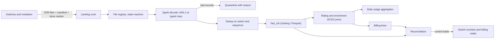

## 🎯 خلاصه

> pipelineای طراحی کن که حدود **۳ ترابایت در روز** رکورد جزئیات تماس (CDR) باینری را از سوییچ‌های شبکه می‌گیرد، decode می‌کند، تکرارها را حذف می‌کند، با تعرفه نرخ‌گذاری می‌کند و **تجمیع‌های صورتحساب و تحلیل مصرف** تولید می‌کند که با سوییچ‌ها و سیستم صورتحساب تا سطح رکورد تطبیق دارند.

- داده به‌صورت **فایل** می‌رسد، نه جریان؛ بر اساس فایل بچ کن، با manifest، نشانه‌ی پایان (done-marker) و یک ماشین حالت در سطح فایل.
- CDRها رکوردهای **باینری ASN.1** هستند. decode سنگین از نظر CPU است و به یک decoder مبتنی بر schema نیاز دارد، نه تجزیه‌ی متنی.
- **exactly-once** با یک کلید idempotent (`switch_id`، `record_sequence`) و commit اتمی برای هر فایل به‌دست می‌آید، نه با امید به نبودن retry.
- **تطبیق** یک خروجی درجه‌یک است. تعداد و جمع‌ها باید در هر مرحله برابر باشند، وگرنه صورتحساب اجرا نمی‌شود.

## 📋 صورت مسئله

یک اپراتور موبایل چند خوشه‌ی سوییچ دارد (صدا، پیامک، داده). هر سوییچ هر چند دقیقه فایل CDR می‌نویسد. اپراتور به سه چیز نیاز دارد: یک fact کامل و بی‌تکرار از مصرف برای تحلیل؛ ردیف‌های فاکتور برای هر دوره‌ی صورتحساب برای سیستم billing؛ و یک اثبات روزانه که عددها با سوییچ‌ها برابرند. مشترکین، تعرفه‌ها و سایت‌های سلولی در طول زمان عوض می‌شوند.

عدد برنامه‌ریزی از نقشه‌ی راه ما **۳ ترابایت در روز** فایل CDR خام است.

### نیازمندی‌های کارکردی

- دریافت فایل‌های CDR از سوییچ‌ها و سرورهای mediation از landing zone (SFTP یا object storage).
- decode کردن رکوردهای ASN.1 با کدگذاری BER به فیلدهای تایپ‌شده، و رد کردن یا قرنطینه‌ی رکوردهای بد با دلیل.
- حذف رکوردهایی که بیش از یک بار ظاهر می‌شوند (مثلاً وقتی سوییچ بعد از timeout فایل را دوباره می‌فرستد).
- غنی‌سازی رکوردها با بُعدهای مشترک، تعرفه و سایت سلولی که در زمان تماس معتبر بوده‌اند.
- تولید `fact_cdr`، تجمیع روزانه‌ی مصرف به تفکیک مشترک و تعرفه، و ردیف‌های صورتحساب برای هر دوره.
- تطبیق تعداد و جمع‌ها به تفکیک سوییچ، ساعت و دوره‌ی صورتحساب، با مقادیر کنترلی.

### نیازمندی‌های غیرکارکردی

- **تأخیر:** ورودی‌های مصرف و صورتحساب روز قبل قبل از اجرای صبح صورتحساب (مثلاً ساعت ۰۴:۰۰) آماده باشند.
- **درستی:** هیچ رکوردی گم یا دوبار شمرده نشود. هر ناهمخوانی باید کشف، گزارش و توضیح داده شود.
- **حریم خصوصی:** IMSI و MSISDN شناسه‌ی شخصی‌اند. قبل از تحلیل شبه‌نام می‌شوند و مقادیر خام محدود می‌مانند. در بسیاری از حوزه‌های قضایی یک الزام قانونی است و برای هر اپراتور یک تعهد قراردادی.
- **نگهداری:** CDRهای خام برای دوره‌ی قانونی (معمولاً ماه‌ها) نگه داشته شوند؛ داده‌ی decode‌شده برای تحلیل بیشتر.

## 📐 تخمین

عدد نقشه‌ی راه را استفاده کن: **۳ ترابایت در روز** داده‌ی فایل CDR خام. فرض کن هر رکورد خام به‌طور متوسط حدود **۲۵۰ بایت** است، شامل پوشش ASN.1.

- رکورد در روز: ۳ × ۱۰¹² B ÷ ۲۵۰ B = **۱۲ میلیارد رکورد در روز**.
- نرخ متوسط: ۱۲ × ۱۰⁹ ÷ ۸۶٬۴۰۰ s ≈ **۱۳۹٬۰۰۰ رکورد در ثانیه**.
- نرخ اوج: فرض کن در ساعت شلوغ ۳ برابر متوسط باشد، یعنی **حدود ۴۲۰٬۰۰۰ رکورد در ثانیه**.
- اندازه‌ی رکورد decode‌شده روی bus: فرض کن حدود ۲۰۰ بایت پس از تبدیل به قالب تایپ‌شده. در اوج: ۴۲۰٬۰۰۰ × ۲۰۰ B = **۸۴ مگابایت در ثانیه** داده‌ی decode‌شده.
- پارتیشن‌های Kafka: قاعده‌ی سرانگشتی برای برنامه‌ریزی حدود ۱۰ مگابایت در ثانیه برای هر پارتیشن با یک producer و یک گروه مصرف‌کننده است، پس ۸۴ مگابایت بر ثانیه حدود ۹ پارتیشن می‌خواهد. برای حاشیه‌ی امن و موازی‌سازی مصرف‌کننده **۲۴ پارتیشن** در نظر بگیر. این را با benchmark خودت بسنج.
- توان decode: پنجره‌ی batch روزانه حدود ۱ ساعت است. توان لازم ۳ ترابایت ÷ ۳٬۶۰۰ ث ≈ **۸۳۴ مگابایت در ثانیه** داده‌ی خام فایل است. اگر یک core حدود **۱۰ مگابایت در ثانیه** decode و parse کند (فرضی که باید اندازه گرفته شود)، به ۸۳۴ ÷ ۱۰ ≈ **۸۴ core** نیاز داری، یعنی حدود **۲۱ executor با ۴ core**.
- ذخیره‌سازی بُعدهای decode‌شده: ۱۲ × ۱۰⁹ رکورد در روز × ۶۰ بایت فشرده در هر رکورد (ستونی، با dictionary و delta encoding) ≈ **۷۲۰ گیگابایت در روز**، یعنی ۷۲۰ × ۳۶۵ ≈ **۲۶۳ ترابایت در سال** قبل از replication. با replication سه‌گانه‌ی HDFS حدود **۷۹۰ ترابایت** می‌شود. object storage با erasure coding ارزان‌تر است.
- نگهداری خام: ۳۰ روز فایل خام با ۳ ترابایت در روز یعنی ۹۰ ترابایت قبل از فشرده‌سازی. فایل‌های BER فشرده شده کوچک‌تر می‌شوند، ولی آن را اندازه بگیر.

اهمیت حساب‌کردن بیشتر از عدد دقیق است. نتیجه‌ی کلیدی: **مرحله‌ی decode برای یک ساعت در روز حدود ۲۰ executor لازم دارد**، و داده‌ی خام در ماه اول بزرگ‌ترین بخش ذخیره‌سازی است. این دو عدد طراحی را هدایت می‌کنند.

## 🗃️ مدل داده

| جدول | grain یا کلید | یادداشت |
|---|---|---|
| `raw_cdr_file` | یک ردیف برای هر فایل | `file_id`، `switch_id`، `checksum`، `status`، `record_count_declared` |
| `stg_cdr_decoded` | یک ردیف برای هر رکورد decode‌شده | فیلدهای تایپ‌شده، `file_id`، `record_sequence` |
| `fact_cdr` | یک ردیف برای هر CDR یکتا | کلید `(switch_id, record_sequence)`؛ پارتیشن بر اساس `event_date` و `event_hour` |
| `dim_subscriber` | SCD2 | طرح تعرفه، وضعیت، MSISDN شبه‌نام‌شده؛ بازه‌های اعتبار |
| `dim_tariff` | Type 2 | طرح‌های نرخ؛ بازه‌های اعتبار |
| `dim_cell_site` | Type 1 | موقعیت، فناوری |
| `agg_usage_daily` | مشترک × تعرفه × روز | ثانیه‌ی صدا، تعداد پیامک، بایت داده |
| `billing_line` | مشترک × دوره × سرویس | مبلغ نرخ‌گذاری‌شده؛ ورودی سیستم صورتحساب |
| `recon_result` | سوییچ × ساعت و دوره | تعداد و جمع‌ها: اعلام‌شده، decode‌شده، ذخیره‌شده، صورتحساب‌شده |

`fact_cdr` **شماره‌ی توالی‌ای که سوییچ داده** را به‌عنوان بخشی از کلید نگه می‌دارد. این تنها شناسه‌ای است که با ساختار خودش یکتاست، چون سوییچ برای هر رکوردی که تولید می‌کند شمارنده را افزایش می‌دهد. زمان‌ها به UTC ذخیره می‌شوند و منطقه‌ی زمانی منبع به‌صورت ستون نگه داشته می‌شود.

یک بُعد تقویم از دو تقویم پشتیبانی می‌کند. دوره‌های صورتحساب برای مشترکان ایرانی اغلب با ماه‌های جلالی تنظیم می‌شوند، در حالی که گزارش‌های شبکه تاریخ میلادی دارند. هر دو را در `dim_date` نگه دار و هیچ‌کدام را داخل یک کوئری از دیگری حساب نکن.

## 🏗️ طراحی سطح بالا



registry فایل لایه‌ی کنترل است. هر فایل از `RECEIVED → VALIDATED → DECODED → COMMITTED` عبور می‌کند، یا به `QUARANTINED` می‌رود. هر اجرا فقط فایل‌های `RECEIVED` یا فایل‌های در حالت خطا را برمی‌دارد، و هر فایل را فقط یک بار commit می‌کند. اجرای دوباره به همین دلیل امن است.

job مربوط به decode هر فایل را به‌عنوان یک واحد می‌خواند. کل روز را به‌صورت یک جریان نمی‌خواند، پس یک فایل خراب بقیه را متوقف نمی‌کند و retry در سطح فایل انجام می‌شود.

## 🧠 غواصی در بخش‌های کلیدی

### ۱. ورود فایل

سوییچ‌ها فایل‌ها را با یک الگوی نام‌گذاری و، در راه‌اندازی خوب، یک manifest و یک done-marker می‌نویسند. landing zone را دور همین بساز.

- **ابتدا done-marker.** یک فایل فقط وقتی واجد شرایط است که نشانه‌اش وجود داشته باشد. بدون آن ممکن است فایلی را بخوانی که هنوز در حال نوشتن است.
- **بررسی manifest.** تعداد رکورد و checksum اعلام‌شده در manifest را با آنچه خوانده‌ای مقایسه کن. ناهمخوانی یعنی فایل ناقص یا خراب است، پس فایل به قرنطینه می‌رود، نه به جدول fact.
- **تکرار در سطح فایل.** سوییچ ممکن است بعد از timeout فایل را دوباره بفرستد. registry فایل دوم با همان checksum یا همان `(switch_id, file_sequence)` را رد می‌کند و ثبت می‌کند که تکراری بوده.
- **فایل‌های دیرهنگام.** فایل‌ها ممکن است ساعت‌ها یا روزها دیر برسند. registry این را عادی می‌کند: فایل دیرهنگام پردازش و پارتیشن آن بازسازی می‌شود.

برای الگوی کلی landing zone و done-marker به [[file-ingestion]] نگاه کن.

### ۲. decode ASN.1

CDRها رکوردهای ASN.1 هستند که با BER یا یک قاعده‌ی کدگذاری مرتبط نوشته شده‌اند. schema هر فیلد را تعریف می‌کند و کدگذاری فشرده، ولی تودرتو و وابسته به نسخه است.

- **از یک decoder مبتنی بر schema استفاده کن.** decoder را از روی schema ASN.1 تولید کن، یا یک کتابخانه‌ی نگه‌داری‌شده به کار ببر، و آن را داخل taskهای Spark اجرا کن (مثلاً از طریق `mapPartitions`). با ابزارهای متنی یا Python رکورد به رکورد تجزیه نکن: در ۴۲۰ هزار رکورد در ثانیه، سربار آن هزینه را تعیین می‌کند.
- **نسخه‌ی schema را نگه دار.** سوییچ‌ها در طول زمان ارتقا می‌یابند و فیلدهای جدید ظاهر می‌شوند. نسخه‌ی schema را در هر ردیف decode‌شده نگه دار، و وقتی نسخه‌ی ناشناخته است، با خطای واضح شکست بخور، نه اینکه فیلدها را بی‌صدا حذف کنی.
- **رکوردهای بد.** رکوردی که decode نمی‌شود به یک جدول قرنطینه با `file_id`، offset بایت، خطا و نسخه‌ی schema می‌رود. تعداد رکوردهای قرنطینه‌شده بخشی از تطبیق است. هرگز بی‌صدا حذفشان نکن.
- **زمان‌ها.** فیلدهای زمانی را با قوانین منطقه‌ی زمانی‌شان decode کن. UTC به‌همراه offset را ذخیره کن و دقیق باش که ساعت سوییچ نماینده‌ی چیست.

> **⚠️ مراقب باش:** decoderی که «برای احتیاط» فیلدهای ناشناخته را رد می‌کند، مقدار داده‌ای را که صورتحساب می‌کنی تغییر می‌دهد. به‌جایش شکست بخور یا قرنطینه کن.

### ۳. بارگذاری exactly-once

در داخل یک فایل، هر رکورد یک بار ظاهر می‌شود. بین فایل‌ها، اگر سوییچ دوباره بفرستد، یک رکورد ممکن است دو بار بیاید. هدف این است که هر رکورد یکتا، هر چند بار job اجرا شود، فقط یک بار وارد شود.

- **کلید.** `(switch_id, record_sequence)` یک رکورد را مشخص می‌کند. اگر سوییچ بعد از restart شماره‌ها را از نو شروع کند، یک `switch_epoch` یا زمان شروع به کلید اضافه کن، و این را با فروشنده‌ی سوییچ بررسی کن.
- **dedup داخل یک اجرا.** بر اساس کلید گروه‌بندی کن و یک ردیف نگه دار، و بررسی کن که تکرارها یکسان‌اند. اگر متفاوت‌اند، این یک حادثه‌ی کیفیت داده است، نه یک dedup.
- **commit اتمی.** خروجی فایل را در یک جدول staging بنویس، سپس `MERGE` در `fact_cdr` روی کلید در یک تراکنش (Iceberg یا Delta). بعد همان مرحله‌ی pipeline فایل را در registry به `COMMITTED` ببرد. اگر job بین مراحل بمیرد، MERGE idempotent است، پس اجرای دوباره امن است.
- **replay.** اجرای دوباره‌ی یک فایل commit‌شده نباید ردیف جدیدی بسازد. MERGE روی کلید این را تضمین می‌کند.

برای الگوی کلی به [[exactly-once]] و [[pattern-dedup]] نگاه کن.

### ۴. غنی‌سازی با SCD2

یک تماس ساعت ۱۰ روز سوم ماه باید با تعرفه‌ای نرخ‌گذاری شود که مشترک در ساعت ۱۰ داشته. join به تعرفه‌ی **فعلی** تماس‌های قدیمی را دوباره قیمت‌گذاری می‌کند و اختلاف ایجاد می‌کند. مثل درس تجارت الکترونیک، روی بازه‌ی اعتبار join کن:

```sql
SELECT c.cdr_key, c.volume_bytes, t.rate_per_mb
FROM fact_cdr AS c
JOIN dim_tariff AS t
  ON t.tariff_id = c.tariff_id
 AND c.event_ts >= t.valid_from
 AND c.event_ts <  t.valid_to;
```

نرخ‌گذاری را قطعی (deterministic) نگه دار: همان CDR و همان نسخه‌های بُعد، همیشه همان مبلغ را می‌دهند. این همان چیزی است که اجازه می‌دهد یک دوره‌ی صورتحساب را دوباره اجرا کنی و همان فاکتور را بگیری.

### ۵. تطبیق

تطبیق جایی است که طراحی ثابت می‌شود. برای هر سوییچ و هر ساعت، چهار عدد را مقایسه کن:

1. رکوردهای **اعلام‌شده** (از manifest یا شمارنده‌های خود سوییچ).
2. رکوردهای **decode‌شده** (از job decode).
3. رکوردهای یکتای **ذخیره‌شده** در `fact_cdr`، بعد از dedup و قرنطینه.
4. رکوردها یا حجم **صورتحساب‌شده** در `billing_line`، برای دوره.

هویت این است: `اعلام‌شده = ذخیره‌شده + قرنطینه‌شده + تکرارهای حذف‌شده`. اختلاف غیرصفر یک حادثه با کد دلیل است. برای صورتحساب، جمع مبالغ نرخ‌گذاری‌شده را با مجموع سیستم billing برای دوره مقایسه کن، با اختلاف صفر برای مبالغی که به یک شیوه محاسبه شده‌اند.

رکوردهای roaming اغلب ظرف چند روز بعد از رویداد در فایل‌های شریک می‌رسند. آن‌ها را در همان fact با زمان ورود خودشان نگه دار، و با مالی تصمیم بگیر که متعلق به دوره‌ی جاری‌اند یا به یک restatement.

## 🧠 عمق و trade-offها (سنیور)

- **batch یا stream؟** منبع فایل است و صورتحساب روزانه است. طراحی batch فایلی با Spark ساده‌تر و ارزان‌تر از طراحی استریمی است. استریم را فقط وقتی به کار ببر که یک هشدار مصرف نزدیک به لحظه (تقلب، شوک قبض) الزام باشد، و آن را از یک مسیر جدا و تقریبی تغذیه کن.
- **تنظیم Spark برای decode.** decode از نظر CPU محدود است، پس تعداد core هر executor را با ایمنی thread و حافظه‌ی decoder هماهنگ کن. مراقب skew باش: چند فایل بزرگ یا یک سوییچ شلوغ taskهای نامتوازن می‌سازد. اگر decode در سطح فایل است، بعد از decode دوباره پارتیشن‌بندی کن، نه قبل از آن.
- **فایل‌های کوچک.** سوییچی که هزاران فایل ریز می‌نویسد، بعد از decode فایل‌های Parquet کوچک زیادی می‌سازد. در هر ساعت پارتیشن compaction انجام بده، یا قبل از decode در سطح registry فایل‌ها را ادغام کن. به [[small-files-problem]] نگاه کن.
- **فرمت جدول.** جدول Iceberg یا Delta، MERGE اتمی، snapshot برای حسابرسی و time travel برای تطبیق می‌دهد. قبل از اتکا به قابلیت‌ها و محدودیت‌های نسخه‌ی خودت، آن‌ها را بررسی کن.
- **ذخیره‌سازی و هزینه.** ۲۶۳ ترابایت داده‌ی decode‌شده در سال روی HDFS یا object storage داخلی قابل مدیریت است، ولی فایل‌های خام بزرگ‌ترند. سیاست نگهداری خام و decode‌شده را جدا کن، و مطمئن شو بهینه‌سازی هزینه، دوره‌ی قانونی نگهداری را کوتاه نمی‌کند.
- **داده‌ی شخصی.** MSISDN و IMSI را در زمان decode با یک hash کلیددار (HMAC با کلیدی که در secrets store نگهداری می‌شود) شبه‌نام کن، تا تحلیل بتواند join کند بی‌آنکه شماره را ببیند. فایل‌های خام را به گروه کوچکی محدود کن. hash ساده کافی نیست: فضای شماره‌ی تلفن کوچک است و با brute force قابل برگشت است.
- **داده‌ی دیرهنگام و تکراری از شرکا.** فایل‌های roaming و interconnect دیر می‌رسند و ممکن است هم‌پوشانی داشته باشند. آن‌ها را منبع جدا با ورودی‌های registry و تطبیق جدا بدان.
- **بستر ایران.** بسیاری از اپراتورها این را on-prem با Hadoop، Hive یا Iceberg، Spark، صورتحساب Oracle و قواعد سخت‌گیرانه‌ی محل نگهداری داده اجرا می‌کنند. طراحی یکی است؛ هزینه‌ی عملیاتی (نوسازی سخت‌افزار، ظرفیت برای اوج‌هایی مثل نوروز و دوره‌ی امتحانات) بیشتر است.
- **چه چیزی را پایش کنی:** فایل‌های منتظر در landing (سن و تعداد)، نرخ قرنطینه به تفکیک سوییچ، توان decode (مگابایت در ثانیه برای هر executor)، نرخ تکرار، اختلاف تطبیق در هر ساعت، و زمان آمادگی صورتحساب.
- **کی این را نسازی:** یک اپراتور کوچک با یک سوییچ و چند صد گیگابایت در روز می‌تواند همین منطق را در یک job SQL شبانه اجرا کند. قواعد registry، تطبیق و SCD2 همچنان لازم‌اند، ولی Spark و lakehouse ممکن است زیادی باشند.

## 🧪 امتحان کن

اول حدس بزن، بعد جواب را ببین.

> یک سوییچ هنگام ارسال فایل `F-0412` timeout می‌شود و آن را به‌صورت `F-0412b` دوباره می‌فرستد. هر دو نسخه شامل رکوردهای ۱۰۰۰ تا ۱۹۹۹ با همان شماره‌ی توالی هستند. pipeline چه کاری باید بکند، و بررسی تکرار کجاست؟

<details><summary>حدست چیست؟</summary>

فایل دوم یک **تکرار در سطح فایل** است: checksum یا `(switch_id, file_sequence)` با فایلی که قبلاً در registry است یکی است، پس علامت‌گذاری می‌شود تکراری و decode نمی‌شود. اگر decode می‌شد، dedup در سطح رکورد روی `(switch_id, record_sequence)` هم ردیف‌های تکراری را حذف می‌کرد و تطبیق آن‌ها را به‌عنوان `duplicates_removed` می‌شمرد. هر دو بررسی وجود دارند، ولی بررسی سطح فایل ارزان‌تر است چون اصلاً decode انجام نمی‌دهد.

</details>

## 💬 گوشه‌ی مصاحبه

> **🎤 این را در مصاحبه بگو:** «CDRها را به‌صورت فایل‌های بچ با یک registry در نظر می‌گیرم. هر فایل با manifest اعتبارسنجی می‌شود، با یک decoder ASN.1 مبتنی بر schema decode می‌شود، و با یک MERGE idempotent روی سوییچ و توالی در یک جدول Iceberg commit می‌شود. نرخ‌گذاری تعرفه‌ای را join می‌کند که در زمان تماس معتبر بوده. تطبیق تعداد اعلام‌شده، decode‌شده، ذخیره‌شده و صورتحساب‌شده را به تفکیک سوییچ و ساعت بررسی می‌کند، و هر شکافی یک حادثه است.»

**پاسخ متوسط چه شکلی است:** ورود فایل، decode با Spark، جدول fact، تجمیع روزانه و یک job صورتحساب.

**پاسخ سنیور چه اضافه می‌کند:** هزینه‌ی decode بر حسب executor، طراحی کلید برای exactly-once، نرخ‌گذاری SCD2، هویت تطبیق، شبه‌نام‌سازی PII با hash کلیددار، و کنترل فایل‌های کوچک.

**پاسخ Staff چه اضافه می‌کند:** مدل هزینه و ریسک برای رشد ۳ برابری در دو سال، مالک و SLA هر مقدار کنترلی، برنامه برای تغییرات schema از فروشنده‌های سوییچ، و برنامه‌ی DR که فایل‌های خام را برای یک دوره‌ی مشخص دوباره پخش می‌کند.

### پرسش‌های بعدی محتمل

1. **«فروشنده‌ی سوییچ نسخه‌ی جدید می‌دهد و ۱۲ فیلد اضافه می‌کند. چه می‌شکند؟»** decoder با نسخه‌ی ناشناخته‌ی schema با خطای واضح شکست می‌خورد. schema جدید را اضافه می‌کنی، ردیف‌های decode‌شده را نسخه‌دار می‌کنی و فقط اگر قواعد صورتحساب از فیلدهای جدید استفاده کند بک‌فیل می‌کنی. ردیف‌های قدیمی نسخه‌ی خودشان را نگه می‌دارند.
2. **«یک اجرای صورتحساب در یک دوره ۰٫۰۲٪ شکاف پیدا کرد. تحقیقت را شرح بده.»** هویت تطبیق را برای هر سوییچ و ساعت بررسی کن. دلایل قرنطینه، تعداد تکرار، فایل‌های دیرهنگام و ورودی‌های roaming را نگاه کن. اولین مرحله‌ای را پیدا کن که عددها از هم جدا می‌شوند.
3. **«ترافیک در ۲ سال ۳ برابر می‌شود. چه تغییر می‌کند؟»** executorهای decode را زیاد کن، تعداد پارتیشن‌ها را بالا ببر، موازی‌سازی per-switch و ذخیره‌سازی لایه‌ای برای فایل‌های خام را در نظر بگیر. تخمین را با توان decode اندازه‌گیری‌شده دوباره حساب کن، نه با عدد فرضی.
4. **«چطور اجرای دوباره‌ی یک دوره‌ی صورتحساب را یکسان می‌کنی؟»** نرخ‌گذاری قطعی در برابر نسخه‌های بُعد، MERGE idempotent، نسخه‌های ثابت schema، و snapshot از ورودی‌های آن اجرا.
5. **«چرا برای CDRها از Kafka استفاده نکنی؟»** سوییچ‌ها فایل تولید می‌کنند و صورتحساب به بچ‌های کامل با مقادیر کنترلی نیاز دارد. Kafka یک استریم اضافه می‌کند که تطبیق همچنان باید درباره‌اش استدلال کند. آن را فقط برای مسیر هشدار نزدیک به لحظه به کار ببر.

## ⚠️ اشتباهات رایج

- **فرض CDR به‌عنوان JSON یا متن.** ASN.1 باینری و مبتنی بر schema است. با schema تجزیه کن.
- **حذف بی‌صدای رکوردهای بد.** هویت تطبیق می‌شکند و صورتحساب بی‌آنکه کسی متوجه شود غلط است.
- **dedup فقط بر اساس hash محتوا.** دو تماس واقعی می‌توانند محتوای یکسان داشته باشند (مدت و حجم و زمان یکسان). از توالی سوییچ استفاده کن.
- **join به تعرفه‌ی فعلی.** تماس‌های قدیمی دوباره قیمت‌گذاری می‌شوند و اختلاف به دنبالش می‌آید.
- **commit فایل بدون وضعیت registry.** اجرای دوباره رکوردها را تکراری یا جاافتاده می‌کند.
- **ذخیره‌ی MSISDN خام در تحلیل.** هم ریسک حریم خصوصی است و هم ریسک قانونی.
- **نداشتن مقادیر کنترلی.** بدون تعداد اعلام‌شده از سوییچ، نمی‌توانی کامل بودن را ثابت کنی.
- **اندازه‌گیری بر اساس میانگین.** صورتحساب با ساعت شلوغ هدایت می‌شود، پس برای اوج و پنجره‌ی batch اندازه بگیر.

## ✅ خودت را بسنج

1. **یادآوری.** کلید اصلی یک CDR یکتا در `fact_cdr` چیست؟
   - A) MSISDN و زمان
   - B) `(switch_id, record_sequence)`
   - C) hash کل محتوای رکورد
   - D) نام فایل

   <details><summary>پاسخ</summary>

   **B** — سوییچ برای هر رکوردی که تولید می‌کند یک توالی می‌دهد، پس `(switch_id, record_sequence)` رکورد را مشخص می‌کند. hash محتوا می‌تواند برای تماس‌های واقعاً متفاوت برخورد کند، و نام فایل وقتی فایلی دوباره فرستاده می‌شود عوض می‌شود.

   </details>

2. **سناریو.** manifest یک فایل ۱٬۰۰۰٬۰۰۰ رکورد اعلام می‌کند، ولی decoder ۹۹۹٬۸۷۰ رکورد می‌خواند. چه باید بشود؟
   - A) ۹۹۹٬۸۷۰ رکورد را بار کن و ادامه بده
   - B) فایل را قرنطینه کن، شکاف را گزارش کن و آن را در `fact_cdr` commit نکن
   - C) از سوییچ رکوردهای گمشده را بخواه و بی‌نهایت صبر کن
   - D) manifest را طوری تغییر بده که با تعداد decode‌شده بخواند

   <details><summary>پاسخ</summary>

   **B** — ناهمخوانی تعداد یعنی فایل ناقص یا خراب است. قرنطینه داده‌ی بد را از صورتحساب دور نگه می‌دارد و شکاف گزارش می‌شود. تغییر manifest (D) مقدار کنترلی‌ای را که برای تطبیق لازم داری از بین می‌برد.

   </details>

3. **سناریو.** چرا طراحی به‌جای append ساده، از MERGE idempotent روی کلید استفاده می‌کند؟
   - A) Iceberg از append پشتیبانی نمی‌کند
   - B) فایل دوباره‌فرستاده‌شده یا اجرای دوباره با append ردیف تکراری اضافه می‌کند؛ MERGE روی کلید هر رکورد یکتا را یک بار اضافه می‌کند
   - C) MERGE از append سریع‌تر است
   - D) append نمی‌تواند زمان‌های decode‌شده را ذخیره کند

   <details><summary>پاسخ</summary>

   **B** — retry و فایل دوباره‌فرستاده‌شده در سیستم‌های بچ عادی‌اند. MERGE روی کلید بارگذاری را idempotent می‌کند، پس همان ورودی که دو بار اعمال شود، همان جدول را می‌دهد.

   </details>

4. **trade-off سنیور.** تعرفه‌ی یک مشتری در روز ۱۵ عوض شده و کل دوره‌ی صورتحساب دوباره اجرا می‌شود. join به تعرفه‌ی فعلی، صورتحساب‌هایی متفاوت با اصلی‌ها می‌دهد. راه‌حل چیست؟
   - A) همیشه با تعرفه‌ی فعلی قیمت بگذار
   - B) روی بازه‌ی اعتبار تعرفه در زمان تماس join کن، و نرخ‌گذاری را در برابر بُعدهای نسخه‌دار قطعی نگه دار
   - C) صورتحساب‌های قدیمی را حذف کن
   - D) تعرفه را در فایل CDR ذخیره کن

   <details><summary>پاسخ</summary>

   **B** — تماس‌ها باید با تعرفه‌ای نرخ‌گذاری شوند که در زمان وقوع معتبر بوده. بُعدهای نسخه‌دار با بازه‌ی اعتبار، نرخ‌گذاری را قطعی می‌کنند، پس اجرای دوباره همان مبلغ‌ها را بازتولید می‌کند.

   </details>

5. **سؤال طراحی سنیور.** چرا decoder باید از یک کتابخانه‌ی مبتنی بر schema استفاده کند، نه یک parser دست‌نوشته؟
   - A) parserهای دست‌نوشته نمی‌توانند داده‌ی باینری بخوانند
   - B) decoder مبتنی بر schema تعریف‌های ASN.1 را دنبال می‌کند، فیلدهای تودرتو و اختیاری را درست مدیریت می‌کند، و نسخه‌های schema را صریح می‌کند؛ در حالی که parser دست‌نوشته وقتی schema عوض شود بی‌صدا می‌شکند
   - C) decoderهای مبتنی بر schema همیشه از هر جایگزین دیگری سریع‌ترند
   - D) فروشنده‌ی سوییچ یک کتابخانه‌ی مشخص را الزام کرده

   <details><summary>پاسخ</summary>

   **B** — schema قرارداد است. decoderی که از آن ساخته یا هدایت می‌شود، موقعیت فیلدها، فیلدهای اختیاری و نسخه‌ها را درست نگه می‌دارد و با تغییرات با خطای واضح شکست می‌خورد. parser دست‌نوشته معمولاً بی‌صدا شکست می‌خورد، و در صورتحساب این بدترین نتیجه است.

   </details>

## 🗂️ فلش‌کارت

| Front | Back |
|---|---|
| CDR با ASN.1 چیست؟ | رکورد تماس باینری و تعریف‌شده با schema که سوییچ تولید می‌کند |
| چرا registry فایل؟ | وضعیت هر فایل را دنبال می‌کند تا اجرای دوباره و فایل‌های دیرهنگام امن باشند |
| کلید یکتا برای CDR؟ | `(switch_id, record_sequence)`، و اگر توالی‌ها ریست می‌شوند epoch هم |
| چرا قرنطینه به‌جای حذف؟ | حذف، هویت تطبیق را می‌شکند و صورتحساب را تغییر می‌دهد |
| چرا تعرفه را بر اساس بازه‌ی اعتبار join می‌کنیم؟ | تماس‌ها باید با تعرفه‌ی معتبر در زمان تماس نرخ‌گذاری شوند |
| هویت تطبیق چیست؟ | اعلام‌شده = ذخیره‌شده + قرنطینه‌شده + تکرارهای حذف‌شده |
| چرا با hash کلیددار شبه‌نام کنیم؟ | تحلیل می‌تواند join کند بی‌آنکه شماره را نشان دهد؛ hash ساده را می‌شود brute force کرد |

## 🔗 ادامه

- پیش‌نیازها: [[file-ingestion]]، [[dedup-idempotent-loads]].
- الگوهای مرتبط: [[pattern-exactly-once]]، [[pattern-reconciliation]]، [[pattern-data-deletion]].
- طراحی‌های مرتبط: [[design-payment-reconciliation]]، [[design-cdc-lake]].
- زمینه: [[data-estimation]]، [[numbers-to-know]]، [[lakehouse-table-formats]]، [[data-security]].
- واژه‌نامه: [[exactly-once]]، [[deduplication]]، [[small-files-problem]]، [[partition]].
