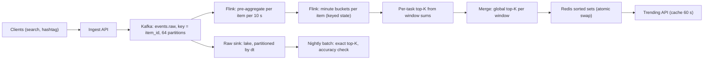

## 🎯 خلاصه

> **مسئله:** یک سیستم بساز که برای یک جریان حدود یک میلیارد رویداد در روز، **K بالاترین آیتم** (K = 100) بر اساس تعداد رویداد را در چند پنجره (۵ دقیقه‌ی اخیر، یک ساعت اخیر، ۲۴ ساعت اخیر) نشان دهد. فهرست تقریباً هر دقیقه به‌روز شود و خواندنش زیر ۱۰۰ میلی‌ثانیه باشد.

- **جریان را بر اساس کلید آیتم partition کن.** رویدادهای هر آیتم روی یک task می‌افتند، پس فهرست‌های top-K محلی از هم جدا هستند و top-K سراسری فقط بهترین K نتیجه‌ی محلی است. در این مقیاس دقت کامل به‌دست می‌آید.
- شمارش را در **bucketهای یک‌دقیقه‌ای** انجام بده، برای هر پنجره bucketها را جمع بزن، و در هر partition یک **heap** از K بهترین نگه دار.
- **Count-Min Sketch (CMS)** ابزار وقتی است که تعداد کلیدهای متمایز منفجر شود (مثلاً آیتم × کشور × ساعت). خطای آن **مطلق** است، یعنی `ε × N`، پس ε را بر اساس کوچک‌ترین تعدادی که باید درست رتبه‌بندی شود تعیین کن، نه بر اساس حافظه.
- نتیجه را از یک **sorted set** سرو کن که هر دقیقه به‌صورت اتمیک جایگزین می‌شود، تا خواننده‌ها هرگز فهرست نیمه‌نوشته نبینند.

## 🌱 از ساده شروع کنیم (مبتدی)

> **💡 تشبیه:** یک مدرسه اعلام می‌کند ۱۰ کتاب پرامانت این هفته. هر کتابدار در میز خودش امانت‌ها را می‌شمارد، ولی هر کتاب فقط به یک میز اختصاص دارد. در پایان هر دقیقه، میزها فهرست ۱۰ کتاب برتر خودشان را گزارش می‌دهند. کتابدار اصلی گزارش‌ها را ادغام می‌کند، و نتیجه ۱۰ کتاب واقعی است، چون هیچ کتابی در دو میز شمرده نشده.

**شرح مسئله.** یک پلتفرم جست‌وجو هر جست‌وجو و هر استفاده از هشتگ را ثبت می‌کند. محصول می‌خواهد یک فهرست «ترند» داشته باشد: ۱۰۰ آیتمی که در ۵ دقیقه‌ی اخیر، یک ساعت اخیر و ۲۴ ساعت اخیر بیشترین رویداد را داشته‌اند. این فهرست در صفحه‌ی اصلی نشان داده می‌شود و تقریباً هر دقیقه به‌روز می‌شود.

**نیازمندی‌های عملکردی**

1. دریافت رویدادهای جست‌وجو و هشتگ.
2. برگرداندن top 100 برای هر پنجره (۵ دقیقه، ۱ ساعت، ۲۴ ساعت).
3. فیلتر اختیاری بر اساس منطقه یا دسته (ذکر می‌شود، ولی جزو طراحی اصلی نیست).
4. شمردن هر رویداد یک‌بار، حتی اگر producer آن را دوباره فرستاده باشد (برای ترند، duplicate تقریبی قابل‌قبول است، ولی باید گفته شود).

**نیازمندی‌های غیرعملکردی**

- **تازگی:** فهرست حداکثر حدود یک دقیقه کهنه باشد.
- **تأخیر:** خواندن در percentile ۹۹ زیر ۱۰۰ میلی‌ثانیه برگردد.
- **دقت:** رتبه‌بندی دقیق باشد یا خطای مشخص‌شده داشته باشد، و بشود آن را با یک job batch سنجید.
- **مقیاس:** ۱ میلیارد رویداد در روز، با اوج ۵ برابر میانگین.
- **دسترس‌پذیری:** ری‌استارت یک broker یا task نباید فهرست را بیش از یک دقیقه از دسترس خارج کند.

اولین چیزی که باید بگویی این است که سخت‌ترین بخش، رتبه‌بندی **پنجره‌ای** با فضای کلید بزرگ و آیتم داغ است، نه خود توان عملیاتی.

## 🔧 واقعاً چطور کار می‌کند (متوسط)

### Step 3: تخمین (محاسبه را نشان بده)

| کمیت | محاسبه | نتیجه |
|---|---|---|
| نرخ میانگین رویداد | 1,000,000,000 / 86,400 s | حدود 11,600 رویداد بر ثانیه |
| نرخ اوج رویداد | 11,600 × 5 | حدود 58,000 رویداد بر ثانیه |
| اندازه‌ی خام رویداد | فرض 100 بایت | 100 B |
| داده‌ی خام در روز | 1,000,000,000 × 100 B | 100 GB در روز |
| retention کافکا، ۷ روز، ۳ replica | 100 GB × 7 × 3 | 2.1 TB |
| آیتم‌های متمایز در روز | فرض | 50 میلیون |
| آیتم‌های متمایز در ساعت | فرض | 10 میلیون |
| رویداد به‌ازای هر آیتم در ساعت (میانگین) | 41.7 M رویداد/ساعت / 10 M آیتم | حدود 4 |
| state دقیق یک‌ساعته با نقشه‌ی پراکنده‌ی دقیقه‌ای | 10 M آیتم × حدود 110 B | حدود 1.1 GB در کل |
| هر task (۶۴ task) | 1.1 GB / 64 | حدود 17 MB |

state دقیق کوچک است. این تصمیم طراحی را عوض می‌کند: در این مقیاس می‌شود دقیق شمرد، و فقط وقتی فضای کلید چند مرتبه‌ی بزرگ‌تر شد به sketch متوسل شد.

### Step 4: مدل داده

- **رویداد خام** (lake، غیرقابل‌تغییر): `event_id`، `item_id`، `item_type`، `region`، `event_time`، `ingest_time`، `dt` (partition).
- **bucket دقیقه‌ای** (state داخلی): کلید `(item_id, minute_start)`، مقدار `count`. ورودی‌ها بعد از ۲۴ ساعت حذف می‌شوند.
- **فهرست سرو** (sorted set در Redis): یک کلید برای هر پنجره، مثلاً `trend:1h`، عضو = `item_id`، امتیاز = تعداد. هر به‌روزرسانی یک کلید موقت می‌نویسد و آن را روی کلید فعال rename می‌کند.
- **جدول ممیزی** (OLAP، برای تحلیل و بررسی دقت): `(window, rank, item_id, count, computed_at)`.

### Step 5: طراحی سطح بالا

مسیر را این‌طور دنبال کن: رویدادها بر اساس آیتم کلیددار می‌شوند، پس شمارش یک آیتم در یک task زندگی می‌کند. pre-aggregation ترافیک آیتم‌های داغ را کم می‌کند. هر دقیقه هر task فهرست top-K محلی‌اش را می‌فرستد، و یک مرحله‌ی ادغام کوچک top-K سراسری را برای هر پنجره انتخاب می‌کند. lake داده‌ی خام را برای محاسبه‌ی دوباره نگه می‌دارد، و job شبانه‌ی batch پاسخ مرجع را می‌دهد.

**پنجره‌بندی.** شمارش را در bucketهای یک‌دقیقه‌ای انجام بده. پنجره‌ی ۵ دقیقه‌ای مجموع ۵ bucket آخر است، پنجره‌ی یک ساعته مجموع ۶۰ bucket، و پنجره‌ی ۲۴ ساعته مجموع ۲۴ جمع ساعتی که از bucketهای دقیقه‌ای ساخته شده. پنجره‌های لغزان هر دقیقه از روی bucketها بازمحاسبه می‌شوند، پس وقتی یک bucket قدیمی منقضی شود از مجموع کم می‌شود.

## 🧠 عمق و trade-offها (سنیور)

### بررسی ۱: شمارش دقیق با partition بر اساس کلید آیتم

partition کردن بر اساس `item_id` مهم‌ترین تصمیم طراحی است. هر partition مجموعه‌ی جدا از آیتم‌ها را نگه می‌دارد، پس:

- شمارش یک آیتم هرگز بین task ها تقسیم نمی‌شود، و نیازی به ادغام شمارش‌های جزئی نیست.
- top-K محلی هر partition، top-K دقیق آیتم‌های همان partition است. top-K سراسری بهترین K نتیجه از ۶۴ فهرست محلی است (۶۴ × ۱۰۰ = ۶٬۴۰۰ کاندید)، و این دقیق است.

هزینه‌ی این کار **skew** است: یک آیتم وایرال همه‌ی رویدادهایش را به یک task می‌فرستد. بررسی ۴ این را حل می‌کند.

### بررسی ۲: انتخاب top-K با heap

برای انتخاب K آیتم برتر از N شمارش، یک min-heap به اندازه‌ی K نگه می‌داری. برای هر آیتم کاندید، اگر شمارشش از کمترین عنصر heap بیشتر باشد، آن کمترین را جایگزین کن. هزینه O(N log K) است. با N = ۳۰۰٬۰۰۰ آیتم در یک partition و K = ۱۰۰، این حدود ۳۰۰٬۰۰۰ × ۷ مقایسه در هر دقیقه است، یعنی ناچیز.

در پنجره‌های **لغزان** دقت کن. شمارش‌ها وقتی bucketهای قدیمی منقضی می‌شوند **کم** می‌شوند. یک heap که فقط افزایش را مدیریت می‌کند، آیتمی را که دیگر داغ نیست در بالا نگه می‌دارد. دو راه‌حل داری:

- هر دقیقه top-K محلی را از روی مجموع پنجره بازمحاسبه کن. این ساده است، و با اندازه‌های بالا ارزان است.
- یا از یک **امتیاز با کاهش نمایی** (`score = score × e^(−λΔt) + 1`) استفاده کن. این امتیاز بین به‌روزرسانی‌ها O(1) state می‌خواهد و فقط افزایش دارد، پس heap درست می‌ماند. هزینه‌اش این است که پنجره یک نیم‌عمر است، نه یک مرز سخت.

### بررسی ۳: Count-Min Sketch وقتی فضای کلید منفجر می‌شود

فرض کن حالا محصول به top آیتم‌ها **به‌ازای هر کشور در هر ساعت** نیاز دارد، با ۲۰۰ کشور و ۱۰ میلیارد جفت آیتم-کشور. نقشه‌های دقیق دیگر جا نمی‌شوند. یک CMS یک تقریب با اندازه‌ی ثابت می‌دهد:

- جدولی با `d` ردیف و `w` ستون از شمارنده‌ها. هر رویداد به ازای هر ردیف یک خانه را، با یک هش متفاوت، یک واحد زیاد می‌کند.
- تخمین یک آیتم، **کمینه‌ی** `d` خانه‌ی آن است. برخورد هش‌ها فقط شمارش را زیاد می‌کند، پس تخمین هرگز کمتر از مقدار واقعی نیست و بیشتر شدنش کران دارد.
- اندازه‌گیری: `w = ⌈e / ε⌉`، `d = ⌈ln(1/δ)⌉`. تضمین این است: تخمین ≤ مقدار واقعی + ε·N، با احتمال حداقل ۱ − δ، که N کل شمارش در پنجره است.

| ε | w | d | حافظه (شمارنده‌ی ۴ بایتی) | حداکثر خطا در ساعت (N = 41.7 M) |
|---|---|---|---|---|
| 10⁻⁴ | 27,183 | 5 | حدود 0.54 MB | حدود 4,170 |
| 10⁻⁵ | 271,829 | 5 | حدود 5.4 MB | حدود 417 |

(برای δ = 0.01، مقدار `d = ⌈ln 100⌉ = 5` است.)

نکته‌ی کلیدی این است که خطا **مطلق** است. اگر صدمین آیتم ساعت حدود ۲۰٬۰۰۰ رویداد داشته باشد، خطای ۴٬۱۷۰ حدود ۲۰ درصد است و می‌تواند ترتیب فهرست را عوض کند. با ε = 10⁻⁵ خطا حدود ۲ درصد است. پس ε را از کوچک‌ترین تعدادی انتخاب کن که باید درست رتبه‌بندی شود، و بعد هزینه‌ی حافظه‌اش را بپرداز.

دو نکته‌ی دیگر. **به‌روزرسانی محافظه‌کارانه** (فقط خانه‌هایی را زیاد کن که برابر کمینه‌ی فعلی‌اند) بیش‌برآوردی را کم می‌کند. و CMS **قابل ادغام** است: جمع دو sketch خانه‌به‌خانه، sketch اجتماع را می‌دهد، و همین‌طور sketchهای دقیقه‌ای را به یک پنجره تبدیل می‌کنی. کنار sketch یک heap از شناسه‌های کاندید نگه دار، چون CMS می‌تواند شمارش را تخمین بزند ولی به‌تنهایی آیتم‌های سنگین را فهرست نمی‌کند.

اگر به شمارش **متمایز** (کاربران یکتا) نیاز داری، CMS ابزار اشتباهی است؛ [[hyperloglog]] و [[design-unique-counts]] را ببین.

### بررسی ۴: آیتم‌های داغ و skew

یک هشتگ وایرال می‌تواند ۳۰ درصد کل رویدادها را بگیرد. partition آن گلوگاه می‌شود، و state اش هم با بقیه فرق دارد.

- **قبل از shuffle، pre-aggregate کن.** یک پنجره‌ی ۱۰ ثانیه‌ای برای هر آیتم، میلیون‌ها رویداد آیتم داغ را به یک رکورد در هر ۱۰ ثانیه تبدیل می‌کند. این ارزان‌ترین و مؤثرترین راه است.
- **تجمیع دو مرحله‌ای با salting** (برای حالت نادری که pre-aggregation کافی نیست): کلید داغ را به زیرکلید تقسیم کن، هر زیرکلید را جداگانه تجمیع کن، و بعد جمع بزن. [[pattern-hot-keys]] و [[salting]] را ببین.
- تأخیر بزرگ‌ترین partition را پایش کن، نه میانگین را.

### بررسی ۵: سرو کردن و تازگی

هر دقیقه job آیتم‌های K برتر هر پنجره را در یک sorted set **موقت** می‌نویسد و بعد آن را روی کلید فعال rename می‌کند. `RENAME` کلید را در یک مرحله جایگزین می‌کند، پس خواننده یا فهرست قدیمی کامل را می‌بیند یا فهرست جدید کامل را، نه نیمه‌نوشته را. API پاسخ را حدود ۶۰ ثانیه کش می‌کند، پس نرخ خواندن از Redis خیلی کمتر از نرخ درخواست کلاینت‌هاست.

اگر job شکست بخورد، خواننده‌ها آخرین فهرست خوب را می‌بینند. سن فهرست (`computed_at`) را در پاسخ نشان بده تا UI بتواند بگوید «۴ دقیقه پیش به‌روز شد»، نه اینکه داده‌ی کهنه را بی‌صدا نشان دهد.

### بررسی ۶: بازیابی و درستی

job فلینک bucketهای دقیقه‌ای و offsetهای Kafka را checkpoint می‌کند. بعد از شکست از checkpoint دوباره replay می‌کند، و bucketها با همان مقادیر بازنویسی می‌شوند (upsert idempotent روی `(item_id, minute_start)`). job شبانه top-K دقیق را از lake بازمحاسبه می‌کند. هر روز این دو را مقایسه کن: recall در K (چند تا از ۱۰۰ آیتم برتر batch در ۱۰۰ آیتم برتر streaming هستند) و همبستگی رتبه‌ها. وقتی recall زیر آستانه‌ی توافق‌شده رفت، هشدار بده.

## 🧪 امتحان کن

1. محصول می‌خواهد top 100 **به‌ازای هر کشور** (۲۰۰ کشور) را در ساعت اخیر ببیند، با ۱۰ میلیارد جفت آیتم-کشور در روز. بین نقشه‌ی دقیق و CMS انتخاب کن، و حافظه و خطا را برای ε = 10⁻⁵ بگو.
2. یک آیتم داغ در ساعت ۲۰ میلیون رویداد دارد. با pre-aggregation ده‌ثانیه‌ای، task آن در ساعت چند رکورد دریافت می‌کند؟ محاسبه را نشان بده.
3. توضیح بده چرا یک heap ساده‌ی top-K برای یک پنجره‌ی لغزان که در آن شمارش‌ها کم می‌شوند کافی نیست.

راه‌حل‌ها را نشان بده

**1.** نقشه‌های دقیق: ۱۰ میلیارد جفت × چندده بایت یعنی صدها گیگابایت state برای هر پنجره، که برای یک طراحی راحت خیلی بزرگ است. یک CMS با ε = 10⁻⁵ و δ = 0.01 حدود ۵٫۴ MB برای هر sketch مصرف می‌کند (w = 271,829، d = 5، شمارنده‌ی ۴ بایتی). خطای بیشینه در ساعت برابر ε × N است، با N = ۱ میلیارد / ۲۴ ≈ ۴۱٫۷ میلیون، یعنی حدود ۴۱۷ شمارش. برای هر کشور یک heap کاندید نگه دار تا آیتم‌ها فهرست شوند. اگر شمارش آیتم‌های برتر هر کشور خیلی بالاتر از ۴۱۷ باشد، رتبه‌بندی قابل اعتماد است.

**2.** یک ساعت ۳٬۶۰۰ ثانیه دارد، پس ۳٬۶۰۰ / ۱۰ = ۳۶۰ پنجره. pre-aggregation به ازای هر پنجره یک رکورد می‌فرستد، پس task در ساعت ۳۶۰ رکورد دریافت می‌کند به جای ۲۰ میلیون. این کاهشی حدود ۵۵٬۰۰۰ برابری است.

**3.** heap ای که فقط افزایش را پشتیبانی می‌کند فرض می‌کند امتیاز یک آیتم هرگز کم نمی‌شود. در پنجره‌ی لغزان، bucketهای منقضی‌شده شمارش را کم می‌کنند، پس آیتمی می‌تواند از بقیه پایین‌تر برود ولی همچنان بالای heap بماند. راه‌حل این است که هر دقیقه top-K محلی را از روی مجموع پنجره بازمحاسبه کنی، یا از امتیاز کاهشی استفاده کنی که فقط در زمان به‌روزرسانی تغییر می‌کند و بین به‌روزرسانی‌ها یکنواست.

## 💬 گوشه‌ی مصاحبه

- **متوسط:** بر اساس کلید آیتم partition کن، شمارش را در bucketهای دقیقه‌ای انجام بده، یک heap به اندازه‌ی K نگه دار، و از cache یا sorted set سرو کن. توضیح بده چرا برای ۵۰ میلیون آیتم شمارش دقیق خوب است.
- **سنیور:** مشکل کاهش شمارش در پنجره‌ی لغزان و راه‌حلش، pre-aggregation برای آیتم داغ، مبادله‌ی خطای CMS با عدد، انتشار اتمیک نتیجه، و تطبیق با batch شبانه.
- **Staff:** تعریف محصول از «ترند» (حجم یا سرعت)، هزینه‌ی ابعادی مثل منطقه یا دسته (یک CMS برای هر بعد، یا سلسله‌مراتب)، سوءاستفاده و ربات‌ها (فهرست ترند را می‌شود دستکاری کرد؛ تعداد رویداد هر کاربر را برای هر آیتم محدود کن)، سرو چندمنطقه‌ای و failover، و تکامل تعریف پنجره‌ها بدون پردازش دوباره‌ی کامل.

### سؤال‌های تکمیلی که باید انتظارش را داشت

- «چرا هر دقیقه روی warehouse `GROUP BY item ORDER BY count DESC LIMIT 100` نزنیم؟» جواب: درست است، ولی هر دقیقه کل پنجره را با هزینه‌ی بالا اسکن می‌کند و تأخیرش دقیقه‌هاست، نه ثانیه.
- «اگر پستی که ترند شده حذف شود چه؟» جواب: یک رویداد جبرانی (شمارش منفی) را در همان stream کلیددار بفرست، یا تقریب را بپذیر و در batch شبانه اصلاح کن.
- «به‌جای رویداد، کاربران متمایز برای هر هشتگ بشماریم؟» جواب: HyperLogLog را برای هر bucket استفاده کن که مثل CMS قابل ادغام است، و بگو خطایش نسبی است (با اندازه‌ی استاندارد ثبات‌ها حدود ۱ درصد)، نه مطلق.
- «اگر محصول شمارش دقیق و exactly-once برای صورتحساب بخواهد چه؟» جواب: این طراحی برای ترند است، نه صورتحساب. برای صورتحساب از مسیر batch تطبیق‌شده و sink idempotent در [[pattern-exactly-once]] استفاده کن.

## ⚠️ اشتباهات رایج

> **⚠️ توجه:** partition کردن تصادفی جریان (مثلاً round-robin). شمارش یک آیتم بین task ها تقسیم می‌شود و فهرست‌های top-K محلی دیگر نمی‌توانند به یک پاسخ دقیق سراسری ادغام شوند.

> **⚠️ توجه:** استفاده از CMS برای رتبه‌بندی شمارش‌های کوچک. خطایش مطلق است، پس sketchی که برای کل جریان اندازه شده می‌تواند فهرستی با شمارش‌های کوچک را به‌هم بریزد.

- استفاده از یک heap ساده‌ی top-K برای پنجره‌ی لغزان، که باعث می‌شود آیتم‌های منقضی‌شده بالا بمانند.
- نگه داشتن top-K در یک ردیف دیتابیس که با هر رویداد به‌روز می‌شود. این یک نقطه‌ی داغ نوشتن و تقویت زیاد نوشتن می‌سازد. فهرست را هر دقیقه یک‌بار به‌روز کن.
- نادیده گرفتن آیتم داغ تا وقتی که بزرگ‌ترین partition عقب می‌افتد.
- سرو کردن فهرستی بدون زمان‌برچسب، که باعث می‌شود داده‌ی کهنه تازه به نظر برسد.
- شمردن رویدادهای ربات یا تکراری بدون محدودیت به‌ازای هر کاربر، و بعد نامیدن نتیجه «ترند».
- ادعای نتایج دقیق بدون مقایسه‌ی اندازه‌گیری‌شده با job batch.

## ✅ خودت را بسنج

1. چرا partition بر اساس کلید آیتم برای top-K مفید است؟
   - A) نوشتن stream را سریع‌تر می‌کند
   - B) رویدادهای هر آیتم روی یک task هستند، پس فهرست‌های top-K محلی از هم جدا هستند و به top-K دقیق سراسری ادغام می‌شوند
   - C) نیاز به پنجره را از بین می‌برد
   - D) شمارش‌ها را فشرده می‌کند

جواب

**B** — وقتی هیچ آیتمی بین task ها تقسیم نمی‌شود، شمارش جزئی برای ادغام لازم نیست، و بهترین K نتیجه‌ی محلی همان پاسخ سراسری است.

2. در یک Count-Min Sketch، یک query چه چیزی برمی‌گرداند؟

   - A) همیشه شمارش دقیق
   - B) کمینه‌ی شمارنده‌های آن آیتم در `d` ردیف، که هرگز کمتر از مقدار واقعی نیست
   - C) بیشینه‌ی شمارنده‌های آیتم
   - D) یک نمونه‌ی تصادفی از رویدادها

جواب

**B** — برخورد هش‌ها فقط شمارش را زیاد می‌کند، پس کمینه‌ی ردیف‌ها تنگ‌ترین تخمین است. می‌تواند بیش‌برآورد کند ولی کم‌برآورد نمی‌کند.

3. **(سنیور)** باید آیتم‌هایی که حدود ۲۰٬۰۰۰ رویداد در ساعت دارند درست رتبه‌بندی شوند، و N برابر ۴۱٫۷ میلیون است. کدام ε کافی‌ست، و چرا حافظه تصمیم را تعیین نمی‌کند؟

   - A) ε = 10⁻⁴، چون حافظه‌ی کمتری مصرف می‌کند
   - B) ε = 10⁻⁵، چون کران خطایش حدود ۴۱۷ شمارش است، یعنی حدود ۲ درصد از ۲۰٬۰۰۰؛ خطا مطلق است، پس ε باید از شمارش‌هایی که باید رتبه شوند تعیین شود
   - C) هر ε کار می‌کند، چون خطا نسبی است
   - D) ε برای رتبه‌بندی اهمیتی ندارد

جواب

**B** — کران برحسب ε × N و به شمارش مطلق است. خطای ۴٬۱۷۰ روی ۲۰٬۰۰۰ حدود ۲۰ درصد است و می‌تواند فهرست را جابه‌جا کند. هزینه‌ی حافظه‌ی ε = 10⁻⁵ (حدود ۵٫۴ MB برای هر sketch) بهای رتبه‌بندی درست در اینجاست.

4. **(سنیور)** یک heap ترند یک‌ساعته‌ی لغزان آیتمی را نشان می‌دهد که ۴۰ دقیقه پیش دیگر ترند نبود. محتمل‌ترین علت و راه‌حل چیست؟

   - A) partition کافکا خیلی بزرگ است
   - B) heap فقط افزایش را مدیریت می‌کند، پس شمارش‌های منقضی‌شده هرگز از ترتیب heap کم نشدند؛ هر دقیقه از روی مجموع پنجره بازمحاسبه کن یا از امتیاز کاهشی استفاده کن
   - C) کلید Redis rename نشده
   - D) عرض CMS خیلی کم است

جواب

**B** — شمارش آیتم وقتی bucketهای قدیمی منقضی شدند پایین آمد، ولی heap وقتی امتیاز کم می‌شود دوباره مرتب نمی‌شود. بازمحاسبه‌ی top-K محلی از روی مجموع پنجره در هر دقیقه این را حل می‌کند.

5. **(سنیور)** چرا فهرست را با یک کلید موقت و `RENAME` منتشر کنیم، به‌جای به‌روزرسانی درجای sorted set فعال؟

   - A) `RENAME` از `ZADD` سریع‌تر است
   - B) خواننده یا فهرست قدیمی کامل را می‌بیند یا فهرست جدید کامل را، هرگز فهرست نیمه‌نوشته را
   - C) sorted setها قابل به‌روزرسانی نیستند
   - D) Redis برای هر نوشتن نیاز به rename دارد

جواب

**B** — از دید خواننده جایگزینی اتمیک است. بازنویسی درجا می‌تواند ترکیبی از آیتم‌های قدیمی و جدید، یا یک فهرست خالی در حین به‌روزرسانی نشان دهد.

## 🗂️ فلش‌کارت

| جلو | پشت |
|---|---|
| چرا بر اساس کلید آیتم partition کنیم | شمارش هر آیتم روی یک task است، پس فهرست‌های top-K محلی دقیقاً ادغام می‌شوند |
| heap برای top-K | min-heap به اندازه‌ی K؛ انتخاب top K از N شمارش در O(N log K) |
| مشکل پنجره‌ی لغزان برای heap | شمارش‌ها با منقضی شدن bucketها کم می‌شوند؛ بازمحاسبه کن یا امتیاز کاهشی بگیر |
| تخمین CMS | کمینه‌ی `d` ردیف؛ هرگز کمتر از مقدار واقعی؛ ممکن است بیش‌برآورد کند |
| کران خطای CMS | تخمین ≤ مقدار واقعی + ε·N با احتمال حداقل ۱ − δ |
| چرا ε را از شمارش‌های رتبه‌بندی‌شده بگیریم | خطا مطلق است، پس شمارش‌های کوچک به ε کوچک‌تر نیاز دارند |
| sketchهای قابل ادغام | جمع خانه‌به‌خانه‌ی دو sketch، sketch اجتماع را می‌دهد |
| راه‌حل آیتم داغ | pre-aggregation در پنجره‌های کوتاه قبل از shuffle؛ salting فقط در صورت نیاز |
| انتشار اتمیک | یک کلید موقت بنویس و با `RENAME` روی کلید فعال بگذار |
| بررسی دقت | مقایسه‌ی top-K streaming با batch شبانه: recall در K |

## 🔗 ادامه

- [[design-unique-counts]] شمارش متمایز با HyperLogLog را پوشش می‌دهد، ابزار درست وقتی کاربران را می‌شماری، نه رویدادها.
- [[design-leaderboard]] یک مسئله‌ی رتبه‌بندی مرتبط را با sorted setها و الگوی به‌روزرسانی متفاوت حل می‌کند.
- [[pattern-hot-keys]] کاهش skew را با جزئیات توضیح می‌دهد.
- [[pattern-late-data]] و [[streaming-state]] تصمیم‌های پنجره، تأخیر دیررسیدن و اندازه‌ی state پشت bucketهای دقیقه‌ای را پوشش می‌دهند.
- [[probabilistic-ds]] Bloom filter، HyperLogLog، Count-Min Sketch و reservoir sampling را در یک جا خلاصه می‌کند.
